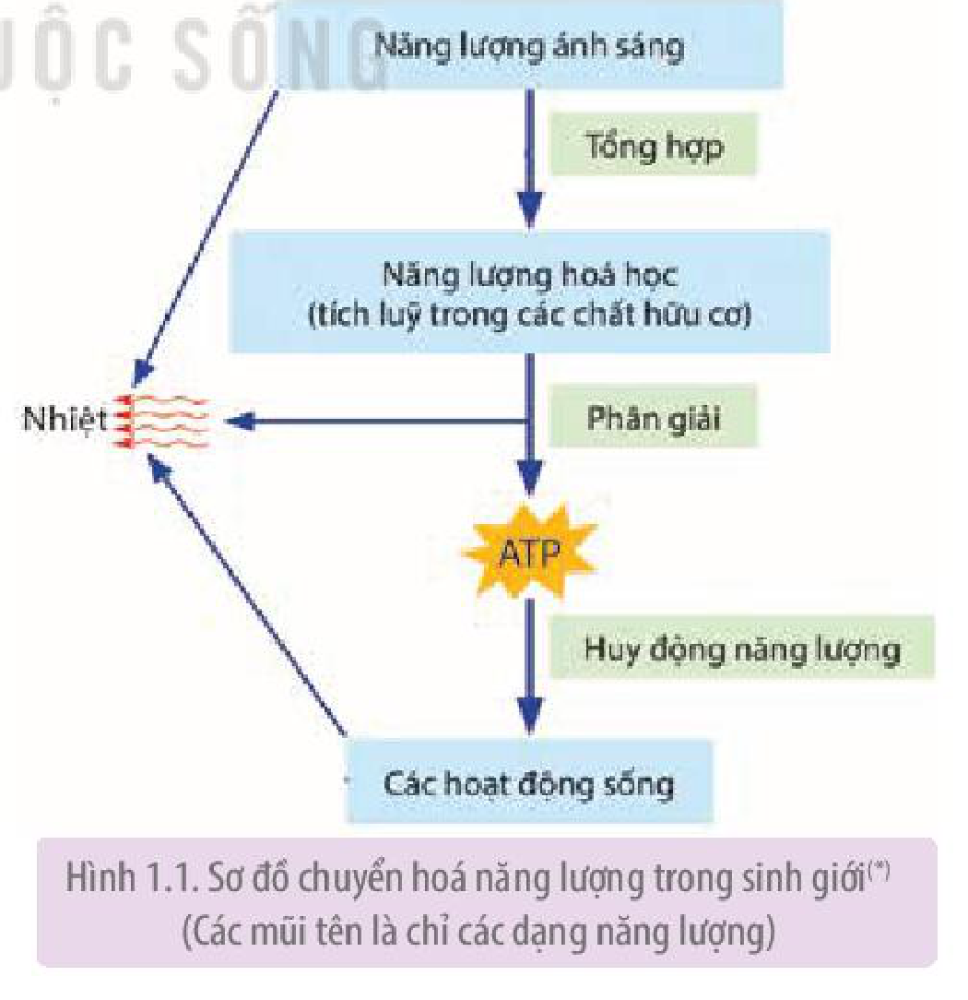
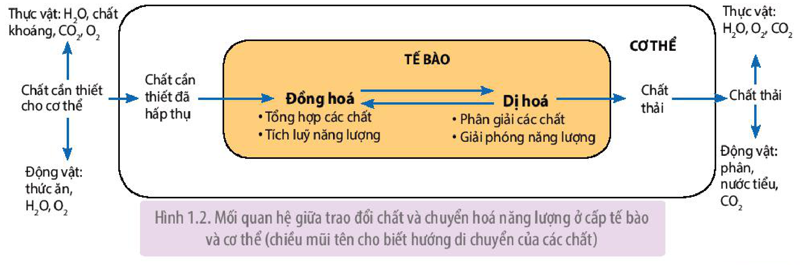

<!-- pdf:6 -->

# BÀI 1: KHÁI QUÁT VỀ TRAO ĐỔI CHẤT VÀ CHUYỂN HOÁ NĂNG LƯỢNG

## 🎯 Yêu cầu cần đạt

- Phân tích được vai trò của trao đổi chất và chuyển hoá năng lượng đối với sinh vật.
- Nêu được các dấu hiệu đặc trưng của trao đổi chất và chuyển hoá năng lượng.
- Dựa vào sơ đồ chuyển hoá năng lượng trong sinh giới, mô tả được tóm tắt ba giai đoạn chuyển hoá năng lượng (tổng hợp, phân giải và huy động năng lượng).
- Trình bày được mối quan hệ giữa trao đổi chất và chuyển hoá năng lượng ở cấp tế bào và cơ thể.
- Nêu được các phương thức trao đổi chất và chuyển hoá năng lượng (tự dưỡng và dị dưỡng). Lấy được ví dụ minh hoạ.
- Nêu được khái niệm tự dưỡng và dị dưỡng.
- Phân tích được vai trò của sinh vật tự dưỡng trong sinh giới.

## 🔴 Mở đầu

Điều gì xảy ra cho cơ thể sinh vật nếu không lấy đủ các chất cần thiết từ môi trường và không thải được các chất thải ra môi trường?

## I. VAI TRÒ CỦA TRAO ĐỔI CHẤT VÀ CHUYỂN HOÁ NĂNG LƯỢNG ĐỐI VỚI SINH VẬT

<!-- term: Trao đổi chất -->
<!-- term: Chuyển hoá năng lượng -->
Sinh vật không thể tồn tại và phát triển nếu không thực hiện trao đổi chất và chuyển hoá năng lượng. Sinh vật lấy các chất từ môi trường cung cấp cho quá trình tạo chất sống của cơ thể, hình thành tế bào, cơ quan, cơ thể, đồng thời tích luỹ và giải phóng năng lượng phục vụ cho các hoạt động sống như vận động, sinh sản, cảm ứng, sinh trưởng và phát triển,...

<!-- term: Trao đổi chất -->
Chất thải, chất độc hại hoặc dư thừa sinh ra từ quá trình chuyển hoá được cơ thể thải ra môi trường. Các chất này nếu ứ đọng lại trong cơ thể sẽ gây rối loạn các hoạt động sống, thậm chí gây tử vong.

<!-- pdf:7 -->

## II. CÁC DẤU HIỆU ĐẶC TRƯNG CỦA TRAO ĐỔI CHẤT VÀ CHUYỂN HOÁ NĂNG LƯỢNG Ở SINH VẬT

Dấu hiệu đặc trưng của trao đổi chất và chuyển hoá năng lượng ở sinh vật thể hiện qua các quá trình dưới đây:

### 1. Tiếp nhận các chất từ môi trường và vận chuyển các chất

<!-- term: Trao đổi chất -->
Thực vật lấy chất khoáng, nước, $\text{CO}_2$ và năng lượng ánh sáng để tổng hợp chất hữu cơ cần thiết cho cơ thể. Hệ vận chuyển đưa các chất hữu cơ đến tế bào cơ thể, đồng thời vận chuyển nước, chất khoáng hấp thụ từ rễ lên lá.

Hầu hết động vật lấy chất dinh dưỡng từ thức ăn nhờ hệ tiêu hoá và lấy $\text{O}_2$ từ không khí nhờ hệ hô hấp. Chất dinh dưỡng và $\text{O}_2$ được vận chuyển đến các tế bào cơ thể nhờ hệ tuần hoàn.

### 2. Biến đổi các chất kèm theo chuyển hoá năng lượng ở tế bào

<!-- term: Trao đổi chất -->
<!-- term: Chuyển hoá năng lượng -->
Các chất tiếp nhận từ môi trường được vận chuyển đến tế bào và tham gia vào quá trình đồng hoá và dị hoá. Quá trình **đồng hoá** tổng hợp chất hữu cơ phức tạp từ các chất đơn giản, kèm theo tích luỹ năng lượng trong các liên kết hoá học. Quá trình **dị hoá** phân giải các chất hữu cơ phức tạp (hình thành trong quá trình đồng hoá) thành các chất đơn giản, kèm theo giải phóng năng lượng từ các liên kết hoá học.

### 3. Thải các chất vào môi trường

<!-- term: Trao đổi chất -->
Các chất không được cơ thể sử dụng, các chất dư thừa, thậm chí độc hại tạo ra từ quá trình chuyển hoá được cơ thể thải ra môi trường.

Như vậy, cơ thể thực vật cũng như động vật là một hệ thống mở, không ngừng trao đổi chất và năng lượng với môi trường sống.

Quá trình trao đổi chất và năng lượng luôn được điều chỉnh, phù hợp với nhu cầu của cơ thể.

## III. CÁC GIAI ĐOẠN CHUYỂN HOÁ NĂNG LƯỢNG TRONG SINH GIỚI

Từ sơ đồ chuyển hoá năng lượng trong sinh giới (H 1.1), có thể chia quá trình chuyển hoá năng lượng làm 3 giai đoạn: tổng hợp, phân giải và huy động năng lượng.

Hình 1.1. Sơ đồ chuyển hoá năng lượng trong sinh giới(*) (Các mũi tên là chỉ các dạng năng lượng)

### 1. Giai đoạn tổng hợp

Nguồn năng lượng khởi đầu trong sinh giới là năng lượng ánh sáng mặt trời (**quang năng**). Chất diệp lục của cây xanh thu nhận quang năng để tổng hợp chất hữu cơ từ các phân tử $\text{CO}_2$ và nước. Như vậy, cây xanh đã chuyển hoá quang năng thành **hoá năng** tích luỹ trong các liên kết hoá học ở các phân tử hữu cơ.

> (\*) Nguồn: Sinh học - Campbell và cộng sự, 2017

<!-- pdf:8 -->

Động vật không có khả năng nhận năng lượng trực tiếp từ ánh sáng mặt trời để tổng hợp chất hữu cơ, chúng lấy năng lượng (hoá năng) sẵn có trong thức ăn.

### 2. Giai đoạn phân giải

<!-- term: Hô hấp -->
Các liên kết hoá học trong phân tử hữu cơ chứa năng lượng ở dạng thế năng, nhờ quá trình hô hấp mà thế năng này biến đổi thành động năng.

<!-- term: ATP -->
Nhìn bề ngoài hô hấp lấy $\text{O}_2$ và thải $\text{CO}_2$, nhưng thực chất đó là những phản ứng biến đổi vật chất kèm theo sự biến đổi về năng lượng trong tế bào. Quá trình hô hấp làm biến đổi các phân tử lớn (carbohydrate, lipid, protein) thành các phân tử nhỏ hơn, đồng thời, năng lượng hoá học tích luỹ trong các liên kết hoá học ở các phân tử lớn chuyển sang năng lượng hoá học tích luỹ trong các liên kết hoá học của các phân tử nhỏ ở dạng dễ chuyển đổi và sử dụng (ví dụ: ATP, NADH,...).

### 3. Giai đoạn huy động năng lượng

<!-- term: ATP -->
Năng lượng tạo ra từ hô hấp tế bào (chủ yếu là ATP) được sử dụng cho các hoạt động sống như tổng hợp chất sống, vận động, sinh sản, cảm ứng, sinh trưởng và phát triển,... Các liên kết giữa các gốc phosphate trong phân tử ATP sẽ bị phá vỡ, giải phóng năng lượng. Các dạng năng lượng khác nhau cuối cùng đều chuyển thành **nhiệt năng** và toả vào môi trường.

## ❓ Dừng lại và suy ngẫm

1. Trao đổi chất và chuyển hoá năng lượng có vai trò như thế nào đối với sinh vật?
2. Những dấu hiệu nào cho thấy trao đổi chất và chuyển hoá năng lượng diễn ra ở sinh vật?
3. Dựa vào Hình 1.1, mô tả tóm tắt quá trình chuyển hoá năng lượng trong sinh giới (bắt đầu từ năng lượng ánh sáng).

## IV. MỐI QUAN HỆ GIỮA TRAO ĐỔI CHẤT VÀ CHUYỂN HOÁ NĂNG LƯỢNG Ở CẤP TẾ BÀO VÀ CƠ THỂ

<!-- term: Chuyển hoá năng lượng -->
Chất dinh dưỡng cơ thể lấy vào được chuyển tới tế bào. Tại đây các chất tham gia vào quá trình đồng hoá tổng hợp nên chất hữu cơ xây dựng cơ thể và dự trữ năng lượng. Một phần chất hữu cơ được phân giải, giải phóng năng lượng cung cấp cho các hoạt động sống của tế bào và cơ thể. Chất thải sinh ra từ quá trình dị hoá tế bào được thải ra ngoài môi trường.

Mối quan hệ giữa trao đổi chất và chuyển hoá năng lượng ở cấp độ tế bào và cơ thể sinh vật được thể hiện ở Hình 1.2.

Hình 1.2. Mối quan hệ giữa trao đổi chất và chuyển hoá năng lượng ở cấp tế bào và cơ thể (chiều mũi tên cho biết hướng di chuyển của các chất)

<!-- pdf:9 -->

## V. CÁC PHƯƠNG THỨC TRAO ĐỔI CHẤT VÀ CHUYỂN HOÁ NĂNG LƯỢNG

Phương thức trao đổi chất và chuyển hoá năng lượng ở sinh vật là tự dưỡng hoặc dị dưỡng.

### 1. Tự dưỡng

<!-- term: Tự dưỡng -->
Tự dưỡng gồm quang tự dưỡng và hoá tự dưỡng.

<!-- term: Tự dưỡng -->
**Quang tự dưỡng** là phương thức sinh vật sử dụng chất vô cơ, nước, $\text{CO}_2$ và năng lượng ánh sáng để tổng hợp nên các chất hữu cơ cần thiết cho cơ thể và tích luỹ năng lượng. Thực vật là sinh vật quang tự dưỡng điển hình.

<!-- term: Tự dưỡng -->
**Hoá tự dưỡng** là phương thức sinh vật sử dụng nguồn carbon (chủ yếu là $\text{CO}_2$) và nguồn năng lượng từ chất vô cơ như $\text{H}_2\text{S}$, $\text{NO}_3^-$, $\text{NH}_4^+$,... để tổng hợp nên các chất hữu cơ và tích luỹ năng lượng. Một số vi khuẩn là sinh vật hoá tự dưỡng.

Vai trò của sinh vật tự dưỡng trong sinh giới:

- Cung cấp $\text{O}_2$, đảm bảo cho hoạt động sống của hầu hết sinh vật.
- Cung cấp thức ăn, nơi ở và nơi sinh sản cho động vật.
- Điều hoà khí hậu: tạo nhiệt độ, độ ẩm thuận lợi cho sự tồn tại và phát triển của sinh vật.

### 2. Dị dưỡng

**Dị dưỡng** là phương thức sinh vật lấy chất hữu cơ trực tiếp từ sinh vật tự dưỡng hoặc từ động vật khác, thông qua tiêu hoá, hấp thụ và đồng hoá các chất để xây dựng cơ thể, tích luỹ và sử dụng năng lượng cho mọi hoạt động sống. Động vật là sinh vật dị dưỡng điển hình.

## ❓ Dừng lại và suy ngẫm

1. Nghiên cứu Hình 1.2, trình bày mối liên quan giữa trao đổi chất và chuyển hoá năng lượng ở cấp tế bào và cơ thể sinh vật.
2. Tại sao gọi thực vật là sinh vật tự dưỡng và động vật là sinh vật dị dưỡng?
3. Phân tích vai trò của sinh vật tự dưỡng trong sinh giới.

## 📌 Kiến thức cốt lõi

- Trao đổi chất và chuyển hoá năng lượng giúp sinh vật tồn tại và phát triển.
- Các dấu hiệu đặc trưng của trao đổi chất và chuyển hoá năng lượng ở sinh vật gồm: tiếp nhận, vận chuyển các chất từ môi trường sống, chuyển hoá các chất kèm theo chuyển hoá năng lượng ở tế bào và thải các chất thải vào môi trường.
- Chuyển hoá năng lượng trong sinh giới gồm 3 giai đoạn: tổng hợp, phân giải và huy động năng lượng.
- Trao đổi chất và chuyển hoá năng lượng ở cấp tế bào và cơ thể sinh vật liên quan chặt chẽ với nhau.
- Trao đổi chất và chuyển hoá năng lượng ở cấp độ tế bào là cơ sở cho quá trình trao đổi chất và chuyển hoá năng lượng của cơ thể sinh vật.
- Phương thức trao đổi chất và chuyển hoá năng lượng ở sinh vật là tự dưỡng và dị dưỡng.

## ✏️ Luyện tập và vận dụng

1. Cho biết những chất nào được cơ thể thực vật, động vật lấy từ môi trường sống và đưa đến tế bào cơ thể sử dụng cho đồng hoá, dị hoá; Những chất thải nào sinh ra từ quá trình chuyển hoá được cơ thể thải ra môi trường.
2. Quá trình trao đổi chất giữa cơ thể và môi trường bị rối loạn sẽ ảnh hưởng như thế nào đến cơ thể? Làm thế nào để quá trình trao đổi chất giữa cơ thể và môi trường diễn ra thuận lợi?

## 📷 Danh sách hình trong bài

| Mã hình | Trang PDF | Vị trí | Chú thích gốc |
|---|---|---|---|
| H11-sinh-b01-01 | 7 | Mục III | Hình 1.1. Sơ đồ chuyển hoá năng lượng trong sinh giới(*) (Các mũi tên là chỉ các dạng năng lượng) |
| H11-sinh-b01-02 | 8 | Mục IV | Hình 1.2. Mối quan hệ giữa trao đổi chất và chuyển hoá năng lượng ở cấp tế bào và cơ thể (chiều mũi tên cho biết hướng di chuyển của các chất) |
