<!-- pdf:10 -->

# BÀI 2: TRAO ĐỔI NƯỚC VÀ KHOÁNG Ở THỰC VẬT

## 🎯 Yêu cầu cần đạt

- Trình bày được vai trò của nước đối với thực vật và mô tả được ba giai đoạn của quá trình trao đổi nước trong cây gồm: hấp thụ nước ở rễ, vận chuyển nước ở thân và thoát hơi nước ở lá.
- Trình bày được cơ chế hấp thụ nước và khoáng ở tế bào lông hút của rễ.
- Nêu được sự vận chuyển các chất trong cây theo hai dòng: dòng mạch gỗ và dòng mạch rây. Nêu được vai trò của sự vận chuyển các chất hữu cơ trong mạch rây.
- Trình bày được vai trò của quá trình thoát hơi nước và nêu được cơ chế đóng mở của khí khổng.
- Nêu được khái niệm dinh dưỡng ở thực vật và vai trò sinh lí của một số nguyên tố khoáng đa lượng và vi lượng đối với thực vật. Quan sát và nhận biết được một số biểu hiện của cây do thiếu khoáng.
- Nêu được nguồn cung cấp nitrogen cho cây. Trình bày được quá trình hấp thụ và biến đổi nitrate và ammonium ở thực vật.
- Phân tích được một số nhân tố ảnh hưởng đến trao đổi nước và quá trình dinh dưỡng khoáng ở thực vật.
- Giải thích được sự cân bằng nước và tưới tiêu hợp lí, phân tích được vai trò của phân bón đối với năng suất cây trồng.

## 🔴 Mở đầu

Nước và chất khoáng có vai trò gì đối với thực vật? Chúng được thực vật hấp thụ và sử dụng như thế nào?

## I. VAI TRÒ CỦA NƯỚC VÀ CHẤT KHOÁNG

Nước, chất khoáng là những chất dinh dưỡng của thực vật. **Dinh dưỡng ở thực vật** là quá trình hấp thụ nước, chất khoáng và đồng hoá chúng thành chất sống của cơ thể thực vật.

### 1. Vai trò của nước

Nước chiếm khoảng 70 – 90% khối lượng tươi của thực vật. Nước tham gia vào thành phần cấu tạo của tế bào và chi phối các quá trình sinh lí diễn ra trong cây, vai trò cụ thể của nước được thể hiện trong sơ đồ dưới đây:

- **VAI TRÒ CỦA NƯỚC:**
  1. Là thành phần cấu tạo của tế bào
  2. Là dung môi hoà tan các chất, tham gia vào quá trình vận chuyển vật chất trong cây
  3. Là nguyên liệu, môi trường của các phản ứng sinh hoá
  4. Điều hoà nhiệt độ của cơ thể thực vật

<!-- pdf:11 -->

### 2. Vai trò của các nguyên tố khoáng

<!-- term: Nguyên tố khoáng thiết yếu -->
Trong thành phần cấu tạo của cơ thể thực vật có hơn $50^{(*)}$ nguyên tố, nhưng chỉ có khoảng $17^{(*)}$ nguyên tố được xem là thiết yếu với cây. Đó là những nguyên tố mà khi thiếu chúng cây sẽ không hoàn thành được chu kì sống của mình.

<!-- term: Nguyên tố đa lượng -->
<!-- term: Nguyên tố vi lượng -->
Trong cây, các nguyên tố khoáng thiết yếu có hai vai trò chính, đó là: cấu trúc nên các thành phần của tế bào và điều tiết các quá trình sinh lí. Bảng 2.1 dưới đây thể hiện vai trò của một số nguyên tố đa lượng và vi lượng.

**Bảng 2.1.** Vai trò của một số nguyên tố khoáng thiết yếu đối với thực vật$^{(*\*)}$

| Nguyên tố | Dạng hấp thụ | Vai trò |
|---|---|---|
| **Các nguyên tố đa lượng** | | |
| Calcium (Ca) | $\text{Ca}^{2+}$ | Thành phần của thành tế bào, hoạt hoá enzyme thuỷ phân ATP và phospholipid. |
| Magnesium (Mg) | $\text{Mg}^{2+}$ | Thành phần của diệp lục, tham gia hoạt hoá enzyme liên quan đến sự vận chuyển gốc phosphate. |
| Nitrogen (N) | $\text{NO}_3^-, \text{NH}_4^+$ | Thành phần của nhiều hợp chất hữu cơ. |
| Phosphorus (P) | $\text{PO}_4^{3-}, \text{H}_2\text{PO}_4^-$ | Thành phần của nucleic acid, phospholipid, ATP và một số coenzyme,... |
| Potassium (K) | $\text{K}^+$ | Điều tiết áp suất thẩm thấu của tế bào, tham gia thúc đẩy quá trình vận chuyển sản phẩm quang hợp về cơ quan dự trữ. |
| Sulfur (S) | $\text{SO}_4^{2-}$ | Thành phần cấu tạo của protein, coenzyme,... |
| **Các nguyên tố vi lượng** | | |
| Chlorine (Cl) | $\text{Cl}^-$ | Tham gia vào quá trình quang phân li nước trong quang hợp và có chức năng cân bằng nước trong cây. |
| Iron (Fe) | $\text{Fe}^{2+}, \text{Fe}^{3+}$ | Thành phần của cytochrome, hoạt hoá các enzyme của quá trình tổng hợp diệp lục. |
| Manganese (Mn) | $\text{Mn}^{2+}$ | Thành phần cấu trúc của một số enzyme oxy hoá khử, đồng thời hoạt hoá các enzyme của quá trình quang hợp,... |
| Molybdenum (Mo) | $\text{MoO}_4^{2-}$ | Tham gia vào quá trình dinh dưỡng nitrogen ở thực vật như cố định $\text{N}_2$, quá trình khử nitrate. |
| Zinc (Zn) | $\text{Zn}^{2+}$ | Tham gia vào quá trình hình thành diệp lục, hoạt hoá một số enzyme xúc tác cho các phản ứng quang hợp, hô hấp,... |

Hậu quả của thừa hoặc thiếu nguyên tố khoáng thường được biểu hiện thành các triệu chứng quan sát thấy trên cây như hiện tượng biến màu, biến dạng của lá, thân, quả,... (H 2.1).

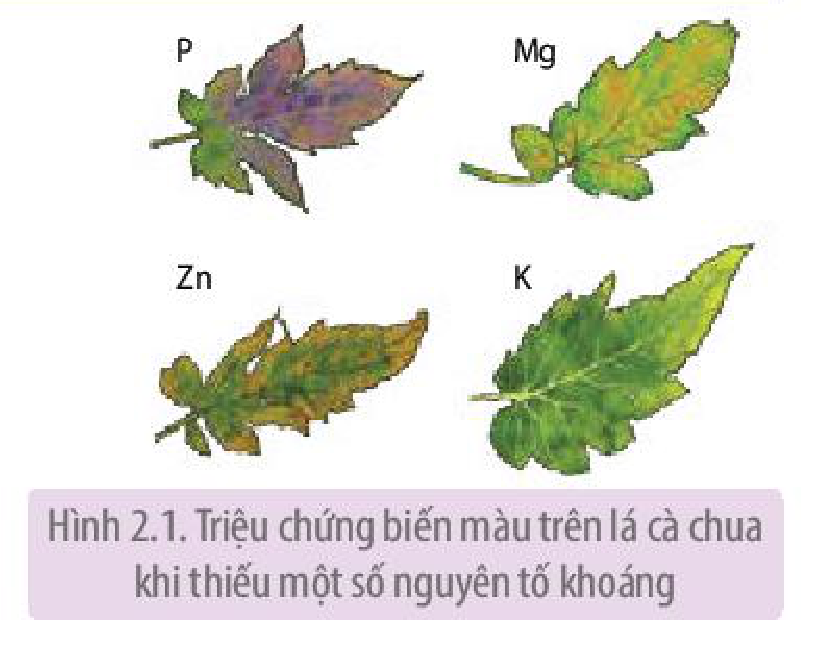

Hình 2.1. Triệu chứng biến màu trên lá cà chua khi thiếu một số nguyên tố khoáng

> \* Nguồn: Sinh học, N.A. Campbell và cộng sự, 2016.
> \*\* Nguồn: Plant physiology, L.Taiz & E.Zeiger, 2014.

<!-- pdf:12 -->

## II. QUÁ TRÌNH TRAO ĐỔI NƯỚC VÀ KHOÁNG Ở THỰC VẬT

Trao đổi nước ở cơ thể thực vật diễn ra theo ba giai đoạn: hấp thụ nước ở rễ, vận chuyển nước ở thân và thoát hơi nước ở lá (H 2.2). Nguyên tố khoáng hoà tan trong nước, do vậy trao đổi khoáng đi kèm với trao đổi nước.

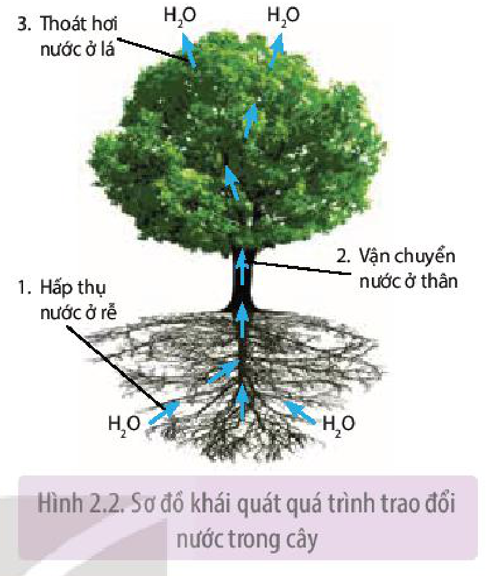

Hình 2.2. Sơ đồ khái quát quá trình trao đổi nước trong cây

### 1. Hấp thụ nước và khoáng ở rễ

Thực vật trên cạn hấp thụ nước và khoáng từ đất chủ yếu qua rễ nhờ các **lông hút**. Thực vật thuỷ sinh hấp thụ nước và khoáng từ môi trường nước qua tế bào biểu bì của hầu hết các cơ quan.

Rễ có hình thái và cấu tạo phù hợp với chức năng hút nước và khoáng (H 2.3).

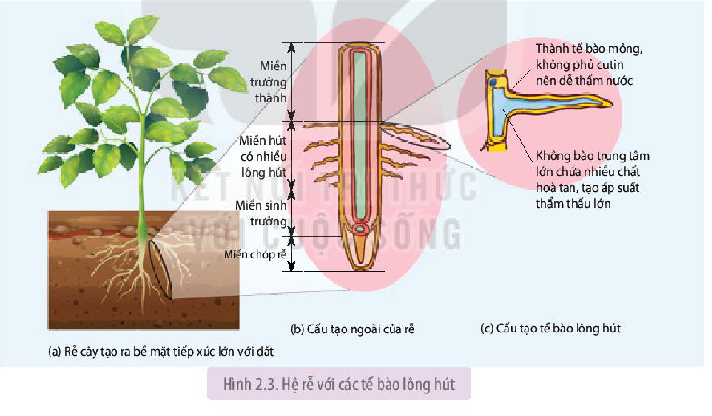

Hình 2.3. Hệ rễ với các tế bào lông hút

**a) Hấp thụ nước ở tế bào lông hút**

Rễ hấp thụ nước từ đất theo cơ chế thẩm thấu: Dịch tế bào biểu bì lông hút của rễ có nồng độ chất tan cao hơn so với dịch trong đất, nghĩa là ưu trương so với dịch trong đất, nên nước sẽ di chuyển từ đất vào tế bào lông hút.

Nồng độ chất tan trong tế bào thực vật duy trì ở mức cao do hai nguyên nhân: (1) Rễ hấp thụ các ion khoáng từ đất và tích luỹ các chất tan từ quá trình chuyển hoá vật chất, (2) Quá trình thoát hơi nước ở lá làm giảm hàm lượng nước ở các tế bào phía dưới, trong đó có tế bào lông hút.

<!-- pdf:13 -->

**b) Hấp thụ khoáng ở tế bào lông hút**

Rễ hấp thụ khoáng theo hai cơ chế: thụ động và chủ động.

<!-- term: Hấp thụ thụ động -->
Cơ chế thụ động: Chất khoáng hoà tan trong đất khuếch tán từ đất (nơi có nồng độ chất khoáng cao) vào rễ (nơi nồng độ chất khoáng thấp).

<!-- term: Hấp thụ chủ động -->
Cơ chế chủ động: Chất khoáng được vận chuyển từ đất vào rễ ngược chiều gradient nồng độ, nhờ các chất mang được hoạt hoá bằng năng lượng.

**c) Vận chuyển nước và chất khoáng từ lông hút vào mạch gỗ của rễ**

Nước và các chất khoáng được vận chuyển từ lông hút vào mạch gỗ của rễ theo hai con đường: con đường gian bào và con đường tế bào chất (H 2.4).

<!-- term: Con đường gian bào -->
<!-- term: Vành đai Caspary -->
- Con đường gian bào: Nước và chất khoáng di chuyển qua thành tế bào và dọc theo không gian giữa các tế bào (gian bào), qua lớp vỏ đến nội bì gặp vành **đai Caspary** không thấm nước nên nước và chất khoáng phải xuyên qua lớp màng tế bào nội bì. Kết quả là thực vật có thể kiểm soát được lượng chất khoáng đi vào mạch gỗ của cây.

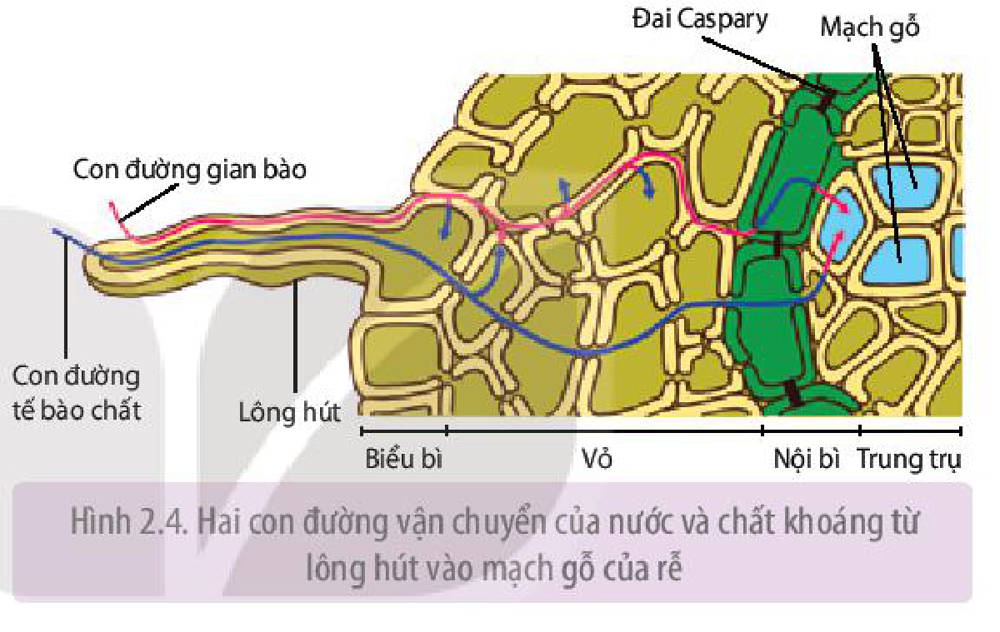

Hình 2.4. Hai con đường vận chuyển của nước và chất khoáng từ lông hút vào mạch gỗ của rễ

<!-- term: Con đường tế bào chất -->
- Con đường tế bào chất: Sau khi vào tế bào lông hút, nước và chất khoáng sẽ di chuyển từ tế bào chất của tế bào lông hút, qua tế bào chất của các lớp tế bào trong rễ thông qua hệ thống cầu sinh chất và vào mạch gỗ ở trung trụ.

### 2. Vận chuyển nước và các chất trong thân

**a) Dòng mạch gỗ**

<!-- term: Mạch gỗ -->
- Nước và chất khoáng từ rễ, qua thân, lên lá theo mạch gỗ.

<!-- term: Mạch gỗ -->
<!-- term: Quản bào -->
<!-- term: Mạch ống -->
- Mạch gỗ (xylem) được cấu tạo từ hai loại tế bào là quản bào và mạch ống (H 2.5a). Chúng là các tế bào chết, chỉ còn lại thành tế bào đã thấm lignin (hoá gỗ). Mạch ống có bề ngang rộng hơn, nhưng chiều dài ngắn hơn so với quản bào. Cách sắp xếp của mạch ống và quản bào trong mạch gỗ tương tự nhau. Cụ thể, các tế bào xếp chồng lên nhau theo chiều thẳng đứng, thông với nhau qua các lỗ ở đầu tận cùng. Trên quản bào và mạch ống còn có các lỗ bên, khiến dòng mạch gỗ có thể vận chuyển theo chiều ngang.

<!-- term: Lực đẩy -->
<!-- term: Lực hút -->
<!-- term: Lực liên kết -->
- Dịch mạch gỗ với thành phần chính là nước, chất khoáng và một số chất hoà tan khác như đường, amino acid, hormone, alkaloid, acid hữu cơ,... được vận chuyển thành dòng liên tục trong mạch gỗ nhờ sự kết hợp của ba lực chính (H 2.5b).

<!-- pdf:14 -->

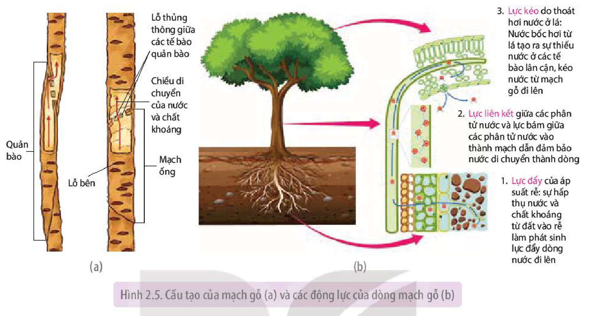

Hình 2.5. Cấu tạo của mạch gỗ (a) và các động lực của dòng mạch gỗ (b)

Nhờ các động lực này, dòng mạch gỗ có thể vận chuyển lên độ cao hàng trăm mét, tương ứng với chiều cao của các cây gỗ lớn. Bất kì tác động nào ảnh hưởng hoặc loại bỏ các động lực của dòng mạch gỗ cũng có thể làm ngắt quãng dòng nước vận chuyển trong thân.

**b) Dòng mạch rây**

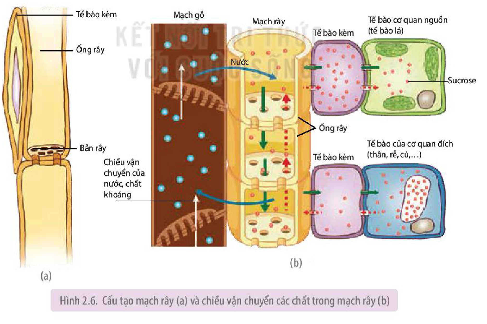

Hình 2.6. Cấu tạo mạch rây (a) và chiều vận chuyển các chất trong mạch rây (b)

<!-- pdf:15 -->

<!-- term: Mạch rây -->
- Khác với kiểu vận chuyển một chiều ở mạch gỗ, trong mạch rây, các chất vận chuyển (dịch mạch rây) có thể di chuyển theo hai hướng, từ lá xuống rễ hoặc ngược lại tuỳ thuộc vào vị trí của cơ quan nguồn so với cơ quan đích.

<!-- term: Mạch rây -->
<!-- term: Ống rây -->
<!-- term: Tế bào kèm -->
- Mạch rây (phloem) cấu tạo từ các tế bào ống rây và tế bào kèm (H 2.6a). Các tế bào ống rây xếp chồng lên nhau theo chiều thẳng đứng và thông với nhau qua các lỗ ở hai đầu của tế bào. Các tế bào kèm nằm dọc theo các ống rây, cung cấp năng lượng và nguyên liệu duy trì sự sống cho các tế bào ống rây.

<!-- term: Mạch rây -->
- Dịch mạch rây có thành phần chính là đường sucrose, ngoài ra còn có các amino acid, hormone, chất khoáng,... Dịch mạch rây được vận chuyển từ cơ quan nguồn (lá) đến cơ quan đích hay cơ quan dự trữ (rễ) hoặc ngược lại, từ cơ quan dự trữ (củ) lên cơ quan sử dụng (lá non, chồi non) xuôi theo chiều gradient nồng độ của các chất vận chuyển (H 2.6b). Mạch rây còn nhận nước từ mạch gỗ chuyển sang, đảm bảo cho quá trình vận chuyển chất tan diễn ra thuận lợi.

### 3. Thoát hơi nước ở lá

**Thoát hơi nước** là sự bay hơi của nước qua bề mặt cơ thể thực vật vào khí quyển. Trong đó, lá là cơ quan thoát hơi nước chủ yếu. Thoát hơi nước ở lá diễn ra theo hai con đường: qua bề mặt lá và qua khí khổng, trong đó thoát hơi nước qua khí khổng là chủ yếu.

**a) Thoát hơi nước qua bề mặt lá**

<!-- term: Cutin -->
Lượng hơi nước thoát qua bề mặt lá phụ thuộc vào độ dày tầng cutin và diện tích lá. Ở cây non, lượng nước thoát hơi qua bề mặt lá tương đương với qua khí khổng do lớp cutin bao phủ phiến lá còn mỏng. Khi cây trưởng thành, tầng cutin dày lên, lượng nước thoát qua bề mặt chỉ chiếm 10 – 20%. Lá của nhóm thực vật sống ở nơi khô hạn thường có tầng cutin dày làm giảm sự thoát hơi nước, giúp tăng khả năng chịu hạn.

**b) Thoát hơi nước qua khí khổng**

Lượng hơi nước thoát qua khí khổng phụ thuộc vào số lượng, sự phân bố và hoạt động đóng mở của khí khổng.

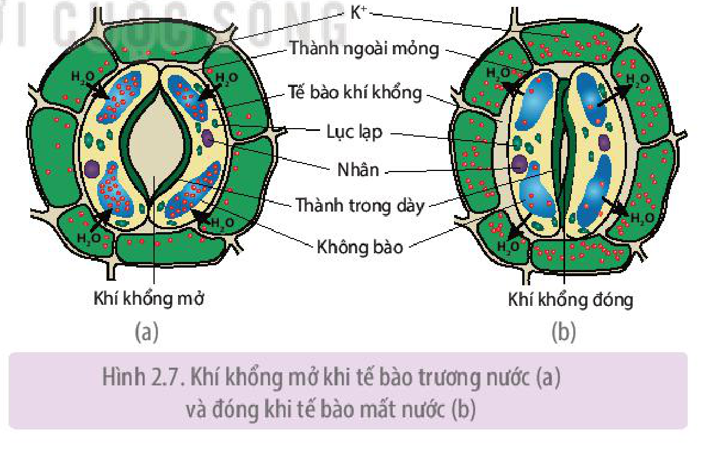

Hình 2.7. Khí khổng mở khi tế bào trương nước (a) và đóng khi tế bào mất nước (b)

**Khí khổng** là khe hở trên bề mặt lớp tế bào biểu bì lá được tạo nên giữa hai tế bào khí khổng. Khí khổng đóng hay mở phụ thuộc vào hàm lượng nước trong hai tế bào này (H 2.7). Cụ thể, do có cấu tạo thành trong dày, thành ngoài mỏng nên khi tế bào khí khổng hút nước (trương nước), thành ngoài dãn nhanh hơn thành trong làm cho khí khổng mở ra; ngược lại, khi tế bào mất nước xẹp xuống thì khí khổng đóng lại. Sự trương nước hay mất nước của tế bào khí khổng được điều tiết bởi hai tác nhân chính đó là ánh sáng và **stress**.

<!-- pdf:16 -->

Ánh sáng thúc đẩy quang hợp làm tăng tổng hợp đường trong tế bào khí khổng và hoạt hoá bơm ion trên màng tế bào khí khổng dẫn đến tăng nồng độ các ion $\text{K}^+$, $\text{NO}_3^-$, $\text{Cl}^-$,... trong tế bào. Kết quả là áp suất thẩm thấu của tế bào khí khổng tăng lên, làm tế bào hút nước và khí khổng mở. Tuy nhiên, nếu cường độ ánh sáng quá mạnh làm tăng nhiệt độ lá, khi đó tế bào khí khổng sẽ bị mất nước và đóng lại.

<!-- term: Abscisic acid -->
Khi thực vật bị stress (ví dụ: hạn hán) cây tăng tổng hợp abscisic acid, hàm lượng acid này tăng thúc đẩy bơm ion bơm $\text{K}^+$ ra khỏi tế bào và làm khí khổng đóng lại, giúp hạn chế mất nước.

**c) Vai trò của thoát hơi nước**

Chỉ khoảng 2% lượng nước được cây hấp thụ sử dụng cho các hoạt động sống, còn lại 98% mất đi qua thoát hơi nước. Lượng nước thoát ra lớn thể hiện vai trò quan trọng của quá trình thoát hơi nước:

<!-- term: Lực hút -->
- Thoát hơi nước ở lá tạo lực hút kéo nước và các chất hoà tan đi theo một chiều từ rễ lên lá.
- Trong quá trình thoát hơi nước, khí khổng mở ra tạo điều kiện để $\text{CO}_2$ từ môi trường khuếch tán vào lá, cung cấp nguyên liệu cho quá trình quang hợp.
- Thoát hơi nước làm giảm nhiệt độ bề mặt của lá, đảm bảo cho lá không bị hư hại, đặc biệt trong những ngày nắng nóng.

## ❓ Dừng lại và suy ngẫm

1. Nước tham gia vào những hoạt động, quá trình sinh lí nào trong đời sống của thực vật?
2. Thực vật hấp thụ nước và ion khoáng theo những cơ chế nào? Làm thế nào để nhận biết được triệu chứng thiếu khoáng ở cây trồng?
3. Trình bày quá trình trao đổi nước và khoáng ở nhóm thực vật trên cạn bằng cách hoàn thành bảng mẫu sau vào vở.

| Giai đoạn | Cơ quan thực hiện | Con đường | Vai trò |
|---|---|---|---|
| Hấp thụ nước và khoáng | ? | ? | ? |
| Vận chuyển nước và khoáng | ? | ? | ? |
| Thoát hơi nước | ? | ? | ? |

4. Thực vật điều tiết quá trình thoát hơi nước theo cơ chế nào?

## III. DINH DƯỠNG NITROGEN

### 1. Vai trò của nitrogen

Nitrogen là nguyên tố đặc biệt quan trọng đối với sự sinh trưởng, phát triển của thực vật, nó vừa có vai trò cấu trúc, vừa giữ chức năng điều tiết nhiều quá trình sinh lí diễn ra trong cây.

- Vai trò cấu trúc: Nitrogen là thành phần của các hợp chất hữu cơ quan trọng như protein, nucleic acid, diệp lục,...

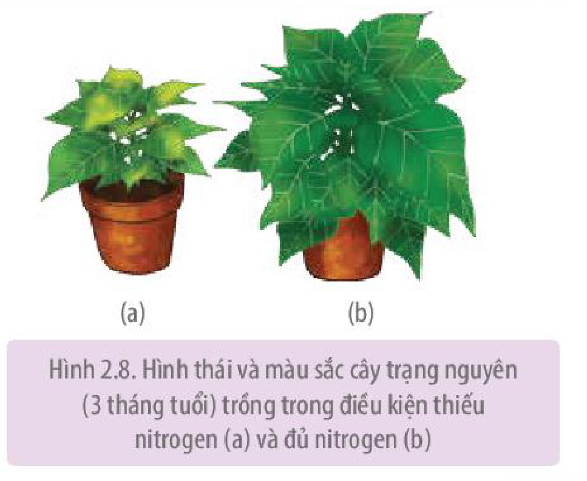

Hình 2.8. Hình thái và màu sắc cây trạng nguyên (3 tháng tuổi) trồng trong điều kiện thiếu nitrogen (a) và đủ nitrogen (b)

<!-- pdf:17 -->

- Vai trò điều tiết: Nitrogen tham gia cấu tạo nên enzyme, các hormone thực vật,... qua đó điều tiết các quá trình sinh trưởng, phát triển của thực vật.

Khi thiếu nitrogen, lá có màu vàng, cây sinh trưởng chậm (H 2.8). Ngược lại, nếu thừa nitrogen, thân và lá phát triển mạnh, cây yếu, dễ đổ và mắc sâu bệnh.

### 2. Nguồn cung cấp nitrogen cho thực vật

<!-- term: Nitrogen vô cơ hấp thụ được -->
<!-- term: Cố định nitrogen -->
Trong tự nhiên, nitrogen tồn tại ở dạng tự do ($\text{N}_2$ trong khí quyển) và dạng hợp chất (vô cơ, hữu cơ). Thực vật chỉ có thể hấp thụ được nitrogen ở dạng vô cơ ($\text{NH}_4^+$, $\text{NO}_3^-$). Tuy nhiên, dưới tác động của yếu tố vật lí (sấm sét) hoặc hoạt động của một số nhóm vi khuẩn mà nitrogen trong khí quyển và trong các hợp chất hữu cơ được chuyển hoá thành dạng $\text{NH}_4^+$, $\text{NO}_3^-$ cây có thể hấp thụ được (H 2.9).

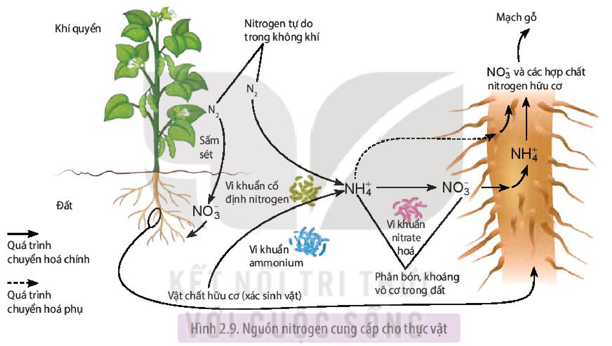

Hình 2.9. Nguồn nitrogen cung cấp cho thực vật

Con người có thể bổ sung nguồn nitrogen cung cấp cho cây trồng thông qua quá trình bón phân. Phân bón sử dụng có thể dưới dạng vô cơ như các loại phân đạm urea, phân đạm chứa gốc $\text{NH}_4^+$ hay $\text{NO}_3^-$. Phân hữu cơ được khuyến khích sử dụng vì nó cung cấp thành phần dinh dưỡng cân bằng, đa dạng cho cây và tham gia cải tạo đất trồng.

### 3. Quá trình biến đổi nitrate và ammonium ở thực vật

Nitrogen có trong $\text{NH}_4^+$ và $\text{NO}_3^-$ sau khi được cây hấp thụ sẽ được biến đổi thành nitrogen chứa trong các hợp chất hữu cơ. Đây là hoạt động đồng hoá nitrogen trong cơ thể thực vật, bao gồm hai quá trình: khử nitrate và đồng hoá ammonium.

**a) Quá trình khử nitrate**

<!-- term: Khử nitrate -->
Quá trình chuyển nitrogen từ dạng $\text{NO}_3^-$ thành dạng $\text{NH}_4^+$ gọi là **quá trình khử nitrate**. Quá trình này diễn ra qua hai bước dưới sự xúc tác của enzyme nitrate reductase và nitrite reductase theo sơ đồ sau:

$$\text{NO}_3^- \text{ (dạng oxy hoá)} \xrightarrow{\text{Nitrate reductase}} \text{NO}_2^- \xrightarrow{\text{Nitrite reductase}} \text{NH}_4^+ \text{ (dạng khử)}$$
<!-- ocr-ok: công thức LaTeX -->

<!-- pdf:18 -->

**b) Quá trình đồng hoá ammonium**

Ammonium ($\text{NH}_4^+$) được cây hấp thụ và hình thành từ quá trình khử nitrate sẽ tham gia vào quá trình tổng hợp amino acid hoặc tạo các amide theo các cách sau:

<!-- term: Đồng hoá ammonium -->
- Ammonium kết hợp với keto acid (pyruvic, ketoglutaric, fumaric và oxaloacetic) tạo thành amino acid.

  Ví dụ: $\text{NH}_4^+ + \text{Pyruvic acid} \longrightarrow \text{Alanine}$

  Sau đó, các amino acid này có thể tham gia tổng hợp nên các amino acid khác và protein.

<!-- term: Đồng hoá ammonium -->
<!-- term: Glutamine -->
- Ammonium kết hợp với các amino dicarboxylic tổng hợp nên các amide. Quá trình này giúp giải độc cho tế bào khi lượng $\text{NH}_4^+$ tích luỹ quá nhiều, đồng thời là cơ chế dự trữ ammonium cho tế bào thực vật.

  Ví dụ: $\text{NH}_4^+ + \text{Glutamic acid} \longrightarrow \text{Glutamin}$

## ❓ Dừng lại và suy ngẫm

1. Khi bón quá nhiều phân đạm cho một số loại cây ngũ cốc như lúa, ngô thì hiện tượng gì sẽ xảy ra? Giải thích.
2. Dựa vào sơ đồ Hình 2.9, kể tên các nguồn cung cấp nitrogen cho cây. Cho biết thực vật có thể sử dụng trực tiếp nitrogen tự do có trong không khí hay không?
3. Nitrogen vô cơ ($\text{NH}_4^+$, $\text{NO}_3^-$) cây hấp thụ vào được chuyển hoá thành nitrogen trong các hợp chất hữu cơ (amino acid, protein,...) theo những cách nào?

## IV. CÁC NHÂN TỐ ẢNH HƯỞNG ĐẾN HOẠT ĐỘNG TRAO ĐỔI NƯỚC VÀ DINH DƯỠNG KHOÁNG

Quá trình trao đổi nước và dinh dưỡng khoáng ở thực vật chịu ảnh hưởng của một số nhân tố như ánh sáng, nhiệt độ, độ ẩm đất và không khí,...

### 1. Ánh sáng

Ánh sáng thúc đẩy khí khổng mở, làm tăng tốc độ thoát hơi nước ở lá (H 2.10), tạo động lực cho quá trình hấp thụ, vận chuyển nước và chất khoáng ở rễ và thân.

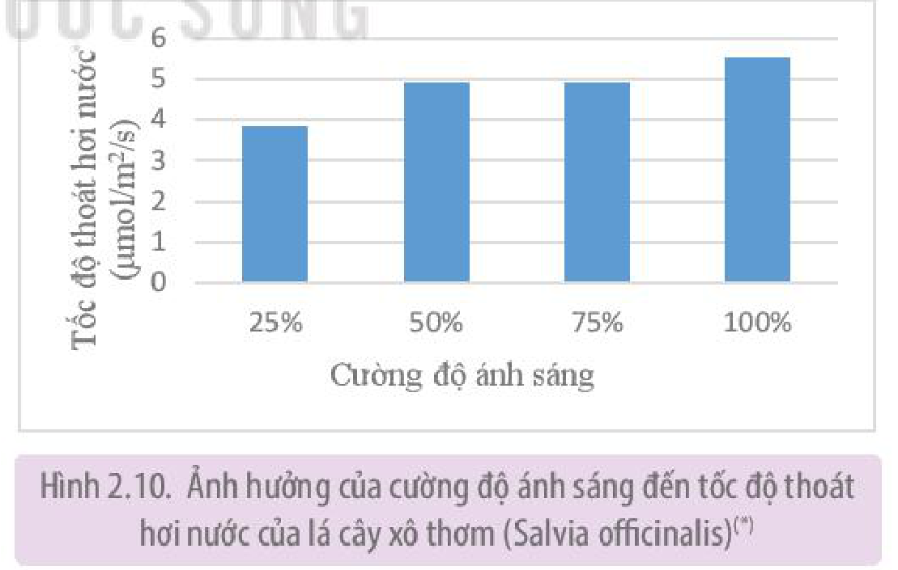

Hình 2.10. Ảnh hưởng của cường độ ánh sáng đến tốc độ thoát hơi nước của lá cây xô thơm (*Salvia officinalis*)$^{(*)}$

Bên cạnh đó, ánh sáng cần cho hoạt động quang hợp tạo chất hữu cơ, cung cấp nguyên liệu cho hoạt động hô hấp, qua đó giải phóng năng lượng cần thiết cho quá trình hấp thụ và vận chuyển chủ động các chất trong cây.

Trong trồng trọt, cần đảm bảo mật độ gieo trồng (trồng theo hàng, tỉa cây, tỉa cành,...), chọn khu vực trồng,... nhằm cung cấp đủ ánh sáng cho cây.

> \*Nguồn: Influence of Light Intensity on Growth and Physiological Characteristics of Common Sage (*Salvia officinalis* L.), G. Zervoudakis et al., 2012.

<!-- pdf:19 -->

### 2. Nhiệt độ

Trong giới hạn sinh thái về nhiệt độ của mỗi loài thực vật, tốc độ hấp thụ nước và nguyên tố khoáng tỉ lệ thuận với sự tăng nhiệt độ. Nhiệt độ giảm làm giảm khả năng hô hấp của rễ và khuếch tán của chất khoáng trong đất, dẫn đến khả năng hấp thụ khoáng của hệ rễ giảm.

**Bảng 2.1.** Ảnh hưởng của nhiệt độ ở vùng rễ đến khả năng hấp thụ chất khoáng của cây dưa chuột (*Cucumis sativus* L.)$^{(*)}$

| Nhiệt độ | Nitrogen (N) (mg/kg chất khô) | Postassium (K) (mg/kg chất khô) | Phosphorus (P) (mg/kg chất khô) |
|---|---|---|---|
| $10^\circ\text{C}$ | 13,48 | 18,98 | 7,45 |
| $20^\circ\text{C}$ | 21,47 | 20,97 | 15,23 |

Tuy nhiên, nếu nhiệt độ tăng quá cao (trên $45\ ^\circ\text{C}$) thì lông hút có thể bị tổn thương hoặc chết, enzyme tham gia vào hoạt động trao đổi chất bị biến đổi, dẫn đến giảm hoặc dừng hấp thụ nước và khoáng.

Trong sản xuất, để hạn chế ảnh hưởng của nhiệt độ thấp đến khả năng hút nước và chất khoáng của hệ rễ có thể tiến hành ủ ấm gốc cây bằng rơm rạ, bao tải gai,... Trong phương pháp trồng cây thủy canh, các ống trồng cây được bọc hoặc làm từ vật liệu cách nhiệt để nhằm duy trì nhiệt độ ổn định trong dung dịch dinh dưỡng từ đó tăng khả năng hút khoáng của hệ rễ.

### 3. Độ ẩm đất và không khí

Trong giới hạn nhất định, độ ẩm đất tỉ lệ thuận với khả năng hấp thụ nước và khoáng của hệ rễ. Độ ẩm đất phù hợp giúp cho quá trình hô hấp thuận lợi và làm tăng trưởng kích thước của hệ rễ, do đó tăng lượng nước và khoáng hấp thụ được. Ngược lại, độ ẩm đất quá cao hoặc quá thấp sẽ làm giảm hô hấp và ức chế sinh trưởng của rễ, dẫn đến giảm lượng nước và chất khoáng hấp thụ.

Ví dụ: Chiều dài của rễ cây đậu tương tăng 8,8 cm và lượng Fe rễ hấp thụ được tăng khoảng $50\ \mu\text{g}$ khi độ ẩm tăng từ 60% lên 90%.

Độ ẩm không khí ảnh hưởng gián tiếp đến hoạt động trao đổi nước và khoáng thông qua việc tác động đến quá trình thoát hơi nước. Độ ẩm không khí cao làm giảm tỉ lệ hoạt động và độ mở của khí khổng (H 2.11), từ đó dẫn đến giảm cường độ thoát hơi nước. Ngược lại, khi độ ẩm không khí thấp, cường độ thoát hơi nước tăng lên, qua đó thúc đẩy quá trình hấp thụ nước và khoáng.

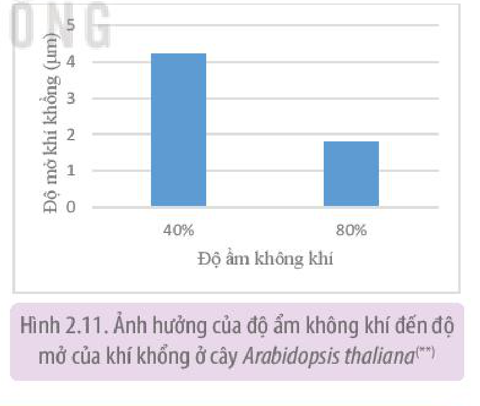

Hình 2.11. Ảnh hưởng của độ ẩm không khí đến độ mở của khí khổng ở cây *Arabidopsis thaliana*$^{(*\*)}$

## ❓ Dừng lại và suy ngẫm

Các yếu tố ngoại cảnh ảnh hưởng như thế nào đến hoạt động trao đổi nước và khoáng ở thực vật?

> \*Nguồn: Effects of root zone temperature and N, P, and K supplies on nutrient uptake of cucumber (*Cucumis sativus* L.) seedlings in hydroponics, Q. Yan et al., 2012.
> \*\*Nguồn: Natural variation in stomatal responses to environmental changes among arabidopsis thaliana ecotypes, S. Takahasi et al., 2015

<!-- pdf:20 -->

## V. ỨNG DỤNG QUÁ TRÌNH TRAO ĐỔI NƯỚC VÀ KHOÁNG Ở THỰC VẬT TRONG SẢN XUẤT NÔNG NGHIỆP

### 1. Tưới nước hợp lí cho cây trồng

**Cân bằng nước** trong cơ thể thực vật đạt được khi lượng nước cây hấp thụ vào bằng hoặc lớn hơn lượng nước thoát ra. Ngược lại, khi lượng nước thoát ra môi trường cao hơn lượng nước cây hấp thụ được, hiện tượng mất cân bằng nước sẽ xảy ra, triệu chứng héo ở lá và thân non xuất hiện.

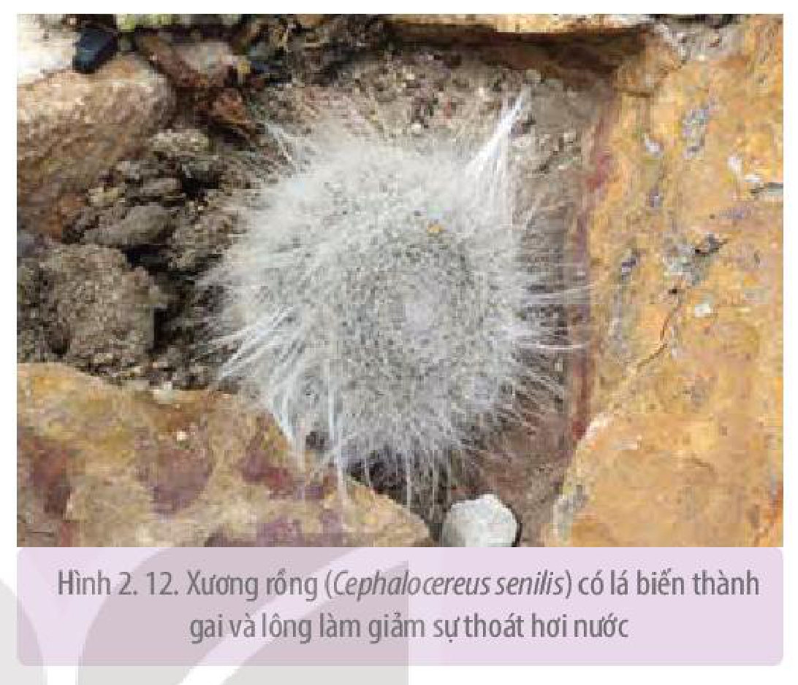

Hình 2.12. Xương rồng (*Cephalocereus senilis*) có lá biến thành gai và lông làm giảm sự thoát hơi nước

Trạng thái mất cân bằng nước có thể xuất hiện khi thực vật sinh trưởng trong các điều kiện như hạn, mặn, ngập úng,... Thực vật thường có các phản ứng để chống chịu với các điều kiện bất lợi này thông qua một số biến đổi về hình thái, giải phẫu (lá biến thành gai, lá có lớp lông phủ trên bề mặt (H 2.12), khí khổng nằm sâu dưới biểu bì lá,...), quá trình sinh lí - sinh hoá hoặc biến đổi ở cấp độ phân tử (protein chống chịu). Các biến đổi này có tác dụng hạn chế thoát hơi nước, tăng cường khả năng hấp thụ nước và khoáng (tăng tích luỹ chất tan trong không bào của lông hút, tăng số lượng rễ,...), từ đó thiết lập trạng thái cân bằng nước mới, đảm bảo cho thực vật có thể chống chịu được trong một thời gian nhất định.

Bên cạnh các phản ứng có tính chất thích nghi tạm thời của thực vật, con người có thể chủ động tiến hành các biện pháp chọn lọc, lai tạo, chuyển gene để tạo ra các giống có khả năng chống chịu hạn, mặn, ngập úng,... Ngoài ra, các kĩ thuật canh tác như cải tạo đất trồng, rèn luyện hạt giống, bón phân cân đối,... cũng được áp dụng nhằm hạn chế ảnh hưởng bất lợi của môi trường đến cây trồng.

<!-- term: Tưới tiêu hợp lí -->
Trong sản xuất, để duy trì trạng thái cân bằng nước trong cây, cần **tưới tiêu nước hợp lí**, tức là cung cấp vừa đủ lượng nước cần thiết, đáp ứng nhu cầu của cây trồng. Lượng nước này thay đổi theo loài, giai đoạn sinh trưởng phát triển của cây và cách tưới. Như vậy, tưới tiêu nước hợp lí là tưới nước đúng nhu cầu sinh lí của cây, đúng thời điểm cây cần và đúng phương pháp.

### 2. Phân bón và năng suất cây trồng

Trong sản xuất nông nghiệp, phân bón là một trong những nguồn cung cấp chất khoáng quan trọng nhất cho cây trồng. Trong giới hạn nhất định, lượng phân bón cung cấp tỉ lệ thuận với năng suất cây trồng (H 2.13).

Nếu bón phân với lượng quá ít, không đáp ứng đủ nhu cầu dinh dưỡng của cây, triệu chứng thiếu khoáng sẽ xuất hiện, cây còi cọc và chậm lớn dẫn đến giảm năng suất cây trồng.

> (\*) Nguồn: Dinh dưỡng cây trồng và phân bón, Nguyễn Mạnh Hùng & Nguyễn Mạnh Chinh, 2015

<!-- pdf:21 -->

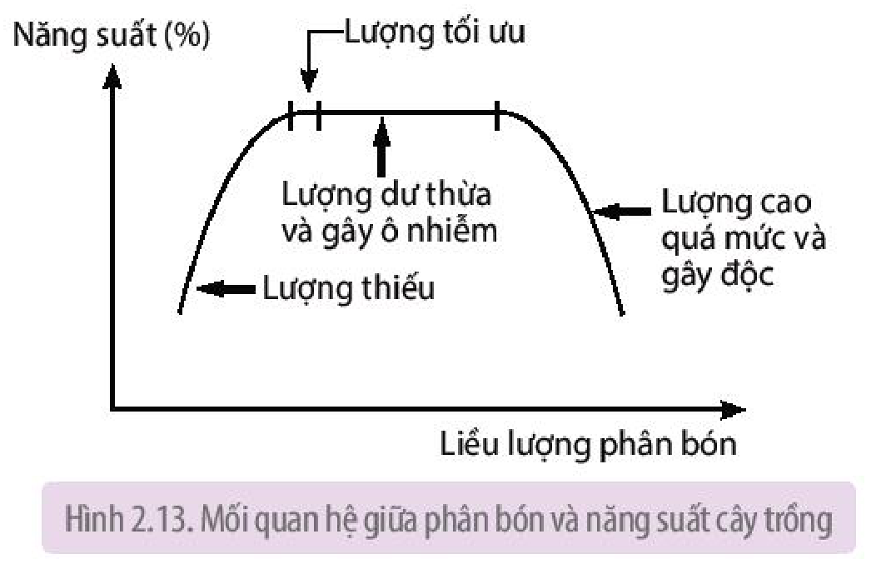

Hình 2.13. Mối quan hệ giữa phân bón và năng suất cây trồng

Ngược lại, bón phân quá nhiều sẽ dẫn đến dư thừa và gây độc cho cây. Dư thừa phân bón có thể tiêu diệt các sinh vật có lợi trong đất (vi sinh vật cố định đạm, phân giải chất hữu cơ,...), làm ô nhiễm đất và nước ngầm, tồn dư trong mô thực vật gây ảnh hưởng xấu đến sức khoẻ của người và vật nuôi khi sử dụng thực vật làm thức ăn.

<!-- term: Phân bón hợp lí -->
Vì vậy, để nâng cao năng suất cây trồng, cần phải **bón phân hợp lí**, cụ thể là phân bón phải đáp ứng được nhu cầu dinh dưỡng và phù hợp với từng giai đoạn sinh trưởng phát triển của cây trồng. Trong thực tế, để đạt được hiệu quả kinh tế cao, việc bón phân cần tuân thủ theo 4 nguyên tắc chính: đúng loại phân bón, đúng liều lượng, đúng thời điểm và bón đúng phương pháp.

Ví dụ: Lượng phân bón và phương pháp bón khuyến cáo cho cây mía trồng thâm canh trên đất cát pha được thể hiện trong Bảng 2.2 dưới đây.

**Bảng 2.2.** Lượng phân bón khuyến cáo cho cây mía$^{(*)}$

| Thời điểm bón | Phân hữu cơ (kg/ha) | Đạm (kg/ha) | Lân ($\text{P}_2\text{O}_5$) (kg/ha) | Kali ($\text{K}_2\text{O}$) (kg/ha) | Phương pháp bón |
|---|---|---|---|---|---|
| Bón lót | 10-20 tấn | 70-80 | 90-100 | 60-65 | Trộn đều vào đất |
| Bón thúc lần 1 (đẻ nhánh) | | 70-80 | | 60-65 | Bón theo hốc |
| Bón thúc lần 2 (thúc lóng) | | 70-80 | | 60-65 | Bón theo hốc |

## ❓ Dừng lại và suy ngẫm

1. Trong hoạt động tưới nước, cần lưu ý gì để đảm bảo trạng thái cân bằng nước cho cây?
2. Việc bón quá ít hoặc quá nhiều phân bón sẽ ảnh hưởng như thế nào đến đất và cây trồng?

> \*Nguồn: Quyết định số 383/QĐ-TT-CCN, Ban hành quy trình kỹ thuật tạm thời thâm canh cây mía, Cục Trồng trọt - Bộ Nông nghiệp và Phát triển Nông thôn, 2015.

<!-- pdf:22 -->

## 📌 Kiến thức cốt lõi

- Nước, chất khoáng là những chất dinh dưỡng của thực vật. Quá trình dinh dưỡng thực vật là quá trình hấp thụ nước, chất khoáng và đồng hoá chúng thành chất sống của cơ thể thực vật.
- Hoạt động trao đổi nước ở thực vật diễn ra theo ba giai đoạn kế tiếp nhau gồm: hấp thụ nước ở hệ rễ, vận chuyển nước ở thân và thoát hơi nước ở lá. Nguyên tố khoáng hoà tan trong nước, do vậy, quá trình trao đổi khoáng đi kèm với trao đổi nước.
- Rễ hấp thụ nước theo cơ chế thụ động, trong khi hấp thụ khoáng theo cả cơ chế chủ động và thụ động.
- Trong cây tồn tại hai con đường vận chuyển vật chất là dòng mạch gỗ vận chuyển nước, muối khoáng từ rễ lên lá và dòng mạch rây vận chuyển chất hữu cơ từ lá xuống rễ (hoặc theo chiều ngược lại).
- Thoát hơi nước diễn ra theo hai con đường: qua bề mặt lá hoặc qua khí khổng. Trong đó, lượng nước bay hơi khỏi lá được điều tiết chủ yếu bởi cơ chế đóng mở khí khổng.
- Đất là nguồn cung cấp nitrogen chính cho cây trồng. Cây hấp thụ nitrogen ở hai dạng là $\text{NH}_4^+$ và $\text{NO}_3^-$; nhờ quá trình khử nitrate và đồng hoá ammonium, nitrogen vô cơ được chuyển thành dạng hữu cơ.
- Hoạt động trao đổi nước và chất khoáng chịu ảnh hưởng của các yếu tố môi trường như ánh sáng, nhiệt độ, độ ẩm đất và không khí,... Trong sản xuất, có thể điều khiển các yếu tố ngoại cảnh và áp dụng chế độ bón phân, tưới nước hợp lí để nâng cao năng suất cây trồng.

## ✏️ Luyện tập và vận dụng

<!-- term: Bón lót -->
<!-- term: Bón thúc -->
1. Trong tự nhiên, ở một số cây trồng như cà rốt, khoai tây,... chất dự trữ trong củ sẽ được vận chuyển lên các cơ quan phía trên trong giai đoạn sinh trưởng, phát triển nào của thực vật?
2. Khi rễ cây bị ngập úng trong thời gian dài, cây trồng có biểu hiện như thế nào? Giải thích.
3. Giải thích tại sao trong trồng trọt, phân hữu cơ (phân chuồng, phân xanh,...) thường được sử dụng để bón lót (bón vào đất trước khi gieo trồng), trong khi các loại phân vô cơ (đạm, kali) được dùng để bón thúc.

## 💡 Em có biết

**Nấm rễ là gì?**

**Nấm rễ** là hiện tượng cộng sinh giữa nấm và rễ cây ở thực vật trên cạn, trong đó thực vật cung cấp chất hữu cơ cho nấm, ngược lại, nấm hỗ trợ thực vật hấp thụ nước, chất khoáng từ đất. Nấm rễ có ở hơn 90% các loài thực vật, chúng đặc biệt phát triển ở thông nhựa, vân sam, sồi. Nấm rễ hỗ trợ thực vật hấp thụ nước và chất khoáng, ngoài ra, nấm rễ còn giúp cải thiện các đặc tính của môi trường đất như độ ẩm, độ thoáng khí, hàm lượng dinh dưỡng,... nhờ đó kích thích sinh trưởng của cơ thể thực vật.

## 📷 Danh sách hình trong bài

| Mã hình | Trang PDF | Vị trí | Chú thích gốc |
|---|---|---|---|
| H11-sinh-b02-01 | 11 | Mục I.2 | Hình 2.1. Triệu chứng biến màu trên lá cà chua khi thiếu một số nguyên tố khoáng |
| H11-sinh-b02-02 | 12 | Mục II | Hình 2.2. Sơ đồ khái quát quá trình trao đổi nước trong cây |
| H11-sinh-b02-03 | 12 | Mục II.1 | Hình 2.3. Hệ rễ với các tế bào lông hút |
| H11-sinh-b02-04 | 13 | Mục II.1.c | Hình 2.4. Hai con đường vận chuyển của nước và chất khoáng từ lông hút vào mạch gỗ của rễ |
| H11-sinh-b02-05 | 14 | Mục II.2.a | Hình 2.5. Cấu tạo của mạch gỗ (a) và các động lực của dòng mạch gỗ (b) |
| H11-sinh-b02-06 | 14 | Mục II.2.b | Hình 2.6. Cấu tạo mạch rây (a) và chiều vận chuyển các chất trong mạch rây (b) |
| H11-sinh-b02-07 | 15 | Mục II.3.b | Hình 2.7. Khí khổng mở khi tế bào trương nước (a) và đóng khi tế bào mất nước (b) |
| H11-sinh-b02-08 | 16 | Mục III.1 | Hình 2.8. Hình thái và màu sắc cây trạng nguyên (3 tháng tuổi) trồng trong điều kiện thiếu nitrogen (a) và đủ nitrogen (b) |
| H11-sinh-b02-09 | 17 | Mục III.2 | Hình 2.9. Nguồn nitrogen cung cấp cho thực vật |
| H11-sinh-b02-10 | 18 | Mục IV.1 | Hình 2.10. Ảnh hưởng của cường độ ánh sáng đến tốc độ thoát hơi nước của lá cây xô thơm (*Salvia officinalis*)$^{(*)}$ |
| H11-sinh-b02-11 | 19 | Mục IV.3 | Hình 2.11. Ảnh hưởng của độ ẩm không khí đến độ mở của khí khổng ở cây *Arabidopsis thaliana*$^{(*\*)}$ |
| H11-sinh-b02-12 | 20 | Mục V.1 | Hình 2.12. Xương rồng (*Cephalocereus senilis*) có lá biến thành gai và lông làm giảm sự thoát hơi nước |
| H11-sinh-b02-13 | 21 | Mục V.2 | Hình 2.13. Mối quan hệ giữa phân bón và năng suất cây trồng |
