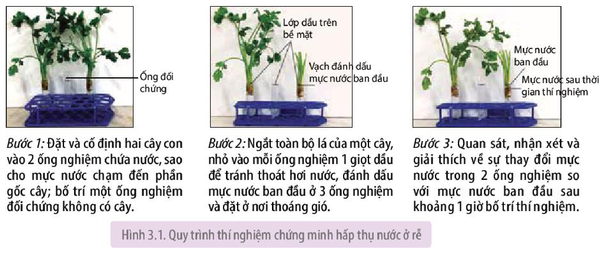
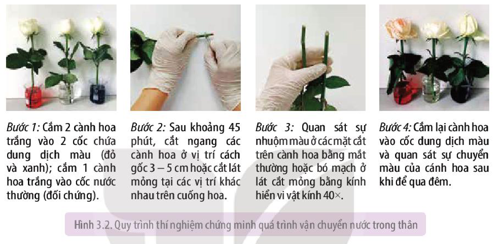
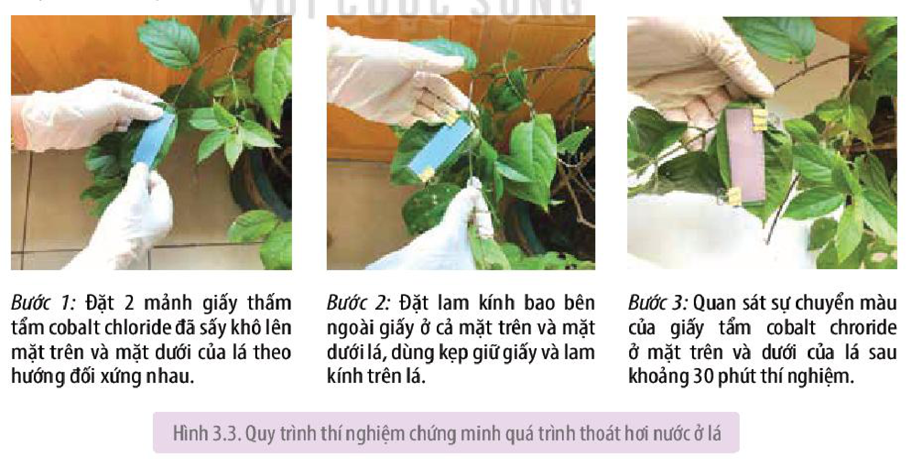
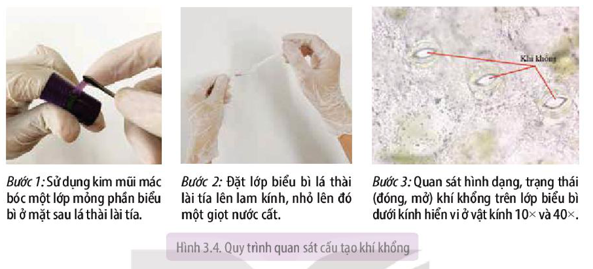
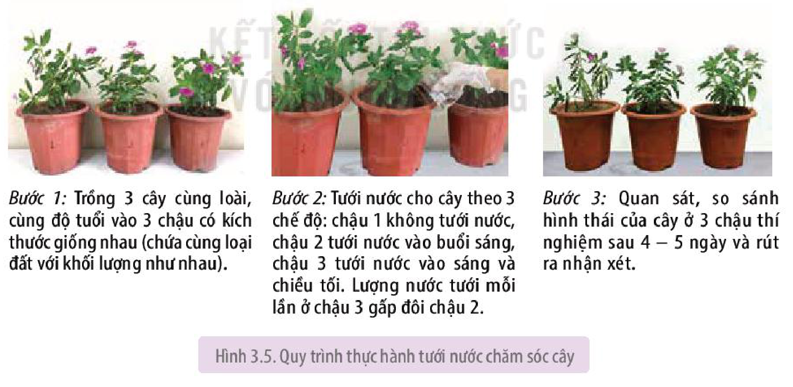

<!-- pdf:23 -->

# BÀI 3: THỰC HÀNH: TRAO ĐỔI NƯỚC VÀ KHOÁNG Ở THỰC VẬT

## I. YÊU CẦU CẦN ĐẠT
<!-- ocr-ok: OCR nhận diện sai tiêu đề -->

- Thực hiện được các thí nghiệm chứng minh sự hút nước ở rễ, vận chuyển nước ở thân và thoát hơi nước ở lá. Thực hành tưới nước chăm sóc cây.
- Thực hiện được các bước trồng cây thuỷ canh, khí canh.
- Thực hành quan sát được cấu tạo khí khổng ở lá.

## II. CHUẨN BỊ

### 1. Dụng cụ, thiết bị

- Lam kính, ống nghiệm, cốc thuỷ tinh 100 mL, chậu trồng cây.
- Kim mũi mác, kẹp (gỗ, nhựa), giấy thấm, dao lam, giá ống nghiệm.
- Kính hiển vi.
- Video về quy trình trồng cây thuỷ canh, khí canh.

### 2. Hoá chất

- Dung dịch màu thực phẩm, xanh methylene,...
- Dung dịch cobalt chloride.

### 3. Mẫu vật

- Cành có hoa màu trắng: hoa hồng, hoa cúc, hoa đồng tiền,...
- Cây cảnh: dừa cạn, mười giờ, sử quân tử,...
- Cây có hệ rễ chùm hoàn chỉnh: ngô, cần tây,...

## III. CÁCH TIẾN HÀNH

### 1. Thí nghiệm trao đổi nước ở thực vật

**a) Chứng minh quá trình hấp thụ nước ở rễ**

- Nguyên lí: Dựa vào sự thay đổi lượng nước cung cấp cho cây trước và sau thời gian thí nghiệm để chứng minh có hoạt động hấp thụ nước ở hệ rễ.
- Quy trình thí nghiệm: Các bước tiến hành thí nghiệm được thể hiện ở Hình 3.1.

<!-- term: Đối chứng -->
*Bước 1:* Đặt và cố định hai cây con vào 2 ống nghiệm chứa nước, sao cho mực nước chạm đến phần gốc cây; bố trí một ống nghiệm đối chứng không có cây.
<!-- ocr-ok: văn bản 3 cột dưới hình, OCR đọc ngang -->

<!-- term: Dầu -->
*Bước 2:* Ngắt toàn bộ lá của một cây, nhỏ vào mỗi ống nghiệm 1 giọt dầu để tránh thoát hơi nước, đánh dấu mực nước ban đầu ở 3 ống nghiệm và đặt ở nơi thoáng gió.
<!-- ocr-ok: văn bản 3 cột dưới hình, OCR đọc ngang -->

*Bước 3:* Quan sát, nhận xét và giải thích về sự thay đổi mực nước trong 2 ống nghiệm so với mực nước ban đầu sau khoảng 1 giờ bố trí thí nghiệm.

Hình 3.1. Quy trình thí nghiệm chứng minh hấp thụ nước ở rễ

<!-- pdf:24 -->

**b) Chứng minh quá trình vận chuyển nước ở thân**

<!-- term: Dung dịch màu -->
- Nguyên lí: Sử dụng dung dịch màu để đánh dấu và quan sát đường đi của nước trong hệ mạch của thực vật, qua đó chứng minh quá trình vận chuyển nước ở thân.
- Quy trình thí nghiệm (H 3.2):

<!-- term: Đối chứng -->
*Bước 1:* Cắm 2 cành hoa trắng vào 2 cốc chứa dung dịch màu (đỏ và xanh); cắm 1 cành hoa trắng vào cốc nước thường (đối chứng).

*Bước 2:* Sau khoảng 45 phút, cắt ngang các cành hoa ở vị trí cách gốc 3 – 5 cm hoặc cắt lát mỏng tại các vị trí khác nhau trên cuống hoa.

<!-- term: Bó mạch -->
*Bước 3:* Quan sát sự nhuộm màu ở các mặt cắt trên cành hoa bằng mắt thường hoặc bó mạch ở lát cắt mỏng bằng kính hiển vi vật kính $40\times$.

*Bước 4:* Cắm lại cành hoa vào cốc dung dịch màu và quan sát sự chuyển màu của cánh hoa sau khi để qua đêm.

Hình 3.2. Quy trình thí nghiệm chứng minh quá trình vận chuyển nước trong thân

**c) Chứng minh quá trình thoát hơi nước ở lá**

<!-- term: Giấy cobalt chloride -->
- Nguyên lí: Dựa vào sự chuyển màu của giấy tẩm cobalt chloride để chứng minh có quá trình thoát hơi nước ở lá. Cụ thể, khi khô, giấy cobalt chloride có màu xanh; khi ẩm, giấy chuyển màu hồng.
- Quy trình thí nghiệm (H 3.3):

*Bước 1:* Đặt 2 mảnh giấy thấm tẩm cobalt chloride đã sấy khô lên mặt trên và mặt dưới của lá theo hướng đối xứng nhau.

*Bước 2:* Đặt lam kính bao bên ngoài giấy ở cả mặt trên và mặt dưới lá, dùng kẹp giữ giấy và lam kính trên lá.

*Bước 3:* Quan sát sự chuyển màu của giấy tẩm cobalt chroride ở mặt trên và dưới của lá sau khoảng 30 phút thí nghiệm.

Hình 3.3. Quy trình thí nghiệm chứng minh quá trình thoát hơi nước ở lá

<!-- pdf:25 -->

**d) Thực hành quan sát cấu tạo khí khổng ở lá**

<!-- term: Biểu bì lá -->
*Bước 1:* Sử dụng kim mũi mác bóc một lớp mỏng phần biểu bì ở mặt sau lá thài lài tía.

*Bước 2:* Đặt lớp biểu bì lá thài lài tía lên lam kính, nhỏ lên đó một giọt nước cất.
<!-- ocr-ok: văn bản 3 cột dưới hình, OCR đọc ngang -->

*Bước 3:* Quan sát hình dạng, trạng thái (đóng, mở) khí khổng trên lớp biểu bì dưới kính hiển vi ở vật kính $10\times$ và $40\times$.

Hình 3.4. Quy trình quan sát cấu tạo khí khổng

**e) Thực hành tưới nước chăm sóc cây**

<!-- term: Tưới nước hợp lí -->
- Nguyên lí: Tưới nước hợp lí sẽ đảm bảo trạng thái cân bằng nước trong cây. Khi tưới nước không đủ hoặc thừa so với nhu cầu sinh lí của cây, cây mất cân bằng nước, biểu hiện thành triệu chứng héo, thối, có thể dẫn đến chết cây.
- Quy trình thí nghiệm (H 3.5):

*Bước 1:* Trồng 3 cây cùng loài, cùng độ tuổi vào 3 chậu có kích thước giống nhau (chứa cùng loại đất với khối lượng như nhau).

*Bước 2:* Tưới nước cho cây theo 3 chế độ: chậu 1 không tưới nước, chậu 2 tưới nước vào buổi sáng, chậu 3 tưới nước vào sáng và chiều tối. Lượng nước tưới mỗi lần ở chậu 3 gấp đôi chậu 2.

*Bước 3:* Quan sát, so sánh hình thái của cây ở 3 chậu thí nghiệm sau 4 – 5 ngày và rút ra nhận xét.

Hình 3.5. Quy trình thực hành tưới nước chăm sóc cây

*Lưu ý:* Với chậu trồng cây chứa khoảng 3 – 3,5 kg đất, chậu 2 tưới 100 mL/lần, chậu 3 tưới 200 mL/lần.

<!-- pdf:26 -->

### 2. Thực hành trồng cây thuỷ canh, khí canh

**a) Nguyên lí**

<!-- term: Thuỷ canh -->
<!-- term: Khí canh -->
<!-- term: Giá thể trơ -->
**Thuỷ canh** và **khí canh** là phương pháp trồng cây không cần đất, dinh dưỡng được cung cấp cho cây dưới dạng các chất khoáng hoà tan trong dung dịch trồng cây. Điều chỉnh hàm lượng và thành phần các nguyên tố khoáng trong dung dịch sẽ cho năng suất và chất lượng sản phẩm khác nhau. Trong hệ thống thuỷ canh, cây được trồng vào các **giá thể trơ** (xơ dừa, đất sét nung,...) chứa trong các rọ trồng cây và đặt trong dung dịch dinh dưỡng. Trong hệ thống khí canh, dung dịch dinh dưỡng được cung cấp cho cây dưới dạng sương nhờ máy bơm.

**b) Quy trình thực hành**
<!-- ocr-ok: OCR dính chữ Quytrình -->

Học sinh xem video về quy trình trồng cây theo phương pháp thuỷ canh và khí canh, thực hiện các nhiệm vụ sau:

- Nêu các dụng cụ, hoá chất được sử dụng để trồng cây thuỷ canh, khí canh.
- Vẽ sơ đồ các bước tiến hành trồng cây thuỷ canh và khí canh.
- So sánh, rút ra nhận xét về ưu điểm và hạn chế của hai phương pháp này so với phương pháp trồng cây trên đất.

Tuỳ từng điều kiện, học sinh có thể tham quan các mô hình trồng cây thuỷ canh, khí canh tại địa phương (nếu có), tham gia thực hiện một số bước trong quy trình sản xuất cây thuỷ canh theo quy trình được hướng dẫn bởi cơ sở sản xuất.

## IV. THU HOẠCH

Học sinh viết báo cáo thực hành theo các nội dung sau:

**BÁO CÁO THỰC HÀNH**

1. **Mục đích**
2. **Kết quả và giải thích**
<!-- ocr-ok: OCR dính chữ Mụcđích -->

   Trình bày kết quả thí nghiệm chứng minh sự hấp thụ nước, vận chuyển nước ở thân và thoát hơi nước ở lá; kết quả thí nghiệm trồng cây thuỷ canh và khí canh. Giải thích kết quả các thí nghiệm.

3. **Trả lời câu hỏi**
   a) Đề xuất phương án thí nghiệm khác với cách tiến hành được mô tả trong bài để chứng minh lá là cơ quan thoát hơi nước.
   b) Trình bày phương án thí nghiệm để nhuộm được hai hoặc ba màu khác nhau cho một số loại hoa trắng khác như đồng tiền, cúc, huệ,...

## 📷 Danh sách hình trong bài

| Mã hình | Trang PDF | Vị trí | Chú thích gốc |
|---|---|---|---|
| H11-sinh-b03-01 | 23 | Mục III.1.a | Hình 3.1. Quy trình thí nghiệm chứng minh hấp thụ nước ở rễ |
| H11-sinh-b03-02 | 24 | Mục III.1.b | Hình 3.2. Quy trình thí nghiệm chứng minh quá trình vận chuyển nước trong thân |
| H11-sinh-b03-03 | 24 | Mục III.1.c | Hình 3.3. Quy trình thí nghiệm chứng minh quá trình thoát hơi nước ở lá |
| H11-sinh-b03-04 | 25 | Mục III.1.d | Hình 3.4. Quy trình quan sát cấu tạo khí khổng |
| H11-sinh-b03-05 | 25 | Mục III.1.e | Hình 3.5. Quy trình thực hành tưới nước chăm sóc cây |
