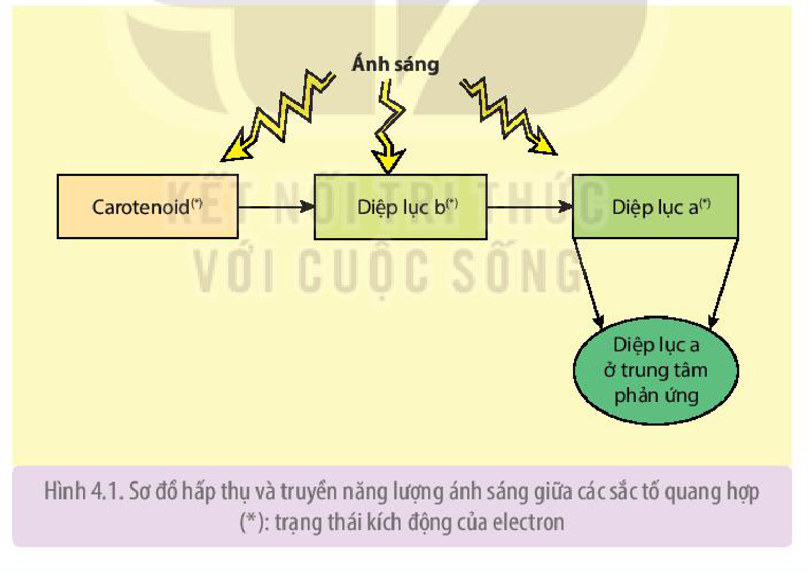
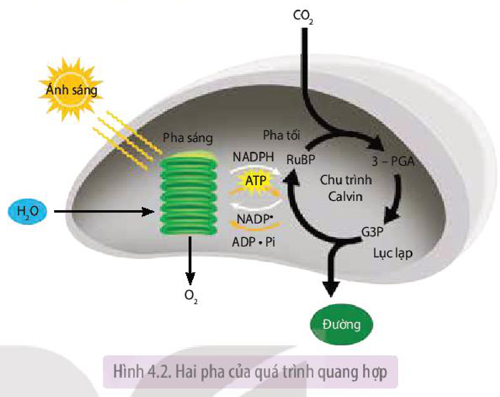
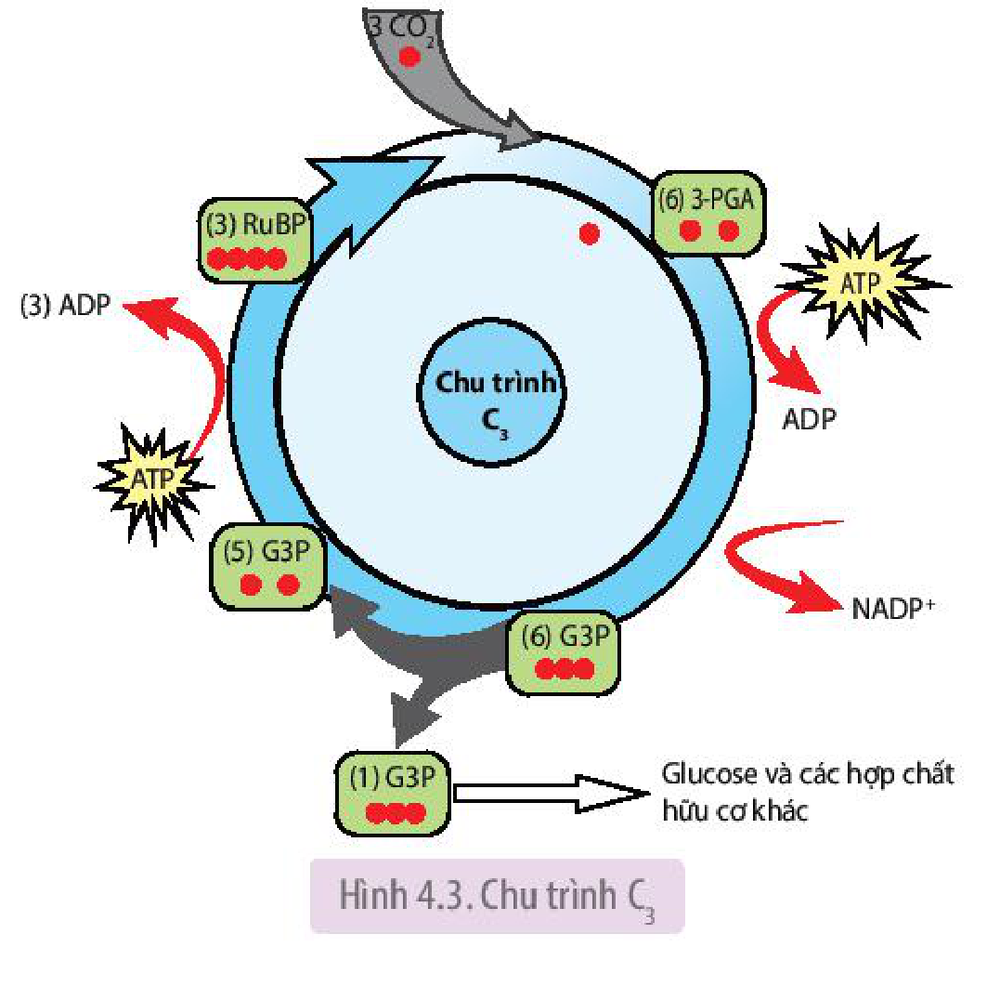
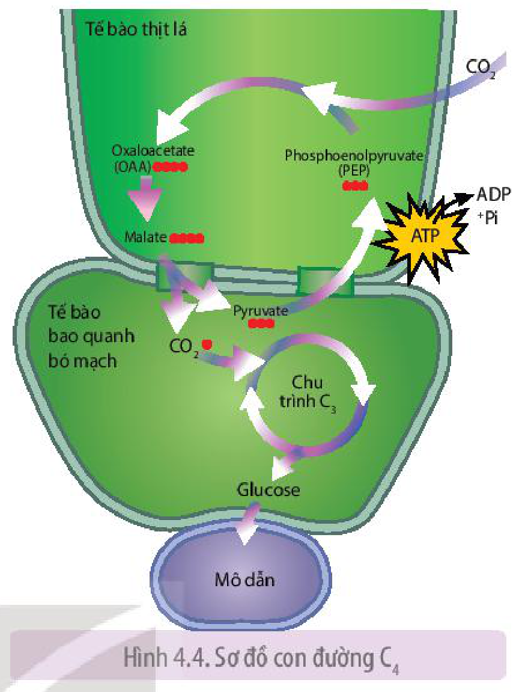
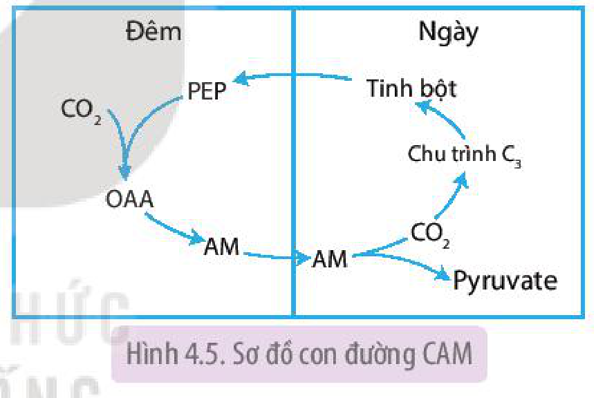
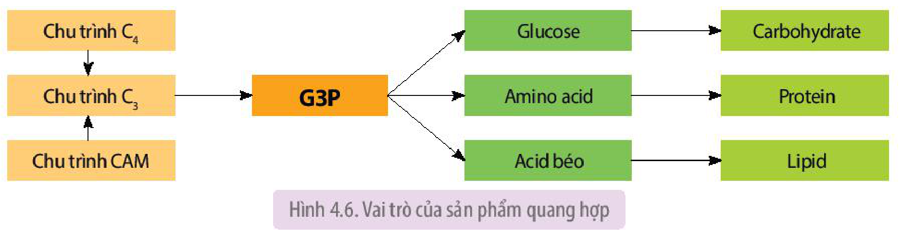
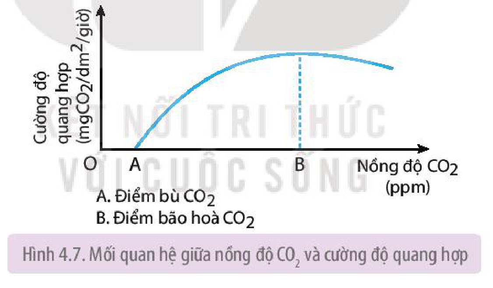
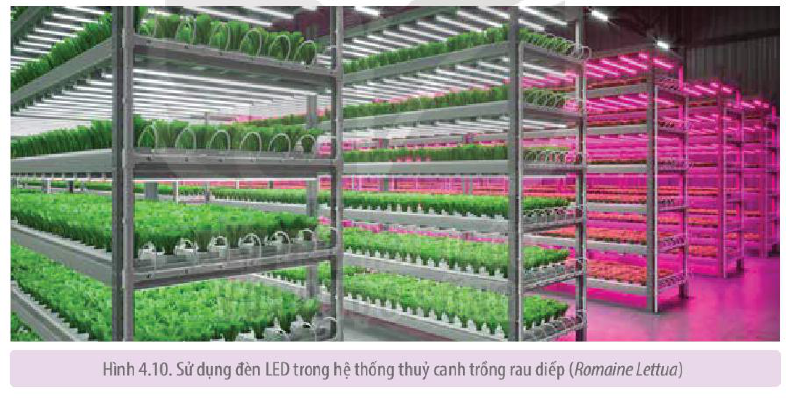

<!-- pdf:27 -->

# BÀI 4: QUANG HỢP Ở THỰC VẬT

## 🎯 Yêu cầu cần đạt

- Phát biểu được khái niệm quang hợp ở thực vật. Viết được phương trình quang hợp. Nêu được vai trò của quang hợp ở thực vật.
- Trình bày được vai trò của sắc tố trong việc hấp thụ năng lượng ánh sáng. Nêu được các sản phẩm của quá trình biến đổi năng lượng ánh sáng thành năng lượng hoá học (ATP và NADPH).
- Nêu được các con đường đồng hoá carbon trong quang hợp. Chứng minh được sự thích nghi của thực vật $\text{C}_4$ và CAM trong điều kiện môi trường bất lợi.
- Trình bày được vai trò của sản phẩm quang hợp trong tổng hợp chất hữu cơ (chủ yếu là tinh bột) đối với cây và đối với sinh giới.
- Phân tích được ảnh hưởng của các điều kiện bên ngoài đến quang hợp.
- Phân tích được mối quan hệ giữa quang hợp và năng suất cây trồng.
- Vận dụng hiểu biết về quang hợp để giải thích được một số biện pháp kĩ thuật và công nghệ nâng cao năng suất cây trồng.

## 🔴 Mở đầu

Nguồn thức ăn và nguồn oxygen góp phần duy trì sự sống trên Trái Đất bắt nguồn từ đâu?

## I. KHÁI QUÁT VỀ QUANG HỢP

### 1. Khái niệm về quang hợp

<!-- term: Lục lạp -->
**Quang hợp** ở thực vật là quá trình lục lạp hấp thụ và sử dụng năng lượng ánh sáng để chuyển hoá $\text{CO}_2$ và nước thành hợp chất hữu cơ ($\text{C}_6\text{H}_{12}\text{O}_6$) đồng thời giải phóng $\text{O}_2$.

Phương trình tổng quát của quá trình quang hợp:

$$6\text{CO}_2 + 12\text{H}_2\text{O} \xrightarrow[\text{lục lạp}]{\text{Ánh sáng}} \text{C}_6\text{H}_{12}\text{O}_6 + 6\text{O}_2 + 6\text{H}_2\text{O}$$
<!-- ocr-ok: công thức LaTeX -->

### 2. Vai trò của quang hợp

Quang hợp cung cấp nguồn chất hữu cơ đa dạng và phong phú, đáp ứng nhu cầu dinh dưỡng và dưỡng khí của hầu hết các sinh vật trên Trái Đất.

- Quang hợp ở thực vật tạo ra chất hữu cơ làm nguồn thức ăn cho chính cơ thể thực vật.
- Quang hợp cung cấp nguồn chất hữu cơ và $\text{O}_2$, đáp ứng nhu cầu dinh dưỡng và dưỡng khí của hầu hết các sinh vật trên Trái Đất.
- Khí $\text{O}_2$ được tạo ra trong quang hợp có ý nghĩa quan trọng đối với sự cân bằng $\text{O}_2/\text{CO}_2$ trong khí quyển.

<!-- pdf:28 -->

### 3. Hệ sắc tố quang hợp

**a) Các nhóm sắc tố**

Hệ sắc tố quang hợp ở cây xanh gồm hai nhóm chính là diệp lục (chlorophyll) và carotenoid.

<!-- term: Diệp lục a -->
**Diệp lục** tạo nên màu xanh của lá và các bộ phận có màu xanh ở cây. Ngày nay, các nhà khoa học đã phát hiện ra khoảng 10 loại diệp lục, trong đó loại sắc tố chủ đạo mà thiếu nó cây không thể quang hợp được là **diệp lục a**. Diệp lục hấp thụ ánh sáng đỏ và xanh tím. Đây là nhóm sắc tố có vai trò quan trọng nhất trong quang hợp.

**Carotenoid** là nhóm sắc tố tạo nên màu vàng, đỏ, cam của lá, hoa, củ, quả ở nhiều loài cây như gấc, xoài, cà rốt,... Carotenoid gồm hai loại là **xanthophyll** (loại có oxygen) và **carotene** (loại không có oxygen), trong đó $\beta\text{–carotene}$ là tiền chất của vitamin A.

**b) Vai trò của hệ sắc tố**

<!-- term: Hệ sắc tố quang hợp -->
<!-- term: Thylakoid -->
Hệ sắc tố quang hợp phân bố trên màng thylakoid có vai trò quan trọng trong việc hấp thụ và biến đổi năng lượng ánh sáng thành dạng hoá năng.

<!-- term: Hệ sắc tố quang hợp -->
<!-- term: Diệp lục a -->
Phân tử sắc tố hấp thụ photon ánh sáng và chuyển thành trạng thái có electron bị kích động. Năng lượng đã hấp thụ được truyền cộng hưởng đến phân tử sắc tố khác rồi đến phân tử diệp lục a ở trung tâm phản ứng (H 4.1). Tại đây, phân tử diệp lục a làm nhiệm vụ biến đổi quang năng thành hoá năng chứa trong ATP và NADPH.

Hình 4.1. Sơ đồ hấp thụ và truyền năng lượng ánh sáng giữa các sắc tố quang hợp (\*): trạng thái kích động của electron

## ❓ Dừng lại và suy ngẫm

1. Nguyên liệu, năng lượng được sử dụng trong quang hợp có nguồn gốc từ đâu? Sản phẩm của quang hợp là gì và chúng có vai trò như thế nào đối với sinh giới?
2. Hệ sắc tố ở cây xanh được chia làm mấy nhóm? Cho biết vai trò của các nhóm sắc tố này trong quang hợp.
3. Một số loài thực vật có lá màu đỏ thực hiện quang hợp được không? Vì sao?

<!-- pdf:29 -->

## II. QUÁ TRÌNH QUANG HỢP Ở THỰC VẬT

<!-- term: Lục lạp -->
<!-- term: Thylakoid -->
<!-- term: Pha sáng -->
<!-- term: Pha tối -->
Quá trình quang hợp ở thực vật diễn ra tại lục lạp theo hai pha: pha sáng và pha tối (pha đồng hoá $\text{CO}_2$). Pha sáng diễn ra trên màng thylakoid với sự tham gia của ánh sáng và các phân tử sắc tố, có diễn biến giống nhau ở tất cả các nhóm thực vật ($\text{C}_3$, $\text{C}_4$ và CAM). Pha tối diễn ra trong chất nền của lục lạp, sử dụng các sản phẩm của pha sáng cùng với sự tham gia của các enzyme để đồng hoá carbon thành các phân tử hữu cơ. Tuỳ từng nhóm thực vật mà pha tối sẽ diễn ra theo các con đường khác nhau.

Hình 4.2. Hai pha của quá trình quang hợp

### 1. Pha sáng

<!-- term: Pha sáng -->
<!-- term: Phân li nước -->
Diệp lục hấp thụ ánh sáng và chuyển thành trạng thái kích động electron làm cho một số electron ($\text{e}^-$) của diệp lục bật ra khỏi quỹ đạo. Dưới tác dụng của ánh sáng nước phân li, giải phóng $\text{O}_2$, electron và $\text{H}^+$ theo sơ đồ sau:

$$2\text{H}_2\text{O} \longrightarrow 4\text{H}^+ + 4\text{e}^- + \text{O}_2$$
<!-- ocr-ok: công thức LaTeX -->

<!-- term: NADPH -->
Electron sinh ra từ quá trình phân li nước được dùng để bù lại cho phân tử diệp lục a đã mất electron. $\text{H}^+$ tham gia tổng hợp ATP và khử $\text{NADP}^+$ thành NADPH.

<!-- term: Pha sáng -->
Như vậy, sản phẩm của pha sáng gồm có: $\text{O}_2$, ATP và NADPH.

### 2. Pha tối

<!-- term: Pha tối -->
<!-- term: NADPH -->
Sự cố định $\text{CO}_2$ tạo thành các hợp chất hữu cơ (glucose,...) diễn ra ở pha tối nhờ nguồn năng lượng ATP và NADPH do pha sáng cung cấp.

**a) Con đường cố định $\text{CO}_2$ ở thực vật $\text{C}_3$ (chu trình Calvin hay chu trình $\text{C}_3$)**

<!-- term: Thực vật C₃ -->
Năm 1951, hai nhà bác học Calvin và Benson cùng cộng sự phát hiện ra con đường cố định $\text{CO}_2$ ở nhiều loài thực vật phân bố rộng rãi trên thế giới, chủ yếu ở vùng ôn đới và cận nhiệt đới như lúa, khoai, sắn, các loại rau, đậu,...

Hình 4.3. Chu trình $\text{C}_3$

<!-- pdf:30 -->

<!-- term: RuBP -->
<!-- term: 3-PGA -->
<!-- term: G3P -->
Ribulose 1,5 biphosphate (RuBP) là chất nhận $\text{CO}_2$ đầu tiên để tạo thành 3–Phosphoglyceric acid (3–PGA). Đây là hợp chất 3 carbon đầu tiên được tạo thành nên chu trình này còn gọi là **chu trình $\text{C}_3$**. Với sự tham gia của ATP và NADPH (từ pha sáng), phân tử 3–PGA bị khử thành glyceraldehyde 3 phosphate (G3P). Một phần G3P đi ra khỏi chu trình để tạo thành glucose và các hợp chất hữu cơ khác. Phần còn lại sẽ được sử dụng cho tái tạo RuBP.

**b) Con đường cố định $\text{CO}_2$ ở thực vật $\text{C}_4$ (con đường $\text{C}_4$)**

<!-- term: Con đường C₄ -->
<!-- term: Thực vật C₄ -->
<!-- term: PEP -->
<!-- term: OAA -->
<!-- term: Tế bào bao mạch -->
<!-- term: Tế bào nhu mô lá -->
Năm 1965, hai nhà khoa học Úc là Hatch và Slack đã tìm thấy quá trình cố định $\text{CO}_2$ ở các thực vật sống ở vùng nhiệt đới và cận nhiệt đới như mía, rau dền, ngô, kê, cao lương, cỏ gấu,... Ở các loài này, chất nhận $\text{CO}_2$ đầu tiên trong tế bào mô giậu là hợp chất 3 C (phosphoenol pyruvate – PEP) và sản phẩm đầu tiên được tạo thành là hợp chất 4 C (oxaloacetic acid – OAA) nên con đường này còn được gọi là **con đường $\text{C}_4$** (H 4.4). Hợp chất 4 C đi qua cầu sinh chất đến tế bào bao bó mạch rồi phân giải thành pyruvate và $\text{CO}_2$. $\text{CO}_2$ sẽ tham gia vào chu trình Calvin để tạo carbohydrate.

Hình 4.4. Sơ đồ con đường $\text{C}_4$

**c) Con đường cố định $\text{CO}_2$ ở thực vật CAM (con đường CAM)**

<!-- term: Thực vật CAM -->
Nhóm thực vật CAM gồm các loài thực vật sống ở sa mạc hoặc trong các điều kiện hạn chế về nước như dứa, xương rồng, thuốc bỏng,... Sống trong điều kiện khô hạn, thực vật CAM có con đường cố định $\text{CO}_2$ theo cách riêng của mình (H 4.5).

Hình 4.5. Sơ đồ con đường CAM

<!-- term: Thực vật CAM -->
Để hạn chế sự thoát hơi nước, khí khổng của các thực vật này sẽ đóng vào ban ngày và mở vào ban đêm để $\text{CO}_2$ khuếch tán vào bên trong tế bào thịt lá.

### 3. Sự thích nghi của thực vật $\text{C}_4$ và CAM trong điều kiện môi trường bất lợi

Sống trong điều kiện nóng, hạn thực vật $\text{C}_4$ và CAM đã hình thành đặc điểm thích nghi trong quang hợp đảm bảo cho chúng tổng hợp được chất hữu cơ trong điều kiện khí hậu không thuận lợi.

Cụ thể, pha tối ở cây $\text{C}_4$ và CAM có thêm chu trình sơ bộ cố định $\text{CO}_2$, đảm bảo nguồn cung cấp $\text{CO}_2$ cho quang hợp.

<!-- term: PEP-carboxylase -->
Dưới tác dụng của emzyme PEP–carboxylase có ái lực cao với $\text{CO}_2$, cây $\text{C}_4$ và CAM có thể cố định nhanh $\text{CO}_2$ ở nồng độ rất thấp. Điều này rất có lợi đối với cây trồng khi trời nóng, hạn, khí khổng đóng một phần để tránh mất nước khiến nồng độ $\text{CO}_2$ trong gian bào thấp. Thực vật $\text{C}_4$ tích luỹ $\text{CO}_2$ trong không gian rộng (nhu mô thịt lá) nên chúng dự trữ được nhiều $\text{CO}_2$, vì thế đây là nhóm thực vật cho năng suất cao.

<!-- pdf:31 -->

### 4. Vai trò của sản phẩm quang hợp

<!-- term: G3P -->
Glyceraldehyde 3 phosphate (G3P) là sản phẩm quang hợp ở các nhóm thực vật $\text{C}_3$, $\text{C}_4$ và CAM. Đây là hợp chất 3 carbon đóng vai trò quan trọng, là nguyên liệu tổng hợp nên các hợp chất hữu cơ cần thiết cho cơ thể thực vật và sinh giới (H 4.6).

Hình 4.6. Vai trò của sản phẩm quang hợp

## ❓ Dừng lại và suy ngẫm

1. Quá trình quang hợp gồm những pha nào? Nguyên liệu và sản phẩm của mỗi pha là gì?
2. Tại sao lại gọi là thực vật $\text{C}_3$, thực vật $\text{C}_4$ và thực vật CAM? Ba nhóm thực vật này có quá trình quang hợp thích nghi với điều kiện sống như thế nào?

## III. ẢNH HƯỞNG CỦA CÁC YẾU TỐ NGOẠI CẢNH ĐẾN QUANG HỢP
<!-- ocr-ok: OCR nhận diện sai ANH/MGOẠI/GANH -->

Các yếu tố chủ yếu ảnh hưởng đến quang hợp ở thực vật là ánh sáng, khí $\text{CO}_2$ và nhiệt độ. Ngoài ra, nước và chất khoáng cũng ảnh hưởng đến quang hợp.

### 1. Ánh sáng

Ánh sáng là điều kiện cơ bản để cây tiến hành quang hợp. Ánh sáng ảnh hưởng đến hoạt động quang hợp của cây thông qua cường độ ánh sáng và thành phần ánh sáng.

**a) Cường độ ánh sáng**

Cường độ ánh sáng ảnh hưởng rõ rệt tới cường độ quang hợp của cây. Hai chỉ tiêu quan trọng để đánh giá ảnh hưởng của cường độ ánh sáng đến quang hợp là điểm bù ánh sáng và điểm bão hoà ánh sáng.

- **Điểm bù ánh sáng** ($\text{I}_\text{o}$) là cường độ ánh sáng mà tại đó cường độ quang hợp bằng cường độ hô hấp ($\text{I}_\text{qh} = \text{I}_\text{hh}$). Cây ưa bóng có điểm bù ánh sáng thấp hơn cây ưa sáng.
- **Điểm bão hoà ánh sáng** (Im) là cường độ ánh sáng mà ở đó cường độ quang hợp đạt cao nhất, dù có tăng cường độ ánh sáng thì cường độ quang hợp cũng không tăng.

**b) Thành phần ánh sáng**

<!-- term: Thành phần ánh sáng -->
Thành phần ánh sáng tại vùng ánh sáng khả kiến (mắt người có thể nhìn thấy các màu khác nhau) có 6 tia sáng là tím, xanh, lục, vàng, da cam, đỏ tương ứng với các bước sóng 400 – 700 nm. Thành phần ánh sáng thay đổi theo thời gian trong ngày: buổi sáng và buổi chiều nhiều tia đỏ, bước sóng dài; buổi trưa nhiều tia xanh tím, có bước sóng ngắn.

<!-- pdf:32 -->

<!-- term: Thành phần ánh sáng -->
Các tia sáng có độ dài bước sóng khác nhau sẽ có ảnh hưởng khác nhau đến cường độ quang hợp. Quang hợp diễn ra chủ yếu ở miền ánh sáng đỏ và xanh tím, trong đó cường độ quang hợp mạnh nhất tại miền ánh sáng đỏ. Nếu cùng cường độ ánh sáng, hiệu quả quang hợp của ánh sáng đơn sắc màu đỏ cao hơn ánh sáng đơn sắc xanh tím.

Thành phần ánh sáng không chỉ ảnh hưởng đến cường độ quang hợp mà còn ảnh hưởng tới sự chuyển hoá sản phẩm quang hợp. Ví dụ: ánh sáng xanh tím kích thích sự tổng hợp các amino acid, protein, trong khi ánh sáng đỏ lại thúc đẩy sự hình thành carbohydrate.

### 2. Khí $\text{CO}_2$

Trong giới hạn nhất định, khi nồng độ $\text{CO}_2$ tăng thì cường độ quang hợp cũng tăng (H 4.7). Tuy nhiên, nồng độ $\text{CO}_2$ tăng quá cao (khoảng 0,2%) có thể làm cây chết vì ngộ độc, còn nồng độ khí $\text{CO}_2$ quá thấp, quang hợp sẽ không xảy ra.

<!-- term: Điểm bù CO₂ -->
**Điểm bù $\text{CO}_2$** là nồng độ $\text{CO}_2$ tối thiểu mà tại đó cường độ quang hợp bằng cường độ hô hấp. Điểm bù $\text{CO}_2$ thay đổi tuỳ theo từng loại cây. Điểm bù $\text{CO}_2$ của thực vật CAM và cây $\text{C}_4$ thấp hơn các cây $\text{C}_3$.

<!-- term: Điểm bão hoà CO₂ -->
**Điểm bão hoà $\text{CO}_2$** là điểm mà ở đó nếu nồng độ $\text{CO}_2$ tăng lên thì cường độ quang hợp cũng không tăng (quang hợp đạt cực đại). Cây trồng có điểm bão hoà $\text{CO}_2$ dao động khoảng 0,06 – 0,1%.

Hình 4.7. Mối quan hệ giữa nồng độ $\text{CO}_2$ và cường độ quang hợp

### 3. Nhiệt độ

Các cây nhiệt đới bắt đầu quang hợp ở nhiệt độ khoảng $5 - 7\ ^\circ\text{C}$. Trong khi đó, nhiệt độ cây vùng lạnh và ôn đới có thể bắt đầu quang hợp là khoảng $(-15) - (-5)\ ^\circ\text{C}$.

Sự phụ thuộc giữa nhiệt độ và quang hợp theo chiều hướng: nhiệt độ tăng thì cường độ quang hợp tăng nhanh và thường đạt cực đại ở nhiệt độ tối ưu, sau đó giảm dần.

<!-- term: Nhiệt độ tối ưu -->
Nhiệt độ tối ưu thay đổi theo từng loài thực vật. Đa số thực vật nhiệt đới có nhiệt độ tối ưu khoảng $25 - 30\ ^\circ\text{C}$. Các cây vùng ôn đới có cường độ quang hợp mạnh nhất ở nhiệt độ tối ưu khoảng $8 - 15\ ^\circ\text{C}$.

> (\*) Nguồn: Sinh lí thực vật – Hoàng Minh Tấn và cộng sự, 2006

<!-- pdf:33 -->

## ❓ Dừng lại và suy ngẫm

1. Những yếu tố ngoại cảnh nào ảnh hưởng đến cường độ quang hợp? Giải thích cơ sở khoa học
2. Tại sao trong sản xuất nông nghiệp, muốn cây sinh trưởng, phát triển tốt và cho năng suất cao thì không nên trồng với mật độ quá dày?

## IV. QUANG HỢP VÀ NĂNG SUẤT CÂY TRỒNG

### 1. Mối quan hệ giữa quang hợp và năng suất cây trồng

Khi phân tích thành phần hoá học của các sản phẩm nông nghiệp, người ta nhận thấy tổng số chất khô do quang hợp tạo ra chiếm tới 90 – 95% tổng số chất khô của thực vật. Chính vì vậy, quang hợp là nhân tố chủ yếu quyết định năng suất cây trồng; 5 – 10% còn lại là do dinh dưỡng khoáng quyết định.

### 2. Một số biện pháp kĩ thuật và công nghệ nâng cao năng suất cây trồng thông qua quang hợp

Quang hợp quyết định phần lớn năng suất cây trồng, vì vậy, muốn nâng cao năng suất cây trồng cần tăng diện tích bộ lá, tăng cường độ và hiệu quả quang hợp thông qua một số biện pháp dưới đây:

**a) Biện pháp kĩ thuật nông học**

Bón phân hợp lí giúp thúc đẩy quá trình vận chuyển sản phẩm đồng hoá về cơ quan dự trữ, làm tăng năng suất. Ví dụ: Bón phân kali đầy đủ cho các cây lấy củ (khoai tây, sắn, củ cải,...) sẽ làm củ to, hàm lượng tinh bột và đường tăng; bón phân lân cho các cây họ Đậu làm tăng tổng hợp chất béo và chuyển hoá nitrogen thành đạm. Phân bón (nhất là đạm) cũng là yếu tố ảnh hưởng đến sự phát triển bộ lá của cây. Diện tích lá lớn sẽ nâng cao hiệu suất quang hợp. Vì vậy, tăng diện tích lá là biện pháp quan trọng để tăng năng suất cây trồng.

Cung cấp nước đầy đủ cho cây trồng, đặc biệt là khi cây bắt đầu chuyển sang giai đoạn sinh sản sẽ quyết định đến sự vận chuyển vật chất trong cây về cơ quan dự trữ. Thiếu nước, hoa sẽ không thụ tinh, hạt lép, quả bị rụng,... Nước là nguyên liệu của quang hợp, cung cấp nước đầy đủ sẽ làm tăng hiệu quả quang hợp, từ đó làm tăng năng suất cây trồng.

Gieo trồng đúng thời vụ tạo điều kiện thuận lợi về các yếu tố thời tiết,... giúp cây sinh trưởng, phát triển tốt, cho năng suất cao. Các yếu tố ngoại cảnh về thời vụ đặc biệt là nhiệt độ, cường độ ánh sáng đều ảnh hưởng đến cường độ quang hợp, hiệu suất quang hợp và năng suất cây trồng. Ví dụ: Khoai tây trồng trong điều kiện nhiệt độ cao (vụ xuân hè), mặc dù được tưới nước và bón phân đầy đủ nhưng củ vẫn ít và nhỏ, năng suất thấp. Tuy nhiên, khoai tây trồng vào vụ đông, nếu được tưới nước, bón phân hợp lí sẽ cho năng suất củ rất cao vì nhiệt độ thích hợp cho khoai tây hình thành củ là $18 - 23\ ^\circ\text{C}$.

<!-- pdf:34 -->

Ngoài các biện pháp kĩ thuật nêu trên, công tác chọn, tạo những giống cây trồng có diện tích lá lớn, cường độ quang hợp và năng suất cao, kết hợp với các biện pháp phòng trừ sâu, bệnh hại cũng có vai trò quan trọng trong việc nâng cao năng suất cây trồng.

**b) Công nghệ nâng cao năng suất cây trồng**

<!-- term: Đèn LED trồng cây -->
Hiện nay, sử dụng ánh sáng đèn LED thay thế ánh sáng mặt trời là công nghệ mới giúp con người có thể chủ động tạo được nguồn ánh sáng có cường độ và thành phần quang phổ phù hợp với quá trình quang hợp ở từng loại cây trồng. Công nghệ này đã được ứng dụng phổ biến ở Việt Nam và trên thế giới với nhiều loại cây trồng, nhất là rau xanh và các cây trồng được nhân giống bằng phương pháp nuôi cấy mô tế bào thực vật (H 4.10).

Trồng rau trong phòng hoặc trong nhà kính có sử dụng đèn LED là mô hình canh tác mới, có nhiều ưu điểm như tốn ít không gian, rút ngắn thời gian sinh trưởng của cây, khắc phục được những điều kiện bất lợi của môi trường (mùa đông lạnh giá, ánh sáng yếu),... đem lại năng suất và giá trị kinh tế cao.

Hình 4.10. Sử dụng đèn LED trong hệ thống thuỷ canh trồng rau diếp (*Romaine Lettua*)

## ❓ Dừng lại và suy ngẫm

1. Tại sao quang hợp quyết định năng suất cây trồng?
2. Các biện pháp kĩ thuật nào có thể tác động tới quang hợp nhằm nâng cao năng suất cây trồng? Phân tích tác dụng của mỗi biện pháp.
3. Công nghệ trồng cây không cần ánh sáng mặt trời là gì? Hãy kể tên một số loại cây trồng được áp dụng công nghệ này.

<!-- pdf:35 -->

## 📌 Kiến thức cốt lõi

Quang hợp là quá trình thực vật tổng hợp carbohydrate và giải phóng $\text{O}_2$ từ các chất vô cơ đơn giản ($\text{CO}_2$, $\text{H}_2\text{O}$) dưới tác dụng của năng lượng ánh sáng và sự tham gia của hệ sắc tố quang hợp.

Quang hợp tạo ra chất hữu cơ cung cấp cho cây và các sinh vật dị dưỡng trên Trái Đất; cung cấp nguyên liệu cho các ngành công nghiệp, cung cấp nguồn năng lượng lớn duy trì hoạt động của sinh giới; đảm bảo sự cân bằng $\text{O}_2$, $\text{CO}_2$ giúp điều hoà khí quyển.

Trong pha sáng của quang hợp, hệ sắc tố quang hợp có vai trò nhận năng lượng ánh sáng và chuyển hoá năng lượng đó (quang năng) thành hoá năng dưới dạng ATP và NADPH. Các sản phẩm này được sử dụng làm nguồn năng lượng để cố định $\text{CO}_2$ trong pha tối của quang hợp. Tuỳ từng nhóm thực vật mà pha tối sẽ diễn ra theo chu trình $\text{C}_3$ hay con đường $\text{C}_4$ hoặc CAM. Sản phẩm quang hợp là nguyên liệu để tổng hợp các hợp chất hữu cơ cần thiết cho cơ thể như protein, lipid và carbohydrate.

Các yếu tố bên ngoài như ánh sáng, nhiệt độ và $\text{CO}_2$ ảnh hưởng trực tiếp đến cường độ quang hợp. Hoạt động quang hợp quyết định 90 – 95% năng suất cây trồng. Do vậy, để nâng cao năng suất cây trồng, cần áp dụng các biện pháp kĩ thuật và công nghệ để tăng cường độ quang hợp.

## ✏️ Luyện tập và vận dụng

1. Tại sao các cây xương rồng, thuốc bỏng,... thường sinh trưởng và phát triển chậm hơn so với các cây thuộc nhóm thực vật $\text{C}_3$, $\text{C}_4$?
2. Tại sao trong trồng trọt người ta thường trồng xen cây có điểm bù ánh sáng thấp với cây có điểm bù ánh sáng cao? Lấy ví dụ.
3. Trong trồng trọt, muốn tăng năng suất và chất lượng cây trồng như khoai tây, khoai lang, sắn dây, mía, củ cải đường,... thông qua quang hợp, cần áp dụng các biện pháp kĩ thuật nào?

## 💡 Em có biết

<!-- term: Carotene -->
Carotene thuộc nhóm carotenoid, là nhóm sắc tố tạo nên màu sắc vàng, đỏ, da cam của hoa, quả, lá, củ ở một số loài thực vật. Thực vật có bốn loại carotene quan trọng là $\alpha, \beta, \gamma\text{ – carotene}$ và licopene, trong đó, $\beta\text{ – carotene}$ có giá trị dinh dưỡng cao hơn hẳn các loại còn lại. Khi bị thuỷ phân, $\beta\text{ – carotene}$ tách thành hai phân tử vitamin A, trong khi mỗi phân tử của các carotene khác chỉ cho một phân tử vitamin A. Chính vì vậy, $\beta\text{ – carotene}$ được coi là tiền vitamin A và là nguồn cung cấp vitamin A quan trọng cho cơ thể người và động vật, đặc biệt đối với thị giác của con người. Nguồn cung cấp đầy đủ vitamin A là các loại rau, củ, quả có màu vàng, đỏ như gấc, cà rốt, đu đủ, xoài,...

## 📷 Danh sách hình trong bài

| Mã hình | Trang PDF | Vị trí | Chú thích gốc |
|---|---|---|---|
| H11-sinh-b04-01 | 28 | Mục I.3.b | Hình 4.1. Sơ đồ hấp thụ và truyền năng lượng ánh sáng giữa các sắc tố quang hợp (*): trạng thái kích động của electron |
| H11-sinh-b04-02 | 29 | Mục II | Hình 4.2. Hai pha của quá trình quang hợp |
| H11-sinh-b04-03 | 29 | Mục II.2.a | Hình 4.3. Chu trình $\text{C}_3$ |
| H11-sinh-b04-04 | 30 | Mục II.2.b | Hình 4.4. Sơ đồ con đường $\text{C}_4$ |
| H11-sinh-b04-05 | 30 | Mục II.2.c | Hình 4.5. Sơ đồ con đường CAM |
| H11-sinh-b04-06 | 31 | Mục II.4 | Hình 4.6. Vai trò của sản phẩm quang hợp |
| H11-sinh-b04-07 | 32 | Mục III.2 | Hình 4.7. Mối quan hệ giữa nồng độ $\text{CO}_2$ và cường độ quang hợp |
| H11-sinh-b04-08 | 34 | Mục IV.2.b | Hình 4.10. Sử dụng đèn LED trong hệ thống thuỷ canh trồng rau diếp (*Romaine Lettua*) |
