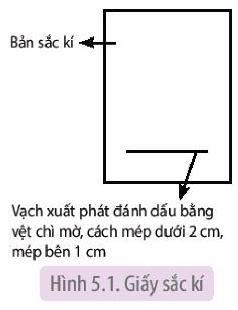
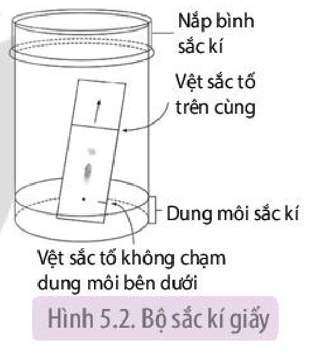
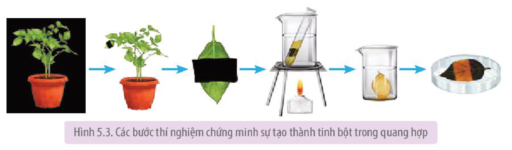
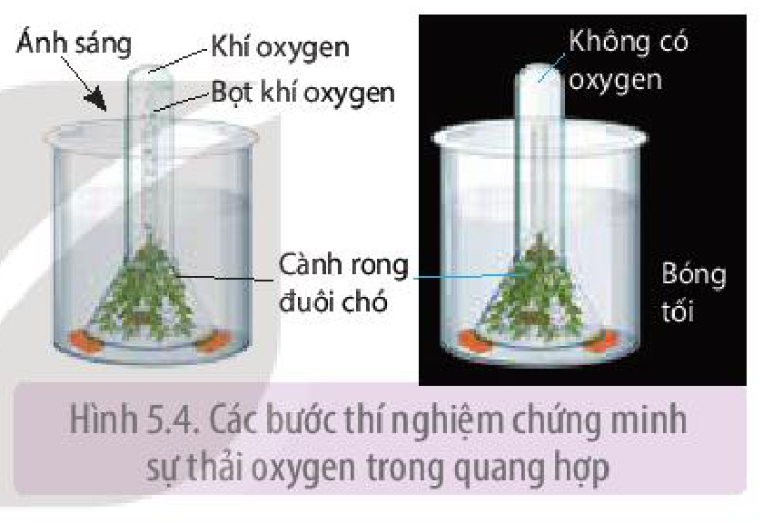

<!-- pdf:36 -->

# BÀI 5: THỰC HÀNH: QUANG HỢP Ở THỰC VẬT

## I. YÊU CẦU CẦN ĐẠT
<!-- ocr-ok: OCR nhận diện sai GẦU GẦN -->

- Quan sát được lục lạp trong tế bào thực vật; nhận biết, tách chiết các sắc tố (diệp lục a, b; carotene và xanthophyll) trong lá cây.
- Thiết kế và thực hiện được các thí nghiệm về sự hình thành tinh bột, thải khí oxygen trong quá trình quang hợp.

## II. CHUẨN BỊ

### 1. Dụng cụ, thiết bị

- Kim mũi mác, lam kính, lamen, kính hiển vi có vật kính $10\times$ và $40\times$.
- Bình tam giác, cốc thuỷ tinh, giấy sắc kí, ống eppendorf, bình sắc kí hình trụ có nắp đậy, ống mao dẫn chuyên dùng cho sắc kí, thước kẻ, bút chì.
- Giá thí nghiệm, panh, băng giấy đen, nước ấm (khoảng $40\ ^\circ\text{C}$), đĩa Petri, đèn cồn, ống nghiệm, cốc thuỷ tinh, que đóm, bật lửa/diêm.

### 2. Hoá chất

<!-- term: Dung môi sắc kí -->
- Nước cất.
- Acetone 80%, dung môi dùng để chạy sắc kí là hỗn hợp petroleum ether và ethanol tỉ lệ 14 : 1.
- Cồn $90^\circ$, dung dịch iodine.

### 3. Mẫu vật

- Cây rong mái chèo hoặc lá thài lài tía.
- Lá cây (các loại lá rau theo mùa: rau muống, rau ngót, rau cải, rau dền đỏ,...).
- Chậu cây khoai tây hoặc chậu cây khác (cây theo mùa), cành rong đuôi chó.

## III. CÁCH TIẾN HÀNH

### 1. Quan sát lục lạp trong tế bào thực vật

**a) Nguyên lí**

Lục lạp là bào quan có màu, di chuyển trong dịch tế bào, có thể quan sát dưới kính hiển vi.

**b) Quy trình thí nghiệm**

*Bước 1:* Lấy một lá rong mái chèo còn tươi, nguyên vẹn và cuốn phiến lá vòng qua ngón tay trỏ (kẹp giữ lá bằng ngón cái và ngón giữa). Dùng kim mũi mác bóc lấy lớp biểu bì của lá.

*Bước 2:* Đặt mẫu biểu bì lên lam kính, nhỏ 1 giọt nước cất lên trên, đậy lamen. Quan sát bằng kính hiển vi với vật kính $10\times$ và $40\times$.

*Bước 3:* Vẽ hình ảnh quan sát được vào vở.

<!-- pdf:37 -->

### 2. Tách chiết các sắc tố trong lá cây

**a) Nguyên lí**

<!-- term: Sắc kí giấy -->
<!-- term: Acetone 80% -->
Một số dung môi hữu cơ có khả năng phá vỡ liên kết giữa diệp lục, lipid và protein trong lá, nhờ đó có thể tách chiết sắc tố ở trạng thái dung dịch. Sử dụng **sắc kí giấy** với dung môi thích hợp có thể tách và quan sát các sắc tố thành phần.

**b) Quy trình thí nghiệm**

<!-- term: Acetone 80% -->
*Bước 1:* Chuẩn bị dung dịch sắc tố: cân khoảng 2 g lá tươi đã cắt bỏ cuống và gân chính. Dùng kéo cắt nhỏ lá, cho vào bình tam giác. Đổ vào đó khoảng 20 mL acetone 80% cho ngập mẫu. Sau 1 giờ, thu được dung dịch sắc tố.

<!-- term: Dung môi sắc kí -->
*Bước 2:* Chuẩn bị dung dịch sắc kí: hỗn hợp petroleum ether và ethanol tỉ lệ 14 : 1.

Hình 5.1. Giấy sắc kí

*Bước 3:* Tiến hành thí nghiệm:

- Lấy 0,3 mL dung dịch sắc tố đậm đặc cho vào ống eppendorf, đậy kín để tránh bay hơi.
- Dùng bút chì và thước kẻ, kẻ một đường mờ trên giấy sắc kí theo Hình 5.1.
- Dùng ống hút mao dẫn hút dung dịch sắc tố và chấm dịch theo vệt chì mờ trên bản sắc kí khoảng 10 lần.
- Đặt bản sắc kí theo chiều thẳng đứng vào bình sắc kí đã đựng sẵn dung dịch sắc kí, sao cho vệt sắc tố không chạm vào dung dịch bên dưới như Hình 5.2.
- Để cho các sắc tố tách riêng thành 4 loại trong khoảng 10 phút.

Hình 5.2. Bộ sắc kí giấy

*Bước 4:* Quan sát hiện tượng và ghi lại kết quả thí nghiệm vào vở.

### 3. Sự tạo thành tinh bột trong quang hợp

**a) Nguyên lí**

<!-- term: Iodine -->
**Iodine** là thuốc thử tinh bột. Khi nhỏ iodine vào tinh bột, tinh bột sẽ chuyển thành màu xanh tím.

**b) Quy trình thí nghiệm**

*Bước 1:* Chuẩn bị thí nghiệm:

- Đặt chậu cây khoai tây trong bóng tối 2 ngày.
- Dùng băng giấy đen bịt kín một phần lá ở cả hai mặt, đem chậu cây để ra ngoài nắng khoảng 4 – 6 giờ.
- Ngắt chiếc lá, bỏ băng giấy đen.

*Bước 2:* Tiến hành thí nghiệm:

- Đun sôi cách thuỷ lá trong cồn $90^\circ$.
- Rửa sạch lá trong cốc nước ấm.
- Nhúng lá vào dung dịch iodine đựng trong đĩa Petri và quan sát sự thay đổi màu sắc trên lá.

<!-- pdf:38 -->

Hình 5.3. Các bước thí nghiệm chứng minh sự tạo thành tinh bột trong quang hợp

*Bước 3:* Ghi lại kết quả thí nghiệm vào vở.

### 4. Sự thải oxygen trong quang hợp

**a) Nguyên lí**

Oxygen tạo thành trong quang hợp có thể làm tàn đỏ của que đóm sáng lên hoặc làm que đóm cháy nhẹ.

**b) Quy trình thí nghiệm**
<!-- ocr-ok: OCR dính chữ Quytrình -->

*Bước 1:* Lấy 2 cành rong đuôi chó cho vào 2 phễu thuỷ tinh sao cho phần ngọn rong ở phía miệng phễu.

*Bước 2:* Úp ngược 2 phễu vào 2 cốc thủy tinh đựng nước. Đổ đầy nước vào 2 ống nghiệm, dùng ngón tay cái bịt miệng từng ống nghiệm và nhanh tay úp ống nghiệm vào cuống phễu (H 5.4).

Hình 5.4. Các bước thí nghiệm chứng minh sự thải oxygen trong quang hợp

*Bước 3:* Để một cốc trong tối hoặc bọc giấy đen, cốc còn lại để ra nắng hoặc ánh sáng đèn.

*Bước 4:* Sau 30 phút, quan sát hiện tượng xảy ra ở 2 ống nghiệm.

## IV. THU HOẠCH

Học sinh viết báo cáo thực hành theo các nội dung sau:

**BÁO CÁO THỰC HÀNH**

1. **Mục đích**
2. **Kết quả và giải thích**
   - Hình vẽ lục lạp trong tế bào biểu bì lá cây rong mái chèo.
   - Kết quả thí nghiệm nhận biết, tách chiết các sắc tố trong lá cây và giải thích.
   - Kết quả thí nghiệm sự tạo thành tinh bột và thải oxygen trong quang hợp và giải thích.
3. **Trả lời câu hỏi**
   a) Em có nhận xét gì về hình dạng, số lượng, kích thước và sự phân bố lục lạp trong tế bào cây rong mái chèo?
   b) Tại sao phải để chậu cây trong bóng tối 2 ngày trước khi làm thí nghiệm?
   c) Việc trồng cây thuỷ sinh hoặc thả rong trong bể cá có tác dụng gì?

## 📷 Danh sách hình trong bài

| Mã hình | Trang PDF | Vị trí | Chú thích gốc |
|---|---|---|---|
| H11-sinh-b05-01 | 37 | Mục III.2.b | Hình 5.1. Giấy sắc kí |
| H11-sinh-b05-02 | 37 | Mục III.2.b | Hình 5.2. Bộ sắc kí giấy |
| H11-sinh-b05-03 | 38 | Mục III.3.b | Hình 5.3. Các bước thí nghiệm chứng minh sự tạo thành tinh bột trong quang hợp |
| H11-sinh-b05-04 | 38 | Mục III.4.b | Hình 5.4. Các bước thí nghiệm chứng minh sự thải oxygen trong quang hợp |
