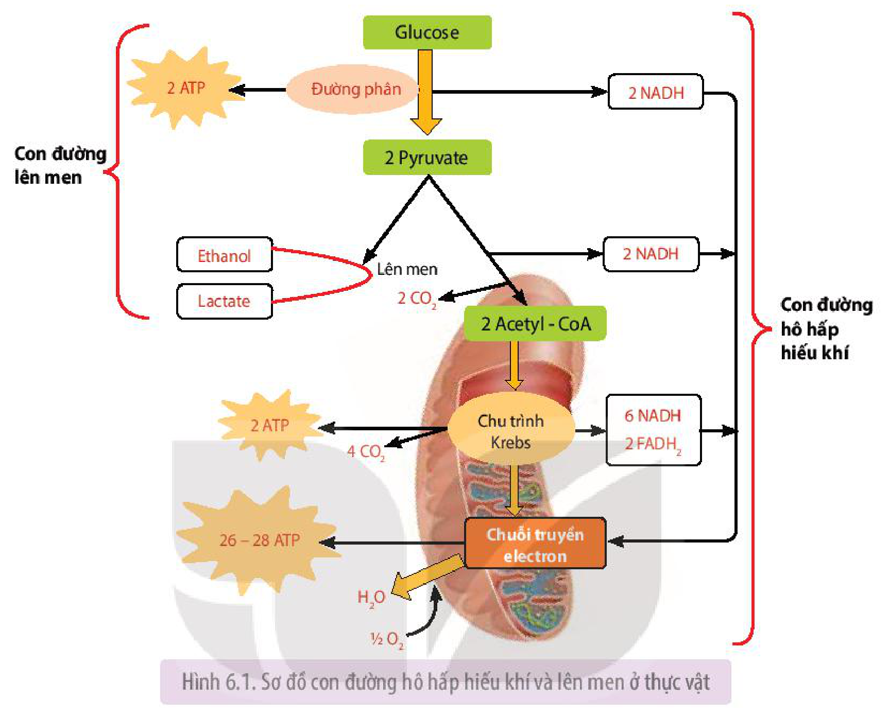
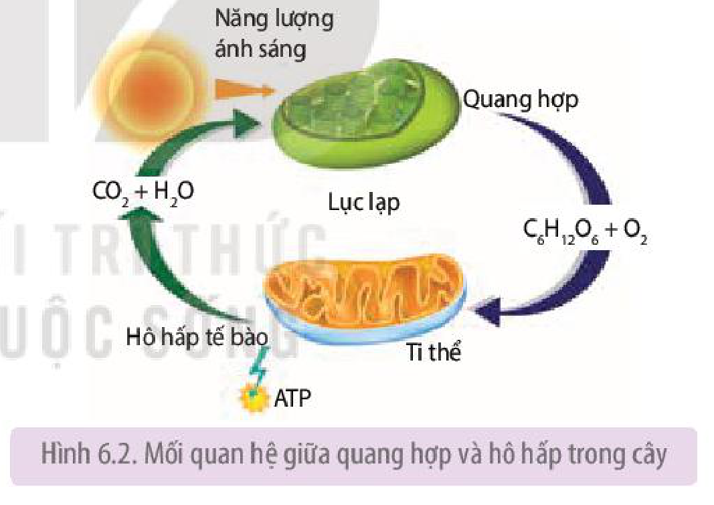

<!-- pdf:39 -->

# BÀI 6: HÔ HẤP Ở THỰC VẬT

## 🎯 Yêu cầu cần đạt

- Nêu được khái niệm hô hấp ở thực vật.
- Phân tích được vai trò của hô hấp ở thực vật.
- Trình bày được sơ đồ các giai đoạn của hô hấp ở thực vật.
- Phân tích được ảnh hưởng của các điều kiện môi trường đến hô hấp ở thực vật. Vận dụng được những hiểu biết về hô hấp giải thích các vấn đề thực tiễn.
- Phân tích được mối quan hệ giữa quang hợp và hô hấp.

## 🔴 Mở đầu

Để thực hiện các hoạt động sống như trao đổi nước, khoáng, sinh trưởng, phát triển, sinh sản,... thực vật sử dụng nguồn năng lượng do quá trình nào cung cấp?

## I. KHÁI QUÁT VỀ HÔ HẤP Ở THỰC VẬT

### 1. Khái niệm

**Hô hấp** là quá trình phân giải các hợp chất hữu cơ phức tạp, phổ biến là carbohydrate thành các chất đơn giản, đồng thời tạo ra ATP và nhiệt năng.

<!-- term: Hô hấp hiếu khí -->
<!-- term: Lên men -->
Hô hấp có thể diễn ra trong điều kiện có oxygen (hô hấp hiếu khí) hoặc không có oxygen (lên men). Ở thực vật, hô hấp hiếu khí là hình thức hô hấp chủ yếu.

<!-- term: Hô hấp hiếu khí -->
Phương trình tổng quát của hô hấp hiếu khí được viết như sau:

$$\text{C}_6\text{H}_{12}\text{O}_6 + 6\text{O}_2 \longrightarrow 6\text{CO}_2 + 6\text{H}_2\text{O} + \text{Năng lượng (nhiệt + ATP)}$$
<!-- ocr-ok: công thức LaTeX -->

### 2. Vai trò của hô hấp

- Năng lượng (dưới dạng ATP) sinh ra từ hô hấp được sử dụng cho hầu hết các hoạt động sống của cây như tổng hợp và vận chuyển các chất, sinh trưởng và phát triển, cảm ứng,...
- Nhiệt năng được giải phóng ra trong hô hấp giúp duy trì nhiệt độ cơ thể, đảm bảo cho các hoạt động sống trong cơ thể thực vật diễn ra một cách bình thường.
- Hô hấp tạo ra các sản phẩm trung gian (đường 3 carbon, pyruvate,...) là nguyên liệu để tổng hợp nên các hợp chất hữu cơ trong cơ thể như protein, acid béo,...

## II. CÁC CON ĐƯỜNG HÔ HẤP Ở THỰC VẬT

<!-- term: Hô hấp hiếu khí -->
<!-- term: Lên men -->
Hô hấp ở thực vật có thể diễn ra theo 2 con đường: hô hấp hiếu khí và lên men. Hô hấp hiếu khí là con đường diễn ra phổ biến ở thực vật trong điều kiện bình thường, có $\text{O}_2$; lên men chỉ xảy ra trong điều kiện thiếu $\text{O}_2$ như trường hợp rễ cây bị ngập úng, hạt ngâm trong nước,... Lên men là một phản ứng thích nghi của cây, giúp cây tồn tại tạm thời trong điều kiện thiếu $\text{O}_2$.

<!-- pdf:40 -->

<!-- term: Đường phân -->
Hai con đường hô hấp hiếu khí và lên men có chung giai đoạn đường phân (H 6.1).

Hình 6.1. Sơ đồ con đường hô hấp hiếu khí và lên men ở thực vật

### 1. Hô hấp hiếu khí

<!-- term: Hô hấp hiếu khí -->
Hô hấp hiếu khí diễn ra mạnh ở các tế bào, mô, cơ quan đang có các hoạt động sinh lí mạnh như hạt đang nảy mầm, cây đang ra hoa, tạo quả,... Hô hấp hiếu khí gồm đường phân, chu trình Krebs và chuỗi truyền electron.

**a) Đường phân**

<!-- term: Đường phân -->
<!-- term: Pyruvate -->
<!-- term: NADH, FADH₂ -->
Giai đoạn này xảy ra ở tế bào chất, trong điều kiện không có $\text{O}_2$ (kị khí), khi đó 1 phân tử glucose sẽ phân giải thành 2 phân tử pyruvate và thu được 2 ATP, 2 NADH.

**b) Oxy hoá pyruvate và chu trình Krebs**

<!-- term: Pyruvate -->
<!-- term: Ti thể -->
<!-- term: Chu trình Krebs -->
<!-- term: NADH, FADH₂ -->
Hai phân tử pyruvate tạo ra được chuyển vào chất nền ti thể, tại đây, chúng được biến đổi thành 2 phân tử acetyl-CoA, 2 NADH và $2\text{CO}_2$. Sau khi tạo thành, 2 phân tử acetyl-CoA đi vào chu trình Krebs. Chu trình Krebs diễn ra trong chất nền của ti thể (H 6.2). Tại đây, mỗi phân tử acetyl-CoA bị chuyển hoá hoàn toàn giải phóng ra $2\text{CO}_2$, 3 NADH, $1\text{FADH}_2$ và 1 ATP.

**c) Chuỗi truyền electron**

<!-- term: Ti thể -->
<!-- term: Chuỗi truyền electron -->
<!-- term: NADH, FADH₂ -->
Chuỗi truyền electron phân bố ở màng trong của ti thể. Tại đây, electron sẽ được truyền từ các phân tử NADH và $\text{FADH}_2$ (được tạo ra từ các giai đoạn trước) tới $\text{O}_2$ qua một chuỗi các phản ứng oxy hoá khử, cuối cùng tạo ra ATP và nước. Giai đoạn này tạo ra nhiều ATP nhất trong quá trình hô hấp.

<!-- pdf:41 -->

Như vậy, từ 1 phân tử glucose, qua hô hấp hiếu khí giải phóng 6 phân tử $\text{H}_2\text{O}$, 6 phân tử $\text{CO}_2$ và tạo ra 30 – 32 phân tử ATP. Đây là nguồn năng lượng lớn cung cấp cho các hoạt động sống của cây, đảm bảo cho cây tồn tại và phát triển.

### 2. Lên men

Con đường lên men gồm 2 giai đoạn: đường phân và lên men, trong đó, giai đoạn đường phân diễn ra tương tự như ở hô hấp hiếu khí.

<!-- term: Lên men -->
Ở giai đoạn lên men, pyruvate được tạo ra từ quá trình đường phân, trong điều kiện không có $\text{O}_2$ sẽ lên men tạo thành ethanol hoặc lactate.

<!-- term: Lên men -->
Như vậy, 1 phân tử glucose phân giải theo con đường lên men chỉ thu được 2 phân tử ATP.

## ❓ Dừng lại và suy ngẫm

1. Nêu khái niệm hô hấp ở thực vật và phân tích vai trò của hô hấp đối với cơ thể thực vật.
2. Con đường hô hấp hiếu khí và lên men gồm những giai đoạn nào? Nguyên liệu và sản phẩm của từng giai đoạn là gì?

## III. CÁC YẾU TỐ ẢNH HƯỞNG ĐẾN HÔ HẤP Ở THỰC VẬT

### 1. Nước

Nước là dung môi, là môi trường cho các phản ứng hoá học xảy ra, đồng thời hoạt hoá các enzyme hô hấp. Vì vậy, nước trong mô, cơ quan, cơ thể thực vật liên quan trực tiếp đến cường độ hô hấp.

Trong giới hạn nhất định, cường độ hô hấp tỉ lệ thuận với hàm lượng nước. Các hạt khô đang ở trạng thái ngủ, nghỉ có hàm lượng nước rất thấp, khi hạt hút nước và nảy mầm thì cường độ hô hấp tăng nhanh. Ví dụ: Hạt ngô, hạt thóc phơi khô có hàm lượng nước khoảng 11 – 12%; khi hàm lượng nước trong hạt tăng lên 14 – 15% thì cường độ hô hấp tăng lên 4 – 5 lần; tăng hàm lượng nước lên 30 – 35% thì cường độ hô hấp tăng lên hàng nghìn lần$^{(*)}$.

### 2. Nhiệt độ

<!-- term: Nhiệt độ tối ưu -->
Nhiệt độ ảnh hưởng đến hoạt động của các enzyme hô hấp, từ đó ảnh hưởng đến cường độ hô hấp. Trong giới hạn nhất định, khi nhiệt độ tăng, cường độ hô hấp cũng tăng, thúc đẩy sự nảy mầm của hạt, tạo năng lượng cung cấp cho các giai đoạn tiếp theo của cây non. Mỗi loại hạt khác nhau thường có giới hạn nhiệt độ cho sự nảy mầm khác nhau (Bảng 6.1).

**Bảng 6.1.** Giới hạn nhiệt độ cho sự nảy mầm của một số loại hạt$^{(*\*)}$

| Loại hạt | Tối thiểu ($^\circ\text{C}$) | Tối ưu ($^\circ\text{C}$) | Tối đa ($^\circ\text{C}$) |
|---|---|---|---|
| Ngô | 8 – 10 | 35 | 45 |
| Lúa | 10 – 12 | 35 – 37 | 44 – 50 |
| Dưa hấu | 12 – 14 | 35 | 40 |

> (\*) Nguồn: Sinh lí thực vật – Hoàng Minh Tấn và cộng sự, 2006.
> (\*\*) Nguồn: Sinh lí thực vật ứng dụng – Nguyễn Quang Sáng và cộng sự, 2007.

<!-- pdf:42 -->

### 3. Hàm lượng $\text{O}_2$

Khí $\text{O}_2$ là nguyên liệu của hô hấp nên nồng độ $\text{O}_2$ ảnh hưởng trực tiếp đến cường độ hô hấp. Nếu hàm lượng $\text{O}_2$ trong không khí giảm xuống dưới 10% thì hô hấp bị ảnh hưởng; dưới 5% thì cây chuyển sang con đường lên men. Khi đó, năng lượng tạo ra không đủ cung cấp cho các hoạt động của cây, cây có thể chết nếu tình trạng này kéo dài.

### 4. Hàm lượng $\text{CO}_2$

Hàm lượng $\text{CO}_2$ trong không khí cao sẽ ức chế hô hấp hiếu khí, cây chuyển sang con đường lên men, tạo nhiều sản phẩm độc, gây hại cho cây trồng hoặc làm giảm sức sống của hạt. Khi hàm lượng $\text{CO}_2$ trong không khí tăng 35% so với nồng độ $\text{CO}_2$ ở điều kiện bình thường thì hầu hết các hạt giống đều mất khả năng nảy mầm$^{(*)}$.

## ❓ Dừng lại và suy ngẫm

1. Tại sao để hạt nảy mầm cần cung cấp đủ nước?
2. Nước, nhiệt độ, hàm lượng $\text{O}_2$, $\text{CO}_2$ có ảnh hưởng như thế nào đến hô hấp ở thực vật? Giải thích.

## IV. ỨNG DỤNG CỦA HÔ HẤP Ở THỰC VẬT VÀO THỰC TIỄN

Những hiểu biết về hô hấp ở thực vật đã được con người vận dụng trong trồng trọt và bảo quản nông sản nhằm nâng cao năng suất cây trồng và kéo dài thời gian bảo quản nông sản sau thu hoạch.

### 1. Hô hấp trong bảo quản nông sản

Trong quá trình bảo quản nông sản, cần đảm bảo giữ được cả về số lượng và chất lượng của sản phẩm bằng cách làm giảm cường độ hô hấp đến mức tối thiểu. Người ta có thể kéo dài thời gian bảo quản nông sản thông qua việc khống chế các yếu tố ngoại cảnh (nước, $\text{CO}_2$, $\text{O}_2$) ảnh hưởng đến hô hấp.

**a) Điều chỉnh hàm lượng nước**

Trong giới hạn nhất định, hàm lượng nước tỉ lệ thuận với cường độ hô hấp, vì vậy, cần điều chỉnh hàm lượng nước trong nông sản phù hợp với mục đích và đối tượng bảo quản nhằm kéo dài thời gian bảo quản. Ví dụ: Để bảo quản hiệu quả các loại hạt, cần điều chỉnh độ ẩm của hạt về mức 10 – 13% bằng cách phơi hoặc sấy khô sau thu hoạch, sau đó cất giữ hạt trong các dụng cụ có nắp đậy hoặc trong kho. Đối với các loại rau có hàm lượng nước cao, có thời gian bảo quản ngắn, cần duy trì độ ẩm không khí khoảng 90 – 95%. Độ ẩm phù hợp để bảo quản các loại quả khoảng 80 – 90%.

**b) Điều chỉnh nhiệt độ**

Nhiệt độ môi trường thấp làm giảm cường độ hô hấp ở thực vật, đồng thời ức chế sự sinh trưởng của các vi sinh vật gây hỏng nông sản. Do đó, có thể điều chỉnh nhiệt độ môi trường bảo quản về mức phù hợp với từng đối tượng nông sản để kéo dài thời gian bảo quản. Ví dụ: Nhiệt độ tối ưu cho bảo quản khoai tây là $4\ ^\circ\text{C}$, cam và chanh là $6\ ^\circ\text{C}$, bắp cải là $1\ ^\circ\text{C}$.

> (\*) Nguồn: Sinh lý thực vật ứng dụng – Vũ Quang Sáng, 2007

<!-- pdf:43 -->

**c) Điều chỉnh thành phần không khí trong môi trường bảo quản**

<!-- term: Điều chỉnh khí trong bảo quản -->
Thành phần không khí, đặc biệt là hàm lượng $\text{O}_2$ và $\text{CO}_2$ trong môi trường có ảnh hưởng rõ rệt tới cường độ hô hấp ở thực vật. Vì vậy, chủ động điều chỉnh hàm lượng các khí này trong môi trường bảo quản là một trong những biện pháp bảo quản nông sản hiệu quả. Ví dụ: Rau được bảo quản trong môi trường có hàm lượng $\text{CO}_2$ là 10%, $\text{O}_2$ 11% hoặc $\text{N}_2$ 79% thì thời gian bảo quản có thể kéo dài thêm 30 – 40% so với bảo quản thông thường.

### 2. Hô hấp trong trồng trọt

Trong trồng trọt, cần áp dụng một số biện pháp canh tác như làm đất (cày, bừa, xới đất) trước khi gieo hạt, làm cỏ sục bùn, vun gốc,... nhằm tạo môi trường thoáng khí, cung cấp $\text{O}_2$ cho cây hô hấp hiếu khí.

Ngoài ra, trồng cây đúng thời vụ, đảm bảo hệ thống cấp và thoát nước trong canh tác để có thể chủ động tưới tiêu hợp lí, tránh hiện tượng ngập úng cho cây, tạo điều kiện thuận lợi cho cây hô hấp hiếu khí cung cấp năng lượng cho các hoạt động sống, qua đó thúc đẩy quá trình sinh trưởng, phát triển, nâng cao năng suất cây trồng.

## V. MỐI QUAN HỆ GIỮA QUANG HỢP VÀ HÔ HẤP

Quang hợp và hô hấp là hai quá trình sinh lí quan trọng, liên quan đến trao đổi chất và chuyển hoá năng lượng diễn ra trong cây.

<!-- term: Cân bằng hô hấp và quang hợp -->
Hai quá trình này liên quan chặt chẽ với nhau, trong đó quang hợp tạo ra chất hữu cơ và $\text{O}_2$ cung cấp nguyên liệu cho quá trình hô hấp. Ngược lại $\text{CO}_2$ là sản phẩm của hô hấp được sử dụng làm nguyên liệu cho quang hợp (H 6.2). Hô hấp còn tạo ra các sản phẩm trung gian làm tăng áp suất thẩm thấu của tế bào rễ, tạo điều kiện cho rễ hút nước, cung cấp nguyên liệu cho quang hợp.

Hình 6.2. Mối quan hệ giữa quang hợp và hô hấp trong cây

<!-- term: Cân bằng hô hấp và quang hợp -->
Mối quan hệ giữa quang hợp và hô hấp ảnh hưởng đến lượng chất hữu cơ tích luỹ trong cây và quyết định đến năng suất cây trồng.

## ❓ Dừng lại và suy ngẫm

1. Sơ đồ hoá các ứng dụng thực tiễn của quá trình hô hấp ở thực vật. Vì sao điều chỉnh các yếu tố ảnh hưởng đến hô hấp có thể kéo dài thời gian bảo quản nông sản và góp phần nâng cao năng suất cây trồng?
2. Quan sát Hình 6.2, hãy phân tích mối quan hệ giữa 2 quá trình quang hợp và hô hấp ở thực vật.

<!-- pdf:44 -->

## 📌 Kiến thức cốt lõi

- Hô hấp là quá trình phân giải các hợp chất hữu cơ phức tạp, phổ biến là carbohydrate tạo thành các chất đơn giản, đồng thời tạo ra ATP và nhiệt năng.
- Hô hấp tạo ra năng lượng để duy trì nhiệt độ cho cơ thể và sử dụng cho các hoạt động sống của cây, đồng thời tạo ra các sản phẩm trung gian cung cấp nguyên liệu cho quá trình tổng hợp các hợp chất hữu cơ khác trong cơ thể.
- Hô hấp hiếu khí là con đường phổ biến ở thực vật, xảy ra trong điều kiện có $\text{O}_2$, gồm 3 giai đoạn là đường phân, chu trình Krebs và chuỗi truyền electron. Năng lượng thu được khi phân giải hiếu khí 1 phân tử glucose là 30 – 32 ATP.
- Lên men diễn ra trong điều kiện môi trường thiếu $\text{O}_2$, gồm 2 giai đoạn là đường phân và lên men; 1 phân tử glucose qua lên men chỉ thu được 2 ATP.
- Hô hấp chịu ảnh hưởng của nhiều yếu tố môi trường như nhiệt độ, nước, hàm lượng $\text{CO}_2$,... Con người có thể dựa vào hiểu biết về các yếu tố đó để điều khiển quá trình hô hấp ở thực vật theo hướng có lợi trong trồng trọt và bảo quản nông sản.
- Hô hấp và quang hợp có mối quan hệ mật thiết, phụ thuộc lẫn nhau. Quang hợp cung cấp nguyên liệu cho hô hấp và ngược lại.

## ✏️ Luyện tập và vận dụng

1. Tại sao trong quá trình bảo quản nông sản, cần đưa cường độ hô hấp của nông sản về mức tối thiểu?
2. Giải thích cơ sở khoa học của việc ngâm hạt giống vào nước và ủ hạt trước khi gieo trồng.
3. Hãy nêu các biện pháp bảo quản nông sản mà em biết. Giải thích cơ sở khoa học của việc rau trong siêu thị được bảo quản trong túi nylon đục lỗ và để trong tủ mát.
4. Hãy giải thích vai trò của hô hấp đối với sự hút nước và khoáng của cây. Hiểu biết này có ý nghĩa gì trong trồng trọt?

## 💡 Em có biết

**Hô hấp sáng** (**quang hô hấp**) là quá trình oxy hoá hợp chất hữu cơ và giải phóng $\text{CO}_2$, diễn ra trong điều kiện cường độ ánh sáng cao. Hô hấp sáng thường xảy ra ở thực vật $\text{C}_3$ như lúa, đậu, khoai, sắn, cam, chanh, nhãn, vải,...

Khác với hô hấp hiếu khí, hô hấp sáng không tạo ra năng lượng cung cấp cho hoạt động sống của cây mà tiêu tốn năng lượng ATP một cách vô ích và tiêu tốn khoảng 30 – 50% lượng sản phẩm quang hợp, dẫn đến làm giảm năng suất cây trồng.

Vì vậy, trong chọn và tạo giống cây trồng, người ta thường chú trọng chọn, tạo những giống có cường độ hô hấp sáng thấp nhằm giảm tiêu hao chất hữu cơ, giúp tăng năng suất cây trồng.

## 📷 Danh sách hình trong bài

| Mã hình | Trang PDF | Vị trí | Chú thích gốc |
|---|---|---|---|
| H11-sinh-b06-01 | 40 | Mục II | Hình 6.1. Sơ đồ con đường hô hấp hiếu khí và lên men ở thực vật |
| H11-sinh-b06-02 | 43 | Mục V | Hình 6.2. Mối quan hệ giữa quang hợp và hô hấp trong cây |
