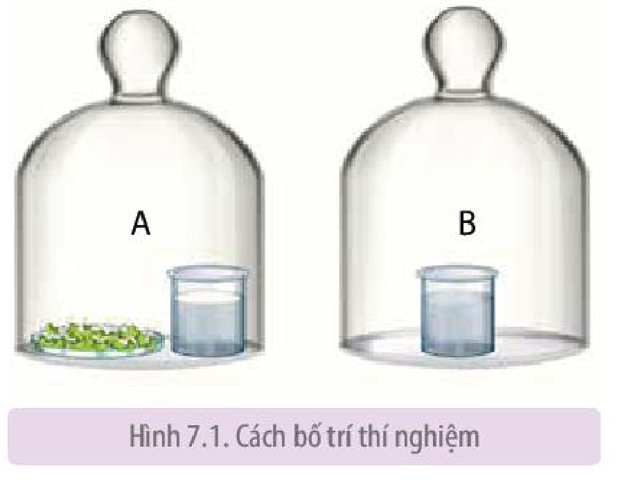
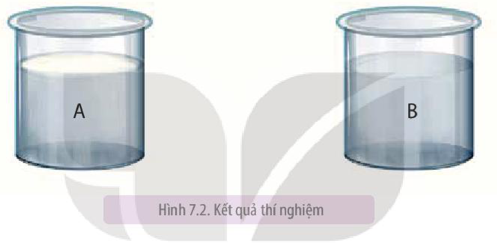

<!-- pdf:45 -->

# BÀI 7: THỰC HÀNH: HÔ HẤP Ở THỰC VẬT

## I. YÊU CẦU CẦN ĐẠT

Thực hành được thí nghiệm hô hấp ở thực vật.

## II. CHUẨN BỊ

### 1. Dụng cụ, thiết bị

Tủ sấy (nếu có), đĩa Petri, bông y tế hoặc giấy thấm, cốc thuỷ tinh, nước ấm (khoảng $40\ ^\circ\text{C}$), chuông thuỷ tinh.

### 2. Hoá chất

Nước vôi trong.

### 3. Mẫu vật

Một trong các loại hạt sau: đậu tương, đậu đen, đậu xanh, lạc, vừng.

## III. CÁCH TIẾN HÀNH

### 1. Nguyên lí

<!-- term: Nước vôi trong -->
<!-- term: Hạt nảy mầm -->
$\text{CO}_2$ được tạo ra do hô hấp của hạt nảy mầm sẽ được hấp thụ bởi nước vôi trong tạo thành kết tủa (váng đục trên bề mặt cốc nước vôi trong).

### 2. Quy trình thí nghiệm

<!-- term: Hạt nảy mầm -->
*Bước 1:* Chuẩn bị hạt nảy mầm:

- Chọn khoảng 5 g hạt chắc, không bị vỡ, không bị mọt.
- Ngâm hạt trong cốc nước ấm (khoảng $40\ ^\circ\text{C}$) trong khoảng 2 giờ.
- Vớt hạt, rải đều vào đĩa Petri đã lót giấy thấm (hoặc bông).
- Phủ giấy thấm đã thấm nước (hoặc bông thấm nước) lên trên bề mặt hạt và đậy nắp đĩa Petri.
- Để đĩa Petri ở nhiệt độ phòng hoặc trong tủ ấm có nhiệt độ $30 - 35\ ^\circ\text{C}$ trong 1 – 2 ngày.

Hình 7.1. Cách bố trí thí nghiệm

<!-- pdf:46 -->

<!-- term: Nước vôi trong -->
<!-- term: Hạt nảy mầm -->
*Bước 2:* Tiến hành thí nghiệm:

- Chuẩn bị 2 chuông thuỷ tinh đã dán nhãn (A, B) và 2 cốc nước vôi trong.
- Đặt đĩa hạt nảy mầm và 1 cốc nước vôi trong vào chuông A.
- Đặt cốc nước vôi trong còn lại vào chuông B.
- Để 2 chuông trong điều kiện phòng thí nghiệm khoảng 1 giờ.

*Bước 3:* Quan sát hiện tượng và kết quả thí nghiệm:

- Sau 1 giờ, mở 2 chuông và quan sát hiện tượng trên bề mặt của 2 cốc nước vôi trong.
- Ghi lại kết quả thí nghiệm và giải thích.

Hình 7.2. Kết quả thí nghiệm

## IV. THU HOẠCH

Học sinh viết báo cáo thực hành theo các nội dung sau:

**BÁO CÁO THỰC HÀNH**

1. **Mục đích**
2. **Kết quả và giải thích**
<!-- ocr-ok: OCR dính chữ Mụcđích -->

   Báo cáo kết quả thí nghiệm về hô hấp ở hạt nảy mầm và giải thích.

3. **Trả lời câu hỏi**
   a) Tại sao phải ngâm hạt trong nước ấm khoảng $40\ ^\circ\text{C}$?
   b) Tại sao trong thí nghiệm này dùng hạt nảy mầm mà không dùng cây?

## 📷 Danh sách hình trong bài

| Mã hình | Trang PDF | Vị trí | Chú thích gốc |
|---|---|---|---|
| H11-sinh-b07-01 | 45 | Mục III.2 | Hình 7.1. Cách bố trí thí nghiệm |
| H11-sinh-b07-02 | 46 | Mục III.2 | Hình 7.2. Kết quả thí nghiệm |
