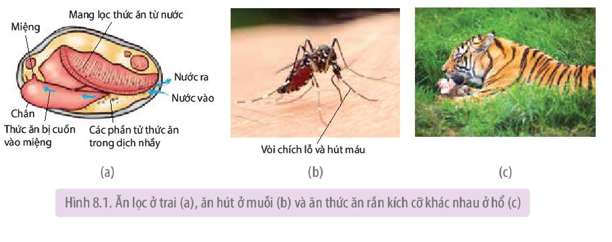
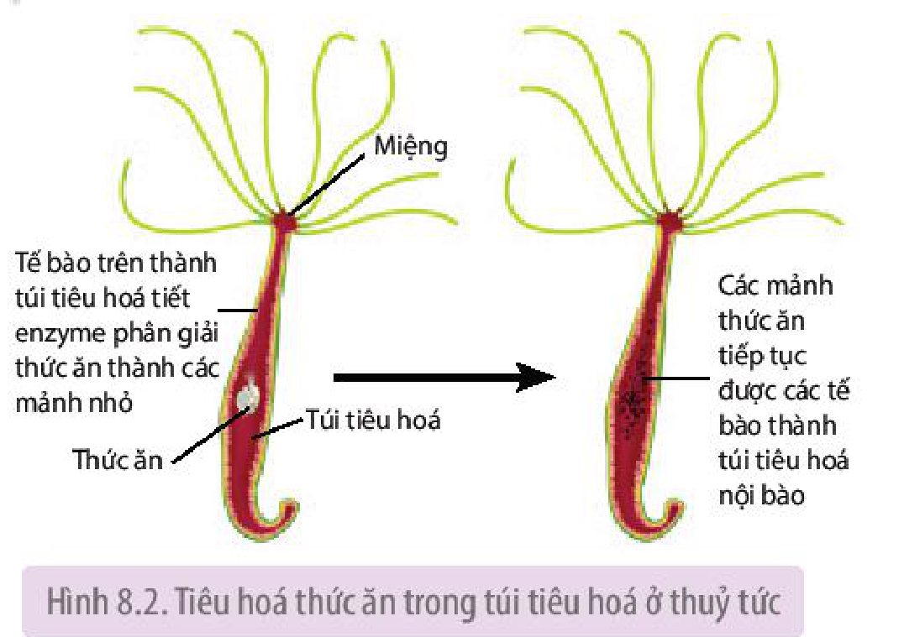
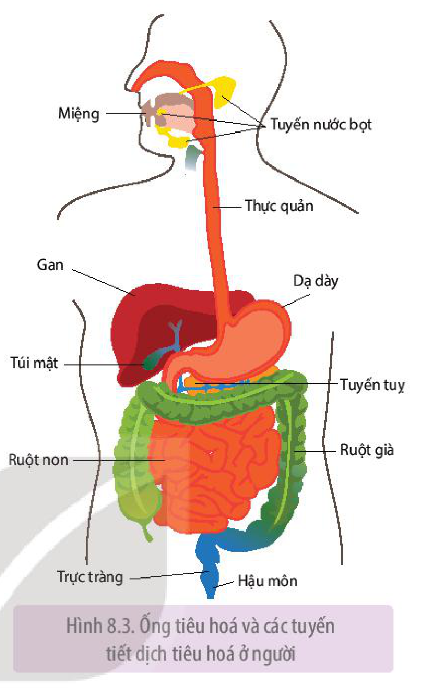
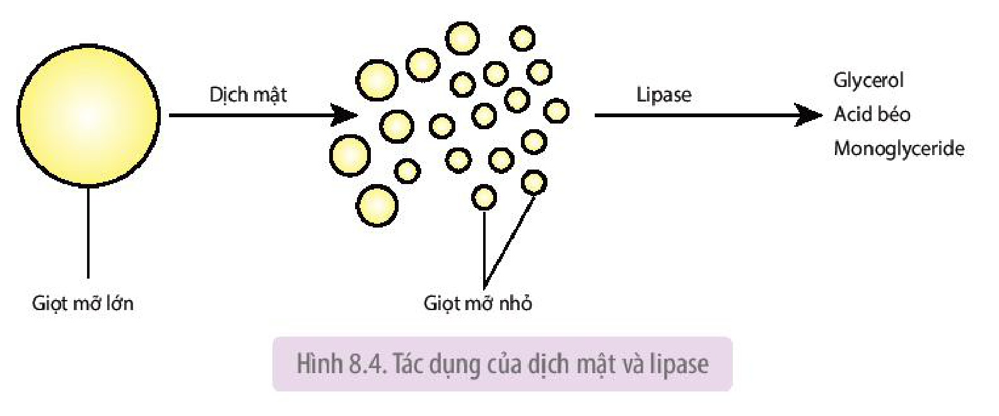
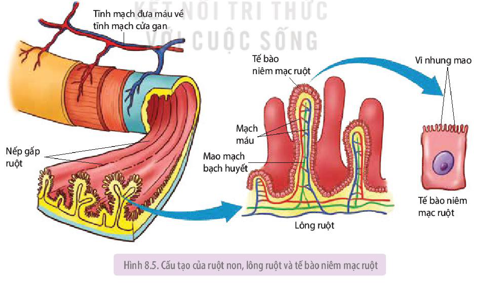

<!-- pdf:47 -->

# BÀI 8: DINH DƯỠNG VÀ TIÊU HOÁ Ở ĐỘNG VẬT

## 🎯 Yêu cầu cần đạt

- Nêu được quá trình dinh dưỡng bao gồm: lấy thức ăn, tiêu hoá, hấp thụ và đồng hoá chất dinh dưỡng.
- Dựa vào sơ đồ (hoặc hình ảnh), trình bày được các hình thức tiêu hoá ở động vật.
- Vận dụng được hiểu biết về dinh dưỡng trong xây dựng chế độ ăn uống và các biện pháp dinh dưỡng phù hợp ở mỗi lứa tuổi và trạng thái cơ thể.
- Giải thích được vai trò của việc sử dụng thực phẩm sạch trong đời sống con người.
- Thực hiện tìm hiểu được các bệnh về tiêu hoá ở người và các bệnh học đường liên quan đến dinh dưỡng và cách phòng tránh.
- Vận dụng hiểu biết về hệ tiêu hoá để phòng các bệnh về tiêu hoá.

## 🔴 Mở đầu

Thức ăn sau khi ăn vào sẽ được cơ thể người tiêu hoá, hấp thụ và sử dụng như thế nào?

## I. QUÁ TRÌNH DINH DƯỠNG

Ở động vật và người, **dinh dưỡng** là quá trình lấy chất dinh dưỡng cần thiết dưới dạng thức ăn và tổng hợp thành chất sống của cơ thể, đảm bảo cho cơ thể tồn tại và phát triển.

Quá trình dinh dưỡng gồm bốn giai đoạn: lấy thức ăn, tiêu hoá thức ăn, hấp thụ chất dinh dưỡng và đồng hoá các chất.

### 1. Lấy thức ăn

Động vật lấy thức ăn từ môi trường sống theo 3 kiểu chính: ăn lọc, ăn hút và ăn thức ăn rắn kích cỡ khác nhau.

**a) Ăn lọc**

Đây là kiểu lọc nước qua bộ phận chuyên hoá để lấy thức ăn. Ví dụ: Trai có các tấm mang lọc những sinh vật rất nhỏ trong nước để làm thức ăn (H 8.1a).

Hình 8.1. Ăn lọc ở trai (a), ăn hút ở muỗi (b) và ăn thức ăn rắn kích cỡ khác nhau ở hổ (c)

<!-- pdf:48 -->

**b) Ăn hút**

Ở kiểu ăn hút, thức ăn được lấy vào bằng cách hút dịch lỏng từ cơ thể động vật hoặc thực vật. Động vật lấy thức ăn theo kiểu ăn hút có cấu tạo miệng phù hợp với đục lỗ và hút dịch. Ví dụ: Muỗi cái dùng vòi chích lỗ, hút máu qua da người và động vật (H 8.1b).

**c) Ăn thức ăn rắn kích cỡ khác nhau**

Các loài động vật lấy thức ăn theo kiểu này thể hiện rất nhiều phương thức lấy thức ăn khác nhau. Ví dụ: Voi dùng vòi để lấy thức ăn đưa vào miệng; Hổ cắn chết con mồi rồi dùng răng cắt từng miếng thịt và nuốt (H 8.1c).

### 2. Tiêu hoá thức ăn

**Tiêu hoá** là quá trình biến đổi thức ăn chứa các chất dinh dưỡng có cấu tạo phức tạp thành các phân tử nhỏ, đơn giản mà cơ thể có thể hấp thụ được.

Tiêu hoá thức ăn có thể diễn ra bên trong tế bào, gọi là **tiêu hoá nội bào** hoặc diễn ra bên ngoài tế bào, gọi là **tiêu hoá ngoại bào**. Trong tiêu hoá nội bào, các mảnh thức ăn nhỏ được tế bào thực bào, sau đó các enzyme của lysosome phân giải thành các chất dinh dưỡng đơn giản mà cơ thể có thể sử dụng được. Trong tiêu hoá ngoại bào, thức ăn được biến đổi thành những mảnh nhỏ nhờ các enzyme tiêu hoá (ở túi tiêu hoá) hoặc biến đổi thành các chất đơn giản nhờ hoạt động cơ học và enzyme tiêu hoá (ở ống tiêu hoá).

Động vật thể hiện nhiều hình thức tiêu hoá khác nhau.

**a) Tiêu hoá thức ăn ở động vật chưa có cơ quan tiêu hoá**

Ở động vật chưa có cơ quan tiêu hóa, thức ăn được tiêu hoá nội bào.

Ví dụ: Ở động vật thuộc ngành Thân lỗ, thức ăn là các vụn hữu cơ nhỏ trong nước biển được tế bào cổ áo có roi hoặc tế bào amip trên thành cơ thể thực bào và tiêu hoá nội bào. Tế bào amip di chuyển tự do trong thành cơ thể và chuyển chất dinh dưỡng cho các tế bào khác trong cơ thể.

**b) Tiêu hoá thức ăn trong túi tiêu hoá**

<!-- term: Túi tiêu hoá -->
Túi tiêu hoá có ở động vật thuộc ngành Ruột khoang, Giun dẹp. Ở động vật có túi tiêu hoá, thức ăn được tiêu hoá ngoại bào và nội bào.

Ví dụ: Ở thuỷ tức, thức ăn đi qua miệng vào trong túi, chất thải cũng đi qua miệng ra ngoài. Tiêu hoá thức ăn ở thủy tức được thể hiện ở Hình 8.2.

Hình 8.2. Tiêu hoá thức ăn trong túi tiêu hoá ở thuỷ tức

**c) Tiêu hoá thức ăn trong ống tiêu hoá**

<!-- term: Ống tiêu hoá -->
Ống tiêu hoá có ở hầu hết động vật không xương sống và có xương sống. Trong ống tiêu hóa, thức ăn được tiêu hoá ngoại bào.

<!-- pdf:49 -->

Ở người, ống tiêu hoá cùng với gan, tuỵ và các tuyến nước bọt tạo thành hệ tiêu hoá (H 8.3).

<!-- term: Tiêu hoá cơ học -->
<!-- term: Tiêu hoá hoá học -->
Trong ống tiêu hoá của người, thức ăn được tiêu hoá cơ học (nhờ sự co dãn của các lớp cơ trơn trên thành ống tiêu hoá) và tiêu hoá hoá học (nhờ các enzyme do các tuyến tiêu hoá tiết ra). Quá trình tiêu hoá cơ học và hóa học được điều khiển bởi hệ thần kinh và hormone.

Hình 8.3. Ống tiêu hoá và các tuyến tiết dịch tiêu hoá ở người

Quá trình tiêu hoá thức ăn trong hệ tiêu hoá của người diễn ra theo trình tự dưới đây:

<!-- term: Tiêu hoá cơ học -->
<!-- term: Tiêu hoá hoá học -->
<!-- term: Amylase -->
- Tiêu hoá ở khoang miệng:
  + Tiêu hoá cơ học: Hoạt động của miệng và lưỡi làm nhỏ thức ăn, trộn thức ăn với nước bọt.
  + Tiêu hoá hoá học: Enzyme amylase trong nước bọt thuỷ phân tinh bột trong thức ăn thành đường maltose.

<!-- term: Nhu động -->
Phản xạ nuốt có tác dụng chuyển thức ăn từ miệng xuống thực quản. Thực quản co bóp tạo ra nhu động kiểu làn sóng, đẩy thức ăn xuống dạ dày.

<!-- term: Tiêu hoá cơ học -->
<!-- term: Tiêu hoá hoá học -->
<!-- term: Pepsin -->
- Tiêu hoá ở dạ dày:
  + Tiêu hoá cơ học: Dạ dày co bóp làm nhỏ thức ăn và trộn thức ăn với dịch vị.
  + Tiêu hoá hoá học: Enzyme pepsin và HCl trong dịch vị dạ dày phân giải protein trong thức ăn thành các peptide.

<!-- term: Môn vị -->
<!-- term: Nhu động -->
Dạ dày co bóp theo kiểu sóng nhu động đẩy thức ăn từ dạ dày qua môn vị (cơ vòng ngăn cách dạ dày với tá tràng) vào ruột non.

<!-- term: Tiêu hoá cơ học -->
<!-- term: Tiêu hoá hoá học -->
<!-- term: Nhu động -->
- Tiêu hoá ở ruột non:
  + Tiêu hoá cơ học: Các nhu động của ruột non (co thắt từng đoạn, dao động kiểu con lắc và nhu động kiểu làn sóng) có tác dụng nhào trộn thức ăn với dịch tuỵ, dịch mật, dịch ruột, đồng thời đẩy thức ăn dịch chuyển trong ruột non về phía ruột già.
  + Tiêu hoá hoá học: Các enzyme trong dịch tuỵ và dịch ruột thuỷ phân các chất dinh dưỡng trong thức ăn thành các chất dinh dưỡng đơn giản có thể hấp thụ được.

Tiêu hoá tinh bột: Các enzyme (amylase, maltase, lactase, sucrase) thuỷ phân carbohydrate thành các đường đơn.

<!-- term: Dịch mật -->
<!-- term: Lipase -->
Tiêu hoá lipid: Dịch mật do gan sản xuất làm giảm sức căng bề mặt của các giọt lipid lớn, tạo thành các giọt lipid nhỏ, nhờ đó tăng diện tích tác động của lipase. Lipase trong dịch tuỵ và dịch ruột thuỷ phân lipid thành các dạng đơn giản (H 8.4).

<!-- pdf:50 -->

Hình 8.4. Tác dụng của dịch mật và lipase

<!-- term: Protease -->
Tiêu hoá protein: Các enzyme protease (trypsin, chymotrypsin, peptidase, dipeptidase) thuỷ phân protein, peptide thành amino acid.

Phần còn lại của thức ăn hầu như không còn chất dinh dưỡng đi vào ruột già và được biến đổi thành phân. Nhu động của ruột già đẩy phân về phía trực tràng. Sau đó phân được thải ra ngoài qua hậu môn.

### 3. Hấp thụ chất dinh dưỡng

**Hấp thụ** là quá trình các chất dinh dưỡng đi ra khỏi các cơ quan tiêu hoá vào hệ tuần hoàn máu và hệ tuần hoàn bạch huyết.

<!-- term: Nhung mao -->
Hấp thụ các chất dinh dưỡng chủ yếu diễn ra ở ruột non. Ruột non có nhiều nếp gấp, lông ruột và vi nhung mao. Các cấu trúc này tạo ra diện tích hấp thụ rất lớn, từ 250 – 300 $\text{m}^2$ (H 8.5).

Hình 8.5. Cấu tạo của ruột non, lông ruột và tế bào niêm mạc ruột

<!-- pdf:51 -->

Các chất dinh dưỡng đơn giản được ruột non hấp thụ theo hai phương thức: vận chuyển chủ động và vận chuyển thụ động.

Các chất dinh dưỡng được hấp thụ ở ruột non là amino acid, đường đơn (glucose, galactose, fructose), acid béo, glycerol, monoglyceride, cholesterol, vitamin (A, D, E, K, B, C,...), khoáng chất ($\text{Na}^+$, $\text{K}^+$, $\text{Ca}^{2+}$, $\text{Mg}^{2+}$, $\text{Fe}^{2+}$, $\text{Cl}^-$, $\text{HCO}_3^-$, $\text{I}^-$,...) và nước.

### 4. Đồng hoá và sử dụng chất dinh dưỡng

Chất dinh dưỡng đã hấp thụ được hệ tuần hoàn vận chuyển đến các tế bào của cơ thể và được đồng hoá thành chất sống của cơ thể (các chất này tham gia tạo tế bào mới, đổi mới các thành phần tế bào, sửa chữa các tế bào, mô hư hỏng) và dự trữ năng lượng, cung cấp năng lượng cho tế bào hoạt động.

## ❓ Dừng lại và suy ngẫm

1. Điền tên một số loài động vật: hàu, sò, rệp, nhện, ong, thằn lằn, cá chép, cá voi, đại bàng vào bảng kẻ trong vở và đánh dấu $\times$ vào kiểu lấy thức ăn tương ứng.

| Loài | Kiểu lấy thức ăn: Ăn lọc | Kiểu lấy thức ăn: Ăn hút | Kiểu lấy thức ăn: Ăn thức ăn rắn kích cỡ khác nhau |
|---|---|---|---|
| 1....?...... | ? | ? | ? |

2. Phân biệt tiêu hoá nội bào với tiêu hoá ngoại bào.
3. Cho biết tác dụng của tiêu hoá cơ học và tiêu hoá hoá học thức ăn trong ống tiêu hoá.

## II. ỨNG DỤNG

### 1. Xây dựng chế độ ăn uống khoa học

Cuộc sống ngày nay đang làm thay đổi lối sống của con người. Nhiều người ít vận động và ăn uống không khoa học. Một số người ăn quá nhiều thức ăn, ăn rất nhiều hoặc rất ít một loại thức ăn nào đó, dẫn đến ngày càng nhiều người, trong đó có trẻ em, mắc các bệnh khác nhau như béo phì, suy dinh dưỡng,... Để giúp cơ thể khoẻ mạnh, mỗi người cần biết lựa chọn một chế độ ăn uống khoa học. **Chế độ ăn uống khoa học** là chế độ ăn uống đủ năng lượng và đủ các chất mà cơ thể cần.

**a) Đủ năng lượng**

Chế độ ăn uống đủ năng lượng là chế độ ăn đảm bảo cung cấp đủ năng lượng mà cơ thể cần theo độ tuổi, giới tính, trạng thái sinh lí (mang thai, cho con bú,...) (Bảng 8.1). Carbohydrate, lipid và protein là những chất cung cấp năng lượng (1 g carbohydrate hoặc 1 g protein cung cấp 4,1 kcal, 1 g lipid cung cấp 9,3 kcal).

**b) Đủ các chất dinh dưỡng và khối lượng mỗi chất dinh dưỡng**

Cơ thể người cần được cung cấp đủ 6 nhóm chất dinh dưỡng (carbohydrate, lipid, protein, vitamin, khoáng chất và nước) đặc biệt là những chất dinh dưỡng thiết yếu, đồng thời phải

<!-- pdf:52 -->

đảm bảo đủ khối lượng mỗi chất dinh dưỡng. Trong xây dựng chế độ ăn, nhu cầu protein luôn được quan tâm do protein đảm nhận nhiều chức năng quan trọng đối với cơ thể (Bảng 8.1).

**Bảng 8.1.** Nhu cầu năng lượng và protein theo lứa tuổi và trạng thái sinh lí $^{(*)}$

| Tuổi | Nhu cầu năng lượng (Kcal/ngày) - Nam | Nhu cầu năng lượng (Kcal/ngày) - Nữ | Nhu cầu protein (g/ngày) - Nam | Nhu cầu protein (g/ngày) - Nữ |
|---|---|---|---|---|
| 1 – 2 | 1 000 | 930 | 20 | 20 |
| 3 – 5 | 1 320 | 1 230 | 25 | 25 |
| 6 – 7 | 1 570 | 1 460 | 33 | 32 |
| 8 – 9 | 1 820 | 1 730 | 40 | 40 |
| 10 – 11 | 2 150 | 1 980 | 50 | 48 |
| 12 – 14 | 2 500 | 2 040 | 65 | 60 |
| 15 – 19 | 2 820 | 2 110 | 74 | 63 |
| 20 – 29 | 2 570 | 2 050 | 69 | 60 |
| 30 – 49 | 2 350 | 2 010 | 68 | 60 |
| 50 – 69 | 2 330 | 1 980 | 70 | 62 |
| $\ge$ 70 | 2 190 | 1 820 | 68 | 59 |
| Phụ nữ mang thai | | | | |
| – 3 tháng giữa | | + 250 | | + 10 |
| – 3 tháng cuối | | + 450 | | + 31 |
| Phụ nữ cho con bú | | + 500 | | + 13 đến 19 |
<!-- ocr-ok: bảng có tiêu đề gộp cột và OCR đọc nhầm "Tuổi" thành "tui", "33" thành "3"; đã đối chiếu ảnh gốc -->

Đặc biệt, cần đảm bảo đủ nước cho cơ thể. Nhu cầu về nước khác nhau tuỳ thuộc vào độ tuổi, thời tiết, mức độ lao động,... Mỗi ngày cơ thể người trưởng thành mất đi khoảng 1,5 – 2 L nước qua nước tiểu, phân, mồ hôi và hơi thở. Vì vậy, cần ăn, uống bù lại lượng nước đã mất.

<!-- term: Thực phẩm sạch -->
Ngoài ra, chế độ ăn uống cần đảm bảo vệ sinh an toàn thực phẩm. Thực phẩm phải tươi, ngon và phải là thực phẩm sạch.

### 2. Vai trò của việc sử dụng thực phẩm sạch trong đời sống

<!-- term: Thực phẩm sạch -->
- Cung cấp các chất dinh dưỡng cần thiết cho cơ thể, tạo điều kiện tối ưu cho sự tồn tại và phát triển của cơ thể. Từ đó, nâng cao năng suất lao động, tạo ra nhiều của cải, giảm thiểu các chi phí về y tế và thời gian điều trị bệnh.
- An toàn cho người sử dụng, tránh được các bệnh do tác nhân sinh học, hoá học, vật lí trong thức ăn gây ra.

> (\*) Nguồn: Viện Dinh dưỡng – Bộ Y tế, 2016

<!-- pdf:53 -->

### 3. Các bệnh về tiêu hoá và cách phòng tránh

Có rất nhiều bệnh về đường tiêu hoá như tiêu chảy, viêm loét dạ dày tá tràng, ung thư đại tràng,... Nguyên nhân gây ra bệnh rất khác nhau, có bệnh là do ăn uống không đúng cách, chế độ ăn uống không cân đối, ăn thực phẩm không đảm bảo vệ sinh; có bệnh là do lối sống như uống rượu bia nhiều, hút nhiều thuốc, thời gian ăn uống tuỳ tiện, không hợp lí,...

Nhìn chung, để phòng tránh các bệnh về tiêu hoá cần có chế độ ăn đủ chất, đủ lượng, hạn chế đồ mặn, đồ chiên xào, đảm bảo vệ sinh, ăn uống điều độ, tránh vận động ngay sau khi ăn,... Tuỳ từng bệnh cụ thể mà có biện pháp phòng tránh phù hợp.

## ❓ Dừng lại và suy ngẫm

1. Cần áp dụng chế độ ăn uống như thế nào để đảm bảo đủ chất dinh dưỡng cho cơ thể? Giải thích.
2. Tại sao cần có chế độ ăn phù hợp với mỗi lứa tuổi như trẻ em, phụ nữ mang thai, phụ nữ trong thời kì cho con bú?
3. Tìm hiểu qua tài liệu, internet, đồng thời tìm gặp bác sĩ hoặc những người có chuyên môn về dinh dưỡng hỏi về các bệnh tiêu hoá phổ biến, các bệnh học đường liên quan đến dinh dưỡng, sau đó kẻ và hoàn thành các bảng vào vở theo mẫu sau:

| Các bệnh tiêu hoá | Nguyên nhân | Cách phòng tránh |
|---|---|---|
| 1. ........................?........................ | ? | ? |

| Các bệnh học đường | Nguyên nhân | Cách phòng tránh |
|---|---|---|
| 1. ........................?........................ | ? | ? |

## 📌 Kiến thức cốt lõi

- Quá trình dinh dưỡng gồm: lấy thức ăn, tiêu hoá, hấp thụ và đồng hoá các chất.
- Tiêu hoá nội bào là quá trình biến đổi thức ăn bên trong tế bào, tiêu hoá ngoại bào là quá trình biến đổi thức ăn bên ngoài tế bào.
- Trong túi tiêu hoá, thức ăn được tiêu hoá ngoại bào và nội bào; trong ống tiêu hoá, thức ăn được tiêu hoá ngoại bào.
- Chế độ ăn uống khoa học là chế độ ăn uống cân đối, đủ chất và đủ lượng.
- Sử dụng thực phẩm sạch đảm bảo cho cơ thể khoẻ mạnh, tránh mắc bệnh.
- Các bệnh về tiêu hoá do nhiều nguyên nhân khác nhau như ăn uống không đúng cách, chế độ ăn uống không cân đối, ăn thực phẩm không đảm bảo vệ sinh,... Tuỳ từng loại bệnh mà có cách phòng tránh phù hợp.

<!-- pdf:54 -->

## ✏️ Luyện tập và vận dụng

1. Ở người, để đảm bảo đủ chất dinh dưỡng cho cơ thể, cần phải đa dạng thực phẩm trong chế độ ăn. Giải thích.
2. Vận dụng những hiểu biết về tiêu hoá, hãy đề xuất một số biện pháp giúp hệ tiêu hoá khoẻ mạnh, hoạt động hiệu quả.

## 💡 Khoa học và đời sống

<!-- term: Lactase -->
Trong ống tiêu hoá của trẻ em ở thời kì bú sữa mẹ có enzyme lactase thuỷ phân lactose trong sữa mẹ thành đường đơn galactose và glucose. Khi trẻ lớn lên và ngừng bú sữa thì ống tiêu hoá có thể giảm hoặc ngừng sản xuất lactase. Nếu người không có lactase mà uống sữa thì lactose không được tiêu hoá và đi vào ruột già. Vi khuẩn trong ruột già lên men lactose gây đau bụng, đầy hơi và tiêu chảy.

## 📷 Danh sách hình trong bài

| Mã hình | Trang PDF | Vị trí | Chú thích gốc |
|---|---|---|---|
| H11-sinh-b08-01 | 47 | Mục I.1.a | Hình 8.1. Ăn lọc ở trai (a), ăn hút ở muỗi (b) và ăn thức ăn rắn kích cỡ khác nhau ở hổ (c) |
| H11-sinh-b08-02 | 48 | Mục I.2.b | Hình 8.2. Tiêu hoá thức ăn trong túi tiêu hoá ở thuỷ tức |
| H11-sinh-b08-03 | 49 | Mục I.2.c | Hình 8.3. Ống tiêu hoá và các tuyến tiết dịch tiêu hoá ở người |
| H11-sinh-b08-04 | 50 | Mục I.2.c | Hình 8.4. Tác dụng của dịch mật và lipase |
| H11-sinh-b08-05 | 50 | Mục I.3 | Hình 8.5. Cấu tạo của ruột non, lông ruột và tế bào niêm mạc ruột |
