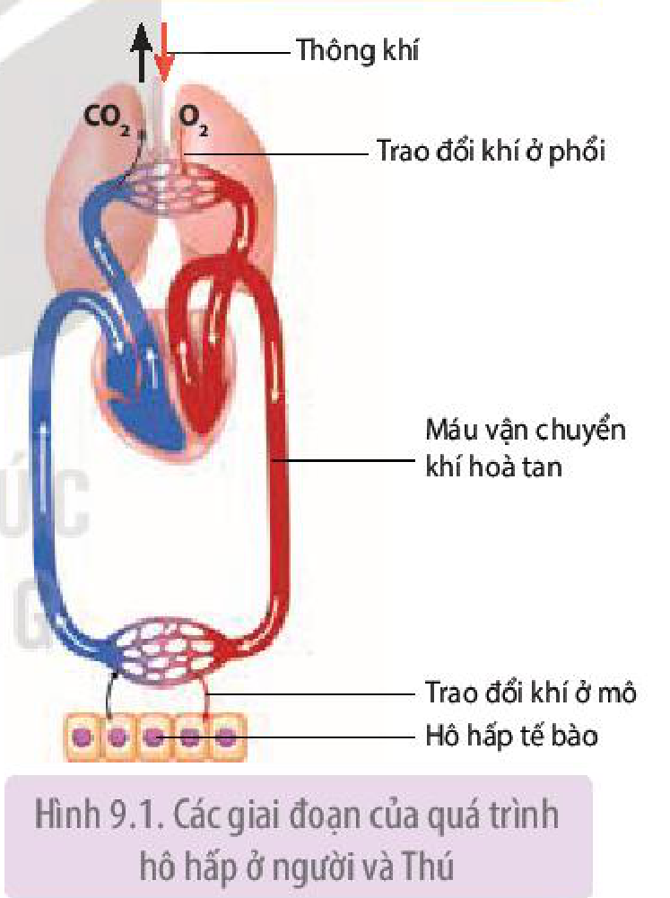
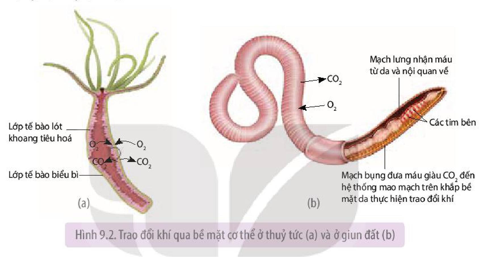
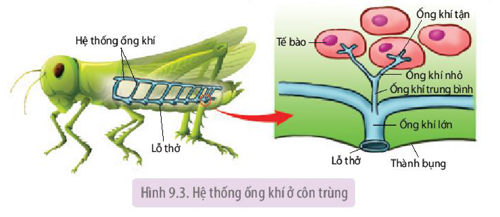
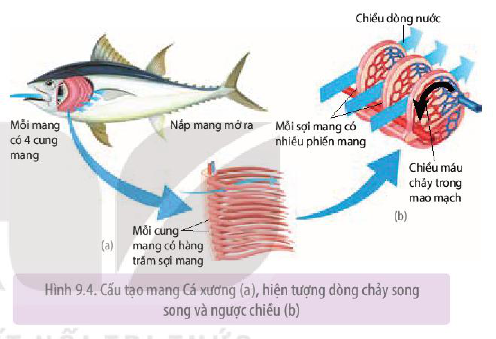
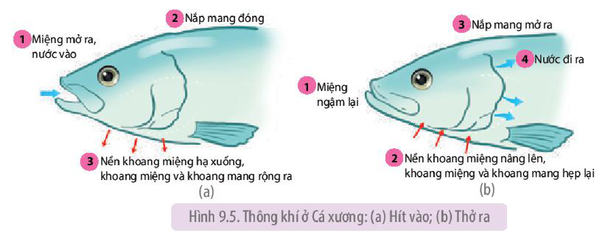
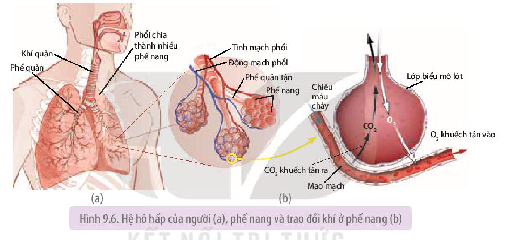
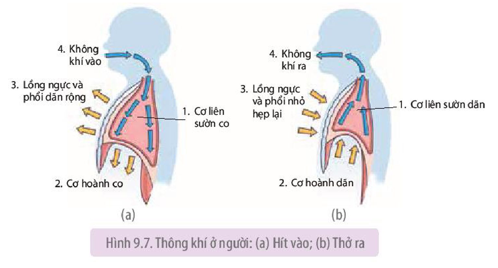
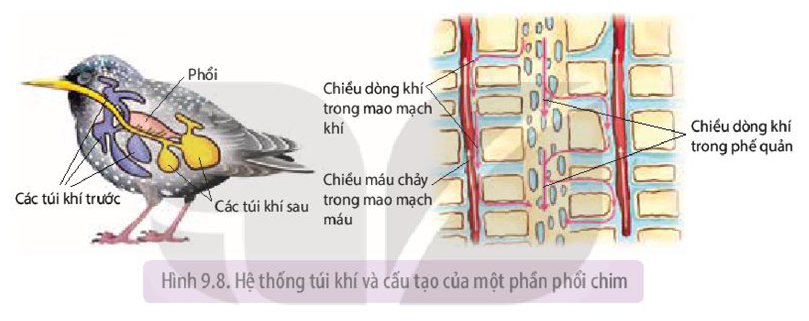
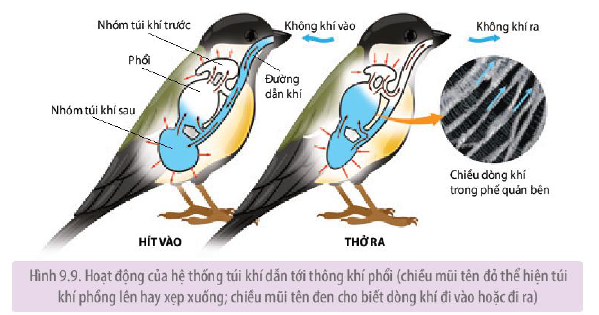

<!-- pdf:55 -->

# BÀI 9: HÔ HẤP Ở ĐỘNG VẬT

## 🎯 Yêu cầu cần đạt

- Phân tích được vai trò của hô hấp ở động vật.
- Trình bày được các hình thức trao đổi khí và giải thích được một số hiện tượng trong thực tiễn.
- Tìm hiểu được các bệnh về đường hô hấp và vận dụng hiểu biết về hô hấp để phòng các bệnh về đường hô hấp.
- Giải thích được tác hại của thuốc lá đối với sức khoẻ và ô nhiễm không khí đối với hô hấp.
- Trình bày ý nghĩa của việc xử phạt người hút thuốc lá nơi công cộng và cấm trẻ em dưới 16 tuổi hút thuốc lá.
- Giải thích được vai trò của thể dục, thể thao đối với hô hấp.

## 🔴 Mở đầu

Tại sao cá heo, cá voi sống trong nước nhưng phải thường xuyên nhô lên mặt nước để thở?

## I. VAI TRÒ CỦA HÔ HẤP

Hô hấp là quá trình lấy $\text{O}_2$ liên tục từ môi trường cung cấp cho hô hấp tế bào, tạo năng lượng cho hoạt động sống, đồng thời thải $\text{CO}_2$ sinh ra từ quá trình chuyển hoá ra ngoài.

Đối với động vật, hô hấp có những vai trò sau:

- Lấy $\text{O}_2$ từ môi trường sống cung cấp cho hô hấp tế bào, tạo năng lượng cho các hoạt động sống của cơ thể.
- Thải $\text{CO}_2$ sinh ra từ hô hấp tế bào vào môi trường, đảm bảo cân bằng môi trường trong cơ thể.

Quá trình hô hấp ở người và Thú gồm 5 giai đoạn liên quan mật thiết với nhau: thông khí (hít vào và thở ra), trao đổi khí ở phổi, vận chuyển khí $\text{O}_2$ và $\text{CO}_2$, trao đổi khí ở mô và hô hấp tế bào (H 9.1).

Hình 9.1. Các giai đoạn của quá trình hô hấp ở người và Thú

## ❓ Dừng lại và suy ngẫm

1. Phân tích mối liên quan của các giai đoạn trong quá trình hô hấp.
2. Tại sao cơ thể động vật bắt buộc phải lấy $\text{O}_2$ từ môi trường và thải $\text{CO}_2$ ra môi trường?

## II. CÁC HÌNH THỨC TRAO ĐỔI KHÍ

Ở động vật, bộ phận hoặc cơ quan thực hiện trao đổi khí $\text{O}_2$ và $\text{CO}_2$ với môi trường gọi là **bề mặt trao đổi khí**. Bề mặt trao đổi khí là cơ quan chuyên hoá như da, mang, phổi, hệ thống ống khí hoặc bề mặt cơ thể.

Trao đổi khí $\text{O}_2$ và $\text{CO}_2$ đi qua bề mặt trao đổi khí dựa trên hai nguyên lí, đó là khuếch tán từ nơi có phân áp cao sang nơi có phân áp thấp và khuếch tán qua bề mặt mỏng, ẩm ướt.

<!-- pdf:56 -->

Tất cả động vật đều có xu hướng tối ưu hoá tốc độ khuếch tán khí qua tăng diện tích bề mặt trao đổi khí và thông khí.

### 1. Trao đổi khí qua bề mặt cơ thể

<!-- term: Trao đổi khí qua bề mặt cơ thể -->
Trao đổi khí qua bề mặt cơ thể thấy ở động vật không có cơ quan trao đổi khí chuyên hoá thuộc ngành Ruột khoang, Giun dẹp,... và cũng gặp ở động vật có cơ quan trao đổi khí chuyên hoá như Giun đốt, ếch,... Khí $\text{O}_2$ và $\text{CO}_2$ khuếch tán qua toàn bộ bề mặt cơ thể của các động vật này (H 9.2).

Hình 9.2. Trao đổi khí qua bề mặt cơ thể ở thuỷ tức (a) và ở giun đất (b)

### 2. Trao đổi khí qua hệ thống ống khí

<!-- term: Trao đổi khí qua hệ thống ống khí -->
Côn trùng và một số chân khớp khác sống trên cạn trao đổi khí qua hệ thống ống khí.

<!-- term: Hệ thống ống khí -->
<!-- term: Ống khí tận -->
<!-- term: Lỗ thở -->
Hệ thống ống khí bao gồm các ống khí lớn phân nhánh thành các các ống khí nhỏ dần và ống khí nhỏ nhất là ống khí tận. Số lượng ống khí rất nhiều, tạo ra bề mặt trao đổi khí rất lớn với tế bào. Ống khí tận là nơi trao đổi khí $\text{O}_2$ và $\text{CO}_2$ với tế bào. Các ống khí thông với bên ngoài qua các lỗ thở. Lỗ thở có van đóng, mở điều tiết không khí ra, vào ống khí (H 9.3).

Hình 9.3. Hệ thống ống khí ở côn trùng

Thông khí ở côn trùng là nhờ hoạt động của các cơ hô hấp làm thay đổi thể tích khoang thân, phối hợp với đóng, mở các van lỗ thở. Thông khí tạo ra sự chênh lệch về phân áp khí $\text{O}_2$ và $\text{CO}_2$ giữa không khí trong ống khí tận và tế bào cơ thể, nhờ đó các tế bào cơ thể thực hiện trao đổi khí $\text{O}_2$ và $\text{CO}_2$ với không khí.

<!-- pdf:57 -->

## ❓ Dừng lại và suy ngẫm

1. Quan sát Hình 9.2, cho biết thuỷ tức và giun đất trao đổi khí với môi trường sống như thế nào.
2. Quan sát Hình 9.3 và giải thích tại sao sự phân nhánh của ống khí có thể giúp côn trùng trao đổi khí rất hiệu quả, đảm bảo đủ $\text{O}_2$ cho hoạt động bình thường cũng như các hoạt động tích cực, tiêu tốn nhiều năng lượng.

### 3. Trao đổi khí qua mang

**Mang** là cơ quan trao đổi khí chuyên hoá của động vật sống trong môi trường nước như Thân mềm, Chân khớp, Cá sụn, Cá xương, nòng nọc lưỡng cư,...

<!-- term: Trao đổi khí qua mang -->
Cá xương có một đôi mang, mỗi mang nằm trong một khoang mang. Mỗi mang được cấu tạo từ các cung mang, sợi mang (H 9.4a) và phiến mang. Đặc điểm cấu tạo này của mang tạo ra diện tích trao đổi khí rất lớn. Hệ thống mao mạch trên phiến mang là nơi trao đổi khí $\text{O}_2$ và $\text{CO}_2$ với dòng nước chảy qua phiến mang.

Hình 9.4. Cấu tạo mang Cá xương (a), hiện tượng dòng chảy song song và ngược chiều (b)

Cách sắp xếp mao mạch trong mang của Cá xương khác với các loài có mang khác, đó là dòng máu trong mao mạch chảy song song và ngược chiều với dòng nước đi qua phiến mang, nhờ đó tối ưu hoá trao đổi khí giữa máu mao mạch với nước. Đặc điểm này gọi là **dòng chảy song song và ngược chiều** (H 9.4b).

Thông khí ở cá xương là nhờ hoạt động của các cơ hô hấp làm thay đổi thể tích khoang miệng và khoang mang, làm cho dòng nước giàu $\text{O}_2$ đi qua mang theo một chiều liên tục, không bị ngắt quãng (H 9.5).

Hình 9.5. Thông khí ở Cá xương: (a) Hít vào; (b) Thở ra

<!-- pdf:58 -->

## ❓ Dừng lại và suy ngẫm

Nghiên cứu Hình 9.4 và 9.5, cho biết tại sao hệ hô hấp của cá xương trao đổi khí với nước rất hiệu quả?

### 4. Trao đổi khí qua phổi

**Phổi** là cơ quan trao đổi khí chuyên hoá của nhiều động vật sống trên cạn như Bò sát, Chim và Thú. Lưỡng cư cũng có phổi nhưng phổi ít **phế nang** nên trao đổi khí diễn ra chủ yếu qua da.

Hình 9.6. Hệ hô hấp của người (a), phế nang và trao đổi khí ở phế nang (b)

<!-- term: Trao đổi khí qua phổi -->
Phổi cùng với đường dẫn khí, cơ hô hấp tạo nên hệ hô hấp của người. Do phổi được tạo thành từ hàng triệu phế nang nên diện tích bề mặt trao đổi khí rất lớn (từ 100 $\text{m}^2$ đến 120 $\text{m}^2$, gấp hơn 50 lần diện tích da). Phế nang có hệ thống mao mạch bao quanh dày đặc. Máu chảy trong các mao mạch trao đổi khí $\text{O}_2$ và $\text{CO}_2$ với dòng không khí ra, vào phế nang (H 9.6).

Thông khí ở phổi người là nhờ hoạt động của các cơ hô hấp làm thay đổi thể tích lồng ngực và thể tích phổi (H 9.7).

Hình 9.7. Thông khí ở người: (a) Hít vào; (b) Thở ra

<!-- pdf:59 -->

Kiểu thông khí như của người (khi hít vào lồng ngực và phổi dãn rộng ra, kéo không khí từ ngoài vào phổi) được gọi là **thông khí nhờ áp suất âm**. Bò sát, Chim và Thú thông khí nhờ áp suất âm.

Phổi chim có cấu tạo và hoạt động khác so với phổi người và Thú. Phổi chim thông với hệ thống túi khí và không có phế nang. Ở Chim, phế quản phân nhánh thành các ống khí rất nhỏ, gọi là **mao mạch khí**. Không khí trong các mao mạch khí trao đổi khí $\text{O}_2$ và $\text{CO}_2$ với máu trong các mao mạch máu (H 9.8).

Phổi chim cũng có hiện tượng dòng chảy song song và ngược chiều như Cá xương, đó là chiều máu chảy trong các mao mạch máu song song và ngược chiều với dòng không khí lưu thông trong các mao mạch khí (quan sát mũi tên chỉ chiều dòng máu trong mao mạch máu và chiều dòng khí trong mao mạch khí ở Hình 9.8).

Hình 9.8. Hệ thống túi khí và cấu tạo của một phần phổi chim

<!-- term: Túi khí -->
Thông khí ở phổi chim là nhờ hoạt động của các cơ hô hấp làm thay đổi thể tích khoang thân và thể tích hai nhóm túi khí trước và sau. Hình 9.9 cho thấy: Khi hít vào, không khí giàu $\text{O}_2$ đi vào phổi và vào nhóm túi khí sau; Khi thở ra, không khí giàu $\text{O}_2$ từ nhóm túi khí sau lại đi vào phổi, nghĩa là cả khi hít vào và khi thở ra đều có không khí giàu $\text{O}_2$ đi qua phổi theo một chiều, liên tục và không có khí cặn.

Hình 9.9. Hoạt động của hệ thống túi khí dẫn tới thông khí phổi (chiều mũi tên đỏ thể hiện túi khí phồng lên hay xẹp xuống; chiều mũi tên đen cho biết dòng khí đi vào hoặc đi ra)

<!-- pdf:60 -->

## ❓ Dừng lại và suy ngẫm

Tại sao hệ hô hấp của người và của Chim trao đổi khí với không khí rất hiệu quả?

## III. BỆNH VỀ HÔ HẤP

Bệnh hô hấp ở người có rất nhiều và gây ra hậu quả xấu đối với sức khoẻ, thậm chí gây tử vong. Bệnh có thể ở đường dẫn khí (viêm mũi, viêm phế quản, ung thư khí quản,...) hoặc ở phổi (viêm phổi, lao phổi,...). Bệnh hô hấp do nhiều nguyên nhân khác nhau, trong số đó, ô nhiễm không khí và khói thuốc lá là nguyên nhân hàng đầu.

Không khí bị ô nhiễm chứa các tác nhân gây bệnh như virus, vi khuẩn, nấm mốc và các khí độc hại như CO, $\text{SO}_2$, $\text{NO}_2$, $\text{CH}_4$, Pb, bụi lớn nhỏ các loại,... Các tác nhân gây bệnh này đến từ nhiều nguồn khác nhau như hoạt động công nghiệp, giao thông vận tải, cháy rừng,...

Khói thuốc lá chứa nhiều chất độc hại không chỉ gây ra những hậu quả xấu cho sức khoẻ người hút thuốc lá mà còn gây ra những hậu quả tương tự đối với người hít phải khói thuốc lá do người khác hút (Bảng 9.1).

**Bảng 9.1.** Khói thuốc lá và tác hại của khói thuốc lá

| Các chất hoá học trong khói thuốc lá | Tác động lên cơ thể |
|---|---|
| Nicotin | Gây nghiện, tăng nhịp tim, tăng huyết áp, tăng nguy cơ hình thành cục máu đông. |
| Carbon monoxide (CO) | Kết hợp với hemoglobin, làm giảm khả năng vận chuyển $\text{O}_2$ của máu. |
| Tar (hỗn hợp chất hoá học) | Gây nguy cơ ung thư phổi, họng, miệng; làm tê liệt lông rung trong đường dẫn khí. |
| Các chất gây kích thích lên hệ hô hấp (hydrogen cyanide, acrolein,...) | Gây tiết nhiều dịch nhày làm tê liệt lông rung trong đường dẫn khí, dịch nhày bám giữ khiến các hạt khói thuốc lá không được đẩy lên hầu dẫn đến viêm, hẹp đường dẫn khí, gây khó thở và ho. |

## IV. LỢI ÍCH CỦA LUYỆN TẬP THỂ DỤC, THỂ THAO ĐỐI VỚI HÔ HẤP

<!-- term: Thể tích khí lưu thông -->
<!-- term: Thông khí phổi/phút -->
Rèn luyện thể dục, thể thao tác động rõ rệt đến hệ hô hấp. Cơ hô hấp phát triển hơn (to hơn, săn chắc hơn, co khoẻ hơn), dẫn đến tăng thể tích khí lưu thông (thể tích khí khi hít vào hoặc khi thở ra bình thường), tăng thông khí phổi/phút (thể tích khí lưu thông nhân với nhịp thở) và giảm nhịp thở.

## ❓ Dừng lại và suy ngẫm

1. Tìm hiểu qua tài liệu, internet, hỏi bác sĩ, cán bộ y tế,... về một số bệnh phổ biến ở đường dẫn khí và ở phổi, nguyên nhân gây bệnh, biện pháp phòng tránh các bệnh đó, sau đó kẻ và hoàn thành bảng trong vở theo mẫu dưới đây:

| Tên bệnh | Nguyên nhân gây bệnh | Biện pháp phòng tránh |
|---|---|---|
| 1. ....................?.................... | ? | ? |

<!-- pdf:61 -->

2. Ô nhiễm không khí và khói thuốc lá ảnh hưởng như thế nào đến hô hấp và sức khoẻ con người?
3. Tham khảo Bảng 9.1 và cho biết ý nghĩa của việc: Xử phạt người hút thuốc lá ở nơi công cộng (cơ quan, trường học, bệnh viện,...) và cấm trẻ em dưới 16 tuổi hút thuốc lá.

## 📌 Kiến thức cốt lõi

- Hô hấp đảm bảo cho động vật lấy được $\text{O}_2$ từ môi trường cung cấp cho hô hấp tế bào, tạo năng lượng cho các hoạt động sống, đồng thời thải $\text{CO}_2$ sinh ra từ quá trình chuyển hoá ra ngoài.
- Trao đổi khí ở động vật liên quan đến diện tích bề mặt trao đổi khí và thông khí.
- Các hình thức trao đổi khí chủ yếu ở động vật: qua bề mặt cơ thể, qua cơ quan trao đổi khí chuyên hoá.
- Bệnh hô hấp do nhiều nguyên nhân khác nhau, trong đó ô nhiễm không khí và khói thuốc lá là nguyên nhân hàng đầu.
- Luyện tập thể dục, thể thao thường xuyên giúp hệ hô hấp khoẻ mạnh, hoạt động hiệu quả.

## ✏️ Luyện tập và vận dụng

1. Tại sao khi nuôi ếch và giun đất, người nuôi phải giữ cho môi trường nuôi luôn ẩm ướt?
2. Tại sao nuôi tôm, cá với mật độ cao người ta thường dùng máy sục khí vào nước nuôi?
3. Vận dụng những hiểu biết về hô hấp, hãy đề xuất một số biện pháp giúp hệ hô hấp khoẻ mạnh, hoạt động hiệu quả.

## 💡 Em có biết

Ở một số loài ốc, bên cạnh mang lá đối dùng cho trao đổi khí dưới nước còn có thêm phổi để thở trên cạn. Phổi của ốc thực chất là phần biến đổi của khoang áo có tăng cường thêm nhiều mao mạch.

## 📷 Danh sách hình trong bài

| Mã hình | Trang PDF | Vị trí | Chú thích gốc |
|---|---|---|---|
| H11-sinh-b09-01 | 55 | Mục I | Hình 9.1. Các giai đoạn của quá trình hô hấp ở người và Thú |
| H11-sinh-b09-02 | 56 | Mục II.1 | Hình 9.2. Trao đổi khí qua bề mặt cơ thể ở thuỷ tức (a) và ở giun đất (b) |
| H11-sinh-b09-03 | 56 | Mục II.2 | Hình 9.3. Hệ thống ống khí ở côn trùng |
| H11-sinh-b09-04 | 57 | Mục II.3 | Hình 9.4. Cấu tạo mang Cá xương (a), hiện tượng dòng chảy song song và ngược chiều (b) |
| H11-sinh-b09-05 | 57 | Mục II.3 | Hình 9.5. Thông khí ở Cá xương: (a) Hít vào; (b) Thở ra |
| H11-sinh-b09-06 | 58 | Mục II.4 | Hình 9.6. Hệ hô hấp của người (a), phế nang và trao đổi khí ở phế nang (b) |
| H11-sinh-b09-07 | 58 | Mục II.4 | Hình 9.7. Thông khí ở người: (a) Hít vào; (b) Thở ra |
| H11-sinh-b09-08 | 59 | Mục II.4 | Hình 9.8. Hệ thống túi khí và cấu tạo của một phần phổi chim |
| H11-sinh-b09-09 | 59 | Mục II.4 | Hình 9.9. Hoạt động của hệ thống túi khí dẫn tới thông khí phổi (chiều mũi tên đỏ thể hiện túi khí phồng lên hay xẹp xuống; chiều mũi tên đen cho biết dòng khí đi vào hoặc đi ra) |
