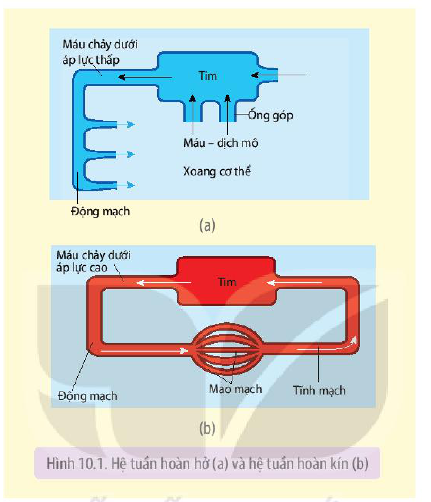
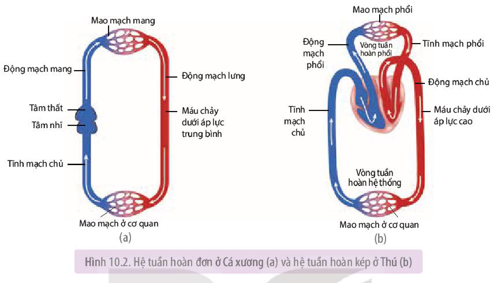
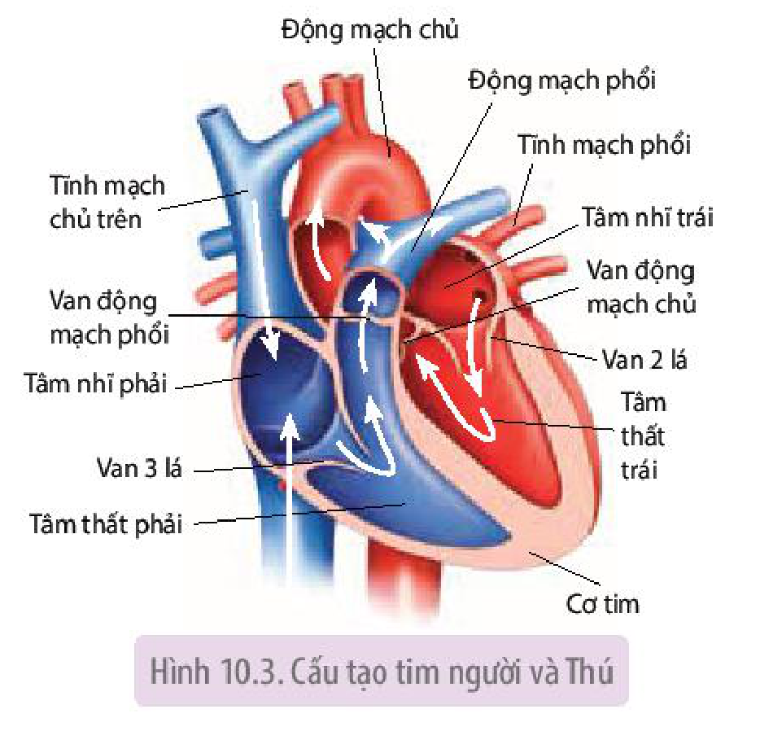
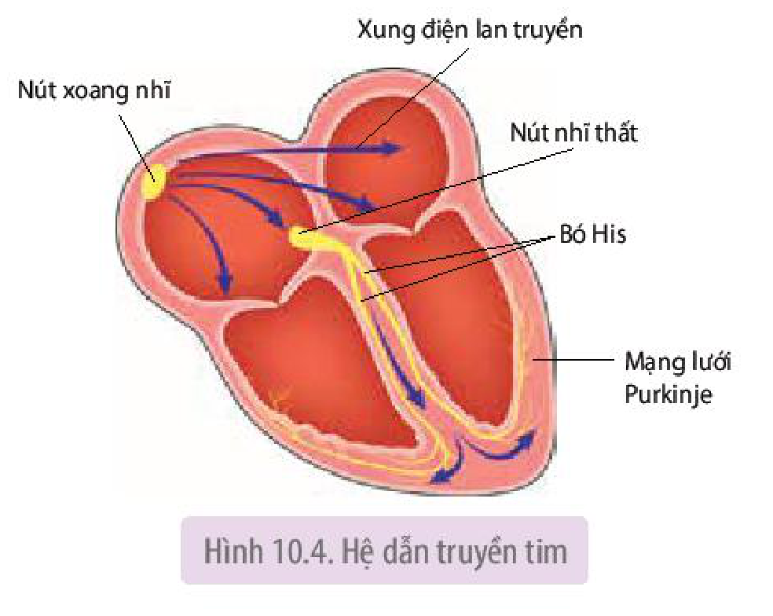
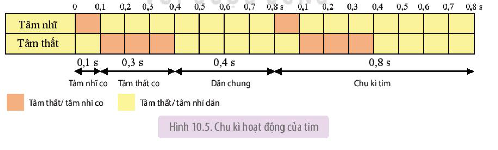
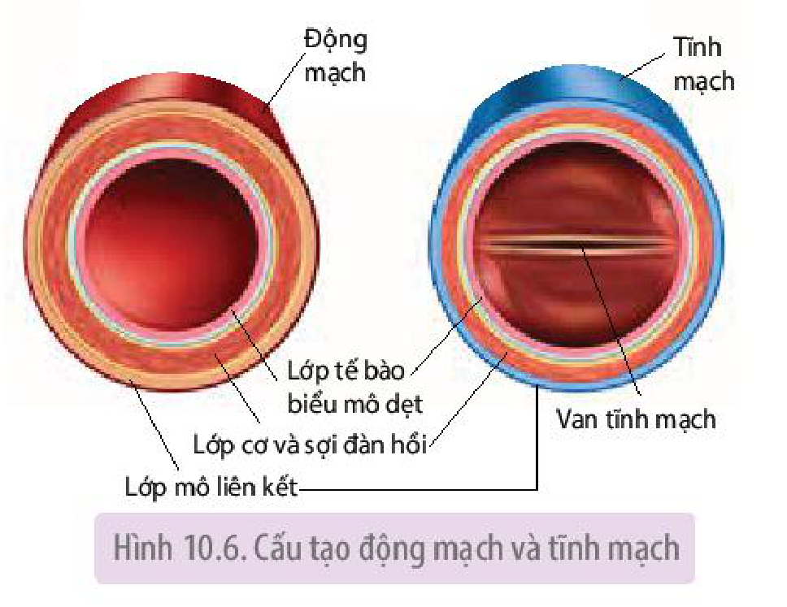
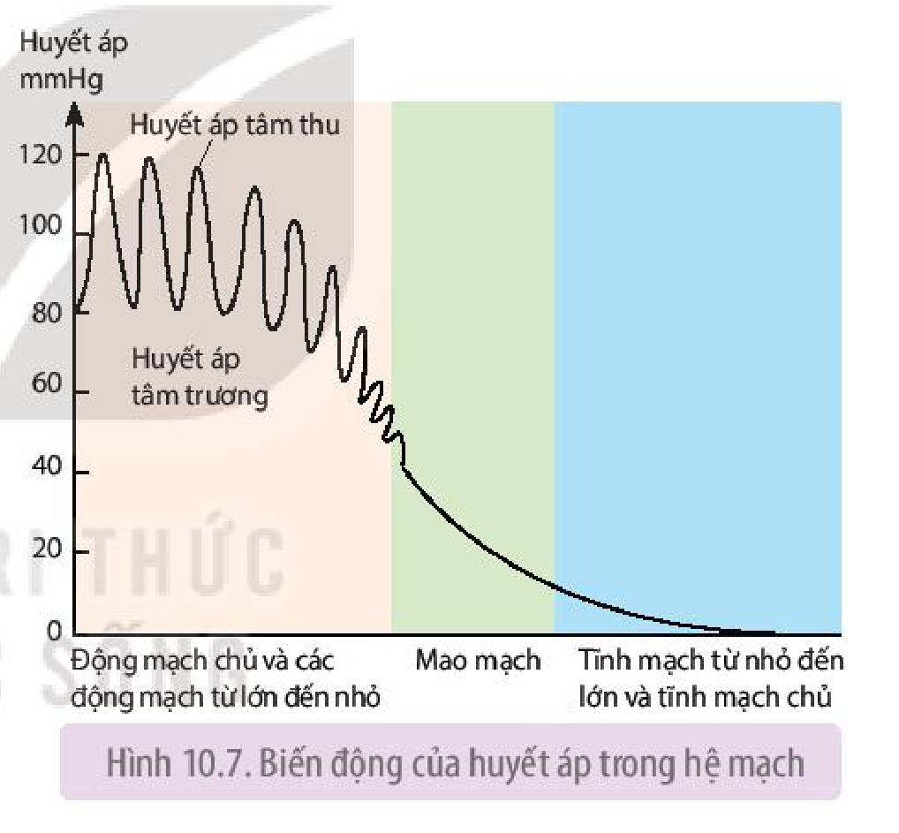
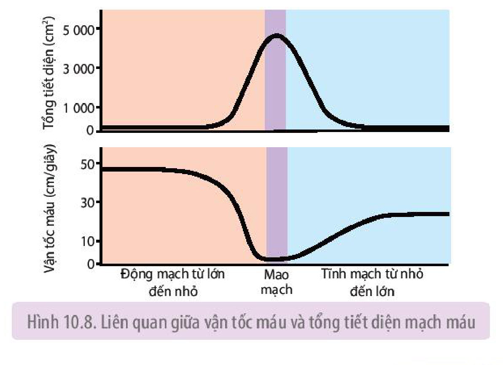
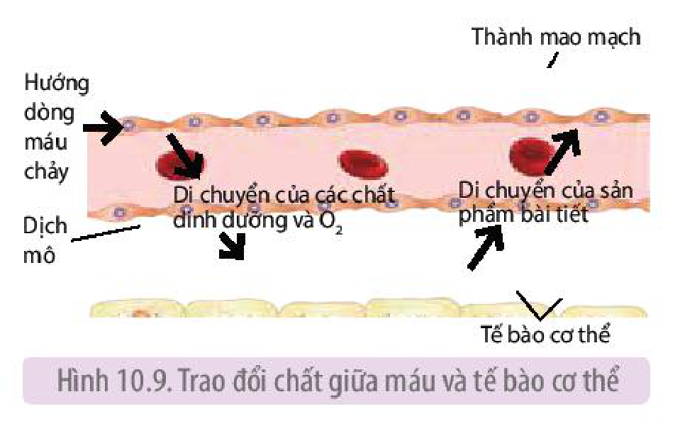
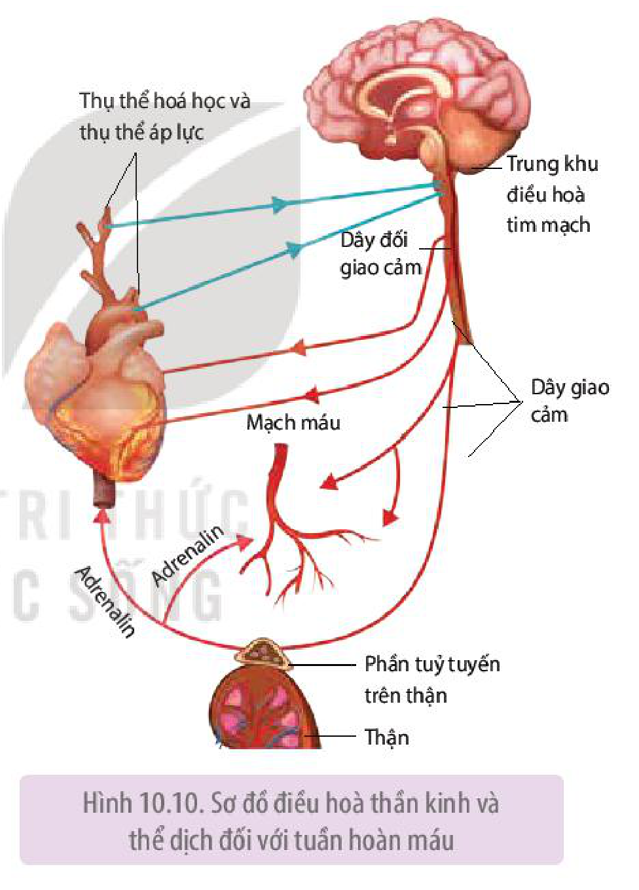

<!-- pdf:62 -->

# BÀI 10: TUẦN HOÀN Ở ĐỘNG VẬT

## 🎯 Yêu cầu cần đạt

- Trình bày được khái quát hệ vận chuyển trong cơ thể động vật và nêu được một số dạng hệ vận chuyển ở các nhóm động vật khác nhau.
- Dựa vào hình ảnh, sơ đồ, phân biệt được các dạng hệ tuần hoàn ở động vật, mô tả được cấu tạo và hoạt động của hệ mạch và quá trình vận chuyển máu trong hệ mạch.
- Trình bày được cấu tạo, hoạt động của tim và sự phù hợp giữa cấu tạo và chức năng của tim. Giải thích được khả năng tự phát nhịp gây nên tính tự động của tim.
- Nêu được hoạt động tim mạch được điều hoà bằng cơ chế thần kinh và thể dịch.
- Phân tích được tác hại của việc lạm dụng rượu, bia đối với sức khoẻ của con người, đặc biệt là hệ tim mạch. Trình bày được vai trò của thể dục, thể thao đối với tuần hoàn.
- Kể được các bệnh thường gặp về hệ tuần hoàn. Trình bày được một số biện pháp phòng chống các bệnh tim mạch.

## 🔴 Mở đầu

Mạch máu bị hẹp hoặc tắc do xơ vữa có thể gây hậu quả gì đối với cơ thể?

## I. KHÁI QUÁT HỆ TUẦN HOÀN

Ở động vật, hệ vận chuyển được gọi là **hệ tuần hoàn**.

Hệ tuần hoàn của động vật cấu tạo từ các bộ phận sau:

- **Dịch tuần hoàn**: là máu hoặc hỗn hợp máu – dịch mô.
- **Tim**: là một bơm hút và đẩy máu chảy trong hệ thống mạch máu.

<!-- term: Hệ thống mạch máu -->
<!-- term: Động mạch -->
<!-- term: Tĩnh mạch -->
<!-- term: Mao mạch -->
- Hệ thống mạch máu: gồm động mạch, mao mạch và tĩnh mạch. Động mạch gồm các mạch máu từ lớn đến nhỏ, có chức năng đưa máu từ tim đến các cơ quan. Tĩnh mạch gồm các mạch máu từ nhỏ đến lớn, có chức năng đưa máu từ các cơ quan về tim. Mao mạch nối động mạch nhỏ nhất với tĩnh mạch nhỏ nhất, là nơi thực hiện trao đổi chất giữa máu và tế bào cơ thể.

Hệ tuần hoàn có chức năng vận chuyển các chất từ bộ phận này đến bộ phận khác, đảm bảo các hoạt động sống của cơ thể.

## II. CÁC DẠNG HỆ TUẦN HOÀN

Hệ tuần hoàn ở động vật bao gồm các dạng sau:

- Hệ tuần hoàn
  - Hệ tuần hoàn hở
  - Hệ tuần hoàn kín
    - Hệ tuần hoàn đơn
    - Hệ tuần hoàn kép

<!-- pdf:63 -->

### 1. Hệ tuần hoàn hở

<!-- term: Hệ tuần hoàn hở -->
Hệ tuần hoàn hở có ở đa số động vật thuộc ngành Chân khớp và một số loài Thân mềm (H 10.1a)

Hình 10.1. Hệ tuần hoàn hở (a) và hệ tuần hoàn kín (b)

<!-- term: Hệ tuần hoàn hở -->
Hệ tuần hoàn hở có những đặc điểm sau:

- Tim bơm máu vào động mạch với áp lực thấp, máu chảy vào xoang cơ thể trộn lẫn với dịch mô tạo thành hỗn hợp máu – dịch mô, gọi chung là máu.
- Máu trao đổi chất trực tiếp với tế bào cơ thể, sau đó trở về tim theo các ống góp.
- Máu chảy trong động mạch dưới áp lực thấp nên tốc độ máu chảy chậm, tim thu hồi máu chậm.

### 2. Hệ tuần hoàn kín

<!-- term: Hệ tuần hoàn kín -->
Hệ tuần hoàn kín có ở Giun đốt, một số thân mềm và động vật có xương sống (H 10.1b).

<!-- term: Hệ tuần hoàn kín -->
Hệ tuần hoàn kín có những đặc điểm sau:

- Tim bơm máu vào động mạch với áp lực mạnh, máu chảy liên tục trong mạch kín, từ động mạch qua mao mạch, tĩnh mạch và về tim.
- Máu trao đổi chất với tế bào thông qua dịch mô.
- Máu chảy trong động mạch dưới áp lực cao hoặc trung bình nên tốc độ máu chảy nhanh, tim thu hồi máu nhanh.

<!-- term: Hệ tuần hoàn đơn -->
<!-- term: Hệ tuần hoàn kép -->
Hệ tuần hoàn kín có thể là hệ tuần hoàn đơn (ở Cá xương, Cá sụn) hoặc hệ tuần hoàn kép (ở động vật có phổi như Lưỡng cư, Bò sát, Chim và Thú) (H 10.2).

<!-- pdf:64 -->

Hình 10.2. Hệ tuần hoàn đơn ở Cá xương (a) và hệ tuần hoàn kép ở Thú (b)

## ❓ Dừng lại và suy ngẫm

1. Nghiên cứu Hình 10.1 và mô tả đường đi của máu (bắt đầu từ tim) trên sơ đồ hệ tuần hở và hệ tuần hoàn kín, từ đó đưa ra khái niệm hệ tuần hoàn hở và hệ tuần hoàn kín.
2. Nghiên cứu Hình 10.2 và mô tả đường đi của máu (bắt đầu từ tim) trên sơ đồ hệ tuần đơn của Cá xương và hệ tuần hoàn kép của Thú, từ đó đưa ra khái niệm hệ tuần hoàn đơn và hệ tuần hoàn kép.

## III. CẤU TẠO VÀ HOẠT ĐỘNG CỦA TIM

### 1. Cấu tạo tim

<!-- term: Van tim -->
Tim người có bốn buồng (ngăn), hai buồng nhỏ thu nhận máu từ tĩnh mạch vào tim gọi là **tâm nhĩ**, hai buồng lớn bơm máu ra khỏi tim gọi là **tâm thất**. Thành các buồng tim được cấu tạo từ các tế bào cơ tim. Buồng tim nối thông với động mạch hoặc tĩnh mạch. Giữa tâm nhĩ và tâm thất, giữa tâm thất và động mạch có các van tim (H 10.3). Van tim cho máu đi theo một chiều. Khi van ba lá và van hai lá mở, máu chảy từ hai tâm nhĩ vào hai tâm thất. Khi van động mạch phổi mở, máu từ tâm thất phải vào động mạch phổi. Khi van động mạch chủ mở, máu từ tâm thất trái vào động mạch chủ.

Hình 10.3. Cấu tạo tim người và Thú

<!-- pdf:65 -->

### 2. Hoạt động của tim

**a) Tính tự động của tim**

Tim bị cắt rời khỏi cơ thể vẫn co dãn nhịp nhàng thêm một thời gian nếu được cung cấp đủ chất dinh dưỡng, $\text{O}_2$ và nhiệt độ thích hợp. Khả năng tự co dãn của tim gọi là **tính tự động của tim**.

<!-- term: Hệ dẫn truyền tim -->
<!-- term: Nút xoang nhĩ -->
Tim co dãn được là nhờ hệ dẫn truyền tim. Hệ dẫn truyền tim gồm nút xoang nhĩ, nút nhĩ thất, bó His và mạng lưới Purkinje. Nút xoang nhĩ tự động phát xung điện, cứ sau một khoảng thời gian nhất định, nút xoang nhĩ lại phát xung điện. Xung điện lan ra khắp cơ tâm nhĩ và làm 2 tâm nhĩ co, tiếp đó xung điện lan đến nút nhĩ thất, bó His, rồi theo mạng Purkinje lan ra khắp cơ tâm thất, làm 2 tâm thất co (H 10.4).

Hình 10.4. Hệ dẫn truyền tim

**b) Chu kì hoạt động của tim (chu kì tim)**

Tim co và dãn nhịp nhàng theo chu kì. Pha co của tim gọi là **tâm thu**, pha dãn của tim gọi là **tâm trương**.

<!-- term: Chu kì tim -->
Chu kì tim bắt đầu bằng tâm nhĩ (phải và trái) co, đẩy máu từ tâm nhĩ xuống tâm thất. Tâm nhĩ dãn có tác dụng thu nhận máu từ tĩnh mạch chủ và tĩnh mạch phổi. Tiếp đó tâm thất (phải và trái) co, đẩy máu từ tâm thất vào động mạch phổi và động mạch chủ. Tâm thất dãn hút máu từ tâm nhĩ xuống tâm thất. Chu kì tim mới lại bắt đầu bằng hai tâm nhĩ co (H 10.3).

<!-- term: Nhịp tim -->
Ở người trưởng thành, mỗi chu kì tim kéo dài khoảng 0,8 s, trong đó tâm nhĩ co 0,1 s, tâm thất co 0,3 s, thời gian dãn chung là 0,4 s, tương ứng với 75 chu kì tim trong một phút hoặc nhịp tim là 75 nhịp/phút (H 10.5).

Hình 10.5. Chu kì hoạt động của tim

## ❓ Dừng lại và suy ngẫm

1. Van tim có vai trò như thế nào trong tuần hoàn máu?
2. Hệ dẫn truyền tim có vai trò như thế nào đối với hoạt động của tim và tuần hoàn máu?

<!-- pdf:66 -->

## IV. CẤU TẠO VÀ HOẠT ĐỘNG CỦA HỆ MẠCH

### 1. Cấu tạo của hệ mạch

Các động mạch và tĩnh mạch từ lớn đến nhỏ đều được cấu tạo từ ba lớp (H 10.6). Các tĩnh mạch lớn ở chân có van cho máu đi theo một chiều, từ chân về tim. Mao mạch cấu tạo từ một lớp tế bào biểu mô dẹt (H 10.9).

Hình 10.6. Cấu tạo động mạch và tĩnh mạch

### 2. Hoạt động của hệ mạch

**a) Huyết áp**

**Huyết áp** là áp lực của máu lên thành mạch. Tim co bóp đẩy máu vào động mạch tạo ra huyết áp. Do hoạt động co dãn của tim theo chu kì nên máu được bơm vào động mạch theo từng đợt và tạo ra huyết áp tâm thu và huyết áp tâm trương. **Huyết áp tâm thu** (còn gọi là **huyết áp tối đa**) ứng với tâm thất co, **huyết áp tâm trương** (còn gọi là **huyết áp tối thiểu**) ứng với tâm thất dãn.

Huyết áp của người thường được đo ở cánh tay, gọi là **huyết áp động mạch**. Trị số bình thường của huyết áp tâm thu của người trưởng thành là 110 – 120 mmHg và huyết áp tâm trương là 70 – 80 mmHg.
<!-- ocr-ok: OCR dính chữ không dấu cách ("Huyếtápcủangườithườngđượcđoởcánh", "Trịsốbình", "là110—120mmHgvàhuyết") và đọc nhầm "mmHg" thành "mmhHạg"; đã đối chiếu ảnh gốc -->

Trong suốt chiều dài của hệ mạch, từ động mạch chủ đến mao mạch và tĩnh mạch chủ, có sự biến động rõ rệt về huyết áp (H 10.7).

Hình 10.7. Biến động của huyết áp trong hệ mạch

**b) Vận tốc máu**

**Vận tốc máu** là tốc độ máu chảy trong một giây. Vận tốc máu biến động trong hệ thống động mạch, tĩnh mạch và mao mạch.

Biến động vận tốc máu trong hệ mạch liên quan đến tổng tiết diện mạch máu (H 10.8).

Vận tốc máu trong hệ mạch có thể thay đổi. Ví dụ: Khi huyết áp tăng thì vận tốc máu tăng và ngược lại, khi huyết áp giảm thì vận tốc máu cũng giảm.

Hình 10.8. Liên quan giữa vận tốc máu và tổng tiết diện mạch máu

<!-- pdf:67 -->

**c) Trao đổi chất ở mao mạch**

<!-- term: Mao mạch -->
Mao mạch có đường kính 5 – 10 $\mu\text{m}$ và chiều dài khoảng 0,4 – 2 mm. Số lượng mao mạch rất lớn, tạo ra diện tích trao đổi chất giữa máu và tế bào cơ thể khoảng 500 – 700 $\text{m}^2$. Thành mao mạch cấu tạo từ một lớp tế bào biểu mô dẹt và có các lỗ nhỏ cho phép các chất đi qua. Máu trao đổi chất với tế bào cơ thể qua dịch mô (H 10.9).

Hình 10.9. Trao đổi chất giữa máu và tế bào cơ thể

## V. ĐIỀU HOÀ HOẠT ĐỘNG TIM MẠCH

Hoạt động tim mạch được điều hoà bằng cơ chế thần kinh và thể dịch, qua đó điều hoà tuần hoàn máu. Cơ chế thần kinh theo nguyên tắc phản xạ, cơ chế thể dịch thực hiện nhờ các hormone.

Dựa trên thông tin truyền về từ thụ thể áp lực hoặc thụ thể hoá học (thụ thể $\text{O}_2$ và $\text{CO}_2$) ở xoang động mạch cảnh và gốc cung động mạch chủ, trung khu điều hoà tim mạch tăng hay giảm xung thần kinh trên dây thần kinh giao cảm hoặc đối giao cảm, qua đó ảnh hưởng đến hoạt động của tim và mạch máu.

Ví dụ: Khi huyết áp giảm, thụ thể áp lực ở xoang động mạch cảnh và gốc cung động mạch chủ gửi xung thần kinh về trung khu điều hoà tim mạch ở hành não. Trung khu điều hoà tim mạch tăng tần số xung thần kinh trên dây giao cảm, làm tim đập nhanh, mạnh và các mạch máu nhỏ co lại. Xung thần kinh còn theo dây giao cảm đến tuyến trên thận, làm tuyến này tăng tiết adrenalin và noradrenalin vào máu. Hai hormone này làm tim đập nhanh, mạnh và các mạch máu nhỏ co lại. Tim đập nhanh, mạnh kèm theo mạch máu co làm huyết áp tăng trở lại (H 10.10).

Hình 10.10. Sơ đồ điều hoà thần kinh và thể dịch đối với tuần hoàn máu

Ngược lại, khi huyết áp tăng cao, trung khu điều hoà tim mạch lại tăng tần số xung thần kinh trên dây đối giao cảm, làm tim giảm nhịp và làm các mạch máu ngoại vi dãn, nhờ đó huyết áp trở lại bình thường.

<!-- term: Hệ tuần hoàn bạch huyết -->
Bên cạnh hệ tuần hoàn máu còn có hệ tuần hoàn bạch huyết với chức năng tiếp nhận lipid hấp thụ từ ruột non và thu hồi dịch mô đưa về hệ tuần hoàn máu.

<!-- pdf:68 -->

## ❓ Dừng lại và suy ngẫm

1. Quan sát Hình 10.7, giải thích sự biến động huyết áp trong hệ thống mạch máu.
2. Quan sát Hình 10.8, sau đó trả lời các câu hỏi sau:
   a) Vận tốc máu biến động như thế nào trong hệ mạch?
   b) Cho biết mối liên quan giữa vận tốc máu và tổng tiết diện mạch máu.
3. Tại sao trao đổi chất giữa máu và tế bào cơ thể chỉ diễn ra ở mao mạch?

## VI. ỨNG DỤNG

### 1. Lợi ích của luyện tập thể dục, thể thao thường xuyên đối với hệ tuần hoàn

Luyện tập thể dục, thể thao thường xuyên tác động đến cấu tạo và chức năng của tim và mạch máu.

**a) Đối với tim**

- Cơ tim phát triển, thành tim dày, buồng tim dãn rộng hơn và co mạnh hơn, dẫn đến tăng **thể tích tâm thu** cả khi nghỉ ngơi và khi đang luyện tập.
- Nhịp tim khi nghỉ ngơi giảm (do thể tích tâm thu tăng). Nhịp tim 75 nhịp/phút có thể giảm xuống còn 50 nhịp/ phút nhưng **lưu lượng tim** vẫn giữ nguyên.
- Khi lao động nặng, lưu lượng tim của người luyện tập thể dục, thể thao thường xuyên cao hơn so với người ít vận động.

**b) Đối với mạch máu và máu**

- Mạch máu bền hơn và tăng khả năng đàn hồi, nhờ đó tăng lưu lượng máu khi lao động nặng.
- Tăng thêm mao mạch ở cơ xương, nhờ đó tăng khả năng điều chỉnh huyết áp.
- Tăng thể tích máu, tăng số lượng hồng cầu, nhờ đó tăng khả năng cung cấp $\text{O}_2$.

### 2. Tác hại của lạm dụng rượu, bia đối với tim mạch và sức khoẻ

Rượu, bia làm tim đập nhanh, mạnh dẫn đến huyết áp tăng cao. Về lâu dài, huyết áp cao kéo dài gây suy yếu cơ tim, rối loạn nhịp tim, tổn thương mạch máu, xuất huyết não,...

Riêng đối với hệ thần kinh, uống nhiều rượu, bia trong thời gian dài gây trì trệ hoạt động thần kinh, não mất đi sự linh hoạt vốn có. Người uống nhiều rượu, bia không làm chủ được bản thân, dễ nổi nóng, có những hành động không nghĩ đến hậu quả, các động tác thiếu chính xác,...

### 3. Bệnh về hệ tuần hoàn

Bệnh ở hệ tuần hoàn do nhiều nguyên nhân khác nhau, có bệnh do di truyền, bẩm sinh (ví dụ: bệnh hở, hẹp van tim,...), có bệnh do lối sống (ví dụ: bệnh xơ vữa mạch máu do ăn nhiều chất béo,...).

## ❓ Dừng lại và suy ngẫm

1. Dựa vào tài liệu, internet, hỏi bác sĩ, cán bộ y tế,... về một số bệnh phổ biến ở hệ tuần hoàn, nguyên nhân gây bệnh đó và cách phòng chống. Sau đó kẻ và hoàn thành bảng vào vở theo mẫu dưới đây:

| Tên bệnh | Nguyên nhân gây bệnh | Biện pháp phòng chống |
|---|---|---|
| 1........?......... | ? | ? |

<!-- pdf:69 -->

2. Dựa vào tác động của rượu, bia đối với hoạt động thần kinh, hãy phân tích tầm quan trọng của quy định xử phạt người có sử dụng rượu, bia khi tham gia giao thông.

## 📌 Kiến thức cốt lõi

- Hệ tuần hoàn gồm các dạng: tuần hoàn hở, tuần hoàn kín (tuần hoàn đơn, tuần hoàn kép).
- Tim co dãn tự động là do hệ dẫn truyền tim. Tim co dãn nhịp nhàng theo chu kì. Pha co của tim gọi là tâm thu, pha dãn của tim gọi là tâm trương.
- Động mạch và tĩnh mạch đều được cấu tạo từ ba lớp: lớp tế bào biểu mô dẹt, lớp sợi cơ trơn, sợi đàn hồi và lớp mô liên kết. Mao mạch cấu tạo từ một lớp tế bào biểu mô dẹt. Ở hệ tuần hoàn kín, trao đổi chất giữa máu và tế bào thực hiện qua dịch mô.
- Huyết áp là áp lực của máu lên thành mạch máu. Huyết áp giảm dần từ động mạch đến mao mạch và tĩnh mạch.
- Vận tốc máu tỉ lệ nghịch với tổng tiết diện mạch máu.
- Hoạt động tim mạch được điều hoà bằng cơ chế thần kinh và thể dịch.
- Lạm dụng rượu, bia gây hậu quả xấu đối với hệ tim mạch và sức khoẻ.
- Thể dục, thể thao giúp hệ tuần hoàn khoẻ mạnh, hoạt động hiệu quả.

## ✏️ Luyện tập và vận dụng

1. Tại sao máu ở tĩnh mạch phổi có nồng độ $\text{O}_2$ cao hơn so với máu ở tĩnh mạch chủ?
2. Bảng dưới đây cho thấy nhịp tim của một số động vật:

| Động vật | Nhịp tim/phút |
|---|---|
| Voi | 25 – 40 |
| Trâu | 40 – 50 |
| Lợn | 60 – 90 |
| Mèo | 110 – 130 |
| Chuột | 720 – 780 |

Cho nhận xét về mối liên quan giữa nhịp tim và kích thước cơ thể động vật. Tại sao nhịp tim lại khác nhau ở các loài động vật?

3. Người luyện tập thể dục, thể thao đều đặn vài tháng có nhịp tim lúc nghỉ ngơi giảm đi so với trước đây, điều này được giải thích như thế nào?
4. Vận dụng những hiểu biết về hệ tuần hoàn, hãy đề xuất một số biện pháp giúp hệ tuần hoàn khoẻ mạnh, hoạt động hiệu quả.

## 💡 Em có biết

Hươu cao cổ có huyết áp ở động mạch chủ rất cao, khoảng 250 mmHg, áp lực này đảm bảo đưa đủ máu lên não. Khi hươu cao cổ cúi đầu xuống uống nước, các van một chiều và các xoang có chức năng giảm lượng máu lớn dồn về não, ngăn áp lực cao gây tổn thương não.

## 📷 Danh sách hình trong bài

| Mã hình | Trang PDF | Vị trí | Chú thích gốc |
|---|---|---|---|
| H11-sinh-b10-01 | 63 | Mục II.1 | Hình 10.1. Hệ tuần hoàn hở (a) và hệ tuần hoàn kín (b) |
| H11-sinh-b10-02 | 64 | Mục II.2 | Hình 10.2. Hệ tuần hoàn đơn ở Cá xương (a) và hệ tuần hoàn kép ở Thú (b) |
| H11-sinh-b10-03 | 64 | Mục III.1 | Hình 10.3. Cấu tạo tim người và Thú |
| H11-sinh-b10-04 | 65 | Mục III.2.a | Hình 10.4. Hệ dẫn truyền tim |
| H11-sinh-b10-05 | 65 | Mục III.2.b | Hình 10.5. Chu kì hoạt động của tim |
| H11-sinh-b10-06 | 66 | Mục IV.1 | Hình 10.6. Cấu tạo động mạch và tĩnh mạch |
| H11-sinh-b10-07 | 66 | Mục IV.2.a | Hình 10.7. Biến động của huyết áp trong hệ mạch |
| H11-sinh-b10-08 | 66 | Mục IV.2.b | Hình 10.8. Liên quan giữa vận tốc máu và tổng tiết diện mạch máu |
| H11-sinh-b10-09 | 67 | Mục IV.2.c | Hình 10.9. Trao đổi chất giữa máu và tế bào cơ thể |
| H11-sinh-b10-10 | 67 | Mục V | Hình 10.10. Sơ đồ điều hoà thần kinh và thể dịch đối với tuần hoàn máu |
