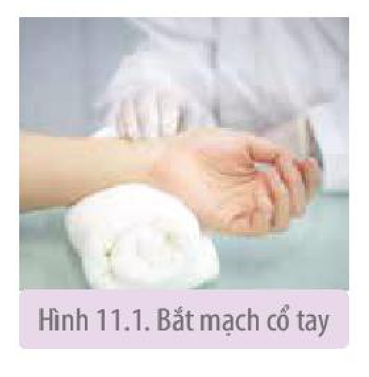
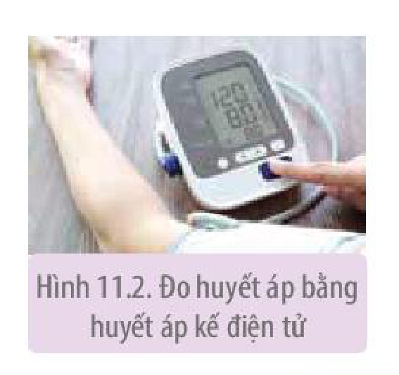
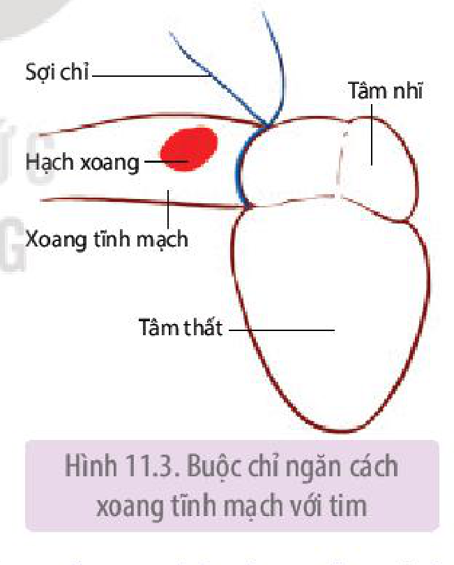
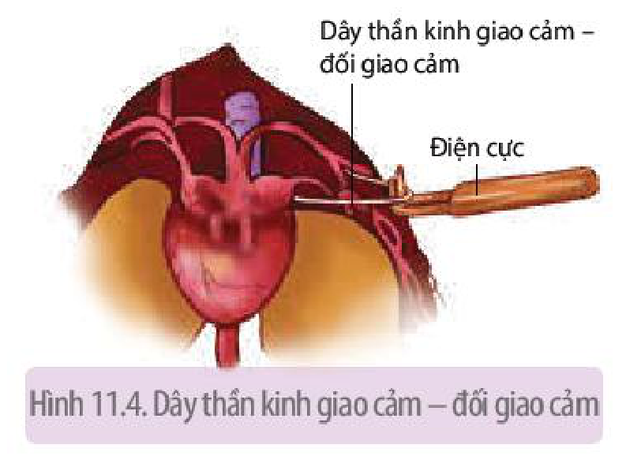

<!-- pdf:70 -->

# BÀI 11: THỰC HÀNH: MỘT SỐ THÍ NGHIỆM VỀ HỆ TUẦN HOÀN

## I. YÊU CẦU CẦN ĐẠT
<!-- ocr-ok: OCR đọc nhầm "I. YÊU CẦU CẦN ĐẠT" thành "YÊU GẦU GẦM ĐẠT"; đã đối chiếu ảnh gốc -->

- Thực hành đo được huyết áp ở người và nhận biết được trạng thái sức khoẻ từ kết quả đo; đếm được nhịp tim của người ở các trạng thái hoạt động khác nhau và giải thích kết quả.
- Mổ được tim ếch và tìm hiểu tính tự động của tim; tìm hiểu được vai trò của dây thần kinh giao cảm, đối giao cảm; tìm hiểu được tác động của adrenalin đến hoạt động của tim.

## II. CHUẨN BỊ

### 1. Dụng cụ, thiết bị

Đồng hồ bấm giây, huyết áp kế điện tử, dụng cụ mổ (kéo, dao mổ, panh, kim chọc tuỷ), khay mổ, kim găm ếch, bông thấm nước, móc thuỷ tinh, chỉ, máy kích thích điện, nguồn điện 6 V, ống thông tim, cốc thuỷ tinh 250 mL.

### 2. Hoá chất

<!-- term: Dung dịch sinh lí -->
Dung dịch sinh lí cho động vật biến nhiệt và dung dịch sinh lí có adrenalin nồng độ 1/50 000 hoặc 1/100 000.

### 3. Mẫu vật: Ếch.

## III. CÁCH TIẾN HÀNH

### 1. Thực hành đếm nhịp tim

*Bước 1:* Đếm nhịp tim (thông qua bắt mạch đập ở cổ tay) khi đang nghỉ ngơi: Tay để ngửa, ấn ba ngón tay (ngón trỏ, ngón giữa và ngón áp út) vào rãnh quay cổ tay, ấn mạnh dần cho đến khi cảm nhận rõ mạch đập ở đầu ngón tay (H 11.1). Nhìn đồng hồ và đếm số mạch đập trong 1 phút. Ghi lại số liệu đếm được.

Hình 11.1. Bắt mạch cổ tay

*Bước 2:* Đếm nhịp tim ngay sau khi chạy nhanh tại chỗ 2 phút hoặc chống hai tay xuống ghế và nâng hạ cơ thể vài chục lần. Cách đếm nhịp tim như khi đang nghỉ ngơi. Ghi lại số liệu đếm được.

### 2. Thực hành đo huyết áp

<!-- term: Huyết áp kế điện tử -->
Sử dụng huyết áp kế điện tử để đo huyết áp (H 11.2).

*Bước 1:*

- Người được đo ngồi trên ghế và để tay duỗi trên mặt bàn sao cho cánh tay ngang với vị trí của tim và kéo tay áo lên sát nách.
- Quấn bọc cao su của huyết áp kế quanh cánh tay, phía trên khuỷu tay khoảng 1 cm.

Hình 11.2. Đo huyết áp bằng huyết áp kế điện tử

<!-- pdf:71 -->

*Bước 2:*

- Ấn nút công tắc mở máy, máy sẽ tự động bơm khí vào, bọc cao su phồng lên và sau đó tự động xả khí.
- Khi hoàn thành đo, máy sẽ phát ra tiếng kêu "pip". Kết quả đo sẽ hiển thị trên màn hình nhỏ. Số liệu trên cùng là giá trị huyết áp tâm thu, ở giữa là tâm trương và dưới cùng là nhịp tim.

*Bước 3:* Ấn nút công tắc (cũng là núm khởi động) để tắt máy.

Nếu muốn đo lại lần nữa, phải đợi khoảng 3 phút, kể từ lần đo trước.

Một số điều lưu ý khi đo huyết áp bằng huyết áp kế điện tử:

- Giữ nguyên tư thế cơ thể và không nói chuyện lúc máy đang đo.
- Tránh căng thẳng thần kinh hay hồi hộp, xúc động khi đo.
- Nghỉ ngơi vài phút trước khi đo nếu như vừa từ nơi khác đến.
- Khi biểu tượng Err xuất hiện, báo hiệu máy bị lỗi, phải tắt máy và tiến hành đo lại.
- Sai số khi đo khoảng 5%.

### 3. Thí nghiệm tìm hiểu tính tự động của tim

*Bước 1:* Dùng kim chọc tuỷ phá tuỷ sống ếch và ghim ếch ngửa trên khay mổ.

*Bước 2:* Mổ lộ tim:

- Dùng kéo cắt bỏ một mảnh da ngực hình tam giác. Dùng panh kẹp nâng xương ức và cơ ngực, cắt bỏ mảnh lồng ngực theo hình cắt ở da trước đó.
- Kéo căng hai chi trước sang hai bên và ghim lại để mở rộng vết mổ.
- Dùng panh kẹp nâng màng bao tim lên và dùng kéo cắt màng bao tim. Nếu máu chảy nhiều thì dùng bông tẩm dung dịch sinh lí thấm bớt máu.

*Bước 3:* Quan sát hoạt động của tim và đếm số nhịp tim trong 1 phút. Ghi lại kết quả đếm.

*Bước 4:* Dùng kẹp luồn sợi chỉ dưới hai nhánh động mạch chủ phải và trái rồi lật ngược tim ếch lên phía trên. Kéo hai đầu chỉ lùi xuống phía dưới, vào đúng vị trí giữa xoang tĩnh mạch với tim và buộc chặt lại (H 11.3).

Hình 11.3. Buộc chỉ ngăn cách xoang tĩnh mạch với tim

*Bước 5:* Đếm nhịp đập xoang tĩnh mạch và nhịp đập của tim trong 1 phút. Ghi lại kết quả đếm.

### 4. Thí nghiệm tìm hiểu vai trò của dây thần kinh giao cảm – đối giao cảm đối với hoạt động của tim ếch

*Bước 1:* Dùng kim chọc tuỷ phá tuỷ sống của ếch và ghim ếch ngửa trên khay mổ.

*Bước 2:* Mổ lộ tim theo các bước như ở thí nghiệm nghiên cứu tính tự động của tim.

*Bước 3:* Tìm dây thần kinh hỗn hợp (giao cảm – đối giao cảm) đến tim:

- Dùng kéo cắt bỏ da, xương ở một góc hàm sát chi trước. Kéo chân ếch cạnh góc hàm, cắt chếch xuống dưới và ghim chân lại. Dùng móc thuỷ tinh phá bỏ tổ chức liên kết ở góc hàm và chi trước sẽ lộ ra một hốc nhỏ. Nhìn xuống đáy hốc để tìm cơ nâng bả. Cơ này có hình tam giác. Vắt ngang qua cơ này là bó dây thần kinh – mạch máu, dây thần

<!-- pdf:72 -->

<!-- term: Dây thần kinh hỗn hợp -->
kinh lớn nhất nằm sát và song song với mạch máu chính là dây thần kinh hỗn hợp (gồm cả sợi giao cảm và sợi đối giao cảm).
- Dùng móc thuỷ tinh tách dây thần kinh hỗn hợp này ra khỏi mạch máu. Luồn sợi chỉ xuống phía dưới để nâng dây thần kinh lên và đặt vào điện cực kích thích (H 11.4).
- Đếm nhịp tim trong 1 phút. Ghi lại kết quả đếm.

Hình 11.4. Dây thần kinh giao cảm – đối giao cảm

*Bước 4:* Dùng máy kích thích điện kích thích dây thần kinh qua hệ thống rung trong khoảng 5 s. Đếm nhịp tim trong khi kích thích và sau khi ngừng kích thích. Ghi lại kết quả đếm.

### 5. Thí nghiệm tìm hiểu tác động của adrenalin lên hoạt động của tim ếch

*Bước 1:* Dùng kim chọc tuỷ phá tuỷ sống ếch và ghim ếch ngửa trên khay mổ.

*Bước 2:* Mổ lộ tim ếch:

- Mổ lộ tim theo các bước như ở thí nghiệm nghiên cứu tính tự động của tim. Mổ rộng thêm lồng ngực để tim ếch lộ rõ hơn.

*Bước 3:* Cắt đứt các mạch máu đến và đi khỏi tim (lưu ý giữ lại xoang tĩnh mạch). Bỏ tim vào cốc thuỷ tinh có chứa 100 mL dung dịch sinh lí, đếm nhịp tim trong 1 phút và ghi lại kết quả. Sau đó thay dung dịch sinh lí có adrenalin, đếm nhịp tim trong 1 phút và ghi lại kết quả.

## IV. THU HOẠCH

Viết báo cáo thực hành theo các nội dung sau:

**BÁO CÁO THỰC HÀNH**

1. **Mục đích**
2. **Kết quả và giải thích**

a) Kết quả đếm nhịp tim khi nghỉ ngơi và ngay sau khi hoạt động. Giải thích.

b) Kết quả đo huyết áp khi đang nghỉ ngơi, từ đó rút ra kết luận về tình trạng huyết áp.

c) Kết quả đếm nhịp tim khi chưa thắt chỉ với nhịp đập xoang nhĩ, nhịp tim sau khi thắt chỉ.

d) Kết quả đếm nhịp tim lúc bình thường, nhịp tim trong khi và ngay sau khi kích thích dây thần kinh giao cảm – đối giao cảm. Giải thích.

e) Kết quả đếm nhịp tim lúc bình thường và khi có tác động của adrenalin. Giải thích.

3. **Trả lời câu hỏi**

a) Tại sao thông qua bắt mạch cổ tay có thể đếm được nhịp tim?

b) Tại sao khi đo huyết áp phải tránh bị căng thẳng thần kinh, không nói chuyện, nghỉ ngơi ít phút trước khi đo nếu từ nơi khác đến?

c) Tại sao khi nghiên cứu tính tự động của tim ếch và tìm hiểu vai trò của dây thần kinh giao cảm – đối giao cảm đối với hoạt động của tim ếch phải phá tuỷ sống của ếch?

d) Tại sao phải tách tim ra khỏi cơ thể ếch (làm tim rời) khi nghiên cứu tác động của adrenalin lên hoạt động của tim ếch?

## 📷 Danh sách hình trong bài

| Mã hình | Trang PDF | Vị trí | Chú thích gốc |
|---|---|---|---|
| H11-sinh-b11-01 | 70 | Mục III.1 | Hình 11.1. Bắt mạch cổ tay |
| H11-sinh-b11-02 | 70 | Mục III.2 | Hình 11.2. Đo huyết áp bằng huyết áp kế điện tử |
| H11-sinh-b11-03 | 71 | Mục III.3 | Hình 11.3. Buộc chỉ ngăn cách xoang tĩnh mạch với tim |
| H11-sinh-b11-04 | 72 | Mục III.4 | Hình 11.4. Dây thần kinh giao cảm – đối giao cảm |
