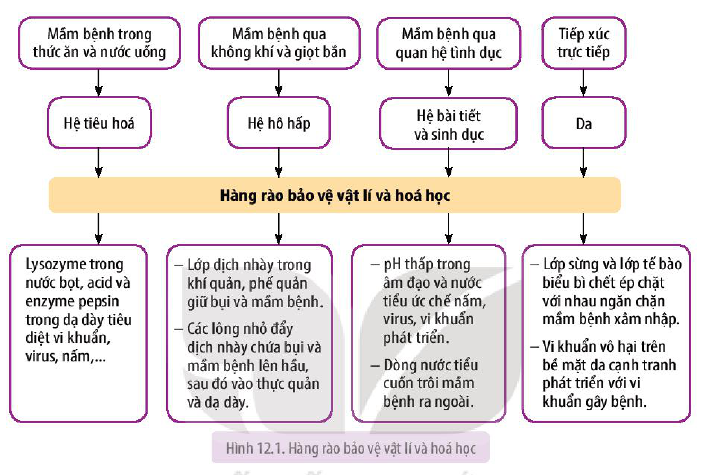
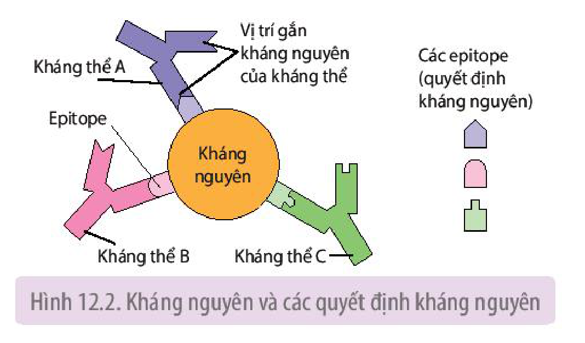
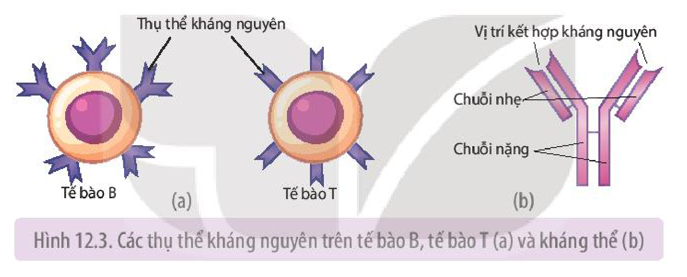
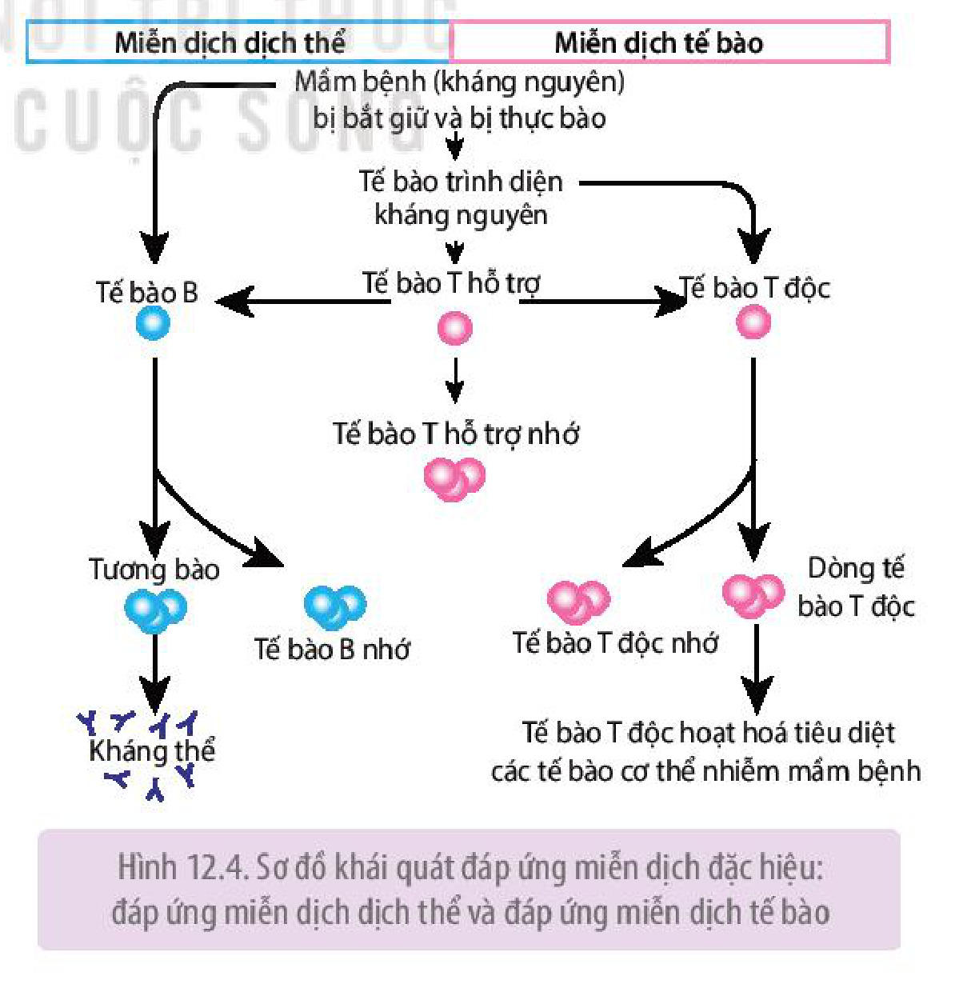
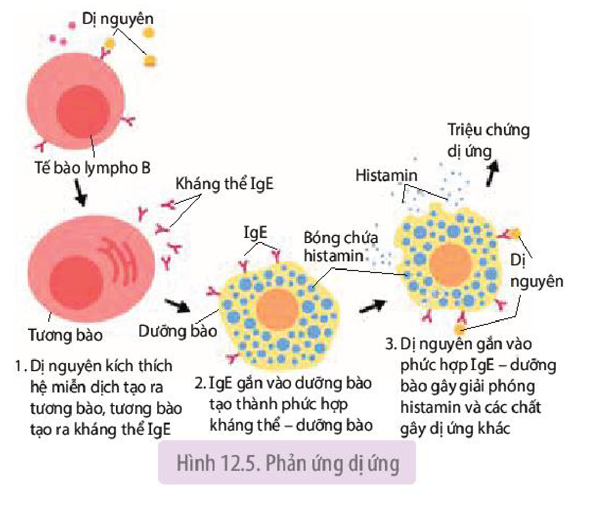

<!-- pdf:73 -->

# BÀI 12: MIỄN DỊCH Ở ĐỘNG VẬT

## 🎯 Yêu cầu cần đạt

- Nêu được các nguyên nhân bên trong và bên ngoài gây ra các bệnh ở động vật và người.
- Giải thích được vì sao nguy cơ mắc bệnh ở người rất lớn nhưng xác suất bị bệnh rất nhỏ.
- Phát biểu được khái niệm miễn dịch và mô tả được khái quát hệ miễn dịch ở người.
- Phân biệt được miễn dịch không đặc hiệu và miễn dịch đặc hiệu.
- Trình bày được cơ chế mắc bệnh và cơ chế chống bệnh ở động vật.
- Phân tích được vai trò của việc chủ động tiêm phòng vaccine.
- Giải thích được cơ sở của hiện tượng dị ứng với chất kích thích, thức ăn; cơ sở khoa học của thử phản ứng khi tiêm kháng sinh.
- Trình bày được quá trình phá vỡ chức năng của hệ miễn dịch trong cơ thể người bệnh (bệnh tự miễn, ung thư và hội chứng suy giảm miễn dịch mắc phải).
- Điều tra được tiêm phòng bệnh, dịch bệnh trong trường học hoặc tại địa phương.

## 🔴 Mở đầu

Xung quanh con người có rất nhiều tác nhân gây bệnh như virus, vi khuẩn, nấm,... nhưng xác suất mắc bệnh ở người lại nhỏ. Vì sao?

## I. NGUYÊN NHÂN GÂY BỆNH Ở NGƯỜI VÀ ĐỘNG VẬT

**Bệnh** là sự sai lệch hoặc tổn thương về cấu trúc và chức năng của bất kì bộ phận, cơ quan, hệ thống nào của cơ thể, biểu hiện bằng một bộ triệu chứng đặc trưng giúp thầy thuốc có thể chẩn đoán xác định và chẩn đoán phân biệt, ngay cả khi chưa rõ nguyên nhân, bệnh lí học và tiên lượng$^{(*)}$. Nguyên nhân gây bệnh cho người và động vật rất nhiều, có thể từ bên ngoài (tác nhân sinh học, vật lí và hoá học) hoặc từ bên trong cơ thể (yếu tố di truyền, thoái hoá mô do tuổi già,...).

Các tác nhân gây bệnh tác động vào tế bào, cơ quan, bộ phận của cơ thể gây tổn thương về cấu trúc và rối loạn về chức năng làm xuất hiện các triệu chứng bệnh lí. Trên thực tế, cơ chế mắc bệnh rất đa dạng.

## ❓ Dừng lại và suy ngẫm

Hãy ghép các tác nhân gây bệnh với cách thức gây bệnh theo các yêu cầu dưới đây:

1. Ghép đúng tác nhân sinh học (1, 2, 3 hoặc 4) với cách thức gây bệnh (A, B, C hoặc D).

| Tác nhân sinh học | Cách thức gây bệnh |
|---|---|
| 1. Vi khuẩn | A. xuyên thủng tế bào cơ thể, lấy chất dinh dưỡng từ tế bào, huỷ hoại các tế bào mà chúng kí sinh. |
| 2. Virus | B. giải phóng độc tố, huỷ hoại các tế bào cơ thể. |
| 3. Vi nấm | C. lấy chất dinh dưỡng trong ống tiêu hoá của người và động vật, làm suy yếu cơ thể, có thể gây tử vong. |
| 4. Giun, sán | D. xâm nhập vào tế bào và can thiệp vào hoạt động của tế bào để tạo ra các phần tử mới, gây suy yếu, huỷ hoại các tế bào cơ thể. |

> (\*) Nguồn: Từ điển y học, Dorland, 2000

<!-- pdf:74 -->

2. Ghép đúng tác nhân vật lí (1, 2, 3, 4 hoặc 5) với cách thức gây bệnh (A, B, C, D, hoặc E).

| Tác nhân vật lí | Cách thức gây bệnh |
|---|---|
| 1. Tác nhân cơ học | A. gây biến tính protein, gây bỏng. |
| 2. Nhiệt độ cao | B. gây giảm thính lực hoặc điếc. |
| 3. Dòng điện | C. gây tổn thương DNA, có thể gây ung thư da. |
| 4. Ánh sáng mặt trời mạnh | D. gây giập nát, tổn thương mô, cơ quan. |
| 5. Âm thanh lớn kéo dài | E. gây giật, bỏng tại chỗ hoặc toàn thân. |

3. Ghép đúng tác nhân hoá học (1, 2 hoặc 3) với cách thức gây bệnh (A, B hoặc C).

| Tác nhân hoá học | Cách thức gây bệnh |
|---|---|
| 1. Acid, kiềm | A. là độc tố thần kinh, gây liệt vận động, ngừng hô hấp. |
| 2. Chất cyanide trong nấm, măng | B. gây ngộ độc cấp tính, có thể gây tử vong. |
| 3. Tetrodotoxin trong cá nóc | C. gây bỏng trên diện rộng hoặc hẹp. |

4. Ghép đúng nguyên nhân bên trong (1, 2) với cách thức gây bệnh (A, B).

| Nguyên nhân bên trong | Cách thức gây bệnh |
|---|---|
| 1. Yếu tố di truyền | A. thoái hoá mô thần kinh, thoái hoá võng mạc. |
| 2. Tuổi già | B. gây ra nhiều bệnh như bệnh bạch tạng, mù màu. |

## II. KHÁI NIỆM MIỄN DỊCH

**Miễn dịch** là khả năng cơ thể chống lại các tác nhân gây bệnh, đảm bảo cho cơ thể khoẻ mạnh, không mắc bệnh.

<!-- term: Hệ miễn dịch -->
Ở người và động vật, chức năng bảo vệ cơ thể chống lại các tác nhân gây bệnh do hệ miễn dịch đảm nhận. Hệ miễn dịch bao gồm mô, cơ quan, tế bào bạch cầu, một số phân tử protein trong máu, cùng tham gia tạo thành các phòng tuyến bảo vệ, chống lại sự xâm nhập của các tác nhân gây bệnh như vi khuẩn, virus, nấm, kí sinh trùng,... Hai phòng tuyến bảo vệ cơ thể do hệ miễn dịch tạo thành là miễn dịch không đặc hiệu và miễn dịch đặc hiệu.

## III. MIỄN DỊCH KHÔNG ĐẶC HIỆU

<!-- term: Miễn dịch không đặc hiệu -->
Miễn dịch không đặc hiệu còn gọi là miễn dịch bẩm sinh hoặc miễn dịch tự nhiên.

<!-- term: Miễn dịch không đặc hiệu -->
Miễn dịch không đặc hiệu thể hiện đáp ứng giống nhau chống lại các tác nhân gây bệnh khác nhau, nghĩa là không đặc hiệu đối với tác nhân gây bệnh.

Miễn dịch không đặc hiệu bao gồm:

- Hàng rào bảo vệ vật lí và hoá học.
- Các đáp ứng không đặc hiệu: thực bào, viêm, sốt và tạo peptide, protein chống lại mầm bệnh.

### 1. Hàng rào bảo vệ vật lí và hoá học

<!-- term: Hàng rào bảo vệ vật lí và hoá học -->
Lớp tế bào biểu mô lót trong các hệ tiêu hoá, hô hấp, bài tiết, sinh sản và da tạo thành hàng rào vật lí và hoá học ngăn chặn mầm bệnh.

<!-- pdf:75 -->

Nếu mầm bệnh (tác nhân gây bệnh) từ môi trường vào cơ thể qua hệ tiêu hoá, hệ hô hấp, hệ bài tiết, hệ sinh dục và da thì hàng rào bảo vệ đầu tiên của hệ miễn dịch đã sẵn sàng tiếp đón và tiêu diệt những mầm bệnh này (H 12.1).

Hình 12.1. Hàng rào bảo vệ vật lí và hoá học

Một số trường hợp, mầm bệnh vượt qua được hàng rào bảo vệ vật lí và hoá học thì chúng sẽ gặp hàng rào bảo vệ tiếp theo, đó là các đáp ứng không đặc hiệu.

### 2. Các đáp ứng không đặc hiệu

<!-- term: Thực bào -->
<!-- term: Đại thực bào -->
<!-- term: Tế bào giết tự nhiên -->
- Thực bào: Đại thực bào, bạch cầu trung tính nhận biết và thực bào mầm bệnh xâm nhập vào cơ thể. Trong máu còn có tế bào giết tự nhiên phá huỷ tế bào nhiễm virus và các tế bào khối u, bạch cầu ưa acid tiết ra độc tố tiêu diệt giun kí sinh.

Cơ quan tạo ra các loại bạch cầu là tuỷ xương, tuyến ức, lá lách và các hạch bạch huyết.

<!-- term: Phản ứng viêm -->
<!-- term: Viêm -->
- Viêm: Phản ứng viêm xảy ra khi một vùng nào đó của cơ thể bị tổn thương và bắt đầu nhiễm trùng. Các tế bào tổn thương tiết ra chất hoá học kích thích dưỡng bào và bạch cầu ưa kiềm giải phóng histamin. Histamin làm các mạch máu ở vùng lân cận dãn ra và tăng tính thấm đối với huyết tương. Mạch máu dãn đưa nhiều máu và bạch cầu đến vùng tổn thương. Các bạch cầu thực bào vi khuẩn, virus, qua đó ngăn chặn chúng phát tán sang các vùng khác.

- **Sốt**: là tình trạng thân nhiệt cơ thể tăng lên và duy trì ở mức cao hơn thân nhiệt bình thường. Khi vùng tổn thương nhiễm khuẩn, đại thực bào thực bào vi khuẩn, virus và tiết ra chất gây sốt kích thích trung khu điều hoà thân nhiệt ở vùng dưới đồi, làm cơ thể tăng sinh nhiệt và sốt. Sốt có tác dụng bảo vệ cơ thể qua:

<!-- pdf:76 -->

  + Ức chế vi khuẩn, virus tăng sinh.
  + Làm gan tăng nhận sắt từ máu, đây là chất cần cho sinh sản của vi khuẩn.
  + Làm tăng hoạt động thực bào của bạch cầu.

Tuy nhiên, sốt cao trên 39 °C có thể gây nguy hiểm cho cơ thể như co giật, hôn mê, thậm chí tử vong.

<!-- term: Interferon -->
<!-- term: Hệ thống bổ thể -->
- Các peptide và protein chống lại mầm bệnh:
  + Các tế bào cơ thể bị nhiễm virus tiết ra interferon, chất này kích thích các tế bào không bị nhiễm bên cạnh sản sinh ra các protein ức chế sự sinh sản của virus.
  + Khoảng 30 protein thuộc hệ thống bổ thể lưu hành trong máu ở trạng thái bất hoạt và chỉ được hoạt hoá khi tiếp xúc với các chất trên bề mặt vi khuẩn. Sự hoạt hoá gây ra một chuỗi các phản ứng hoá sinh làm tan vỡ các tế bào có vi khuẩn xâm nhập.

## ❓ Dừng lại và suy ngẫm

1. Miễn dịch không đặc hiệu bảo vệ cơ thể chống lại mầm bệnh như thế nào?
2. Tại sao sốt vừa có ích lại vừa có hại đối với cơ thể?

## IV. MIỄN DỊCH ĐẶC HIỆU

Miễn dịch đặc hiệu còn gọi là miễn dịch thích ứng hoặc miễn dịch thu được. Miễn dịch đặc hiệu chỉ có ở động vật có xương sống.

**Miễn dịch đặc hiệu** là phản ứng đặc hiệu chống lại những mầm bệnh riêng biệt khi chúng xâm nhập vào cơ thể. Miễn dịch đặc hiệu thực chất là phản ứng giữa tế bào miễn dịch, kháng thể với kháng nguyên.

### 1. Kháng nguyên là gì?

**Kháng nguyên** là những phân tử ngoại lai gây ra đáp ứng miễn dịch đặc hiệu. Hầu hết kháng nguyên là các đại phân tử như các protein, polypeptide, polysaccharide.

Nhiều kháng nguyên nhô ra từ mầm bệnh (vi khuẩn, virus, nấm, cơ thể đơn bào,...) hoặc từ tế bào lạ khác (mô cấy truyền). Một số kháng nguyên là độc tố của vi khuẩn, nọc độc của rắn.

Hình 12.2. Kháng nguyên và các quyết định kháng nguyên

Kháng nguyên có những nhóm amino acid nhỏ gọi là **quyết định kháng nguyên** hay **epitope**. Mỗi kháng nguyên đơn lẻ thường có một số quyết định kháng nguyên (H 12.2). Nhờ quyết định kháng nguyên mà tế bào miễn dịch và kháng thể mới nhận biết được kháng nguyên tương ứng.

<!-- pdf:77 -->

### 2. Tế bào B, tế bào T và kháng thể

<!-- term: Tế bào B -->
<!-- term: Tế bào T -->
<!-- term: Thụ thể kháng nguyên -->
Tế bào B và tế bào T (còn gọi là tế bào lympho B và tế bào lympho T) có các thụ thể kháng nguyên trên màng sinh chất (H 12.3a). Thụ thể kháng nguyên có vùng (vị trí) nhận diện và gắn với kháng nguyên qua quyết định kháng nguyên tương ứng, giống như chìa khoá với ổ khoá.

Tất cả thụ thể kháng nguyên trên một tế bào B hoặc một tế bào T đều giống hệt nhau nên chúng chỉ gắn với loại kháng nguyên tương ứng qua quyết định kháng nguyên.

<!-- term: Tương bào -->
Khi tế bào B hoạt hoá, phân chia tạo thành các tương bào. Các tương bào sản sinh ra các thụ thể kháng nguyên và đưa vào máu. Các thụ thể kháng nguyên tự do trong máu gọi là **kháng thể** hay **globulin miễn dịch** (Ig). Kháng thể có vùng (vị trí) nhận diện và gắn với kháng nguyên qua quyết định kháng nguyên tương ứng, giống như chìa khoá với ổ khoá (H 12.3b). Tất cả kháng thể được tạo ra từ các tương bào thuộc một dòng tế bào B đều giống hệt nhau nên chúng chỉ gắn với loại kháng nguyên tương ứng qua quyết định kháng nguyên.

Hình 12.3. Các thụ thể kháng nguyên trên tế bào B, tế bào T (a) và kháng thể (b)

### 3. Cơ chế miễn dịch đặc hiệu

Miễn dịch đặc hiệu gồm miễn dịch dịch thể và miễn dịch tế bào.

Cơ chế miễn dịch đặc hiệu diễn ra như sau (H 12.4):

<!-- term: Tế bào trình diện kháng nguyên -->
<!-- term: Tế bào T hỗ trợ -->
(1) Mầm bệnh xâm nhập vào cơ thể bị các tế bào trình diện kháng nguyên (đại thực bào, tế bào B và tế bào chia nhánh) bắt giữ và thực bào. Các tế bào trình diện kháng nguyên đem kháng nguyên trình diện tế bào T hỗ trợ và làm tế bào T hỗ trợ hoạt hoá.

(2) Tế bào T hỗ trợ hoạt hoá phân chia tạo ra dòng tế bào T hỗ trợ và dòng tế bào T hỗ trợ nhớ. Từ đây, dòng tế bào T hỗ trợ gây ra miễn dịch dịch thể và miễn dịch tế bào.

Hình 12.4. Sơ đồ khái quát đáp ứng miễn dịch đặc hiệu: đáp ứng miễn dịch dịch thể và đáp ứng miễn dịch tế bào

<!-- pdf:78 -->

<!-- term: Miễn dịch dịch thể -->
(3a) Miễn dịch dịch thể: Các tế bào T hỗ trợ tiết ra cytokine gây hoạt hoá tế bào B, khởi đầu cho miễn dịch dịch thể. Tế bào B tăng sinh và biệt hoá, tạo ra dòng tương bào và dòng tế bào B nhớ. Các tương bào sản sinh ra kháng thể IgG. Kháng thể lưu hành trong máu và tiêu diệt mầm bệnh trong máu theo nhiều cách khác nhau (H 12.4).

<!-- term: Miễn dịch tế bào -->
<!-- term: Tế bào T độc -->
(3b) Miễn dịch tế bào: Các tế bào T hỗ trợ tiết cytokine còn làm tế bào T độc hoạt hoá, khởi đầu cho miễn dịch tế bào. Để trở nên hoạt hoá, ngoài tế bào T hỗ trợ, tế bào T độc còn cần tương tác với tế bào trình diện kháng nguyên. Tế bào T độc phân chia, tạo ra dòng tế bào T độc hoạt hoá và dòng tế bào T độc nhớ. Các tế bào T độc lưu hành trong máu và tiết ra độc tố tiêu diệt các tế bào nhiễm mầm bệnh (H 12.4).

### 4. Đáp ứng miễn dịch nguyên phát và thứ phát

<!-- term: Đáp ứng miễn dịch nguyên phát -->
<!-- term: Đáp ứng miễn dịch thứ phát -->
Hệ miễn dịch tiếp xúc lần đầu tiên với kháng nguyên sẽ tạo ra đáp ứng miễn dịch nguyên phát (gồm đáp ứng miễn dịch dịch thể và đáp ứng miễn dịch tế bào). Nếu sau đó, hệ miễn dịch lại tiếp xúc với chính loại kháng nguyên đó thì sẽ tạo ra đáp ứng miễn dịch thứ phát. Nhờ tế bào nhớ tạo ra ở đáp ứng miễn dịch nguyên phát nên đáp ứng miễn dịch thứ phát diễn ra nhanh hơn (2 – 3 ngày so với 7 – 10 ngày), số lượng tế bào miễn dịch (tế bào T, tế bào B) và kháng thể nhiều hơn, đồng thời duy trì ở mức cao lâu hơn, dẫn đến khả năng chống lại mầm bệnh hiệu quả, giúp người và vật nuôi không bị bệnh hoặc có mắc bệnh thì cũng rất nhẹ.

<!-- term: Vaccine -->
Ứng dụng hiểu biết trên, người ta điều chế ra vaccine để phòng các bệnh do virus, vi khuẩn. Vaccine thường được sản xuất dưới dạng dung dịch tiêm có chứa kháng nguyên đã được xử lí, không còn khả năng gây bệnh (ví dụ: vi khuẩn, virus đã chết hoặc đã suy yếu không đủ sức gây bệnh, các protein kháng nguyên như protein tái tổ hợp, gene hoặc RNA mã hoá protein của virus, vi khuẩn,...). Tiêm chủng vaccine là biện pháp chủ động tạo ra đáp ứng miễn dịch nguyên phát ở người và vật nuôi.

### 5. Dị ứng

**Dị ứng** là phản ứng quá mức của cơ thể đối với kháng nguyên nhất định, nghĩa là cơ thể quá mẫn cảm với kháng nguyên.

Một số người có phản ứng quá mức với loại kháng nguyên nào đó, những người khác thì không. Kháng nguyên trong phản ứng dị ứng gọi là **dị nguyên**. Dị nguyên có ở phấn hoa, bào tử nấm, lông động vật, nọc ong, hải sản, sữa,...

Một số thuốc kháng sinh được coi là dị nguyên vì chúng cũng gây ra phản ứng dị ứng. Phản ứng dị ứng diễn ra theo trình tự dưới đây (H 12.5):

Hình 12.5. Phản ứng dị ứng

Chất gây ra triệu chứng dị ứng chủ yếu là histamin. Histamin đi theo máu đến các mô gây ra các triệu chứng dị ứng như dãn mạch ngoại vi,

<!-- pdf:79 -->

tăng tính thấm ở mao mạch, ngứa, hắt hơi, sổ mũi, chảy nước mắt, co thắt phế quản gây khó thở,...

<!-- term: Sốc phản vệ -->
Phản ứng dị ứng cấp tính đôi khi đưa đến sốc phản vệ. Sốc phản vệ xảy ra khi dị nguyên gây giải phóng lượng lớn histamin trên diện rộng. Hậu quả là co thắt phế quản, dãn các mạch máu ngoại vi, huyết áp giảm nhanh,... dẫn đến não, tim không nhận đủ máu và $\text{O}_2$. Tình trạng thiếu $\text{O}_2$ có thể gây tử vong sau vài phút. Thực tế cho thấy, ong đốt hoặc tiêm một số loại kháng sinh, ví dụ: penicillin, cephalosporin có thể gây sốc phản vệ ở những người phản ứng quá mức với nọc ong hoặc thuốc kháng sinh. Một số người dị ứng với tôm, cua, lạc,... có thể xuất hiện các triệu chứng dị ứng, thậm chí nguy hiểm đến tính mạng sau khi ăn các loại thức ăn này.

## ❓ Dừng lại và suy ngẫm

1. Phân biệt miễn dịch không đặc hiệu và miễn dịch đặc hiệu.
2. Tế bào B, tế bào T và kháng thể nhận diện kháng nguyên tương ứng như thế nào?
3. Tại sao hiệu quả bảo vệ cơ thể của đáp ứng miễn dịch thứ phát cao hơn nhiều so với đáp ứng miễn dịch nguyên phát?

## V. CÁC BỆNH PHÁT SINH DO CHỨC NĂNG HỆ MIỄN DỊCH BỊ PHÁ VỠ

### 1. Hội chứng suy giảm miễn dịch mắc phải

<!-- term: Hội chứng suy giảm miễn dịch mắc phải -->
Hội chứng suy giảm miễn dịch mắc phải ở người (viết tắt là AIDS) do một loại retrovirus có tên là HIV gây ra. Khi vào cơ thể, HIV xâm nhập và tăng sinh trong tế bào T hỗ trợ và tiêu diệt tế bào này, dẫn đến làm suy yếu dần đáp ứng miễn dịch dịch thể và đáp ứng miễn dịch tế bào. Kết quả là khả năng chống nhiễm trùng và ung thư ngày càng suy giảm, bất kì một mầm bệnh nào đều có thể phát triển và gây bệnh. Những loại bệnh phát sinh do hệ miễn dịch suy giảm gọi là "**bệnh cơ hội**". Các bệnh cơ hội thường rất nhiều, như lao, tiêu chảy, viêm não, viêm phổi, ung thư,... Do rất nhiều bệnh cùng xuất hiện khi hệ miễn dịch suy giảm nên người ta gọi là Hội chứng suy giảm miễn dịch mắc phải.

### 2. Bệnh ung thư

**Bệnh ung thư** là do một nhóm tế bào trở nên bất thường và phân chia liên tục, không kiểm soát được dẫn đến tạo thành khối u, gọi là **u ác tính**. U ác tính có xu hướng phát triển nhanh, xâm lấn các mô bình thường bên cạnh. Tế bào u ác tính (tế bào ung thư) có thể tách ra khỏi khối u đi theo đường máu hoặc bạch huyết đến các vị trí khác trong cơ thể và hình thành khối u ác tính mới, quá trình này gọi là **di căn**. Khi tế bào ung thư di chuyển vào tuỷ xương và hình thành khối u ác tính trong tuỷ xương, gây cản trở chức năng sản sinh tế bào máu, trong đó có các tế bào bạch cầu. Hậu quả là hệ miễn dịch bị suy yếu, dẫn đến giảm khả năng tiêu diệt tế bào ung thư và mầm bệnh.

### 3. Bệnh tự miễn

**Bệnh tự miễn** là bệnh mà hệ miễn dịch của cơ thể bị rối loạn, mất khả năng phân biệt các kháng nguyên ngoại lai với tế bào, cơ quan của cơ thể, dẫn đến các tế bào miễn dịch hoặc kháng thể do cơ thể sản sinh ra tấn công, huỷ hoại các tế bào, cơ quan của chính mình và gây ra bệnh tự miễn. Ví dụ: Các tế bào T tiêu diệt các tế bào sản xuất insulin của tuyến tuỵ gây ra bệnh tiểu đường type I.

<!-- pdf:80 -->

Nguyên nhân gây ra bệnh tự miễn có thể do gene, do một số yếu tố môi trường như tia phóng xạ, hoá chất, virus, vi khuẩn,... Các yếu tố này gây biến đổi thành phần cấu tạo của tế bào cơ thể, làm hệ miễn dịch coi tế bào như là chất ngoại lai. Người ta đã phát hiện ra hơn 60 bệnh tự miễn.

## ❓ Dừng lại và suy ngẫm

Những bệnh nào có thể xuất hiện khi chức năng hệ miễn dịch bị phá vỡ?

## 📌 Kiến thức cốt lõi

- Nguyên nhân bên ngoài gây bệnh cho động vật như các tác nhân sinh học, vật lí, hoá học hoặc bên trong cơ thể như đột biến gene, đột biến nhiễm sắc thể, thoái hoá mô do tuổi già.
- Miễn dịch là khả năng cơ thể chống lại các tác nhân gây bệnh, đảm bảo cho cơ thể khoẻ mạnh, không mắc bệnh.
- Miễn dịch không đặc hiệu gồm hàng rào bảo vệ vật lí, hoá học và các đáp ứng không đặc hiệu (thực bào, viêm, sốt và tạo peptide, protein chống lại mầm bệnh). Miễn dịch đặc hiệu gồm miễn dịch dịch thể và miễn dịch tế bào.
- Tiêm chủng vaccine chủ động tạo ra đáp ứng miễn dịch.
- Dị ứng là phản ứng quá mức của cơ thể đối với kháng nguyên.
- Bệnh ung thư, tự miễn, AIDS là do chức năng hệ miễn dịch bị phá vỡ.

## ✏️ Luyện tập và vận dụng

1. Tại sao tiêm vaccine có thể giúp phòng một số bệnh do virus và vi khuẩn gây ra ở người và vật nuôi?
2. Tìm gặp những người phụ trách y tế, những người phụ trách thú y của địa phương và đề nghị họ cho biết:
   - Địa phương đã tiêm vaccine phòng chống những bệnh nào cho trẻ em và người lớn?
   - Những loài động vật nuôi nào ở địa phương đã được tiêm vaccine phòng bệnh và phòng những bệnh nào?
3. Tại sao trước khi tiêm một số loại kháng sinh người ta phải thử phản ứng dị ứng của cơ thể với kháng sinh bằng cách tiêm một lượng rất nhỏ kháng sinh dưới da cẳng tay và theo dõi phản ứng xảy ra tại vị trí tiêm?

## 💡 Em có biết

Kháng nguyên của virus cúm luôn biến đổi làm cho các dòng tế bào nhớ không thể nhận ra các chủng virus cúm mới. Đây chính là nguyên nhân dẫn đến vaccine cúm được sản xuất mới và tiêm nhắc lại hằng năm.

## 📷 Danh sách hình trong bài

| Mã hình | Trang PDF | Vị trí | Chú thích gốc |
|---|---|---|---|
| H11-sinh-b12-01 | 75 | Mục III.1 | Hình 12.1. Hàng rào bảo vệ vật lí và hoá học |
| H11-sinh-b12-02 | 76 | Mục IV.1 | Hình 12.2. Kháng nguyên và các quyết định kháng nguyên |
| H11-sinh-b12-03 | 77 | Mục IV.2 | Hình 12.3. Các thụ thể kháng nguyên trên tế bào B, tế bào T (a) và kháng thể (b) |
| H11-sinh-b12-04 | 77 | Mục IV.3 | Hình 12.4. Sơ đồ khái quát đáp ứng miễn dịch đặc hiệu: đáp ứng miễn dịch dịch thể và đáp ứng miễn dịch tế bào |
| H11-sinh-b12-05 | 78 | Mục IV.5 | Hình 12.5. Phản ứng dị ứng |
