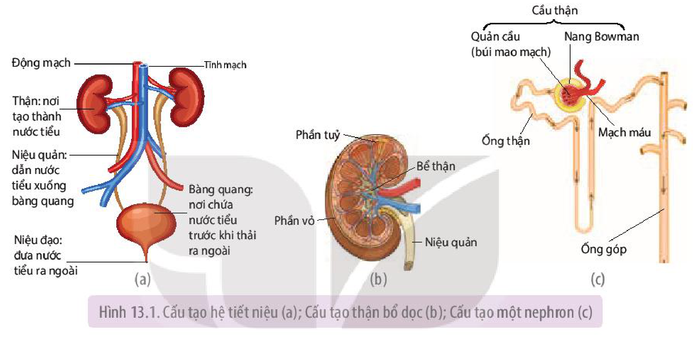
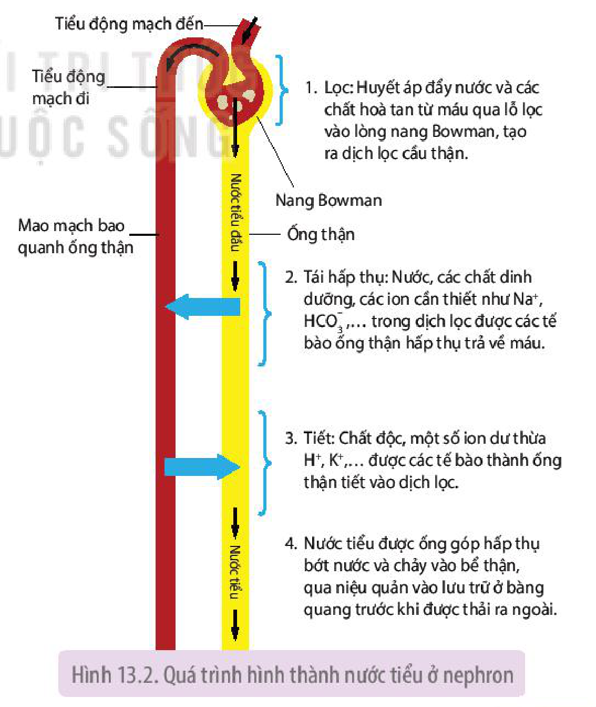
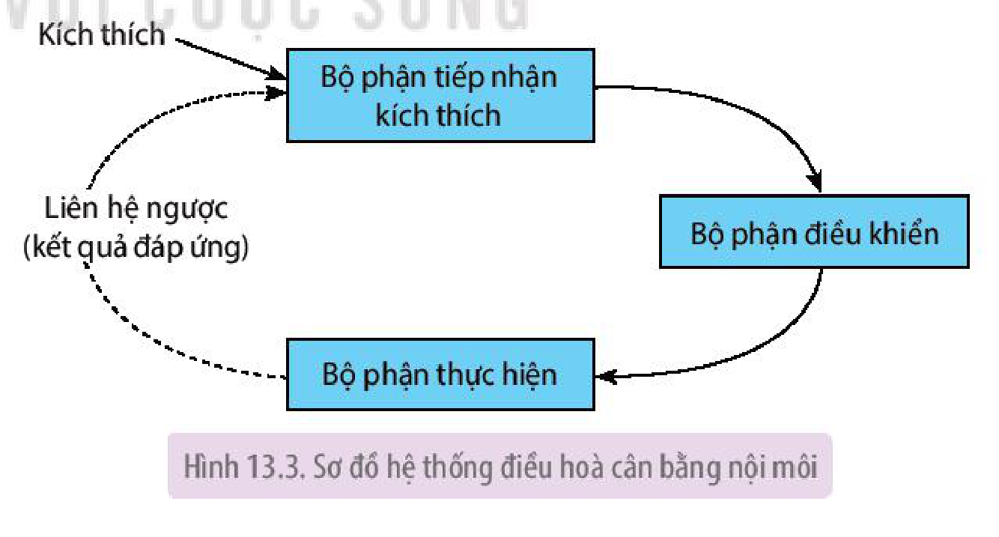
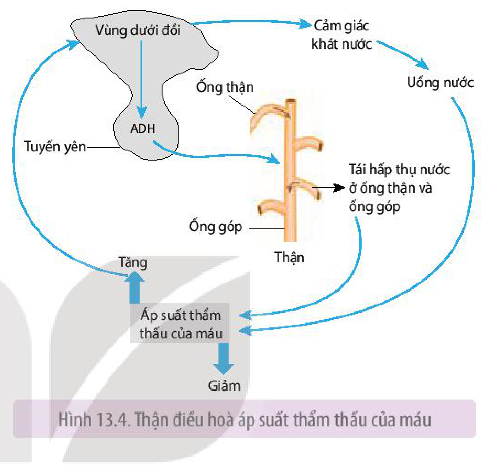
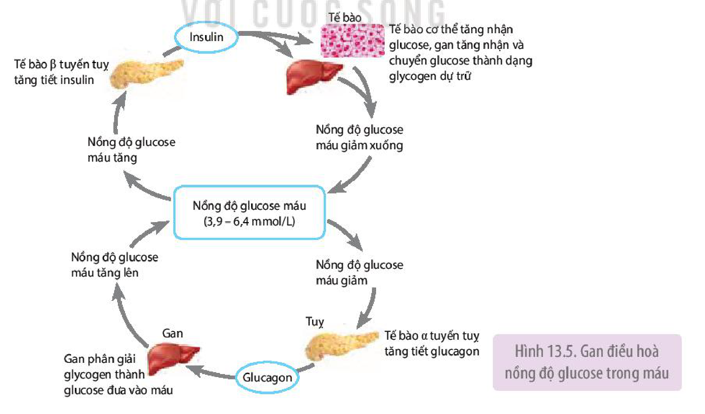
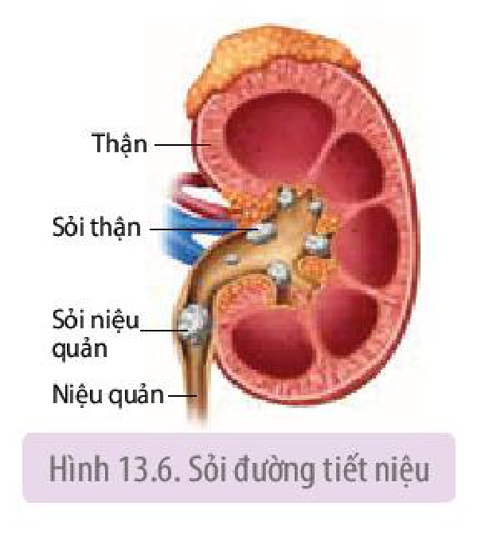

<!-- pdf:81 -->

# BÀI 13: BÀI TIẾT VÀ CÂN BẰNG NỘI MÔI

## 🎯 Yêu cầu cần đạt

- Phát biểu được khái niệm bài tiết và trình bày vai trò của bài tiết.
- Trình bày được vai trò của thận trong bài tiết và cân bằng nội môi.
- Nêu được khái niệm: nội môi, cân bằng nội môi và giải thích được cơ chế chung điều hoà nội môi.
- Nêu được một số cơ quan tham gia điều hoà cân bằng nội môi và một số hằng số nội môi.
- Trình bày được các biện pháp bảo vệ thận và các biện pháp phòng tránh một số bệnh liên quan đến thận và bài tiết như suy thận, sỏi thận,...
- Nêu được tầm quan trọng của việc xét nghiệm định kì các chỉ số sinh hoá liên quan đến cân bằng nội môi và giải thích được kết quả xét nghiệm.

## 🔴 Mở đầu

Điều gì sẽ xảy ra với cơ thể nếu như các chất độc hại và các chất dư thừa không được thải ra bên ngoài mà lại tích tụ trong cơ thể?

## I. KHÁI NIỆM VÀ VAI TRÒ CỦA BÀI TIẾT

**Bài tiết** là quá trình loại bỏ ra khỏi cơ thể các chất sinh ra từ quá trình chuyển hoá mà cơ thể không sử dụng, các chất độc hại và các chất dư thừa.

Nhờ có bài tiết, các chất sinh ra từ quá trình chuyển hoá, các chất độc hại, các chất dư thừa bị đào thải ra khỏi cơ thể. Nếu các chất này tích tụ lại trong cơ thể sẽ gây mất cân bằng nội môi, gây tổn thương tế bào, cơ quan, dẫn đến bệnh tật hoặc tử vong. Các chất bài tiết như $\text{CO}_2$, urea, uric acid, creatinin, bilirubin,... được thải ra ngoài nhờ các cơ quan bài tiết (Bảng 13.1).

**Bảng 13.1.** Các cơ quan bài tiết chủ yếu và các sản phẩm bài tiết ở người

| Cơ quan bài tiết | Sản phẩm bài tiết chính |
|---|---|
| Phổi | $\text{CO}_2$ |
| Thận | Nước tiểu (gồm nước, urea, uric acid, creatinin, chất vô cơ dưới dạng ion như $\text{Na}^+$, $\text{K}^+$, $\text{H}^+$, $\text{Ca}^{2+}$, $\text{Cl}^-$, $\text{HCO}_3^-$,...) |
| Da | Mồ hôi (gồm nước, một ít chất vô cơ và urea) |
| Hệ tiêu hoá | Bilirubin |

<!-- pdf:82 -->

## II. THẬN VÀ CHỨC NĂNG TẠO NƯỚC TIỂU

### 1. Cấu tạo của thận

<!-- term: Thận -->
Ở người, hai quả thận thuộc hệ tiết niệu có chức năng lọc máu tạo nước tiểu. Mỗi thận được cấu tạo bởi khoảng một triệu đơn vị chức năng, gọi là **nephron** hay **đơn vị thận**. Các nephron tạo nên phần vỏ và phần tuỷ thận. Mỗi nephron được cấu tạo từ cầu thận và ống thận. Mỗi ống góp thu nhận nước tiểu từ một số nephron, hấp thụ bớt nước và chuyển nước tiểu chính thức vào bể thận, sau đó qua niệu quản vào bàng quang (H 13.1).

Hình 13.1. Cấu tạo hệ tiết niệu (a); Cấu tạo thận bổ dọc (b); Cấu tạo một nephron (c)

### 2. Chức năng tạo nước tiểu của thận

Nước tiểu được tạo thành trong quá trình máu chảy qua các nephron. Quá trình tạo nước tiểu ở nephron gồm các giai đoạn được mô tả ở Hình 13.2.

<!-- term: Nước tiểu chính thức -->
Mỗi ngày có khoảng 1 700 – 1 800 L máu chảy qua thận và tạo ra khoảng 180 L **dịch lọc cầu thận** (còn gọi là **nước tiểu đầu**). Dịch lọc cầu thận có thành phần tương tự như máu, nhưng không có tế bào máu và protein huyết tương. Nhờ quá trình tái hấp thụ chất dinh dưỡng và tiết chất thải của các tế bào ống thận và ống góp nên chỉ còn 1,5 – 2 L nước tiểu chính thức được tạo thành và thải ra ngoài mỗi ngày.

Hình 13.2. Quá trình hình thành nước tiểu ở nephron

<!-- pdf:83 -->

Nhờ chức năng lọc máu, tái hấp thụ các chất dinh dưỡng, điều tiết lượng nước và muối hấp thụ, loại bỏ các chất độc hại và các chất dư thừa ra khỏi cơ thể nên thận có vai trò quan trọng trong việc ổn định thể tích và thành phần của thể dịch, qua đó duy trì sự sống của người và động vật.

## ❓ Dừng lại và suy ngẫm

1. Kể tên một số chất bài tiết. Các chất đó được cơ quan nào bài tiết?
2. Quá trình hình thành nước tiểu gồm những giai đoạn nào? Điều gì xảy ra nếu một trong những giai đoạn này bị rối loạn?

## III. CÂN BẰNG NỘI MÔI

### 1. Khái niệm nội môi, cân bằng nội môi

**Nội môi** là môi trường bên trong cơ thể được tạo bởi máu, bạch huyết và dịch mô.

**Cân bằng nội môi** là trạng thái trong đó các điều kiện lí, hoá của môi trường trong cơ thể duy trì ổn định (áp suất thẩm thấu của máu trung bình 300 mOsm/L, pH máu động mạch là 7,35), đảm bảo cho các tế bào, cơ quan hoạt động bình thường.

Cân bằng nội môi là trạng thái cân bằng động nghĩa là các chỉ số của môi trường trong cơ thể có xu hướng thay đổi và dao động xung quanh một khoảng giá trị xác định. Sở dĩ như vậy là do ảnh hưởng từ sự thay đổi liên tục của các kích thích bên ngoài hoặc bên trong cơ thể. Ví dụ: Nồng độ glucose trong máu người luôn dao động trong khoảng 3,9 – 6,4 mmol/L (tương ứng 70 – 110 mg glucose/100 mL).

Trạng thái cân bằng nội môi được duy trì nhờ các hệ thống điều hoà cân bằng nội môi.

<!-- term: Hệ thống điều hoà cân bằng nội môi -->
Mỗi hệ thống điều hoà cân bằng nội môi gồm ba thành phần: bộ phận tiếp nhận kích thích, bộ phận điều khiển và bộ phận thực hiện (H 13.3).

Hình 13.3. Sơ đồ hệ thống điều hoà cân bằng nội môi

**Bộ phận tiếp nhận**: là thụ thể hoặc cơ quan thụ cảm, tiếp nhận kích thích từ môi trường trong hoặc ngoài cơ thể.

**Bộ phận điều khiển**: là trung ương thần kinh hoặc tuyến nội tiết. Bộ phận điều khiển chuyển tín hiệu thần kinh hoặc hormone đến bộ phận thực hiện.

**Bộ phận thực hiện**, còn gọi **bộ phận đáp ứng**: là các cơ quan như thận, gan, phổi, tim, mạch máu,...

<!-- pdf:84 -->

Kết quả đáp ứng của bộ phận thực hiện lại gây tác động ngược trở lại bộ phận tiếp nhận kích thích. Sự tác động ngược như vậy gọi là **liên hệ ngược**.

Khi một bộ phận của hệ thống điều hoà cân bằng nội môi hoạt động không bình thường hoặc bị bệnh sẽ dẫn đến mất cân bằng nội môi. Ví dụ: Khi bị suy tim, lượng máu bơm lên động mạch giảm, dẫn đến huyết áp và vận tốc máu giảm.

### 2. Một số cơ quan tham gia điều hoà cân bằng nội môi

Có thể nói hầu hết các mô, cơ quan trong cơ thể đều tham gia điều hoà cân bằng nội môi, tuy nhiên thận, gan và phổi là những cơ quan quan trọng hàng đầu.

**a) Vai trò của thận trong điều hoà cân bằng nội môi**

- Thận điều hoà cân bằng muối và nước, qua đó duy trì áp suất thẩm thấu của dịch cơ thể (H 13.4).
- Thận còn có vai trò duy trì ổn định pH máu qua điều chỉnh tiết $\text{H}^+$ vào dịch lọc và tái hấp thụ $\text{HCO}_3^-$ từ dịch lọc trả về máu.

Hình 13.4. Thận điều hoà áp suất thẩm thấu của máu

**b) Vai trò của gan trong điều hoà cân bằng nội môi**

Gan điều hoà nồng độ của nhiều chất hoà tan như protein, glucose,... trong huyết tương, qua đó duy trì cân bằng nội môi (H 13.5).

Hình 13.5. Gan điều hoà nồng độ glucose trong máu

<!-- pdf:85 -->

**c) Vai trò của phổi trong duy trì pH máu**

Phổi thải $\text{CO}_2$ từ máu vào môi trường, qua đó duy trì pH máu.

## ❓ Dừng lại và suy ngẫm

1. Tại sao lại nói cân bằng nội môi là cân bằng động?
2. Hệ thống duy trì cân bằng nội môi đảm bảo duy trì cân bằng nội môi trong cơ thể như thế nào? Cho ví dụ.

## IV. VẬN DỤNG

### 1. Các biện pháp bảo vệ thận

Do thận là cơ quan rất quan trọng đối với sự sống của con người nhưng thận cũng là cơ quan dễ bị tổn thương nên các biện pháp bảo vệ thận phải được quan tâm đúng mức. Một số biện pháp sau đây cần thực hiện để bảo vệ thận:

**a) Chế độ ăn hợp lí**

Chế độ ăn nhiều muối NaCl, nhiều dầu mỡ gây tăng huyết áp. Huyết áp cao kéo dài sẽ dẫn đến tổn thương và suy thận.

Ăn nhiều protein động vật tạo ra nhiều uric acid, tăng thải calcium qua nước tiểu, điều này đưa đến nguy cơ tạo ra sỏi thận.

**b) Uống đủ nước**

Mỗi ngày, cơ thể cần khoảng 1,5 – 2 L nước. Cơ thể cần nhiều nước hơn khi lao động trong thời tiết nắng nóng, cho con bú,... Uống đủ nước đảm bảo cho thận thải thuận lợi các chất độc hại và muối dư thừa. Nếu uống thừa nước sẽ gây loãng máu, tăng áp lực thải nước qua thận, lâu ngày dẫn đến suy thận. Nếu uống không đủ nước, cơ thể khó thải hết các chất thải độc hại qua thận, đồng thời nồng độ các chất thải trong nước tiểu tăng lên, tạo điều kiện thuận lợi cho sỏi thận hình thành.

**c) Không uống nhiều rượu, bia**

Rượu, bia gây rối loạn chức năng thận, thậm chí gây tổn hại tế bào thận, nếu sử dụng trong thời gian dài sẽ làm suy giảm chức năng lọc và tái hấp thụ các chất của thận. Uống nhiều rượu, bia còn làm tim đập nhanh, huyết áp tăng, đây cũng là nguyên nhân gây tổn thương thận, suy thận.

**d) Không sử dụng quá nhiều loại thuốc**

Thận có chức năng lọc và bài thải thuốc ra khỏi cơ thể. Tuy nhiên, khi dùng nhiều loại thuốc, thận phải tăng cường lọc và thải thuốc, dẫn đến quá tải, sau một thời gian sẽ khiến chức năng của thận suy giảm. Một số thuốc kháng sinh, thuốc chống viêm, thuốc lợi tiểu, thuốc giảm đau,... sau một thời gian sử dụng gây suy giảm chức năng thận.

### 2. Một số bệnh về hệ tiết niệu và biện pháp phòng tránh

Có rất nhiều bệnh về hệ tiết niệu như suy thận, sỏi thận, viêm thận, thận nhiễm mỡ,... Hai trong số các bệnh nguy hiểm là suy thận và sỏi thận.

<!-- pdf:86 -->

**Suy thận** là tình trạng suy giảm chức năng thận. Suy thận dẫn đến tích tụ các chất độc hại, gây rối loạn chức năng tế bào, huỷ hoại tế bào, cơ quan. Nếu suy thận nặng phải chạy thận nhân tạo, ghép thận,... để duy trì sự sống.

**Sỏi thận** là do các chất thải trong nước tiểu kết lại với nhau và lắng đọng, lâu ngày tạo thành sỏi. Sỏi có thể từ một, hai, ba viên cho đến hàng trăm viên to nhỏ khác nhau. Tuỳ theo vị trí, sỏi có thể là sỏi thận, sỏi niệu quản, sỏi bàng quang, sỏi niệu đạo (H 13.6). Sỏi thận làm tổn thương thận, cản trở hoặc tắc đường lưu thông nước tiểu, gây ngộ độc, đau đớn, hôn mê, thậm chí tử vong.

Hình 13.6. Sỏi đường tiết niệu

### 3. Tầm quan trọng của việc xét nghiệm định kì các chỉ số sinh hoá liên quan đến cân bằng nội môi

Tình trạng sức khoẻ được đánh giá bằng nhiều cách như kiểm tra cân nặng, huyết áp, xét nghiệm các chỉ số sinh lí, sinh hoá máu, nước tiểu,...

Xét nghiệm định kì các chỉ số sinh lí, sinh hoá máu là một trong những biện pháp phát hiện sớm tình trạng mất cân bằng nội môi, qua đó đánh giá được chức năng của các cơ quan như thận, gan, tim mạch,... từ đó kịp thời điều chỉnh và chữa trị khi bệnh còn nhẹ.

Một số chỉ số sinh lí, sinh hoá máu cơ bản thường được chỉ định xét nghiệm định kì.

Trên phiếu xét nghiệm, kết quả xét nghiệm được ghi ở cột bên cạnh cột chỉ số bình thường để dễ so sánh.

Dưới đây là bảng kết quả xét nghiệm một số chỉ số sinh lí, sinh hoá máu của một người (Bảng 13.2)

**Bảng 13.2.** Kết quả xét nghiệm một số chỉ số sinh lí, sinh hoá máu của một người

| Tên xét nghiệm | Chỉ số bình thường | Kết quả xét nghiệm | Tên xét nghiệm | Chỉ số bình thường | Kết quả xét nghiệm |
|---|---|---|---|---|---|
| Glucose | 3,9 – 6,4 mmol/L | **8,2** | Cholesterol | 2,6 – 5,2 mmol/L | 4,8 |
| Protein toàn phần | 60 – 87 g/L | 71 | Triglyceride | 0,46 – 1,88 mmol/L | 1,79 |
| Albumin | 34 – 50 g/L | 45 | Calcium | 2,20 – 2,50 mmol/L | 2,34 |
| Urea | 2,5 – 9,2 mmol/L | 7,9 | Số lượng hồng cầu | 3,9 – 5,03 triệu/100 mL | 4,09 |
| Uric acid | 150 – 360 $\mu\text{mol/L}$ | **370** | Huyết sắc tố | 12,0 – 15,5 g/100 mL | 12,6 |
| Creatinin | 53 – 97 $\mu\text{mol/L}$ | **110** | Số lượng bạch cầu | 3,5 – 10,5 nghìn/100 mL | 5,9 |
| Bilirubin | 3,4 – 17,1 $\mu\text{mol/L}$ | 9,33 | Số lượng tiểu cầu | 150 – 450 nghìn/100 mL | 195 |

Dựa trên kết quả xét nghiệm, bác sĩ đưa ra nhận định về tình trạng sức khoẻ bình thường hay bị bệnh. Nếu có những chỉ số bất thường, bác sĩ sẽ đưa ra lời khuyên hoặc biện pháp điều trị phù hợp.

<!-- pdf:87 -->

## ❓ Dừng lại và suy ngẫm

1. Kẻ bảng vào vở và điền biện pháp phòng tránh bệnh vào bảng theo mẫu dưới đây:

| Bệnh thận | Nguyên nhân gây bệnh chủ yếu | Biện pháp phòng tránh |
|---|---|---|
| 1. Suy thận | - Tăng huyết áp (do bệnh đái tháo đường, béo phì, mỡ máu cao, chế độ ăn nhiều NaCl, phì đại tuyến tiền liệt, sỏi thận,...). - Nhiễm trùng hệ tiết niệu. - Tác dụng phụ của một số thuốc, lạm dụng rượu, bia,... | ? |
| 2. Sỏi thận | - Uống không đủ nước hằng ngày. - Nhịn tiểu thường xuyên. - Ăn thức ăn nhiều muối NaCl, nhiều protein động vật trong thời gian dài; bổ sung vitamin C, calcium không đúng cách. - Nhiễm trùng hệ tiết niệu,... | ? |

2. Những chỉ số sinh lí, sinh hoá máu nào ở Bảng 13.2 là bình thường, không bình thường? Người có kết quả xét nghiệm này nên làm gì?

## 📌 Kiến thức cốt lõi

- Bài tiết là quá trình loại bỏ khỏi cơ thể các chất thải được sinh ra từ quá trình chuyển hoá cùng với các chất độc hại và các chất dư thừa.
- Quá trình tạo nước tiểu gồm các giai đoạn: lọc ở cầu thận, tái hấp thụ và tiết chất ở ống thận.
- Cân bằng nội môi là trạng thái mà trong đó các điều kiện lí, hoá của môi trường bên trong cơ thể duy trì ổn định, đảm bảo cho các tế bào, cơ quan hoạt động bình thường.
- Mỗi hệ thống điều hoà cân bằng nội môi gồm ba thành phần: bộ phận tiếp nhận kích thích, bộ phận điều khiển và bộ phận thực hiện.
- Hầu hết các cơ quan trong cơ thể đều tham gia điều hoà cân bằng nội môi, trong đó thận, gan, phổi đóng vai trò quan trọng hàng đầu.
- Bảo vệ thận tránh mắc bệnh bằng nhiều biện pháp như điều chỉnh chế độ ăn, uống đủ nước, không lạm dụng thuốc, không uống nhiều rượu, bia,...
- Xét nghiệm định kì các chỉ số sinh lí, sinh hoá máu giúp đánh giá tình trạng sức khoẻ.

## ✏️ Luyện tập và vận dụng

1. Trong cuộc sống hằng ngày, có người uống lượng nước vượt quá nhu cầu của cơ thể và có người uống lượng nước ít hơn so với nhu cầu của cơ thể. Trong hai trường hợp này, hoạt động của thận sẽ thay đổi như thế nào? Giải thích.
2. Tại sao những người bị bệnh suy thận nặng phải chạy thận nhân tạo?
3. Uống rượu ức chế tuyến yên giải phóng ADH, tại sao uống rượu gây khát nước và thải nhiều nước tiểu?

## 💡 Em có biết

Các loài chim biển và rùa biển uống nước biển dẫn đến nguy cơ cơ thể mất cân bằng muối và nước. Tuy nhiên, các loài này vẫn có thể sống và phát triển bình thường do chúng có cơ chế đặc biệt để duy trì cân bằng muối và nước bằng cách thải lượng muối thừa qua tuyến muối ở mũi (chim biển) hoặc tuyến muối cạnh mắt (rùa biển).

## 📷 Danh sách hình trong bài

| Mã hình | Trang PDF | Vị trí | Chú thích gốc |
|---|---|---|---|
| H11-sinh-b13-01 | 82 | Mục II.1 | Hình 13.1. Cấu tạo hệ tiết niệu (a); Cấu tạo thận bổ dọc (b); Cấu tạo một nephron (c) |
| H11-sinh-b13-02 | 82 | Mục II.2 | Hình 13.2. Quá trình hình thành nước tiểu ở nephron |
| H11-sinh-b13-03 | 83 | Mục III.1 | Hình 13.3. Sơ đồ hệ thống điều hoà cân bằng nội môi |
| H11-sinh-b13-04 | 84 | Mục III.2.a | Hình 13.4. Thận điều hoà áp suất thẩm thấu của máu |
| H11-sinh-b13-05 | 84 | Mục III.2.b | Hình 13.5. Gan điều hoà nồng độ glucose trong máu |
| H11-sinh-b13-06 | 86 | Mục IV.2 | Hình 13.6. Sỏi đường tiết niệu |
