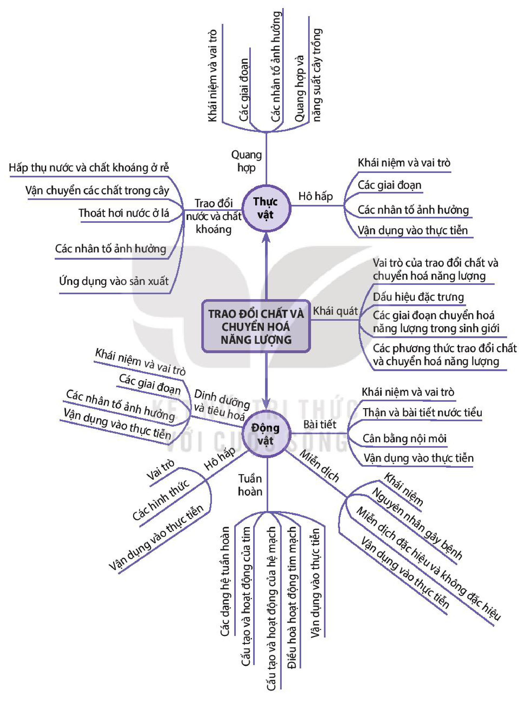

<!-- pdf:88 -->

# SƠ ĐỒ TÓM TẮT KIẾN THỨC CHƯƠNG 1

- Trao đổi chất và chuyển hoá năng lượng
  - Khái quát
    - Vai trò của trao đổi chất và chuyển hoá năng lượng
    - Dấu hiệu đặc trưng
    - Các giai đoạn chuyển hoá năng lượng trong sinh giới
    - Các phương thức trao đổi chất và chuyển hoá năng lượng
  - Thực vật
    - Trao đổi nước và chất khoáng
      - Hấp thụ nước và chất khoáng ở rễ
      - Vận chuyển các chất trong cây
      - Thoát hơi nước ở lá
      - Các nhân tố ảnh hưởng
      - Ứng dụng vào sản xuất
    - Quang hợp
      - Khái niệm và vai trò
      - Các giai đoạn
      - Các nhân tố ảnh hưởng
      - Quang hợp và năng suất cây trồng
    - Hô hấp
      - Khái niệm và vai trò
      - Các giai đoạn
      - Các nhân tố ảnh hưởng
      - Vận dụng vào thực tiễn
  - Động vật
    - Dinh dưỡng và tiêu hoá
      - Khái niệm và vai trò
      - Các giai đoạn
      - Các nhân tố ảnh hưởng
      - Vận dụng vào thực tiễn
    - Hô hấp
      - Vai trò
      - Các hình thức
      - Vận dụng vào thực tiễn
    - Tuần hoàn
      - Các dạng hệ tuần hoàn
      - Cấu tạo và hoạt động của tim
      - Cấu tạo và hoạt động của hệ mạch
      - Điều hoà hoạt động tim mạch
      - Vận dụng vào thực tiễn
    - Miễn dịch
      - Khái niệm
      - Nguyên nhân gây bệnh
      - Miễn dịch đặc hiệu và không đặc hiệu
      - Vận dụng vào thực tiễn
    - Bài tiết
      - Khái niệm và vai trò
      - Thận và bài tiết nước tiểu
      - Cân bằng nội môi
      - Vận dụng vào thực tiễn
<!-- ocr-ok: chữ trên một số nhánh sơ đồ in nghiêng/xoay hướng; đã đối chiếu ảnh gốc -->

## 📷 Danh sách hình trong bài

| Mã hình | Trang PDF | Vị trí | Chú thích gốc |
|---|---|---|---|
| H11-sinh-so-do-tom-tat-c01-01 | 88 | Cả trang | Sơ đồ tóm tắt kiến thức chương 1 |
