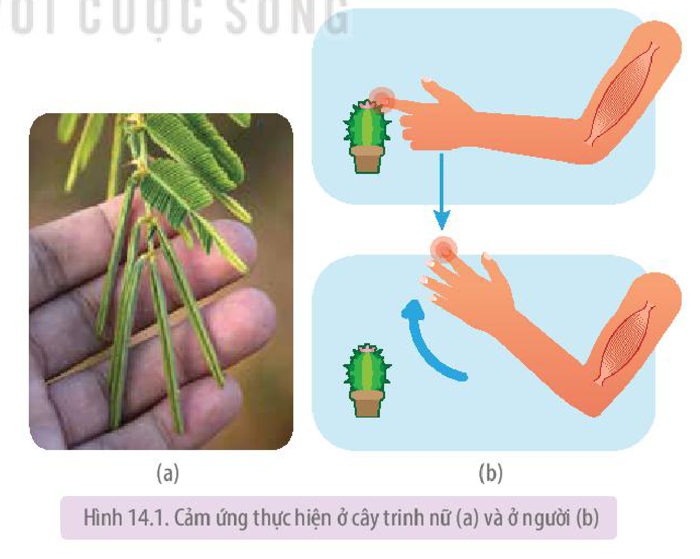

<!-- pdf:89 -->

# BÀI 14: KHÁI QUÁT VỀ CẢM ỨNG Ở SINH VẬT

## 🎯 Yêu cầu cần đạt

- Phát biểu được khái niệm cảm ứng ở sinh vật.
- Trình bày được vai trò và cơ chế cảm ứng ở sinh vật.

## 🔴 Mở đầu

Nếu sinh vật không phản ứng kịp thời đối với kích thích đến từ môi trường thì sẽ dẫn đến hậu quả như thế nào?

## I. KHÁI NIỆM VÀ VAI TRÒ CỦA CẢM ỨNG

### 1. Khái niệm cảm ứng
<!-- ocr-ok: OCR đọc thiếu chữ trong tiêu đề màu tím -->

**Cảm ứng** là sự tiếp nhận và phản ứng của sinh vật đối với những thay đổi của môi trường (trong và ngoài), đảm bảo cho sinh vật thích ứng với môi trường sống.

Cảm ứng của thực vật thường diễn ra chậm, khó nhận thấy, biểu hiện bằng các cử động dinh dưỡng như hướng nước, hướng hoá, hướng sáng,... hoặc sinh trưởng như mọc chồi cây theo mùa,...

*Ví dụ:* Lá cây trinh nữ (*Mimosa pudica* L.) cụp lại khi bị chạm phải (H 14.1a).

Cảm ứng ở động vật diễn ra với tốc độ nhanh và đa dạng. Mức độ, tính chính xác, hình thức cảm ứng ở động vật thay đổi tuỳ thuộc vào bộ phận phụ trách cảm ứng.

*Ví dụ:* Khi bị gai đâm vào tay, thụ thể đau ở tay chuyển thông tin đau về bộ phận xử lí thông tin (tuỷ sống và não bộ), thông tin từ bộ phận xử lí thông tin truyền đến cơ xương, cơ xương co làm tay rụt lại (H 14.1b).

Hình 14.1. Cảm ứng thực hiện ở cây trinh nữ (a) và ở người (b)

<!-- pdf:90 -->

### 2. Vai trò của cảm ứng đối với sinh vật

Cảm ứng là đặc điểm thích nghi với những thay đổi của môi trường, đảm bảo cho sinh vật tồn tại và phát triển.

Ví dụ:

- Ngọn cây hướng về phía có ánh sáng đảm bảo cho cây nhận được nhiều ánh sáng cung cấp cho quang hợp.
- Ở người, khi ánh sáng mạnh chiếu vào mắt thì đồng tử co lại, tránh cho mắt bị tổn thương.

## ❓ Dừng lại và suy ngẫm

Cho ví dụ về cảm ứng ở động vật, thực vật và phân tích vai trò của các cảm ứng đó.

## II. CƠ CHẾ CẢM ỨNG Ở SINH VẬT

Cảm ứng ở sinh vật được thực hiện thông qua các bộ phận: tiếp nhận kích thích, dẫn truyền thông tin kích thích, xử lí thông tin và đáp ứng.

Cảm ứng ở thực vật khởi đầu bằng thụ thể trên màng tế bào tiếp nhận kích thích, thông tin kích thích từ thụ thể được truyền qua tế bào chất dưới dạng dòng điện tử hoặc chất hoá học đến bộ phận xử lí thông tin và đáp ứng rồi gây ra đáp ứng. Cả ba bộ phận tham gia vào cảm ứng ở thực vật đều là rễ, thân hoặc lá,...

Ở động vật có hệ thần kinh, cảm ứng thực hiện qua cung phản xạ, trong đó, thụ thể cảm giác tiếp nhận kích thích từ môi trường và tạo ra xung thần kinh truyền về thần kinh trung ương, từ đây xung thần kinh đi đến cơ quan đáp ứng tạo ra đáp ứng phù hợp.

## ❓ Dừng lại và suy ngẫm

Cơ chế cảm ứng ở thực vật giống với động vật như thế nào?

## 📌 Kiến thức cốt lõi

- Cảm ứng là sự tiếp nhận và phản ứng của sinh vật đối với những thay đổi của môi trường, đảm bảo cho sinh vật thích ứng với môi trường sống.
- Ở thực vật, bộ phận tiếp nhận thu nhận kích thích. Thông tin kích thích được truyền qua tế bào chất đến bộ phận xử lí thông tin. Bộ phận này xử lí thông tin và đưa ra đáp ứng.
- Cảm ứng ở động vật có hệ thần kinh dựa trên phản xạ, trong đó thụ thể cảm giác tiếp nhận kích thích từ môi trường và tạo ra xung thần kinh truyền về thần kinh trung ương, từ đây xung thần kinh đi đến cơ quan đáp ứng tạo ra đáp ứng phù hợp.

## ✏️ Luyện tập và vận dụng

1. Những bộ phận nào của cơ thể thực vật và động vật tham gia vào quá trình cảm ứng?
2. Hiện tượng người quay đầu lại khi nghe tiếng người khác gọi tên mình từ phía sau có phải là cảm ứng không? Giải thích.

## 📷 Danh sách hình trong bài

| Mã hình | Trang PDF | Vị trí | Chú thích gốc |
|---|---|---|---|
| H11-sinh-b14-01 | 89 | Mục I.1 | Hình 14.1. Cảm ứng thực hiện ở cây trinh nữ (a) và ở người (b) |
