<!-- pdf:91 -->

# BÀI 15: CẢM ỨNG Ở THỰC VẬT

## 🎯 Yêu cầu cần đạt

- Nêu được khái niệm cảm ứng ở thực vật và phân tích được vai trò cảm ứng đối với thực vật.
- Trình bày được đặc điểm và cơ chế cảm ứng ở thực vật.
- Nêu được một số hình thức biểu hiện của cảm ứng ở thực vật: vận động hướng động và vận động cảm ứng.
- Vận dụng được hiểu biết về cảm ứng ở thực vật để giải thích một số hiện tượng trong thực tiễn.

## 🔴 Mở đầu

Thực vật đứng yên hay vận động? Chúng mở rộng không gian sống, tìm kiếm dinh dưỡng và hướng đến các điều kiện sinh thái thích hợp bằng cách nào?

## I. KHÁI NIỆM, VAI TRÒ VÀ ĐẶC ĐIỂM CỦA CẢM ỨNG Ở THỰC VẬT

### 1. Khái niệm

**Cảm ứng ở thực vật** là sự tiếp nhận và trả lời của thực vật đối với các kích thích từ môi trường.

Cảm ứng biểu hiện bằng sự vận động của các cơ quan, bộ phận thực vật khi nhận kích thích đến từ một hướng xác định hoặc kích thích không có hướng. Một số vận động có thể quan sát thấy như leo giàn của tua cuốn, uốn cong của rễ hay thân non, nở hoặc khép của cánh hoa, phản ứng cụp lá,...

### 2. Vai trò của cảm ứng

Cảm ứng đảm bảo cho thực vật tận dụng tối đa nguồn sống như nước, ánh sáng, dinh dưỡng khoáng,... hoặc tự vệ khi gặp kích thích bất lợi, qua đó thực vật có thể thích ứng tốt hơn với những biến đổi thường xuyên của môi trường sống, tạo điều kiện cho cây sinh trưởng và phát triển bình thường.

### 3. Đặc điểm của cảm ứng

Các yếu tố môi trường như ánh sáng, nhiệt độ, nước, hoá chất, trọng lực,... là các tác nhân kích thích gây ra cảm ứng ở thực vật.

Cảm ứng ở thực vật thường diễn ra chậm và khó nhận biết bằng mắt thường trong thời gian ngắn. Tuy nhiên, cũng có vận động cảm ứng diễn ra nhanh như phản ứng cụp lá của cây trinh nữ hay phản ứng bắt mồi của cây gọng vó.

Cảm ứng ở thực vật có thể liên quan đến sinh trưởng hoặc không liên quan đến sinh trưởng của tế bào.

## ❓ Dừng lại và suy ngẫm

Lấy một số ví dụ về cảm ứng ở thực vật thể hiện vai trò tận dụng nguồn sống trong điều kiện môi trường bất lợi.

<!-- pdf:92 -->

## II. CÁC HÌNH THỨC CẢM ỨNG VÀ CƠ CHẾ CẢM ỨNG Ở THỰC VẬT

### 1. Các hình thức cảm ứng

Cảm ứng ở thực vật có thể chia thành các kiểu sau (H 15.1):

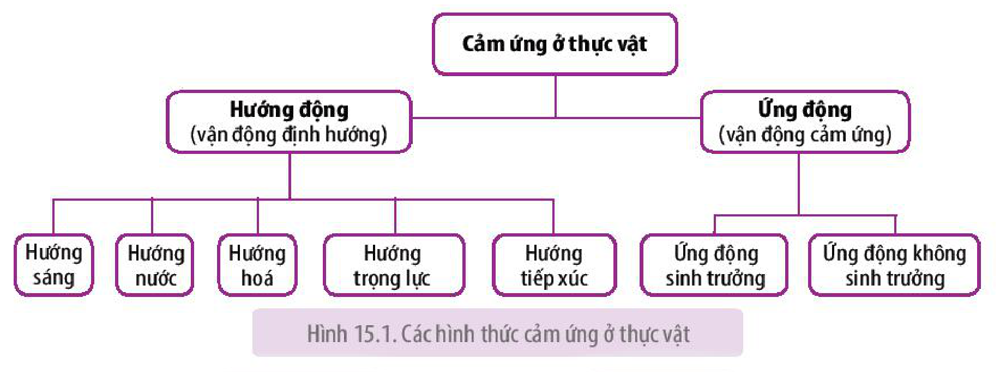

Hình 15.1. Các hình thức cảm ứng ở thực vật

**a) Hướng động (vận động định hướng)**

**Hướng động** là hình thức phản ứng của cây (thể hiện qua vận động của cơ quan, bộ phận) đối với tác nhân kích thích từ một hướng xác định.

Hướng động của cây phụ thuộc vào hướng của tác nhân kích thích. Khi vận động về phía tác nhân kích thích gọi là **hướng động dương**, ngược lại, khi vận động tránh xa tác nhân kích thích gọi là **hướng động âm**.

- Hướng sáng

**Hướng sáng** là phản ứng sinh trưởng của thực vật đối với ánh sáng. Trong thực tế có thể quan sát thấy hiện tượng hướng sáng dương của ngọn cây, thân non của những cây sống bên cửa sổ, cạnh toà nhà cao tầng,... do nguồn sáng chiếu đến từ một phía (H 15.2).

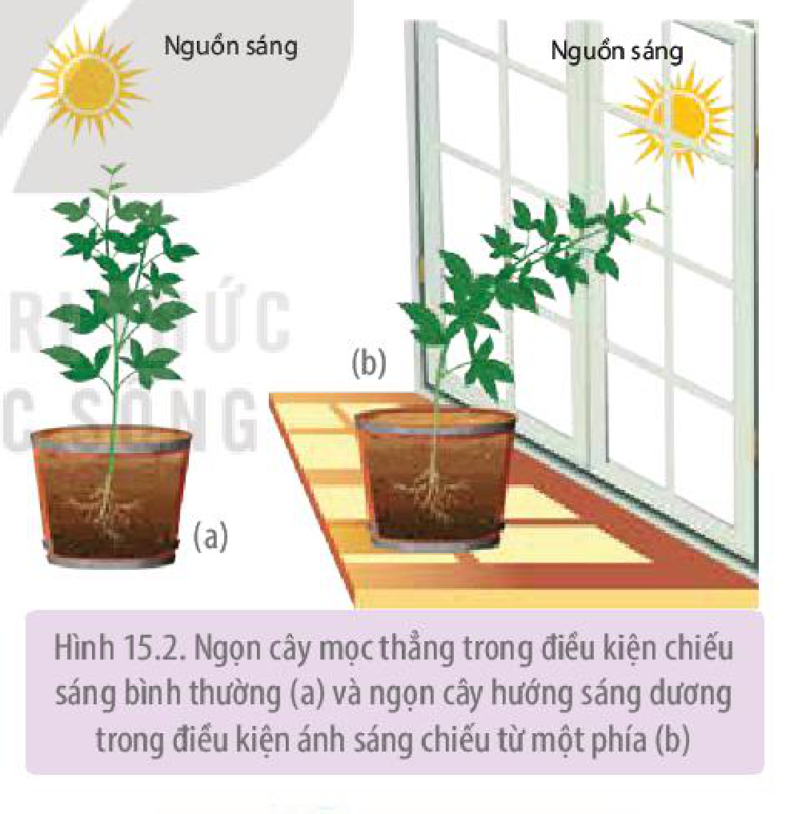

Hình 15.2. Ngọn cây mọc thẳng trong điều kiện chiếu sáng bình thường (a) và ngọn cây hướng sáng dương trong điều kiện ánh sáng chiếu từ một phía (b)

- Hướng hoá

**Hướng hoá** là phản ứng sinh trưởng của cơ quan, bộ phận thực vật đối với các chất hoá học như chất khoáng, chất hữu cơ, hormone thực vật, chất độc,...

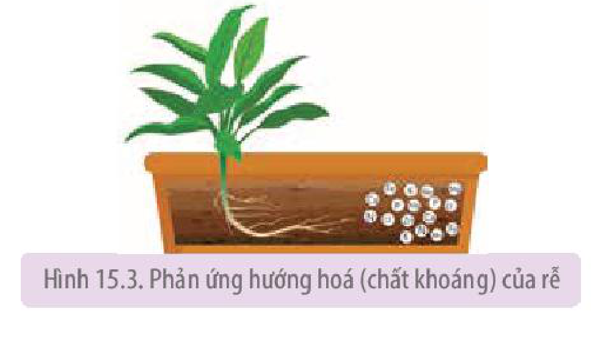

Hình 15.3. Phản ứng hướng hoá (chất khoáng) của rễ

Hướng hoá dương quan sát thấy trong quá trình sinh trưởng của rễ khi nó tìm kiếm chất dinh dưỡng trong đất (H 15.3), trong quá trình kéo dài của ống phấn khi

<!-- pdf:93 -->

thụ tinh,... Hướng hoá âm thể hiện trong hiện tượng rễ cây sinh trưởng tránh xa kim loại nặng, chất độc trong đất.

- Hướng nước

**Hướng nước** là một trường hợp đặc biệt của hướng hoá. Khi nước phân bố không đồng đều trong môi trường đất, rễ sẽ sinh trưởng về phía có nguồn nước (H 15.4). Đặc điểm hướng nước dương của hệ rễ đảm bảo cho cây trồng thích nghi với việc tìm kiếm nước.

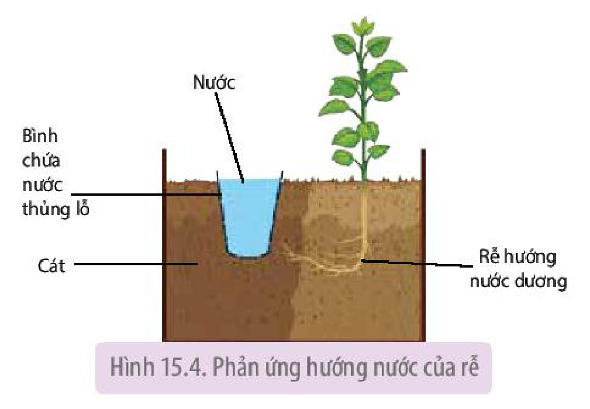

Hình 15.4. Phản ứng hướng nước của rễ

- Hướng trọng lực

**Hướng trọng lực** là phản ứng sinh trưởng của thực vật đối với trọng lực (lực hút của Trái Đất). Các cơ quan của thực vật (rễ, thân) sinh trưởng theo hướng khác nhau đối với hướng của trọng lực: đỉnh rễ sinh trưởng theo hướng của trọng lực, còn chồi đỉnh sinh trưởng theo hướng ngược lại.

Hướng trọng lực thể hiện qua thí nghiệm đặt chậu cây ở vị trí nằm ngang (H 15.5). Sau một thời gian, rễ sinh trưởng quay xuống theo chiều của trọng lực (hướng trọng lực dương), còn thân cong lên theo hướng ngược lại (hướng trọng lực âm). Trong tự nhiên, có thể quan sát hiện tượng này khi cây bị đổ nghiêng trên mặt đất.

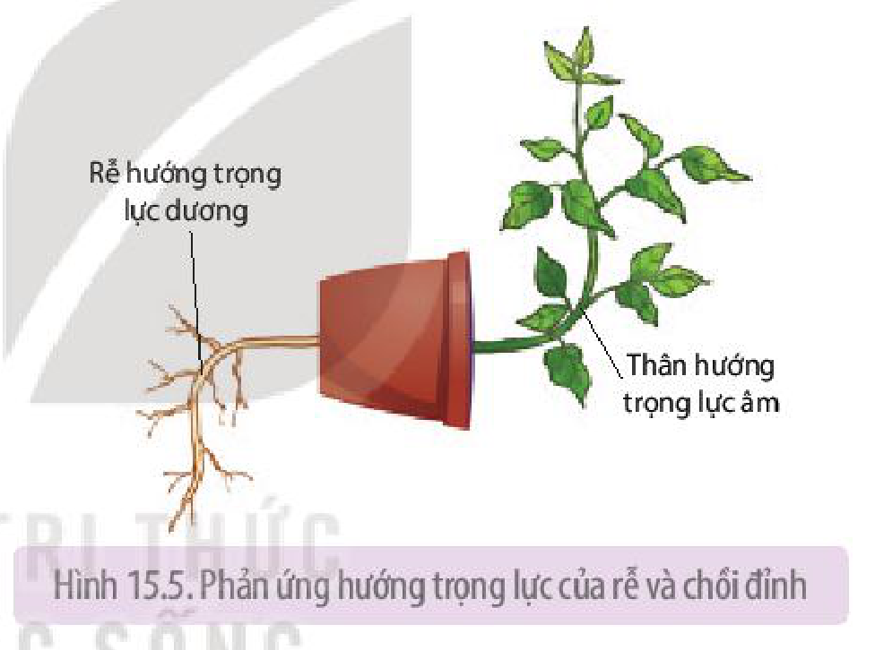

Hình 15.5. Phản ứng hướng trọng lực của rễ và chồi đỉnh
<!-- ocr-ok: OCR đọc sai chữ trong khung chú thích hình -->

- Hướng tiếp xúc

**Hướng tiếp xúc** là phản ứng sinh trưởng đối với tác động cơ học (tiếp xúc) đến từ một phía.

Hướng tiếp xúc thường gặp ở thực vật thân leo và thân bò, biểu hiện dễ thấy là hiện tượng thân, các tua cuốn quấn quanh cọc rào, bờ tường hay giàn leo (H 15.6).

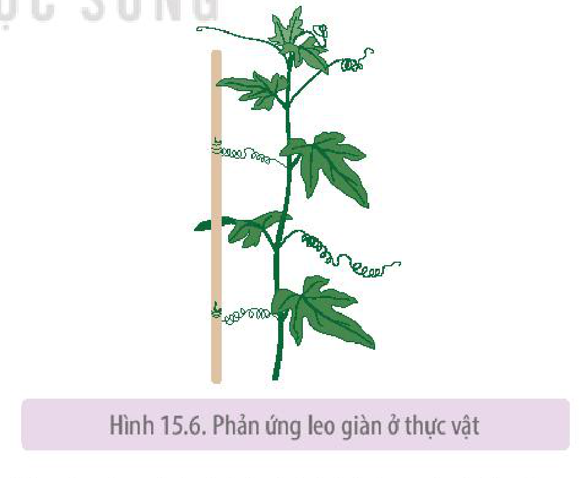

Hình 15.6. Phản ứng leo giàn ở thực vật

**b) Ứng động (vận động cảm ứng)**

**Ứng động** là hình thức phản ứng của cây đối với tác nhân kích thích không định hướng (không có hướng).

<!-- pdf:94 -->

Căn cứ vào đặc điểm liên quan đến sinh trưởng, ứng động được chia thành hai kiểu là ứng động sinh trưởng và ứng động không sinh trưởng.

- Ứng động không sinh trưởng

**Ứng động không sinh trưởng** là những vận động thuận nghịch do sự biến đổi sức trương nước của cơ quan, bộ phận đáp ứng hoặc do xuất hiện sự lan truyền của kích thích trong các tế bào, mô chuyên hoá dưới tác dụng của các tác nhân cơ học, hoá học.

Hiện tượng cụp lá ở cây trinh nữ (*Mimosa pudica*), bắt mồi ở cây gọng vó (*Drosera burmannii*) và cây bắt ruồi (*Dionaea muscipula*) là những ví dụ điển hình cho kiểu ứng động không sinh trưởng.

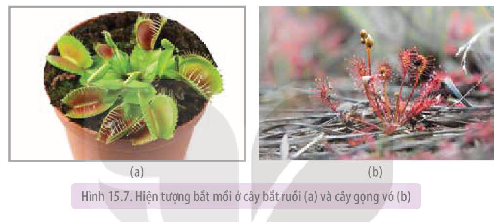

Hình 15.7. Hiện tượng bắt mồi ở cây bắt ruồi (a) và cây gọng vó (b)

- Ứng động sinh trưởng

**Ứng động sinh trưởng** là những vận động xuất hiện do tốc độ sinh trưởng và phân chia tế bào không đều ở các cơ quan, bộ phận đáp ứng, dưới tác động của các kích thích không định hướng trong môi trường. Tuỳ thuộc vào tác nhân gây ứng động, có thể chia thành các kiểu: quang ứng động, nhiệt ứng động,...

Ví dụ:

- Vận động nở hoa khi cảm ứng với ánh sáng ở cây bồ công anh: Hoa nở khi có ánh sáng và cụp lại lúc chạng vạng tối.
- Vận động ngủ, thức của chồi cây theo mùa như ở cây bàng, cây phượng. Mùa đông, nhiệt độ thấp, ánh sáng yếu, thời gian chiếu sáng ngắn dẫn đến chồi cây ngủ (không sinh trưởng). Mùa xuân, nhiệt độ tăng lên, ánh sáng mạnh hơn, thời gian chiếu sáng kéo dài làm chồi cây sinh trưởng. Đây là kiểu vận động theo chu kì mùa, liên quan đến chu kì đồng hồ sinh học, dưới tác động của điều kiện môi trường như ánh sáng, nhiệt độ.

### 2. Cơ chế của cảm ứng
<!-- ocr-ok: OCR đọc sai chữ trong tiêu đề màu tím -->

**a) Cơ chế hướng động**
<!-- ocr-ok: OCR đọc thiếu chữ ở đầu dòng -->

Tác nhân kích thích (ánh sáng, nước, chất khoáng, trọng lực,...) tác động theo một hướng xác định lên các thụ thể của bộ phận tiếp nhận kích thích, thông tin sau đó được truyền đến bộ phận đáp ứng, làm thay đổi hàm lượng auxin ở hai phía đối diện nhau (so với hướng kích thích) của bộ phận này, dẫn đến tốc độ dãn dài không đồng đều giữa các tế bào ở hai phía. Kết quả là sự uốn cong của bộ phận đáp ứng (H 15.8).

<!-- pdf:95 -->

Các tế bào rễ có độ nhạy cảm cao hơn đối với auxin so với các tế bào ở thân. Hàm lượng auxin cao sẽ ức chế sự dãn dài của các tế bào rễ trong khi kích thích các tế bào thân sinh trưởng. Điều này dẫn đến thân và rễ uốn cong theo hai hướng ngược nhau so với hướng kích thích.

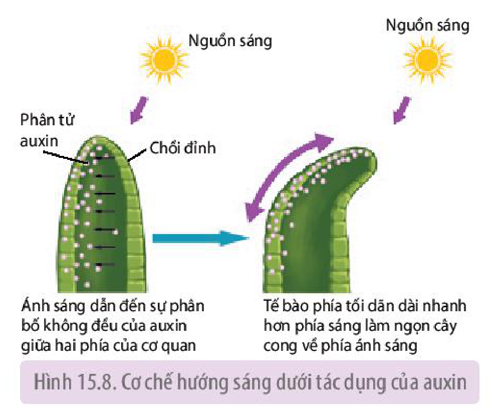

Hình 15.8. Cơ chế hướng sáng dưới tác dụng của auxin

**b) Cơ chế ứng động**

- Cơ chế ứng động không sinh trưởng

Tác nhân kích thích (cơ học, hoá học) tác động lên thụ thể trên màng tế bào của bộ phận tiếp nhận kích thích, sau đó kích thích được truyền đến tế bào của bộ phận đáp ứng làm hoạt hoá các bơm ion ($\text{K}^+$, $\text{Cl}^-$,...), qua đó làm thay đổi sức trương nước của bộ phận đáp ứng, dẫn đến phản ứng cụp lá ở cây trinh nữ (H 15.9) hay sự đóng mở của khí khổng. Sự vận động của bộ phận đáp ứng cũng có thể do kích thích được lan truyền dưới dạng sóng, xuất hiện trong các phản ứng đóng nắp của cây bắt ruồi hay chuyển động của các lông tuyến ở cây gọng vó.

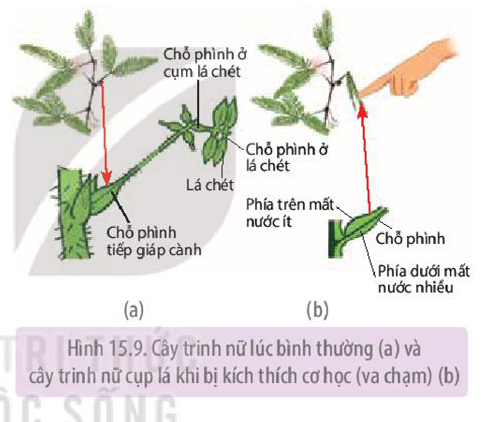

Hình 15.9. Cây trinh nữ lúc bình thường (a) và cây trinh nữ cụp lá khi bị kích thích cơ học (va chạm) (b)

- Cơ chế ứng động sinh trưởng

Tác nhân nhiệt độ, ánh sáng mang tính chu kì (ngày đêm, mùa) tác động lên chồi cây làm thay đổi tương quan hàm lượng giữa các hormone, gây kích thích hoặc ức chế sinh trưởng của chồi cây, hoặc tác động lên mặt trên và mặt dưới của hoa làm phân bố lại hormone dẫn đến sự tăng trưởng khác nhau của mặt trên và mặt dưới của hoa, làm hoa nở hoặc khép (H 15.10).

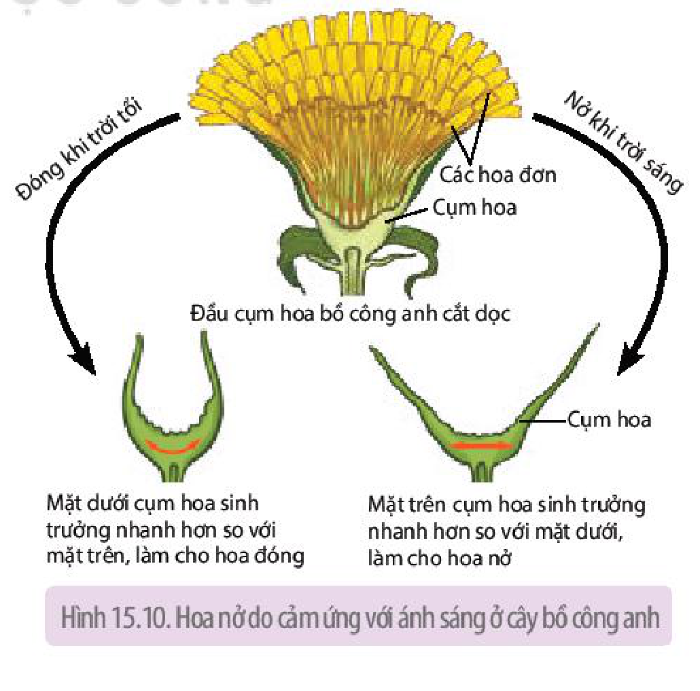

Hình 15.10. Hoa nở do cảm ứng với ánh sáng ở cây bồ công anh

<!-- pdf:96 -->

## ❓ Dừng lại và suy ngẫm

1. Lập bảng phân biệt các hình thức hướng động ở thực vật về tác nhân gây ra vận động, đặc điểm và vai trò của mỗi hình thức.
2. Kẻ và hoàn thành bảng về các hình thức ứng động ở thực vật vào vở theo mẫu dưới đây:

| Kiểu ứng động | Khái niệm | Nguyên nhân | Cơ chế | Ví dụ |
|---|---|---|---|---|
| Ứng động sinh trưởng | ? | ? | ? | ? |
| Ứng động không sinh trưởng | ? | ? | ? | ? |

## III. ỨNG DỤNG CẢM ỨNG Ở THỰC VẬT

Trong thực tiễn sản xuất, dựa trên các hiểu biết về hướng động, ứng động của thực vật, con người có thể điều chỉnh các yếu tố ngoại cảnh thông qua các biện pháp canh tác nhằm đảm bảo cho cây sinh trưởng, phát triển thuận lợi, từ đó nâng cao năng suất, chất lượng nông sản.

### 1. Ứng dụng của hướng động

Dưới đây là một số ứng dụng của hướng động:

- Tăng kích thước bộ rễ bằng cách làm đất tơi xốp, thoáng khí, bón phân và tưới nước xung quanh gốc (H 15.11) để kích thích rễ sinh trưởng theo cả chiều rộng và chiều sâu, từ đó hấp thụ được đầy đủ nước và chất khoáng.

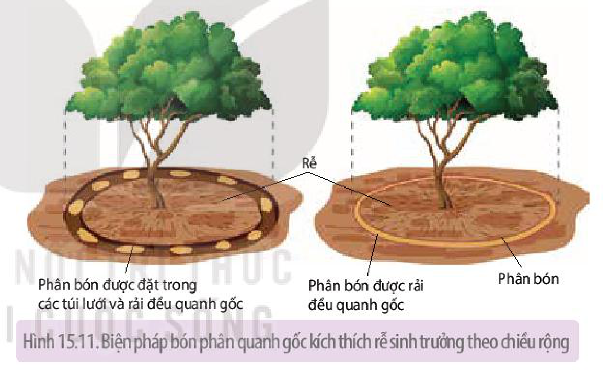

Hình 15.11. Biện pháp bón phân quanh gốc kích thích rễ sinh trưởng theo chiều rộng

- Thúc đẩy cây mầm vươn dài, tăng chiều cao bằng cách: hạn chế chiếu sáng trong thời gian đầu khi hạt nảy mầm, gieo trồng với mật độ cao (trồng dày) khi cây còn non và tỉa thưa để đảm bảo đủ ánh sáng khi cây đã lớn.
- Thúc đẩy các cây thân leo sinh trưởng, phát triển bằng cách làm giàn, mở rộng giàn để kích thích thân cây vươn dài.

### 2. Ứng dụng của ứng động

Một số ứng dụng trong nông nghiệp dựa trên hiểu biết về ứng động của thực vật như:

- Kéo dài thời gian ngủ của hạt, củ giống bằng cách giảm nhiệt độ, độ ẩm trong môi trường bảo quản (bảo quản trong kho lạnh, phơi khô hạt giống), hạn chế tiếp xúc ánh sáng hoặc sử dụng các chất ức chế nảy mầm.
- Kích thích hạt giống, củ giống nảy mầm, đánh thức chồi ngủ bật mầm bằng cách cung cấp thêm nước, tăng nhiệt độ môi trường, sử dụng các chất kích thích sinh trưởng,...
- Tạo điều kiện thuận lợi cho quá trình ra hoa, nở hoa của các loài cây trồng bằng cách bố trí vùng trồng hợp lí, đảm bảo các yêu cầu về ánh sáng, nhiệt độ,...

<!-- pdf:97 -->

## ❓ Dừng lại và suy ngẫm

Nêu một số ví dụ khác về việc vận dụng hiện tượng hướng động, ứng động trong thực tiễn sản xuất.

## 📌 Kiến thức cốt lõi

- Cảm ứng ở thực vật là sự tiếp nhận và trả lời của thực vật đối với các kích thích từ môi trường, đảm bảo cho thực vật thích ứng với điều kiện sống thường xuyên thay đổi.
- Cảm ứng ở thực vật thường diễn ra chậm, khó nhận biết bằng mắt thường, chủ yếu liên quan đến sự thay đổi hàm lượng hormone hay sự thay đổi sức trương nước của các tế bào. Cảm ứng ở thực vật gồm hai loại: hướng động và ứng động.
- Hướng động là hình thức phản ứng của cây trước tác nhân kích thích đến từ một phía. Hướng động gồm: hướng sáng, hướng hoá, hướng nước, hướng trọng lực và hướng tiếp xúc.
- Ứng động là hình thức phản ứng của cây trước tác nhân kích thích không có hướng (nhiệt độ, chu kì ngày, đêm, chu kì mùa,...). Ứng động gồm hai loại là ứng động sinh trưởng và ứng động không sinh trưởng.
- Vận dụng hiểu biết về cảm ứng ở thực vật để điều khiển các yếu tố ngoại cảnh theo hướng có lợi cho sự sinh trưởng và phát triển của thực vật, góp phần nâng cao năng suất cây trồng.

## ✏️ Luyện tập và vận dụng

1. Dựa trên cơ chế hướng động, giải thích về phản ứng hướng trọng lực dương của rễ cây trong hình 15.5 dưới tác động của auxin.
2. Cho các hiện tượng sau: đóng mở của khí khổng, nở hoa của cây mười giờ, leo giàn của cây thiên lí. Các hiện tượng trên thuộc hình thức cảm ứng nào? Giải thích.
3. Tại sao trong quy trình làm rau mầm, người ta thường che tối khoảng 2 – 3 ngày đầu khi hạt mới nảy mầm?

## 💡 Em có biết

Cây gọng vó (*Drosera burmannii* Vahl) thuộc họ Gọng vó (là nhóm thực vật bắt mồi phổ biến với gần 200 loài đã được tìm thấy ở khắp các châu lục). Không giống với đa số các nhóm thực vật khác, lá gọng vó với nhiều lông tuyến bao phủ có khả năng tiết ra các chất nhầy, dính và rất nhạy cảm với các phản ứng tiếp xúc. Khi côn trùng chạm vào các lông tuyến, ngay lập tức các lông tuyến chuyển động và “ôm giữ” con mồi. Cùng lúc đó, cây tiết ra các enzyme tiêu hoá con mồi tạo thành chất dinh dưỡng bổ sung cho cây, đảm bảo cây có thể sinh trưởng và phát triển trong điều kiện đất nghèo dinh dưỡng, thiếu hụt nitrogen như ở các vùng đầm lầy.

## 📷 Danh sách hình trong bài

| Mã hình | Trang PDF | Vị trí | Chú thích gốc |
|---|---|---|---|
| H11-sinh-b15-01 | 92 | Mục II.1 | Hình 15.1. Các hình thức cảm ứng ở thực vật |
| H11-sinh-b15-02 | 92 | Mục II.1.a | Hình 15.2. Ngọn cây mọc thẳng trong điều kiện chiếu sáng bình thường (a) và ngọn cây hướng sáng dương trong điều kiện ánh sáng chiếu từ một phía (b) |
| H11-sinh-b15-03 | 92 | Mục II.1.a | Hình 15.3. Phản ứng hướng hoá (chất khoáng) của rễ |
| H11-sinh-b15-04 | 93 | Mục II.1.a | Hình 15.4. Phản ứng hướng nước của rễ |
| H11-sinh-b15-05 | 93 | Mục II.1.a | Hình 15.5. Phản ứng hướng trọng lực của rễ và chồi đỉnh |
| H11-sinh-b15-06 | 93 | Mục II.1.a | Hình 15.6. Phản ứng leo giàn ở thực vật |
| H11-sinh-b15-07 | 94 | Mục II.1.b | Hình 15.7. Hiện tượng bắt mồi ở cây bắt ruồi (a) và cây gọng vó (b) |
| H11-sinh-b15-08 | 95 | Mục II.2.a | Hình 15.8. Cơ chế hướng sáng dưới tác dụng của auxin |
| H11-sinh-b15-09 | 95 | Mục II.2.b | Hình 15.9. Cây trinh nữ lúc bình thường (a) và cây trinh nữ cụp lá khi bị kích thích cơ học (va chạm) (b) |
| H11-sinh-b15-10 | 95 | Mục II.2.b | Hình 15.10. Hoa nở do cảm ứng với ánh sáng ở cây bồ công anh |
| H11-sinh-b15-11 | 96 | Mục III.1 | Hình 15.11. Biện pháp bón phân quanh gốc kích thích rễ sinh trưởng theo chiều rộng |
