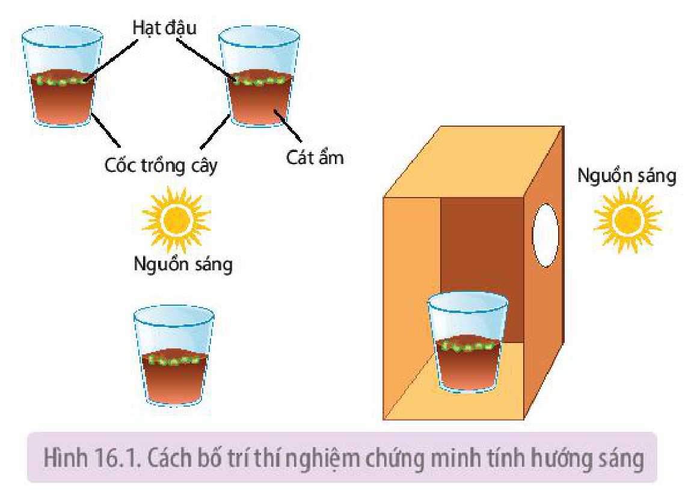
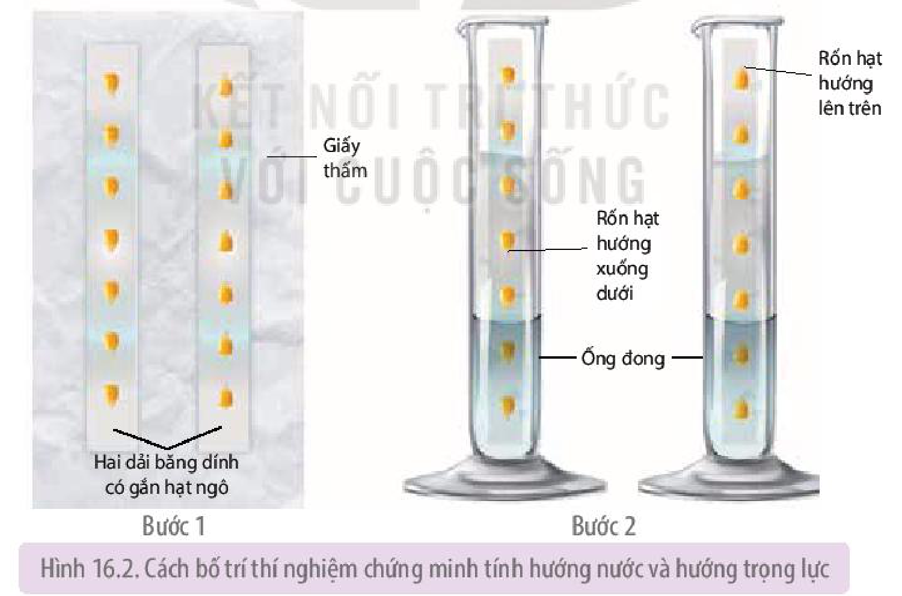
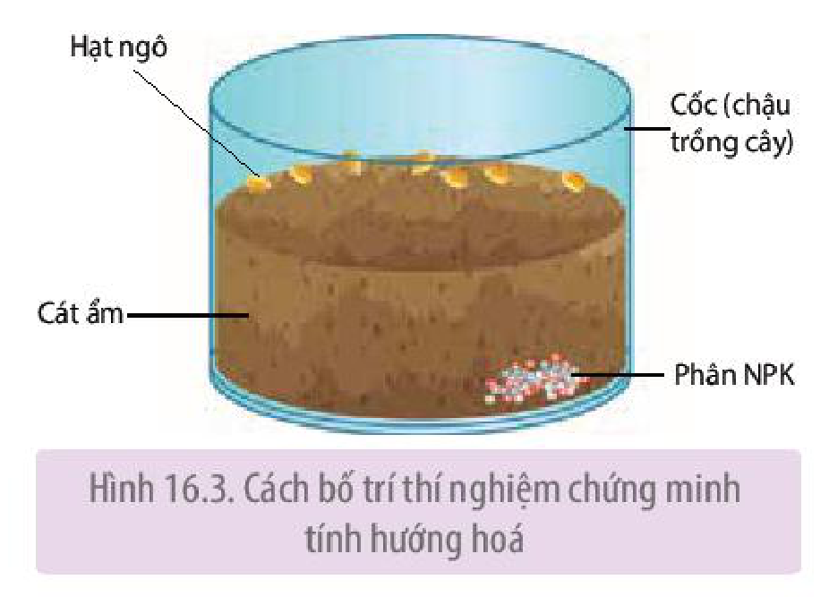

<!-- pdf:98 -->

# BÀI 16: THỰC HÀNH: CẢM ỨNG Ở THỰC VẬT

## I. YÊU CẦU CẦN ĐẠT
<!-- ocr-ok: OCR đọc sai chữ trong tiêu đề màu tím -->

- Thực hiện được một số thí nghiệm về cảm ứng ở một số loài cây.
- Quan sát được hiện tượng cảm ứng ở một số loài cây.

## II. CHUẨN BỊ

### 1. Dụng cụ, thiết bị

- Cốc nhựa hoặc chậu trồng cây trong suốt.
- Ống đong thuỷ tinh dung tích 250 mL.
- Giấy thấm vuông khổ to, băng dính.
- Tranh, ảnh, video về hiện tượng cảm ứng.

### 2. Hoá chất

- Phân bón hỗn hợp NPK hoặc các dạng phân đơn: phân đạm, phân lân, phân kali,...
- Cát, đất trồng cây.

### 3. Mẫu vật

- Hạt ngô.
- Hạt đậu xanh, đậu đen.

## III. CÁCH TIẾN HÀNH

### 1. Nguyên lí

Thực vật có hai hình thức cảm ứng là hướng động và ứng động. Hướng động là hình thức vận động xuất hiện dưới tác động của tác nhân ngoại cảnh đến từ một phía, trong đó hướng của tác nhân kích thích quy định hướng của vận động. Bố trí các thí nghiệm với hạt nảy mầm của một số cây và điều chỉnh hướng của tác nhân ngoại cảnh như ánh sáng, phân bón, nước,... so với vị trí của thực vật để quan sát được các phản ứng hướng động của chúng.

### 2. Quy trình thí nghiệm chứng minh tính hướng động ở thực vật

**a) Thí nghiệm chứng minh tính hướng sáng**

*Bước 1:* Gieo hạt đậu (đậu xanh, đậu đen,...) vào hai cốc cát ẩm, mỗi cốc khoảng 5 – 7 hạt. Tưới ẩm hằng ngày để hạt nảy mầm.

<!-- pdf:99 -->

*Bước 2:* Đặt một cốc hạt trong điều kiện chiếu sáng đầy đủ. Cốc còn lại đặt cạnh cửa sổ (hoặc trong hộp giấy có đục lỗ ở mặt bên) sao cho ánh sáng chiếu đến cây từ một phía (H 16.1).

*Bước 3:* Quan sát, nhận xét và giải thích sự khác nhau về hình thái của cây đậu ở hai cốc sau 5 – 7 ngày.

Hình 16.1. Cách bố trí thí nghiệm chứng minh tính hướng sáng

**b) Thí nghiệm chứng minh tính hướng trọng lực**

*Bước 1:* Gắn hạt ngô lên trên dải băng dính trắng, mỗi hạt cách nhau khoảng 2 – 3 cm. Sau đó, dán lên trên tờ giấy thấm (kích thước $7 \times 20\text{ cm}$), một dải dán xuôi sao cho phần rốn hạt quay xuống dưới, một dải dán ngược để rốn hạt hướng lên trên.

*Bước 2:* Cuộn tròn tờ giấy thấm sao cho hai dải băng dính chứa hạt quay ra phía mặt ngoài của cuộn giấy. Sau đó, đặt tờ giấy đã cuộn tròn vào ống đong (dung tích 250 mL, chứa khoảng 30 mL nước) (H 16.2).

*Bước 3:* Khoảng 3 – 5 ngày sau khi hạt nảy mầm, quan sát và so sánh hướng của phần thân và rễ cây ngô gắn trên hai dải băng dính dán xuôi và ngược. Nhận xét và giải thích kết quả thu được.

Hình 16.2. Cách bố trí thí nghiệm chứng minh tính hướng nước và hướng trọng lực

**c) Thí nghiệm hướng hoá**
<!-- ocr-ok: OCR đọc thiếu chữ ở đầu dòng -->

- *Bước 1:* Cân khoảng 3 – 5 g phân NPK hoặc sử dụng các loại phân bón, muối khoáng khác và đặt vào một góc của cốc (hoặc chậu) thuỷ tinh dung tích 500 mL. Sau đó, đổ cát hoặc đất ẩm đầy khoảng 2/3 cốc.

<!-- pdf:100 -->

- *Bước 2:* Gieo 5 – 7 hạt ngô vào sát thành cốc (phía đối diện với hướng đặt phân bón), sau đó, đặt cốc ở nơi có ánh sáng nhẹ (H 16.3).
- *Bước 3:* Tưới ẩm đều cát (đất) để hạt nảy mầm thuận lợi. Sau khoảng 7 – 10 ngày, quan sát hướng mọc của rễ qua thành trong của cốc, nhận xét và giải thích kết quả thu được.

Hình 16.3. Cách bố trí thí nghiệm chứng minh tính hướng hoá

### 3. Quan sát một số hình thức cảm ứng của thực vật trong tự nhiên

- Quan sát thực tế hoặc qua tranh, ảnh, video một số hiện tượng hướng động và ứng động.
- Xác định loại hướng động, tác nhân kích thích và hình thức phản ứng của mỗi hiện tượng bằng cách kẻ bảng và điền nội dung vào ô thích hợp theo mẫu sau:

| Hiện tượng quan sát | | Hướng sáng | Hướng nước | Hướng hoá | Hướng tiếp xúc | Hướng trọng lực | Ứng động: Sinh trưởng | Ứng động: Không sinh trưởng |
|---|---|---|---|---|---|---|---|---|
| ? | Tác nhân kích thích | ? | ? | ? | ? | ? | ? | ? |
| ? | Phản ứng | ? | ? | ? | ? | ? | ? | ? |

## IV. THU HOẠCH

Học sinh viết báo cáo thực hành theo các nội dung sau:

**BÁO CÁO THỰC HÀNH**

1. **Mục đích**
2. **Kết quả và giải thích**
<!-- ocr-ok: OCR đọc sai chữ trong khung báo cáo thực hành -->

Trình bày kết quả thí nghiệm về tính hướng sáng, hướng nước, hướng trọng lực và hướng hoá đã thực hiện.

3. **Trả lời câu hỏi**

a) Trong cách bố trí thí nghiệm về tính hướng sáng (H 16.1) ở thực vật, nếu hộp giấy được đục lỗ ở phía trên, thẳng với cốc chứa hạt đậu thì có thể quan sát được phản ứng hướng sáng của cây đậu con hay không?

b) Trong thí nghiệm về tính hướng hoá, có thể thay thế phân bón bằng những chất nào khác để quan sát được phản ứng hướng hoá của rễ cây ngô?

## 📷 Danh sách hình trong bài

| Mã hình | Trang PDF | Vị trí | Chú thích gốc |
|---|---|---|---|
| H11-sinh-b16-01 | 99 | Mục III.2.a | Hình 16.1. Cách bố trí thí nghiệm chứng minh tính hướng sáng |
| H11-sinh-b16-02 | 99 | Mục III.2.b | Hình 16.2. Cách bố trí thí nghiệm chứng minh tính hướng nước và hướng trọng lực |
| H11-sinh-b16-03 | 100 | Mục III.2.c | Hình 16.3. Cách bố trí thí nghiệm chứng minh tính hướng hoá |
