<!-- pdf:101 -->

# BÀI 17: CẢM ỨNG Ở ĐỘNG VẬT

## 🎯 Yêu cầu cần đạt

- Trình bày được các hình thức cảm ứng ở các nhóm động vật khác nhau.
- Phân biệt được hệ thần kinh ống với các dạng hệ thần kinh mạng lưới và chuỗi hạch.
- Nêu được cấu tạo và chức năng của tế bào thần kinh.
- Mô tả được cấu tạo của synapse và quá trình truyền tin qua synapse.
- Nêu được khái niệm phản xạ, phân tích được một cung phản xạ, phân tích được đáp ứng của cơ xương trong cung phản xạ.
- Nêu được các dạng thụ thể cảm giác và vai trò của chúng.
- Nêu được vai trò của các cảm giác vị giác, xúc giác và khứu giác.
- Phân tích được cơ chế thu nhận và phản ứng kích thích của cơ quan cảm giác (tai, mắt).
- Phân biệt được phản xạ không điều kiện và phản xạ có điều kiện. Nêu được đặc điểm và phân loại được phản xạ không điều kiện. Trình bày được đặc điểm, các điều kiện và cơ chế hình thành phản xạ có điều kiện. Lấy được các ví dụ minh hoạ.
- Nêu được một số bệnh do tổn thương hệ thần kinh như mất khả năng vận động, mất khả năng cảm giác,...
- Giải thích được cơ chế giảm đau khi uống hoặc tiêm thuốc giảm đau.
- Đề xuất được các biện pháp bảo vệ hệ thần kinh: không lạm dụng chất kích thích, phòng chống nghiện và cai nghiện chất kích thích.

## 🔴 Mở đầu

Làm cách nào mà cơ thể chúng ta có thể phản ứng kịp thời trước rất nhiều kích thích khác nhau đến từ môi trường?

Các nhóm động vật khác nhau có các hình thức cảm ứng khác nhau. Động vật chưa có tổ chức thần kinh như thân lỗ, bọt biển phản ứng rất chậm với kích thích. Các động vật có hệ thần kinh phản ứng nhanh và đa dạng với kích thích dựa trên nguyên tắc phản xạ.

## I. CÁC HÌNH THỨC CẢM ỨNG Ở ĐỘNG VẬT

### 1. Cảm ứng ở động vật có hệ thần kinh lưới

**Hệ thần kinh lưới** gặp ở động vật có cơ thể đối xứng toả tròn như động vật ngành Ruột khoang.

Ở **hệ thần kinh lưới**, các tế bào thần kinh phân bố rải rác khắp cơ thể và liên kết với nhau tạo thành mạng lưới thần kinh (H 17.1), vì vậy, khi bị kích thích, toàn bộ cơ thể động vật phản ứng.

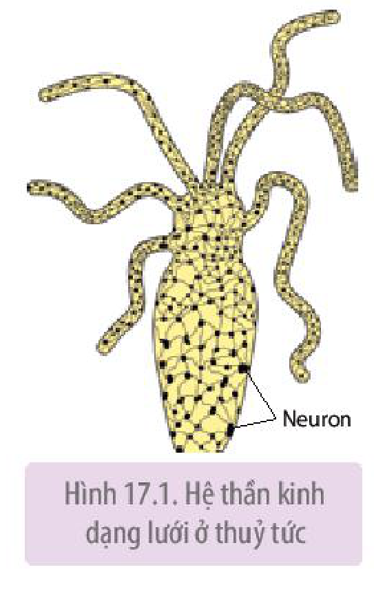

Hình 17.1. Hệ thần kinh dạng lưới ở thuỷ tức

Ví dụ: Ở thuỷ tức, khi bị kích thích, các tế bào cảm giác trên

<!-- pdf:102 -->

thành cơ thể gửi thông tin về mạng lưới thần kinh, từ đây, xung thần kinh truyền đến tất cả tế bào biểu mô cơ hoặc đến các tế bào gai gây ra đáp ứng (cơ thể co lại, gai nhô ra).

### 2. Cảm ứng ở động vật có hệ thần kinh chuỗi hạch

**Hệ thần kinh chuỗi hạch** gặp ở ngành Giun dẹp, Giun tròn, Chân khớp,...

**Hạch thần kinh** được tạo thành từ nhiều tế bào thần kinh. Các hạch thần kinh liên kết với nhau tạo thành chuỗi hạch thần kinh (H 17.2). Mỗi hạch thần kinh là một trung tâm điều khiển hoạt động của một vùng xác định trên cơ thể.

Ở Chân khớp, hạch đầu (hạch não) phát triển mạnh hơn so với các hạch khác và chi phối các hoạt động phức tạp của cơ thể.

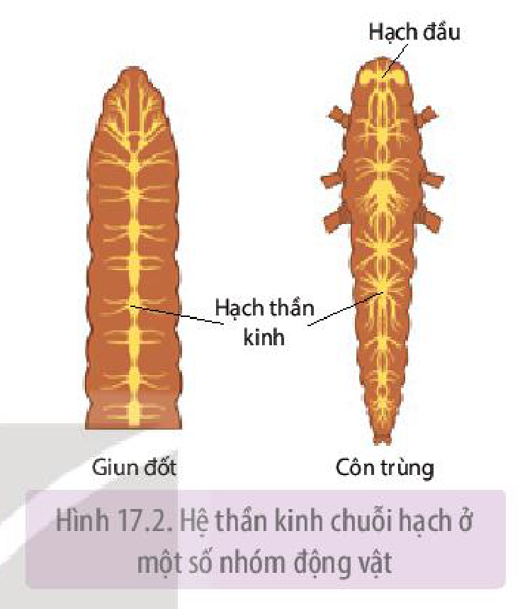

Hình 17.2. Hệ thần kinh chuỗi hạch ở một số nhóm động vật

### 3. Cảm ứng ở động vật có hệ thần kinh ống

**Hệ thần kinh ống** gặp ở động vật thuộc các lớp Cá, Lưỡng cư, Bò sát, Chim và Thú.

**Hệ thần kinh ống** cấu tạo từ số lượng rất lớn tế bào thần kinh. Các tế bào thần kinh tập trung lại thành một ống nằm ở phần lưng cơ thể và phân chia thành **thần kinh trung ương** (gồm não bộ và tuỷ sống) và **thần kinh ngoại biên** (gồm các hạch thần kinh và các **dây thần kinh** não, tuỷ) (H 17.3).

Hệ thần kinh ống hoạt động theo nguyên tắc phản xạ. Các thụ thể cảm giác (cơ học, hoá học, nhiệt độ, ánh sáng,...) tiếp nhận kích thích từ môi trường và gửi thông tin theo các dây thần kinh cảm giác về tuỷ sống và não bộ, từ đây xung thần kinh theo dây thần kinh vận động đến cơ quan đáp ứng (cơ, tuyến) và gây ra đáp ứng.

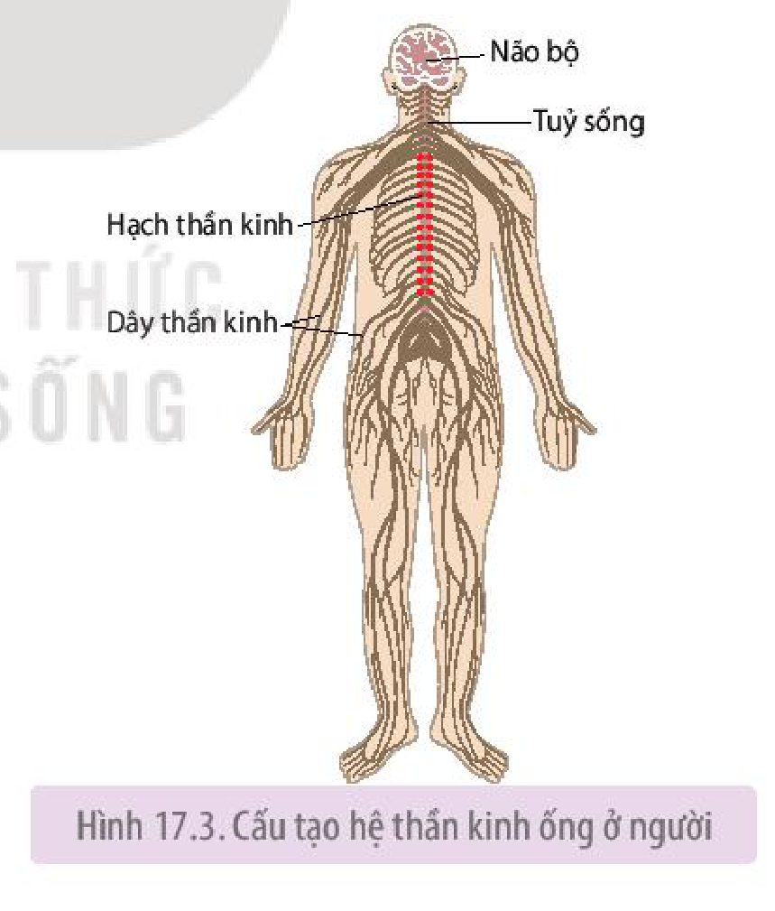

Hình 17.3. Cấu tạo hệ thần kinh ống ở người

## ❓ Dừng lại và suy ngẫm

Tại sao kích thích nhẹ lên thuỷ tức thì cả cơ thể nó co lại, trong khi nếu kích thích nhẹ vào một chân côn trùng thì chỉ chân đó co lại mà không có phản ứng ở các bộ phận khác?

<!-- pdf:103 -->

## II. TẾ BÀO THẦN KINH

**Tế bào thần kinh** còn gọi là **neuron**, là đơn vị cấu tạo và chức năng của hệ thần kinh.

### 1. Cấu tạo của neuron

Hầu hết neuron đều cấu tạo từ ba phần: thân, sợi nhánh, sợi trục (H 17.4).

- **Sợi nhánh**: Mỗi neuron có từ một đến hàng nghìn sợi nhánh tiếp nhận thông tin và đưa về thân.

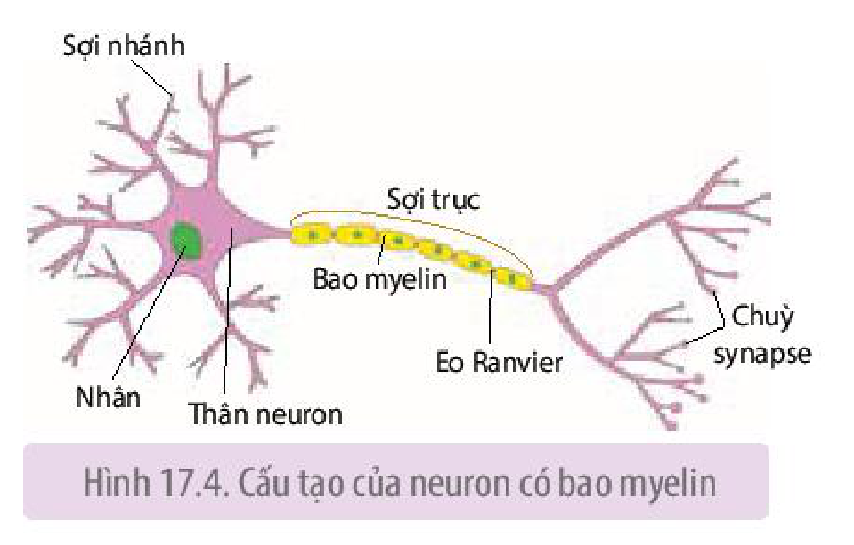

Hình 17.4. Cấu tạo của neuron có bao myelin

- **Sợi trục** của neuron có chức năng truyền xung thần kinh đến tế bào khác. Đầu tận cùng sợi trục phân thành nhiều nhánh và đầu mỗi nhánh phình lên tạo thành **chuỳ synapse**. Nhiều sợi trục có thêm **bao (vỏ) myelin** có tính chất cách điện. Các đoạn nhỏ trên sợi trục không được bao myelin bao bọc gọi là các **eo Ranvier** (H 17.4 ).

### 2. Chức năng của neuron

Neuron có chức năng tiếp nhận kích thích, tạo ra xung thần kinh và truyền xung thần kinh đến neuron khác hoặc tế bào khác.

Khi neuron không bị kích thích thì có điện thế nghỉ.

**a) Điện thế nghỉ và điện thế hoạt động**

**Điện thế nghỉ** là sự chênh lệch điện thế giữa hai bên màng tế bào khi tế bào không bị kích thích, bên trong màng tích điện âm so với bên ngoài màng tích điện dương (H 17.5).

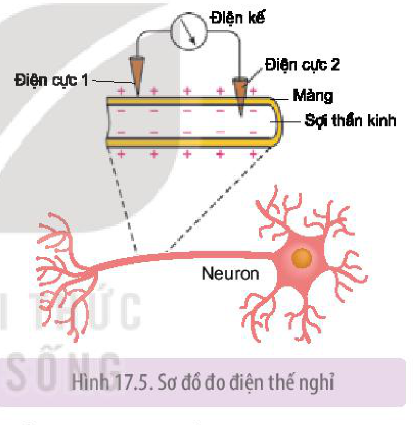

Hình 17.5. Sơ đồ đo điện thế nghỉ

Khi neuron bị kích thích thì điện thế nghỉ biến đổi thành **điện thế hoạt động** (H 17.6).

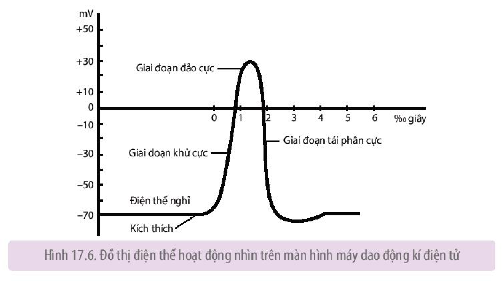

Hình 17.6. Đồ thị điện thế hoạt động nhìn trên màn hình máy dao động kí điện tử

<!-- pdf:104 -->

**b) Lan truyền điện thế hoạt động**

Điện thế hoạt động xuất hiện (còn gọi là **xung thần kinh** hay **xung điện**) không dừng tại điểm phát sinh mà lan truyền dọc theo sợi thần kinh. Cách lan truyền và tốc độ lan truyền của điện thế hoạt động trên sợi thần kinh có bao myelin và không có bao myelin là khác nhau.

Trên sợi thần kinh không có bao myelin, điện thế hoạt động lan truyền là do khử cực, đảo cực và tái phân cực liên tiếp từ vùng này sang vùng khác kế tiếp (H 17.7a).

Trên sợi thần kinh có bao myelin, điện thế hoạt động lan truyền là do khử cực, đảo cực và tái phân cực liên tiếp từ eo Ranvier này sang eo Ranvier kế tiếp, nghĩa là lan truyền theo cách nhảy cóc từ eo Ranvier này sang eo Ranvier khác (H 17.7b).

Ở người, tốc độ lan truyền xung thần kinh trên sợi vận động (có bao myelin) là khoảng 120 m/s, còn trên sợi giao cảm (không có bao myelin) là khoảng 3 – 5 m/s.

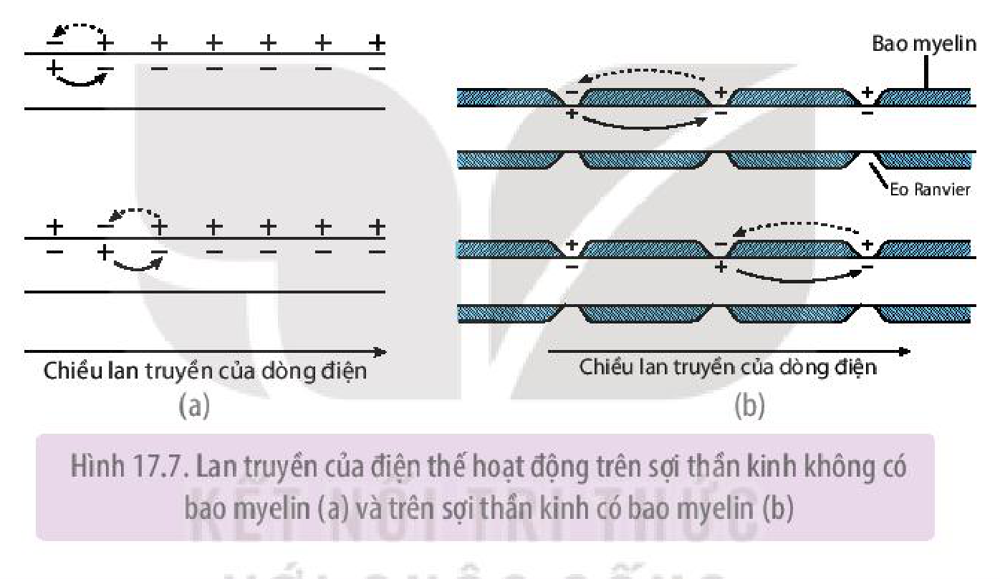

Hình 17.7. Lan truyền của điện thế hoạt động trên sợi thần kinh không có bao myelin (a) và trên sợi thần kinh có bao myelin (b)

## ❓ Dừng lại và suy ngẫm

1. Neuron có cấu tạo như thế nào? Ưu thế của neuron có nhiều hơn một sợi nhánh so với chỉ có một sợi nhánh là gì? Giải thích.
2. Hình dạng của neuron như thế nào cho phép nó truyền tin đi xa?
3. Điện thế nghỉ và điện thế hoạt động được hình thành như thế nào?
4. Tại sao tốc độ lan truyền xung thần kinh trên sợi thần kinh có bao myelin nhanh hơn trên sợi thần kinh không có bao myelin?

## III. SYNAPSE

**Synapse** là diện tiếp xúc giữa tế bào thần kinh với tế bào thần kinh hoặc giữa tế bào thần kinh với tế bào khác. Xung thần kinh từ sợi trục của neuron này đi qua synapse sang tế bào khác (H 17.8).

Trong hệ thần kinh, mỗi neuron có thể có hàng trăm đến hàng nghìn synapse.

<!-- pdf:105 -->

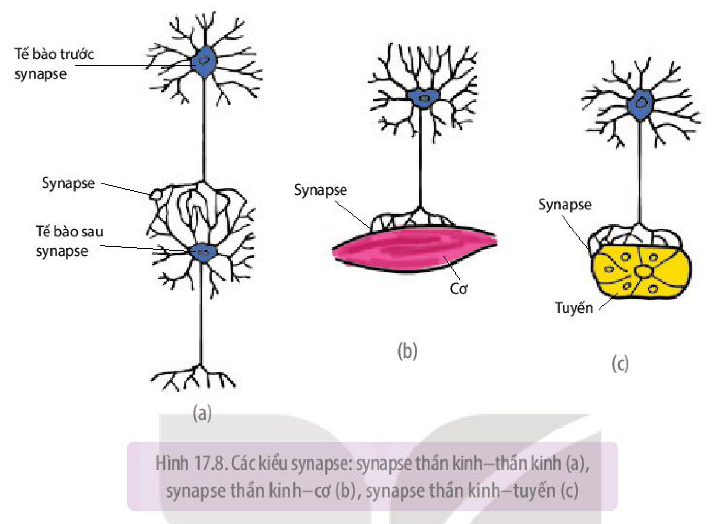

Hình 17.8. Các kiểu synapse: synapse thần kinh–thần kinh (a), synapse thần kinh–cơ (b), synapse thần kinh–tuyến (c)

### 1. Cấu tạo của synapse

Synapse có hai loại: **synapse hoá học** và **synapse điện**. Synapse hoá học là synapse phổ biến ở động vật. Cấu tạo của một synapse hoá học được thể hiện ở Hình 17.9.

Mỗi synapse thường chứa một loại **chất chuyển giao thần kinh** (**chất trung gian hoá học**). Ở động vật có vú, chất chuyển giao thần kinh trong synapse là acetylcholine, noradrenaline, dopamine, serotonin,...

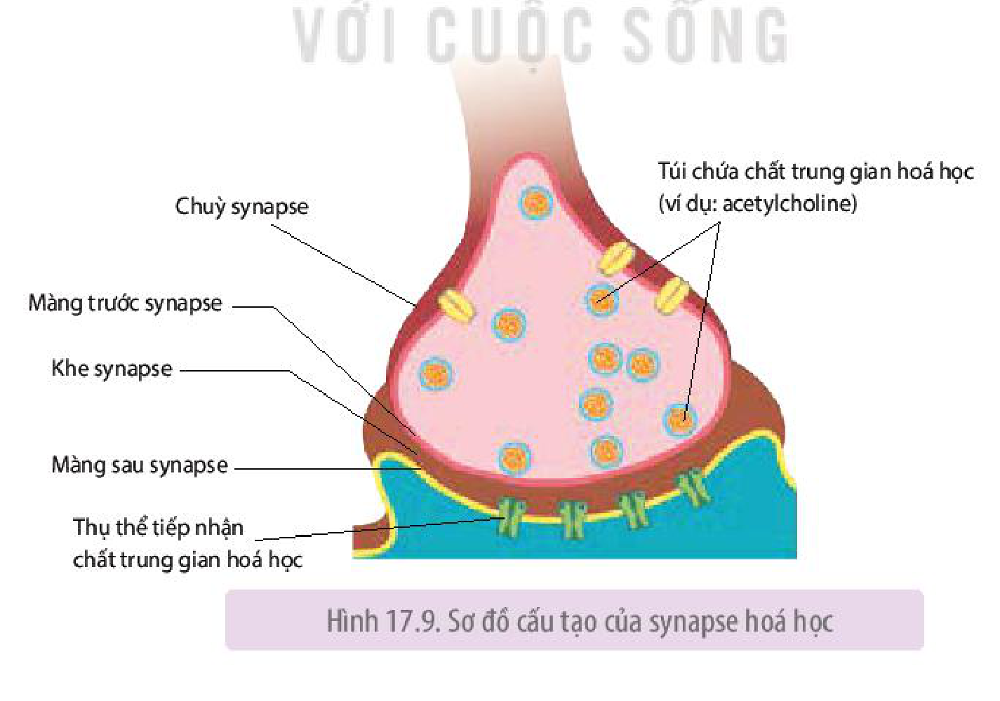

Hình 17.9. Sơ đồ cấu tạo của synapse hoá học

<!-- pdf:106 -->

**b) Truyền tin qua synapse**

Thông tin dưới dạng xung thần kinh khi đến synapse được truyền qua synapse nhờ **chất chuyển giao thần kinh** (H 17.10).

Sau khi điện thế hoạt động xuất hiện ở màng sau và lan truyền đi tiếp, enzyme acetylcholinesterase có ở màng sau sẽ phân huỷ acetylcholine thành acetate và choline. Choline quay trở lại màng trước, đi vào chuỳ synapse và tham gia vào quá trình tổng hợp acetylcholine chứa trong các túi.

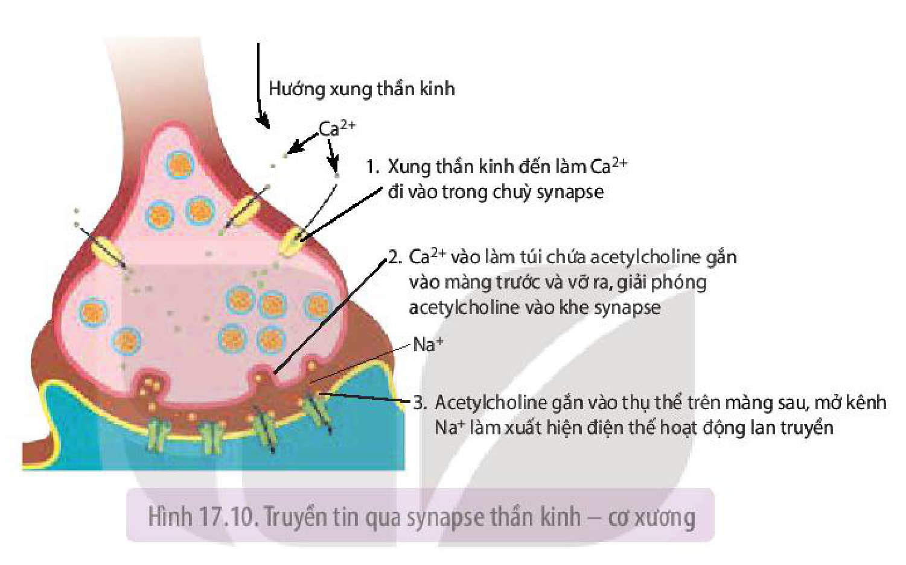

Hình 17.10. Truyền tin qua synapse thần kinh – cơ xương

## ❓ Dừng lại và suy ngẫm

Quan sát Hình 17.9, 17.10 và trả lời các câu hỏi sau:

1. Thông tin dưới dạng xung thần kinh được neuron chuyển qua synapse hoá học sang tế bào khác như thế nào?
2. Tại sao thông tin truyền qua synapse chỉ theo một chiều, từ màng trước sang màng sau mà không theo chiều ngược lại?

### 4. Phản xạ

**a) Khái niệm phản xạ và cung phản xạ**

**Phản xạ** là phản ứng của cơ thể trả lời các kích thích từ môi trường bên trong hoặc bên ngoài thông qua hệ thần kinh.

Phản xạ thực hiện qua **cung phản xạ**. Một cung phản xạ điển hình gồm năm bộ phận (H 17.11):

- Bộ phận tiếp nhận kích thích: là thụ thể cảm giác.
- Đường dẫn truyền hướng tâm: là dây thần kinh cảm giác do các neuron cảm giác tạo thành.

<!-- pdf:107 -->

- Bộ phận trung ương: là tuỷ sống và não bộ do các neuron trung gian (còn gọi là neuron liên lạc) tạo thành.
- Đường dẫn truyền li tâm: là dây thần kinh vận động do các neuron vận động tạo thành.
- Bộ phận đáp ứng: là cơ hay tuyến.

Bất kì một bộ phận nào của cung phản xạ bị tổn thương, phản xạ sẽ không thực hiện được.

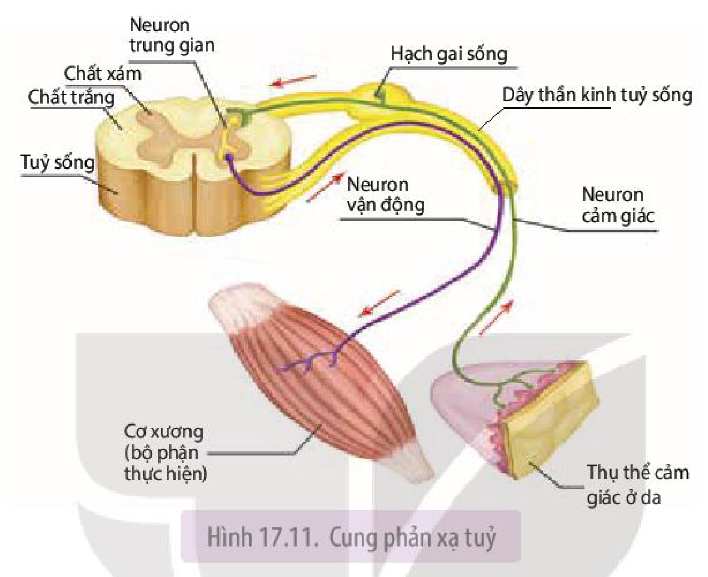

Hình 17.11. Cung phản xạ tuỷ

Ví dụ: Khi lỡ tay chạm vào gai nhọn, tín hiệu đau từ thụ thể đau ở da chuyển về tuỷ sống, các neuron trong tuỷ sống gửi xung thần kinh đến cơ tay, làm cơ tay co và tay rụt lại. Một số neuron trung gian khác chuyển thông tin đau từ tuỷ sống lên não, gây ra cảm giác đau. Não phân tích, đánh giá thông tin và có thể đưa ra quyết định hành động tiếp theo.

## ❓ Dừng lại và suy ngẫm

1. Cung phản xạ gồm những bộ phận nào? Tại sao bất kì một bộ phận nào của cung phản xạ bị tổn thương, phản xạ sẽ không thực hiện được?
2. Trong cung phản xạ, đáp ứng của cơ xương có tác dụng như thế nào đối với cơ thể?

### 2. Các thụ thể cảm giác

**Thụ thể cảm giác** là neuron hoặc tế bào biểu mô chuyên hoá, cũng có thể là các đầu mút của neuron đáp ứng với kích thích đặc hiệu. Một số thụ thể cảm giác tồn tại đơn độc, một số khác tập trung lại cùng với các loại tế bào khác tạo nên các cơ quan cảm giác như mắt, tai, mũi, lưỡi,...

Thụ thể cảm giác có chức năng tiếp nhận và chuyển đổi các dạng năng lượng của kích thích (như âm thanh, ánh sáng, nhiệt,...) thành điện thế thụ thể, khởi phát điện thế hoạt động lan truyền tới trung ương thần kinh.

Thụ thể cảm giác có thể chia thành các dạng như Bảng 17.1:

<!-- pdf:108 -->

Bảng 17.1. Vai trò của các thụ thể cảm giác

| Loại thụ thể | Vai trò |
|---|---|
| **Thụ thể cơ học** | Phát hiện các biến dạng vật lí gây ra do các dạng năng lượng cơ học. Tuỳ theo vị trí, thụ thể cơ học có những vai trò khác nhau. Ví dụ: Thụ thể cơ học ở dạ dày chuyển thông tin độ dãn của dạ dày về hành não, qua đó điều chỉnh co bóp và tiết dịch tiêu hoá của dạ dày. |
| **Thụ thể hoá học** | Phát hiện các phân tử hoá học đặc hiệu và nồng độ của chúng trong máu. Ví dụ: Thụ thể ở tế bào tuyến tuỵ phát hiện và điều chỉnh nồng độ glucose trong máu. |
| **Thụ thể điện từ** | Phát hiện các dạng khác nhau của năng lượng điện từ như ánh sáng nhìn thấy, dòng điện và từ trường |
| **Thụ thể nhiệt** | Phát hiện nóng, lạnh, gửi thông tin đến trung khu điều hoà thân nhiệt nằm ở phần sau vùng dưới đồi, qua đó điều hoà nhiệt độ cơ thể. |
| **Thụ thể đau** | Thụ thể đau phát hiện tổn thương mô do tác nhân cơ học (va đập), hoá học (acid,...), điện, nhiệt (lửa,...), áp lực mạnh (do đè nén) gây ra. Thụ thể đau đưa thông tin đau dưới dạng xung thần kinh về đồi thị và vỏ não gây ra cảm giác đau. Trên cơ sở đó, não kích phát các phản ứng bảo vệ, tránh bị tổn thương hoặc tránh tổn thương nặng hơn, tăng cường các cơ chế sinh lí đối phó với tổn thương,... |

### 3. Vai trò của cảm giác vị giác, khứu giác, xúc giác

Bảng 17.2. Vai trò của cảm giác vị giác, khứu giác và xúc giác

| Tên cảm giác | Vai trò |
|---|---|
| **Vị giác** | Giúp động vật chọn lựa loại thức ăn ăn được và không ăn được, đảm bảo chất dinh dưỡng cho cơ thể tồn tại và phát triển. Làm tăng hoạt động tiêu hoá cơ học và hoá học của hệ tiêu hoá đối với thức ăn,... |
| **Khứu giác** | Gây ra nhiều phản ứng khác nhau như tìm kiếm thức ăn, chọn thức ăn thích hợp, tránh kẻ thù, tìm đến bạn tình (pheromone ở bướm tằm), định hướng đường đi (ở kiến), nhận ra con mới sinh (cá thể cái động vật có vú),... Hỗ trợ cảm giác vị, nhờ đó tăng hoạt động tiêu hoá và hấp thụ chất dinh dưỡng. |
| **Xúc giác** | Cảm giác xúc giác như trơn, nhẵn hay thô, ráp, tròn hay vuông, to hay nhỏ,... có thể gây ra nhiều phản ứng như tránh trượt ngã, giữ vật chính xác không để tuột, rơi, nuốt khi thức ăn trong miệng đã nhỏ và tạo thành viên,... Cảm giác xúc giác còn giúp một số động vật lựa chọn thức ăn. |

### 4. Thị giác

**Thị giác** hay cảm giác ánh sáng khởi đầu từ mắt. Mắt tiếp nhận ánh sáng và chuyển tín hiệu đến vùng thị giác ở vỏ não (H 17.13).

- Cơ chế tiếp nhận ánh sáng: Ánh sáng khúc xạ từ vật vào mắt, đi qua hệ thống khúc xạ ánh sáng (giác mạc, thuỷ dịch, thuỷ tinh thể và dịch kính) (H 17.12a), tế bào hạch, tế bào lưỡng cực, cuối cùng đến tế bào que và nón (H 17.12b). Tế bào que và nón phản ứng với ánh sáng và gây khởi phát xung thần kinh ở tế bào lưỡng cực. Xung thần kinh từ tế bào lưỡng cực chuyển sang tế bào hạch và đi theo dây thần kinh thị giác về vùng thị giác (thuỳ chẩm) trên vỏ não cho cảm giác về hình ảnh và màu sắc của vật.

<!-- pdf:109 -->

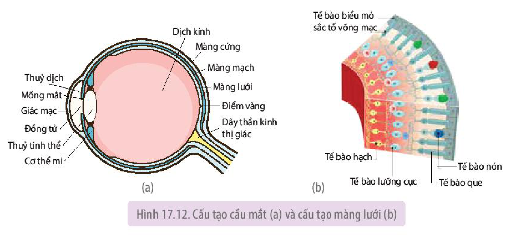

Hình 17.12. Cấu tạo cầu mắt (a) và cấu tạo màng lưới (b)

- Lượng thông tin mà cơ thể tiếp nhận thông qua thụ thể quang học là lớn nhất nếu so sánh với lượng thông tin tiếp nhận từ các loại thụ thể cảm giác khác.

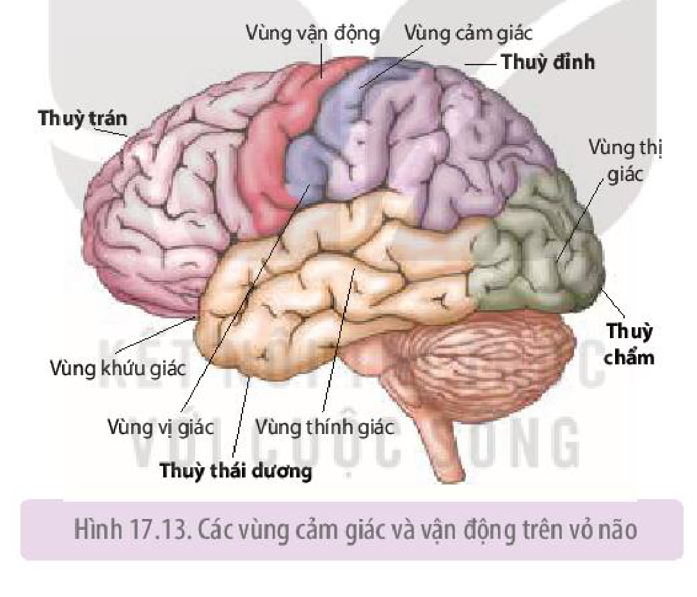

Hình 17.13. Các vùng cảm giác và vận động trên vỏ não

### 5. Thính giác và giữ thăng bằng

**Thính giác** hay cảm giác âm thanh và giữ thăng bằng được khởi đầu bằng cơ quan cảm giác là tai. Tai có hai chức năng, đó là tiếp nhận âm thanh và tham gia giữ thăng bằng cơ thể.

- Tai và chức năng tiếp nhận âm thanh:

Bộ phận tiếp nhận âm thanh gồm tai ngoài, tai giữa và ốc tai (H 17.14a).

Sóng âm từ nguồn âm phát ra truyền theo ống tai vào màng nhĩ, rồi truyền qua chuỗi xương tai giữa làm rung màng cửa sổ bầu dục tạo ra sóng áp lực truyền trong ốc tai. Sóng áp lực làm các tế bào có lông bị kích thích dẫn đến xuất hiện điện thế hoạt động lan truyền về thuỳ thái dương của vỏ não (H 17.3) cho cảm giác về âm thanh.

<!-- pdf:110 -->

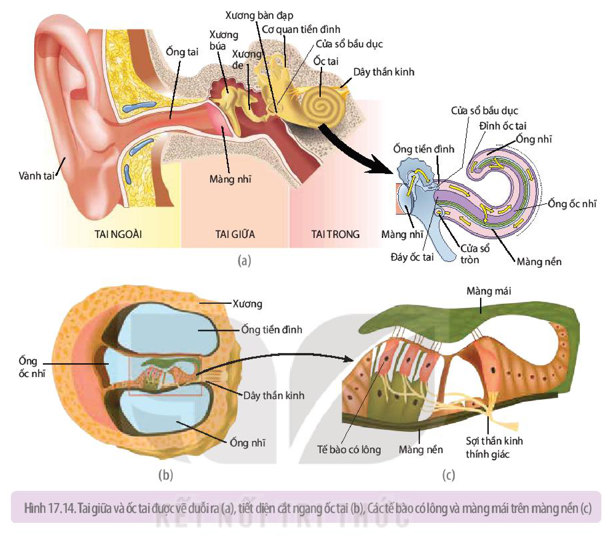

Hình 17.14. Tai giữa và ốc tai được vẽ duỗi ra (a), tiết diện cắt ngang ốc tai (b), Các tế bào có lông và màng mái trên màng nền (c)

Dựa vào cảm giác âm thanh, động vật đưa ra các phản ứng rất đa dạng như định hướng tìm con mồi, xác định kẻ săn mồi, tìm bạn tình, báo động nguy hiểm,...

- Tai và chức năng giữ thăng bằng:

Chức năng giữ thăng bằng cơ thể là nhờ **cơ quan tiền đình** nằm trong tai trong. Cơ quan tiền đình gồm nang cầu, nang bầu dục và ba ống bán khuyên (H 17.15a).

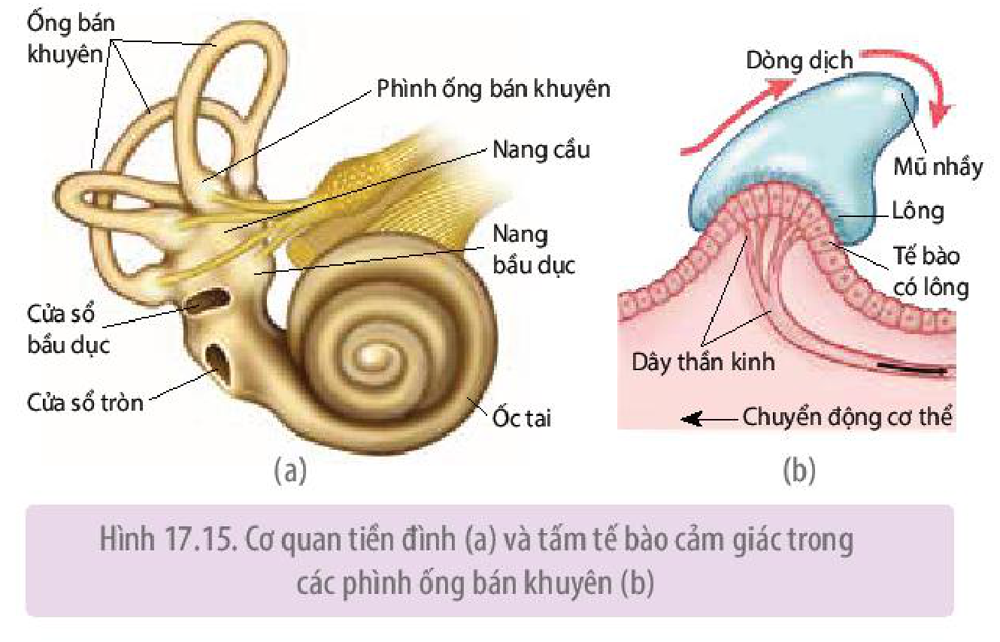

Hình 17.15. Cơ quan tiền đình (a) và tấm tế bào cảm giác trong các phình ống bán khuyên (b)

<!-- pdf:111 -->

Tuỳ theo tư thế và hoạt động của cơ thể, dịch lỏng chuyển dịch trong các bộ phận của cơ quan tiền đình theo một hướng nhất định. Chuyển động của dịch lỏng làm tế bào có lông hưng phấn, xuất hiện xung thần kinh truyền về hành não và tiểu não. Từ đây, xung thần kinh sẽ được truyền đi theo hai hướng: đến các nhóm cơ của cơ thể điều chỉnh sự co, dãn của chúng, giúp cơ thể giữ được thăng bằng và đến vỏ não cho cảm nhận về vị trí, chuyển động của cơ thể.

Nhờ cơ quan tiền đình, các loài động vật đào hang cảm nhận được hướng di chuyển trong hang tối.

## ❓ Dừng lại và suy ngẫm

1. Thụ thể cảm giác là gì? Cho biết các loại thụ thể cảm giác và vai trò của chúng. Để có cảm giác cần những bộ phận nào?
2. Tại sao chúng ta nhìn thấy hình ảnh của vật và nghe được âm thanh?
3. Tại sao chúng ta có thể cảm nhận được vị trí và chuyển động của cơ thể dù đang nhắm mắt?

### 4. Phản xạ không điều kiện và phản xạ có điều kiện

Động vật không xương sống có hệ thần kinh kém phát triển, khó thành lập phản xạ có điều kiện nên các phản xạ của chúng hầu hết là phản xạ không điều kiện. Các loài thú có hệ thần kinh rất phát triển, đặc biệt là bán cầu đại não nên rất thuận lợi cho quá trình học tập và rút kinh nghiệm.

**a) Đặc điểm của phản xạ không điều kiện và phản xạ có điều kiện**

Bảng 17.3. Đặc điểm của phản xạ không điều kiện và phản xạ có điều kiện

| Đặc điểm | **Phản xạ không điều kiện** | **Phản xạ có điều kiện** |
|---|---|---|
| – Nguồn gốc | Di truyền, sinh ra đã có | Hình thành trong đời sống cá thể, không di truyền |
| – Tính chất | Rất bền vững | Dễ mất nếu không được củng cố |
| – Tác nhân kích thích | Tác nhân kích thích thích ứng với thụ thể cảm giác | Tác nhân kích thích bất kì đối với thụ thể cảm giác |
| – Số lượng | Số lượng có giới hạn | Số lượng không giới hạn |
| – Trung ương | Tuỷ sống, thân não | Có sự tham gia của vỏ não |

**b) Phân loại phản xạ không điều kiện**

Phản xạ không điều kiện có thể phân loại theo các tiêu chí khác nhau. Phản xạ không điều kiện thường được phân loại dựa theo chức năng: phản xạ sinh dưỡng, phản xạ tự vệ, phản xạ sinh dục, phản xạ vận động, phản xạ định hướng,... Mỗi loại phản xạ này lại gồm nhiều phản xạ khác nhau. Ví dụ: Phản xạ sinh dưỡng bao gồm phản xạ nuốt, phản xạ co dãn dạ dày và tiết dịch vị, phản xạ tiết nước bọt,...

<!-- pdf:112 -->

**c) Điều kiện hình thành phản xạ có điều kiện**

- Theo I. Pavlov:

I. Pavlov đã tiến hành thí nghiệm và thu được kết quả như hình 17.16.

Từ kết quả thí nghiệm đưa ra các điều kiện hình thành phản xạ có điều kiện dưới đây:

+ Thành lập phản xạ có điều kiện phải dựa trên phản xạ không điều kiện hoặc phản xạ có điều kiện đã được hình thành vững chắc. Ví dụ: Hình thành phản xạ tiết nước bọt khi tiếng chuông reo phải dựa trên phản xạ không điều kiện tiết nước bọt khi thức ăn chạm vào lưỡi.

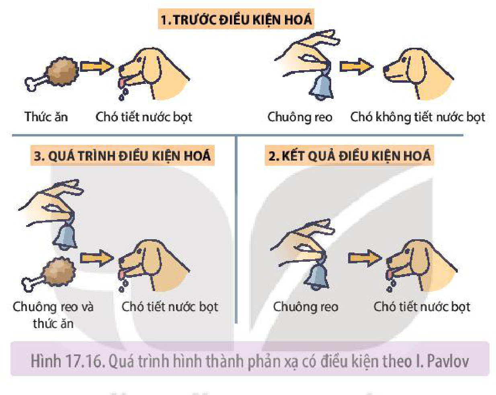

Hình 17.16. Quá trình hình thành phản xạ có điều kiện theo I. Pavlov

+ Phải kết hợp một số lần nhất định giữa kích thích có điều kiện (ánh đèn) và kích thích không điều kiện (thức ăn) (H.17.17). Ví dụ: Trong thí nghiệm của Pavlov, phải kết hợp giữa bật đèn và cho chó ăn khoảng 20 – 30 lần thì phản xạ bật đèn – chó tiết nước bọt mới được thành lập.
+ Kích thích có điều kiện phải tác động trước hoặc đồng thời với kích thích không điều kiện. Ví dụ: bật đèn đồng thời hoặc ngay trước khi cho chó ăn.

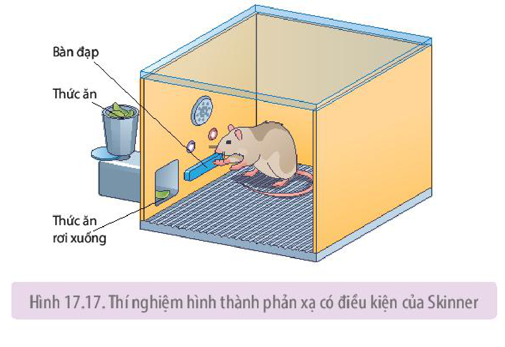

Hình 17.17. Thí nghiệm hình thành phản xạ có điều kiện của Skinner

<!-- pdf:113 -->

- Theo B.F. Skinner:

B.F. Skinner đã làm thí nghiệm như sau: Chuột được thả vào trong lồng có bàn đạp gắn với thức ăn. Chuột chạy trong lồng và vô tình đạp phải bàn đạp thì thức ăn rơi ra. Lặp lại một số lần ngẫu nhiên như vậy, chuột đã học được bài học là nhấn bàn đạp sẽ có thức ăn, vì vậy mỗi khi thấy đói chuột chạy đến nhấn bàn đạp để có thức ăn (H 17.17). Như vậy, điều kiện thành lập các phản xạ có điều kiện là các hành động lặp đi lặp lại kèm theo có thưởng hoặc phạt.

**d) Cơ chế hình thành phản xạ có điều kiện**

Theo Pavlov, quá trình hình thành phản xạ có điều kiện là quá trình hình thành liên hệ thần kinh giữa các vùng thần kinh khác nhau trên vỏ não khi bị kích thích đồng thời, còn theo Skinner, các hành động lặp đi lặp lại kèm theo thưởng (hoặc phạt) làm tăng cường sự kết nối giữa các neuron trong hệ thống thưởng của não.

Vậy bản chất của liên hệ thần kinh giữa các vùng thần kinh khác nhau trên vỏ não của Paplov và tăng cường sự kết nối giữa các neuron trong hệ thống thưởng của Skinner là gì? Các nghiên cứu gần đây cho thấy có những thay đổi về liên hệ giữa các neuron khi chúng tăng cường hoạt động do bị kích thích nhiều lần như hình thành thêm chuỳ synapse, kéo dài chuỳ synapse, tăng số lượng nhánh nhỏ của sợi nhánh hoặc thay đổi cấu tạo và chức năng của các thụ thể ở màng sau synapse, nhờ vậy thông tin đi qua synapse dễ dàng hơn.

## ❓ Dừng lại và suy ngẫm

1. Hãy cho biết các phản xạ dưới đây thuộc loại phản xạ không điều kiện hay có điều kiện. Giải thích.

a) Dừng xe trước vạch kẻ khi thấy đèn tín hiệu giao thông chuyển sang màu đỏ.

b) Người run lập cập khi mặc không đủ ấm trong thời tiết lạnh giá.

c) Thở nhanh khi không khí trong phòng không đủ $\text{O}_2$.

2. Phản xạ có điều kiện được hình thành như thế nào?

## V. MỘT SỐ BỆNH DO TỔN THƯƠNG HỆ THẦN KINH VÀ CƠ CHẾ GIẢM ĐAU

### 1. Bệnh do tổn thương hệ thần kinh

- Tổn thương thần kinh ngoại biên: Dây thần kinh ngoại biên có thể bị tổn thương (do tai nạn giao thông) dẫn đến mất cảm giác hoặc mất khả năng vận động ở các vùng khác nhau của cơ thể. Ví dụ: Tổn thương dây thần kinh thị giác dẫn đến mất khả năng nhìn.
- Tổn thương thần kinh trung ương: Não có thể bị tổn thương (do xuất huyết não, do virus,...). Tuỳ mức độ và vùng não bị tổn thương mà hậu quả đưa đến rất khác nhau. Ví dụ: Nếu tổn thương diện hẹp hồi trán lên có thể sẽ mất khả năng vận động như nói, liệt tay hoặc liệt chân,... còn nếu tổn thương diện rộng hồi trán lên sẽ dẫn đến liệt nửa người hoặc liệt toàn thân.

<!-- pdf:114 -->

### 2. Cơ chế giảm đau của thuốc giảm đau
<!-- ocr-ok: OCR đọc sai chữ trong tiêu đề màu tím -->

Một số loại thuốc uống và tiêm tác dụng lên thần kinh trung ương và thần kinh ngoại biên làm giảm đau.

- Thuốc tác động lên thần kinh trung ương: Ví dụ: Morphin và codein nguồn gốc tự nhiên hoặc tổng hợp có cấu trúc tương tự như endorphins, enkephalin nội sinh. Hai chất này tạo cảm giác khoan khoái, dễ chịu nhưng lại ức chế giải phóng chất chuyển giao thần kinh ở não (chất P, glutamic acid), vì vậy giảm cảm giác đau. Hai chất này gây nghiện và gây lệ thuộc thuốc khi dùng kéo dài.
- Thuốc tác động lên thần kinh ngoại biên: Ví dụ: Thuốc gây tê như procaine, novocaine làm giảm tính thấm của màng tế bào thần kinh đối với $\text{Na}^+$, do đó ngăn chặn khử cực, đảo cực và tái phân cực trên sợi thần kinh cảm giác, dẫn đến xung thần kinh mang thông tin đau không thể lan truyền về đồi thị và vỏ não, làm giảm cảm giác đau.

## VI. BẢO VỆ HỆ THẦN KINH ĐỐI VỚI CHẤT KÍCH THÍCH

Hệ thần kinh rất dễ bị tổn thương nếu mất ngủ, căng thẳng thần kinh (làm việc quá sức, lo lắng kéo dài,...), ăn uống không khoa học, lạm dụng các chất kích thích như thuốc lá, rượu bia, sử dụng ma tuý,...

Các chất như heroin, cocaine,... là những chất kích thích rất mạnh lên hệ thần kinh. Các chất này lúc mới sử dụng cho cảm giác dễ chịu, sảng khoái, giảm mệt mỏi, giảm đau. Tuy nhiên, sau một số lần sử dụng sẽ gây nghiện và lệ thuộc vào chúng. Nếu không tiếp tục sử dụng, cơ thể sẽ cảm thấy rất mệt mỏi, đau đớn, bực bội, âu sầu, giảm trí nhớ, rối loạn cảm giác, khủng hoảng tinh thần và không làm chủ được bản thân, có thể dẫn đến những hành động nguy hiểm cho bản thân, gia đình và xã hội.

## ❓ Dừng lại và suy ngẫm

Dựa vào tài liệu khoa học, internet, hỏi bác sĩ hoặc những người có chuyên môn về chất kích thích trả lời các câu hỏi dưới đây:

1. Thế nào là lạm dụng chất kích thích?
2. Cần làm gì để cai nghiện chất kích thích và phòng tránh tình trạng nghiện chất kích thích?

## 📌 Kiến thức cốt lõi

- Động vật không có hệ thần kinh phản ứng với kích thích chậm và đơn giản.
- Động vật có hệ thần kinh mạng lưới phản ứng với kích thích bằng cách co toàn bộ cơ thể. Hệ thần kinh chuỗi hạch có thể phản ứng cục bộ với kích thích thông qua hạch thần kinh. Hệ thần kinh ống gồm thần kinh trung ương và thần kinh ngoại biên. Não bộ xử lí hầu hết các thông tin và quyết định mức độ và cách phản ứng.
- Neuron cấu tạo từ thân, sợi trục và sợi nhánh. Neuron có chức năng tiếp nhận kích thích, tạo ra xung thần kinh và truyền xung thần kinh đến tế bào khác.

<!-- pdf:115 -->

- Thông tin dưới dạng xung thần kinh truyền từ màng trước qua màng sau synapse nhờ chất dẫn truyền thần kinh.
- Phản xạ là phản ứng của cơ thể trả lời các kích thích từ môi trường bên trong hoặc bên ngoài thông qua hệ thần kinh. Phản xạ thực hiện nhờ cung phản xạ. **Cung phản xạ** gồm thụ thể, dây thần kinh cảm giác, trung ương thần kinh, dây thần kinh vận động và bộ phận đáp ứng.
- Thụ thể cảm giác gồm thụ thể cơ học, thụ thể hoá học, thụ thể điện từ, thụ thể nhiệt và thụ thể đau. Các thụ thể cảm giác có vai trò khác nhau.
- Cảm giác vị giác, xúc giác và khứu giác có những vai trò khác nhau đối với cơ thể.
- Mắt thu nhận và phản ứng với ánh sáng, góp phần quan trọng trong cảm nhận hình ảnh và màu sắc của vật. Tai thu nhận và phản ứng với âm thanh, góp phần quan trọng trong cảm nhận âm thanh. Cơ quan tiền đình trong tai trong có vai trò trong duy trì thăng bằng cơ thể.
- Phản xạ không điều kiện sinh ra đã có, rất bền vững, tác nhân kích thích thích ứng với thụ thể cảm giác. Phản xạ có điều kiện hình thành trong đời sống cá thể, dễ mất nếu không được củng cố, tác nhân kích thích bất kì đối với thụ thể cảm giác.
- Cơ chế hình thành phản xạ có điều kiện: thay đổi liên hệ giữa các neuron khi chúng tăng cường hoạt động do bị kích thích nhiều lần.
- Một số bệnh mất khả năng vận động hoặc cảm giác do tổn thương thần kinh trung ương hoặc thần kinh ngoại biên.
- Các chất kích thích gây nghiện và tổn hại lên hệ thần kinh.

## ✏️ Luyện tập và vận dụng

1. Độc tố tetrodotoxin có trong cá nóc làm đóng kênh $\text{Na}^+$ trên các sợi thần kinh có thể gây tử vong ở người ăn cá nóc. Giải thích.
2. Vi khuẩn *Clostridium botulinum* đôi khi xuất hiện trong thức ăn để lâu ngoài không khí tiết ra độc tố botulinum, độc tố này ngăn cản giải phóng acetylcholine ở chuỳ synapse thần kinh – cơ xương. Nếu ăn phải thức ăn có loại vi khuẩn này thì hậu quả sẽ như thế nào? Giải thích.
3. Nếu nhìn gần trong thời gian dài (ví dụ: đọc sách dưới ánh sáng yếu, bàn ghế không phù hợp với kích thước cơ thể) làm thuỷ tinh thể phồng lên và giữ nguyên ở trạng thái phồng. Trạng thái phồng của thuỷ tinh thể ảnh hưởng như thế nào đến khả năng nhìn các vật? Giải thích.

## 💡 Em có biết

Ở người, vỏ não chiếm khoảng 80% khối lượng của toàn não và được cuộn gấp nhiều lần, tạo ra các nếp nhăn trên não. Nhờ các cuộn gấp này mà diện tích vỏ não đạt xấp xỉ $1\ 000\text{ cm}^2$ với độ dày gần 5 mm.

## 📷 Danh sách hình trong bài

| Mã hình | Trang PDF | Vị trí | Chú thích gốc |
|---|---|---|---|
| H11-sinh-b17-01 | 101 | Mục I.1 | Hình 17.1. Hệ thần kinh dạng lưới ở thuỷ tức |
| H11-sinh-b17-02 | 102 | Mục I.2 | Hình 17.2. Hệ thần kinh chuỗi hạch ở một số nhóm động vật |
| H11-sinh-b17-03 | 102 | Mục I.3 | Hình 17.3. Cấu tạo hệ thần kinh ống ở người |
| H11-sinh-b17-04 | 103 | Mục II.1 | Hình 17.4. Cấu tạo của neuron có bao myelin |
| H11-sinh-b17-05 | 103 | Mục II.2.a | Hình 17.5. Sơ đồ đo điện thế nghỉ |
| H11-sinh-b17-06 | 103 | Mục II.2.a | Hình 17.6. Đồ thị điện thế hoạt động nhìn trên màn hình máy dao động kí điện tử |
| H11-sinh-b17-07 | 104 | Mục II.2.b | Hình 17.7. Lan truyền của điện thế hoạt động trên sợi thần kinh không có bao myelin (a) và trên sợi thần kinh có bao myelin (b) |
| H11-sinh-b17-08 | 105 | Mục III | Hình 17.8. Các kiểu synapse: synapse thần kinh–thần kinh (a), synapse thần kinh–cơ (b), synapse thần kinh–tuyến (c) |
| H11-sinh-b17-09 | 105 | Mục III.1 | Hình 17.9. Sơ đồ cấu tạo của synapse hoá học |
| H11-sinh-b17-10 | 106 | Mục III.1.b | Hình 17.10. Truyền tin qua synapse thần kinh – cơ xương |
| H11-sinh-b17-11 | 107 | Mục 4.a | Hình 17.11. Cung phản xạ tuỷ |
| H11-sinh-b17-12 | 109 | Mục 4 | Hình 17.12. Cấu tạo cầu mắt (a) và cấu tạo màng lưới (b) |
| H11-sinh-b17-13 | 109 | Mục 4 | Hình 17.13. Các vùng cảm giác và vận động trên vỏ não |
| H11-sinh-b17-14 | 110 | Mục 5 | Hình 17.14. Tai giữa và ốc tai được vẽ duỗi ra (a), tiết diện cắt ngang ốc tai (b), Các tế bào có lông và màng mái trên màng nền (c) |
| H11-sinh-b17-15 | 110 | Mục 5 | Hình 17.15. Cơ quan tiền đình (a) và tấm tế bào cảm giác trong các phình ống bán khuyên (b) |
| H11-sinh-b17-16 | 112 | Mục 4.c | Hình 17.16. Quá trình hình thành phản xạ có điều kiện theo I. Pavlov |
| H11-sinh-b17-17 | 112 | Mục 4.c | Hình 17.17. Thí nghiệm hình thành phản xạ có điều kiện của Skinner |
