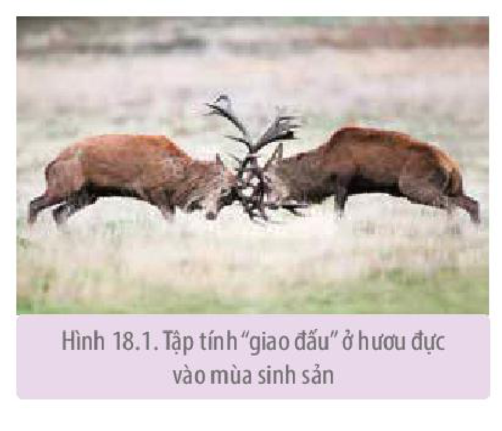
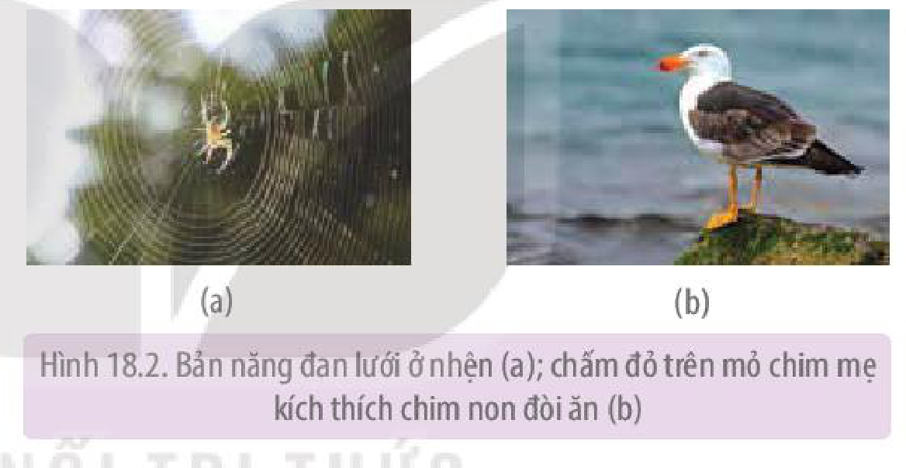
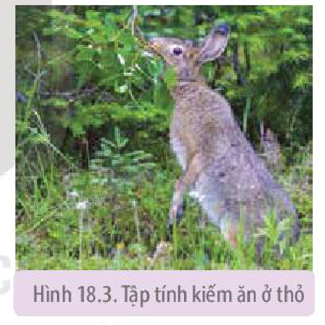
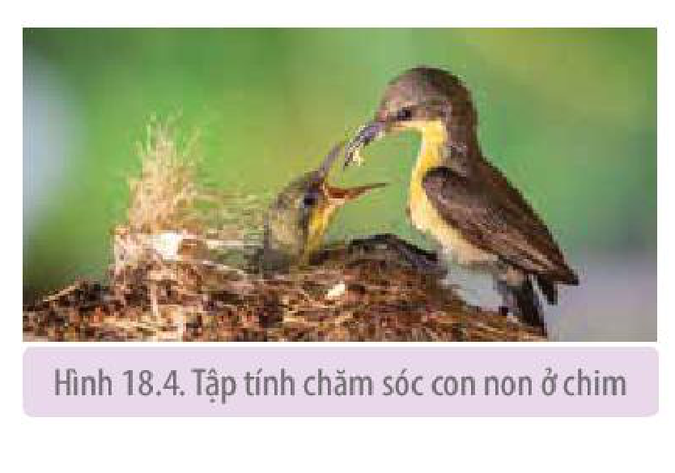
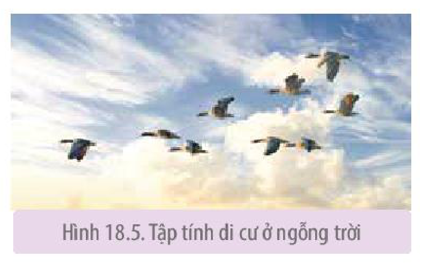
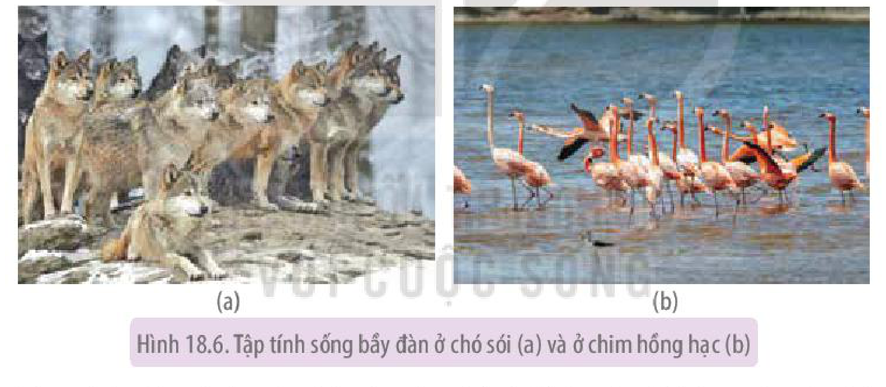
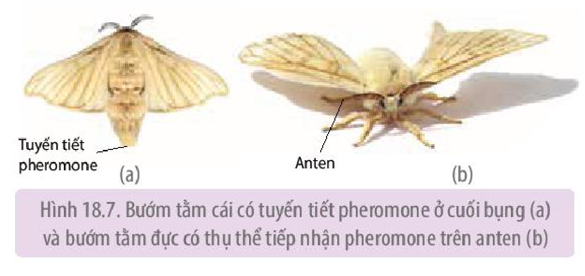
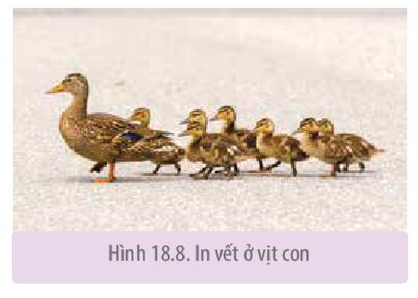

<!-- pdf:116 -->

# BÀI 18: TẬP TÍNH Ở ĐỘNG VẬT

## 🎯 Yêu cầu cần đạt

- Nêu được tập tính và phân tích được vai trò của tập tính đối với động vật. Lấy được một số ví dụ minh hoạ các dạng tập tính ở động vật.
- Phân biệt được tập tính bẩm sinh và tập tính học được. Lấy được ví dụ minh hoạ.
- Lấy được ví dụ chứng minh pheromone là chất được sử dụng như những tín hiệu hoá học của các cá thể cùng loài.
- Nêu được một số hình thức học tập ở động vật. Lấy được ví dụ minh hoạ. Giải thích được cơ chế học tập ở người.
- Trình bày được một số ứng dụng: dạy động vật làm xiếc; dạy trẻ em học tập; ứng dụng trong chăn nuôi; bảo vệ mùa màng; ứng dụng pheromone trong thực tiễn.

## 🔴 Mở đầu

Trong tự nhiên, các loài động vật thể hiện rất nhiều hành vi khác nhau. Tại sao chúng lại thể hiện các hành vi đó? Các hành vi đó đem lại lợi ích gì cho chúng?

## I. KHÁI NIỆM VÀ VAI TRÒ CỦA TẬP TÍNH

### 1. Khái niệm

**Tập tính** là những hành động của động vật trả lời lại kích thích từ môi trường trong và ngoài, đảm bảo cho động vật tồn tại và phát triển.

Động vật thể hiện tập tính khi bị kích thích. Kích thích có thể đến từ bên trong hoặc từ bên ngoài cơ thể. Kích thích bên trong cho động vật biết điều gì đang xảy ra bên trong cơ thể. Ví dụ: Tín hiệu đói báo tin cho cơ thể biết cần bổ sung năng lượng, từ đó gây ra các hành động tìm kiếm thức ăn. Kích thích bên ngoài cho động vật biết tin về môi trường xung quanh. Ví dụ: Tiếng động hoặc mùi phát ra từ kẻ săn mồi làm cho con mồi cảnh giác và tìm cách lẩn trốn.

### 2. Vai trò của tập tính

- Tập tính làm tăng khả năng sinh tồn của động vật. Ví dụ: Hươu nai chạy trốn để giữ tính mạng khi gặp hổ.
- Tập tính đảm bảo cho sự thành công sinh sản. Ví dụ: Vào mùa sinh sản, hươu đực “giao đấu” với nhau để chọn ra con khoẻ hơn được quyền giao phối với hươu cái (H 18.1). Con của con đực khoẻ mạnh có khả năng sống sót và truyền gene cho thế hệ sau cao hơn.

Hình 18.1. Tập tính giao đấu ở hươu đực vào mùa sinh sản

<!-- pdf:117 -->

- Tập tính còn có thể được xem như là một cơ chế cân bằng nội môi, nghĩa là duy trì môi trường trong ổn định. Ví dụ: Khi thời tiết lạnh, cơ thể thằn lằn bị hạ nhiệt độ, thụ thể lạnh báo tin về não, não ra quyết định di chuyển đến nơi có ánh nắng để thu nhiệt, điều này giúp thằn lằn đưa nhiệt độ cơ thể trở về nhiệt độ tối ưu.

## II. TẬP TÍNH BẨM SINH VÀ TẬP TÍNH HỌC ĐƯỢC

Tập tính ở động vật rất phong phú và đa dạng, tuy vậy, dựa vào nguồn gốc, có thể chia thành hai loại: tập tính bẩm sinh và tập tính học được.

### 1. Tập tính bẩm sinh

**Tập tính bẩm sinh** là tập tính sinh ra đã có, di truyền từ bố mẹ, đặc trưng cho loài. Ví dụ:

- Độ ẩm thay đổi làm cho những con mọt gỗ (*Geneus oniscus*) thay đổi mức tăng động. Mọt gỗ chuyển động rất nhanh để rời khỏi vùng khô và chuyển động chậm lại khi đi vào vùng ẩm ướt, nơi chúng tồn tại tốt hơn.
- Nhện thực hiện rất nhiều động tác nối tiếp nhau để kết nối các sợi tơ thành tấm lưới ngay lần đầu tiên mà không cần được dạy. Tập tính giăng tơ phức tạp này của nhện gọi là bản năng (H 18.2a).

Hình 18.2. Bản năng đan lưới ở nhện (a); chấm đỏ trên mỏ chim mẹ kích thích chim non đòi ăn (b)

**Bản năng** là tập tính bẩm sinh, là chuỗi các hành động mà trình tự của chúng trong hệ thần kinh đã được gene quy định sẵn từ khi sinh ra, nghĩa là cứ có kích thích là các động tác xảy ra liên tục theo một trình tự nhất định. Chính vì vậy, tập tính bẩm sinh thường bền vững và rất khó thay đổi.

Nhiều tập tính bẩm sinh được kích hoạt bởi kích thích đơn giản, gọi là **kích thích dấu hiệu**. Ví dụ: Một số loài hải âu có chấm đỏ trên đầu mỏ. Chấm đỏ kích thích hải âu mới sinh mổ lên mỏ hải âu mẹ để đòi ăn (H 18.2b).

Nghiên cứu trên một số động vật không xương sống cho thấy tập tính bẩm sinh có tính di truyền và bị tác động mạnh bởi biểu hiện gene. Gene quy định hình thành hệ thần kinh và các con đường thần kinh của tập tính, vì vậy, cứ có kích thích là có đáp ứng tương ứng.

### 2. Tập tính học được

**Tập tính học được** là tập tính được hình thành trong quá trình sống của cá thể thông qua học tập và rút kinh nghiệm, không di truyền được. Ví dụ: Một số động vật vốn không sợ người, nếu bị người săn bắt chúng học được bài học thấy người là phải chạy trốn.

Tập tính học được là một hành động hoặc chuỗi các hành động diễn ra được quyết định bởi quá trình điều kiện hoá trong hệ thần kinh theo kiểu Paplov hoặc theo kiểu Skinner. Hai kiểu học tập này đều tạo ra các liên kết thần kinh mới giữa các neuron trong não bộ.

<!-- pdf:118 -->

Sự hình thành mối liên hệ thần kinh mới giữa các neuron là cơ sở để giải thích tại sao học tập có thể đưa đến hình thành tập tính mới và khi cần thiết có thể thay đổi tập tính đáp ứng với những thay đổi của môi trường.

Trong nhiều trường hợp khó phân biệt tập tính đó là bẩm sinh hay học được. Rất nhiều tập tính của động vật có cả nguồn gốc bẩm sinh và học tập. Ví dụ: Tập tính làm tổ của chim vừa mang tính bẩm sinh vừa là do học được từ đồng loại.

## ❓ Dừng lại và suy ngẫm

1. Khi nào tập tính được biểu hiện? Lấy một số ví dụ về tập tính ở động vật và cho biết mỗi tập tính đó có ý nghĩa gì đối với động vật.
2. Cho biết sự khác nhau giữa tập tính bẩm sinh và tập tính học được. Tìm thêm ví dụ về hai loại tập tính này.

## III. MỘT SỐ DẠNG TẬP TÍNH PHỔ BIẾN Ở ĐỘNG VẬT

### 1. Tập tính kiếm ăn

**Tập tính kiếm ăn** là tập tính quan trọng hàng đầu đối với sự sinh tồn của động vật. Lợi ích thu được khi kiếm ăn là chất dinh dưỡng, nhưng bất lợi là tiêu tốn năng lượng khi tìm kiếm thức ăn và có nguy cơ bị thương hoặc bị ăn thịt. Ví dụ: Khi đói, thỏ rừng rời khỏi nơi ẩn nấp để tìm kiếm lá cây, củ, quả,... để ăn. Khi kiếm ăn, thỏ luôn cảnh giác trước những kẻ săn mồi như linh miêu, cáo, đại bàng (H 18.3),...

Hình 18.3. Tập tính kiếm ăn ở thỏ

### 2. Tập tính bảo vệ lãnh thổ

**Bảo vệ lãnh thổ** được hiểu là một cá thể hoặc một nhóm động vật kiểm soát một khu vực sống nhất định chống lại các cá thể khác để bảo vệ nguồn thức ăn, nơi ở và sinh sản. Ví dụ: Ở nhiều loài chim, chim đực đậu trên cành cây cao và cất tiếng hót thông báo cho các chim đực khác cùng loài biết là khu vực này đã có chủ. Nếu chim đực khác cố tình hay vô tình bay vào khu vực bảo vệ thì chim chủ nhà bay ra xua đuổi kẻ xâm nhập, đôi khi xảy ra những trận chiến dữ dội giữa chim chủ nhà và chim lạ.

Phạm vi bảo vệ lãnh thổ của mỗi loài là khác nhau, chim chìa vôi là $50 - 70\text{ m}^2$, diều hâu là $1\ 000 - 5\ 000\text{ m}^2$, hổ là vài $\text{km}^2$ đến vài chục $\text{km}^2$.

### 3. Tập tính sinh sản

Ở động vật, **tập tính sinh sản** hầu hết mang tính bản năng.

**Tập tính sinh sản** gồm nhiều tập tính khác nhau như tìm kiếm bạn tình, làm tổ và ấp trứng, chăm sóc và bảo vệ con non (H 18.4),...

Hình 18.4. Tập tính chăm sóc con non ở chim

<!-- pdf:119 -->

### 4. Tập tính di cư

**Di cư** là di chuyển một phần hoặc tất cả quần thể động vật từ một vùng đến một vùng xác định. Di cư có thể hai chiều (đi và về) hoặc di cư một chiều (chuyển hẳn đến nơi ở mới).
<!-- ocr-ok: OCR đọc dính chữ không dấu cách ở đoạn này -->

Một số loài động vật có chu kì di cư đi và về theo chu kì mùa. Di cư thường gặp ở một số loài thú, cá, rùa biển, côn trùng và chim (H 18.5). Nguyên nhân di cư chủ yếu là khan hiếm thức ăn và thời tiết khắc nghiệt (lạnh giá,...). Cá biển di cư liên quan đến thức ăn và sinh sản.

Hình 18.5. Tập tính di cư ở ngỗng trời

Khi di cư, động vật sống trên cạn định hướng nhờ vị trí mặt trời, trăng, sao, địa hình (dãy núi, bờ biển). Chim bồ câu định hướng nhờ từ trường trái đất. Cá định hướng nhờ vào thành phần hoá học của nước và hướng dòng nước chảy.

### 5. Tập tính xã hội

**Tập tính xã hội** là tập tính sống theo bầy đàn. Ong, kiến, một số loài cá, chim, hươu, nai, chó sói, sư tử,... sống theo bầy đàn (H 18.6). Sống bầy đàn đem lại nhiều lợi ích nhưng cũng đưa đến một số bất lợi cho các cá thể trong bầy đàn.

Hình 18.6. Tập tính sống bầy đàn ở chó sói (a) và ở chim hồng hạc (b)

Tập tính xã hội gồm nhiều tập tính như tập tính thứ bậc, tập tính hợp tác, tập tính vị tha,...

## IV. PHEROMONE

**Pheromone** là chất hoá học do động vật sản sinh và giải phóng vào môi trường sống, gây ra các đáp ứng khác nhau ở các cá thể cùng loài. Do cấu tạo phân tử của pheromone khác nhau ở các loài động vật và chỉ các cá thể cùng loài mới có thụ thể cảm giác tiếp nhận tương ứng, vì vậy pheromone mang thông tin đặc trưng cho loài và được coi là tín hiệu hoá học giao tiếp của các cá thể cùng loài.

### 1. Pheromone gây ra các tập tính liên quan đến sinh sản

Nhiều tập tính sinh sản có liên quan đến pheromone. Ví dụ:

Tuyến ở cuối bụng bướm tằm cái (*Bombyx mori*) tiết pheromone vào không khí để thu hút

<!-- pdf:120 -->

bướm tằm đực đến giao phối. Trên **anten** (râu) của bướm tằm đực có thụ thể tiếp nhận pheromone. Bướm tằm đực có thể tiếp nhận pheromone từ khoảng cách rất xa, có thể tới vài km xuôi theo chiều gió (H 18.7).

Hình 18.7. Bướm tằm cái có tuyến tiết pheromone ở cuối bụng (a) và bướm tằm đực có thụ thể tiếp nhận pheromone trên anten (b)

### 2. Pheromone gây ra các tập tính không liên quan đến sinh sản

Pheromone cũng gây ra các tập tính không liên quan đến sinh sản. Ví dụ: Khi một con cá trê bị thương, một chất cảnh báo được tiết ra từ da cá và khuếch tán trong nước tạo ra đáp ứng hoảng sợ ở những con cá trê khác. Những con cá trê trở nên cảnh giác hơn và tập trung lại ở gần đáy bể, nơi chúng cảm thấy an toàn hơn khi bị tấn công.

## ❓ Dừng lại và suy ngẫm

1. Kể tên các dạng tập tính phổ biến ở động vật. Tìm thêm ví dụ cho mỗi dạng tập tính.
2. Lợi ích khi động vật thực hiện tập tính kiếm ăn, bảo vệ lãnh thổ, sinh sản, di cư, sống theo bầy đàn là gì?

## V. MỘT SỐ HÌNH THỨC HỌC TẬP Ở ĐỘNG VẬT

Nhiều tập tính của động vật hình thành là do học tập. Cũng nhờ học tập, động vật có thể thay đổi tập tính để phù hợp với sự thay đổi của môi trường. Các nghiên cứu cho thấy hầu hết tập tính học được là sự phối hợp phức tạp giữa yếu tố bẩm sinh, di truyền với yếu tố học tập và rút kinh nghiệm. Dưới đây là một số hình thức học tập chủ yếu của động vật:

### 1. Quen nhờn

**Quen nhờn** là hình thức học tập đơn giản nhất. Động vật phớt lờ, không đáp ứng lại những kích thích lặp đi lặp lại nhiều lần nếu như kích thích đó không kèm theo sự nguy hiểm. Ví dụ: Thả một hòn đá nhỏ bên cạnh rùa, rùa sẽ rụt đầu và chân vào mai. Lặp lại hành động thả đá nhiều lần thì rùa không rụt đầu và chân vào mai nữa.

### 2. In vết

**In vết** là quá trình học tập nhanh trong một thời gian ngắn. In vết khác với các kiểu học tập khác là có **giai đoạn then chốt**, còn gọi là **giai đoạn quyết định**. Giai đoạn then chốt là một giai đoạn phát triển rất ngắn mà chỉ khi đó các đặc điểm, hành vi nhất định mới có thể học được. Trong giai đoạn then chốt, con non có thể “in” vào não hình dạng bố mẹ và các hành vi cơ bản của loài.

Hình 18.8. In vết ở vịt con

<!-- pdf:121 -->

In vết thấy ở nhiều loài động vật, dễ thấy nhất là ở chim. In vết ở chim có hiệu quả nhất ở giai đoạn vừa mới sinh ra cho đến hai ngày. Khi mới nở ra, chim non có “tính bám” và đi theo các vật chuyển động mà chúng nhìn thấy lần đầu tiên, thường thì vật chuyển động mà chúng nhìn thấy đầu tiên là chim mẹ, sau đó chúng di chuyển theo mẹ (H 18.8). Nhờ in vết, chim non di chuyển theo bố mẹ, do đó chúng được bố mẹ chăm sóc và bảo vệ nhiều hơn.

### 3. Học cách nhận biết không gian và các bản đồ nhận thức

Mỗi môi trường tự nhiên có một số khác biệt về không gian so với môi trường khác, ví dụ không gian về vị trí tổ, thức ăn,... Động vật có khả năng hình thành trí nhớ về đặc điểm không gian của môi trường.

**Bản đồ nhận thức** là sự hình dung trong hệ thần kinh về mối quan hệ không gian giữa các vật thể trong môi trường sống của động vật. Động vật định vị vị trí một cách linh hoạt và hiệu quả nhờ cách liên hệ nhiều vị trí nhất định (vị trí mốc) với nhau.

### 4. Học liên hệ

Khả năng liên hệ một đặc điểm môi trường với một đặc điểm khác gọi là **học liên hệ**. Học liên hệ có thể chia làm hai loại là điều kiện hoá đáp ứng và điều kiện hoá hành động.

**a) Điều kiện hoá đáp ứng**

**Điều kiện hoá đáp ứng** là kiểu học liên kết. Động vật liên kết một kích thích bất kì với một tập tính do kích thích đặc trưng gây ra. Ví dụ: I. P. Pavlov, tiến hành thí nghiệm kết hợp đồng thời tiếng máy gõ nhịp với cho chó ăn. Sau vài chục lần phối hợp tiếng máy gõ nhịp và thức ăn, chỉ cần nghe tiếng máy gõ nhịp là chó tiết nước bọt. Như vậy, trong não chó đã có liên kết tiếng máy gõ nhịp với thức ăn.

**b) Điều kiện hoá hành động**

**Điều kiện hoá hành động** cũng là kiểu học liên kết. Động vật liên kết một hành vi với phần thưởng hoặc hình phạt và sau đó có xu hướng lặp lại hành vi hoặc tránh hành vi đó.

Ví dụ: B. F. Skinner tạo ra một chiếc hộp lớn có bàn đạp, khi các động vật như chó, mèo, hoặc chuột một số lần tình cờ nhấn vào bàn đạp thì thức ăn rơi ra. Động vật đã liên kết hành vi nhấn bàn đạp với phần thưởng thức ăn và chúng sẽ nhấn bàn đạp để nhận được thức ăn khi thấy đói.

Kiểu học mò mẫm “thử và sai” cũng thuộc loại này. Trong tự nhiên, nhiều loài động vật học theo kiểu “thử và sai”. Ví dụ: Chim ăn côn trùng qua một số lần ăn thử các loại côn trùng có màu sắc và hình dạng khác nhau, chúng nhận ra được loại côn trùng nào ăn được, chúng sẽ tiếp tục ăn, loại côn trùng nào ăn vào sẽ bị ngộ độc, chúng sẽ không ăn nữa.

### 5. Học xã hội

Động vật học bằng cách quan sát và bắt chước hành vi của động vật khác. Ví dụ: Tinh tinh con học cách đập vỡ quả cọ dầu để lấy nhân bằng hai hòn đá do bắt chước các con trưởng thành đã làm trước đó. <!-- term: Học xã hội -->

### 6. Nhận thức và giải quyết vấn đề

Dạng học tập phức tạp nhất liên quan đến khả năng nhận biết và xử lí thông tin giải quyết những trở ngại gặp phải. Ví dụ: Cho một con tinh tinh vào một căn phòng có một số hộp trên sàn và một quả chuối treo trên cao hơn tầm với của tinh tinh. Tinh tinh biết xếp chồng các hộp lên nhau và trèo lên hộp để lấy chuối. <!-- term: Nhận thức và giải quyết vấn đề -->

<!-- pdf:122 -->

## VI. CƠ CHẾ HỌC TẬP Ở NGƯỜI

**Học tập** là quá trình đạt được sự hiểu biết, kiến thức, kĩ năng, giá trị, thái độ, hành vi ở người học.

Quá trình học tập diễn ra qua các giai đoạn sau:

- Giai đoạn tiếp nhận và xử lí thông tin: Khi tiếp nhận thông tin, não bộ chuyển hoá thông tin (thông qua chuyển đổi vật chất trong não) hình thành nhận thức, kiến thức, kĩ năng, thái độ và hành vi.
- Giai đoạn tăng cường và củng cố: Tập trung trí não để ghi nhớ thông tin, đồng thời sắp xếp thông tin ổn định theo trật tự nhất định để sử dụng khi cần đến.

Cơ sở thần kinh của học tập: Học tập làm tăng cường liên kết thần kinh trong vỏ não, làm thay đổi cấu tạo và hoạt động ở synapse, gây hoạt hoá gene và tổng hợp protein.

## ❓ Dừng lại và suy ngẫm

1. Động vật có những hình thức học tập nào? Tìm thêm ví dụ về các hình thức học tập.
2. Những hành vi dưới đây thuộc kiểu học nào? Giải thích.

+ Chó săn bắt được thỏ, chuột,... và mang về cho những người nuôi dạy nó. Khi bắt được một con vật chó sẽ nhận được một phần thưởng từ người nuôi dạy.
+ Một con mèo đang đói, khi nghe tiếng bày bát đũa lách cách liền chạy ngay xuống phòng ăn.
+ Tinh tinh dùng lá cây múc nước từ suối lên và đưa lên miệng uống.

## VII. ỨNG DỤNG

Con người đã và đang áp dụng hiểu biết về tập tính động vật vào một số lĩnh vực của đời sống dưới đây:

- Giải trí: dạy khỉ, cá heo,... biểu diễn xiếc, tuy nhiên, cần đối xử nhân đạo với động vật.
- An ninh, quốc phòng: sử dụng chó nghiệp vụ bắt kẻ gian, phát hiện ma tuý.
- Nông nghiệp:

+ Trâu bò được huấn luyện trở về chuồng khi nghe thấy tiếng kẻng.
+ Đặt bù nhìn hình người trong ruộng lúa hoặc trong nương rẫy để đuổi chim, chuột phá hoại cây trồng.
+ Sử dụng các loài thiên địch để tiêu diệt các nhóm sâu, bệnh phá hoại cây trồng. Ví dụ: Nuôi thả ong mắt đỏ để chúng đẻ trứng vào sâu đục thân, sâu xanh, sâu tơ. Ong non nở ra từ trứng sẽ ăn thịt sâu hại.
+ Dựa vào tập tính giao phối của nhiều loài côn trùng gây hại, người ta tạo ra các cá thể đực bất thụ. Những con đực giao phối bình thường với những con cái nhưng chúng không có khả năng sinh sản. Bằng cách này, người ta có thể làm suy giảm số lượng côn trùng gây hại và tiêu diệt chúng.
+ Dùng pheromone nhân tạo làm chất dẫn dụ giới tính để bắt côn trùng hại cây ăn quả.

<!-- pdf:123 -->

## ❓ Dừng lại và suy ngẫm

Tìm thêm các ví dụ về áp dụng tập tính ở động vật vào thực tiễn.

## VIII. QUAN SÁT VÀ MÔ TẢ TẬP TÍNH

### 1. Cách tiến hành

*Bước 1:* Chọn loài động vật quan sát

Chọn ít nhất hai loài động vật để quan sát và mô tả tập tính. Nên chọn những động vật phổ biến, dễ tìm, động vật sống trong điều kiện tự nhiên hoặc nuôi nhốt, động vật ưa hoạt động.

Ví dụ: Côn trùng như gián, bọ ngựa, châu chấu, cào cào, dế mèn, ong, bướm, kiến, nhện, ruồi, muỗi; cá, tôm trong bể nuôi; Lưỡng cư như cóc, ếch; Bò sát như thằn lằn; Chim như gà, vịt, ngan, ngỗng, bồ câu, chim sẻ và Thú như chó, mèo, trâu, bò, ngựa, lợn, dê, chuột, sóc.

*Bước 2:* Quan sát và mô tả tập tính

- Quan sát và mô tả một số tập tính trong số các tập tính sau: tập tính kiếm ăn (rình mồi, bắt mồi), tập tính tự vệ (lẩn trốn, đe doạ), tập tính bảo vệ lãnh thổ (đe doạ, tấn công), tập tính sinh sản (ve vãn, làm tổ, ấp trứng, chăm sóc và bảo vệ con non), tập tính xã hội (tập tính thứ bậc, tập tính hợp tác),...
- Tìm hiểu nguyên nhân gây ra tập tính ở động vật như tiếng động, âm thanh, ánh sáng, hiện diện của vật hay động vật khác, mùi, va chạm, đói, khát, nhiệt độ,... và tìm hiểu lợi ích khi động vật thực hiện tập tính.
- Ghi chép lại các hành vi mà động vật thể hiện do kích thích từ môi trường ngoài hoặc từ bên trong (ví dụ: đói, khát). Ghi lại ngày, giờ, địa điểm quan sát.

### 2. Thu hoạch

Viết báo cáo kết quả quan sát theo các nội dung sau:

| Tên động vật | Tập tính quan sát và mô tả | Nguyên nhân gây ra tập tính | Lợi ích của tập tính |
|---|---|---|---|
| ? | ? | ? | ? |

Một số lưu ý khi tiến hành quan sát:

- Tránh sự hiện diện của con người làm động vật không thể hiện tập tính.
- Không tiến hành quan sát trên động vật nghi bị nhiễm bệnh, có độc tố, động vật hung dữ không được nuôi nhốt trong khu vực bảo vệ an toàn.
- Không sử dụng các động vật trong tự nhiên mới bắt nhốt để quan sát tập tính.
- Cẩn thận khi nghiên cứu tập tính động vật ở ao, hồ,...

Giáo viên có thể lựa chọn phương án khác: Chiếu lên màn hình lớn trước lớp tập tính của một số động vật và yêu cầu học sinh quan sát, mô tả tập tính và viết báo cáo theo như mẫu trên.

<!-- pdf:124 -->

## 📌 Kiến thức cốt lõi

- Tập tính là những hành động của động vật trả lời lại kích thích từ môi trường, đảm bảo cho động vật thích nghi để sinh tồn và phát triển.
- Tập tính làm tăng khả năng sinh tồn, tăng thành đạt sinh sản và cân bằng nội môi.
- Tập tính bẩm sinh là tập tính sinh ra đã có, di truyền từ bố mẹ, đặc trưng cho loài.
- Tập tính học được hình thành trong quá trình sống của cá thể, thông qua học tập và rút kinh nghiệm.
- Một số dạng tập tính: kiếm ăn, bảo vệ lãnh thổ, di cư, sinh sản, tập tính xã hội.
- Pheromone là tín hiệu hoá học giao tiếp của các cá thể cùng loài.
- Một số hình thức học tập: quen nhờn, in vết, học nhận biết không gian, học liên hệ, học xã hội và học giải quyết vấn đề.
- Tập tính động vật được áp dụng trong một số lĩnh vực của đời sống như giải trí, săn bắn, an ninh, quốc phòng, nông nghiệp.

## ✏️ Luyện tập và vận dụng

1. Động vật không xương sống hay động vật có xương sống có nhiều tập tính học tập hơn? Giải thích.
2. Chó sủa khi gặp người lạ và không sủa khi gặp người quen. Đây là hình thức học tập nào? Giải thích.
3. Một số loài sếu có nguy cơ tuyệt chủng, khi nhân giống và ấp trứng bằng lò ấp người ta phải cách li các con sếu non khi mới nở và cho chúng tiếp xúc với hình ảnh và âm thanh của đồng loại và không cho chúng nhìn thấy các đối tượng chuyển động khác, kể cả người. Tại sao người ta phải làm như vậy?

## 💡 Em có biết

Vào mùa sinh sản, ve sầu đực (thuộc họ Cicadidae) bám trên cây và phát ra tiếng kêu mời gọi ve sầu cái đến làm bạn tình. Tiếng kêu là tín hiệu âm thanh đặc trưng cho từng loài ve sầu.

## 📷 Danh sách hình trong bài

| Mã hình | Trang PDF | Vị trí | Chú thích gốc |
|---|---|---|---|
| H11-sinh-b18-01 | 116 | Mục I.2 | Hình 18.1. Tập tính giao đấu ở hươu đực vào mùa sinh sản |
| H11-sinh-b18-02 | 117 | Mục II.1 | Hình 18.2. Bản năng đan lưới ở nhện (a); chấm đỏ trên mỏ chim mẹ kích thích chim non đòi ăn (b) |
| H11-sinh-b18-03 | 118 | Mục III.1 | Hình 18.3. Tập tính kiếm ăn ở thỏ |
| H11-sinh-b18-04 | 118 | Mục III.3 | Hình 18.4. Tập tính chăm sóc con non ở chim |
| H11-sinh-b18-05 | 119 | Mục III.4 | Hình 18.5. Tập tính di cư ở ngỗng trời |
| H11-sinh-b18-06 | 119 | Mục III.5 | Hình 18.6. Tập tính sống bầy đàn ở chó sói (a) và ở chim hồng hạc (b) |
| H11-sinh-b18-07 | 120 | Mục IV.1 | Hình 18.7. Bướm tằm cái có tuyến tiết pheromone ở cuối bụng (a) và bướm tằm đực có thụ thể tiếp nhận pheromone trên anten (b) |
| H11-sinh-b18-08 | 120 | Mục V.2 | Hình 18.8. In vết ở vịt con |
