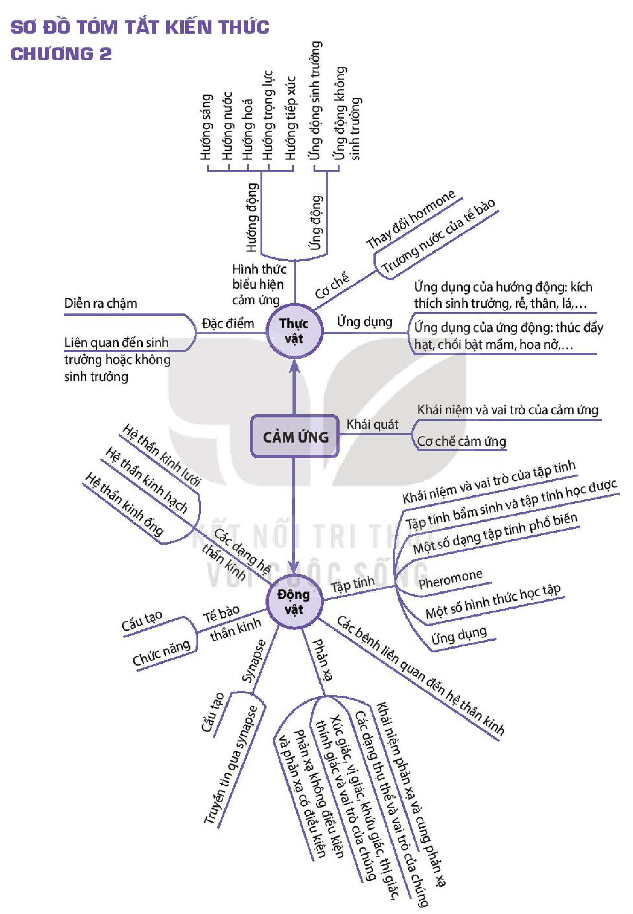

<!-- pdf:125 -->

# SƠ ĐỒ TÓM TẮT KIẾN THỨC CHƯƠNG 2

<!-- Dưới đây chép các nhánh của sơ đồ thành danh sách lồng nhau, giữ nguyên chữ trong các ô. -->

- CẢM ỨNG
  - Khái quát
    - Khái niệm và vai trò của cảm ứng
    - Cơ chế cảm ứng
  - Thực vật
    - Đặc điểm
      - Diễn ra chậm
      - Liên quan đến sinh trưởng hoặc không sinh trưởng
    - Hình thức biểu hiện cảm ứng
      - Hướng động
        - Hướng sáng
        - Hướng nước
        - Hướng hoá
        - Hướng trọng lực
        - Hướng tiếp xúc
      - Ứng động
        - Ứng động sinh trưởng
        - Ứng động không sinh trưởng
    - Cơ chế
      - Thay đổi hormone
      - Trương nước của tế bào
    - Ứng dụng
      - Ứng dụng của hướng động: kích thích sinh trưởng, rễ, thân, lá,...
      - Ứng dụng của ứng động: thúc đẩy hạt, chồi bật mầm, hoa nở,...
  - Động vật
    - Các dạng hệ thần kinh
      - Hệ thần kinh lưới
      - Hệ thần kinh hạch
      - Hệ thần kinh ống
    - Tế bào thần kinh
      - Cấu tạo
      - Chức năng
    - Synapse
      - Cấu tạo
      - Truyền tin qua synapse
    - Phản xạ
      - Khái niệm phản xạ và cung phản xạ
      - Các dạng thụ thể và vai trò của chúng
      - Xúc giác, vị giác, khứu giác, thị giác, thính giác và vai trò của chúng
      - Phản xạ không điều kiện và phản xạ có điều kiện
    - Các bệnh liên quan đến hệ thần kinh
    - Tập tính
      - Khái niệm và vai trò của tập tính
      - Tập tính bẩm sinh và tập tính học được
      - Một số dạng tập tính phổ biến
      - Pheromone
      - Một số hình thức học tập
      - Ứng dụng
<!-- ocr-ok: nhiều nhánh sơ đồ in nghiêng hoặc xoay dọc nên OCR không đọc được chữ trên các nhánh đó; đã đối chiếu trực tiếp ảnh PDF 125 -->

## 📷 Danh sách hình trong bài

| Mã hình | Trang PDF | Vị trí | Chú thích gốc |
|---|---|---|---|
| H11-sinh-so-do-tom-tat-c02-01 | 125 | Cả trang | Sơ đồ tóm tắt kiến thức chương 2 |
