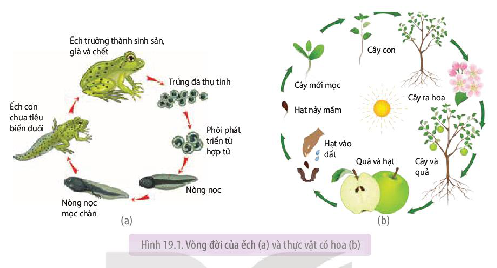

<!-- pdf:126 -->

# BÀI 19: KHÁI QUÁT VỀ SINH TRƯỞNG VÀ PHÁT TRIỂN Ở SINH VẬT

## 🎯 Yêu cầu cần đạt

- Nêu được khái niệm và trình bày được các dấu hiệu đặc trưng của sinh trưởng và phát triển ở sinh vật.
- Phân tích được mối quan hệ giữa sinh trưởng và phát triển.
- Nêu được khái niệm vòng đời và tuổi thọ của sinh vật.
- Trình bày được một số ứng dụng hiểu biết về vòng đời của sinh vật trong thực tiễn và một số yếu tố ảnh hưởng đến tuổi thọ của con người.

## 🔴 Mở đầu

Tại sao một hạt cây có thể phát triển thành một cây xanh, trứng thụ tinh có thể phát triển thành một con vật?

## I. KHÁI NIỆM VÀ DẤU HIỆU ĐẶC TRƯNG CỦA SINH TRƯỞNG VÀ PHÁT TRIỂN

### 1. Khái niệm sinh trưởng và phát triển

**Sinh trưởng** là quá trình tăng kích thước và khối lượng của cơ thể.

**Phát triển** là toàn bộ những biến đổi diễn ra trong chu kì sống của cá thể, bao gồm sự thay đổi về số lượng tế bào, cấu trúc, hình thái và trạng thái sinh lí.

Quá trình sinh trưởng và phát triển có thể diễn ra trong khoảng thời gian dài hoặc ngắn, đơn giản hay phức tạp tuỳ thuộc vào loài sinh vật và điều kiện sống của chúng.

### 2. Các dấu hiệu đặc trưng của sinh trưởng và phát triển

Các dấu hiệu đặc trưng của sinh trưởng là tăng số lượng, kích thước và khối lượng tế bào. Sự phân bào làm tăng số lượng tế bào, sự tổng hợp và tích luỹ các chất làm tế bào tăng kích thước và khối lượng tế bào.

Các dấu hiệu đặc trưng của phát triển là:

- Sinh trưởng: tăng số lượng, kích thước và khối lượng tế bào.
- **Phân hoá tế bào**: quá trình các tế bào thay đổi cấu trúc và chuyên hoá chức năng. Ví dụ: Ở thực vật có hoa, tế bào phân hoá thành tế bào tạo hoa và quả.

<!-- pdf:127 -->

- **Phát sinh hình thái cơ quan, cơ thể**: Thông qua quá trình phát sinh hình thái mà cơ quan, cơ thể có được hình dạng và chức năng sinh lí nhất định. Ví dụ: Hình dạng của chim bồ câu không giống với hình dạng các loài khác là do quá trình phát sinh hình thái.

## II. MỐI QUAN HỆ GIỮA SINH TRƯỞNG VÀ PHÁT TRIỂN

Quá trình phát triển bao gồm những thay đổi mà một cơ thể sinh vật trải qua suốt chu kì sống của nó. Trong quá trình phát triển, các quá trình sinh trưởng, phân hóa tế bào và phát sinh hình thái cơ quan, cơ thể có quan hệ mật thiết với nhau, không tách rời nhau và đan xen với nhau.

Quá trình phát triển của một cá thể sinh vật sinh sản hữu tính bắt đầu bằng hợp tử. Hợp tử phân bào tạo thành nhiều tế bào, các tế bào biệt hoá hình thành các cơ quan và hình dáng của sinh vật non. Sinh vật non trải qua quá trình sinh trưởng lớn dần lên. Khi cơ thể sinh trưởng đạt đến kích thước và khối lượng nhất định thì có sự biến đổi về chất, một nhóm tế bào phân hoá hình thành cơ quan sinh sản, tiền đề cho quá trình hình thành giao tử và hợp tử.

Ví dụ: Ở thực vật có hoa, hợp tử phân chia nhiều lần tạo ra phôi nhiều tế bào. Các tế bào phôi phân hoá tạo thành lá mầm, thân mầm, rễ mầm và thành cây non (giai đoạn phân hóa tế bào và phát sinh hình thái cơ quan, cơ thể). Cây non lớn lên thành cây trưởng thành (giai đoạn sinh trưởng). Khi cây đạt đến kích thước và khối lượng nhất định, một nhóm tế bào phân hoá hình thành hoa, là cơ sở hình thành giao tử và hợp tử (giai đoạn phân hoá tế bào). Ở động vật sinh sản hữu tính, hợp tử phân chia nhiều lần tạo ra phôi gồm nhiều tế bào. Các tế bào phôi phân hoá tạo thành các cơ quan, hệ cơ quan (giai đoạn phân hoá tế bào và phát sinh hình thái cơ quan, cơ thể). Động vật non lớn lên thành cơ thể trưởng thành (giai đoạn sinh trưởng). Khi động vật đến tuổi thành thục sinh dục, cơ quan sinh dục phát triển mạnh và bắt đầu tạo ra các giao tử (giai đoạn phân hoá tế bào).

## ❓ Dừng lại và suy ngẫm

Sinh trưởng và phát triển có quan hệ với nhau như thế nào?

## III. VÒNG ĐỜI VÀ TUỔI THỌ CỦA SINH VẬT

### 1. Vòng đời

**a) Khái niệm**

**Vòng đời của sinh vật** là khoảng thời gian tính từ khi cơ thể được sinh ra, lớn lên, phát triển thành cơ thể trưởng thành, sinh sản tạo ra cá thể mới, già đi rồi chết. Như vậy, vòng đời bao gồm toàn bộ sự phát triển cá thể. Nhìn chung, các cá thể cùng loài có vòng đời giống nhau.

Vòng đời của các loài sinh sản hữu tính bắt đầu bằng hợp tử, trải qua các giai đoạn phôi, con non hoặc cây non đến cá thể trưởng thành có khả năng sinh sản, cá thể trưởng thành già rồi chết (H 19.1).

<!-- pdf:128 -->

Hình 19.1. Vòng đời của ếch (a) và thực vật có hoa (b)

Vòng đời của các loài sinh sản vô tính bắt đầu từ cá thể non do mẹ sinh ra theo phương thức nguyên phân, cá thể non lớn lên thành cá thể trưởng thành, sinh sản, già rồi chết.

**b) Một số ứng dụng hiểu biết về vòng đời của sinh vật**

- Hiểu biết vòng đời của cây để đưa ra các biện pháp chăm sóc phù hợp với từng giai đoạn như bón phân, tưới nước, phòng dịch bệnh,... nhằm thu được hiệu quả kinh tế cao nhất về lá, hoa, củ, quả, hạt. Ví dụ: Tưới đủ nước, giữ đủ độ ẩm của đất để hạt cây nảy mầm. Cung cấp đủ phân, nước, ánh sáng để cây non lớn nhanh, tạo nhiều cành, lá.
- Hiểu biết vòng đời của động vật để đưa ra các biện pháp chăm sóc phù hợp với từng giai đoạn, nhằm thu được hiệu quả kinh tế cao nhất về thịt, trứng, sữa, các sản phẩm động vật (nhung hươu, tơ tằm,...). Ví dụ: Cho ăn cùng một lượng thức ăn nhưng gà ở giai đoạn từ gà con đến trưởng thành sẽ cho khối lượng thịt nhiều hơn gà ở giai đoạn đã trưởng thành.
- Hiểu biết về vòng đời của động vật gây hại cho thực vật, động vật và người để đưa ra các biện pháp phòng chống, tiêu diệt chúng một cách hiệu quả. Ví dụ: Sử dụng thuốc diệt sâu bướm phá hoại cây xanh; tiêu diệt muỗi ở giai đoạn bọ gậy bằng cách cho hoá chất vào nước hoặc loại bỏ các vũng nước đọng nơi muỗi có thể đẻ trứng,...

### 2. Tuổi thọ của sinh vật

**a) Khái niệm**

**Tuổi thọ của sinh vật** là thời gian sống của một sinh vật. **Tuổi thọ của một loài sinh vật** là thời gian sống trung bình của các cá thể trong loài.

Tuổi thọ của các loài sinh vật rất khác nhau và do kiểu gene quy định. Ví dụ: Cây lúa, cây ngô sống 1 năm, cây thông có tuổi thọ khoảng 100 – 300 năm, một số loài cây có tuổi thọ lên đến nghìn năm, phù du sống vài giờ đến vài ngày, muỗi sống khoảng 1 – 3 tháng, rùa sống khoảng 150 năm.

<!-- pdf:129 -->

**b) Một số yếu tố ảnh hưởng đến tuổi thọ của con người**

- Yếu tố bên trong: là yếu tố di truyền có tác động nhất định đến tuổi thọ. Nếu bố mẹ sống lâu, con cũng có khả năng sống lâu.
- Yếu tố bên ngoài gồm:
  + Chế độ ăn uống: Chế độ ăn uống lành mạnh, khoa học, đủ chất, đủ lượng, ăn nhiều trái cây, rau củ, các loại hạt,... giúp cơ thể khoẻ mạnh, giảm mắc bệnh, làm tăng tuổi thọ.
  + Tập luyện thể dục, thể thao thường xuyên làm cơ thể linh hoạt, dẻo dai, các hệ cơ quan khoẻ mạnh. Ít vận động khiến cơ thể trì trệ, dễ mắc bệnh.
  + Lối sống lành mạnh, thái độ sống tích cực, lạc quan, không nghiện rượu, bia, thuốc lá, ma tuý,... giúp tăng cường sức khoẻ và tuổi thọ.
  + Môi trường sống không bị ô nhiễm bởi khói độc, bụi, nước thải công nghiệp, bụi phóng xạ, thuốc trừ sâu,... giúp cơ thể khoẻ mạnh, sống lâu.

## ❓ Dừng lại và suy ngẫm

1. Phân biệt vòng đời và tuổi thọ. Cho ví dụ về vòng đời của một số loài sinh vật.
2. Hiểu biết về vòng đời của thực vật và động vật đem lại lợi ích gì?

## 📌 Kiến thức cốt lõi

- Sinh trưởng là quá trình tăng kích thước và khối lượng cơ thể theo thời gian.
- Phát triển là toàn bộ những biến đổi diễn ra trong chu kì sống của cá thể, bao gồm 3 quá trình: sinh trưởng, phân hoá tế bào và phát sinh hình thái cơ quan, cơ thể. Ba quá trình này quan hệ mật thiết với nhau, không tách rời nhau và đan xen với nhau.
- Vòng đời là quá trình lặp lại theo trình tự nhất định các thay đổi mà một cá thể sinh vật phải trải qua, bắt đầu từ khi được sinh ra, lớn lên và phát triển thành cơ thể trưởng thành, sinh sản, già đi rồi chết.
- Tuổi thọ của sinh vật là thời gian sống (thời gian tồn tại) của một loài sinh vật hoặc con người.
- Nhiều yếu tố ảnh hưởng đến tuổi thọ của sinh vật và con người.

## ✏️ Luyện tập và vận dụng

1. Tìm thêm ví dụ về vòng đời của một số động vật gây hại cho người, cây trồng và vật nuôi, từ đó đề xuất biện pháp phòng trừ chúng.
2. Mỗi người cần làm gì để nâng cao tuổi thọ?

## 📷 Danh sách hình trong bài

| Mã hình | Trang PDF | Vị trí | Chú thích gốc |
|---|---|---|---|
| H11-sinh-b19-01 | 128 | Mục III.1.a | Hình 19.1. Vòng đời của ếch (a) và thực vật có hoa (b) |
