<!-- pdf:130 -->

# BÀI 20: SINH TRƯỞNG VÀ PHÁT TRIỂN Ở THỰC VẬT

## 🎯 Yêu cầu cần đạt

- Nêu được đặc điểm sinh trưởng và phát triển ở thực vật. Phân tích được một số yếu tố môi trường ảnh hưởng đến sinh trưởng và phát triển ở thực vật.
- Nêu được khái niệm mô phân sinh. Trình bày được vai trò của mô phân sinh đối với sinh trưởng ở thực vật. Phân biệt các loại mô phân sinh.
- Trình bày được quá trình sinh trưởng sơ cấp và sinh trưởng thứ cấp ở thực vật.
- Nêu được khái niệm và vai trò của hormone thực vật.
- Phân biệt được các loại hormone kích thích sinh trưởng và hormone ức chế sinh trưởng.
- Trình bày được sự tương quan các hormone thực vật và một số ứng dụng của chúng trong thực tiễn.
- Trình bày được quá trình phát triển ở thực vật có hoa và các nhân tố chi phối quá trình phát triển ở thực vật có hoa.
- Vận dụng được hiểu biết về sinh trưởng và phát triển ở thực vật để giải thích một số ứng dụng trong thực tiễn.

## 🔴 Mở đầu

Thực vật có tuổi không? Khi nào thực vật ngừng sinh trưởng?

## I. ĐẶC ĐIỂM VÀ CÁC YẾU TỐ NGOẠI CẢNH ẢNH HƯỞNG ĐẾN SINH TRƯỞNG, PHÁT TRIỂN Ở THỰC VẬT

### 1. Đặc điểm sinh trưởng và phát triển ở thực vật

Sinh trưởng và phát triển xảy ra tại một số vị trí, cơ quan trên cơ thể thực vật như ngọn thân, đỉnh cành, chóp rễ,... nơi có các mô phân sinh.

Quá trình sinh trưởng và phát triển diễn ra trong suốt đời sống của thực vật (từ giai đoạn hạt cho đến khi cây già và chết) do sự phân chia liên tục của các tế bào tại các mô phân sinh. Đây là hình thức **sinh trưởng không giới hạn**, biểu hiện bằng sự gia tăng kích thước, sự xuất hiện và thay mới của các cơ quan như cành, lá, rễ, hoa, quả,... Sự sinh trưởng không giới hạn này có thể quan sát thấy rõ ở các cây thân gỗ lâu năm, với sự gia tăng chiều cao cây, đường kính thân,... trong suốt chu kì sống của nó.

### 2. Một số yếu tố môi trường ảnh hưởng đến sinh trưởng và phát triển ở thực vật

Quá trình sinh trưởng và phát triển ở thực vật chịu sự chi phối của nhiều yếu tố môi trường như nước, ánh sáng, nhiệt độ, chất dinh dưỡng,...

<!-- pdf:131 -->

**a) Nước**

Nước là nguyên liệu của quang hợp, hô hấp; tham gia vào quá trình dãn dài của tế bào, dinh dưỡng khoáng,... Vì vậy, nước ảnh hưởng đến tốc độ sinh trưởng và phát triển của thực vật như chiều cao cây, nảy mầm của hạt, diện tích lá (H 20.1),...

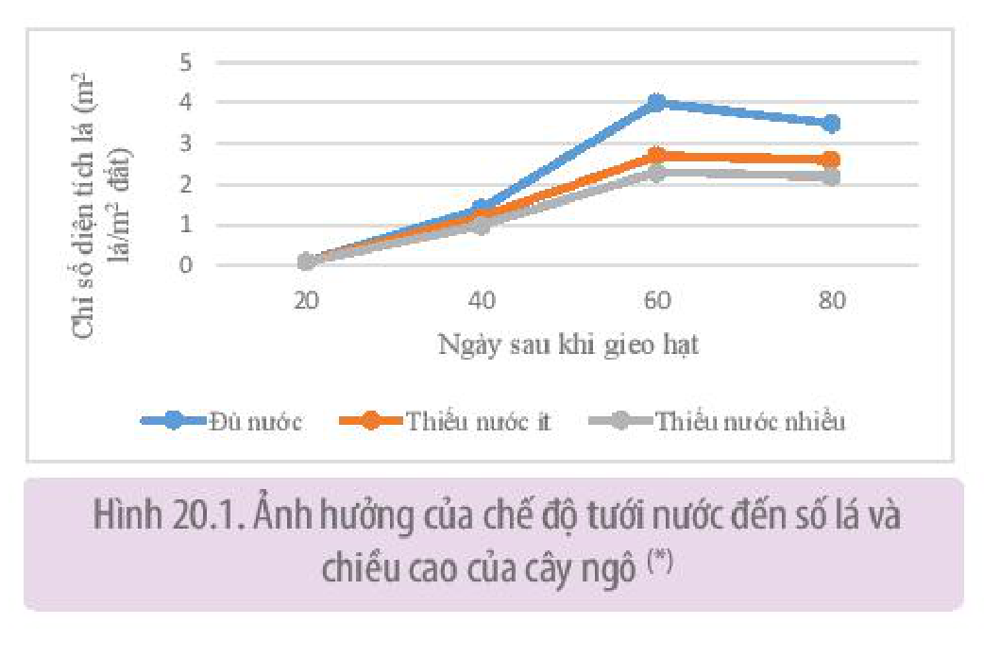

Hình 20.1. Ảnh hưởng của chế độ tưới nước đến số lá và chiều cao của cây ngô (\*)

**b) Ánh sáng**

Ánh sáng là nguồn năng lượng của quá trình tổng hợp chất hữu cơ trong quang hợp, qua đó đảm bảo nguồn vật liệu cho thực vật sinh trưởng, phát triển. Ngoài ra, ánh sáng cũng là tác nhân điều tiết sự tổng hợp, phân giải một số chất như hormone, phytochrome,... tác động đến quá trình phát sinh hình thái của thực vật, điều tiết sự ra hoa, ảnh hưởng đến tỉ lệ nảy mầm của hạt (H 20.2),...

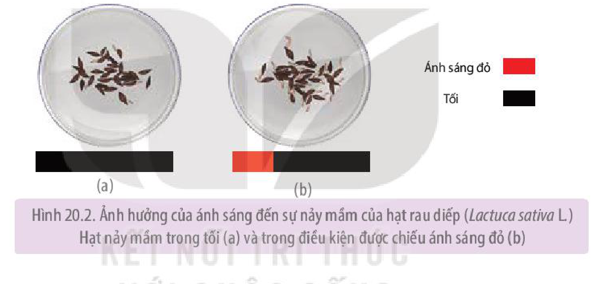

Hình 20.2. Ảnh hưởng của ánh sáng đến sự nảy mầm của hạt rau diếp (*Lactuca sativa* L.) Hạt nảy mầm trong tối (a) và trong điều kiện được chiếu ánh sáng đỏ (b)
<!-- ocr-ok: chữ trong hình và tên khoa học in nghiêng làm OCR đọc sót từ "sự"; đã đối chiếu ảnh PDF 131 -->

**c) Nhiệt độ**

Mỗi loài thực vật sinh trưởng, phát triển thuận lợi trong một khoảng nhiệt độ nhất định, điều này quyết định đến sự phân bố của thực vật trong tự nhiên. Nhiệt độ tối ưu của đa số các loài cây trồng nhiệt đới dao động trong khoảng 20 – 30 °C, trong khi cây ôn đới là khoảng 15 – 20 °C. Nhiệt độ quá cao hoặc quá thấp sẽ ảnh hưởng đến sự nảy mầm của hạt, khả năng ra hoa, hình thái của cơ quan sinh sản,... Trong một giới hạn nhất định, tăng nhiệt độ sẽ làm tăng tỉ lệ nảy mầm và rút ngắn thời gian nảy mầm của hạt (H 20.3).

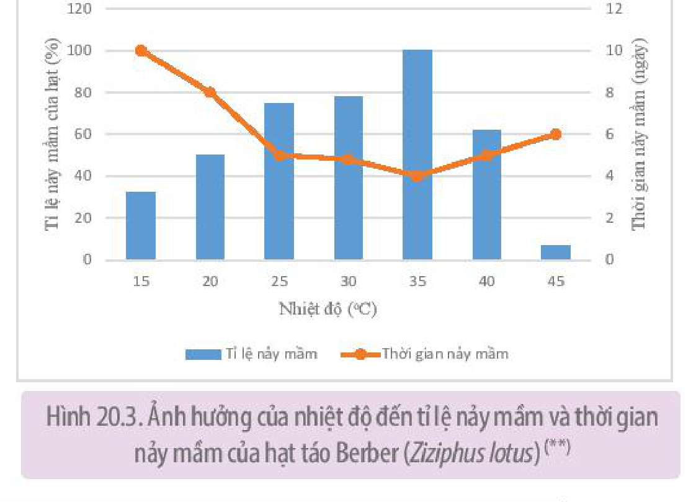

Hình 20.3. Ảnh hưởng của nhiệt độ đến tỉ lệ nảy mầm và thời gian nảy mầm của hạt táo Berber (*Ziziphus lotus*) (\*\*)

> (\*) Nguồn: Effects of Severe Water Stress on Maize Growth Processes in the Field, Libing Song et al., 2019.
> (\*\*) Nguồn: Seed germination at different temperatures and water stress levels, and seedling emergence from different depths of *Ziziphus lotus*, M.Maraghni et al., 2010

<!-- pdf:132 -->

**d) Chất khoáng**

Chất khoáng là thành phần cấu tạo tế bào và tham gia điều tiết các quá trình sinh lí trong cây. Thiếu các nguyên tố khoáng thiết yếu làm chậm quá trình sinh trưởng của cây, ảnh hưởng đến năng suất và chất lượng nông sản, thiếu trong thời gian dài, cây có thể ngừng sinh trưởng và chết. Ví dụ: Cây cà chua trồng trong điều kiện thiếu calcium, quả hình thành sẽ bị thối ở đỉnh (H 20.4).

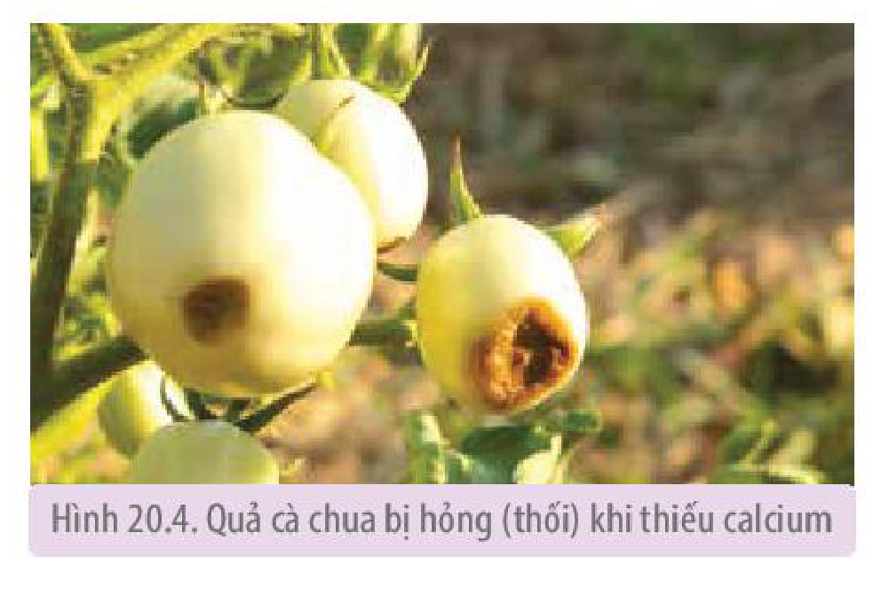

Hình 20.4. Quả cà chua bị hỏng (thối) khi thiếu calcium
<!-- ocr-ok: chữ trên nền tím nhạt của chú thích hình làm OCR đọc sai "calcium" thành "caldum"; đã đối chiếu ảnh PDF 132 -->

## ❓ Dừng lại và suy ngẫm

1. Sinh trưởng và phát triển ở thực vật có đặc điểm gì?
2. Dựa vào Hình 20.3, chỉ ra mối quan hệ giữa nhiệt độ với tỉ lệ nảy mầm và thời gian nảy mầm của hạt.

## II. MÔ PHÂN SINH, SINH TRƯỞNG SƠ CẤP VÀ SINH TRƯỞNG THỨ CẤP

### 1. Mô phân sinh

**Mô phân sinh** là nhóm các tế bào chưa phân hoá, có khả năng phân chia tạo tế bào mới trong suốt đời sống của thực vật.

Mô phân sinh ở thực vật gồm: **mô phân sinh đỉnh**, **mô phân sinh bên** và **mô phân sinh lóng**. Mô phân sinh đỉnh có ở ngọn cây, đỉnh cành và chóp rễ của cả cây một lá mầm và cây hai lá mầm. Trong khi đó, mô phân sinh bên chỉ có ở cây hai lá mầm, còn mô phân sinh lóng chỉ có ở cây một lá mầm.

Vị trí và vai trò của các loại mô phân sinh được thể hiện trong Hình 20.5.

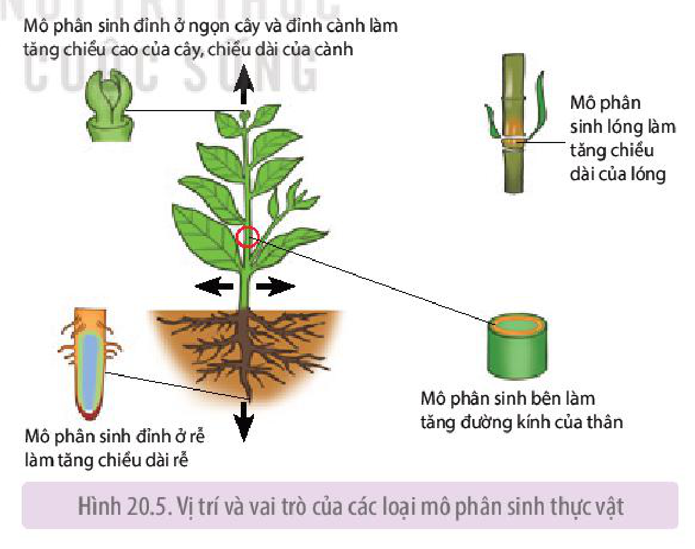

Hình 20.5. Vị trí và vai trò của các loại mô phân sinh thực vật

Trong kĩ thuật nhân giống *in vitro*, mô phân sinh đỉnh thường được sử dụng làm vật liệu nuôi cấy tạo cây hoàn chỉnh, giúp nhân nhanh các giống cây trồng trong một thời gian ngắn.

<!-- pdf:133 -->

### 2. Sinh trưởng sơ cấp và sinh trưởng thứ cấp

Sinh trưởng ở thực vật có hai kiểu: sinh trưởng sơ cấp và sinh trưởng thứ cấp.

**a) Sinh trưởng sơ cấp**

**Sinh trưởng sơ cấp** là kết quả hoạt động của mô phân sinh đỉnh và mô phân sinh lóng dẫn đến sự gia tăng chiều cao của cây và chiều dài của rễ.

Cây một lá mầm và cây hai lá mầm thân thảo chỉ có sinh trưởng sơ cấp, cây chủ yếu sinh trưởng về chiều cao, hạn chế tăng trưởng về đường kính. Đặc biệt, ở cây một lá mầm (lúa, ngô, cỏ lồng vực,...) có mô phân sinh lóng nên thân cây vẫn có thể cao lên khi mô phân sinh đỉnh đã bị cắt bỏ. Với cây hai lá mầm thân gỗ, sinh trưởng sơ cấp diễn ra ở giai đoạn cây non, khi trưởng thành, sinh trưởng sơ cấp chỉ có ở rễ và thân non mới hình thành, phần thân và rễ còn lại chuyển sang sinh trưởng thứ cấp.

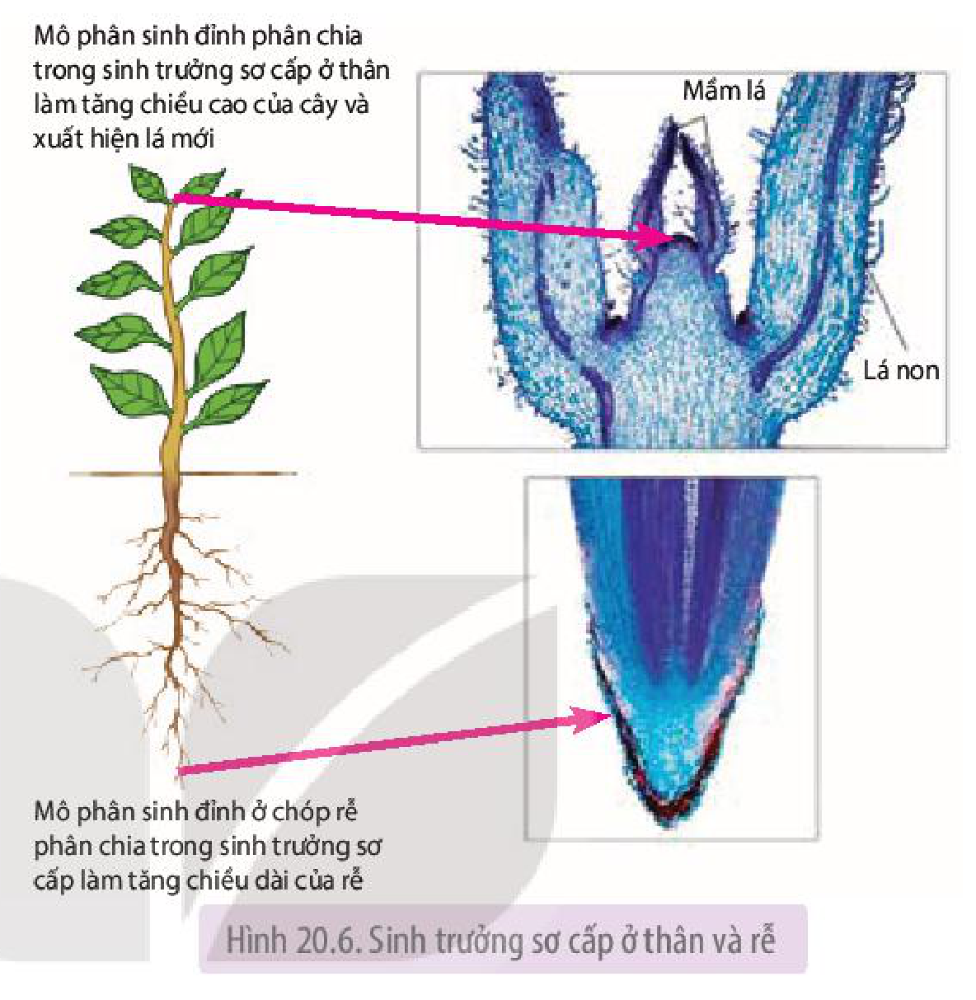

Hình 20.6. Sinh trưởng sơ cấp ở thân và rễ

**b) Sinh trưởng thứ cấp**

**Sinh trưởng thứ cấp** là kết quả phân chia của các tế bào mô phân sinh bên có ở thân và rễ của cây hai lá mầm. Mô phân sinh bên gồm **tầng sinh mạch** (**tầng phát sinh mạch dẫn**) và **tầng sinh bần** (**tầng phát sinh vỏ**).

Tầng sinh mạch phân chia tạo mạch gỗ thứ cấp ở phía trong và mạch rây thứ cấp nằm ở phía ngoài thân, từ đó làm tăng đường kính của thân. Tầng sinh bần phân chia tạo **lớp bần** (lớp tế bào biểu bì) thay thế lớp bần cũ đã già, giúp bảo vệ thân khỏi mất nước và sự xâm nhập của các sinh vật gây hại (H 20.7).

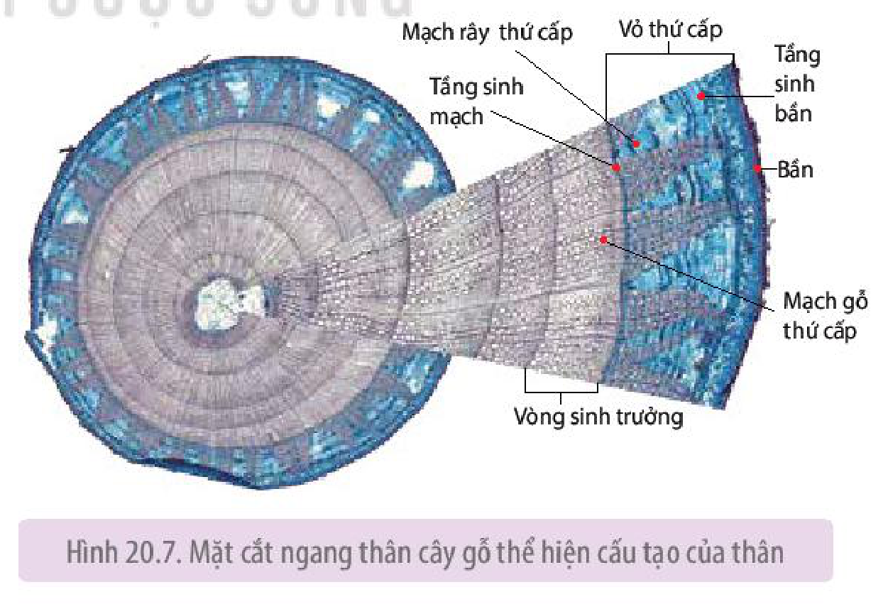

Hình 20.7. Mặt cắt ngang thân cây gỗ thể hiện cấu tạo của thân

<!-- pdf:134 -->

Sinh trưởng thứ cấp qua các năm tạo nên các lớp gỗ thứ cấp, từ đó hình thành nên các **vòng sinh trưởng** hay còn gọi là **vòng gỗ** (H 20.7). Kích thước của vòng gỗ có thể thay đổi phụ thuộc vào điều kiện môi trường.

Sinh trưởng thứ cấp là hình thức sinh trưởng chỉ có ở thực vật hai lá mầm, biểu hiện rõ nhất ở nhóm cây thân gỗ lâu năm.

## ❓ Dừng lại và suy ngẫm

1. Phân biệt các loại mô phân sinh ở thực vật về vị trí và vai trò của mỗi loại.
2. Trong các cơ quan: rễ, thân, lá, cơ quan nào sinh trưởng không giới hạn? Điều này có ý nghĩa như thế nào với đời sống của thực vật?
3. Phân biệt kiểu sinh trưởng của cây một lá mầm và cây hai lá mầm.

## III. HORMONE THỰC VẬT

Bên cạnh yếu tố di truyền, hormone là nhân tố quan trọng giúp điều tiết các quá trình sinh trưởng và phát triển ở thực vật.

### 1. Khái niệm và vai trò của hormone thực vật

**a) Khái niệm**

**Hormone thực vật** (còn gọi là **phytohormone** hay **chất điều hoà sinh trưởng**) là các chất hữu cơ có hoạt tính sinh học cao, được tổng hợp với lượng nhỏ ở các cơ quan, bộ phận nhất định trong cây, tham gia điều tiết các hoạt động sống của thực vật.

**b) Vai trò**

Ở cấp độ tế bào, hormone thực vật có vai trò điều tiết sự phân chia, dãn dài và phân hoá của tế bào, hormone cũng có thể làm thay đổi độ trương nước của tế bào,...

Ở cấp độ cơ thể, hormone có vai trò:

- Thúc đẩy quá trình sinh trưởng, phát triển ở thực vật như: sinh trưởng của chồi ngọn, nảy mầm của hạt, chín của quả,... hoặc ức chế sự sinh trưởng, đẩy nhanh sự già hoá ở cây qua các phản ứng ngủ của hạt, rụng lá, rụng quả,...
- Hormone tham gia điều khiển các đáp ứng của thực vật với các kích thích đến từ môi trường.

### 2. Các loại hormone thực vật

Dựa vào hoạt tính sinh học, hormone thực vật được chia thành hai nhóm: **nhóm kích thích sinh trưởng** (auxin, gibberellin và cytokinin) và **nhóm ức chế sinh trưởng** (abscisic acid, ethylene). Hormone thực vật có thể được tổng hợp bởi con người (gọi là **hormone ngoại sinh** hay **hormone tổng hợp**) với mục đích điều khiển các hoạt động sống của thực vật nhằm nâng cao năng suất, chất lượng cây trồng.

<!-- pdf:135 -->

**a) Nhóm hormone kích thích sinh trưởng**

- Auxin

<!-- term: Auxin -->
Loại auxin phổ biến nhất ở thực vật là IAA (3 – indolacetic acid), ngoài ra còn có một số loại auxin ngoại sinh khác như NAA; 2,4 – D,... Trong cơ thể thực vật, auxin được tổng hợp ở các cơ quan đang sinh trưởng mạnh (chồi ngọn, lá non, phấn hoa, phôi hạt), sau đó được vận chuyển hướng gốc đến rễ theo mạch rây.

<!-- term: Auxin -->
Auxin ảnh hưởng đến hầu hết các quá trình sinh lí từ cấp độ tế bào đến cơ thể. Ở cấp độ tế bào, auxin kích thích phân bào, dãn dài của tế bào và phối hợp với hormone khác kích thích quá trình biệt hoá tế bào. Ở cấp độ cơ thể, auxin có nhiều tác dụng sinh lí khác nhau (H 20.8). Bên cạnh đó, auxin cũng làm tăng kích thước của quả, làm chậm quá trình chín và hạn chế rụng quả, làm liền vết thương,...

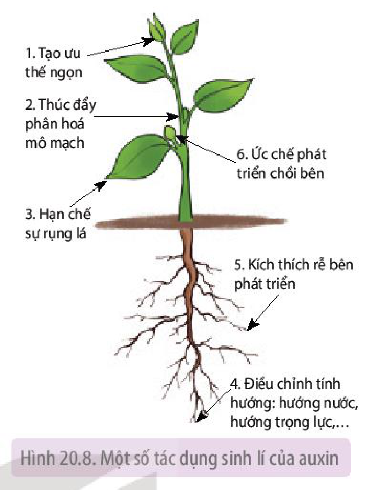

Hình 20.8. Một số tác dụng sinh lí của auxin

- Gibberellin

<!-- term: Gibberellin -->
Trong cây, gibberelin được tổng hợp chủ yếu ở các cơ quan đang sinh trưởng (quả non, lá non, đỉnh chồi và đỉnh rễ). Gibberellin vận chuyển theo cả hai chiều, hướng ngọn và hướng gốc theo mạch gỗ và mạch rây.

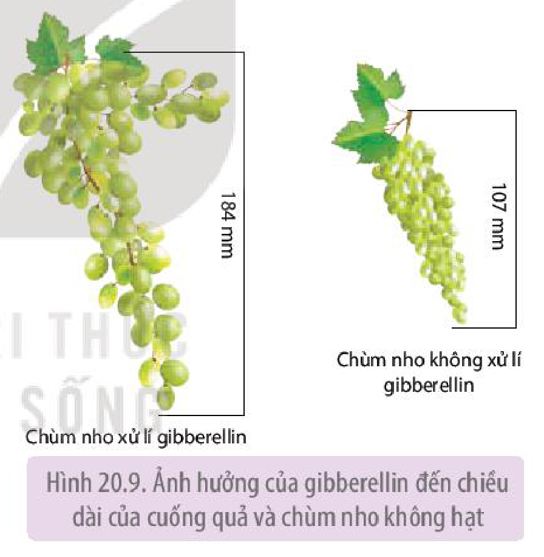

Hình 20.9. Ảnh hưởng của gibberellin đến chiều dài của cuống quả và chùm nho không hạt

<!-- term: Gibberellin -->
Gibberellin ảnh hưởng đến nhiều quá trình sinh lí như:
- Tăng chiều dài của thân và lóng do gibberellin kích thích sự phân chia và dãn dài của tế bào.
- Kích thích nảy mầm của củ và hạt thông qua hoạt hoá enzyme.
- Thúc đẩy sự hình thành và phân hoá giới tính của hoa, sự sinh trưởng của quả. Ví dụ: gibberellin làm tăng chiều dài của cuống và thân mang quả (chùm) ở nho không hạt, giúp tạo không gian cho quả tăng kích thước (H 20.9)

- Cytokinin

Có nhiều loại cytokinin khác nhau đã được tìm thấy ở thực vật.

<!-- term: Cytokinin -->
Trong cây, cytokinin được tổng hợp nhiều ở mô phân sinh đỉnh rễ và được vận chuyển đến các cơ quan khác theo hệ thống mạch gỗ. Ngoài ra, cytokinin còn được hình thành ở quả non, lá non.

<!-- term: Cytokinin -->
Cytokinin có vai trò sinh lí như:
- Kích thích sự phân chia tế bào.

<!-- pdf:136 -->

<!-- term: Cytokinin -->
- Phối hợp với auxin, tác động đến sự phân hoá cơ quan của thực vật, đặc biệt là sự phân hoá chồi. Tác dụng sinh lí này được ứng dụng phổ biến trong kĩ thuật nuôi cấy mô, tế bào thực vật (H 20.10).
- Làm chậm sự già hoá của thực vật, giảm ưu thế ngọn hay kích thích sự nảy mầm của hạt.

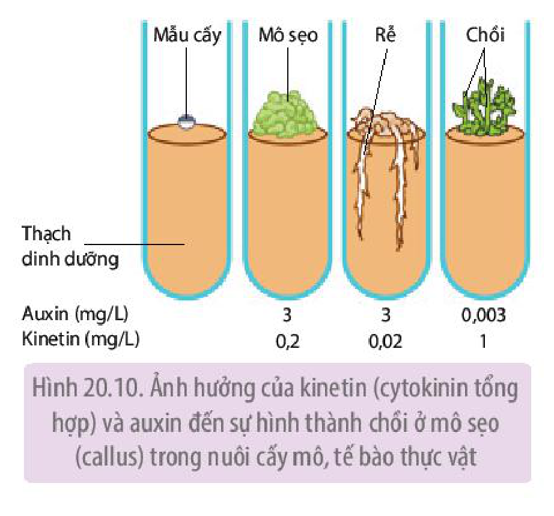

Hình 20.10. Ảnh hưởng của kinetin (cytokinin tổng hợp) và auxin đến sự hình thành chồi ở mô sẹo (callus) trong nuôi cấy mô, tế bào thực vật

**b) Nhóm hormone ức chế sinh trưởng**

- Abscisic acid

<!-- term: Abscisic acid -->
Abscisic acid (ABA) được tổng hợp ở hầu hết các bộ phận của cây (rễ, hoa, quả,...) và được tích luỹ nhiều trong các cơ quan già, sắp rụng hay đang ở trạng thái ngủ nghỉ. Khi gặp một số yếu tố môi trường bất lợi (stress) như hạn hán, ngập úng, bệnh lí, cây thường tăng cường tổng hợp abscisic acid.
<!-- ocr-ok: cột hình bên phải làm OCR tách dòng lộn xộn ở đoạn đầu mục Abscisic acid; đã đối chiếu ảnh PDF 136 -->

<!-- term: Abscisic acid -->
Trong cây, abscisic acid được vận chuyển theo hai chiều: hướng ngọn theo mạch gỗ và hướng gốc theo mạch rây.

Tác dụng sinh lí của abscisic acid được thể hiện trong Hình 20.11.

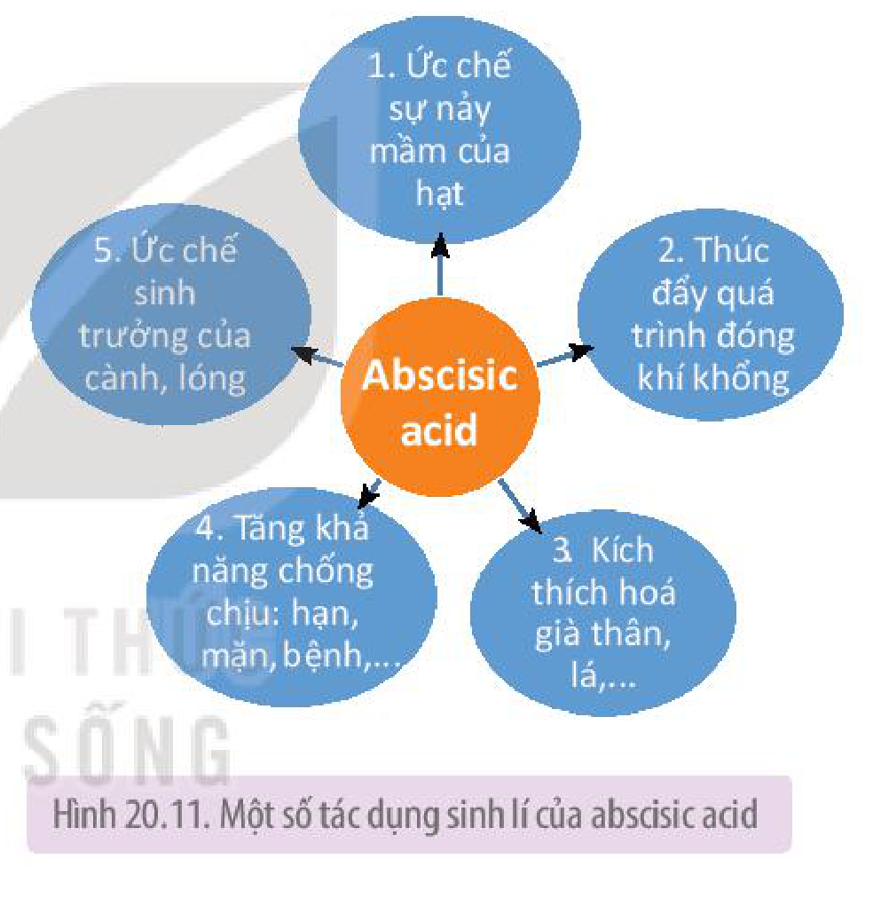

Hình 20.11. Một số tác dụng sinh lí của abscisic acid
<!-- ocr-ok: nền tím nhạt của chú thích hình làm OCR đọc sai "abscisic acid" thành "absdisic adid"; đã đối chiếu ảnh PDF 136 -->

- Ethylene

**Ethylene** ($\text{C}_2\text{H}_4$) là loại hormone thực vật duy nhất tồn tại ở thể khí, do vậy, khác với các loại hormone khác, ethylene được vận chuyển bằng con đường khuếch tán trong phạm vi hẹp. Ethylene được tổng hợp nhiều trong giai đoạn già hoá của cây và quá trình chín của quả. Bên cạnh đó, tổn thương cơ học, hạn hán,... cũng thúc đẩy quá trình sinh tổng hợp hormone này.

Ethylene có một số vai trò sau:

- Thúc đẩy sự chín của quả.
- Kích thích sự rụng của lá, hoa, quả.
- Kích thích sự hình thành lông hút và rễ phụ.
- Kích thích sự ra hoa của một số loài thực vật như dứa, xoài, dưa chuột.

### 3. Tương quan giữa các hormone

Ở thực vật, một quá trình sinh lí thường chịu sự chi phối của hai hay nhiều loại hormone khác nhau. Tương quan giữa các hormone quyết định kết quả của quá trình sinh lí được điều tiết.

Tương quan hormone thực vật có hai loại: tương quan chung và tương quan riêng.

<!-- pdf:137 -->

**a) Tương quan chung**

**Tương quan chung** là tương quan giữa hormone thuộc nhóm kích thích sinh trưởng với hormone thuộc nhóm ức chế sinh trưởng.

Ở giai đoạn cây đang sinh trưởng và phát triển, hormone kích thích được tổng hợp với lượng lớn, chi phối và thúc đẩy hình thành các cơ quan sinh dưỡng. Khi cây chuyển sang giai đoạn sinh sản và bước vào giai đoạn già hoá, hormone ức chế được tổng hợp với lượng tăng dần. Nói cách khác, theo chu kì phát triển của cây, tác động của hormone kích thích có xu hướng giảm dần, trong khi tác động của các hormone ức chế tăng dần. Điều này đúng với cả cây một năm và cây lâu năm.

Căn cứ vào kiểu tương quan này, người ta có thể điều khiển thời gian ra hoa, tạo quả, chín của quả,... thông qua các biện pháp kĩ thuật như sử dụng hormone ngoại sinh, gây stress,... để phục vụ mục đích của con người.

**b) Tương quan riêng**

**Tương quan riêng** là tương quan giữa hai hay nhiều loại hormone khác nhau thuộc cùng một nhóm hay khác nhóm. Một quá trình phát triển có thể được kích thích bởi một hoặc nhiều loại hormone, đồng thời lại bị ức chế bởi loại hormone khác (Bảng 20.1).

Bảng 20.1. Mối tương quan của các loại hormone trong một số quá trình sinh trưởng và phát triển của thực vật

| Quá trình | Auxin | Gibberellin | Cytokinin | Ethylene | Abscisic acid |
|---|---|---|---|---|---|
| Nảy mầm của hạt | – | Kích thích | – | – | Ức chế |
| Rụng lá | Ức chế | – | – | Kích thích | Kích thích |
| Già hóa của mô, cơ quan | Ức chế | Ức chế | Ức chế | Kích thích | Kích thích |
| Chín của quả | Ức chế | – | – | Kích thích | – |
| Phát triển của chồi bên | Ức chế | – | Kích thích | – | – |

Ghi chú: "–" không rõ tác động

Dựa vào hiểu biết về tương quan riêng, con người có thể chủ động điều chỉnh các quá trình phát sinh hình thái, các hoạt động sinh lí theo hướng có lợi như sử dụng các hormone ngoại sinh trong quá trình canh tác hay bảo quản nông sản,...

### 4. Ứng dụng của hormone trong thực tiễn
<!-- ocr-ok: p137.png in rõ "4. Ứng dụng của hormone trong thực tiễn"; OCR đọc nhầm "honmone trong thục tiễn" -->

Ngày nay, hormone ngoại sinh ngày càng được ứng dụng rộng rãi trong sản xuất nông nghiệp giúp nâng cao năng suất, chất lượng cây trồng, đáp ứng nhu cầu lương thực, thực phẩm, nguyên liệu,... của con người.

Một số ứng dụng phổ biến của hormone trong sản xuất nông nghiệp được trình bày trong Bảng 20.2 sau đây:

<!-- pdf:138 -->

Bảng 20.2. Một số ví dụ điều khiển sự ra hoa ở cây trồng bằng ánh sáng

| Loài cây | Phản ứng quang chu kì | Hình thức tác động | Kết quả |
|---|---|---|---|
| Thanh long ruột đỏ(\*) | Cây ngày ngắn | Sử dụng đèn LED đỏ 75W, chiếu sáng 22 đêm, mỗi đêm 5 giờ | Cây ra hoa trái vụ, tăng số lượng hoa/cây và giảm số lượng hoa dị hình |
| Hoa cúc vàng(\*\*) | Cây đêm dài | Sử dụng đèn LED PTP để ngắt đêm trong 3 giờ cho cây cúc vụ đông xuân | Tăng chiều cao, số lá/cây và kéo dài thời gian ra hoa thêm 41 ngày so với công thức không thắp đen |

Để nâng cao hiệu quả tác động khi sử dụng hormone ngoại sinh, cần tuân thủ các nguyên tắc: đúng liều lượng, đúng nồng độ, đảm bảo tính đối kháng và sự phối hợp giữa các loại hormone.

Bên cạnh đó, do thực vật không có enzyme phân giải các hormone ngoại sinh nên khi xử lí các hormone ngoại sinh trên các đối tượng cây trồng được sử dụng làm thức ăn cho người cần tuân thủ tuyệt đối liều lượng, nồng độ khuyến cáo,... nhằm đảm bảo an toàn thực phẩm, không gây ảnh hưởng xấu đến sức khoẻ của người sử dụng.

## ❓ Dừng lại và suy ngẫm

1. Hormone thực vật là gì? Chúng có vai trò như thế nào đối với thực vật?
2. Lập bảng chỉ ra đặc điểm của các loại hormone về vị trí tổng hợp, hướng vận chuyển và tác dụng sinh lí của mỗi loại.
3. Khi sử dụng hormone thực vật trong trồng trọt, cần tuân thủ những nguyên tắc gì?

## IV. PHÁT TRIỂN Ở THỰC VẬT CÓ HOA

### 1. Quá trình phát triển ở thực vật có hoa

Quá trình phát triển ở thực vật trải qua các giai đoạn khác nhau và được xác định bằng sự thay đổi về hình thái, cấu tạo của các mô, cơ quan (H 20.12).

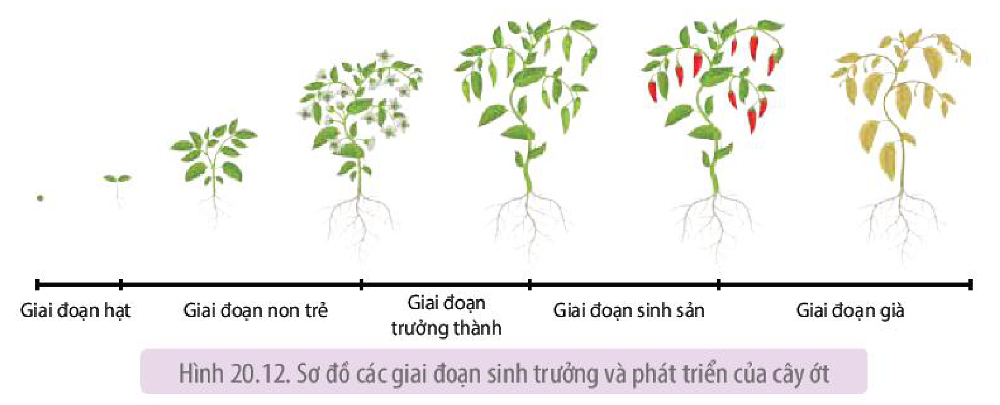

Hình 20.12. Sơ đồ các giai đoạn sinh trưởng và phát triển của cây ớt

> \*Nguồn: Nghiên cứu ảnh hưởng của loại bóng đèn chiếu sáng đến khả năng ra hoa, đậu quả trái vụ và năng suất giống thanh long ruột đỏ TL5 trồng tại Gia Lâm, Hà Nội; Nguyễn Thị Thu Hương và cộng sự, 2020
> \*\*Nguồn: Nghiên cứu đánh giá tác động ngắt đêm (Night break-NB) của một số đèn LED đến sự kìm hãm ra hoa và sinh trưởng của cây hoa cúc, Đặng Xuân Thu và cộng sự, 2021

<!-- pdf:139 -->

Với cây một năm, toàn bộ các giai đoạn của quá trình phát triển chỉ diễn ra trong thời gian một năm, trong khi đó ở cây lâu năm, giai đoạn sinh sản lặp lại một số lần trong vòng đời của nó, số lần lặp lại của giai đoạn này phụ thuộc vào loài.

### 2. Các nhân tố chi phối quá trình phát triển của thực vật có hoa

Sự xuất hiện của hoa là mốc đánh dấu sự chuyển từ giai đoạn sinh trưởng sang giai đoạn phát triển sinh sản. Quá trình ra hoa ở thực vật chịu sự chi phối của các nhân tố bên trong và bên ngoài.

**a) Các nhân tố bên trong**

- Yếu tố di truyền: Tuỳ từng loài, thực vật ra hoa khi đến độ tuổi nhất định. Ví dụ: Ở cây ăn quả lâu năm trồng từ hạt, hoa sẽ xuất hiện sau khoảng 3 – 5 năm, trong khi một số loài tre chỉ ra hoa sau khoảng 50 năm.
- Hormone: Tương quan về nồng độ giữa các hormone quyết định đến sự chuyển từ giai đoạn sinh trưởng sinh dưỡng sang giai đoạn sinh sản ở thực vật.

**b) Các nhân tố bên ngoài**

- Ánh sáng

Sự ra hoa của nhiều loài thực vật phụ thuộc vào tương quan độ dài ngày và đêm gọi là **quang chu kì**. Căn cứ vào phản ứng của thực vật với quang chu kì, thực vật được chia làm ba nhóm:

- **Thực vật đêm dài** (**thực vật ngày ngắn**): là nhóm thực vật ra hoa trong điều kiện ngày ngắn, đêm dài. Ví dụ: cúc, thược dược, cà tím, đậu tương, mía,...
- **Thực vật đêm ngắn** (**thực vật ngày dài**): là nhóm ra hoa trong điều kiện ngày dài, đêm ngắn. Ví dụ: thanh long, dâu tây, cà rốt, củ cải đường, hành,...
- **Thực vật trung tính**: là nhóm thực vật ra hoa không phụ thuộc vào độ dài thời gian chiếu sáng trong ngày. Ví dụ: cà chua, lạc, hướng dương,...

- Nhiệt độ

Một số loài cây chỉ ra hoa khi có khoảng thời gian tiếp xúc với nhiệt độ thấp, hiện tượng này gọi là **sự xuân hoá**. Hiện tượng xuân hoá thường gặp ở các cây trồng có nguồn gốc từ các nước ôn đới nơi có mùa đông lạnh giá. Ví dụ: Cây cà rốt ra hoa trong điều kiện nhiệt độ thấp khoảng 1 – 10 °C, kéo dài 10 – 12 tuần; cây cải bắp trải qua điều kiện nhiệt độ 5 – 8 °C trong khoảng 6 – 8 tuần sẽ ra hoa. Nếu thời gian tiếp xúc với nhiệt độ thấp không đủ dài thì cây có thể không ra hoa. Sự xuân hoá giúp kéo dài thời gian sinh trưởng, tăng sức chống chịu của cây trồng với điều kiện lạnh giá.

- Chất dinh dưỡng

Chất dinh dưỡng ảnh hưởng đến thời gian và khả năng ra hoa của thực vật. Trong điều kiện đất giàu nitrogen, cây thường kéo dài thời gian sinh trưởng sinh dưỡng và chậm ra hoa. Trong khi cây có xu hướng ra hoa sớm khi trồng trên đất nghèo dinh dưỡng.

## ❓ Dừng lại và suy ngẫm

1. Quá trình phát triển của thực vật có hoa gồm những giai đoạn nào? Dấu hiệu nhận biết của mỗi giai đoạn là gì?
2. Kể tên các nhân tố chi phối quá trình sinh trưởng và phát triển của thực vật có hoa. Những nhân tố đó tác động như thế nào đến sinh trưởng và phát triển của thực vật?

<!-- pdf:140 -->

## V. ỨNG DỤNG HIỂU BIẾT VỀ SINH TRƯỞNG VÀ PHÁT TRIỂN

- Điều chỉnh trạng thái ngủ nghỉ của hạt giống, củ giống: (1) sử dụng hormone (abscisic acid, ethylene) hay các chất ức chế sinh trưởng để duy trì trạng thái ngủ, ức chế sự nảy mầm của hạt, củ giống trong bảo quản; (2) phá vỡ trạng thái ngủ nghỉ, thúc đẩy nảy mầm bằng cách sử dụng gibberellin hay đặt hạt giống, củ giống trong điều kiện môi trường (nước, ánh sáng, nhiệt độ thích hợp) thuận lợi.
- Điều khiển sự ra hoa của thực vật dựa trên các hiểu biết về quang chu kì, sự xuân hoá, tương quan dinh dưỡng hay vai trò của các loại hormone,... Sử dụng các biện pháp chiếu sáng bổ sung để điều chỉnh thời gian ra hoa của các cây trồng có phản ứng quang chu kì như thanh long, hoa cúc, mía,... (Bảng 20.3).

Bảng 20.3. Một số ví dụ điều khiển sự ra hoa ở cây trồng bằng ánh sáng(\*)

| Loài cây | Phản ứng quang chu kì | Hình thức tác động | Kết quả |
|---|---|---|---|
| Thanh long | Cây đêm ngắn | Thắp đèn (60 – 75 W) khoảng 6 – 10 giờ/đêm trong 15 – 20 ngày liên tiếp. Xử lí với cây trên 18 tháng tuổi. | Cây ra hoa trái vụ (từ tháng 9 đến tháng 12). |
| Hoa cúc | Cây đêm dài | Thắp đèn khoảng 4 – 6 giờ/đêm cho cây cúc vụ đông. | Kéo dài thời gian sinh trưởng sinh dưỡng, làm thân mang hoa to khoẻ, cây ra hoa muộn vào dịp Tết với đường kính bông lớn. |

Bên cạnh đó, dinh dưỡng hợp lí, điều chỉnh tỉ lệ các loại phân bón cũng có thể thúc đẩy hoặc làm chậm sự ra hoa của thực vật. Hormone ngoại sinh thuộc nhóm gibberellin cũng được sử dụng để thúc đẩy một số cây trồng ra hoa như xà lách, bắp cải, lay ơn. Ngoài ra, xử lí nhiệt độ thấp cũng góp phần rút ngắn thời gian sinh trưởng sinh dưỡng, kích thích các cây như loa kèn, ly,... ra hoa.

- Xác định tuổi thọ của cây thông qua đếm vòng gỗ: Dựa trên việc đếm vòng gỗ trên mặt cắt của thân cây, con người có thể xác định được tuổi của cây, qua đặc điểm của các vòng gỗ cũng có thể xác định được đặc điểm khí hậu trong thời kì sinh trưởng của cây.

## ❓ Dừng lại và suy ngẫm

Tìm thêm ví dụ ứng dụng hiểu biết về sinh trưởng, phát triển của thực vật trong thực tiễn.

## 📌 Kiến thức cốt lõi

- Sinh trưởng diễn ra liên tục trong suốt đời sống của thực vật tại các mô phân sinh. Sinh trưởng gồm hai kiểu: sinh trưởng sơ cấp và sinh trưởng thứ cấp.
- Sinh trưởng và phát triển của thực vật chịu ảnh hưởng của cả yếu tố bên trong như di truyền hormone và các yếu tố bên ngoài như nước, ánh sáng, nhiệt độ, chất khoáng,...

> (\*) Nguồn: Giáo trình Sinh lý thực vật ứng dụng, Vũ Quang Sáng và cộng sự, 2015

<!-- pdf:141 -->

- Mô phân sinh là những tế bào chưa phân hoá, có khả năng phân chia. Thực vật có ba loại mô sinh gồm: mô phân sinh đỉnh, mô phân sinh lóng và mô phân sinh bên.
- Sinh trưởng sơ cấp là kết quả của sự phân chia tế bào của mô phân sinh đỉnh và mô phân sinh lóng, còn sinh trưởng thứ cấp là kết quả của sự phân chia tế bào ở mô sinh bên.
- Hormone thực vật là các chất hữu cơ có hoạt tính sinh học cao, có tác dụng điều tiết các quá trình sống trong cơ thể thực vật. Thực vật có hai nhóm hormone: nhóm hormone kích thích sinh trưởng (auxin, gibberellin, cytokinin) và nhóm ức chế sinh trưởng (abscisic acid, ethylene).
- Quá trình sinh trưởng, phát triển được điều tiết bởi sự tác động phối hợp giữa các hormone.
- Quá trình phát triển của thực vật có hoa trải qua năm giai đoạn kế tiếp nhau gồm: hạt, non trẻ, trưởng thành, sinh sản và già. Quá trình này chịu sự chi phối của các nhân tố bên trong (yếu tố di truyền, hormone) và các nhân tố bên ngoài (ánh sáng, nhiệt độ, chất dinh dưỡng).

## ✏️ Luyện tập và vận dụng

1. Trong sản xuất, người ta thường kéo dài giai đoạn sinh trưởng phát triển sinh dưỡng của những đối tượng cây trồng nào? Nêu một số biện pháp để thực hiện.
2. Nhà Lan trồng ba loại rau gồm: mùng tơi, rau đay và rau bí. Hãy giới thiệu giúp Lan một biện pháp để tăng số lượng nhánh, từ đó tăng năng suất của các loại rau này. Giải thích cơ sở của biện pháp đó.
3. Lập bảng phân biệt sinh trưởng sơ cấp và sinh trưởng thứ cấp.
4. Quan sát lát cắt ngang của thân cây gỗ ở Hình 20.7 và cho biết cách xác định tuổi của cây. Có thể sử dụng vòng gỗ để tìm hiểu về đặc điểm khí hậu (lượng mưa, nhiệt độ) ở địa phương nơi thực vật đó sinh sống được không? Giải thích.

## 💡 Khoa học và đời sống

**Hormone thực vật có thể trở thành thuốc diệt cỏ?**

Ở nồng độ phù hợp, auxin tổng hợp là chất kích thích sinh trưởng với thực vật và được ứng dụng trong nhiều hoạt động sản xuất nông nghiệp. Tuy nhiên, một số loại auxin tổng hợp như 2,4 – D (2,4 – Dichlorophenoxyacetic acid); 2,4,5 – T (2,4,5 – Trichlorophenoxyacetic acid) khi sử dụng ở nồng độ cao có tác dụng diệt cỏ hữu hiệu. Trong đó, 2, 4 – D là loại thuốc diệt cỏ lá rộng và ít ảnh hưởng đến các loại cây ngũ cốc, do đó, nó được sử dụng phổ biến ở nhiều quốc gia trên thế giới. Trong khi 2, 4, 5 – T, tuy có độc tính vừa phải nhưng quá trình sản xuất nó lại tạo ra tạp chất dioxin – chất độc nhất mà con người từng biết đến (chỉ cần hàm lượng rất nhỏ đã gây ra quái thai).

## 📷 Danh sách hình trong bài

| Mã hình | Trang PDF | Vị trí | Chú thích gốc |
|---|---|---|---|
| H11-sinh-b20-01 | 131 | Mục I.2.a | Hình 20.1. Ảnh hưởng của chế độ tưới nước đến số lá và chiều cao của cây ngô (\*) |
| H11-sinh-b20-02 | 131 | Mục I.2.b | Hình 20.2. Ảnh hưởng của ánh sáng đến sự nảy mầm của hạt rau diếp (*Lactuca sativa* L.) Hạt nảy mầm trong tối (a) và trong điều kiện được chiếu ánh sáng đỏ (b) |
| H11-sinh-b20-03 | 131 | Mục I.2.c | Hình 20.3. Ảnh hưởng của nhiệt độ đến tỉ lệ nảy mầm và thời gian nảy mầm của hạt táo Berber (*Ziziphus lotus*) (\*\*) |
| H11-sinh-b20-04 | 132 | Mục I.2.d | Hình 20.4. Quả cà chua bị hỏng (thối) khi thiếu calcium |
| H11-sinh-b20-05 | 132 | Mục II.1 | Hình 20.5. Vị trí và vai trò của các loại mô phân sinh thực vật |
| H11-sinh-b20-06 | 133 | Mục II.2.a | Hình 20.6. Sinh trưởng sơ cấp ở thân và rễ |
| H11-sinh-b20-07 | 133 | Mục II.2.b | Hình 20.7. Mặt cắt ngang thân cây gỗ thể hiện cấu tạo của thân |
| H11-sinh-b20-08 | 135 | Mục III.2.a | Hình 20.8. Một số tác dụng sinh lí của auxin |
| H11-sinh-b20-09 | 135 | Mục III.2.a | Hình 20.9. Ảnh hưởng của gibberellin đến chiều dài của cuống quả và chùm nho không hạt |
| H11-sinh-b20-10 | 136 | Mục III.2.a | Hình 20.10. Ảnh hưởng của kinetin (cytokinin tổng hợp) và auxin đến sự hình thành chồi ở mô sẹo (callus) trong nuôi cấy mô, tế bào thực vật |
| H11-sinh-b20-11 | 136 | Mục III.2.b | Hình 20.11. Một số tác dụng sinh lí của abscisic acid |
| H11-sinh-b20-12 | 138 | Mục IV.1 | Hình 20.12. Sơ đồ các giai đoạn sinh trưởng và phát triển của cây ớt |
