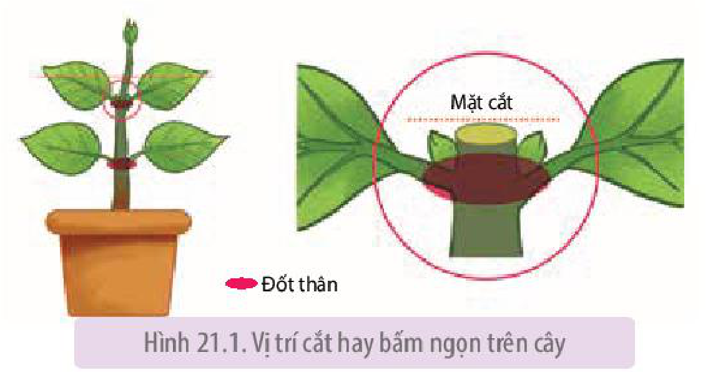
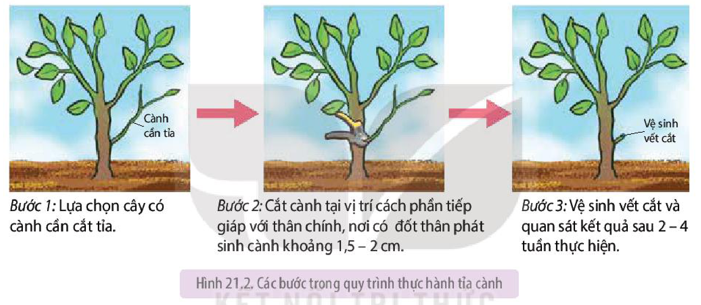

<!-- pdf:142 -->

# BÀI 21: THỰC HÀNH: BẤM NGỌN, TỈA CÀNH, TÍNH TUỔI CÂY

<!-- Trang mở đầu bài (PDF 142) in tiêu đề: "BÀI 21: THỰC HÀNH: BẤM NGỌN, TỈA CÀNH, XỬ LÍ KÍCH THÍCH TỐ VÀ TÍNH TUỔI CÂY"; mục lục và progress.json ghi "Thực hành: Bấm ngọn, tỉa cành, tính tuổi cây". -->

## I. YÊU CẦU CẦN ĐẠT
<!-- ocr-ok: p142.png in rõ "I. YÊU CẦU CẦN ĐẠT"; OCR đọc nhầm "YÊU GẦU GẦN ĐẠT" -->

Thực hành, quan sát được tác dụng của bấm ngọn, tỉa cành, phun kích thích tố lên cây, tính tuổi cây.

## II. CHUẨN BỊ

### 1. Dụng cụ, thiết bị

Kéo cắt cành, thước dây, cân điện tử, cốc, ống đong, bút chì, giấy nhám.

### 2. Hoá chất

$\alpha$ – NAA ($\alpha$ – naphthalene acetic acid).

### 3. Mẫu vật

- Cây rau ăn lá: rau muống, mùng tơi, rau đay,... có từ 3 – 4 đốt thân và chưa phân nhánh.
- Chậu cây cảnh nhỏ: chuỗi ngọc, hoa hồng,... có thân phân nhánh.
- Chậu cây vừng 25 ngày tuổi (12 – 20 chậu).
- Hình ảnh mặt cắt ngang miếng gỗ hoặc đoạn thân cây gỗ cắt ngang có vòng tuổi.

## III. CÁCH TIẾN HÀNH

### 1. Thực hành bấm ngọn, tỉa cành

**a) Nguyên lí**

<!-- term: Ưu thế đỉnh -->
Đỉnh sinh trưởng của cây là nơi sản sinh ra auxin, giúp duy trì ưu thế đỉnh và ức chế sự phát triển của chồi bên. Cắt bỏ chồi đỉnh của cây khiến hàm lượng auxin giảm, từ đó loại bỏ ưu thế ngọn và kích thích sự phát triển của các chồi bên. Khi chồi bên hình thành nhiều, cây phân nhánh quá mức, tỉa bỏ cành cũ nhằm hạn chế sự phát triển của sâu bệnh, thúc đẩy chồi mới hình thành.

**b) Quy trình thực hành**

- Thực hành bấm ngọn

*Bước 1:* Đánh dấu vị trí bấm ngọn – là điểm phía trên đốt thân thứ nhất hoặc thứ hai của cây.

*Bước 2:* Bấm/cắt bỏ chồi ngọn tại vị trí đã đánh dấu.

*Bước 3:* Quan sát sự phân cành của cây sau 2 – 3 tuần thí nghiệm.

<!-- pdf:143 -->

Hình 21.1. Vị trí cắt hay bấm ngọn trên cây
<!-- ocr-ok: p143.png in rõ chú thích "Hình 21.1. Vị trí cắt hay bấm ngọn trên cây"; OCR bỏ sót chú thích này -->

- Thực hành tỉa cành

*Bước 1:* Lựa chọn cây có cành cần cắt tỉa.

*Bước 2:* Cắt cành tại vị trí cách phần tiếp giáp với thân chính, nơi có đốt thân phát sinh cành khoảng 1,5 – 2 cm.

*Bước 3:* Vệ sinh vết cắt và quan sát kết quả sau 2 – 4 tuần thực hiện.

Hình 21.2. Các bước trong quy trình thực hành tỉa cành

*Lưu ý:* Nếu không thực hiện được nội dung thực hành này, học sinh có thể quan sát video về quy trình tỉa cành trên một số loại cây ăn quả hoặc cây cảnh để trình bày được các bước tiến hành và mục đích của việc tỉa cành cho cây.

### 2. Thực hành đánh giá ảnh hưởng của hormone đến sinh trưởng, phát triển của thực vật

**a) Nguyên lí**

Dựa trên việc theo dõi các chỉ tiêu liên quan đến tăng trưởng, năng suất của cây trồng sau khi xử lí hormone ngoại sinh để đánh giá được ảnh hưởng của chúng đến quá trình sinh trưởng, phát triển của thực vật.

**b) Quy trình thí nghiệm**

*Bước 1:* Pha dung dịch $\alpha$ – NAA ở ba nồng độ tương ứng với 3 công thức thí nghiệm là: 25 ppm, 75 ppm và 150 ppm. Công thức đối chứng sử dụng nước máy.

*Bước 2:* Tiến hành phun $\alpha$ – NAA vào hai giai đoạn là 25 ngày và 35 ngày sau trồng. Mỗi lần phun, tiến hành phun ướt lá với lượng bằng nhau giữa các công thức thí nghiệm. Với công thức đối chứng, phun nước thay thế cho $\alpha$ – NAA. Mỗi công thức có thể thực hiện trên 3 – 5 cây vừng.

<!-- pdf:144 -->

*Bước 3:* Xác định các chỉ tiêu liên quan đến sinh trưởng (gồm chiều cao cây, số lá/cây) và các chỉ tiêu liên quan đến năng suất gồm (số hoa/cây, số quả/cây, số hạt/quả) tại thời điểm thu hoạch (khoảng 60 ngày sau trồng).

*Bước 4:* Lập bảng (hoặc biểu đồ) so sánh kết quả theo dõi các chỉ tiêu giữa 4 công thức theo bảng dưới đây để đánh giá ảnh hưởng của $\alpha$ – NAA và liều lượng của nó đến sinh trưởng và phát triển của cây vừng.

| Nồng độ $\alpha$ – NAA (ppm) | Chiều cao cây (cm) | Số lá/cây | Số hoa/cây | Số quả/cây | Số hạt/quả |
|---|---|---|---|---|---|
| 0 | ? | ? | ? | ? | ? |
| 25 | ? | ? | ? | ? | ? |
| 75 | ? | ? | ? | ? | ? |
| 150 | ? | ? | ? | ? | ? |

*Lưu ý:* Tuỳ điều kiện mùa vụ, có thể thay thế cây trồng thí nghiệm và chất điều hoà sinh trưởng sử dụng hoặc quan sát tranh ảnh, xem video về việc xử lí hormone ngoại sinh trên mội số đối tượng cây trồng, từ đó chỉ ra tác dụng và những hạn chế cần lưu ý khi sử dụng hormone ngoại sinh trong sản xuất.

### 3. Thực hành tính tuổi cây

**a) Nguyên lí**

Hằng năm, hoạt động của tầng sinh mạch thuộc mô phân sinh bên của cây sẽ tạo ra lớp tế bào mạch gỗ. Mùa mưa, cây sinh trưởng thuận lợi, lớp tế bào này có kích thước lớn và có màu sáng, ngược lại, vào mùa khô chúng có màu đậm. Hai lớp tế bào sáng và đậm màu này sẽ tạo nên vòng gỗ của năm. Căn cứ vào số vòng gỗ có thể tính được tuổi của cây.

**b) Quy trình thí nghiệm**
<!-- ocr-ok: p144.png in rõ "b) Quy trình thí nghiệm"; OCR đọc dính chữ "b)Quytrình thí nghiệm" -->

*Bước 1:* Chà mịn mặt cắt của đoạn thân hoặc miếng gỗ bằng giấy nhám, có thể xịt thêm nước để dễ quan sát.

*Bước 2:* Xác định lõi của thân, tức vòng tròn nhỏ nhất nằm ở trung tâm của mặt cắt thân cây.

*Bước 3:* Đếm từ vòng tối màu đầu tiên xung quanh lõi đến vòng tối cuối cùng sát với phần vỏ cây. Ghi lại số vòng tròn màu tối đếm được, đó chính là tuổi của cây đang nghiên cứu.

Có thể sử dụng kính lúp để quan sát rõ hơn và nên sử dụng bút chì ghi lại thứ tự các vòng tròn khi đếm để tránh nhầm lẫn.

Lưu ý: Ngoài phương pháp trên, còn có một số phương pháp khác để ước tính tuổi của các cây gỗ như đo chu vi thân cây, đếm số vòng cành cây, đếm số vòng trên lõi khoan thân cây. Trong đó, đếm số vòng trên mặt cắt thân cây là phương pháp chính xác nhất.

<!-- pdf:145 -->

## IV. THU HOẠCH

Học sinh viết báo cáo thực hành theo các nội dung sau:

**BÁO CÁO THỰC HÀNH**

1. **Mục đích**
2. **Kết quả và giải thích**
   Trình bày kết quả các nội dung thực hành bấm ngọn, tỉa cành, phun chất điều hoà sinh trưởng và tính tuổi cây.
3. **Trả lời câu hỏi**
   a) Trên cây mùng tơi thí nghiệm có 3 đốt thân, nếu bạn Nam chọn vị trí bấm là dưới đốt thân thứ ba của cây thì bạn Nam có quan sát được kết quả của thí nghiệm không? Giải thích.
   b) Trên cùng một cây, việc chọn đếm số vòng gỗ trên thân chính với đếm số vòng gỗ trên cành của cây để tính tuổi cây, cách nào cho kết quả chính xác hơn? Tại sao?

## 📷 Danh sách hình trong bài

| Mã hình | Trang PDF | Vị trí | Chú thích gốc |
|---|---|---|---|
| H11-sinh-b21-01 | 143 | Mục III.1.b | Hình 21.1. Vị trí cắt hay bấm ngọn trên cây |
| H11-sinh-b21-02 | 143 | Mục III.1.b | Hình 21.2. Các bước trong quy trình thực hành tỉa cành |
