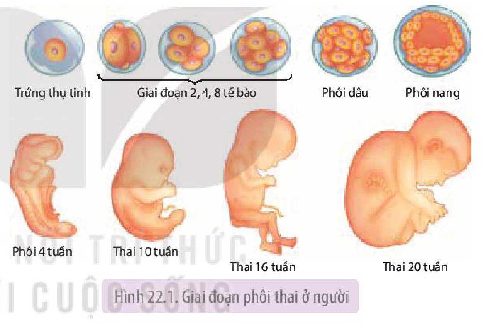
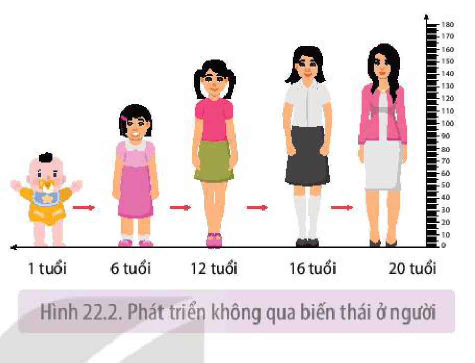
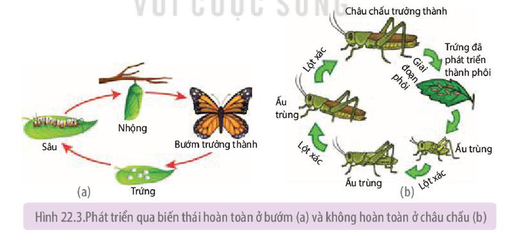
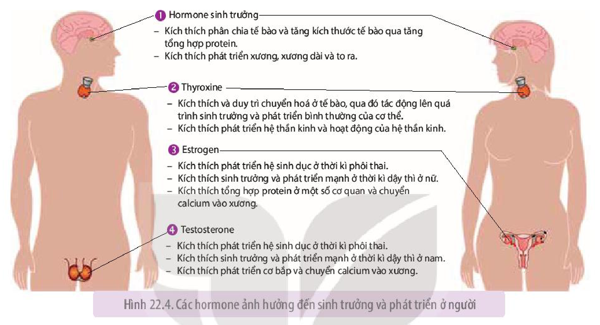

<!-- pdf:146 -->

# BÀI 22: SINH TRƯỞNG VÀ PHÁT TRIỂN Ở ĐỘNG VẬT

## 🎯 Yêu cầu cần đạt

- Nêu được đặc điểm sinh trưởng và phát triển ở động vật.
- Trình bày được các giai đoạn chính trong quá trình sinh trưởng và phát triển ở động vật.
- Phân biệt được phát triển không qua biến thái và phát triển qua biến thái.
- Phân tích được ý nghĩa của phát triển qua biến thái hoàn toàn ở động vật đối với đời sống của chúng.
- Trình bày được các giai đoạn phát triển của con người từ hợp tử đến cơ thể trưởng thành.
- Vận dụng được hiểu biết về các giai đoạn phát triển để áp dụng chế độ ăn uống hợp lí.
- Nêu được ảnh hưởng của các yếu tố bên trong và bên ngoài đến sinh trưởng và phát triển của động vật.
- Nêu được vai trò của một số hormone đối với hoạt động sống của động vật.
- Vận dụng hiểu biết về hormone để giải thích một số hiện tượng trong thực tiễn.
- Phân tích được khả năng điều khiển sinh trưởng và phát triển ở động vật.
- Vận dụng hiểu biết về sinh trưởng và phát triển ở động vật vào thực tiễn.
- Phân tích đặc điểm tuổi dậy thì và ứng dụng hiểu biết về tuổi dậy thì trong bảo vệ sức khoẻ, chăm sóc bản thân và người khác.

## 🔴 Mở đầu

Quá trình một tế bào hợp tử phát triển thành một cơ thể hoàn chỉnh diễn ra như thế nào?

## I. ĐẶC ĐIỂM VÀ CÁC GIAI ĐOẠN SINH TRƯỞNG, PHÁT TRIỂN

### 1. Đặc điểm sinh trưởng và phát triển

- Tốc độ sinh trưởng và phát triển của cơ thể không đều theo thời gian, có giai đoạn sinh trưởng và phát triển nhanh, có giai đoạn chậm, có giai đoạn sinh trưởng. Ví dụ: Ở người, giai đoạn từ khi sinh ra đến trước tuổi dậy thì chủ yếu sinh trưởng. Đến giai đoạn dậy thì tốc độ sinh trưởng và phát triển tăng lên rõ rệt, hình thành các đặc điểm sinh dục thứ phát.
- Tốc độ sinh trưởng và phát triển của các phần khác nhau của cơ thể diễn ra không giống nhau. Ví dụ: Ở người, đầu của thai nhi lúc 2 – 3 tháng tuổi dài gần bằng 1/2 chiều dài cơ thể, khi mới sinh ra bằng 1/4 và đến 16 tuổi chỉ còn bằng 1/7 chiều dài cơ thể.

<!-- pdf:147 -->

- Các cơ quan, hệ cơ quan của phôi thai cũng phát triển theo thời gian khác nhau. Ví dụ: Ở người, tim bắt đầu đập vào ngày thứ 21 của thai kì; cẳng chân, cánh tay, hệ tiêu hoá bắt đầu hình thành vào tuần thứ năm,...
- Thời gian sinh trưởng và phát triển đạt đến kích thước tối đa (chiều cao hoặc chiều dài) là khác nhau ở các loài động vật. Ví dụ: Thời gian lớn lên của con người là khoảng 25 năm, cao tối đa khoảng 2 m; lạc đà lớn lên và đạt kích thước tối đa sau khoảng 8 năm,...

### 2. Các giai đoạn sinh trưởng và phát triển

Quá trình sinh trưởng và phát triển của động vật đẻ trứng bắt đầu từ khi hợp tử phân bào cho đến giai đoạn trưởng thành được chia làm hai giai đoạn: giai đoạn phôi và giai đoạn hậu phôi. Ở động vật đẻ con như Thú và người, quá trình sinh trưởng và phát triển được chia làm giai đoạn phôi thai và giai đoạn sau sinh. Giai đoạn phôi thai tương ứng với giai đoạn phôi, giai đoạn sau sinh tương ứng với giai đoạn hậu phôi.

**a) Giai đoạn phôi**

Giai đoạn phôi diễn ra trong trứng ở bên trong và bên ngoài cơ thể mẹ hoặc chỉ bên ngoài cơ thể mẹ (ở động vật thụ tinh ngoài). Giai đoạn phôi gồm nhiều giai đoạn kế tiếp nhau: phân cắt, phôi nang, phôi vị, tạo cơ quan.

Ở người, **giai đoạn phôi thai** diễn ra trong tử cung (dạ con) người mẹ. Hai tháng đầu (8 tuần) gọi là giai đoạn phôi. Từ tháng thứ ba (từ tuần thứ chín) cho đến khi sinh ra gọi là **giai đoạn thai** (H 22.1).
<!-- ocr-ok: hình bên phải làm OCR tách dòng lộn xộn ở đoạn giai đoạn phôi thai; đã đối chiếu ảnh PDF 147 -->

Hình 22.1. Giai đoạn phôi thai ở người

**b) Giai đoạn hậu phôi**

**Giai đoạn hậu phôi** là giai đoạn con non (nở từ trứng ra hoặc mới sinh ra) phát triển thành con trưởng thành. Ở giai đoạn hậu phôi, quá trình phát triển của con non có thể trải qua biến thái hoặc không qua biến thái.

**Biến thái** là sự thay đổi về hình thái và cấu tạo của động vật sau khi sinh ra hoặc nở từ trứng ra.

## II. CÁC HÌNH THỨC PHÁT TRIỂN

Dựa vào hình thái, cấu tạo của con non trong giai đoạn phát triển thành con trưởng thành, người ta phân biệt hai hình thức (kiểu) phát triển: phát triển không qua biến thái và phát triển qua biến thái. Phát triển qua biến thái có thể là hoàn toàn hoặc không hoàn toàn.

Sơ đồ dưới đây thể hiện các hình thức phát triển ở động vật:

<!-- pdf:148 -->

- Quá trình phát triển
  - Phát triển không qua biến thái
  - Phát triển qua biến thái
    - Phát triển qua biến thái hoàn toàn
    - Phát triển qua biến thái không hoàn toàn

### 1. Phát triển không qua biến thái

**Phát triển không qua biến thái** là quá trình phát triển trong đó con non mới nở từ trứng ra hoặc mới sinh ra đã có cấu tạo giống con trưởng thành. Ví dụ: Trẻ em mới sinh ra và trẻ em ở các độ tuổi tiếp theo đều có đặc điểm cấu tạo tương tự người trưởng thành (H 22.2).

Phát triển không qua biến thái gặp ở đa số động vật có xương sống và một số loài động vật không xương sống.

Hình 22.2. Phát triển không qua biến thái ở người

### 2. Phát triển qua biến thái

**a) Phát triển qua biến thái hoàn toàn**

**Phát triển qua biến thái hoàn toàn** là quá trình phát triển mà ấu trùng có hình thái và cấu tạo rất khác với con trưởng thành. Ví dụ: Sâu bướm có đặc điểm hình thái và cấu tạo rất khác với bướm. Sâu bướm trải qua nhiều lần lột xác và biến đổi thành nhộng, sau đó thành bướm (H 22.3a). **Nhộng** là giai đoạn biến đổi gần như toàn bộ cơ thể. Các mô, các cơ quan cũ của sâu tiêu biến đi, đồng thời các mô, các cơ quan mới hình thành. Vì vậy, bướm chui ra từ kén có hình dạng và cấu tạo khác hẳn với sâu bướm. Giai đoạn nhộng giúp ấu trùng bướm trải qua điều kiện môi trường sống khó khăn như lạnh giá, thiếu thức ăn,...

Hình 22.3. Phát triển qua biến thái hoàn toàn ở bướm (a) và không hoàn toàn ở châu chấu (b)

Hầu hết bướm trưởng thành sống bằng mật hoa, trong ống tiêu hoá chỉ có enzyme sucrase tiêu hoá đường sucrose. Trong khi đó sâu bướm ăn lá cây, trong ống tiêu hoá của sâu có các enzyme thuỷ phân protein, lipid và carbohydrate thành các chất dễ hấp thụ như đường đơn, acid béo, glycerin và amino acid.

<!-- pdf:149 -->

Phát triển qua biến thái hoàn toàn gặp ở lưỡng cư và nhiều loài côn trùng.

**b) Phát triển qua biến thái không hoàn toàn**

**Biến thái không hoàn toàn** là quá trình phát triển mà ấu trùng phát triển chưa hoàn thiện, trải qua nhiều lần lột xác, ấu trùng biến đổi thành con trưởng thành.

Ví dụ: Ấu trùng châu chấu chui từ trứng ra có cơ thể phát triển chưa hoàn thiện (chưa có cánh,...). Ấu trùng trải qua nhiều lần lột xác (khoảng 4 – 5 lần). Sau mỗi lần lột xác, ấu trùng lớn lên rất nhanh, càng giống con trưởng thành và cuối cùng phát triển thành con trưởng thành (H 22.3b). Sự khác biệt về hình thái và cấu tạo của con non giữa các lần lột xác kế tiếp nhau rất nhỏ.

Nhiều loại ấu trùng cũng ăn lá cây như bố mẹ chúng. Các enzyme trong ống tiêu hóa thuỷ phân protein, lipid và carbohydrate thành đường đơn, acid béo, glycerin và amino acid. Phát triển qua biến thái không hoàn toàn gặp ở một số loài động vật chân khớp như châu chấu, cào cào, gián, ve sầu, tôm, cua,...

## ❓ Dừng lại và suy ngẫm

1. Phân biệt phát triển không qua biến thái và phát triển qua biến thái, phát triển qua biến thái hoàn toàn và biến thái không hoàn toàn.
2. Kẻ bảng vào vở theo mẫu sau, điền ít nhất tên 10 loài động vật vào bảng và đánh dấu $\times$ vào kiểu biến thái của chúng.

| Tên động vật | Phát triển không qua biến thái | Phát triển qua biến thái hoàn toàn | Phát triển qua biến thái không hoàn toàn |
|---|---|---|---|
| 1. Ruồi | | $\times$ | |
| 2. ........... | | | |

3. Quan sát Hình 22.1 và 22.2, phân biệt các giai đoạn sinh trưởng và phát triển của con người từ giai đoạn phôi cho đến khi trưởng thành, từ đó giải thích tại sao cần có chế độ ăn uống phù hợp cho trẻ em và phụ nữ khi mang thai?

## III. CÁC YẾU TỐ ẢNH HƯỞNG ĐẾN SINH TRƯỞNG VÀ PHÁT TRIỂN

### 1. Các yếu tố bên trong

**a) Di truyền**

Sinh trưởng và phát triển của mỗi loài, mỗi cá thể động vật trước tiên do yếu tố di truyền quyết định. Người ta đã phát hiện hệ thống gene chịu trách nhiệm điều khiển sinh trưởng và phát triển ở động vật.

Hai đặc điểm sinh trưởng và phát triển dễ nhận thấy nhất do yếu tố di truyền quyết định đó là tốc độ lớn và giới hạn lớn. Ví dụ: Các giống lợn nhập nội có tốc độ sinh trưởng nhanh hơn và khối lượng cơ thể khi trưởng thành lớn hơn so với các giống lợn nội địa của Việt Nam.

<!-- pdf:150 -->

**b) Hormone**

Động vật có xương sống có nhiều hormone ảnh hưởng đến sinh trưởng và phát triển. Tuy nhiên, bốn loại hormone được coi là ảnh hưởng mạnh nhất đến sinh trưởng và phát triển là hormone sinh trưởng (GH), thyroxine, testosterone và estrogen (H 22.4).

<!-- term: Hormone sinh trưởng -->
<!-- term: Thyroxine -->
<!-- term: Estrogen -->
<!-- term: Testosterone -->
- 1. Hormone sinh trưởng: Kích thích phân chia tế bào và tăng kích thước tế bào qua tăng tổng hợp protein. Kích thích phát triển xương, xương dài và to ra.
- 2. Thyroxine: Kích thích và duy trì chuyển hoá ở tế bào, qua đó tác động lên quá trình sinh trưởng và phát triển bình thường của cơ thể. Kích thích phát triển hệ thần kinh và hoạt động của hệ thần kinh.
- 3. Estrogen: Kích thích phát triển hệ sinh dục ở thời kì phôi thai. Kích thích sinh trưởng và phát triển mạnh ở thời kì dậy thì ở nữ. Kích thích tổng hợp protein ở một số cơ quan và chuyển calcium vào xương.
- 4. Testosterone: Kích thích phát triển hệ sinh dục ở thời kì phôi thai. Kích thích sinh trưởng và phát triển mạnh ở thời kì dậy thì ở nam. Kích thích phát triển cơ bắp và chuyển calcium vào xương.

Hình 22.4. Các hormone ảnh hưởng đến sinh trưởng và phát triển ở người

Động vật không xương sống có nhiều hormone tác động lên sinh trưởng và phát triển.

<!-- term: Ecdysone -->
<!-- term: Juvenile -->
Ví dụ: Ở bướm, hai hormone ecdysone và juvenile phối hợp với nhau gây lột xác ở sâu và biến đổi sâu, nhộng thành bướm.

### 2. Các yếu tố bên ngoài

Quá trình sinh trưởng và phát triển của động vật chịu ảnh hưởng của rất nhiều yếu tố trong môi trường sống như thức ăn, nhiệt độ, ánh sáng, điều kiện vệ sinh,... Động vật sống trong nước còn chịu sự ảnh hưởng của nồng độ $\text{O}_2$, pH, mức độ ô nhiễm của nước,...

**a) Thức ăn**

Thức ăn là yếu tố ảnh hưởng mạnh nhất lên quá trình sinh trưởng và phát triển của động vật và người. Các chất dinh dưỡng có trong thức ăn đều cần cho sinh trưởng và phát triển của động vật và người. Chỉ cần thiếu hoặc không đủ số lượng một loại chất dinh dưỡng thì động vật non, trẻ em sẽ chậm lớn và có thể phát triển không bình thường. Ví dụ: Thiếu vitamin D gây ra bệnh còi xương và chậm lớn ở trẻ.

**b) Nhiệt độ**

Mỗi loài động vật sinh trưởng và phát triển tốt trong điều kiện nhiệt độ môi trường thích hợp. Nhiệt độ quá cao hoặc quá thấp có thể làm chậm quá trình sinh trưởng và phát triển của động vật, đặc biệt là động vật biến nhiệt. Ví dụ: Cá rô phi sinh trưởng và phát triển tốt trong điều kiện nhiệt độ môi trường khoảng 30 – 35 °C, khi nhiệt độ hạ xuống 16 – 18 °C, cá ngừng lớn và ngừng đẻ.

<!-- pdf:151 -->

**c) Ánh sáng**

Ánh sáng ảnh hưởng đến quá trình sinh trưởng và phát triển của động vật qua nhiều cách khác nhau. Ví dụ:

- Vào những ngày trời rét, động vật hằng nhiệt mất nhiệt vào môi trường dẫn đến nguy cơ hạ thân nhiệt. Lượng nhiệt mất đi được bù lại bằng cách tăng phân giải chất hữu cơ của cơ thể. Nếu quá trình phân giải kéo dài sẽ làm động vật gầy đi và chậm lớn. Động vật hằng nhiệt phơi nắng để thu thêm nhiệt và giảm mất nhiệt, nhờ đó giảm phân giải chất hữu cơ của cơ thể.
- Động vật biến nhiệt như cá sấu, thằn lằn có tập tính phơi nắng làm tăng thân nhiệt, tăng chuyển hoá tạo năng lượng, nhờ đó tăng khả năng tìm kiếm thức ăn, từ đó ảnh hưởng rất mạnh đến sinh trưởng và phát triển của động vật
- Tia tử ngoại tác động lên da biến tiền vitamin D thành vitamin D. Vitamin D có vai trò trong chuyển hoá calcium để hình thành xương, qua đó ảnh hưởng đến sinh trưởng và phát triển.

## ❓ Dừng lại và suy ngẫm

1. Phân tích ảnh hưởng của các yếu tố bên trong đến sinh trưởng và phát triển ở động vật.
2. Phân tích ảnh hưởng của các yếu tố bên ngoài đến sinh trưởng và phát triển ở động vật sống trên cạn và sống dưới nước.

## IV. TUỔI DẬY THÌ

Một số nghiên cứu của Việt Nam và thế giới(\*) cho thấy giai đoạn dậy thì thường kéo dài khoảng 5 năm, nữ dậy thì sớm hơn nam. Độ tuổi trung bình bắt đầu dậy thì ở nữ là 11 tuổi, nữ có thể dậy thì trong khoảng từ 8 đến 13 tuổi. Độ tuổi trung bình bắt đầu dậy thì ở nam là 12 tuổi, nam có thể dậy thì trong khoảng từ 9 đến 14 tuổi.

Dậy thì chủ yếu là do tác động của tăng testosterone ở nam và tăng estrogen ở nữ. Ở thời kì dậy thì, nam và nữ có những thay đổi rõ rệt về thể chất và tâm sinh lí . Giai đoạn dậy thì đưa đến nhiều lợi ích cho nam và nữ như tăng sức mạnh thể chất, tăng năng lực trí tuệ, phát triển tính độc lập và nhân cách, bắt đầu nghĩ đến mục tiêu cuộc sống,...

Tuy nhiên, trẻ em ở tuổi dậy thì phải đối diện với nhiều thách thức như nguy cơ mắc bệnh lây truyền qua quan hệ tình dục, mang thai ngoài ý muốn và nguy cơ mắc các tệ nạn xã hội (nghiện ma tuý, nghiện rượu,...).

## ❓ Dừng lại và suy ngẫm

1. Những hormone nào gây dậy thì ở trẻ em nam và nữ? Giải thích.
2. Kẻ bảng vào vở theo mẫu dưới đây, sau đó điền những thay đổi về thể chất, sinh lí, tâm lí, tình cảm ở tuổi dậy thì vào bảng (Lưu ý: Nữ điền vào cột dành cho nữ, nam điền vào cột dành cho nam).

> (\*) Nguồn: Bách khoa thư về phát triển kĩ năng tuổi dậy thì – Wyatt, 2022

<!-- pdf:152 -->

| Thay đổi | Nữ | Nam |
|---|---|---|
| 1. Thể chất | ? | ? |
| 2. Sinh lí | ? | ? |
| 3. Tâm lí, tình cảm | ? | ? |

3. Tìm hiểu qua tài liệu, internet, hỏi bác sĩ,... về các bệnh lây truyền qua quan hệ tình dục, sử dụng biện pháp tránh thai, hậu quả mang thai ở tuổi học sinh, sau đó trả lời các câu hỏi sau:
   a) Bệnh lây truyền qua đường tình dục gồm những bệnh nào? Hậu quả khi mắc các bệnh đó là gì?
   b) Tại sao mang thai ở tuổi học sinh đưa đến nhiều hậu quả xấu cho sức khoẻ, tâm sinh lí, học tập? Làm cách nào để tránh mang thai ở tuổi học sinh?
4. Nam, nữ ở tuổi dậy thì cần phải làm gì để bảo vệ sức khoẻ, chăm sóc bản thân và người khác?

## V. ỨNG DỤNG HIỂU BIẾT VỀ SINH TRƯỞNG VÀ PHÁT TRIỂN VÀO THỰC TIỄN CUỘC SỐNG

Trên thực tế, con người đã và đang tìm ra các biện pháp tác động lên tốc độ sinh trưởng và phát triển của động vật như:

- Xây dựng chế độ ăn thích hợp cho động vật nuôi trong các giai đoạn sinh trưởng và phát triển khác nhau (giai đoạn con non, mang thai,...).
- Chọn giống có tốc độ sinh trưởng và phát triển nhanh, cải tạo giống bằng phương pháp lai giống, áp dụng công nghệ phôi tạo ra giống vật nuôi có năng suất cao,...
- Cải tạo môi trường sống: Chuồng nuôi động vật ấm vào mùa đông, mát vào mùa hè đảm bảo cho động vật không tốn năng lượng cho điều hoà thân nhiệt, vệ sinh chuồng nuôi và tiêm vaccine giúp giảm thiểu mắc bệnh ảnh hưởng đến sinh trưởng và phát triển của động vật.
- Xác định giai đoạn sinh trưởng và phát triển dễ bị tổn thương nhất của động vật gây hại, từ đó đề ra biện pháp tiêu diệt phù hợp. Ví dụ: Thả ong mắt đỏ (*Trichogramma japonicum*) đẻ trứng lên sâu đục thân, ấu trùng ong nở ra từ trứng ăn các bộ phận của sâu đục thân làm sâu chết; thả cá vào bể nước để diệt muỗi ở giai đoạn bọ gậy,...

## ❓ Dừng lại và suy ngẫm

Tham khảo tài liệu khoa học, internet,... hãy đề xuất thêm biện pháp thúc đẩy sự sinh trưởng và phát triển của một số loài vật nuôi nào đó hoặc biện pháp kìm hãm, tiêu diệt côn trùng gây hại.

<!-- pdf:153 -->

## 📌 Kiến thức cốt lõi

- Đặc điểm sinh trưởng và phát triển của động vật thể hiện qua:
  + Tốc độ sinh trưởng và phát triển của cơ thể không đều theo thời gian.
  + Tốc độ sinh trưởng và phát triển ở các phần khác nhau của cơ thể không giống nhau.
  + Các cơ quan, hệ cơ quan của phôi thai phát triển theo thời gian khác nhau.
  + Thời gian sinh trưởng và phát triển đạt đến kích thước tối đa là khác nhau ở các loài động vật.
- Quá trình sinh trưởng và phát triển của động vật được chia làm hai giai đoạn chủ yếu: giai đoạn phôi và giai đoạn hậu phôi.
- Quá trình phát triển của động vật có thể không qua biến thái hoặc qua biến thái. Quá trình phát triển qua biến thái có thể là hoàn toàn hoặc không hoàn toàn.
- Các nhân tố bên trong như di truyền, hormone và các nhân tố bên ngoài như thức ăn, nhiệt độ, ánh sáng,... ảnh hưởng lên sinh trưởng và phát triển của động vật.
- **Tuổi dậy thì** là giai đoạn chuyển từ thiếu niên sang thanh niên. Ở thời kì dậy thì, nam và nữ có những thay đổi về thể chất, sinh lí, tâm lí và tình cảm.

## ✏️ Luyện tập và vận dụng

1. Tại sao sâu bướm và châu chấu, cào cào phá hoại cây xanh rất mạnh và gây ra tổn thất cho nông nghiệp?
2. Hormone có thể làm tăng tốc độ sinh trưởng và phát triển của động vật nhưng tại sao không nên lạm dụng hormone trong chăn nuôi?
3. Kinh nghiệm của những người chăn nuôi là cắt bỏ hai tinh hoàn của gà trống con khi nó bắt đầu biết gáy. Kết quả thu được là gà lớn nhanh và béo, nhưng cơ thể gà phát triển không bình thường như mào nhỏ, cựa không phát triển, không biết gáy, mất bản năng sinh dục,... Điều này được giải thích như thế nào?
4. Vận dụng hiểu biết về các giai đoạn phát triển, cho biết tại sao phải quan tâm đến chế độ ăn uống của trẻ em theo độ tuổi. Nếu trẻ em thường xuyên ăn quá nhiều thức ăn giàu chất dinh dưỡng hoặc ăn không đủ chất dinh dưỡng thì hậu quả sẽ thế nào? Giải thích.

## 💡 Em có biết

Chim ấp trứng tạo ra nhiệt độ thích hợp trong một thời gian nhất định đảm bảo cho hợp tử phát triển thuận lợi thành chim non. Con người dùng lò ấp trứng nhân tạo, điều khiển được nhiệt độ tối ưu nên cho tỉ lệ trứng nở thành con non cao hơn so với chim ấp trong điều kiện tự nhiên.

## 📷 Danh sách hình trong bài

| Mã hình | Trang PDF | Vị trí | Chú thích gốc |
|---|---|---|---|
| H11-sinh-b22-01 | 147 | Mục I.2.a | Hình 22.1. Giai đoạn phôi thai ở người |
| H11-sinh-b22-02 | 148 | Mục II.1 | Hình 22.2. Phát triển không qua biến thái ở người |
| H11-sinh-b22-03 | 148 | Mục II.2.a | Hình 22.3. Phát triển qua biến thái hoàn toàn ở bướm (a) và không hoàn toàn ở châu chấu (b) |
| H11-sinh-b22-04 | 150 | Mục III.1.b | Hình 22.4. Các hormone ảnh hưởng đến sinh trưởng và phát triển ở người |
