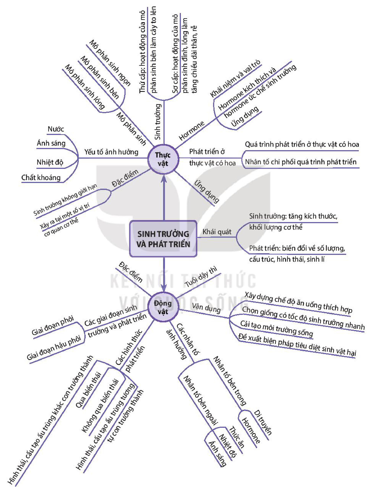

<!-- pdf:156 -->

# SƠ ĐỒ TÓM TẮT KIẾN THỨC CHƯƠNG 3

<!-- Dưới đây chép các nhánh của sơ đồ tư duy thành danh sách lồng nhau, giữ nguyên chữ trong các ô và trên các nhánh. -->

- SINH TRƯỞNG VÀ PHÁT TRIỂN
  - Khái quát
    - Sinh trưởng: tăng kích thước, khối lượng cơ thể
    - Phát triển: biến đổi về số lượng, cấu trúc, hình thái, sinh lí
  - Thực vật
    - Đặc điểm
      - Sinh trưởng không giới hạn
      - Xảy ra tại một số vị trí cơ quan cơ thể
    - Yếu tố ảnh hưởng
      - Nước
      - Ánh sáng
      - Nhiệt độ
      - Chất khoáng
    - Mô phân sinh
      - Mô phân sinh ngọn
      - Mô phân sinh bên
      - Mô phân sinh lóng
    - Sinh trưởng
      - Thứ cấp: hoạt động của mô phân sinh bên làm cây to lên
      - Sơ cấp: hoạt động của mô phân sinh đỉnh, lóng làm tăng chiều dài thân, rễ
    - Hormone
      - Khái niệm và vai trò
      - Hormone kích thích và hormone ức chế sinh trưởng
      - Ứng dụng
    - Phát triển ở thực vật có hoa
      - Quá trình phát triển ở thực vật có hoa
      - Nhân tố chi phối quá trình phát triển
    - Ứng dụng
  - Động vật
    - Đặc điểm
    - Các giai đoạn sinh trưởng và phát triển
      - Giai đoạn phôi
      - Giai đoạn hậu phôi
    - Các hình thức phát triển
      - Qua biến thái: Hình thái, cấu tạo ấu trùng khác con trưởng thành
      - Không qua biến thái: Hình thái, cấu tạo ấu trùng tương tự con trưởng thành
    - Các nhân tố ảnh hưởng
      - Nhân tố bên ngoài
        - Thức ăn
        - Nhiệt độ
        - Ánh sáng
      - Nhân tố bên trong
        - Di truyền
        - Hormone
    - Tuổi dậy thì
    - Vận dụng
      - Xây dựng chế độ ăn uống thích hợp
      - Chọn giống có tốc độ sinh trưởng nhanh
      - Cải tạo môi trường sống
      - Đề xuất biện pháp tiêu diệt sinh vật hại
<!-- ocr-ok: sơ đồ tư duy có nhiều nhánh chữ xoay nghiêng các góc, OCR không đọc được các nhánh nghiêng; đã đối chiếu ảnh PDF 156 -->

## 📷 Danh sách hình trong bài

| Mã hình | Trang PDF | Vị trí | Chú thích gốc |
|---|---|---|---|
| H11-sinh-so-do-tom-tat-c03-01 | 156 | Cả trang | Sơ đồ tóm tắt kiến thức chương 3 |
