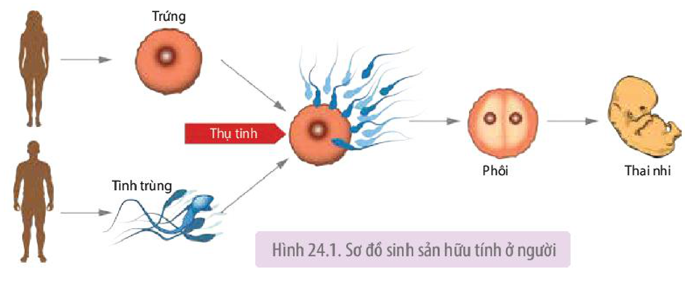
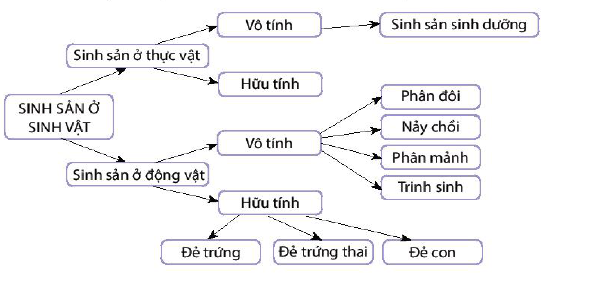

<!-- pdf:157 -->

# BÀI 24: KHÁI QUÁT VỀ SINH SẢN Ở SINH VẬT

## 🎯 Yêu cầu cần đạt

- Phát biểu được khái niệm sinh sản, sinh sản vô tính, sinh sản hữu tính và nêu được các dấu hiệu đặc trưng của sinh sản ở sinh vật.
- Trình bày được vai trò của sinh sản đối với sinh vật và phân biệt được các hình thức sinh sản ở sinh vật.

## 🔴 Mở đầu

Các loài sinh vật có những hình thức sinh sản nào?

## I. KHÁI NIỆM SINH SẢN

**Sinh sản** là quá trình tạo ra cơ thể mới, đảm bảo sự phát triển liên tục của loài.

Sinh sản ở sinh vật có thể là sinh sản vô tính hoặc hữu tính. Một số ít loài sinh vật thể hiện cả hai hình thức sinh sản vô tính và hữu tính.

**Sinh sản vô tính** là hình thức sinh sản tạo ra cơ thể mới với các đặc điểm giống cá thể ban đầu mà không có sự đóng góp vật chất di truyền của cá thể khác. Ví dụ: Từ một lá của cây thuốc bỏng có thể phát triển thành một cây hoặc nhiều cây thuốc bỏng mới có đặc điểm giống hệt cây thuốc bỏng cung cấp lá.

**Sinh sản hữu tính** là hình thức sinh sản có sự kết hợp giữa giao tử đực và giao tử cái tạo thành hợp tử, hợp tử phát triển thành cơ thể mới. Hình 24.1 thể hiện quá trình sinh sản hữu tính ở người.

Hình 24.1. Sơ đồ sinh sản hữu tính ở người

<!-- pdf:158 -->

## II. DẤU HIỆU ĐẶC TRƯNG CỦA SINH SẢN

<!-- term: Dấu hiệu đặc trưng của sinh sản vô tính -->
<!-- term: Dấu hiệu đặc trưng của sinh sản hữu tính -->
**Bảng 24.1.** Dấu hiệu đặc trưng của sinh sản

<!-- term: Dấu hiệu đặc trưng của sinh sản vô tính -->
<!-- term: Dấu hiệu đặc trưng của sinh sản hữu tính -->
| Sinh sản vô tính | Sinh sản hữu tính |
|---|---|
| - Vật chất di truyền của các cơ thể con giống nhau và giống với cơ thể mẹ. | - Vật chất di truyền của các cơ thể con được tái tổ hợp từ hai nguồn khác nhau nên có sự sai khác. |
| - Vật chất di truyền của cơ thể mẹ được truyền đạt nguyên vẹn cho cơ thể con qua cơ chế nguyên phân. | - Vật chất di truyền được truyền đạt từ thế hệ mẹ sang thế hệ con thông qua quá trình giảm phân, thụ tinh và nguyên phân. |
| - Sinh sản vô tính được điều hoà chủ yếu bởi hệ thống kiểm soát chu kì tế bào. | - Sinh sản hữu tính được điều hoà bởi các hormone. |

## ❓ Dừng lại và suy ngẫm

Phân biệt sinh sản vô tính với sinh sản hữu tính. Cho ví dụ một số thực vật và động vật sinh sản vô tính và sinh sản hữu tính.

## III. VAI TRÒ CỦA SINH SẢN ĐỐI VỚI SINH VẬT

<!-- term: Vai trò của sinh sản đối với sinh vật -->
- Sinh sản vô tính cũng như sinh sản hữu tính đều tạo ra các thế hệ con cháu, đảm bảo cho loài tiếp tục tồn tại và phát triển.
- Sinh sản vô tính nhanh chóng tạo ra các cá thể mới có bộ nhiễm sắc thể đặc trưng cho loài trong điều kiện môi trường sống ổn định, thuận lợi. Các dạng thân củ, thân rễ, thân hành,... giúp thực vật tồn tại khi điều kiện sống bất lợi và phát triển khi điều kiện sống thuận lợi.
- Sinh sản hữu tính tạo ra các cá thể mới có bộ nhiễm sắc thể đặc trưng cho loài, đồng thời tạo ra các tổ hợp gene đa dạng, giúp sinh vật thích nghi với sự thay đổi của môi trường sống.

## IV. CÁC HÌNH THỨC SINH SẢN Ở SINH VẬT

Sơ đồ dưới đây thể hiện các hình thức sinh sản ở sinh vật.

- SINH SẢN Ở SINH VẬT
  - Sinh sản ở thực vật
    - Vô tính
      - Sinh sản sinh dưỡng
      - Sinh sản bằng bào tử
    - Hữu tính
  - Sinh sản ở động vật
    - Vô tính
      - Phân đôi
      - Nảy chồi
      - Phân mảnh
      - Trinh sinh
    - Hữu tính
      - Đẻ trứng
      - Đẻ trứng thai
      - Đẻ con
<!-- ocr-ok: chữ trong các ô sơ đồ nhánh, OCR đọc rời rạc; đã đối chiếu ảnh PDF 158 -->

<!-- pdf:159 -->

Các hình thức sinh sản của sinh vật được nghiên cứu cụ thể trong Bài 25. Sinh sản ở thực vật và Bài 27. Sinh sản ở động vật.

## ❓ Dừng lại và suy ngẫm

Sinh sản vô tính và sinh sản hữu tính có vai trò như thế nào đối với sinh vật?

## 📌 Kiến thức cốt lõi

- Sinh sản là quá trình tạo ra cơ thể mới, đảm bảo sự phát triển liên tục của loài.
- Sinh sản ở sinh vật có thể là sinh sản vô tính hoặc hữu tính.
- Sinh sản vô tính là hình thức sinh sản tạo ra cơ thể mới với các đặc điểm giống cá thể ban đầu mà không có sự đóng góp vật chất di truyền của cá thể khác.
- Sinh sản hữu tính là hình thức sinh sản có sự kết hợp giữa giao tử đực và giao tử cái tạo thành hợp tử, hợp tử phát triển thành cơ thể mới.

## ✏️ Luyện tập và vận dụng

1. Cho biết ưu điểm và hạn chế của sinh sản vô tính, sinh sản hữu tính.
2. Vì sao những giống cây trồng thụ phấn chéo như lúa, ngô thường bị phân hoá thành nhiều dòng với những đặc điểm khác nhau qua một số thế hệ?

## 📷 Danh sách hình trong bài

| Mã hình | Trang PDF | Vị trí | Chú thích gốc |
|---|---|---|---|
| H11-sinh-b24-01 | 157 | Mục I | Hình 24.1. Sơ đồ sinh sản hữu tính ở người |
| H11-sinh-b24-02 | 158 | Mục IV | Sơ đồ các hình thức sinh sản ở sinh vật (sách không đánh số hình) |
