<!-- pdf:160 -->

# BÀI 25: SINH SẢN Ở THỰC VẬT

## 🎯 Yêu cầu cần đạt

- Trình bày được hình thức sinh sản sinh dưỡng ở thực vật và nhận biết được sinh sản bằng bào tử ở một số thực vật.
- Trình bày được các phương pháp nhân giống vô tính ở thực vật.
- Trình bày được ứng dụng của sinh sản vô tính ở thực vật trong thực tiễn.
- So sánh được sinh sản hữu tính với sinh sản vô tính ở thực vật.
- Trình bày được quá trình sinh sản hữu tính ở thực vật có hoa: cấu tạo chung của hoa, quá trình hình thành hạt phấn, túi phôi, thụ phấn, thụ tinh, hình thành hạt, quả.

## 🔴 Mở đầu

Các loài thực vật có những chiến lược sinh sản như thế nào để đảm bảo cho chúng thích nghi được với các điều kiện sống khác nhau?

## I. SINH SẢN VÔ TÍNH

### 1. Hình thức sinh sản vô tính

**Sinh sản vô tính ở thực vật** (hay còn gọi là **sinh sản sinh dưỡng**) là hình thức sinh sản mà cây con được tạo ra từ các bộ phận sinh dưỡng khác nhau của cây mẹ như củ, thân, rễ, lá,...(H.25.1). Ví dụ: cây chuối sinh sản bằng cách nảy chồi từ thân ngầm của cây mẹ, khoai lang sinh sản từ một đoạn thân hoặc từ củ,...

Hình thức sinh sản sinh dưỡng tạo ra cây con có bộ gene giống cây mẹ, đảm bảo cho thực vật duy trì được kiểu gene thích nghi với môi trường sống. Vì vậy, hình thức sinh sản này phù hợp (có lợi thế) trong điều kiện môi trường ổn định và ít biến đổi.

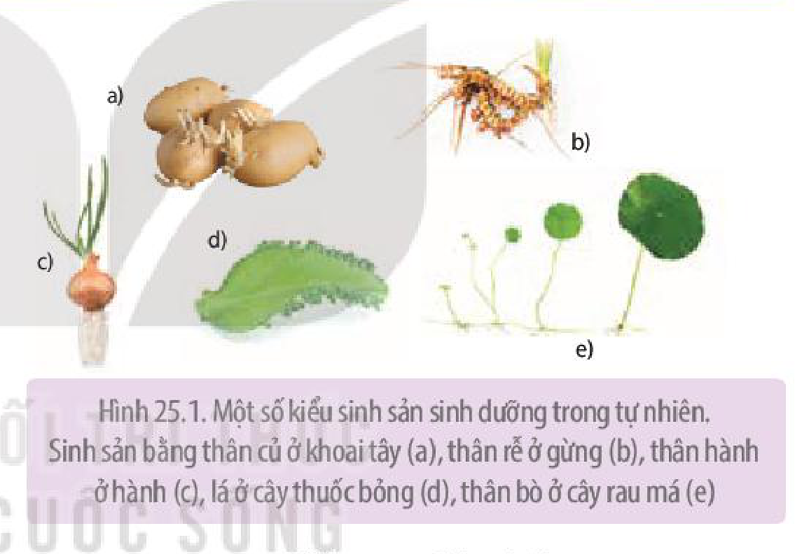

Hình 25.1. Một số kiểu sinh sản sinh dưỡng trong tự nhiên. Sinh sản bằng thân củ ở khoai tây (a), thân rễ ở gừng (b), thân hành ở hành (c), lá ở cây thuốc bỏng (d), thân bò ở cây rau má (e)

**Sinh sản bằng bào tử** là hình thức sinh sản mà cơ thể mới được phát triển từ **bào tử** (n). Trong đó, bào tử đơn bội được hình thành trong **túi bào tử** (**thể bào tử**) của cây mẹ. Khi túi bào tử phát triển đến

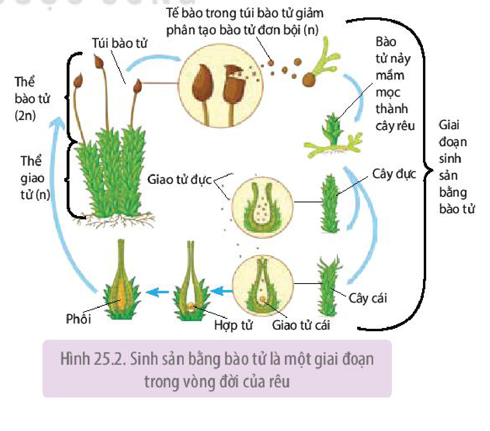

Hình 25.2. Sinh sản bằng bào tử là một giai đoạn trong vòng đời của rêu

<!-- pdf:161 -->

giai đoạn nhất định sẽ vỡ ra, giải phóng bào tử vào môi trường, nếu gặp điều kiện thuận lợi (độ ẩm, nhiệt độ,...) thích hợp, bào tử nguyên phân nhiều lần hình thành cây mới (**thể giao tử**) (H 25.2). Hình thức sinh sản bằng bào tử là một giai đoạn trong vòng đời của một số loài thực vật như rêu, dương xỉ.

### 2. Các phương pháp nhân giống vô tính và ứng dụng trong thực tiễn

Khác với sinh sản sinh dưỡng tự nhiên, **phương pháp nhân giống vô tính** nhân tạo cần đến sự tác động của các biện pháp cơ học, công nghệ sinh học,... để điều chỉnh quá trình phát sinh hình thái từ mô, cơ quan sinh dưỡng hình thành cây con.

Phương pháp nhân giống vô tính thường được ứng dụng trong thực tiễn sản xuất là: giâm cành, chiết cành, ghép (cành hay mắt) và nuôi cấy mô, tế bào (vi nhân giống/nhân giống *in vitro*).

**a) Giâm cành**

**Giâm cành** là kĩ thuật nhân giống sử dụng các đoạn **cành bánh tẻ** và các kĩ thuật nông học để tạo cây hoàn chỉnh.

Phương pháp giâm cành được ứng dụng để nhân giống nhiều loại cây trồng khác nhau như hoa hồng, mía, sắn (H 25.3),... Phương pháp giâm cành tạo ra số lượng lớn cây con có chất lượng đồng đều trong thời gian ngắn. Tuy nhiên, với các cành giâm lấy từ cây mẹ lâu năm, cây giống tạo thành thường nhanh già cỗi.

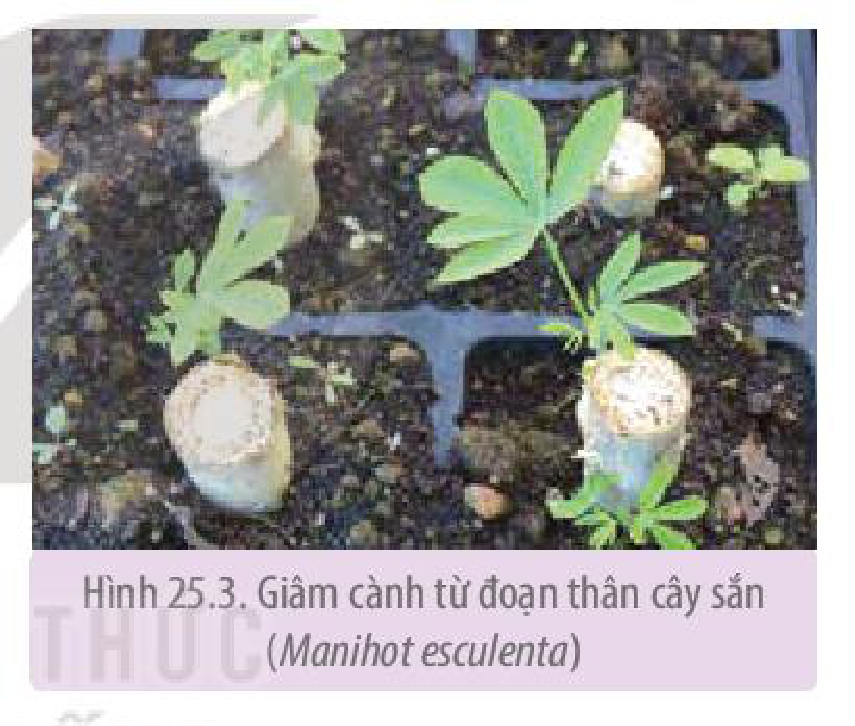

Hình 25.3. Giâm cành từ đoạn thân cây sắn (*Manihot esculenta*)

**b) Chiết cành**

**Chiết cành** là kĩ thuật nhân giống mà cây con tạo được bằng cách thúc đẩy hình thành rễ từ vết khoanh vỏ một cành bánh tẻ trên cây mẹ. Quá trình ra rễ của cành chiết diễn ra tương tự cành giâm, theo đó, dưới tác dụng của auxin, các tế bào tại vết cắt sẽ phản phân hoá thành **mô sẹo**, mô sẹo này sau đó phân hoá để hình thành **rễ bất định**. Khi hệ rễ phát triển đầy đủ, cành chiết được tách khỏi cây mẹ và mang đi trồng.

Chiết cành áp dụng phổ biến cho nhóm cây ăn quả thân gỗ như nhãn, vải, ổi, bưởi, cam (H 25.4),...

Chiết cành cho tỉ lệ sống của cây con cao (có thể lên tới 100%), cây thấp, tán lá gọn, sinh trưởng nhanh và khoẻ nên thuận tiện cho quá trình chăm sóc. Tuy nhiên, hạn chế của phương pháp này là hệ số nhân giống không cao, thường chỉ ứng dụng ở quy mô sản xuất nhỏ, tuổi thọ của cây giống thấp.

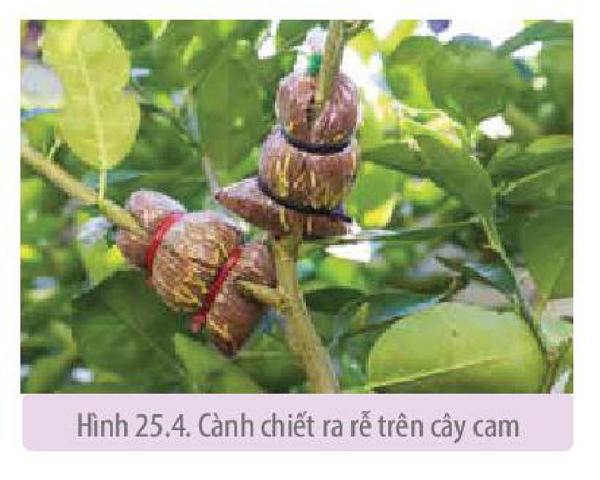

Hình 25.4. Cành chiết ra rễ trên cây cam

<!-- pdf:162 -->

**c) Ghép**

**Ghép** là phương pháp nhân giống sử dụng đoạn thân, cành (**cành ghép**) hoặc chồi (**mắt ghép**) của cây này ghép lên thân hay gốc của cây khác (**gốc ghép**) cùng loài hoặc có quan hệ gần gũi, giúp tổ hợp các đặc tính tốt của cành ghép/mắt ghép và gốc ghép vào cùng một cây.

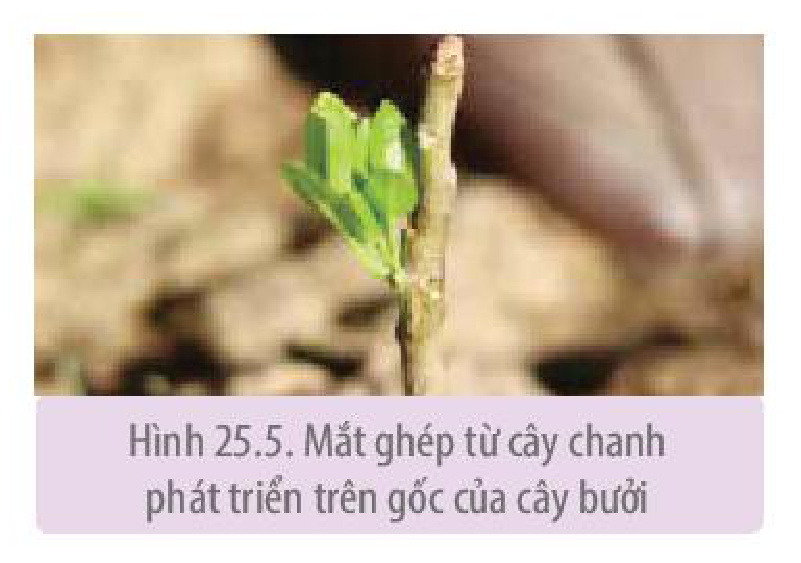

Hình 25.5. Mắt ghép từ cây chanh phát triển trên gốc của cây bưởi

Cây lấy cành/mắt ghép thường là cây cho năng suất cao, chất lượng tốt; trong khi cây dùng làm gốc ghép thường có hệ rễ khoẻ, sức chống chịu cao với điều kiện ngoại cảnh (hạn, úng,...) hay sâu bệnh (đặc biệt là các bệnh có nguồn gốc từ đất). Thông thường, gốc ghép sẽ ít ảnh hưởng đến đặc điểm của cành/mắt ghép (sản phẩm của của cây ghép mang hầu hết các đặc điểm giống với cây cho cành/mắt ghép).

Ví dụ: Ghép cành/mắt của cây hoa hồng với gốc cây tầm xuân, ghép cam hoặc chanh trên gốc cây bưởi (H 25.5),...

**d) Nhân giống in vitro (vi nhân giống)**

**Nhân giống in vitro** là phương pháp được thực hiện dựa trên công nghệ nuôi cấy mô, tế bào thực vật.

Quy trình nhân giống *in vitro* có thể được chia thành các giai đoạn chính dưới đây (H 25.6).

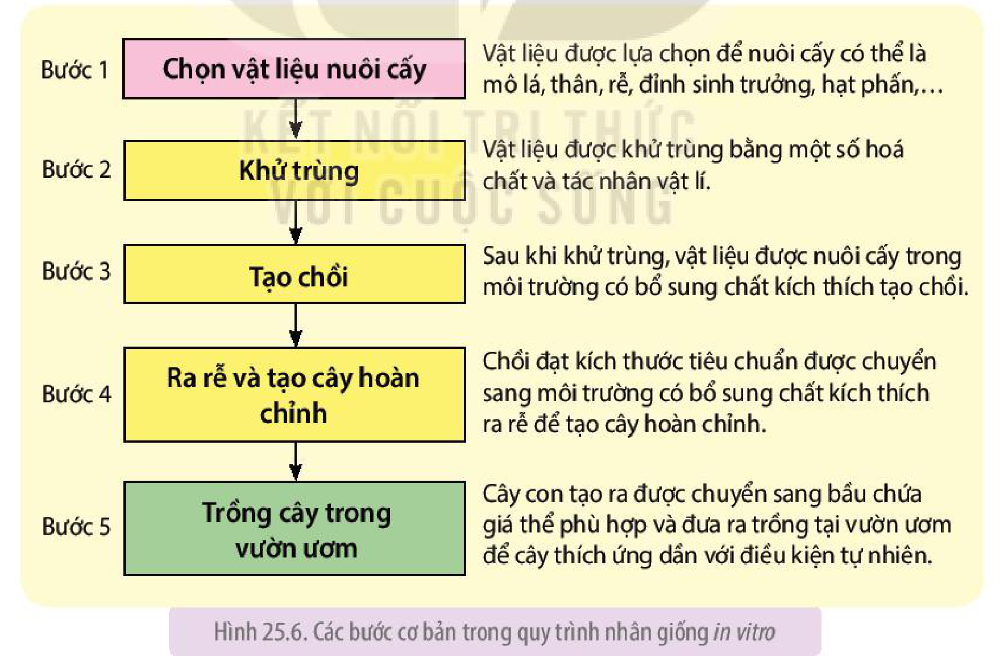

- Bước 1: Chọn vật liệu nuôi cấy — Vật liệu được lựa chọn để nuôi cấy có thể là mô lá, thân, rễ, đỉnh sinh trưởng, hạt phấn,...
- Bước 2: Khử trùng — Vật liệu được khử trùng bằng một số hoá chất và tác nhân vật lí.
- Bước 3: Tạo chồi — Sau khi khử trùng, vật liệu được nuôi cấy trong môi trường có bổ sung chất kích thích tạo chồi.
- Bước 4: Ra rễ và tạo cây hoàn chỉnh — Chồi đạt kích thước tiêu chuẩn được chuyển sang môi trường có bổ sung chất kích thích ra rễ để tạo cây hoàn chỉnh.
- Bước 5: Trồng cây trong vườn ươm — Cây con tạo ra được chuyển sang bầu chứa giá thể phù hợp và đưa ra trồng tại vườn ươm để cây thích ứng dần với điều kiện tự nhiên.

Hình 25.6. Các bước cơ bản trong quy trình nhân giống *in vitro*

Phương pháp nhân giống *in vitro* được ứng dụng rộng rãi ở nhiều loài cây khác nhau do hệ số nhân giống cao, có thể tiến hành quanh năm, cây giống tạo ra sạch bệnh và có thể bảo quản trong thời gian dài.

<!-- pdf:163 -->

## ❓ Dừng lại và suy ngẫm

1. Tại sao trong sinh sản sinh dưỡng, cây con thường giống nhau và giống với cây mẹ? Đặc điểm này có lợi thế trong điều kiện môi trường như thế nào?
2. So sánh ưu điểm và hạn chế của phương pháp nhân giống *in vitro* với các phương pháp nhân giống vô tính khác.
3. Để bảo tồn các cây trồng quý hiếm, có nguy cơ tuyệt chủng nên sử dụng phương pháp nhân giống nào? Tại sao?

## II. SINH SẢN HỮU TÍNH

### 1. Cấu tạo chung của hoa

**Hoa** là chồi sinh sản, cấu tạo gồm bộ phận bất thụ (không sinh sản) và bộ phận hữu thụ (sinh sản), hoa đính vào phần thân cây qua cấu trúc **đế hoa** (H 25.7).

**Bộ phận bất thụ** gồm **lá đài** và các **cánh hoa**. Lá đài thường có màu lục, bao bọc và bảo vệ chồi hoa trước khi hoa nở, trong khi cánh hoa thường có màu sắc sặc sỡ, thu hút côn trùng tham gia vào quá trình thụ phấn.

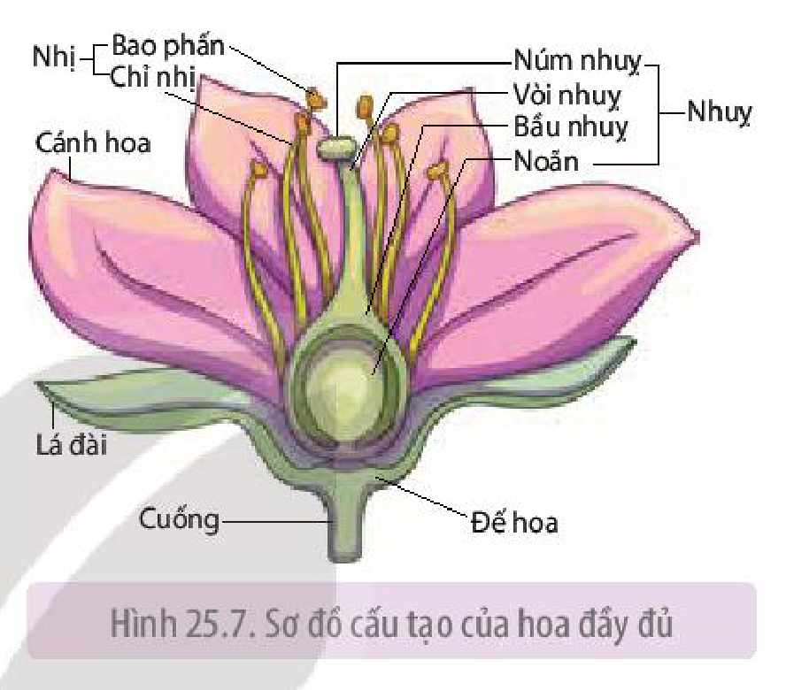

Hình 25.7. Sơ đồ cấu tạo của hoa đầy đủ

**Bộ phận sinh sản** bao gồm **nhị hoa** và **lá noãn** hay còn gọi là **nhuỵ**. Trong đó:
- Nhị hoa gồm chỉ nhị mang bao phấn ở đầu tận cùng, bao phấn chứa các **túi tiểu bào tử** là cấu trúc sinh ra hạt phấn.
- Nhuỵ cấu trúc gồm ba phần: núm nhuỵ, vòi nhuỵ và bầu nhuỵ. Bầu nhuỵ chứa một hay nhiều noãn phụ thuộc vào loài, noãn qua quá trình biến đổi hình thành túi phôi chứa tế bào trứng.

Hoa có thể là **hoa đơn tính** (hoa đực chỉ có nhị hoa và hoa cái chỉ có nhuỵ) như hoa bí ngô, dưa chuột,... hoặc có thể là **hoa lưỡng tính** (hoa có cả nhị và nhuỵ) như hoa chanh, bưởi,... (H 25.8).

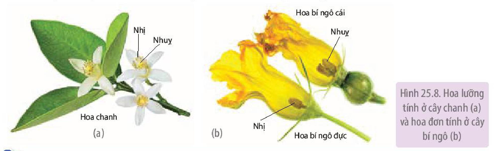

Hình 25.8. Hoa lưỡng tính ở cây chanh (a) và hoa đơn tính ở cây bí ngô (b)

## ❓ Dừng lại và suy ngẫm

1. Hoa được cấu tạo từ những bộ phận nào và vai trò của mỗi bộ phận đó là gì?
2. Một hoa luôn bao gồm hai thành phần là nhị và nhuỵ đúng hay sai? Lấy ví dụ chứng minh.

<!-- pdf:164 -->

### 2. Quá trình sinh sản hữu tính ở thực vật

Quá trình **sinh sản hữu tính ở thực vật có hoa** gồm ba giai đoạn kế tiếp nhau: (1) hình thành hạt phấn và túi phôi; (2) thụ phấn và thụ tinh; (3) hình thành hạt và quả.

**a) Hình thành hạt phấn và túi phôi**

Ở thực vật, giao tử được hình thành từ thể giao tử (hạt phấn và túi phôi). Quá trình hình thành hạt phấn và túi phôi được minh hoạ ở Hình 25.9.

- Hình thành hạt phấn:

<!-- term: Hình thành hạt phấn -->
Bao phấn chứa các **tế bào mẹ tiểu bào tử** (2n), mỗi tế bào này tiến hành giảm phân hình thành 4 bào tử đơn bội (n), mỗi bào tử đơn bội sau đó nguyên phân hình thành nên một hạt phấn. **Hạt phấn** (thể giao tử đực) là tế bào có thành dày, chứa 2 nhân gồm nhân tế bào ống phấn và nhân sinh sản (H 25.9a).

- Hình thành túi phôi:

<!-- term: Hình thành túi phôi -->
**Túi phôi** (thể giao tử cái) được hình thành từ sự biến đổi của tế bào trong cấu trúc noãn. Cụ thể, **tế bào mẹ đại bào tử** (2n) nằm trong túi đại bào tử của noãn tiến hành giảm phân hình thành nên 4 đại bào tử. Ba trong số 4 bào tử này sẽ tiêu biến, một đại bào tử sống sót thực hiện nguyên phân 3 lần tạo thành 8 tế bào (gồm 1 tế bào trứng, 2 tế bào nhân cực, 3 tế bào đối cực và 2 tế bào kèm), lúc này túi đại bào tử được gọi là túi phôi (H 25.9b).

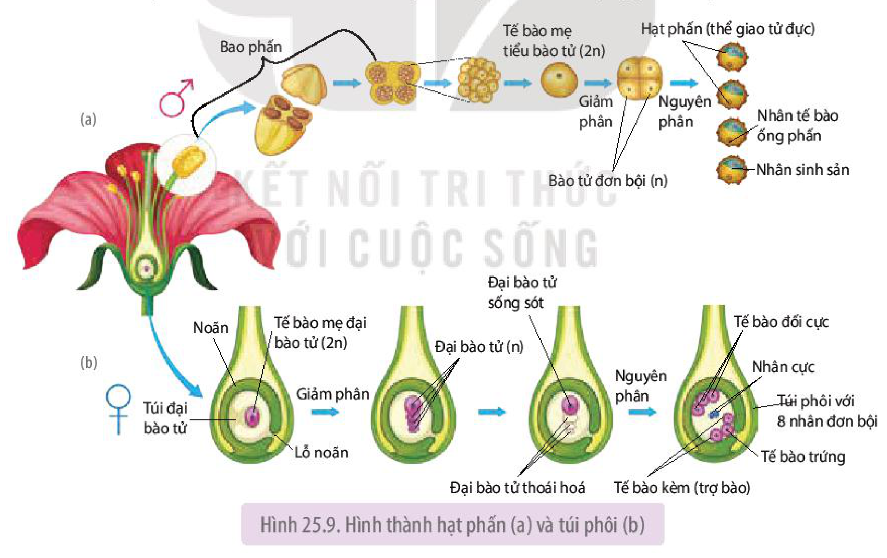

Hình 25.9. Hình thành hạt phấn (a) và túi phôi (b)

**b) Thụ phấn và thụ tinh**

- Quá trình thụ phấn:

**Thụ phấn** là quá trình hạt phấn phát tán và rơi trên núm nhuỵ phù hợp (H 25.10). Ở đa số các loài thực vật, quá trình phát tán của hạt phấn được thực hiện nhờ tác nhân sinh học như ong, bướm, dơi,... hoặc tác nhân phi sinh học chủ yếu là gió và nước. Một số ít loài còn lại có thể tự thụ phấn.

<!-- pdf:165 -->

Căn cứ trên nguồn gốc của hạt phấn và núm nhuỵ, người ta phân biệt hai hình thức thụ phấn là tự thụ phấn và thụ phấn chéo. Quá trình thụ phấn xảy ra trong một hoa hay giữa các hoa trên cùng một cây gọi là **tự thụ phấn**, trong khi đó, **thụ phấn chéo** là hình thức thụ phấn xảy ra giữa các hoa của hai cây khác nhau.

- Quá trình thụ tinh:

**Thụ tinh** là sự kết hợp giữa giao tử đực với giao tử cái hình thành nên hợp tử. Trong quá trình thụ tinh, sau khi ống phấn sinh trưởng kéo dài theo vòi nhuỵ chạm tới túi phôi, xuyên qua lỗ noãn, sẽ giải phóng hai **tinh tử** (giao tử đực), một tinh tử kết hợp với trứng (giao tử cái) tạo nên hợp tử (2n), một tinh tử còn lại hợp nhất với tế bào lớn chứa hai nhân ở trung tâm túi phôi (**nhân cực**) hình thành nên **nhân tam bội** (3n). Cả hai giao tử đều tham gia vào thụ tinh nên quá trình này được gọi là **thụ tinh kép**, hình thức thụ tinh này chỉ gặp ở thực vật hạt kín.

Diễn biến của quá trình thụ tinh được thể hiện trên Hình 25.10.

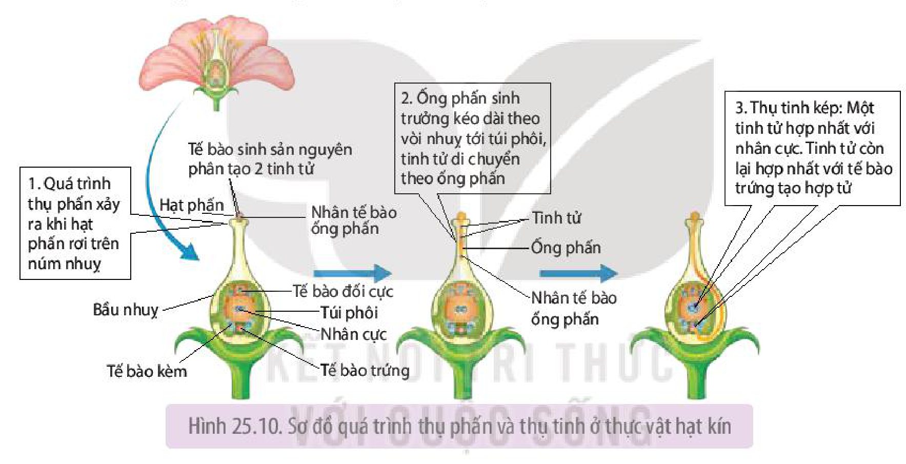

Hình 25.10. Sơ đồ quá trình thụ phấn và thụ tinh ở thực vật hạt kín

Quá trình thụ tinh chịu ảnh hưởng của các yếu tố bên trong như sự tương hợp di truyền, hàm lượng auxin nội sinh của hạt phấn. Ngoài ra, các tác nhân ngoại cảnh như độ ẩm, gió, nhiệt độ là những yếu tố tác động trực tiếp đến khả năng nảy mầm của hạt phấn, tỉ lệ hạt phấn tìm được đến núm nhuỵ. Việc nghiên cứu các yếu tố này giúp làm tăng tỉ lệ thụ phấn và thụ tinh, góp phần tăng năng suất cây trồng.

## ❓ Dừng lại và suy ngẫm

1. Quá trình thụ tinh ở thực vật diễn ra như thế nào (tham khảo Hình 25.10)? Tại sao gọi quá trình thụ tinh ở thực vật có hoa là thụ tinh kép?
2. Ở hình bên, chiều di chuyển của hạt phấn đến nhuỵ hoa được thể hiện bằng mũi tên, cho biết số (1) và số (2) tương ứng với kiểu thụ phấn nào ở thực vật?

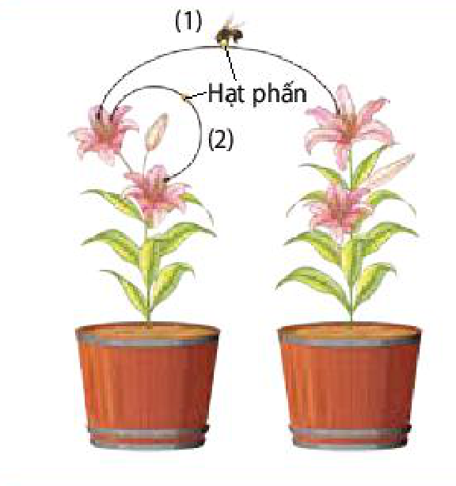

<!-- pdf:166 -->

**c) Quá trình hình thành hạt và quả**

- Quá trình hình thành hạt:

<!-- term: Quá trình hình thành hạt -->
Sau thụ tinh, noãn chứa hợp tử (2n) và nhân tam bội (3n) sẽ phát triển thành **hạt**. Trong đó, hợp tử phân chia liên tiếp nhiều lần tạo các tế bào con, sau đó phân hoá hình thành nên cấu trúc của **phôi** gồm lá mầm, thân mầm và rễ mầm. Nhân tam bội cũng phân chia tạo nên khối tế bào giàu dinh dưỡng gọi là **nội nhũ**. Ở các cây hai lá mầm, chất dinh dưỡng tích luỹ ở nội nhũ sẽ chuyển vào lá mầm nên hạt của chúng không có nội nhũ. Chất dinh dưỡng trong nội nhũ hay lá mầm giúp nuôi phôi và cây mầm đến khi cây con có thể tự dưỡng. Giai đoạn cuối của quá trình hình thành hạt, vỏ noãn cứng lại và mất nước tạo nên vỏ hạt.

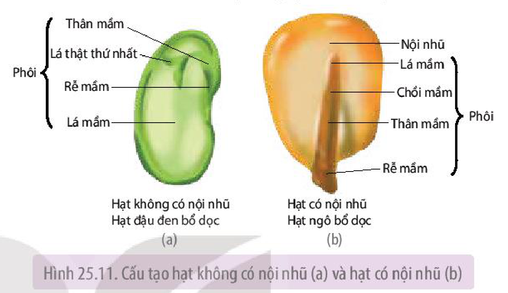

Hình 25.11. Cấu tạo hạt không có nội nhũ (a) và hạt có nội nhũ (b)

Hạt được chia thành hai loại: **hạt có nội nhũ** (hạt của cây một lá mầm như hạt ngô, lúa mì, lúa,...) và **hạt không có nội nhũ** (hạt cây hai lá mầm như hạt đậu đen, hạt bí ngô, hạt lạc,...) (H 25.11).

- Quá trình hình thành quả:

<!-- term: Quá trình hình thành quả -->
Đồng thời với quá trình hình thành hạt, bầu nhuỵ sẽ phát triển thành **quả**. Quả có vai trò bảo vệ và phát tán hạt.
Hạt xuất hiện làm tăng lượng hormone (auxin, cytokinin, gibberellin) khuếch tán vào bầu nhuỵ, thúc đẩy các tế bào tại đây phân chia và gia tăng kích thước dẫn đến hình thành quả. Khi quả đã phát triển đầy đủ và đạt kích thước đặc trưng, quả bước vào giai đoạn già và chín, quá trình này được điều khiển bởi hormone ethylene.

## ❓ Dừng lại và suy ngẫm

1. Nội nhũ của hạt ở cây một lá mầm và cây hai lá mầm khác nhau như thế nào? Nội nhũ có vai trò gì?
2. Quả được hình thành như thế nào? Đặc điểm nào giúp quả thực hiện được vai trò bảo vệ và phát tán hạt?

## 📌 Kiến thức cốt lõi

- Thực vật sinh sản theo hai hình thức là sinh sản vô tính (sinh sản sinh dưỡng) và sinh sản hữu tính.
- Giâm cành, chiết cành, ghép cành (mắt) và nhân giống *in vitro* là các phương pháp nhân giống được con người thực hiện dựa trên hình thức sinh sản vô tính ở thực vật.

<!-- pdf:167 -->

- Trong sinh sản hữu tính, hạt phấn chứa hai tinh tử (giao tử đực) được hình thành từ các tế bào trong bao phấn, túi phôi chứa tế bào trứng (giao tử cái) được tạo thành từ sự biến đổi của noãn.
- Thụ phấn là quá trình hạt phấn phát tán và rơi trên núm nhuỵ. Thụ tinh diễn ra sau thụ phấn, khi một tinh tử kết hợp với trứng tạo hợp tử, một tinh tử kết hợp với tế bào trung tâm chứa 2 nhân cực nằm trong túi phôi hình thành nên nội nhũ tam bội, đây là quá trình thụ tinh kép chỉ gặp ở thực vật có hoa.
- Hạt được phát triển từ noãn đã thụ tinh. Hạt chứa phôi và nội nhũ hoặc không có nội nhũ. Bầu nhuỵ phát triển thành quả, quả có chức năng bảo vệ và phát tán hạt.

## ✏️ Luyện tập và vận dụng

1. So sánh hình thức sinh sản vô tính với hình thức sinh sản hữu tính ở thực vật.
2. Bằng kiến thức đã học và quan sát thực tế, em hãy kẻ và hoàn thành bảng vào vở theo mẫu dưới đây và rút ra nhận xét chung về điều kiện sinh thái (môi trường) đảm bảo cho quá trình sinh sản vô tính ở thực vật diễn ra thuận lợi trong tự nhiên.

| Thực vật | Cây chuối | Cây riềng | Cỏ gấu | Sen đá | Trầu không |
|---|---|---|---|---|---|
| Cơ quan, bộ phận tạo cây con | ? | ? | ? | ? | ? |

3. Vườn nhà bác Minh có một cây bưởi cho quả rất ngon, bác muốn nhân giống để trồng thêm vài cây nữa ở góc vườn, em hãy gợi ý cho bác Minh phương pháp nhân giống phù hợp và thuyết phục bác thực hiện theo lời khuyên của em.

## 💡 Em có biết

**Tomtato** là giống cây ghép từ ngọn cà chua với phần gốc cây khoai tây do Paul Hansord, Giám đốc công ty Thompson & Morgan (Anh) thực hiện. Cây Tomtato đã được tạo ra bằng việc cắt vát nhọn và dẹt phần ngọn cà chua, sau đó xẻ đôi thân cây khoai tây, ghép chúng lại với nhau rồi quấn quanh vết ghép và giữ cây đứng thẳng. Trung bình một vụ, mỗi cây cho khoảng 500 quả cà chua với chất lượng tương đương hoặc cao hơn cây cà chua thông thường, cùng với nó là khoảng hơn 2 kg khoai tây.

## 📷 Danh sách hình trong bài

| Mã hình | Trang PDF | Vị trí | Chú thích gốc |
|---|---|---|---|
| H11-sinh-b25-01 | 160 | Mục I.1 | Hình 25.1. Một số kiểu sinh sản sinh dưỡng trong tự nhiên. Sinh sản bằng thân củ ở khoai tây (a), thân rễ ở gừng (b), thân hành ở hành (c), lá ở cây thuốc bỏng (d), thân bò ở cây rau má (e) |
| H11-sinh-b25-02 | 160 | Mục I.1 | Hình 25.2. Sinh sản bằng bào tử là một giai đoạn trong vòng đời của rêu |
| H11-sinh-b25-03 | 161 | Mục I.2.a | Hình 25.3. Giâm cành từ đoạn thân cây sắn (*Manihot esculenta*) |
| H11-sinh-b25-04 | 161 | Mục I.2.b | Hình 25.4. Cành chiết ra rễ trên cây cam |
| H11-sinh-b25-05 | 162 | Mục I.2.c | Hình 25.5. Mắt ghép từ cây chanh phát triển trên gốc của cây bưởi |
| H11-sinh-b25-06 | 162 | Mục I.2.d | Hình 25.6. Các bước cơ bản trong quy trình nhân giống *in vitro* |
| H11-sinh-b25-07 | 163 | Mục II.1 | Hình 25.7. Sơ đồ cấu tạo của hoa đầy đủ |
| H11-sinh-b25-08 | 163 | Mục II.1 (allow_edge_ink: cạnh dưới góc trái chạm biểu tượng dấu hỏi của hộp Dừng lại và suy ngẫm nằm cao hơn đáy hộp chú thích Hình 25.8) | Hình 25.8. Hoa lưỡng tính ở cây chanh (a) và hoa đơn tính ở cây bí ngô (b) |
| H11-sinh-b25-09 | 164 | Mục II.2.a | Hình 25.9. Hình thành hạt phấn (a) và túi phôi (b) |
| H11-sinh-b25-10 | 165 | Mục II.2.b | Hình 25.10. Sơ đồ quá trình thụ phấn và thụ tinh ở thực vật hạt kín |
| H11-sinh-b25-11 | 165 | Dừng lại và suy ngẫm (Mục II.2.b) | Sơ đồ các kiểu thụ phấn (1) và (2) ở thực vật (sách không đánh số hình) |
| H11-sinh-b25-12 | 166 | Mục II.2.c | Hình 25.11. Cấu tạo hạt không có nội nhũ (a) và hạt có nội nhũ (b) |
