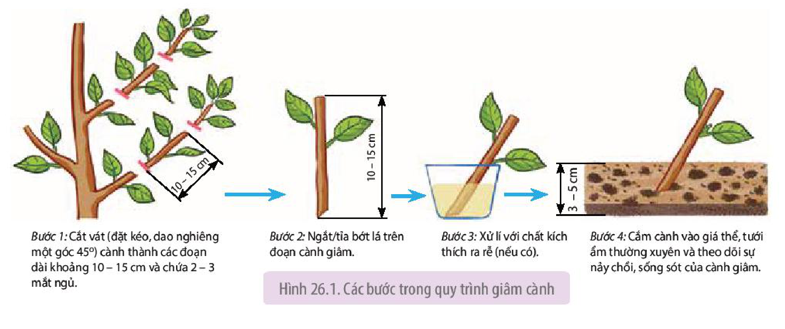
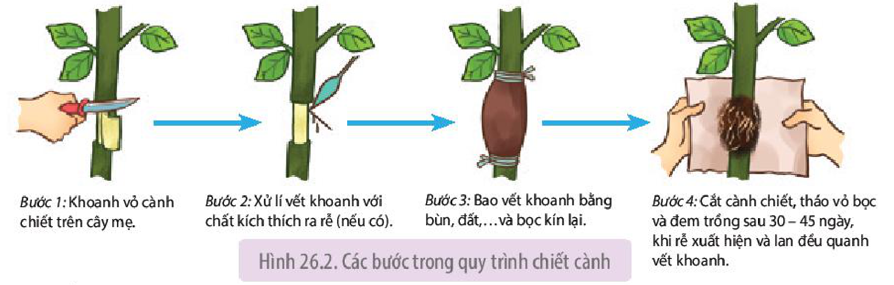
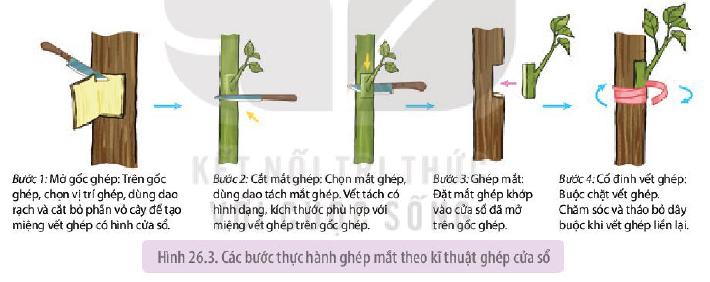
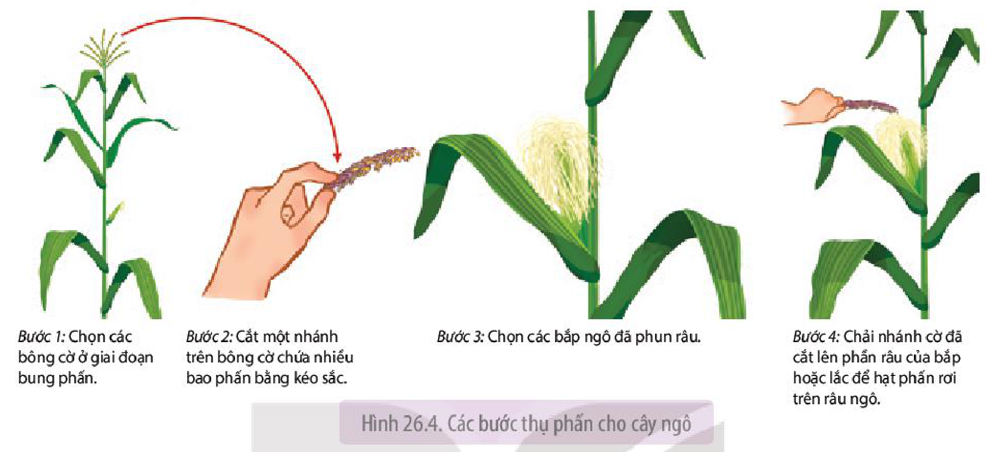

<!-- pdf:168 -->

# BÀI 26: THỰC HÀNH: NHÂN GIỐNG VÔ TÍNH VÀ THỤ PHẤN CHO CÂY

## I. YÊU CẦU CẦN ĐẠT
<!-- ocr-ok: OCR đọc nhầm "I. YÊU CẦU CẦN ĐẠT" thành "I.. YÊU GẦU CẦM ĐẠT"; đã đối chiếu ảnh PDF 168 -->

Thực hành được nhân giống cây bằng sinh sản sinh dưỡng; thụ phấn cho cây (thụ phấn hoặc quan sát thụ phấn ở ngô).

## II. CHUẨN BỊ

### 1. Dụng cụ, thiết bị

- Dao, kéo cắt cành, kéo nhỏ và sắc, dây buộc.
- Video, tranh, ảnh về quá trình thụ phấn cho cây.

### 2. Mẫu vật

- Một số loại cây theo mùa phù hợp để nhân giống vô tính như cây dâu tằm, hoa hồng, rau muống, rau ngót, dây khoai lang,... và giá thể trồng cây.
- Cây ngô đang ở giai đoạn ra hoa.

## III. CÁCH TIẾN HÀNH

### 1. Thực hành nhân giống vô tính cây trồng

**a) Nguyên lí**

Dựa trên hình thức sinh sản sinh dưỡng của thực vật trong tự nhiên để nhân giống cây trồng bằng cách sử dụng các kĩ thuật nông học nhằm thúc đẩy quá trình ra rễ của cành chiết, cành giâm hay liền vết thương ở cành ghép, qua đó tạo cây mới từ đoạn thân, cành của cây mẹ.

**b) Quy trình thực hành**

- Giâm cành

- *Bước 1:* Cắt vát (đặt kéo, dao nghiêng một góc 45°) cành thành các đoạn dài khoảng 10 – 15 cm và chứa 2 – 3 mắt ngủ.
- *Bước 2:* Ngắt/tỉa bớt lá trên đoạn cành giâm.
- *Bước 3:* Xử lí với chất kích thích ra rễ (nếu có).
- *Bước 4:* Cắm cành vào giá thể, tưới ẩm thường xuyên và theo dõi sự nảy chồi, sống sót của cành giâm.

Hình 26.1. Các bước trong quy trình giâm cành

<!-- pdf:169 -->

*Lưu ý:* Có thể tiến hành với các đoạn cành giâm có độ tuổi khác nhau hoặc cành có xử lí và không xử lí chất kích thích ra rễ để so sánh kết quả ở bước 4.

- Chiết cành

Quy trình chiết cành được thực hiện theo sơ đồ Hình 26.2.

- *Bước 1:* Khoanh vỏ cành chiết trên cây mẹ.
- *Bước 2:* Xử lí vết khoanh với chất kích thích ra rễ (nếu có).
- *Bước 3:* Bao vết khoanh bằng bùn, đất,... và bọc kín lại.
- *Bước 4:* Cắt cành chiết, tháo vỏ bọc và đem trồng sau 30 – 45 ngày, khi rễ xuất hiện và lan đều quanh vết khoanh.

Hình 26.2. Các bước trong quy trình chiết cành

- Ghép mắt

**Ghép mắt** có thể thực hiện theo các kĩ thuật như **ghép cửa sổ**, ghép chữ T,... Hình 26.3 thể hiện quy trình ghép mắt theo kĩ thuật ghép cửa sổ.

- *Bước 1: Mở gốc ghép:* Trên gốc ghép, chọn vị trí ghép, dùng dao rạch và cắt bỏ phần vỏ cây để tạo miệng vết ghép có hình cửa sổ.
- *Bước 2: Cắt mắt ghép:* Chọn mắt ghép, dùng dao tách mắt ghép. Vết tách có hình dạng, kích thước phù hợp với miệng vết ghép trên gốc ghép.
- *Bước 3: Ghép mắt:* Đặt mắt ghép khớp vào cửa sổ đã mở trên gốc ghép.
- *Bước 4: Cố định vết ghép:* Buộc chặt vết ghép. Chăm sóc và tháo bỏ dây buộc khi vết ghép liền lại.

Hình 26.3. Các bước thực hành ghép mắt theo kĩ thuật ghép cửa sổ

*Lưu ý:* Có thể thay đổi hình dạng miệng vết ghép và mắt ghép, cần đảm bảo để vết ghép khớp nhau và không quá lớn. Vết cắt cần thực hiện thật gọn, tránh làm dập chồi ghép. Khi buộc vết ghép, không buộc đè lên chồi ghép.

### 2. Thực hành thụ phấn cho cây ngô

**a) Nguyên lí**

Ngô là cây có hoa đơn tính cùng gốc, hoa đực còn gọi là **bông cờ** ở phần ngọn và hoa cái hay **bắp** ở phần thân. Trong tự nhiên, bông cờ thường tung phấn trước khi phần bắp phun râu sẵn sàng cho việc thụ phấn từ 3 – 4 ngày. Do vậy, cây ngô thường có hiện tượng giao phấn nhờ gió, trong trường hợp hoa nở vào những ngày ít gió, con người có thể tiến hành **thụ phấn bổ sung** bằng cách thu phấn của bông cờ để thụ phấn cho bắp.

**b) Quy trình thực hành**

Quy trình thụ phấn cho cây ngô được thực hiện theo 4 bước như mô tả trong Hình 26.4.

<!-- pdf:170 -->

*Lưu ý:* Trong trường hợp không chuẩn bị được cây ngô ở giai đoạn ra hoa, học sinh có thể quan sát quy trình thụ phấn trên video, tranh, ảnh.

- *Bước 1:* Chọn các bông cờ ở giai đoạn bung phấn.
- *Bước 2:* Cắt một nhánh trên bông cờ chứa nhiều bao phấn bằng kéo sắc.
- *Bước 3:* Chọn các bắp ngô đã phun râu.
- *Bước 4:* Chải nhánh cờ đã cắt lên phần râu của bắp hoặc lắc để hạt phấn rơi trên râu ngô.

Hình 26.4. Các bước thụ phấn cho cây ngô

## IV. THU HOẠCH

Học sinh viết báo cáo thực hành theo các nội dung sau:

**BÁO CÁO THỰC HÀNH**

1. **Mục đích**
2. **Kết quả và giải thích**
- Trình bày kết quả thí nghiệm giâm cành, chiết và ghép cành theo gợi ý trong bảng dưới đây:

| Biện pháp nhân giống | Tỉ lệ sống của cây con | Thời gian tạo cây con hoàn chỉnh | Đặc điểm/chất lượng của cây con |
|---|---|---|---|
| Giâm cành | | | |
| Chiết cành | | | |
| Ghép cành | | | |

- Thí nghiệm thụ phấn ngô: đánh giá về khối lượng, chất lượng của bắp ngô được thụ phấn, có thể so sánh với các bắp ngô được thụ phấn hoặc giao phấn tự nhiên.
3. **Trả lời câu hỏi**

Em hãy đề xuất thêm một phương pháp thu hạt phấn ngô để hạn chế việc thất thoát hạt phấn trong quá trình cắt nhánh bông cờ ở bước 2 trong quy trình thụ phấn cho ngô mô tả ở Hình 26.4.

## 📷 Danh sách hình trong bài

| Mã hình | Trang PDF | Vị trí | Chú thích gốc |
|---|---|---|---|
| H11-sinh-b26-01 | 168 | Mục III.1.b | Hình 26.1. Các bước trong quy trình giâm cành |
| H11-sinh-b26-02 | 169 | Mục III.1.b | Hình 26.2. Các bước trong quy trình chiết cành |
| H11-sinh-b26-03 | 169 | Mục III.1.b | Hình 26.3. Các bước thực hành ghép mắt theo kĩ thuật ghép cửa sổ |
| H11-sinh-b26-04 | 170 | Mục III.2.b | Hình 26.4. Các bước thụ phấn cho cây ngô |
