<!-- pdf:171 -->

# BÀI 27: SINH SẢN Ở ĐỘNG VẬT

## 🎯 Yêu cầu cần đạt

- Phân biệt được các hình thức sinh sản vô tính ở động vật.
- Phân biệt được các hình thức sinh sản hữu tính ở động vật.
- Trình bày được quá trình sinh sản hữu tính ở động vật.
- Phân tích được cơ chế điều hoà sinh sản ở động vật.
- Trình bày được một số ứng dụng về điều khiển sinh sản ở động vật và sinh đẻ có kế hoạch ở người.
- Nêu được một số thành tựu thụ tinh trong ống nghiệm.
- Trình bày được các biện pháp tránh thai.

## 🔴 Mở đầu

Sinh sản ở động vật khác với sinh sản ở thực vật như thế nào?

Động vật có hai phương thức sinh sản, đó là sinh sản vô tính và sinh sản hữu tính. **Sinh sản vô tính ở động vật** gặp ở các loài động vật có cấu tạo cơ thể đơn giản, còn **sinh sản hữu tính ở động vật** có ở hầu hết động vật không xương sống và có xương sống.

## I. SINH SẢN VÔ TÍNH Ở ĐỘNG VẬT

Các hình thức sinh sản vô tính ở động vật gồm phân đôi, nảy chồi, phân mảnh và trinh sinh.

### 1. Phân đôi

**Phân đôi** là hình thức sinh sản mà một cá thể mẹ phân đôi thành hai cá thể có kích thước gần bằng nhau.

Sinh sản bằng hình thức phân đôi gặp ở hải quỳ.

### 2. Nảy chồi

**Nảy chồi** là hình thức sinh sản mà chồi mọc ra từ cơ thể mẹ, lớn dần lên, sau đó tách ra thành cơ thể mới.

Sinh sản bằng cách nảy chồi có ở Bọt biển, Ruột khoang (H 27.1).

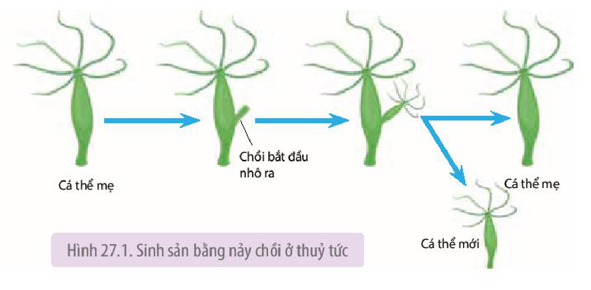

Hình 27.1. Sinh sản bằng nảy chồi ở thuỷ tức

<!-- pdf:172 -->

### 3. Phân mảnh

**Phân mảnh** là hình thức sinh sản mà cơ thể mới phát triển từ mảnh tách ra từ cơ thể mẹ.

Sinh sản bằng cách phân mảnh gặp ở Giun dẹp, Bọt biển, sao biển (H 27.2).

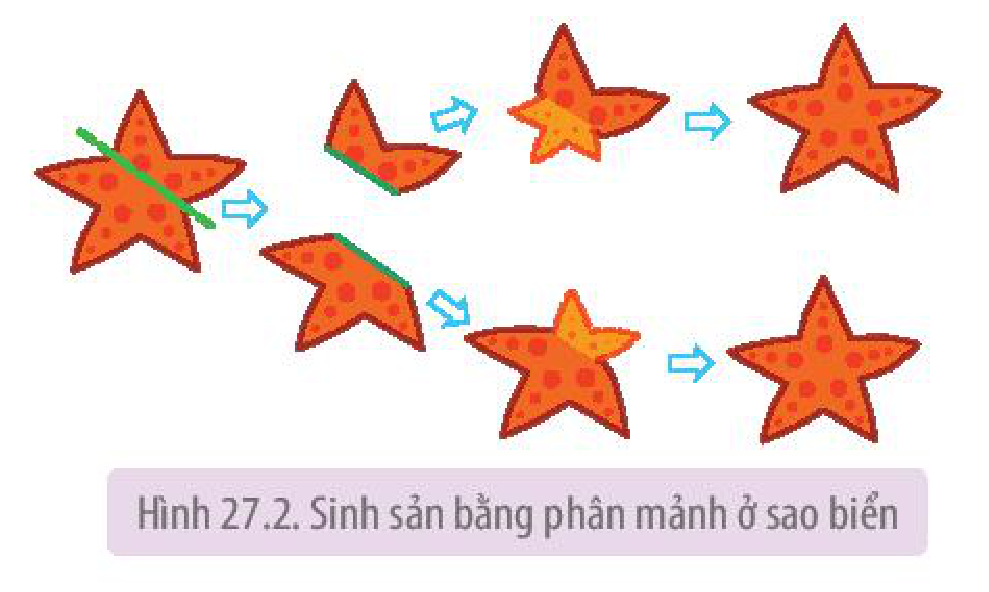

Hình 27.2. Sinh sản bằng phân mảnh ở sao biển

### 4. Trinh sinh

**Trinh sinh** là hình thức sinh sản, trong đó cơ thể mới phát triển từ trứng không được thụ tinh.

Trinh sinh gặp ở các loài chân đốt như ong, kiến, rệp. Một vài loài cá, lưỡng cư, bò sát cũng sinh sản theo cách này. Sinh sản theo kiểu trinh sinh thường xen kẽ với sinh sản hữu tính. Ví dụ: Ong mật chúa đẻ rất nhiều trứng, những trứng không thụ tinh sẽ phát triển thành ong đực có bộ nhiễm sắc thể đơn bội, còn những trứng thụ tinh phát triển thành ong thợ. Ong chúa có bộ nhiễm sắc thể lưỡng bội.

## ❓ Dừng lại và suy ngẫm

1. Phân biệt hình thức sinh sản phân đôi, nảy chồi, phân mảnh và trinh sinh.
2. Tại sao trong sinh sản vô tính ở động vật, các cá thể con giống nhau và giống cá thể mẹ về các đặc điểm di truyền?

## II. SINH SẢN HỮU TÍNH Ở ĐỘNG VẬT

### 1. Các hình thức sinh sản hữu tính

Nếu dựa vào nơi phát triển phôi và sản phẩm sinh ra, hình thức sinh sản hữu tính có thể chia thành: đẻ trứng, đẻ trứng thai và đẻ con.

**a) Đẻ trứng**

<!-- term: Đẻ trứng -->
- Trứng được con cái đẻ vào môi trường nước, con đực xuất tinh dịch lên trứng để thụ tinh (gọi là **thụ tinh ngoài**). Con non nở ra từ trứng phát triển thành con trưởng thành.

Cá, Lưỡng cư và nhiều loài động vật không xương sống đẻ trứng và trứng thụ tinh với tinh trùng trong môi trường nước.

<!-- term: Đẻ trứng -->
- Trứng thụ tinh với tinh trùng bên trong cơ thể con cái (gọi là **thụ tinh trong**), tiếp đó con cái đẻ trứng đã thụ tinh vào môi trường sống. Con non nở ra từ trứng phát triển thành con trưởng thành.

<!-- pdf:173 -->

Bò sát, Chim và nhiều loài động vật không xương sống đẻ trứng, trứng thụ tinh trong cơ thể con cái.

**b) Đẻ trứng thai (noãn thai sinh)**

**Đẻ trứng thai** (**noãn thai sinh**): Trứng thụ tinh với tinh trùng tạo thành hợp tử trong cơ thể con cái. Hợp tử được giữ lại và phát triển trong ống dẫn trứng của con cái nhờ chất dinh dưỡng dự trữ trong noãn hoàng. Đến một thời điểm nhất định, con non được mẹ đẻ ra.

Đẻ trứng thai gặp ở một số loài cá, một số loài bò sát và một số loài chân khớp.

**c) Đẻ con (thai sinh)**

**Đẻ con** (**thai sinh**): Trứng thụ tinh với tinh trùng tạo thành hợp tử trong cơ thể con cái. Hợp tử phát triển trong tử cung nhờ lấy chất dinh dưỡng từ cơ thể mẹ qua **nhau thai**. Đến một thời điểm nhất định, con non được mẹ đẻ ra.

Đẻ con có ở Thú (trừ thú mỏ vịt) và người.

### 2. Quá trình sinh sản hữu tính ở người

Quá trình sinh sản hữu tính gồm bốn giai đoạn kế tiếp nhau: hình thành giao tử (tinh trùng và trứng), thụ tinh, phát triển phôi thai và đẻ con, mỗi giai đoạn xảy ra trong một khoảng thời gian nhất định (H 27.3).

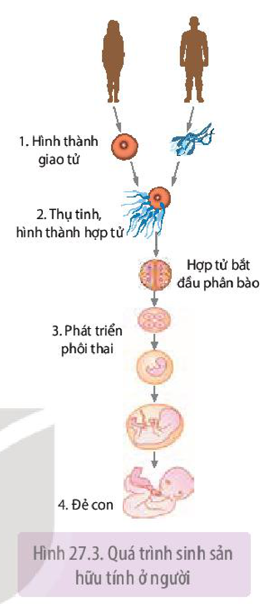

Hình 27.3. Quá trình sinh sản hữu tính ở người

**a) Hình thành tinh trùng và trứng**

Ở người, giao tử đực là **tinh trùng** và giao tử cái là **trứng**. Các **tế bào mầm sinh dục** tạo ra giao tử được hình thành rất sớm trong giai đoạn phát triển phôi.

<!-- term: Quá trình sinh tinh -->
- Quá trình sinh tinh:

Tinh trùng hình thành trong **ống sinh tinh** của hai tinh hoàn, bắt đầu từ **tinh nguyên bào**, trải qua quá trình nguyên phân và giảm phân (H 27.4).

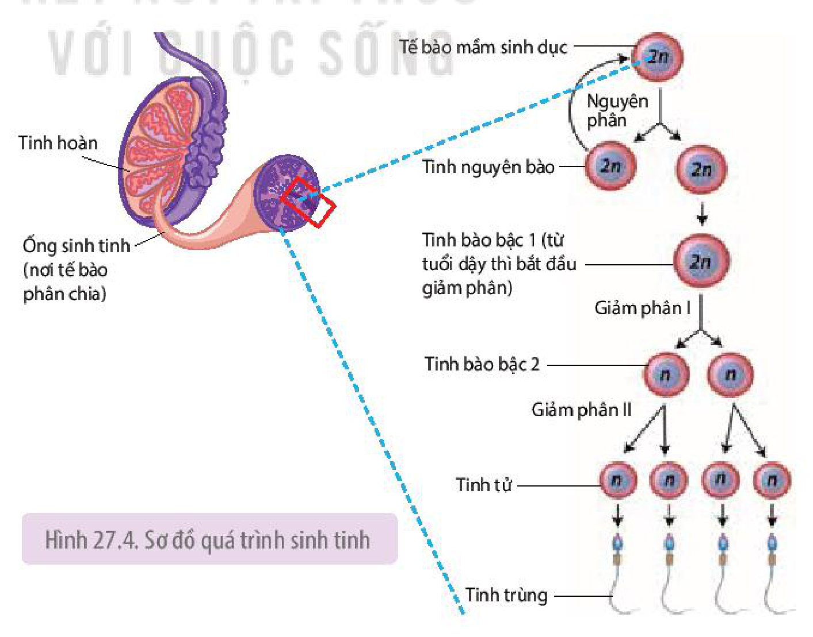

Hình 27.4. Sơ đồ quá trình sinh tinh

<!-- pdf:174 -->

Thời gian sản sinh tinh trùng, tính từ tinh nguyên bào đến khi tạo thành tinh trùng mất khoảng 64 ngày. Hai tinh hoàn có khả năng sản sinh khoảng 120 triệu tinh trùng mỗi ngày. Tuy nhiên, số lượng và chất lượng tinh trùng giảm dần theo tuổi.

<!-- term: Quá trình sinh trứng -->
- Quá trình sinh trứng:

Quá trình sinh trứng diễn ra trong hai buồng trứng của nữ giới. Buồng trứng của trẻ sơ sinh gái đã có khoảng 400 000 **noãn bào bậc 1** nằm trong các **nang trứng** sơ cấp. Tuy nhiên, chỉ khoảng 300 – 400 noãn bào bậc 1 phát triển thành tế bào trứng trưởng thành trong suốt cuộc đời người phụ nữ.

Các tế bào trứng phát triển trong các nang trứng của buồng trứng. Mỗi nang trứng được cấu tạo từ một tế bào trứng (noãn bào), nhiều tế bào hạt và tế bào vỏ nang. Buồng trứng của người phụ nữ trưởng thành chứa các nang trứng ở các giai đoạn phát triển khác nhau. Bắt đầu từ tuổi dậy thì cho đến khi mãn kinh, cứ khoảng 28 ngày thì có một nang trứng chín và **trứng rụng**, nghĩa là chu kì nang trứng chín và trứng rụng là khoảng 28 ngày.

Quá trình sinh trứng diễn ra theo trình tự được mô tả trong Hình 27.5.

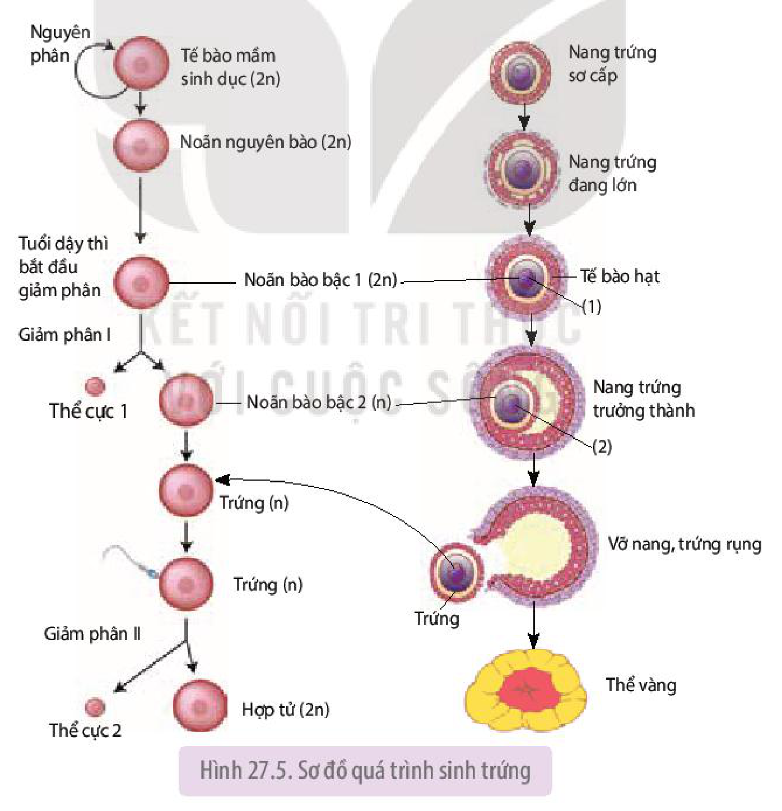

Hình 27.5. Sơ đồ quá trình sinh trứng

Noãn bào bậc 1 (2n) bắt đầu giảm phân I khi trẻ em gái bắt đầu dậy thì và dừng lại ở kì giữa của giảm phân II. Giảm phân II chỉ tiếp tục diễn ra khi trứng thụ tinh với tinh trùng để tạo thành hợp tử.

<!-- pdf:175 -->

Tế bào hạt của nang trứng tiết ra hormone estrogen kích thích niêm mạc tử cung phát triển. Sau khi nang trứng chín và vỡ ra, trứng được giải phóng vào ống dẫn trứng, phần còn lại của nang trứng phát triển thành **thể vàng**. Thể vàng tiết ra estrogen và progesterone kích thích niêm mạc tử cung tiếp tục phát triển, chuẩn bị đón hợp tử làm tổ.

**b) Thụ tinh**

**Thụ tinh** là sự kết hợp giữa tinh trùng đơn bội (n) và tế bào trứng đơn bội (n) tạo thành hợp tử lưỡng bội (2n). Như vậy, hợp tử là tế bào có một nửa số lượng nhiễm sắc thể nhận từ bố và một nửa số lượng nhiễm sắc thể nhận từ mẹ.

Quá trình thụ tinh diễn ra theo trình tự như Hình 27. 6.

Khi tinh trùng gắn vào thụ thể trên màng sinh chất của tế bào trứng thì gây ra **phản ứng vỏ**, ngăn không cho các tinh trùng khác xâm nhập vào tế bào trứng. Vì vậy, chỉ có một tinh trùng thụ tinh với một tế bào trứng để tạo thành hợp tử.

Thụ tinh diễn ra trong ống dẫn trứng, tại 1/3 ống dẫn trứng tính từ loa vòi trứng (H 27.7).

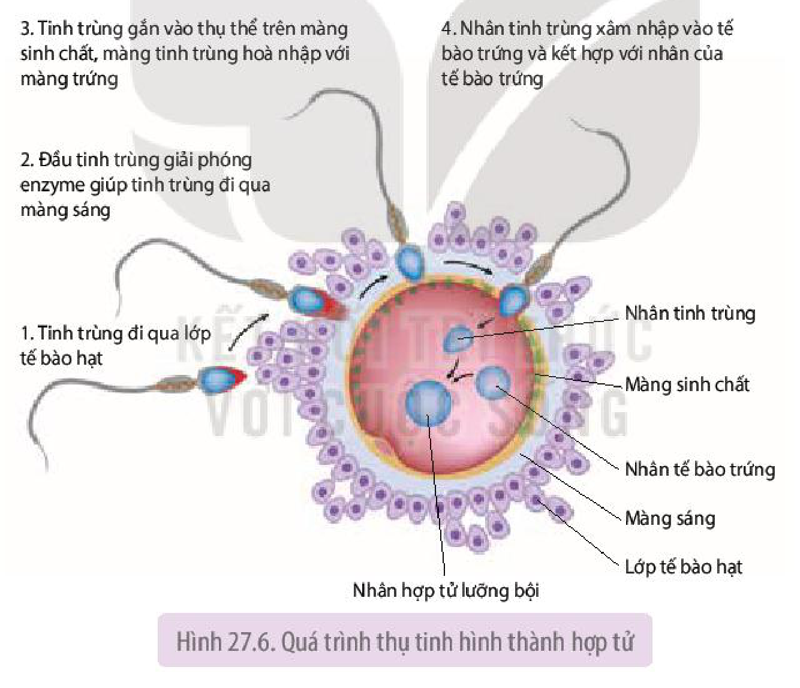

Hình 27.6. Quá trình thụ tinh hình thành hợp tử

**c) Phát triển phôi thai**

Sau khi trứng thụ tinh với tinh trùng tạo thành hợp tử. Hợp tử phân bào liên tiếp trên đường di chuyển về phía tử cung và làm tổ. Trong 8 tuần đầu, các tế bào hợp tử phân chia và phân hoá tạo thành mô và cơ quan nên gọi là **giai đoạn phôi**. Sau giai đoạn phôi là giai đoạn hoàn thiện các cơ quan nên gọi là **giai đoạn thai**. Giai đoạn phôi thai diễn ra trong cơ thể người mẹ kéo dài khoảng 9 tháng 10 ngày (40 tuần) và được nuôi dưỡng nhờ máu mẹ qua nhau thai. Hình 27.7 thể hiện giai đoạn phát triển phôi sớm và phôi làm tổ trong tử cung của người mẹ.

<!-- pdf:176 -->

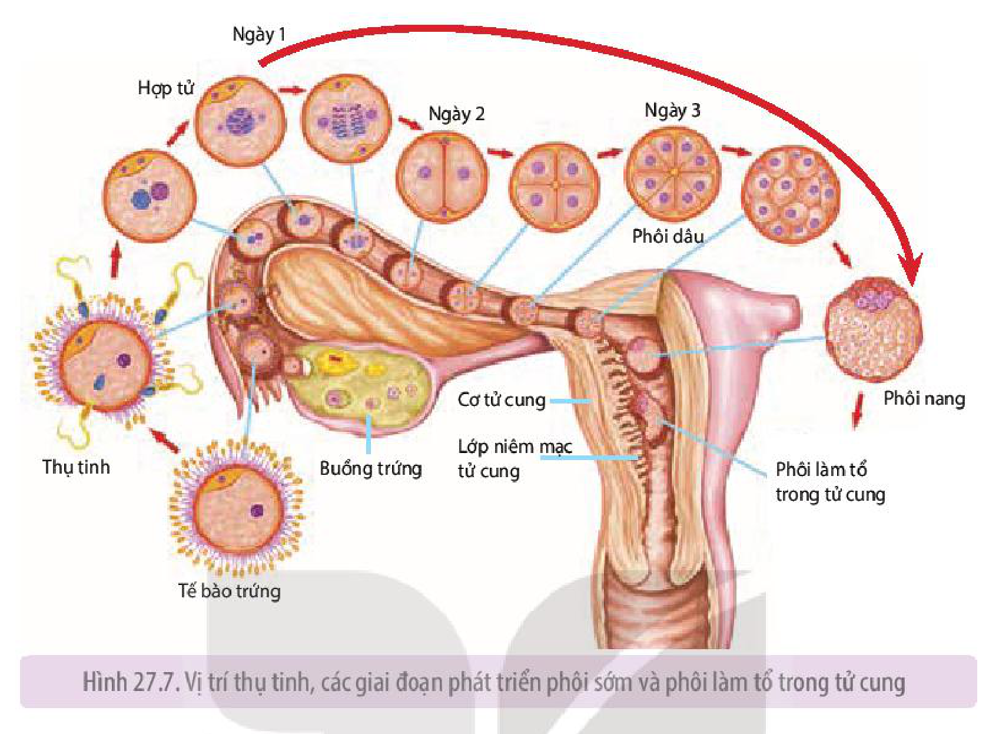

Hình 27.7. Vị trí thụ tinh, các giai đoạn phát triển phôi sớm và phôi làm tổ trong tử cung

<!-- term: Cơ chế sinh con -->
**d) Đẻ con (sinh con)**
<!-- ocr-ok: OCR đọc dính "d) Đẻcon (sinh con)"; đã đối chiếu ảnh PDF 176 -->

Sau khoảng 9 tháng 10 ngày phát triển trong tử cung người mẹ, con sẽ được sinh ra. Cơ chế sinh con được mô tả trong Hình 27.8.

**Oxytocin** kích thích tử cung co bóp, đồng thời kích thích nhau thai tiết ra **prostagladin**. Prostagladin hỗ trợ oxytocin làm tử cung co bóp mạnh hơn, đẩy thai nhi ra ngoài.

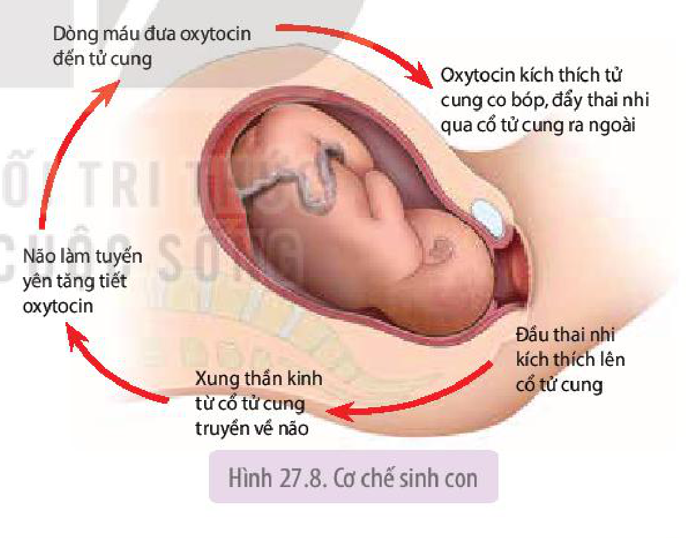

Hình 27.8. Cơ chế sinh con

## ❓ Dừng lại và suy ngẫm

1. Trình bày quá trình sinh tinh và sinh trứng.
2. Quá trình thụ tinh diễn ra như thế nào?
3. Cho biết ưu điểm và nhược điểm của mang thai và sinh con ở Thú so với đẻ trứng ở các loài động vật khác.

<!-- pdf:177 -->

### 3. Cơ chế điều hoà sinh sản

Quá trình sinh sản của động vật diễn ra bình thường là nhờ động vật có **cơ chế điều hoà sinh sản**. Cơ chế điều hoà sinh sản chủ yếu là cơ chế điều hoà sinh tinh và sinh trứng. Hệ nội tiết đóng vai trò chủ yếu trong điều hoà sinh sản.

<!-- term: Cơ chế điều hoà sinh tinh -->
**a) Cơ chế điều hoà sinh tinh**

Các hormone do vùng dưới đồi và tuyến yên tiết ra đi theo đường máu đến tinh hoàn, kích thích tinh hoàn sinh tinh trùng (H 27. 9).

Cơ chế điều hoà sinh tinh được kiểm soát nhờ **liên hệ ngược**. Nồng độ **testosterone** trong máu tăng lên sẽ gây ức chế lên vùng dưới đồi và tuyến yên, làm giảm tiết **GnRH**, **FSH** và **LH**.

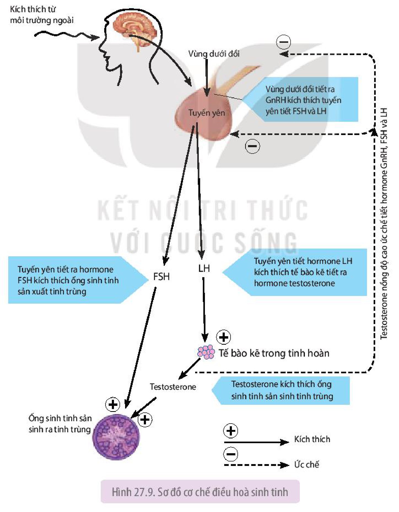

Hình 27.9. Sơ đồ cơ chế điều hoà sinh tinh

<!-- pdf:178 -->

<!-- term: Cơ chế điều hoà sinh trứng -->
**b) Cơ chế điều hoà sinh trứng**

Các hormone do vùng dưới đồi và tuyến yên tiết ra đi theo đường máu đến buồng trứng, kích thích nang trứng phát triển và làm cho nang trứng chín và trứng rụng (H 27.10).

Cơ chế điều hoà sinh trứng được kiểm soát nhờ liên hệ ngược. Nồng độ **progesterone** và **estrogen** trong máu tăng lên gây ức chế vùng dưới đồi và tuyến yên, làm giảm tiết GnRH, FSH và LH.

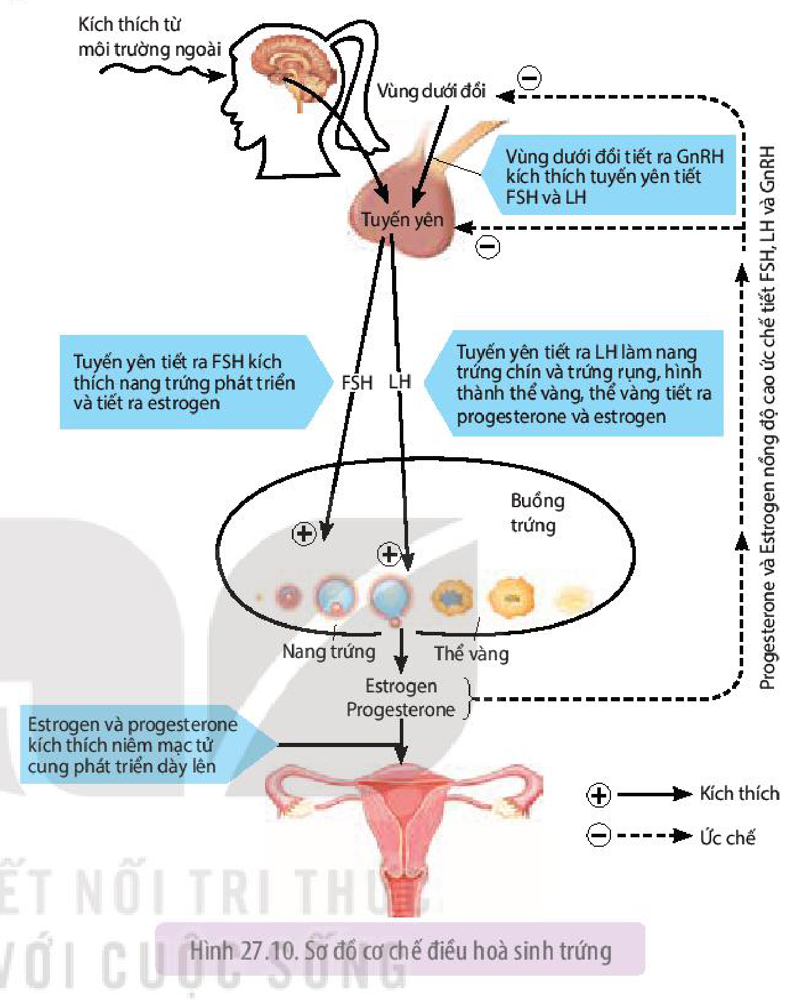

Hình 27.10. Sơ đồ cơ chế điều hoà sinh trứng

**c) Ảnh hưởng của thần kinh và môi trường sống đến quá trình sinh tinh và sinh trứng**

Môi trường sống và thần kinh ảnh hưởng đến quá trình sinh tinh và sinh trứng theo nhiều cách khác nhau:

- Căng thẳng thần kinh kéo dài như sợ hãi, lo lắng, buồn phiền, gây rối loạn sản xuất hormone, làm giảm sản sinh tinh trùng và rối loạn chu kì trứng chín và rụng.
- Thiếu ăn, suy dinh dưỡng, chế độ ăn uống không hợp lí (thiếu chất dinh dưỡng thiết yếu), bệnh béo phì gây rối loạn chuyển hoá làm giảm sản sinh tinh trùng và rối loạn chu kì trứng chín và rụng.
- Lối sống ít vận động, thường xuyên mặc quần lót chật làm giảm khả năng sản sinh tinh trùng.
- Nghiện thuốc lá, nghiện rượu, nghiện ma tuý gây rối loạn chuyển hoá làm giảm sản sinh tinh trùng, chu kì kinh nguyệt không đều.

## ❓ Dừng lại và suy ngẫm

1. So sánh vai trò của các hormone trong điều hoà quá trình sinh tinh và sinh trứng.
2. Liên hệ ngược có vai trò như thế trong điều hoà sinh tinh và sinh trứng?

<!-- pdf:179 -->

## III. ỨNG DỤNG

### 1. Một số biện pháp điều khiển số con ở động vật

**a) Thụ tinh nhân tạo**
<!-- ocr-ok: OCR đọc dính "Ểa)Thụtinh nhân tạo"; đã đối chiếu ảnh PDF 179 -->

- **Thụ tinh nhân tạo bên trong cơ thể**: là phương pháp bơm tinh trùng đã được chọn lọc vào buồng tử cung vào thời điểm nang trứng chín và trứng rụng (nhờ kích thích bằng hormone) tạo điều kiện cho quá trình thụ tinh hiệu quả. Hợp tử tạo ra phát triển thành phôi thai trong tử cung.
- **Thụ tinh nhân tạo bên ngoài cơ thể**: Ví dụ: Một số loài cá như cá mè, cá trắm cỏ không đẻ trong các ao, hồ nuôi. Người ta tiêm dịch chiết từ tuyến dưới não của loài cá khác cho cá mè cái làm cho trứng chín hàng loạt, sau đó nặn trứng ra đĩa và cho trứng thụ tinh nhân tạo với tinh dịch của cá đực cùng loài rồi đem ấp nở ra cá mè con.

**b) Thay đổi yếu tố môi trường**

- Thay đổi thời gian chiếu sáng trong 24 giờ đối với gà nuôi nhốt làm cho gà đẻ nhiều hơn một trứng/ngày.
- Bổ sung chất khoáng vào thức ăn (từ vỏ trứng, ốc, hến,...) làm tăng đẻ trứng ở vịt.

**c) Nuôi cấy phôi**

<!-- term: Nuôi cấy phôi -->
- Tiêm hormone thúc đẩy sự chín và rụng nhiều trứng cùng một lúc rồi lấy các trứng đó ra ngoài, cho trứng thụ tinh nhân tạo để thu được nhiều hợp tử. Giữ các hợp tử trong môi trường thích hợp bên ngoài cơ thể để các hợp tử phát triển thành phôi. Cấy các phôi này vào tử cung của một hoặc nhiều động vật cái để cho nhiều cá thể con.

<!-- term: Nuôi cấy phôi -->
- Ở giai đoạn phôi hai, bốn hoặc tám tế bào, người ta tách các tế bào phôi thành từng tế bào riêng rẽ. Nuôi các tế bào phôi đó trong môi trường thích hợp để phát triển thành phôi mới, sau đó cấy riêng từng phôi mới vào tử cung của các động vật cái. Bằng cách này có thể thu được nhiều con cùng giới tính và giống hệt nhau chỉ từ một trứng đã thụ tinh.

### 2. Một số biện pháp điều khiển giới tính ở động vật

<!-- term: Điều khiển giới tính ở động vật -->
- Sử dụng các kĩ thuật như lọc, li tâm, điện di để tách tinh trùng thành hai loại, một loại có nhiễm sắc thể giới tính X và loại kia có nhiễm sắc thể giới tính Y. Tuỳ theo mục đích và nhu cầu cần con đực hay con cái để chọn ra loại tinh trùng cho thụ tinh với trứng.
- Nuôi cá rô phi bột (cá nhỏ) bằng **17-methyltestosterone** (một loại testosterone tổng hợp) phối hợp vitamin C sẽ tạo ra 90% cá rô phi đực. Cá rô phi đực cho kích thước lớn, nhiều thịt và lớn nhanh hơn.
- Chiếu tia tử ngoại lên tằm sẽ tạo ra nhiều tằm đực hơn, giúp nâng cao hiệu quả kinh tế do tằm đực cho nhiều tơ hơn so với tằm cái.

### 3. Một số thành tựu thụ tinh trong ống nghiệm

Ở người, thụ tinh trong ống nghiệm là phương pháp hỗ trợ sinh sản, sử dụng cho điều trị hiếm muộn.

**Thụ tinh trong ống nghiệm** là phương pháp cho trứng và tinh trùng thụ tinh trong ống nghiệm để tạo ra phôi, sau đó phôi được chuyển vào buồng tử cung của phụ nữ để làm tổ và phát triển thành thai nhi.

Ngoài phương pháp trộn trứng với nhiều tinh trùng trong ống nghiệm để thụ tinh, hiện nay người ta còn sử dụng phương pháp tiêm một tinh trùng vào trong tế bào chất của một trứng để thụ tinh, sau đó cho phôi phát triển và cấy vào buồng tử cung.

<!-- pdf:180 -->

Năm 1997, thụ tinh trong ống nghiệm lần đầu tiên được thực hiện ở Việt Nam và năm 1998, ba em bé thụ tinh trong ống nghiệm đã chào đời. Từ đó đến nay, đã có hơn hai mươi nghìn trẻ em ở Việt Nam được ra đời bằng phương pháp thụ tinh trong ống nghiệm.

## ❓ Dừng lại và suy ngẫm

1. Những biện pháp nào có thể điều khiển số con, điều khiển giới tính ở động vật? Thay đổi số con và thay đổi giới tính có ý nghĩa như thế nào trong chăn nuôi?
2. Thụ tinh trong ống nghiệm giải quyết vấn đề gì trong sinh sản ở người và động vật?

### 4. Sinh đẻ có kế hoạch ở người và các biện pháp tránh thai

**a) Sinh đẻ có kế hoạch là gì?**

**Sinh đẻ có kế hoạch** là điều chỉnh số con, thời điểm sinh con và khoảng cách sinh con sao cho phù hợp với việc nâng cao chất lượng cuộc sống của mỗi cá nhân, gia đình và xã hội.

Với đặc điểm phát triển kinh tế, xã hội, văn hoá của nước ta hiện nay, mỗi cặp vợ chồng nên có 2 con. Đông con gây ra nhiều bất lợi cho các cặp vợ chồng như tăng chi phí ăn mặc, học tập, nhà ở, thuốc chữa bệnh; tốn nhiều sức lực và thời gian cho chăm sóc, dạy dỗ con, giảm thời gian nghỉ ngơi, hồi phục sức khoẻ của người mẹ,... Thống kê cho thấy phụ nữ đẻ nhiều con thường có cơ tử cung chùng nhão, dễ bị sa tử cung, dễ mắc bệnh phụ khoa, tỉ lệ tử vong ở mẹ tăng theo tuổi và số lần đẻ.

Phụ nữ không nên đẻ sớm: Phụ nữ sinh con trước tuổi 18 được coi là **đẻ sớm**. Trước 18 tuổi, tử cung chưa phát triển hoàn chỉnh về cấu tạo và chức năng nên phôi thai phát triển không thuận lợi, khi sinh con dễ bị rách cổ tử cung, vỡ tử cung, viêm tử cung, tỉ lệ đẻ khó và tử vong ở mẹ khi sinh con cao,...

Phụ nữ không nên đẻ muộn: Phụ nữ sinh con sau 35 tuổi được coi là **đẻ muộn**. Từ tuổi 35 trở lên, chức năng sinh lí của hệ sinh dục phụ nữ bắt đầu suy giảm, khả năng thụ thai, mang thai giảm, tỉ lệ sảy thai và mang thai ngoài tử cung cao,...

Phụ nữ không nên **đẻ dày**: Khoảng cách sinh con kế tiếp nhau không nên dưới 3 năm vì thời gian phụ nữ chửa, đẻ, nuôi con nhỏ và hồi phục lại sức khoẻ phải cần đến 3 năm.

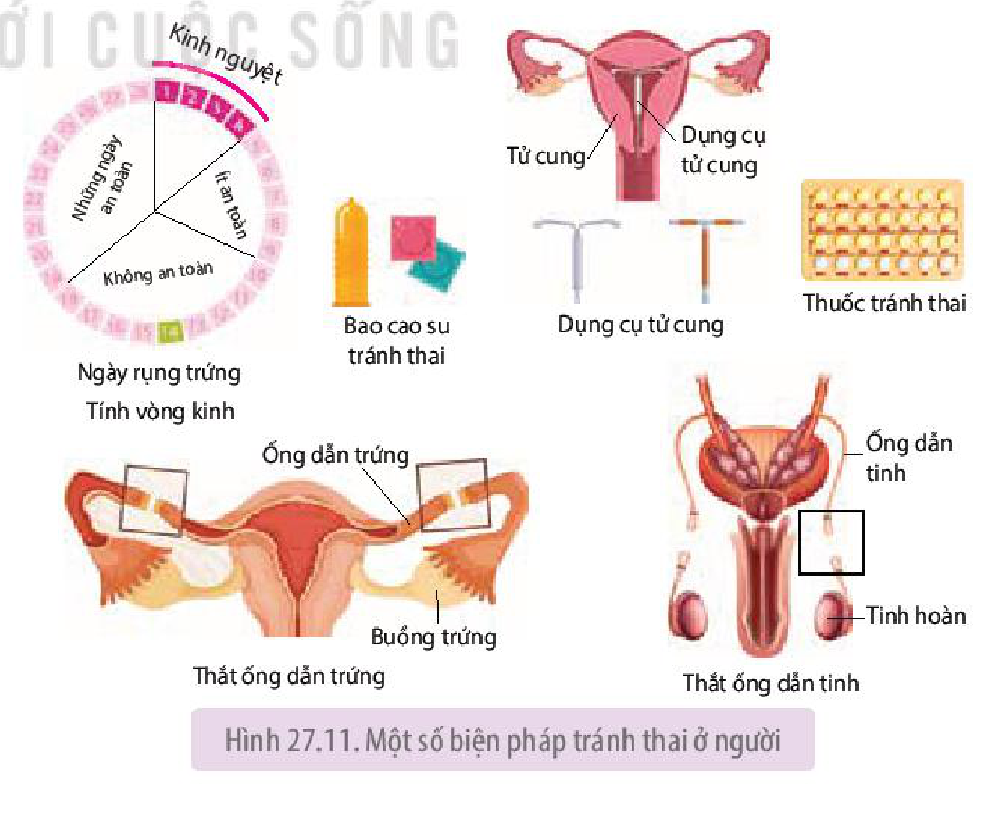

Hình 27.11. Một số biện pháp tránh thai ở người

<!-- pdf:181 -->

**b) Các biện pháp tránh thai**

<!-- term: Các biện pháp tránh thai -->
Sử dụng **biện pháp tránh thai** giúp phụ nữ tránh được việc phá thai hoặc sinh con ngoài ý muốn, đồng thời giúp giữ gìn sức khỏe và hạnh phúc gia đình. Hiện nay có rất nhiều biện pháp tránh thai an toàn và hiệu quả (H 27.11). Tuy nhiên, trước khi sử dụng biện pháp tránh thai, nam, nữ cần phải được bác sĩ hay người có chuyên môn về biện pháp tránh thai tư vấn để có thể lựa chọn biện pháp tránh thai phù hợp với lứa tuổi, giới tính, trạng thái sinh lí của mỗi người. Ví dụ: Nam, nữ mới bước vào tuổi trưởng thành không nên sử dụng biện pháp thắt ống dẫn tinh, thắt ống dẫn trứng mà nên sử dụng các biện pháp tránh thai khác.

## ❓ Dừng lại và suy ngẫm

1. Vì sao phải sinh đẻ có kế hoạch?
2. Tìm hiểu qua tài liệu, internet, hỏi bác sĩ, cán bộ y tế,... về tên và cơ chế tác dụng của các biện pháp tránh thai, sau đó kẻ bảng vào vở và hoàn thành bảng theo mẫu dưới đây:

| Tên biện pháp tránh thai | Cơ chế tác dụng |
|---|---|
| 1. Tính vòng kinh | ? |
| ... | ? |

3. Những biện pháp tránh thai nào vừa tránh được mang thai và sinh con ngoài ý muốn, vừa tránh được các bệnh lây truyền qua quan hệ tình dục?

## 📌 Kiến thức cốt lõi

- Các hình thức sinh sản vô tính là phân đôi, nảy chồi, phân mảnh và trinh sinh.
- Các hình thức sinh sản hữu tính là đẻ trứng, đẻ trứng thai và thai sinh.
- Quá trình sinh sản hữu tính ở người gồm các giai đoạn: hình thành giao tử, thụ tinh, phát triển phôi thai và đẻ con.
- Thụ tinh là sự kết hợp giữa một trứng đơn bội và một tinh trùng đơn bội tạo thành hợp tử lưỡng bội.
- Hệ nội tiết đóng vai trò chính trong điều hoà sinh sản ở động vật.
- Các biện pháp điều khiển sinh sản ở động vật (điều khiển số con hoặc điều khiển giới tính) thông qua sử dụng hormone, chất kích thích tổng hợp, thay đổi yếu tố môi trường, nuôi cấy phôi, thụ tinh nhân tạo, thụ tinh trong ống nghiệm,...
- Sinh đẻ có kế hoạch là điều chỉnh số con, thời điểm sinh con và khoảng cách sinh con sao cho phù hợp với việc nâng cao chất lượng cuộc sống của mỗi cá nhân, gia đình và xã hội.
- Sử dụng các biện pháp tránh thai tránh được việc phá thai và sinh con ngoài ý muốn.

<!-- pdf:182 -->

## ✏️ Luyện tập và vận dụng

1. Cho biết sự khác nhau giữa hai hình thức sinh sản vô tính và sinh sản hữu tính.
2. Vai trò của việc hình thành thể cực trong quá trình sinh trứng là gì?
3. Tuyến yên giảm sản xuất hormone FSH, LH sẽ ảnh hưởng như thế nào đến quá trình sinh tinh và sinh trứng?
4. Tại sao những người tiêm testosterone tổng hợp với mục đích phát triển cơ bắp lại có nguy cơ bị vô sinh?
5. Tại sao cần phải có hiểu biết về biện pháp tránh thai?

## 💡 Khoa học và đời sống

**Chửa ngoài dạ con** hay **mang thai ngoài tử cung** là tình trạng phôi sớm (phát triển từ trứng thụ tinh) làm tổ và phát triển bên ngoài buồng tử cung, cụ thể là trong ống dẫn trứng (95 – 98% trường hợp), trong ổ bụng hay ở cổ tử cung. Mang thai ngoài tử cung gây đau đớn, chảy máu,... và tử vong nếu không được phát hiện và can thiệp y tế kịp thời.

Có nhiều nguyên nhân gây ra mang thai ngoài tử cung, trong đó phá thai, bệnh lây truyền qua đường tình dục là những nguyên nhân phổ biến gây viêm, hẹp ống dẫn trứng, dẫn đến phôi không thể di chuyển vào buồng tử cung để làm tổ như bình thường mà dừng lại, làm tổ và phát triển trong ống dẫn trứng. Hậu quả là vỡ ống dẫn trứng, chảy máu và có thể tử vong.

## 📷 Danh sách hình trong bài

| Mã hình | Trang PDF | Vị trí | Chú thích gốc |
|---|---|---|---|
| H11-sinh-b27-01 | 171 | Mục I.2 | Hình 27.1. Sinh sản bằng nảy chồi ở thuỷ tức |
| H11-sinh-b27-02 | 172 | Mục I.3 | Hình 27.2. Sinh sản bằng phân mảnh ở sao biển |
| H11-sinh-b27-03 | 173 | Mục II.2 | Hình 27.3. Quá trình sinh sản hữu tính ở người |
| H11-sinh-b27-04 | 173 | Mục II.2.a | Hình 27.4. Sơ đồ quá trình sinh tinh |
| H11-sinh-b27-05 | 174 | Mục II.2.a | Hình 27.5. Sơ đồ quá trình sinh trứng |
| H11-sinh-b27-06 | 175 | Mục II.2.b | Hình 27.6. Quá trình thụ tinh hình thành hợp tử |
| H11-sinh-b27-07 | 176 | Mục II.2.c | Hình 27.7. Vị trí thụ tinh, các giai đoạn phát triển phôi sớm và phôi làm tổ trong tử cung |
| H11-sinh-b27-08 | 176 | Mục II.2.d | Hình 27.8. Cơ chế sinh con |
| H11-sinh-b27-09 | 177 | Mục II.3.a | Hình 27.9. Sơ đồ cơ chế điều hoà sinh tinh |
| H11-sinh-b27-10 | 178 | Mục II.3.b | Hình 27.10. Sơ đồ cơ chế điều hoà sinh trứng |
| H11-sinh-b27-11 | 180 | Mục III.4.a | Hình 27.11. Một số biện pháp tránh thai ở người |
