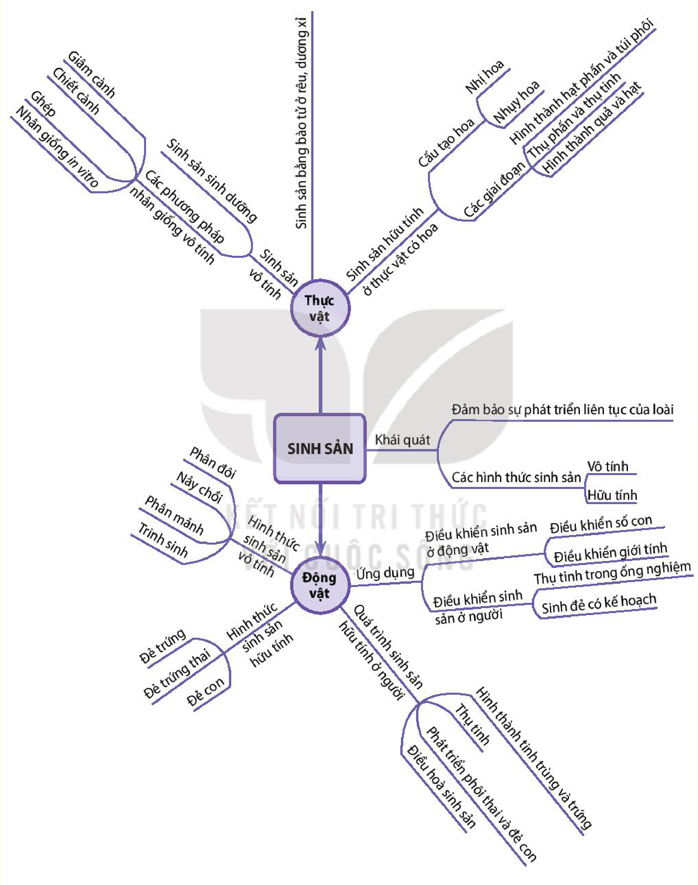

<!-- pdf:183 -->

# SƠ ĐỒ TÓM TẮT KIẾN THỨC CHƯƠNG 4

<!-- Dưới đây chép các nhánh của sơ đồ thành danh sách lồng nhau, giữ nguyên chữ trong các nhánh. -->

- SINH SẢN
  - Khái quát
    - Đảm bảo sự phát triển liên tục của loài
    - Các hình thức sinh sản
      - Vô tính
      - Hữu tính
  - Thực vật
    - Sinh sản vô tính
      - Các phương pháp nhân giống vô tính
        - Giâm cành
        - Chiết cành
        - Ghép
        - Nhân giống in vitro
      - Sinh sản sinh dưỡng
      - Sinh sản bằng bào tử ở rêu, dương xỉ
    - Sinh sản hữu tính ở thực vật có hoa
      - Cấu tạo hoa
        - Nhị hoa
        - Nhuỵ hoa
      - Các giai đoạn
        - Hình thành hạt phấn và túi phôi
        - Thụ phấn và thụ tinh
        - Hình thành quả và hạt
  - Động vật
    - Hình thức sinh sản vô tính
      - Phân đôi
      - Nảy chồi
      - Phân mảnh
      - Trinh sinh
    - Hình thức sinh sản hữu tính
      - Đẻ trứng
      - Đẻ trứng thai
      - Đẻ con
    - Quá trình sinh sản hữu tính ở người
      - Hình thành tinh trùng và trứng
      - Thụ tinh
      - Phát triển phôi thai và đẻ con
      - Điều hoà sinh sản
    - Ứng dụng
      - Điều khiển sinh sản ở động vật
        - Điều khiển số con
        - Điều khiển giới tính
      - Điều khiển sinh sản ở người
        - Thụ tinh trong ống nghiệm
        - Sinh đẻ có kế hoạch
<!-- ocr-ok: các nhánh sơ đồ tư duy in nghiêng nhiều góc độ nên OCR không đọc được chữ trên nhánh; đã đối chiếu trực tiếp ảnh PDF 183 -->

## 📷 Danh sách hình trong bài

| Mã hình | Trang PDF | Vị trí | Chú thích gốc |
|---|---|---|---|
| H11-sinh-so-do-tom-tat-c04-01 | 183 | Cả trang | Sơ đồ tóm tắt kiến thức chương 4 |
