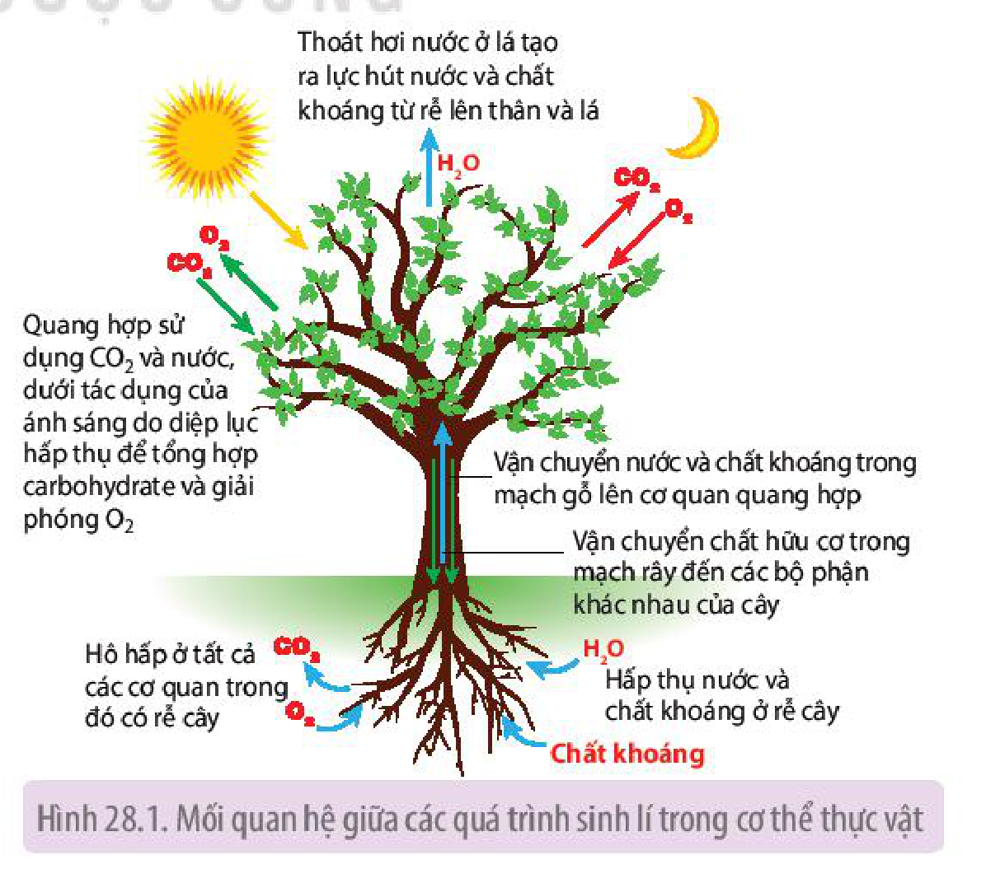
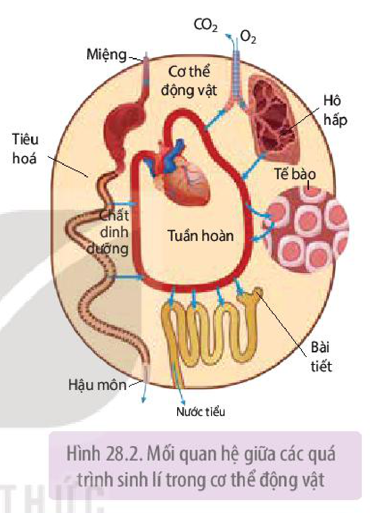

<!-- pdf:184 -->

# BÀI 28: MỐI QUAN HỆ GIỮA CÁC QUÁ TRÌNH SINH LÍ TRONG CƠ THỂ SINH VẬT

## 🎯 Yêu cầu cần đạt

- Trình bày được mối quan hệ giữa các quá trình sinh lí trong cơ thể, từ đó chứng minh cơ thể là một hệ thống mở, tự điều chỉnh.

## 🔴 Mở đầu

Trong cơ thể thực vật cũng như động vật diễn ra rất nhiều quá trình sinh lí. Các quá trình sinh lí trong cơ thể diễn ra như thế nào?

## I. MỐI QUAN HỆ GIỮA CÁC QUÁ TRÌNH SINH LÍ TRONG CƠ THỂ THỰC VẬT

<!-- term: Mối quan hệ giữa các quá trình sinh lí trong cơ thể thực vật -->
Nhiều quá trình sinh lí diễn ra trong cơ thể thực vật như trao đổi nước, dinh dưỡng khoáng, quang hợp, hô hấp,... (H 28.1). Mỗi quá trình này đảm nhận các chức năng khác nhau, tuy nhiên giữa các quá trình lại có mối quan hệ mật thiết với nhau đảm bảo cho sự hoạt động thống nhất của cơ thể. Bất kì quá trình sinh lí nào thay đổi đều ảnh hưởng đến quá trình sinh lí khác.

Ví dụ: Khi quá trình hấp thụ nước và chất khoáng bị cản trở sẽ dẫn đến thiếu nguyên liệu cho quang hợp, hô hấp,...

Hình 28.1. Mối quan hệ giữa các quá trình sinh lí trong cơ thể thực vật

<!-- pdf:185 -->

## ❓ Dừng lại và suy ngẫm

Nghiên cứu Hình 28.1, trình bày mối quan hệ giữa:

- Quang hợp và hô hấp.
- Hấp thụ nước và thoát hơi nước.

## II. MỐI QUAN HỆ GIỮA CÁC QUÁ TRÌNH SINH LÍ TRONG CƠ THỂ ĐỘNG VẬT

<!-- term: Mối quan hệ giữa các quá trình sinh lí trong cơ thể động vật -->
Trong cơ thể động vật diễn ra nhiều quá trình sinh lí như tiêu hoá, hô hấp, bài tiết, tuần hoàn,... (H 28.2). Tuy mỗi quá trình đảm nhận các chức năng khác nhau nhưng giữa chúng có mối quan hệ chặt chẽ. Cơ thể chỉ tồn tại, sinh trưởng, phát triển bình thường khi các hoạt động sinh lí này diễn ra nhịp nhàng.

Ví dụ: Khi hệ tuần hoàn hoạt động bình thường sẽ đảm bảo lưu lượng máu lên hệ hô hấp, nhờ vậy hệ hô hấp sẽ lấy đủ $\text{O}_2$ cho cơ thể và thải thải $\text{CO}_2$ hiệu quả.

Trong quá trình sống, cơ thể thực vật và động vật thường xuyên trao đổi chất và năng lượng với môi trường. Mặc dù là **hệ thống mở** nhưng cơ thể lại có khả năng **tự điều chỉnh** trước những thay đổi của môi trường, đảm bảo cho các hoạt động sống diễn ra ổn định.

Hình 28.2. Mối quan hệ giữa các quá trình sinh lí trong cơ thể động vật

## ❓ Dừng lại và suy ngẫm

Nghiên cứu Hình 28.2, nêu mối quan hệ giữa:

- Tuần hoàn và bài tiết.
- Tiêu hoá và tuần hoàn.

## 📌 Kiến thức cốt lõi

- Trong cơ thể thực vật và động vật, các quá trình sinh lí liên quan chặt chẽ với nhau và ảnh hưởng lẫn nhau.
- Cơ thể sinh vật là một hệ thống mở và có khả năng tự điều chỉnh.

## ✏️ Luyện tập và vận dụng

1. Hệ thống mở là gì? Tại sao nói cơ thể thực vật và động vật là những hệ thống mở, tự điều chỉnh?
2. Dựa vào mối liên quan giữa các quá trình sinh lí trong cơ thể, giải thích nhận định cơ thể thực vật hoặc động vật là một thể thống nhất

## 📷 Danh sách hình trong bài

| Mã hình | Trang PDF | Vị trí | Chú thích gốc |
|---|---|---|---|
| H11-sinh-b28-01 | 184 | Mục I | Hình 28.1. Mối quan hệ giữa các quá trình sinh lí trong cơ thể thực vật |
| H11-sinh-b28-02 | 185 | Mục II | Hình 28.2. Mối quan hệ giữa các quá trình sinh lí trong cơ thể động vật |
