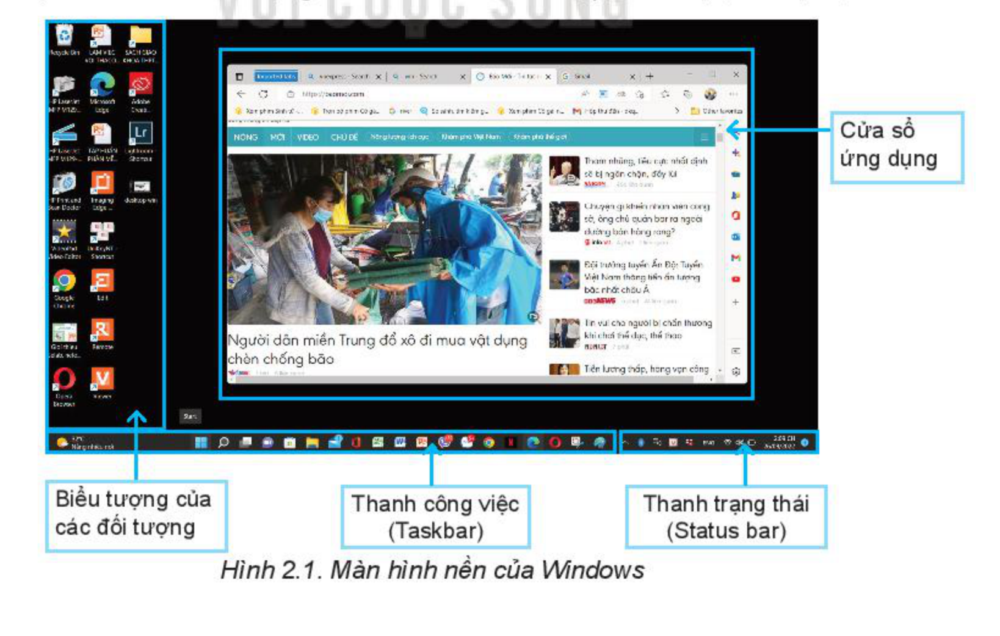
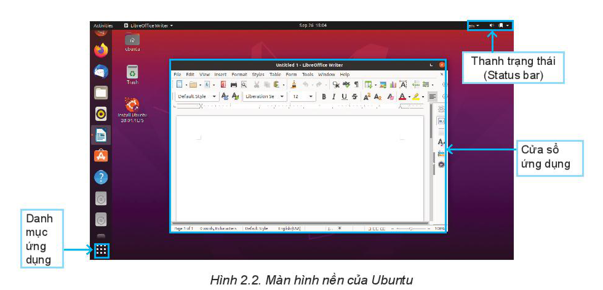
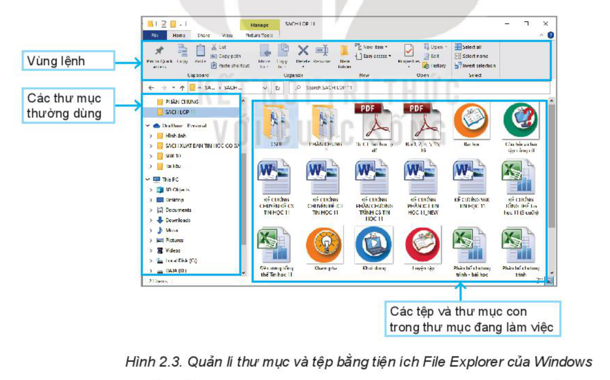
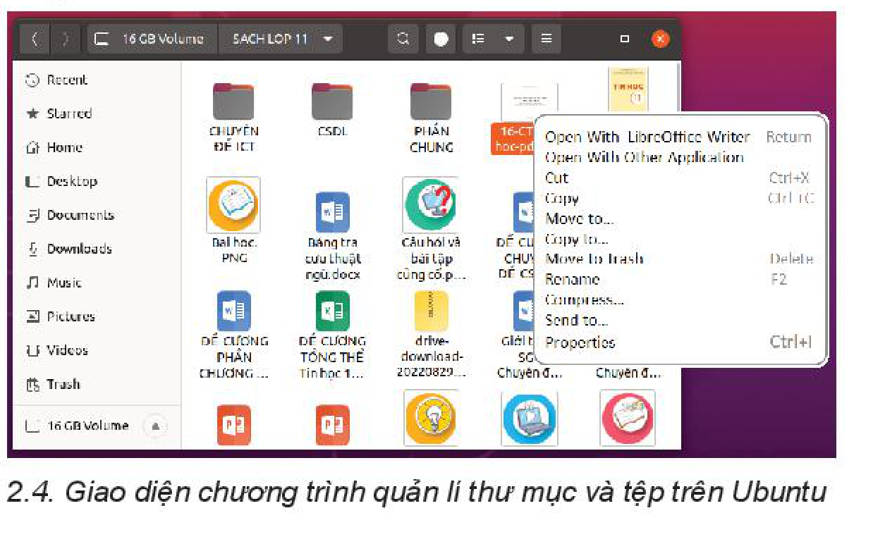
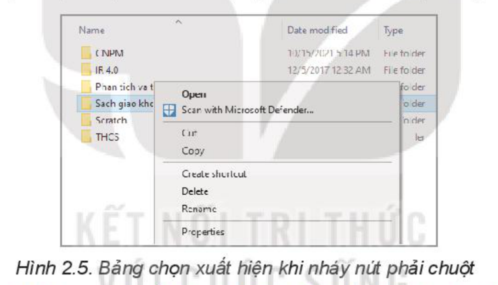
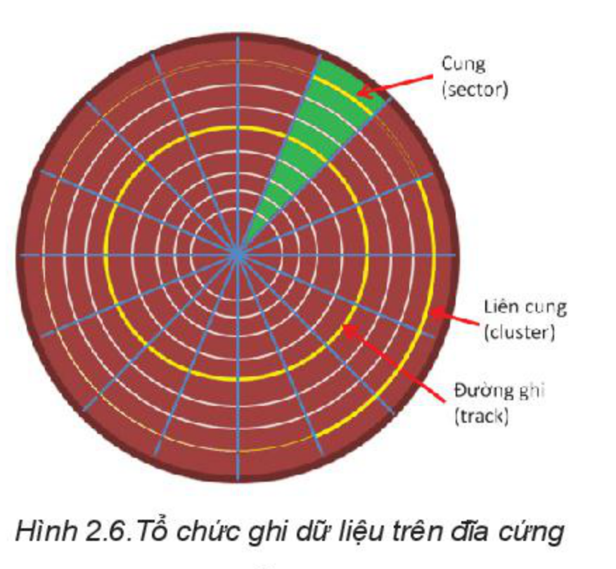
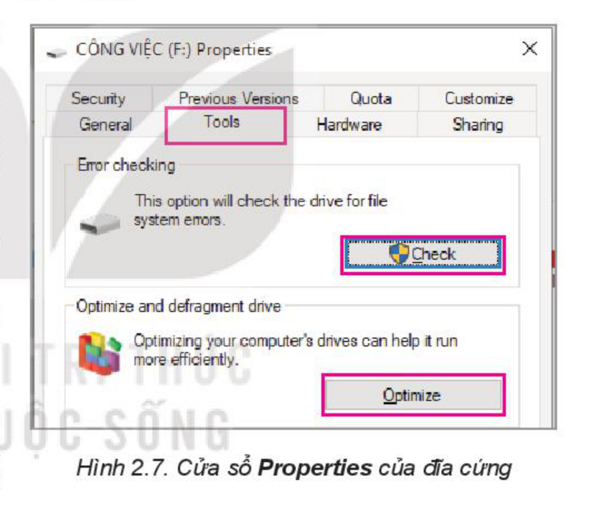
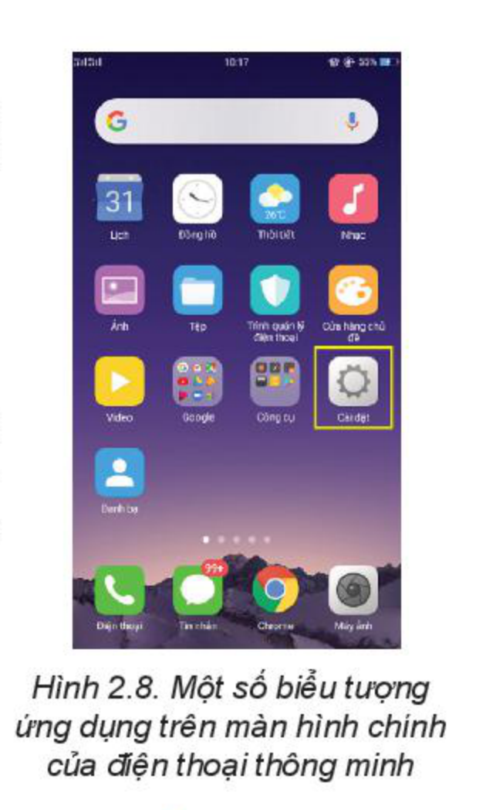
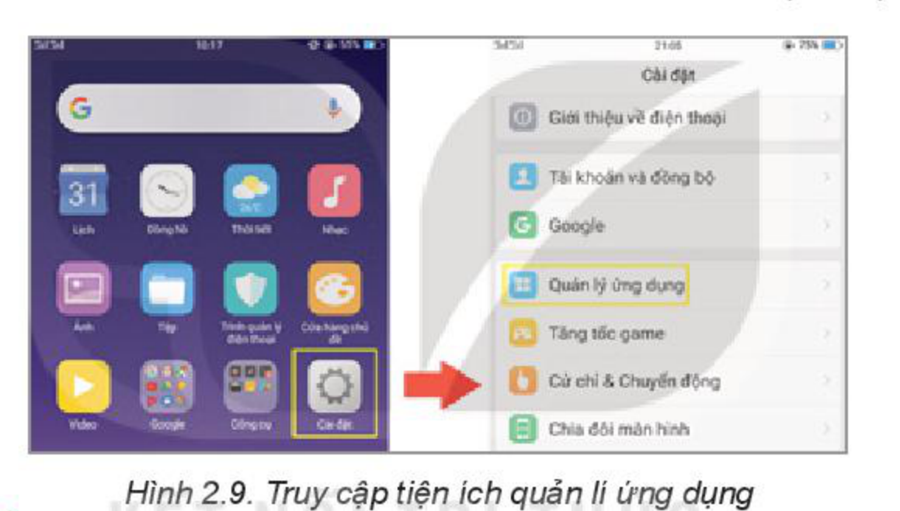

<!-- pdf:11 -->

# BÀI 2: THỰC HÀNH SỬ DỤNG HỆ ĐIỀU HÀNH

## 🎯 Sau bài học này em sẽ:

- Sử dụng được một số chức năng cơ bản của hệ điều hành cho máy tính cá nhân.
- Sử dụng được một vài tiện ích của hệ điều hành nâng cao hiệu quả của máy tính cá nhân.
- Sử dụng được một vài tiện ích cơ bản của hệ điều hành trên thiết bị di động.

## 🔴 Khởi động

> Các thiết bị di động thực tế cũng là máy tính cá nhân. Hệ điều hành của các loại máy tính cá nhân có nhiều tiện ích khác nhau nhưng giao diện người dùng có nhiều điểm tương đồng. Em hãy chỉ ra một vài điểm tương đồng đó.

### Nhiệm vụ 1. Sử dụng một số chức năng cơ bản của hệ điều hành cho máy tính cá nhân

Ở Bài 1, em đã biết hệ điều hành cho máy tính cá nhân như Windows, macOS và Linux. Em hãy thực hành sử dụng các chức năng sau (với hệ điều hành Windows hoặc hệ điều hành mã nguồn mở Ubuntu):

- Cung cấp môi trường giao tiếp với người sử dụng.
- Quản lí tệp và thư mục.

*Hướng dẫn:*

- Cung cấp môi trường giao tiếp với người sử dụng.
  - Quan sát giao diện đồ hoạ với các cửa sổ, các biểu tượng và con trỏ. Mỗi cửa sổ hay biểu tượng đều có tên. **Con trỏ** dùng để chọn đối tượng làm việc.
  - Nhận biết các biểu tượng trên màn hình như: tệp, thư mục, nút lệnh,...

*Hình 2.1. Màn hình nền của Windows*

<!-- pdf:12 -->

*Hình 2.2. Màn hình nền của Ubuntu*

  - Truy cập nhanh các phần mềm ứng dụng nhờ **thanh công việc** hay nút Start.
  - Quan sát **thanh trạng thái** hiển thị các biểu tượng và cho biết trạng thái làm việc của máy tính như kết nối mạng, dung lượng pin, mức loa, chế độ bàn phím,...
  - Thực hành các thao tác làm việc với biểu tượng như nháy chuột, nháy đúp chuột, nháy nút phải chuột, kéo thả chuột.
- Quản lí tệp và thư mục.
  - Sử dụng tiện ích **File Explorer** của Windows để quản lí tệp và thư mục.

*Hình 2.3. Quản lí thư mục và tệp bằng tiện ích File Explorer của Windows*

  - Trong cửa sổ File Explorer, nháy chuột (nháy đúp chuột) vào biểu tượng thư mục để xem nội dung bên trong (các tệp và thư mục con).
  - Thực hành quản lí thư mục gồm: tạo mới, đổi tên, xoá, di chuyển thư mục.

<!-- pdf:13 -->

  - Thực hành quản lí tệp trên Ubuntu gồm: đổi tên, xoá, di chuyển tệp và chạy ứng dụng với tệp chương trình.

*Hình 2.4. Giao diện chương trình quản lí thư mục và tệp trên Ubuntu*

  - Nháy đúp chuột vào biểu tượng của tệp ứng dụng hoặc tệp dữ liệu để kích hoạt ứng dụng tương ứng.
  - Nháy nút phải chuột vào một đối tượng để làm xuất hiện bảng chọn gồm các lệnh có thể thực hiện được với đối tượng đó như minh hoạ trong Hình 2.5.

*Hình 2.5. Bảng chọn xuất hiện khi nháy nút phải chuột*

### Nhiệm vụ 2. Sử dụng một số tiện ích trên hệ điều hành máy tính cá nhân nhằm nâng cao hiệu quả sử dụng máy

**Tiện ích** là những phần mềm công cụ hỗ trợ nhiều công việc khác nhau như ứng dụng tính toán, chụp ảnh màn hình, gõ tiếng Việt hoặc các phần mềm nâng cao hiệu quả làm việc với máy tính như nén tệp, quét virus. Có một số tiện ích được cài đặt cùng với hệ điều hành như tiện ích kiểm tra đĩa cứng hay kiểm tra kết nối mạng nhưng cũng có những tiện ích không có sẵn, được cài đặt sau. Một khi được cài đặt chúng được tích hợp như một dịch vụ trên hệ điều hành, ví dụ các tiện ích nén dữ liệu zip hay bộ gõ bàn phím Unikey.

*Hình 2.6. Tổ chức ghi dữ liệu trên đĩa cứng*

Em hãy thực hành sử dụng tiện ích kiểm tra đĩa và hợp mảnh trên đĩa cứng.

<!-- pdf:14 -->

*Hướng dẫn:*

Đĩa cứng ghi dữ liệu theo các đường tròn đồng tâm gọi là **đường ghi** (**track**), mỗi đường gồm nhiều **cung** (**sector**), mỗi cung ghi 512 byte dữ liệu. Việc đọc, ghi được thực hiện theo đơn vị **liên cung** (**cluster**), thường gồm 8 cung.

Khi ghi tệp, hệ điều hành sẽ tìm các vùng trống trên đĩa để ghi, những vùng này có thể nằm trên các đường ghi khác nhau làm tệp bị **phân mảnh**. Khi đó, thời gian đọc, ghi tệp tăng lên nhiều lần vì đầu từ phải dịch chuyển (một cách cơ học) từ đường ghi này sang đường ghi khác. Việc tổ chức lại tệp sao cho các liên cung của một tệp được ghi liên tục, giảm hoạt động di chuyển đầu từ sẽ giúp tăng tốc độ truy cập đĩa cứng. **Tiện ích tối ưu hoá** (**Optimize**), còn có tên là **hợp mảnh** (**Defragment**) cho phép thực hiện công việc này.

Do nhiều nguyên nhân, có thể xảy ra các lỗi tệp như một liên cung mất liên kết với tệp, tạo thành các đoạn dữ liệu "mồ côi", có trên đĩa nhưng không khai thác được hoặc tình trạng chồng chéo, khi có vài tệp liên kết đến cùng một liên cung. Ngoài ra, còn có tình trạng một số cung bị hỏng về vật lí (**bad sector**), đọc ghi không được, cần phải loại khỏi danh sách sử dụng. **Tiện ích kiểm tra đĩa** (**Check disk**) dùng để khử các lỗi trên để việc đọc, ghi đĩa trở lại bình thường.

Các bước để sửa lỗi đĩa và hợp mảnh:
<!-- ocr-ok: đã đối chiếu ảnh trang 14, dòng dẫn bị OCR ghép lẫn chữ trong Hình 2.7 -->

*Bước 1.* Sử dụng `File Explorer` và tìm danh sách các ổ đĩa. Nháy nút phải chuột vào ổ đĩa muốn xử lí rồi chọn `Properties`.

*Bước 2.* Trong cửa sổ `Properties` của đĩa cứng, chọn `Tools`.

*Bước 3.* Chọn `Check` để kiểm tra và khắc phục lỗi đĩa; Chọn `Optimize` để tối ưu hoá, hợp mảnh.
<!-- ocr-ok: đã đối chiếu ảnh trang 14, Bước 3 bị OCR ghép lẫn chữ tiếng Anh trong Hình 2.7 -->

*Lưu ý:* Chức năng hợp mảnh chỉ có tác dụng đối với đĩa từ. Việc hợp mảnh có thể mất nhiều thời gian nếu đĩa có dung lượng lớn.

*Hình 2.7. Cửa sổ Properties của đĩa cứng*

### Nhiệm vụ 3. Sử dụng một số tiện ích của hệ điều hành cho thiết bị di động

1. Em hãy kể tên một số các tiện ích của hệ điều hành Android hoặc iOS cho thiết bị di động mà em biết.

<!-- term: Tiện ích trên thiết bị di động -->
Thiết bị di động như điện thoại thông minh và máy tính bảng cung cấp cho người dùng nhiều tiện ích cá nhân như quản lí danh bạ, nhắn tin, hẹn giờ, lịch, quản lí ảnh, quản lí tệp,...

2. Giao diện quản lí danh bạ

Hãy tìm hiểu trên điện thoại em đang sử dụng để thực hiện các chức năng sau:

<!-- pdf:15 -->

- Hiển thị danh bạ.
- Thêm một người vào danh bạ với các thông tin về số điện thoại, địa chỉ, nhóm; sửa thông tin của một người trong danh bạ; chia sẻ thông tin danh bạ.
- Xoá một người khỏi danh bạ.
- Truy cập danh bạ để gọi điện thoại nhanh.

3. Đặt lịch, hẹn giờ, nhắc việc

- Mở giao diện đồng hồ, sau đó đặt một công việc được nhắc hẹn vào một giờ định trước, một ngày định trước.
- Đặt hẹn một công việc hằng ngày để được nhắc hằng ngày.

4. Quản lí ứng dụng

- Xem các ứng dụng được tải và cài trên máy.
- Xoá ứng dụng không cần thiết.

*Hình 2.8. Một số biểu tượng ứng dụng trên màn hình chính của điện thoại thông minh*

*Hình 2.9. Truy cập tiện ích quản lí ứng dụng*

## ✏️ Luyện tập

1. Tiện ích danh bạ còn có chức năng quản lí nhóm. Mỗi nhóm có thể gồm nhiều số điện thoại, mỗi số điện thoại có thể thuộc nhiều nhóm. Hãy thực hiện việc tạo nhóm, xoá nhóm, đăng kí vào danh bạ.
2. Đồng hồ là một tiện ích cơ bản của hệ điều hành di động. Ứng dụng này, không chỉ cho phép đặt nhắc hẹn (một lần hay định kì) mà còn có khả năng đếm thời gian chính xác đến 1% giây, rất cần cho các hoạt động cần độ chính xác cao như đo các kỉ lục thể thao. Hãy sử dụng các chức năng đếm thời gian tiến hay lùi của tiện ích này.

## 🚀 Vận dụng

1. Hình 2.7 là cửa sổ Properties mở theo Tab Tools. Nếu mở theo Tab General em sẽ thấy có nút lệnh của tiện ích dọn đĩa (Disk Cleanup). Hãy tìm hiểu chức năng và cách sử dụng tiện ích này.
2. Ngoài cách đăng nhập dùng mật khẩu, các thiết bị di động còn cung cấp nhiều phương pháp đăng nhập khác như nhận dạng vân tay, nhận dạng khuôn mặt hay dùng khẩu hình. Hãy tìm hiểu các phương pháp đó và so sánh các điểm mạnh, điểm yếu của chúng.

## 📷 Danh sách hình trong bài

| Mã hình | Trang PDF | Vị trí trong bài | Chú thích gốc |
| --- | --- | --- | --- |
| H11-tin_hoc_khmt-b02-01 | 11 | Nhiệm vụ 1 | Hình 2.1. Màn hình nền của Windows |
| H11-tin_hoc_khmt-b02-02 | 12 | Nhiệm vụ 1 | Hình 2.2. Màn hình nền của Ubuntu |
| H11-tin_hoc_khmt-b02-03 | 12 | Nhiệm vụ 1 | Hình 2.3. Quản lí thư mục và tệp bằng tiện ích File Explorer của Windows |
| H11-tin_hoc_khmt-b02-04 | 13 | Nhiệm vụ 1 | Hình 2.4. Giao diện chương trình quản lí thư mục và tệp trên Ubuntu |
| H11-tin_hoc_khmt-b02-05 | 13 | Nhiệm vụ 1 | Hình 2.5. Bảng chọn xuất hiện khi nháy nút phải chuột |
| H11-tin_hoc_khmt-b02-06 | 13 | Nhiệm vụ 2 | Hình 2.6. Tổ chức ghi dữ liệu trên đĩa cứng |
| H11-tin_hoc_khmt-b02-07 | 14 | Nhiệm vụ 2 | Hình 2.7. Cửa sổ Properties của đĩa cứng |
| H11-tin_hoc_khmt-b02-08 | 15 | Nhiệm vụ 3 | Hình 2.8. Một số biểu tượng ứng dụng trên màn hình chính của điện thoại thông minh |
| H11-tin_hoc_khmt-b02-09 | 15 | Nhiệm vụ 3 | Hình 2.9. Truy cập tiện ích quản lí ứng dụng |
