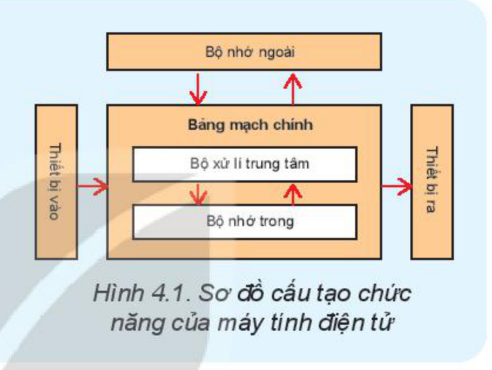
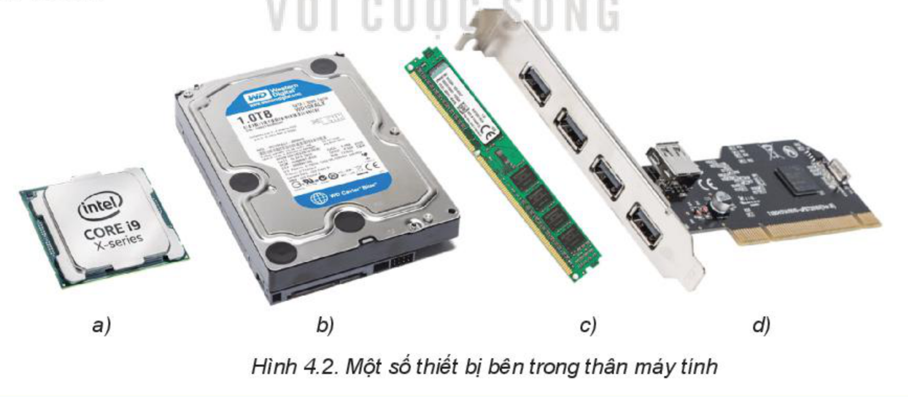
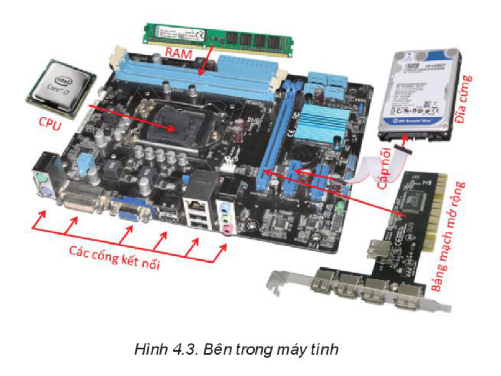
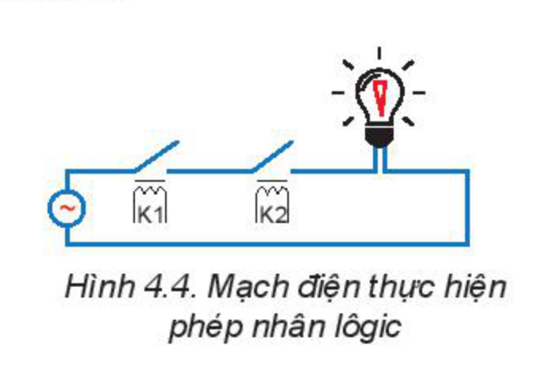
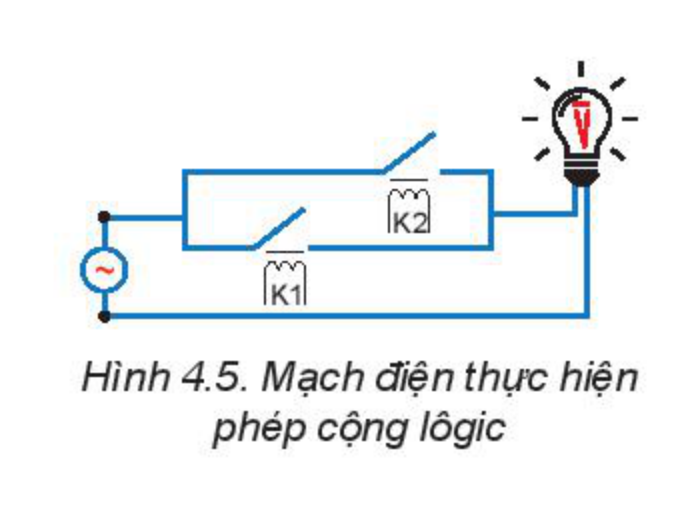
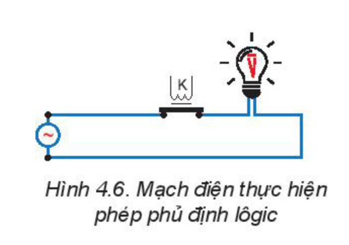
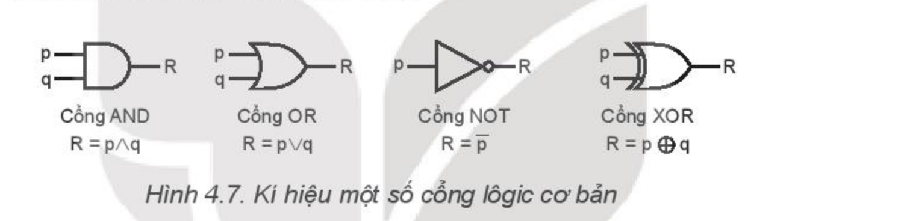
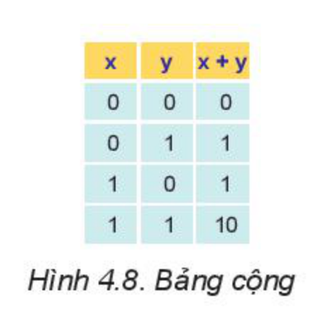
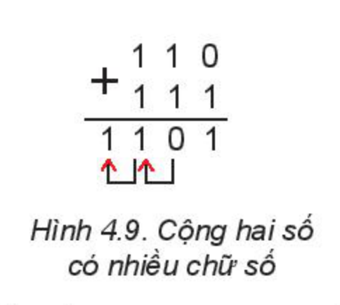
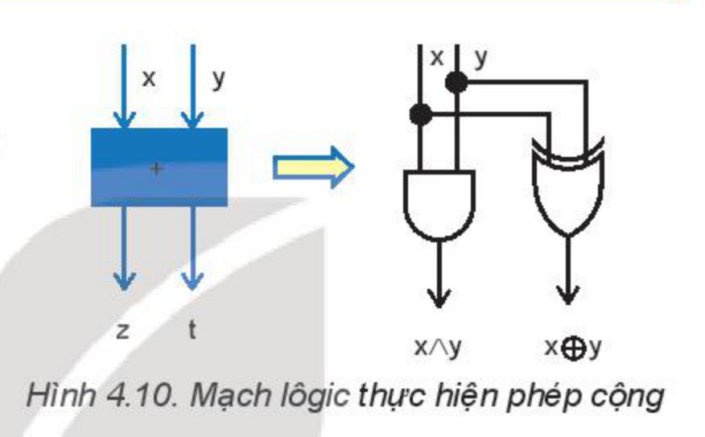

<!-- pdf:22 -->

# BÀI 4: BÊN TRONG MÁY TÍNH

## 🎯 Sau bài học này em sẽ:

- Nhận diện được một số thiết bị trong thân máy với chức năng và các thông số đo hiệu năng của chúng.
- Nhận biết được sơ đồ của các mạch lôgic AND, OR, NOT và giải thích được vai trò của các mạch lôgic đó trong thực hiện các tính toán nhị phân.

## 🔴 Khởi động

> Trong chương trình tin học ở các lớp dưới, các em đã biết cấu trúc chung của máy tính bao gồm: bộ xử lí trung tâm, bộ nhớ trong, bộ nhớ ngoài, các thiết bị vào – ra. Tuy nhiên, hầu hết các em mới chỉ nhìn thấy các thiết bị bên ngoài như màn hình, bàn phím, chuột, máy chiếu, bộ nhớ ngoài (đĩa cứng rời hay thẻ nhớ USB).
>
> Em có biết cụ thể trong thân máy có những bộ phận nào không?

*Hình 4.1. Sơ đồ cấu tạo chức năng của máy tính điện tử*

## 1. CÁC THIẾT BỊ BÊN TRONG MÁY TÍNH

> **Hoạt động 1: Các thiết bị bên trong máy tính**
>
> Dưới đây là một số thiết bị bên trong thân máy, em có biết chúng là các thiết bị gì không?

*Hình 4.2. Một số thiết bị bên trong thân máy tính*

Tất cả các thiết bị bên trong thân máy được gắn với một bảng mạch, gọi là **bảng mạch chính** (**mainboard**) như trong Hình 4.3.

<!-- pdf:23 -->

*Hình 4.3. Bên trong máy tính*

### a) Bộ xử lí trung tâm

**Bộ xử lí trung tâm** (**Central Proccessing Unit** – **CPU**) còn được gọi là **bộ xử lí** là thành phần quan trọng nhất của máy tính, đảm nhận việc thực hiện các chương trình máy tính. CPU được cấu tạo từ hai bộ phận chính:

- **Bộ số học và lôgic** (**Arithmetic & Logic Unit**, viết tắt là **ALU**): thực hiện tất cả các phép tính số học và lôgic trong máy tính.
- **Bộ điều khiển** (**Control Unit**): phối hợp đồng bộ các thiết bị của máy tính, đảm bảo máy tính thực hiện đúng chương trình.

CPU có một **đồng hồ xung**, tạo ra các xung điện áp gửi đến mọi thành phần của máy để đồng bộ các hoạt động. Mỗi phép tính sẽ được thực hiện trong một số xung đồng hồ. Vì thế người ta thường dùng **tần số đồng hồ xung**, thường là GHz (1 tỉ xung một giây) để đánh giá tốc độ của CPU.

Ngoài ra, CPU còn có thêm một số thành phần khác như **thanh ghi** (**register**) và **bộ nhớ đệm** (**bộ nhớ truy cập nhanh** – **cache**). Thanh ghi là vùng nhớ đặc biệt được dùng để lưu trữ tạm thời các lệnh và dữ liệu đang được xử lí cho phép CPU truy cập tới với tốc độ rất nhanh. Bộ nhớ đệm là một bộ nhớ nhỏ chứa dữ liệu được nạp trước từ bộ nhớ trong nhằm giảm thời gian đọc dữ liệu.

Thời kì đầu, mỗi máy tính chỉ có một đơn vị xử lí, sau này người ta chế tạo các máy tính có nhiều đơn vị xử lí được đóng gói trong cùng một chíp. Mỗi đơn vị xử lí như thế được gọi là một **lõi** hoặc một **nhân** (**core**). CPU đa lõi cho phép máy tính xử lí nhanh hơn vì có thể thực hiện song song nhiều công việc.

### b) Bộ nhớ trong ROM và RAM

Tuỳ theo cách sử dụng, **bộ nhớ trong** (**memory**) chia thành hai loại **RAM** (**Random Access Memory**) và **ROM** (**Read Only Memory**).

**RAM** là bộ nhớ có thể ghi được, dùng để ghi dữ liệu tạm thời trong khi chạy các chương trình nhưng không giữ được lâu dài (khi tắt máy, dữ liệu trong RAM sẽ bị xoá).

<!-- pdf:24 -->

**ROM** là bộ nhớ được ghi bằng phương tiện chuyên dùng, các chương trình ứng dụng chỉ có thể đọc mà không thể ghi hay xoá. ROM không cần nguồn nuôi nên có thể lưu dữ liệu và chương trình lâu dài. Nó thường được dùng để lưu các dữ liệu hệ thống cố định và các chương trình kiểm tra hay khởi động máy tính.

Các tham số của bộ nhớ trong thường là:

- **Dung lượng của bộ nhớ** (**dung lượng nhớ**) tính theo MB, GB, ví dụ 8 GB, 16 GB hay 32 GB.
- **Thời gian truy cập trung bình** của bộ nhớ là thời gian cần thiết để ghi hay đọc thông tin. Việc giảm thời gian truy cập bộ nhớ trong có ý nghĩa quan trọng để nâng cao hiệu suất tổng thể của máy tính.

So với RAM, ROM thường có dung lượng nhỏ hơn và thời gian truy cập trung bình lớn hơn.

### c) Bộ nhớ ngoài

**Bộ nhớ ngoài** có thể đặt bên trong hay bên ngoài thân máy. Bộ nhớ ngoài thường là **đĩa từ** (đĩa cứng, đĩa mềm), **đĩa thể rắn** (**Solid State Disk** – **SSD**) hay **đĩa quang**,... Bộ nhớ ngoài dùng để lưu dữ liệu lâu dài, không cần nguồn nuôi, giá thành rẻ hơn RAM và có dung lượng lớn. Các tham số đo hiệu năng của bộ nhớ ngoài cũng giống như bộ nhớ trong bao gồm:

- Dung lượng của bộ nhớ thường tính theo GB hay TB. Các bộ nhớ ngoài cỡ TB ngày nay đã rất phổ biến.
- Thời gian truy cập trung bình là thời gian cần thiết để ghi hay đọc dữ liệu. Đĩa cứng là thiết bị điện cơ nên tốc độ truy cập chậm hơn nhiều so với đĩa SSD nhưng vẫn nhanh hơn nhiều so với đĩa quang.

> - Các thiết bị bên trong máy tính được gắn trên bảng mạch chính, gồm có bộ xử lí, bộ nhớ trong, bộ nhớ ngoài và có thể gắn thêm các bảng mạch mở rộng.
> - Bộ xử lí là nơi thực hiện các phép toán và điều khiển toàn bộ máy tính hoạt động theo chương trình. Tốc độ của bộ xử lí đo bằng tần số xung nhịp, thường được tính theo đơn vị GHz. Bộ xử lí có thể có nhiều lõi, mỗi lõi là một đơn vị xử lí, cho phép thực hiện đồng thời nhiều nhiệm vụ.
> - Bộ nhớ trong là nơi chứa dữ liệu trong khi máy hoạt động còn bộ nhớ ngoài chứa dữ liệu lưu trữ. Các thông số quan trọng nhất của bộ nhớ là dung lượng nhớ, thường được tính theo KB, MB hoặc GB và thời gian truy cập trung bình.

> ❓ **Câu hỏi**
>
> 1. Có thể đo tốc độ của CPU bằng số phép tính thực hiện trong một giây không?
> 2. Giá tiền của mỗi thiết bị nhớ có phải là một thông số đo chất lượng không?

## 2. MẠCH LÔGIC VÀ VAI TRÒ CỦA MẠCH LÔGIC

CPU là thiết bị quan trọng nhất bên trong thân máy. Về bản chất, nó là một mạch điện tử được dùng để biến đổi (xử lí) các dữ liệu nhị phân. Cách thức xử lí dữ liệu của CPU được dựa trên cơ sở hoạt động của các mạch lôgic.

<!-- pdf:25 -->

### a) Một số phép toán lôgic và thể hiện vật lí của chúng

Các phép toán lôgic và hệ đếm nhị phân đã được nêu trong chương trình lớp 10 đối với định hướng khoa học máy tính. Ở đây ta chỉ nêu một cách ngắn gọn các kiến thức về lôgic và số học nhị phân mà các em theo định hướng tin học ứng dụng chưa được giới thiệu.

Các **đại lượng lôgic** là các đại lượng chỉ nhận một trong hai **giá trị lôgic** là “Đúng” và “Sai”, được thể hiện tương ứng bởi các bit 1 và 0.

Trên các đại lượng lôgic người ta xây dựng một số các **phép toán lôgic**, trong đó có **phép cộng** (kí hiệu là **OR** hoặc $\lor$), **phép nhân** (kí hiệu là **AND** hoặc $\land$), **phép phủ định lôgic** (kí hiệu là **NOT** hoặc một dấu gạch ngang trên đối tượng phủ định), **phép hoặc loại trừ** (kí hiệu là **XOR** hoặc $\oplus$) như trong Bảng 4.1.

**Bảng 4.1.** *Một số phép toán lôgic*

| $x$ | $y$ | $x \text{ AND } y$ $x \land y$ | $x \text{ OR } y$ $x \lor y$ | $\text{NOT } x$ $\overline{x}$ | $x \text{ XOR } y$ $x \oplus y$ |
| --- | --- | --- | --- | --- | --- |
| 1 | 1 | 1 | 1 | 0 | 0 |
| 1 | 0 | 0 | 1 | 0 | 1 |
| 0 | 1 | 0 | 1 | 1 | 1 |
| 0 | 0 | 0 | 0 | 1 | 0 |
<!-- ocr-ok: đã đối chiếu ảnh trang 25, Bảng 4.1 có kí hiệu toán học và bị OCR đọc sai số 1 thành 4 -->

Như vậy,

- Phép nhân hai đại lượng lôgic chỉ nhận giá trị 1 khi và chỉ khi cả hai đại lượng $x$ VÀ $y$ đều bằng 1.
- Phép cộng hai đại lượng lôgic chỉ bằng 1 khi và chỉ khi ít nhất một trong hai đại lượng $x$ HOẶC $y$ bằng 1.
- Phép phủ định một đại lượng lôgic sẽ cho giá trị ngược lại. Phủ định của 0 là 1 và phủ định của 1 là 0.
- Phép hoặc loại trừ XOR (OR EXCLUSIVE) của hai đại lượng lôgic cho kết quả bằng 1 khi và chỉ khi hai đại lượng đó có giá trị khác nhau.

Có thể xây dựng các mạch điện hoặc điện tử để thực hiện các phép toán lôgic. Để dễ hình dung, ta minh hoạ qua các **rơ le** (**relay**) điện từ nhưng thực tế các mạch xử lí trong máy tính là mạch điện tử hoặc vi mạch có cùng tính năng.

Rơ le điện từ có một cuộn cảm ứng, khi được cấp điện chúng sẽ hút các tiếp điểm để đóng một mạch điện khác. Rơ le như thế gọi là loại **thường mở**, chỉ đóng mạch khi được cấp điện. Còn loại **rơ le thường đóng** sẽ luôn đóng mạch, khi được cấp điện rơ le sẽ tách các tiếp điểm để ngắt mạch.

**Sơ đồ mạch lôgic AND**. Hình 4.4 là mạch điện mắc nối tiếp hai rơ le K1 và K2 với một bóng điện. Quy ước trạng thái có dòng điện có giá trị lôgic 1, còn trạng thái không có dòng điện có

*Hình 4.4. Mạch điện thực hiện phép nhân lôgic*

*Hình 4.5. Mạch điện thực hiện phép cộng lôgic*

<!-- pdf:26 -->

giá trị lôgic 0. Dễ thấy, chỉ khi cả 2 rơ le có điện (tương ứng với giá trị lôgic 1), thì chúng mới đóng mạch và đèn mới có điện (nhận giá trị lôgic 1). Như vậy trạng thái lôgic của đèn chính là kết quả phép nhân trạng thái lôgic của K1 và K2.

*Hình 4.6. Mạch điện thực hiện phép phủ định lôgic*
<!-- ocr-ok: đã đối chiếu ảnh trang 26, chú thích Hình 4.6 bị OCR đọc dính chữ và ghép vào đoạn bên trái -->

**Sơ đồ mạch lôgic OR**. Tương tự, sơ đồ mạch điện như Hình 4.5 cho phép thực hiện phép cộng lôgic. Chỉ cần ít nhất một trong hai rơ le có điện là mạch đóng, đèn sáng.

**Sơ đồ mạch lôgic NOT**. Dùng một rơ le thường đóng như Hình 4.6. Khi cấp điện cho rơ le (ứng với giá trị lôgic 1) thì nó sẽ ngắt mạch điện (cho giá trị lôgic 0) và ngược lại, khi không cấp điện cho rơ le (ứng với giá trị lôgic 0) thì mạch điện cho đèn lại đóng (cho giá trị lôgic 1).

Các mạch điện có đầu vào và đầu ra được dùng để thể hiện các giá trị lôgic được gọi chung là các **mạch lôgic** hay **mạch số**. Nói cách khác, mạch lôgic là một mạch thực hiện được các biến đổi lôgic. Những mạch lôgic thực hiện các phép toán lôgic cơ bản như AND, OR, NOT, XOR,... được gọi là các **cổng lôgic** (**lôgic gate**). Mỗi cổng như thế đều có một kí hiệu riêng như sau:

*Hình 4.7. Kí hiệu một số cổng lôgic cơ bản*

Tất cả các thiết bị số đều phải dùng mạch lôgic. Không có mạch lôgic sẽ không có thiết bị số trong đó có máy tính điện tử. Vì vậy mạch lôgic rất quan trọng.

### b) Phép cộng trên hệ nhị phân
<!-- ocr-ok: đã đối chiếu ảnh trang 26, tiêu đề mục 2.b in màu xanh bị OCR đọc thiếu chữ -->

**Hệ nhị phân** chỉ dùng hai chữ số 0, 1. Mỗi số trong hệ nhị phân được biểu diễn bằng một dãy chữ số nhị phân, ví dụ số 19 ở hệ thập phân được viết trong hệ nhị phân là 10011. Trong hệ thập phân, một chữ số ở hàng thứ $k$ tính từ phải có giá trị được nhân với $10^{k-1}$. Trong hệ nhị phân cũng tương tự, giá trị của chữ số 1 ở hàng thứ $k$ tính từ phải sẽ là $2^{k-1}$.

*Hình 4.8. Bảng cộng*

Ví dụ giá trị của số 10011 sẽ là:

$$1 \times 2^4 + 1 \times 2^1 + 1 \times 2^0 = 16 + 2 + 1 = 19$$
<!-- ocr-ok: đã đối chiếu ảnh trang 26, công thức đổi hệ nhị phân sang thập phân bị OCR đọc mất số mũ -->

Trên hệ nhị phân, có thể thực hiện các phép tính số học thông thường. Để cộng các số nhị phân, phải cộng từng chữ số, có thể có nhớ sang hàng bên trái. Bảng cộng trên hệ nhị phân như trong Hình 4.8.

*Hình 4.9. Cộng hai số có nhiều chữ số*

Trong bảng cộng, ta thấy, chỉ trong trường hợp $x$ và $y$ đều bằng 1, phép cộng sẽ phát sinh số nhớ bằng 1. Các trường hợp khác số nhớ bằng 0.

Ví dụ phép cộng 6 với 7 trong hệ nhị phân được minh hoạ trong Hình 4.9 với hai lần có nhớ sang hàng bên trái.

<!-- pdf:27 -->

### c) Minh hoạ dùng mạch lôgic xây dựng mạch điện thực hiện phép cộng 2 bit

> **Hoạt động 2: Cộng hai bit**
>
> Bảng cộng trong Hình 4.8 cho thấy việc cộng hai số 1 bit có thể cho kết quả là một số 2 bit nếu phép cộng có nhớ. Khi cộng hai số nhiều bit, thì số nhớ được cộng tiếp vào hàng bên trái.
>
> | $x$ | $y$ | $x + y = zt$ | Số nhớ $z$ | Kết quả $t$ |
> | --- | --- | --- | --- | --- |
> | 0 | 0 | 0 | 0 | 0 |
> | 0 | 1 | 1 | 0 | 1 |
> | 1 | 0 | 1 | 0 | 1 |
> | 1 | 1 | 10 | 1 | 0 |
>
> Em hãy cho biết $z$ và $t$ là kết quả của phép toán lôgic nào của $x$ và $y$.
<!-- ocr-ok: đã đối chiếu ảnh trang 27, bảng trong Hoạt động 2 bị OCR đọc sai chữ số -->

<!-- term: Mạch lôgic thực hiện phép cộng hai số 1 bit -->
Ta hình dung mạch lôgic cộng hai số 1 bit là mạch có hai đầu vào ($x, y$) và hai đầu ra ($z, t$). Có thể thấy $z$ chính là $x \land y$, còn $t$ chính là $x \oplus y$.

Như vậy mạch lôgic thực hiện phép cộng sẽ như Hình 4.10.

*Hình 4.10. Mạch lôgic thực hiện phép cộng*

Ở trên đã có sơ đồ các cổng lôgic AND, OR, NOT. Có thể chứng minh được cổng XOR cũng như mọi cổng lôgic đều có thể tổng hợp được từ các cổng AND, OR, NOT. Nói cách khác, bất cứ mạch lôgic nào cũng có thể xây dựng được từ các cổng AND, OR, NOT.

> - Mạch lôgic hay mạch số là các mạch điện hay điện tử có đầu vào và đầu ra thể hiện các giá trị lôgic. Mọi mạch lôgic đều có thể xây dựng từ các cổng AND, OR và NOT.
> - Tất cả các thiết bị số, gồm cả máy tính đều được chế tạo từ các mạch lôgic.

> ❓ **Câu hỏi**
>
> 1. Thế nào là một mạch lôgic?
> 2. Nêu tầm quan trọng của mạch lôgic.

## ✏️ Luyện tập

1. Tính $\overline{x \lor y}$ và $\overline{x} \land \overline{y}$ với hai bộ giá trị của ($x, y$) là (0, 1) và (1, 0).
<!-- ocr-ok: đã đối chiếu ảnh trang 27, công thức phủ định lôgic ở câu 1 Luyện tập bị OCR mất dấu gạch ngang -->
2. Thực hiện những phép cộng các số nhị phân nhiều chữ số sau đây rồi chuyển các số sang hệ thập phân. Ví dụ $111 + 110 = 1101$, chuyển thành $7 + 6 = 13$.
   a) $1010 + 101$.
   b) $1001 + 1011$.

## 🚀 Vận dụng

Có một chỉ số đo hiệu quả của máy tính là **flops** (**floating operation per second**). Hãy tìm hiểu flops là gì và tại sao lại ít dùng với máy tính cá nhân.

## 📷 Danh sách hình trong bài

| Mã hình | Trang PDF | Vị trí trong bài | Chú thích gốc |
| --- | --- | --- | --- |
| H11-tin_hoc_khmt-b04-01 | 22 | Khởi động | Hình 4.1. Sơ đồ cấu tạo chức năng của máy tính điện tử |
| H11-tin_hoc_khmt-b04-02 | 22 | Mục 1, Hoạt động 1 | Hình 4.2. Một số thiết bị bên trong thân máy tính |
| H11-tin_hoc_khmt-b04-03 | 23 | Mục 1 | Hình 4.3. Bên trong máy tính |
| H11-tin_hoc_khmt-b04-04 | 25 | Mục 2.a | Hình 4.4. Mạch điện thực hiện phép nhân lôgic |
| H11-tin_hoc_khmt-b04-05 | 25 | Mục 2.a | Hình 4.5. Mạch điện thực hiện phép cộng lôgic |
| H11-tin_hoc_khmt-b04-06 | 26 | Mục 2.a | Hình 4.6. Mạch điện thực hiện phép phủ định lôgic |
| H11-tin_hoc_khmt-b04-07 | 26 | Mục 2.a | Hình 4.7. Kí hiệu một số cổng lôgic cơ bản |
| H11-tin_hoc_khmt-b04-08 | 26 | Mục 2.b | Hình 4.8. Bảng cộng |
| H11-tin_hoc_khmt-b04-09 | 26 | Mục 2.b | Hình 4.9. Cộng hai số có nhiều chữ số |
| H11-tin_hoc_khmt-b04-10 | 27 | Mục 2.c | Hình 4.10. Mạch lôgic thực hiện phép cộng |
