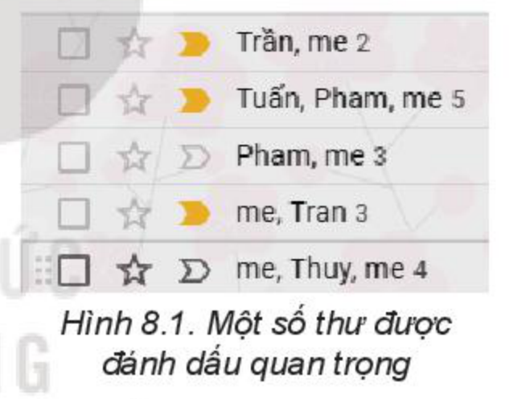
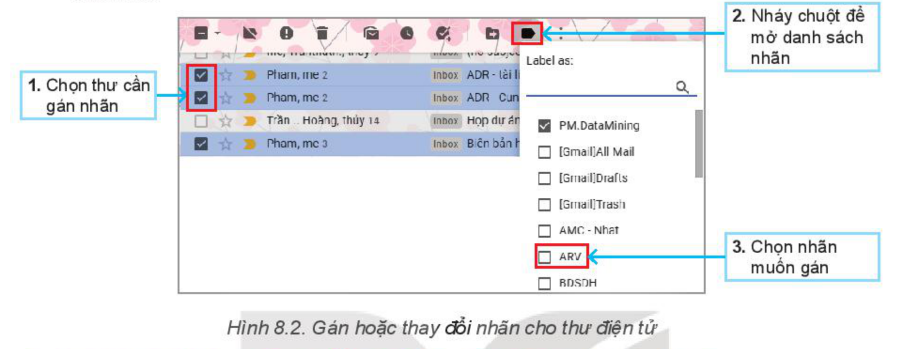
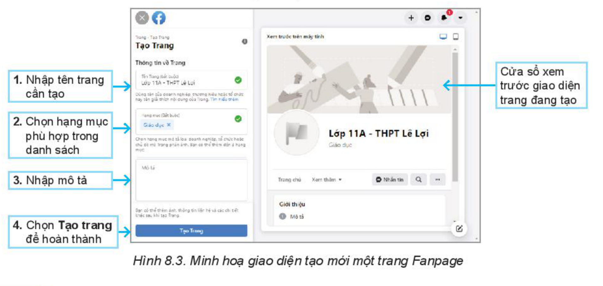
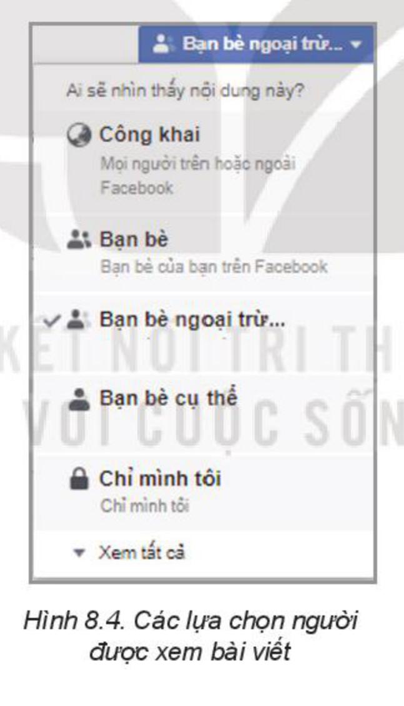
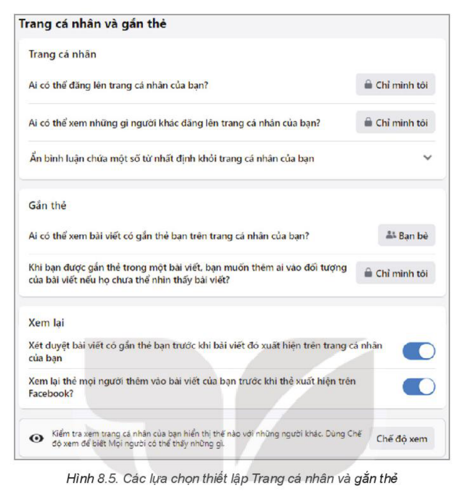

<!-- pdf:40 -->

# BÀI 8: THỰC HÀNH NÂNG CAO SỬ DỤNG THƯ ĐIỆN TỬ VÀ MẠNG XÃ HỘI

## 🎯 Sau bài học này em sẽ:

- Biết đánh dấu và phân loại thư điện tử.
- Khai thác được một số chức năng nâng cao của mạng xã hội.

## 🔴 Khởi động

> Thư điện tử trong **hộp thư** (**Inbox**) thường được hiển thị theo trình tự thời gian thư được gửi tới. Em hãy trao đổi với các bạn trong nhóm về những cách giúp em tìm đọc lại được những thư em đã nhận trước đây.

## 1. ĐÁNH DẤU VÀ PHÂN LOẠI THƯ ĐIỆN TỬ

<!-- term: Đánh dấu và phân loại thư điện tử -->
Việc đánh dấu, phân loại thư điện tử để sắp xếp hộp thư một cách hợp lí sẽ giúp việc sử dụng và tìm kiếm thư điện tử thuận tiện hơn. Dưới đây là một số cách đơn giản để thực hiện điều này của dịch vụ thư điện tử phổ biến nhất hiện nay là **Gmail**.

### Nhiệm vụ 1. Tìm hiểu dấu hiệu thư quan trọng trong Gmail

Gmail hỗ trợ tự động xác định và đánh dấu thư thuộc loại quan trọng bằng dấu (**dấu quan trọng** màu vàng – Hình 8.1) bằng cách dựa vào các dấu hiệu như: người gửi và tần suất gửi cho một người; thư điện tử được mở và trả lời; từ khoá có trong thư điện tử thường xuyên đọc; thư điện tử được gắn dấu sao, lưu trữ hoặc xoá,...

*Hình 8.1. Một số thư được đánh dấu quan trọng*

Hướng dẫn:

*Bước 1.* Vào hộp thư đến, di chuyển con trỏ chuột vào dấu quan trọng màu vàng để biết lí do thư đó được đánh dấu là quan trọng.

*Bước 2.* Nháy chuột vào dấu quan trọng để thay đổi trạng thái quan trọng/không quan trọng của thư điện tử đó.

*Bước 3.* Thực hiện tìm kiếm **is: important** trong Gmail để hiển thị danh sách tất cả thư điện tử quan trọng.

### Nhiệm vụ 2. Sắp xếp, phân loại thư trong Gmail bằng Nhãn

Sử dụng **Nhãn** (**Label**) để sắp xếp, phân loại thư trong hộp thư đến giúp em tiết kiệm thời gian khi tìm kiếm lại các thư, tránh thất lạc thông tin ở các thư cũ và quản lí việc nhận thư từ các địa chỉ thư điện tử dễ dàng hơn.

*Lưu ý:* Nhãn khác với thư mục. Khi em xoá một thư, thư đó sẽ bị xoá khỏi mọi nhãn đính kèm cũng như trong hộp thư đến.

<!-- pdf:41 -->

Hướng dẫn:

*Bước 1.* Tạo nhãn: Truy cập vào Gmail. Nháy chuột vào `Danh sách mở rộng` ở bên trái cửa sổ; nháy chuột vào `Tạo nhãn mới`. Sau khi đặt tên nhãn nháy chọn `Save` để lưu lại.

*Bước 2.* Gán nhãn cho các thư trong hộp thư đến. Thực hiện theo các bước ở Hình 8.2.

*Hình 8.2. Gán hoặc thay đổi nhãn cho thư điện tử*

## 2. KHAI THÁC MỘT SỐ CHỨC NĂNG NÂNG CAO CỦA MẠNG XÃ HỘI

### Nhiệm vụ 3. Tạo Fanpage trên Facebook

**Fanpage** là trang web trên Facebook giúp các tổ chức, doanh nghiệp quảng bá hình ảnh, thương hiệu và sản phẩm. Em hãy tạo Fanpage của lớp mình để đăng tải các bài viết, ảnh, video và sự kiện của trường, lớp.

Hướng dẫn:

*Bước 1.* Đăng nhập vào Facebook. Nháy chuột vào biểu tượng `Menu` để mở danh sách các lệnh. Trong mục `Tạo`, chọn `Trang`.

*Bước 2.* Làm theo các hướng dẫn tại Hình 8.3.

*Hình 8.3. Minh hoạ giao diện tạo mới một trang Fanpage*

<!-- pdf:42 -->

*Bước 3.* Nhập nội dung, hình ảnh, các bài viết cho trang Fanpage vừa tạo và chia sẻ với bạn bè về trang này.

*Bước 4.* Khám phá các tính năng về quản lí trang để thực hiện quản lí trang Fanpage của lớp em.

*Lưu ý:* Việc tạo và quản lí các Fanpage để quảng bá thương hiệu của một tổ chức hay một trang thương mại điện tử được thực hiện theo cách tương tự.

### Nhiệm vụ 4. Tìm hiểu và cài đặt quyền riêng tư trên Facebook

<!-- term: Cài đặt quyền riêng tư trên Facebook -->
– Thiết lập những người có thể xem các bài viết của mình trong tương lai:
*Bước 1.* Đăng nhập vào Facebook. Chọn `Cài đặt` → `Quyền riêng tư` để mở trang thông tin, hướng dẫn.
*Bước 2.* Đọc kĩ các thông tin giải thích về `Cài đặt quyền riêng tư và công cụ` để thực hiện.
*Bước 3.* Tìm hiểu và thiết lập những người có thể xem các bài viết của em trong tương lai (Hình 8.4).
*Bước 4.* Kiểm thử các cài đặt vừa thiết lập.

*Hình 8.4. Các lựa chọn người được xem bài viết*

<!-- term: Thiết lập Trang cá nhân và gắn thẻ -->
– Thiết lập các quyền liên quan đến trang cá nhân và gắn thẻ
*Bước 1.* Chọn `Cài đặt` → `Trang cá nhân và gắn thẻ` trong Facebook.
*Bước 2.* Quan sát và giải thích ý nghĩa các lựa chọn tại Hình 8.5.
*Bước 3.* Thực hiện các thiết lập phù hợp tại `Trang các nhân và gắn thẻ`.
*Bước 4.* Kiểm thử lựa chọn vừa thiết lập.

<!-- pdf:43 -->

*Hình 8.5. Các lựa chọn thiết lập Trang cá nhân và gắn thẻ*

## ✏️ Luyện tập

1. Tạo mới một vài nhãn trong hộp thư của em để phân loại các thư liên quan đến học tập và giải trí. Gán nhãn phù hợp cho các thư và tìm kiếm chúng theo nhãn. Thực hiện việc chỉnh sửa và xoá nhãn.
2. Kiểm tra việc cài đặt quyền riêng tư hiện tại trong tài khoản Facebook của em. Thực hiện các cài đặt phù hợp để tăng tính bảo mật cho tài khoản.

## 🚀 Vận dụng

1. Khám phá phân loại thư bằng dấu sao. Nhận xét, so sánh ưu, nhược điểm với cách phân loại thư bằng dấu quan trọng.
2. Khám phá và sử dụng các tính năng liên quan tới cài đặt riêng tư cho tài khoản người dùng mạng xã hội Facebook:
   a) Xoá lịch sử hoạt động Facebook để ngăn Facebook phát tán quảng cáo đến người dùng.
   b) Bật, tắt dịch vụ vị trí của người dùng.

## 📷 Danh sách hình trong bài

| Mã hình | Trang PDF | Vị trí trong bài | Chú thích gốc |
| --- | --- | --- | --- |
| H11-tin_hoc_khmt-b08-01 | 40 | Mục 1, Nhiệm vụ 1 | Hình 8.1. Một số thư được đánh dấu quan trọng |
| H11-tin_hoc_khmt-b08-02 | 41 | Mục 1, Nhiệm vụ 2 | Hình 8.2. Gán hoặc thay đổi nhãn cho thư điện tử |
| H11-tin_hoc_khmt-b08-03 | 41 | Mục 2, Nhiệm vụ 3 | Hình 8.3. Minh hoạ giao diện tạo mới một trang Fanpage |
| H11-tin_hoc_khmt-b08-04 | 42 | Mục 2, Nhiệm vụ 4 | Hình 8.4. Các lựa chọn người được xem bài viết |
| H11-tin_hoc_khmt-b08-05 | 43 | Mục 2, Nhiệm vụ 4 | Hình 8.5. Các lựa chọn thiết lập Trang cá nhân và gắn thẻ |
