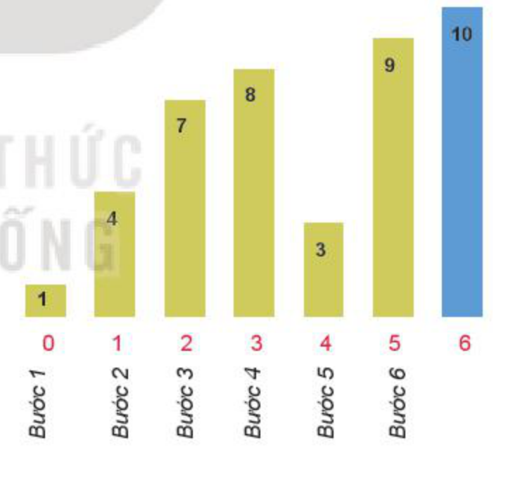
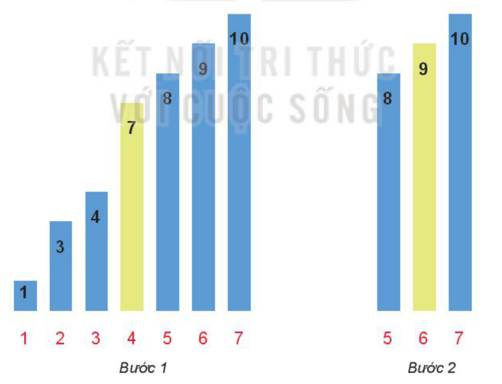

<!-- pdf:90 -->

# BÀI 19: BÀI TOÁN TÌM KIẾM

## 🎯 Sau bài học này em sẽ:

- Biết được ý nghĩa của bài toán tìm kiếm trên thực tế.
- Biết và thực hiện được chương trình tìm kiếm tuần tự và tìm kiếm nhị phân.

## 🔴 Khởi động

> **Trò chơi lật thẻ**
>
> Giả sử có một bộ thẻ, trên mỗi thẻ in một số bất kì. Các thẻ được xếp úp mặt xuống bàn theo thứ tự tăng dần của các số ghi trên thẻ. Người chơi mỗi lần chỉ được lật một thẻ để xem giá trị số in trên đó. Nếu giá trị số in trên thẻ lật lên bằng số K cho trước thì trò chơi kết thúc. Bạn An đã chơi bằng cách lật lần lượt từng thẻ từ đầu đến cuối. Theo em, An có chắc chắn xác định được thẻ nào in số K không? Em có cách nào xác định được thẻ in số K nhanh hơn An không?

## 1. BÀI TOÁN TÌM KIẾM TRÊN THỰC TẾ

> **Hoạt động 1: Bài toán tìm kiếm**
>
> Với các bài toán tìm kiếm sau, hãy thảo luận về miền dữ liệu và khả năng các kết quả có thể tìm được của bài toán:
>
> Bài toán 1. Em cần tìm hình ảnh các cây hoa hồng đẹp trên Internet để đưa vào bài trình bày về cách trồng hoa.
>
> Bài toán 2. Em cần tìm một tệp văn bản có tên bai-hoc-1.docx trên máy tính của em nhưng đã lâu rồi chưa sử dụng lại.
>
> Bài toán 3. Em cần tìm 5 bạn học sinh có điểm trung bình các bài thi cao nhất trong kì thi Olympic Tin học của thành phố.

- Với bài toán 1, miền dữ liệu là tất cả các ảnh có trên các máy tính kết nối mạng Internet. Kết quả là các ảnh có hình hoa hồng.
- Với bài toán 2, miền dữ liệu là các tệp văn bản có trên đĩa cứng máy tính của em. Kết quả là tệp có tên bai-hoc-1.docx.
- Với bài toán 3, miền dữ liệu là danh sách học sinh và điểm các bài dự thi của kì thi Olympic Tin học thành phố. Kết quả là danh sách 5 bạn có thành tích cao nhất tính theo điểm trung bình.

<!-- term: Bài toán tìm kiếm -->
> Có thể nói **bài toán tìm kiếm** là một trong những bài toán quan trọng nhất của Tin học. Việc thiết kế thuật toán tìm kiếm sẽ phụ thuộc vào cấu trúc của **miền dữ liệu** cần tìm kiếm và tiêu chí cụ thể của bài toán tìm kiếm.

<!-- pdf:91 -->

> ❓ **Câu hỏi**
>
> Em hãy xác định miền dữ liệu và nghiệm có thể của các bài toán tìm kiếm sau.
>
> 1. Bài toán tìm đường đi từ nhà em đến trường học dựa trên bản đồ số.
> 2. Bài toán tìm tất cả các trường trung học phổ thông (tên trường, địa chỉ) ở quận (huyện) em đang cư trú.

## 2. TÌM KIẾM TUẦN TỰ

Cách An lần lượt lật các thẻ từ đầu đến cuối trong phần khởi động chính là việc thực hiện **tìm kiếm tuần tự** trong các thẻ bài. Đây là một trường hợp riêng của việc tìm kiếm trên mô hình dữ liệu là một dãy các đối tượng (danh sách) và thuật toán được thực hiện một cách tuần tự. Để cho đơn giản, ta xét danh sách tìm kiếm là một dãy các số. Bài toán tìm kiếm được mô tả như sau:

*Đầu vào:* Cho trước dãy số A[0], A[1],..., A[n-1] và giá trị K.

*Đầu ra:* Cần tìm ra chỉ số i mà phần tử A[i] có giá trị bằng K. Nếu không thấy thì trả về giá trị -1.

> **Hoạt động 2: Thuật toán tìm kiếm tuần tự**
>
> Quan sát cách thực hiện thuật toán tìm kiếm tuần tự trên ví dụ cụ thể sau. Hãy trao đổi, thảo luận để hiểu và mô tả được thuật toán trong trường hợp tổng quát.

Cho dãy số A = [1, 4, 7, 8, 3, 9, 10] và cần tìm kiếm phần tử có giá trị bằng 9.

Có thể thực hiện tìm kiếm tuần tự như sau:

*Bước 1.* i = 0: A[0] = 1 không bằng 9.

*Bước 2.* i = 1: A[1] = 4 không bằng 9.

*Bước 3.* i = 2: A[2] = 7 không bằng 9.

*Bước 4.* i = 3: A[3] = 8 không bằng 9.

*Bước 5.* i = 4: A[4] = 3 không bằng 9.

*Bước 6.* i = 5: A[5] = 9 là phần tử cần tìm.

Như vậy phần tử cần tìm có chỉ số 5.



Các bước thực hiện như trên chính là các bước của thuật toán tìm kiếm tuần tự.

*Thuật toán tìm kiếm tuần tự:* Duyệt lần lượt các phần tử của dãy để tìm phần tử có giá trị bằng K. Nếu tìm thấy, trả về chỉ số của phần tử bằng K; Ngược lại, thông báo không tìm thấy và trả về giá trị –1. Thuật toán có thể duyệt từ đầu dãy hoặc từ cuối dãy.

Thuật toán tìm kiếm tuần tự có thể viết như sau:

```python
def LinearSeach(A,K):
    for i in range(len(A)):
        if A[i] == K:
            return i
    return -1
```

<!-- pdf:92 -->

> **Thuật toán tìm kiếm tuần tự** được thực hiện bằng cách duyệt lần lượt các phần tử của dãy từ đầu đến cuối để tìm phần tử có giá trị bằng giá trị cần tìm.

> ❓ **Câu hỏi**
>
> 1. Cho dãy A = [1, 91, 45, 23, 67, 9, 10, 47, 90, 46, 86].
>    Thuật toán tìm kiếm tuần tự cần thực hiện bao nhiêu lần duyệt để tìm ra phần tử có giá trị bằng 47 trong dãy?
> 2. Khi nào thì tìm kiếm tuần tự sẽ tìm được ngay kết quả, cần ít bước nhất?
> 3. Khi nào thì tìm kiếm tuần tự sẽ cần nhiều bước nhất? Cho ví dụ.

## 3. TÌM KIẾM NHỊ PHÂN

> **Hoạt động 3: Thuật toán tìm kiếm nhị phân**
>
> Cho trước một dãy số đã được sắp xếp theo thứ tự tăng dần. Hãy đọc, quan sát và thảo luận cách làm sau đây để hiểu được thuật toán tìm kiếm nhị phân, biết được tính ưu việt của thuật toán này so với thuật toán tìm kiếm tuần tự trên một dãy các phần tử đã sắp xếp.

### a) Phân tích bài toán

Khác với bài toán tìm kiếm tuần tự, bài toán **tìm kiếm nhị phân** tìm kiếm với dãy số đã được sắp xếp. Khi duyệt một phần tử bất kì của dãy số, em có thể xác định được phần tử cần tìm sẽ nằm ở bên trái hay bên phải phần tử đang duyệt, từ đó quyết định tìm tiếp theo hướng nào mà không cần duyệt tất cả các phần tử của dãy số.

### b) Thuật toán tìm kiếm nhị phân

Thuật toán tìm kiếm nhị phân được thực hiện bằng cách liên tục thu hẹp phạm vi tìm kiếm. Nếu giá trị của phần tử ở giữa bằng K thì thông báo tìm thấy. Nếu giá trị K nhỏ hơn giá trị của phần tử ở giữa thì thu hẹp phạm vi tìm kiếm là nửa đầu của dãy tăng A (ngược lại thì phạm vi tìm kiếm là nửa sau). Cứ tiếp tục thu hẹp phạm vi như vậy cho đến khi tìm thấy hoặc đã duyệt hết thì thông báo không tìm thấy. Thuật toán tìm kiếm nhị phân được thực hiện như sau:

- Thiết lập các giá trị left, right là chỉ số phần tử đầu và cuối của dãy cần tìm. Như vậy cần tìm K trong dãy A[left..right]. Ban đầu đặt left = 0, right = n – 1.
- So sánh K với phần tử giữa dãy A[mid], với mid là phần nguyên của phép chia (left + right) cho 2, có ba trường hợp có thể xảy ra:
  - Nếu K = A[mid] thì trả về chỉ số mid và kết thúc chương trình.
  - Nếu K < A[mid] thì phần tử cần tìm sẽ nằm ở dãy con bên trái của phần tử A[mid], cập nhật giá trị right = mid – 1, giữ nguyên giá trị left.

<!-- pdf:93 -->

  - Nếu K > A[mid] thì phần tử cần tìm sẽ nằm ở dãy con bên phải của phần tử A[mid], cập nhật giá trị left = mid + 1, giữ nguyên giá trị right.

Lặp lại bước trên cho đến khi tìm thấy phần tử bằng K hoặc phạm vi tìm kiếm bằng rỗng (right < left).

### c) Minh hoạ các bước của thuật toán tìm kiếm nhị phân

Giả sử dãy số đã sắp xếp là A = [1, 3, 4, 7, 8, 9, 10]. Giá trị cần tìm là K = 9.

*Bước 1.* Phạm vi tìm kiếm là các phần tử được in đậm [1, 3, 4, 7, 8, 9, 10].

```python
left = 0, right = 6
mid = (0 + 6) // 2 = 3
A[mid] = A[3] = 7 < K # phần tử cần tìm nằm ở dãy con bên phải
```

Cập nhật chỉ số `left = mid + 1 = 3 + 1 = 4`.

*Bước 2.* Phạm vi tìm kiếm là các phần tử được in đậm [1, 3, 4, 7, 8, 9, 10].

```python
left = 4, right = 6
mid = (4+6)//2 = 5
A[mid] = A[5] = 9 = K # phần tử cần tìm có chỉ số 5. Kết thúc chương trình.
```

Ví dụ trên cho thấy thời gian tìm với thuật toán tìm kiếm nhị phân nhanh hơn so với thuật toán tìm kiếm tuần tự, do số phần tử cần duyệt giảm một nửa sau mỗi vòng lặp. Cùng dãy số có số phần tử như nhau (A = [1, 3, 4, 7, 8, 9, 10]) và cùng giá trị tìm kiếm (K = 9) thì thuật toán tìm kiếm tuần tự cần 6 bước, nhưng nếu dãy số được sắp xếp và dùng thuật toán tìm kiếm nhị phân thì chỉ cần hai bước.



Thuật toán tìm kiếm nhị phân trên dãy số đã sắp xếp tăng dần có thể như sau, trong đó hàm BinarySearch(A,K) trả lại chỉ số i nếu tìm thấy A[i] = K và trả lại giá trị –1 nếu không tìm thấy K trong dãy A.

<!-- pdf:94 -->

```python
def BinarySearch(A,K):
    left = 0
    right = len(A) - 1
    while left <= right:
        mid = (left + right)//2
        if A[mid] == K:
            return mid
        elif A[mid] < K:
            left = mid + 1
        else:
            right = mid - 1
    return -1
```

> **Thuật toán tìm kiếm nhị phân** được áp dụng cho các dãy được sắp xếp theo thứ tự xác định. Sau mỗi bước lặp của thuật toán phạm vi tìm kiếm được thu hẹp dần. Ví dụ với dãy tăng dần, nếu giá trị cần tìm nhỏ hơn giá trị của phần tử ở giữa của dãy thì phạm vi tìm kiếm thu hẹp vào nửa đầu của dãy, ngược lại, phạm vi tìm kiếm là nửa cuối của dãy. Cứ tiếp tục như vậy cho đến khi tìm thấy hoặc phạm vi tìm kiếm bằng rỗng.

> ❓ **Câu hỏi**
>
> Cho dãy A = [0, 4, 9, 10, 12, 14, 17, 18, 20, 31, 34, 67].
>
> 1. Với thuật toán tìm kiếm tuần tự, cần duyệt bao nhiêu phần tử để tìm ra phần tử có giá trị bằng 34?
> 2. Với thuật toán tìm kiếm nhị phân, cần duyệt bao nhiêu phần tử để tìm ra phần tử có giá trị bằng 34?
> 3. Thay vì lần lượt lật các thẻ từ đầu đến cuối, bạn Minh đã chơi như sau: Đầu tiên Minh lật thẻ ở giữa, sau đó tuỳ theo số ghi trên thẻ là lớn hơn hay nhỏ hơn số K mà lật tiếp thẻ ở ngay bên trái, hoặc ngay bên phải thẻ ở giữa. Trong trường hợp này, số lần nhiều nhất mà Minh phải lật để tìm ra thẻ in số K là bao nhiêu?

## ✏️ Luyện tập

1. Em hãy chỉnh sửa thuật toán tìm tuần tự để tìm ra tất cả các phần tử trong dãy bằng giá trị cần tìm, biết dãy đó có nhiều phần tử bằng giá trị cần tìm.
2. Viết chương trình của thuật toán tìm kiếm nhị phân với dãy sắp xếp giảm dần.

## 🚀 Vận dụng

1. Cho A là danh sách tên các học sinh trong lớp viết chương trình tìm kiếm tuần tự để tìm ra các học sinh có tên là Hoàn.
2. Cho A là danh sách tên các học sinh trong lớp được sắp xếp theo thứ tự bảng chữ cái, viết chương trình tìm kiếm nhị phân để tìm ra các học sinh có tên là Minh.

## 📷 Danh sách hình trong bài

| Mã hình | Trang PDF | Vị trí trong bài | Chú thích gốc |
| --- | --- | --- | --- |
| H11-tin_hoc_khmt-b19-01 | 91 | Mục 2, Hoạt động 2 | Minh hoạ các bước tìm kiếm tuần tự (Bước 1–6) |
| H11-tin_hoc_khmt-b19-02 | 93 | Mục 3.c | Minh hoạ các bước tìm kiếm nhị phân (Bước 1–2) |
