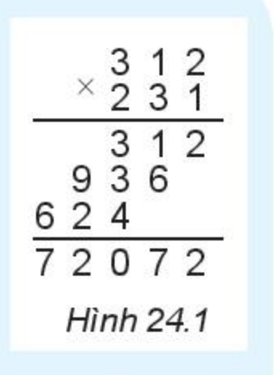
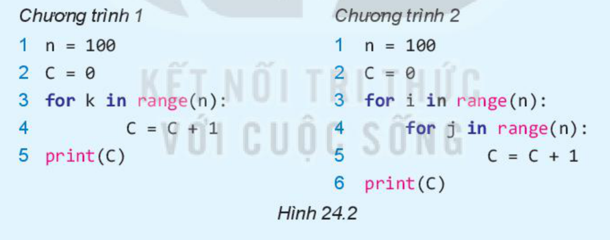

<!-- pdf:112 -->

# BÀI 24: ĐÁNH GIÁ ĐỘ PHỨC TẠP THỜI GIAN THUẬT TOÁN

## 🎯 Sau bài học này em sẽ:

- Biết cách phân tích độ phức tạp thời gian thuật toán.
- Nhận biết được phép toán tích cực trong chương trình.
- Biết và thực hiện được tính toán độ phức tạp thời gian của một số thuật toán đã biết.

## 🔴 Khởi động

> Quan sát Hình 24.1 chúng ta dễ thấy phép nhân 2 số có $n$ chữ số sẽ cần $n^2$ phép nhân và $2n$ phép cộng, vậy tổng số các phép tính đơn của phép nhân này là $n^2 + 2n$, chúng ta nói độ phức tạp thời gian của phép nhân này có bậc $n^2$.
>
> Năm 1960, trong một tiết dạy về công nghệ thông tin, nhà toán học Nga, Viện sĩ Kolmogorov đã hỏi các sinh viên của mình là có ai tìm được cách tính phép nhân trên với thời gian tốt hơn bậc $n^2$ được không? Khi đó đây là một bài toán chưa có lời giải. Đúng một tuần sau, một sinh viên tên là Karatsuba đã đưa GS Kolmogorov một lời giải tốt hơn về phép tính nhân trên chỉ với độ phức tạp thời gian bậc $n^{1,58496}$.



*Hình 24.1*

> Quan sát và ước lượng thời gian thực hiện các đoạn chương trình 1 và 2 trong Hình 24.2. Chương trình nào chạy nhanh hơn? Vì sao?

*Chương trình 1*

```python
1 n = 100
2 C = 0
3 for k in range(n):
4     C = C + 1
5 print(C)
```

*Chương trình 2*

```python
1 n = 100
2 C = 0
3 for i in range(n):
4     for j in range(n):
5         C = C + 1
6 print(C)
```



*Hình 24.2*

## 1. ĐÁNH GIÁ THỜI GIAN THỰC HIỆN CHƯƠNG TRÌNH

<!-- term: Đơn vị thời gian thực hiện chương trình -->
Có thể không cần cài đặt và chạy chương trình mà vẫn ước lượng được thời gian chạy dựa trên việc tính tổng thời gian các phép tính đơn và các lệnh đơn của chương trình. Cách tính này có thể không chính xác hoàn toàn như thời gian thực nhưng có thể dùng để so sánh và ước lượng thời gian chạy chương trình khá chính xác. Khi tính thời gian chạy chương trình, có thể coi tất cả các lệnh đơn (ví dụ lệnh gán) và các phép tính đơn (ví dụ phép tính số học, phép so sánh) có thời gian chạy như nhau, được gọi chung là một **đơn vị thời gian**. Cách tính này sẽ làm đơn giản hoá cách phân tích thời gian tính toán nhưng vẫn bảo đảm độ chính xác của tính toán.

<!-- pdf:113 -->

> **Hoạt động 1: Tìm hiểu cách đánh giá thời gian thực hiện chương trình**
>
> Quan sát và thực hiện đánh giá thời gian chạy của các chương trình 1 và 2 trong Hình 24.2. Từ đó biết và hiểu được cách đánh giá thời gian thực hiện chương trình.

**Chương trình 1.** Gọi $T_1$ là thời gian chạy của chương trình này.

- Mỗi lệnh tại dòng 1 và 2 cần 1 đơn vị thời gian để thực hiện.
- Vòng lặp tại dòng 3 có $n$ bước lặp, mỗi bước của vòng lặp sẽ thực hiện lệnh tại dòng 4, lệnh này cần 1 đơn vị thời gian. Vậy suy ra tổng thời gian của vòng lặp 3 là $n$ thời gian.
- Lệnh cuối tại dòng 5 cần 1 đơn vị thời gian.

Vậy để thực hiện toàn bộ chương trình 1 cần: $T_1 = T_1(n) = 2 + n + 1 = n + 3$ đơn vị thời gian.

**Chương trình 2.** Gọi $T_2$ là thời gian chạy của chương trình này.

- Mỗi lệnh tại dòng 1 và 2 cần 1 đơn vị thời gian.
- Các lệnh tại dòng 3, 4 là hai vòng lặp lồng nhau. Mỗi vòng lặp có $n$ bước như vậy thực chất có $n^2$ bước lặp của hai lệnh này. Mỗi bước lặp sẽ thực hiện các lệnh tại dòng 5, lệnh này cần 1 đơn vị thời gian. Vậy suy ra tổng thời gian của vòng lặp 3, 4 là $n^2$ đơn vị thời gian.
- Lệnh cuối tại dòng 6 cần 1 đơn vị thời gian.

Vậy tổng hợp toàn bộ chương trình 2 ta có: $T_2 = T_2(n) = 2 + n^2 + 1 = n^2 + 3$ đơn vị thời gian.

<!-- term: Nguyên tắc khung đánh giá thời gian chạy chương trình -->
> Cách đánh giá thời gian chạy chương trình được dựa trên một bộ khung các nguyên tắc dùng làm căn cứ để tính toán. Các nguyên tắc khung như sau:
> 1. Các phép toán đơn giản như phép tính số học `+`, `–`, `*`, `/`, phép lấy thương nguyên và số dư, các phép so sánh sẽ tính là 1 đơn vị thời gian.
> 2. Các phép toán lôgic cơ bản như AND, OR, NOT sẽ tính là 1 đơn vị thời gian.
> 3. Các lệnh đơn như lệnh gán, lệnh in, đọc dữ liệu,... tính là 1 đơn vị thời gian.
> 4. Vòng lặp `for` hoặc `while` sẽ được tính thời gian bằng tổng đơn vị thời gian thực hiện của mỗi bước lặp.
> 5. Lệnh `if` với nhiều trường hợp rẽ nhánh sẽ được tính thời gian bằng đơn vị thời gian lớn nhất của các lệnh nhánh.
>
> Áp dụng các nguyên tắc tính khung thời gian trên chúng ta có thể tính được gần chính xác thời gian thực hiện chương trình mà không cần cài đặt và chạy chương trình trên máy tính.

*Lưu ý:* Trong một chương trình, phép toán được thực hiện nhiều nhất và đóng vai trò chính khi thực hiện tính thời gian, được gọi là **phép toán tích cực**. Ví dụ trong chương trình 1 thì phép toán tích cực là phép cộng `C = C + 1` tại dòng 4. Với chương trình 2 thì phép cộng `C = C + 1` tại dòng 6 chính là phép toán tích cực.

<!-- pdf:114 -->

> ❓ **Câu hỏi**
>
> 1. Các lệnh và đoạn chương trình sau cần chạy trong bao nhiêu đơn vị thời gian?

(a)

```python
1 n = 1000000
2 for k in range(n):
3     if k%3 == 0:
4         print(k)
```

(b)

```python
1 n = 1000000
2 b = 3
3 for k in range(0,n,b):
4     print(k)
```

> 2. Khẳng định "Trong mọi chương trình chỉ có đúng một phép toán tích cực" là đúng hay sai?

## 2. PHÂN TÍCH ĐỘ PHỨC TẠP THỜI GIAN THUẬT TOÁN

> **Hoạt động 2: Tìm hiểu khái niệm độ phức tạp thời gian thuật toán**
>
> Cùng trao đổi và tìm hiểu cách phân loại thuật toán dựa trên độ phức tạp thời gian thuật toán.

Trong phạm vi kiến thức phổ thông có thể hiểu **độ phức tạp thời gian thuật toán** là khối lượng thời gian cần thiết để chạy chương trình thể hiện thuật toán. Một trong các cách phân loại thuật toán đó là dựa trên việc ước lượng độ phức tạp thời gian thuật toán. Độ phức tạp thời gian, trong trường hợp tổng quát, có thể coi là một hàm số $T(n)$, với $n$ là 1 số tự nhiên được xác định tuỳ thuộc từng bài toán cụ thể liên quan tới dữ liệu đầu vào. Giá trị của $T(n)$ thường được xác định trên cơ sở số lượng các phép toán/câu lệnh cần thực hiện trong chương trình/thuật toán. Khi $n$ càng lớn thì thời gian $T(n)$ sẽ tăng lên nhưng tốc độ tăng khác nhau. Để phân loại được các hàm thời gian này, các nhà khoa học đã đưa vào định nghĩa O-lớn. **Kí hiệu O-lớn** (big-O) dùng để so sánh và phân tích bậc của hàm thời gian $T(n)$ khi $n$ tăng lên vô cùng. Ví dụ chương trình 1 ở Hình 24.2 có độ phức tạp thời gian bậc $n$ và viết là $T_1(n) = O(n)$, ý nghĩa là khi $n$ tiến tới vô cùng, $T_1(n)$ sẽ tăng nhưng không quá bậc của $n$. Tương tự, chương trình 2 có độ phức tạp thời gian bậc $n^2$, và viết là $T_2(n) = O(n^2)$, ý nghĩa là khi $n$ tăng lên thì $T_2(n)$ sẽ tăng không vượt quá bậc của $n^2$.

Định nghĩa kí hiệu O-lớn:

Cho $f(n)$ và $g(n)$ là hai hàm có đối số tự nhiên. Ta viết $f(n) = O(g(n))$ và nói $f(n)$ có **bậc O-lớn** của $g(n)$ nếu tồn tại hằng số $c > 0$ và số tự nhiên $n_0 \ge 1$ sao cho với mọi $n \ge n_0$ ta có $f(n) \le c \cdot g(n)$. Nếu $f(n)$ là O-lớn của $g(n)$ thì có thể viết: $f(n) = O(g(n))$.

Xét một số ví dụ.

- Chương trình 1 ở Hình 24.2 có hàm thời gian $T_1(n) = n + 3$.

Chọn $c = 2, n_0 = 3$. Khi đó với $n \ge n_0$ ta có: $T_1(n) = n + 3 \le n + n = c \cdot n$. Do đó $T_1(n) = O(n)$. Chúng ta nói chương trình 1 có độ phức tạp thời gian $O(n)$ – tuyến tính.

- Chương trình 2 ở Hình 24.2 có hàm thời gian $T_2(n) = n^2 + 3$.

Chọn $c = 2, n_0 = 2$. Khi đó với $n \ge n_0$, ta có:
<!-- ocr-ok: đã đối chiếu ảnh trang 114, công thức chứa chỉ số dưới n_0 bị OCR đọc sai thành nạ -->

$T_2(n) = n^2 + 3 < n^2 + n_0^2 \le n^2 + n^2 = 2n^2 = c \cdot n^2$.

Vậy suy ra $T_2(n) = O(n^2)$. Ta nói chương trình 2 ở trên có độ phức tạp thời gian $O(n^2)$ – bình phương.

<!-- term: Các hàm chuẩn của kí hiệu O-lớn -->
> Kí hiệu **O-lớn** dùng để đánh giá và phân loại độ phức tạp thời gian của thuật toán khi kích thước đầu vào của bài toán tăng lên vô cùng. Các thuật toán sẽ được đánh giá qua độ phức tạp của một số hàm chuẩn như: $O(1)$ – hằng số, $O(\log n)$ – logarit, $O(n)$ – tuyến tính, $O(n\log n)$ tuyến tính logarit, $O(n^2)$ – bình phương, $O(n^k)$ – đa thức, $O(a^n)$ – luỹ thừa, $O(n!)$ – giai thừa.

<!-- pdf:115 -->

> ❓ **Câu hỏi**
>
> Tính độ phức tạp của các hàm thời gian sau:
>
> a) $T(n) = 2n(n - 2) + 4$.
>
> b) $T(n) = n^3 + 5n - 3$.

## 3. MỘT SỐ QUY TẮC THỰC HÀNH TÍNH ĐỘ PHỨC TẠP THỜI GIAN THUẬT TOÁN

> **Hoạt động 3: Tìm hiểu một số quy tắc đơn giản tính độ phức tạp thời gian thuật toán**
>
> Đọc, quan sát, thảo luận để biết một số quy tắc đơn giản tính độ phức tạp thời gian thuật toán.

Một số quy tắc tính đơn giản để tính độ phức tạp thời gian thuật toán.

**QT1.** ***Quy tắc cộng:*** $O(f(n) + g(n)) = O(\max(f(n), g(n)))$. Quy tắc này được áp dụng khi tính độ phức tạp thời gian cho hai chương trình được thực hiện nối tiếp nhau.

**QT2.** ***Quy tắc nhân:*** Phép nhân với hằng số: $O(C \cdot f(n)) = O(f(n))$, với $C$ là hằng số bất kì.

*Phép nhân với hàm số:* $O(f(n) \cdot g(n)) = O(f(n)) \cdot O(g(n))$. Quy tắc này được áp dụng tính độ phức tạp thời gian cho chương trình có hai vòng lặp lồng nhau.

Ví dụ:

$T(n) = 10n^2 = O(n^2)$ *(Quy tắc nhân với hằng số)*.

$T(n) = 3n^2 + n\log n = O(\max(3n^2, n\log n))$ *(Quy tắc cộng)* $= O(3n^2) = O(n^2)$ *(Quy tắc nhân với hằng số)*.

> ❓ **Câu hỏi**
>
> Áp dụng các quy tắc trên để tính độ phức tạp của các hàm thời gian sau:
>
> a) $T(n) = n^3 + n\log n + 2n + 1$.
>
> b) $T(n) = 3n^4 + 2n^2\log n + 10$.

## ✏️ Luyện tập

1. Xác định độ phức tạp thời gian tính toán cho chương trình sau:

```python
1 n = 1000
2 S = 0
3 for i in range(n):
4     S = S + i(i+1)
5 print(S)
```

2. Xác định độ phức tạp thời gian tính toán cho chương trình sau:

```python
1 n = 1000
2 Sum=0
3 i = 1
4 while i < n:
5     i = i*2
6     Sum = Sum + i
7 print(Sum)
```

## 🚀 Vận dụng

1. Xác định độ phức tạp thời gian của thuật toán sắp xếp chọn đã được học trong Bài 21.
2. Em hãy thiết lập chương trình và tính thời gian chạy thực tế trên máy tính của các chương trình 1 và 2 ở Hình 24.2 với các giá trị n khác nhau, từ đó thấy được ý nghĩa sự khác biệt độ phức tạp thời gian của hai chương trình này.

## 📷 Danh sách hình trong bài

| Mã hình | Trang PDF | Vị trí trong bài | Chú thích gốc |
| --- | --- | --- | --- |
| H11-tin_hoc_khmt-b24-01 | 112 | Khởi động | Hình 24.1 |
| H11-tin_hoc_khmt-b24-02 | 112 | Khởi động | Hình 24.2 |
