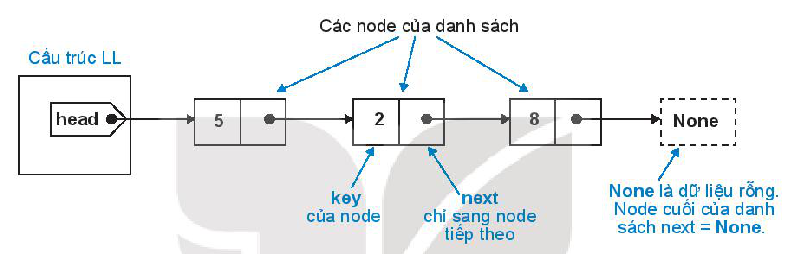
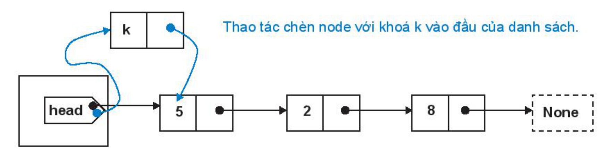
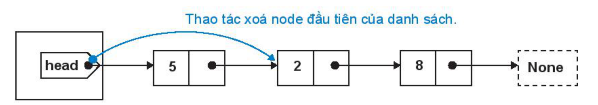
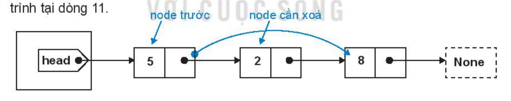

<!-- pdf:138 -->

# BÀI 30: THIẾT LẬP THƯ VIỆN CHO CHƯƠNG TRÌNH

## 🎯 Sau bài học này em sẽ:

- Tạo được một thư viện nhỏ của người lập trình.
- Trình bày được cấu trúc danh sách liên kết.

## 🔴 Khởi động

<!-- term: Danh sách liên kết (linked list) -->
> Em đã học về cấu trúc mảng (một chiều hoặc hai chiều). Cấu trúc mảng là một danh sách các phần tử được đánh chỉ số và quan hệ với nhau thông qua hệ thống chỉ số này. Giả sử $A[0], A[1], \dots, A[n - 1]$ là mảng $n$ phần tử, nếu thực hiện lệnh, ví dụ `del A[1]`, xoá một phần tử của dãy trên, thì các phần tử còn lại sẽ tự động điều chỉnh lại chỉ số để đối tượng vẫn là mảng (nhưng có $n - 1$ phần tử).
>
> **Cấu trúc danh sách liên kết** (hay **danh sách móc nối**, **linked list**) là đối tượng có cấu trúc gần giống với mảng nhưng có liên kết không chặt chẽ như mảng. Một ví dụ của cấu trúc danh sách liên kết là mô hình các trang web. Khi duyệt web, em không thể đánh chỉ số cho từng trang web đã duyệt, mà chỉ có thể di chuyển đến các trang trước và trang sau.
>
> Em hãy tìm thêm các ví dụ thực tế của mô hình danh sách liên kết.

## 1. THIẾT LẬP THƯ VIỆN CHO CHƯƠNG TRÌNH

> **Hoạt động 1: Tìm hiểu ý nghĩa của thư viện chương trình**
>
> Em hãy đọc, thảo luận và trả lời các câu hỏi sau:
>
> 1. Vì sao lại cần thư viện chương trình?
> 2. Ý nghĩa của các hàm trong thư viện chương trình là gì?

### a) Một số hàm của thư viện math

<!-- term: Thư viện math trong Python -->
**math** là một thư viện các hàm chuẩn của Python liên quan đến các tính toán toán học. Ví dụ một số hàm thường dùng của thư viện `math` là hàm tính căn bậc hai **sqrt()**, làm tròn xuống **floor()** và làm tròn lên **ceil()**. Để đưa một thư viện vào bộ nhớ có thể dùng lệnh `import` hoặc `from <thư viện> import <các hàm>` như sau:

```python
import math # đưa toàn bộ thư viện math vào bộ nhớ
```

hoặc:

```python
from math import sqrt, floor, ceil # chỉ đưa vào bộ nhớ ba hàm
```

<!-- pdf:139 -->

*Ví dụ:*

```python
>>> from math import sqrt,floor,ceil
>>> sqrt(5)
2.23606797749979
>>> floor(8.7)
8
>>> ceil(7.1)
8
```

### b) Tự thiết lập thư viện

Cách thiết lập một thư viện rất đơn giản: Em đưa các hàm chuẩn vào một tệp chương trình và đặt tên của tệp này chính là tên thư viện muốn lưu trữ. Xét ví dụ sau, tệp chương trình **lib.py** đóng vai trò như một thư viện. Thư viện này có hai hàm như sau:

**lib.py**

```python
def NhapDL():
    S = input("Nhập dãy số nguyên cách nhau bởi dấu cách: ")
    A = [int(x) for x in S.split()]
    return A
def InsertionSort(A):
    n = len(A)
    for i in range(1,n):
        value = A[i]
        j = i-1
        while j >= 0 and A[j] > value:
            A[j+1] = A[j]
            j = j - 1
        A[j+1] = value
```

Chương trình sử dụng thư viện có thể như sau (đặt tệp chương trình này cùng thư mục với tệp thư viện **lib.py**).

```python
from lib import * # Đưa tất cả các hàm của thư viện lib vào bộ nhớ
A = NhapDL()
InsertionSort(A)
print(A)
```

<!-- term: Thư viện chương trình -->
> **Thư viện chương trình** là tập hợp các hàm được đặt trong các mô đun độc lập để dùng chung cho nhiều chương trình khác nhau. Các thư viện này có thể được dùng nhiều lần và có thể cập nhật, nâng cấp bất cứ lúc nào. Trong Python, lệnh **import** có chức năng đưa thư viện vào bộ nhớ để sẵn sàng sử dụng.

> ❓ **Câu hỏi**
>
> Những câu nào sau đây là sai về ý nghĩa của việc sử dụng thư viện khi viết chương trình?
>
> A. Chương trình sẽ ngắn hơn.
>
> B. Các hàm thư viện được viết một lần và sử dụng nhiều lần.
>
> C. Chương trình sáng sủa, dễ hiểu hơn.
>
> D. Chương trình sẽ chạy nhanh hơn.

<!-- pdf:140 -->

## 2. CẤU TRÚC DANH SÁCH LIÊN KẾT

> **Hoạt động 2: Tìm hiểu cấu trúc danh sách liên kết**
>
> Đọc, trao đổi và thảo luận để biết cấu trúc dữ liệu của danh sách liên kết và các thao tác dữ liệu cơ bản trên danh sách liên kết.

<!-- term: Cấu trúc Node và cấu trúc LL của danh sách liên kết -->
Mỗi danh sách liên kết sẽ bao gồm hai cấu trúc dữ liệu:

- **Cấu trúc Node** mô tả các phần tử độc lập của danh sách. Tối thiểu mỗi node cần có thông tin dữ liệu **key** (khoá) và thuộc tính **next** dùng để kết nối sang phần tử tiếp theo trong danh sách.
- **Cấu trúc LL** (linked list) sẽ có thông tin **head** (đầu) sẽ luôn chỉ vào node đầu tiên của danh sách liên kết.



*Hình 30.1. Cấu trúc danh sách liên kết*
<!-- ocr-ok: đã đối chiếu ảnh trang 140, sơ đồ cấu trúc danh sách liên kết -->

Một số lệnh, thao tác chính với kiểu dữ liệu danh sách liên kết:

- Khởi tạo một danh sách liên kết mới.
- Bổ sung một phần tử với khoá $k$ cho trước vào danh sách.
- Tìm kiếm phần tử có khoá $k$ trong danh sách cho trước.
- Xoá phần tử có khoá $k$ trong danh sách.

Ta sẽ thiết lập một số hàm là các thao tác chuẩn trên dữ liệu danh sách liên kết.

1. Hàm `insert(L,k)` sẽ bổ sung (chèn) node với khoá $k$ vào đầu của danh sách `L`.



*Hình 30.2. Thao tác chèn node với khoá k vào đầu của danh sách*
<!-- ocr-ok: đã đối chiếu ảnh trang 140, sơ đồ thao tác chèn node vào đầu danh sách -->

Chương trình như sau:

```python
def insert(L,k):
    node = Node(k)
    node.next = L.head
    L.head = node
```

<!-- pdf:141 -->

2. Hàm **delete_first(L)** sẽ xoá node đầu tiên của danh sách (nếu danh sách không rỗng).



*Hình 30.3. Thao tác xoá node đầu tiên của danh sách*
<!-- ocr-ok: đã đối chiếu ảnh trang 141, sơ đồ thao tác xoá node đầu tiên của danh sách -->

Chương trình như sau:

```python
def delete_first(L):
    if L.head != None:
        L.head = L.head.next
```

3. Hàm tìm kiếm phần tử có khoá $k$ trong danh sách `L`. Nếu tìm thấy sẽ trả về phần tử (node) tương ứng, nếu không tìm thấy trả về **None**.

Việc tìm kiếm bắt đầu từ node đầu tiên của danh sách (dòng 2). Lần lượt duyệt theo từng phần tử của danh sách cho đến khi nào tìm thấy phần tử có khoá $k$ hoặc đi đến cuối danh sách thì dừng (các lệnh tại dòng 3, 4).

```python
def search(L,k):
    x = L.head
    while x != None and x.key != k:
        x = x.next
    return x
```

4. Hàm xoá phần tử có khoá $k$ trong danh sách `L`.

Cách thực hiện hàm này như sau:

- Nếu phần tử cần tìm là node đầu tiên của danh sách thì cách xoá giống hàm `delete_first()`.
- Trong trường hợp tổng quát cần duyệt để tìm phần tử của danh sách có khoá $k$. Trong quá trình tìm luôn lưu trữ biến `z` là node trước của biến `y` cần xoá. Nếu tìm thấy thì lệnh xoá được mô tả trong sơ đồ sau, chính là lệnh `x.next = y.next` trong chương trình tại dòng 11.



*Hình 30.4. Thao tác xoá phần tử có khoá k trong danh sách*
<!-- ocr-ok: đã đối chiếu ảnh trang 141, sơ đồ thao tác xoá phần tử có khoá k trong danh sách -->

Chương trình như sau:

```python
def delete(L,k):
    if L.head != None:
        if L.head.key == k:                 # Nếu node đầu tiên có khoá k thì xoá node này.
            L.head = L.head.next
        else:
            z = y = L.head
            while y != None and y.key != k:
                z = y
                y = y.next
            if y != None:                   # Tìm kiếm node chứa khoá k. y là biến cần tìm, z luôn chỉ vào node trước của y. Nếu tìm thấy khoá k thì xoá node y.
                z.next = y.next
```

<!-- pdf:142 -->

5. Hàm **show(L)** có tính năng hiển thị toàn bộ thông tin của danh sách liên kết.

```python
def show(L):
    x = L.head
    while x != None:
        print(x.key, end = " ")
        x = x.next
    print()
```

Toàn bộ thư viện chuẩn của cấu trúc danh sách liên kết được mô tả như sau:

**LinkedList.py**

```python
class Node:
    def __init__(self,key):
        self.key = key
        self.next = None
class LL:
    def __init__(self):
        self.head = None
def insert(L,k):
    node = Node(k)
    node.next = L.head
    L.head = node
def delete_first(L):
    if L.head != None:
        L.head = L.head.next
def search(L,k):
    x = L.head
    while x != None and x.key != k:
        x = x.next
    return x
def delete(L,k):
    if L.head != None:
        if L.head.key == k:
            L.head = L.head.next
        else:
            z = y = L.head
            while y != None and y.key != k:
                z = y
                y = y.next
            if y != None:
                z.next = y.next
def show(L):
    x = L.head
    while x != None:
        print(x.key, end = " ")
        x = x.next
    print()
```

<!-- pdf:143 -->

Một số ví dụ thiết lập cấu trúc dữ liệu Linked List:

a) Thiết lập một danh sách rỗng.

```python
L = LL()
```

b) Thiết lập một danh sách bao gồm hai node có khoá là $5, 2$.

```python
L = LL()
insert(L,5)
insert(L,2)
```

c) Thiết lập một danh sách bao gồm các phần tử lấy từ dãy `A` cho trước.

```python
A = [5,2,8,10,0,3]
L = LL()
for k in A:
    insert(L,k)
```

<!-- term: Danh sách liên kết -->
> **Danh sách liên kết** là cấu trúc dữ liệu bao gồm:
> - Cấu trúc **node** mô tả các phần tử của danh sách. Mỗi node sẽ có dữ liệu khoá (**key**) là thông tin chính và thông tin **next** để kết nối sang phần tử tiếp theo của danh sách.
> - Cấu trúc **head** là đầu của mỗi danh sách liên kết. Head luôn chỉ vào node đầu tiên của danh sách.
> - Node cuối cùng của danh sách sẽ có thông tin `next = None` (dữ liệu rỗng).
> Có thể thiết lập các hàm tìm kiếm, bổ sung hoặc xoá thông tin trên danh sách liên kết.

> ❓ **Câu hỏi**
>
> 1. Đoạn chương trình sau thực hiện công việc gì?
>
> ```python
> from LinkedList import *
> L = LL()
> insert(L,10)
> insert(L,20)
> show(L)
> ```
>
> 2. Viết đoạn chương trình ngắn sử dụng thư viện `LinkedList` để thiết lập một danh sách liên kết `L` và bổ sung các tên `"Bình"`, `"Hoa"`, `"Hà"` vào danh sách này.

## ✏️ Luyện tập

1. Viết một thư viện bao gồm các hàm nhập dữ liệu là một dãy số và các hàm thư viện bao gồm sắp xếp chèn, sắp xếp chọn và sắp xếp nổi bọt.
2. Cho trước danh sách liên kết `L` với cấu trúc như đã mô tả trong bài học, muốn lấy ra khoá của node đầu tiên của danh sách thì dùng lệnh nào?

## 🚀 Vận dụng

1. Cho trước một danh sách liên kết `L`. Viết một hàm đếm số lượng phần tử của danh sách liên kết này.
2. Viết hàm `delete_last(L)` có chức năng xoá phần tử cuối cùng của danh sách liên kết `L`.

## 📷 Danh sách hình trong bài

| Mã hình | Trang PDF | Vị trí trong bài | Chú thích gốc |
| --- | --- | --- | --- |
| H11-tin_hoc_khmt-b30-01 | 140 | Mục 2 | Hình 30.1. Cấu trúc danh sách liên kết |
| H11-tin_hoc_khmt-b30-02 | 140 | Mục 2, Hàm 1 | Hình 30.2. Thao tác chèn node với khoá k vào đầu của danh sách |
| H11-tin_hoc_khmt-b30-03 | 141 | Mục 2, Hàm 2 | Hình 30.3. Thao tác xoá node đầu tiên của danh sách |
| H11-tin_hoc_khmt-b30-04 | 141 | Mục 2, Hàm 4 | Hình 30.4. Thao tác xoá phần tử có khoá k trong danh sách |
