<!-- pdf:6 -->

<!-- Phần giới thiệu Chương I (in chung đầu trang PDF 6): CHƯƠNG I. HÀM SỐ LƯỢNG GIÁC VÀ PHƯƠNG TRÌNH LƯỢNG GIÁC -->

Chương này giới thiệu khái niệm góc lượng giác, giá trị lượng giác của góc lượng giác, các công thức lượng giác cơ bản, hàm số lượng giác, cách giải phương trình lượng giác cơ bản và một số ứng dụng của lượng giác trong thực tiễn.

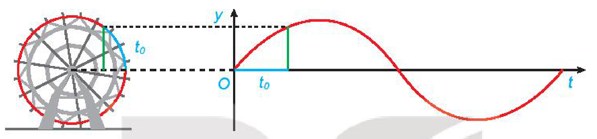

# BÀI 1: GIÁ TRỊ LƯỢNG GIÁC CỦA GÓC LƯỢNG GIÁC

## 🔤 Thuật ngữ

- Góc lượng giác
- Số đo của góc lượng giác
- Đường tròn lượng giác
- Giá trị lượng giác của góc lượng giác
- Hệ thức cơ bản giữa các giá trị lượng giác

## 🎯 Mục tiêu

- Nhận biết các khái niệm cơ bản về góc lượng giác.
- Nhận biết khái niệm giá trị lượng giác của một góc lượng giác.
- Mô tả bảng giá trị lượng giác của một số góc lượng giác thường gặp; hệ thức cơ bản giữa các giá trị lượng giác của một góc lượng giác; quan hệ giữa các giá trị lượng giác của các góc lượng giác có liên quan đặc biệt: bù nhau, phụ nhau, đối nhau, hơn kém nhau $\pi$.
- Sử dụng máy tính cầm tay để tính giá trị lượng giác của một góc lượng giác khi biết số đo của góc đó.
- Giải quyết một số vấn đề thực tiễn gắn với giá trị lượng giác của góc lượng giác.

## 🔴 Mở đầu

Trạm vũ trụ Quốc tế ISS (tên Tiếng Anh: International Space Station) nằm trong quỹ đạo tròn cách bề mặt Trái Đất khoảng $400\text{ km}$ (H.1.1). Nếu trạm mặt đất theo dõi được trạm vũ trụ ISS khi nó nằm trong góc $45^\circ$ ở tâm của quỹ đạo tròn này phía trên ăng-ten theo dõi, thì trạm vũ trụ ISS đã di chuyển được bao nhiêu kilômét trong khi nó đang được trạm mặt đất theo dõi? Giả sử rằng bán kính của Trái Đất là $6\,400\text{ km}$. Làm tròn kết quả đến hàng đơn vị.

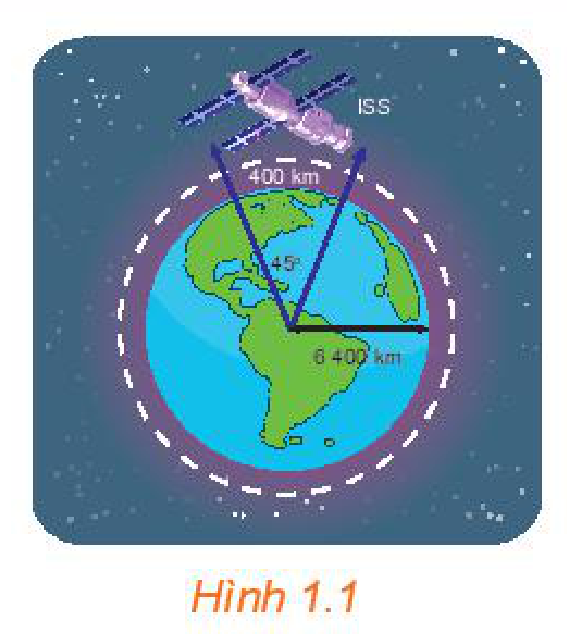
*Hình 1.1*

<!-- pdf:7 -->

## 1. GÓC LƯỢNG GIÁC

**a) Khái niệm góc lượng giác và số đo của góc lượng giác**

**HĐ1: Nhận biết khái niệm góc lượng giác**

Trên đồng hồ ở Hình 1.2, kim phút đang chỉ đúng số $2$.

a) Phải quay kim phút mấy phần của một vòng tròn theo chiều quay ngược chiều kim đồng hồ để nó chỉ đúng số $12$?

b) Phải quay kim phút mấy phần của một vòng tròn theo chiều quay của kim đồng hồ để nó chỉ đúng số $12$?

c) Có bao nhiêu cách quay kim phút theo một chiều xác định để kim phút từ vị trí chỉ đúng số $2$ về vị trí chỉ đúng số $12$?

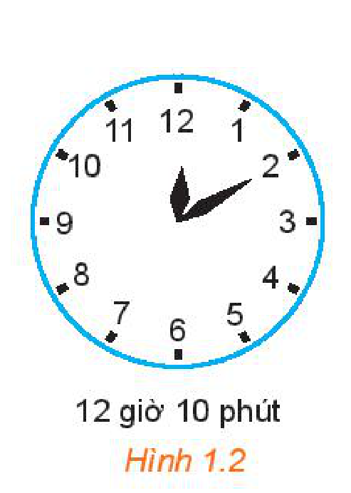
*Hình 1.2*

> Trong mặt phẳng, cho hai tia $Ou, Ov$. Xét tia $Om$ cùng nằm trong mặt phẳng này. Nếu tia $Om$ quay quanh điểm $O$, theo một chiều nhất định từ $Ou$ đến $Ov$, thì ta nói nó quét một **góc lượng giác** với **tia đầu** $Ou$, **tia cuối** $Ov$ và kí hiệu là $(Ou, Ov)$.

Góc lượng giác $(Ou, Ov)$ chỉ được xác định khi ta biết được chuyển động quay của tia $Om$ từ tia đầu $Ou$ đến tia cuối $Ov$ (H.1.3). Ta quy ước: Chiều quay ngược với chiều quay của kim đồng hồ là **chiều dương**, chiều quay cùng chiều kim đồng hồ là **chiều âm**.

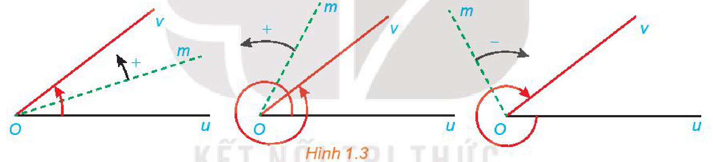
*Hình 1.3*

Khi đó, nếu tia $Om$ quay theo chiều dương đúng một vòng ta nói tia $Om$ quay góc $360^\circ$, quay đúng $2$ vòng ta nói nó quay góc $720^\circ$; quay theo chiều âm nửa vòng ta nói nó quay góc $-180^\circ$, quay theo chiều âm $1,5$ vòng ta nói nó quay góc $-1,5 \cdot 360^\circ = -540^\circ, \dots$

Khi tia $Om$ quay góc $\alpha^\circ$ thì ta nói góc lượng giác mà tia đó quét nên có số đo $\alpha^\circ$. **Số đo của góc lượng giác** có tia đầu $Ou$, tia cuối $Ov$ được kí hiệu là $\text{sđ}(Ou, Ov)$.

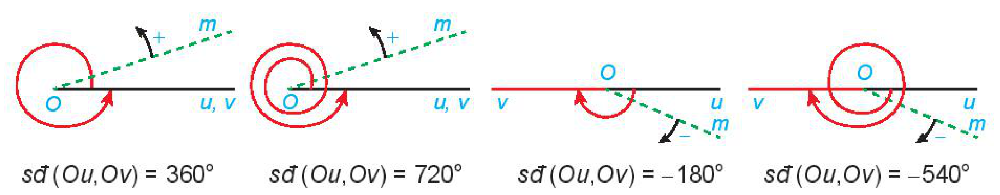

$\text{sđ}(Ou, Ov) = 360^\circ \qquad \text{sđ}(Ou, Ov) = 720^\circ \qquad \text{sđ}(Ou, Ov) = -180^\circ \qquad \text{sđ}(Ou, Ov) = -540^\circ$

> Mỗi góc lượng giác gốc $O$ được xác định bởi tia đầu $Ou$, tia cuối $Ov$ và số đo của nó.

**Chú ý:** Cho hai tia $Ou, Ov$ thì có vô số góc lượng giác tia đầu $Ou$, tia cuối $Ov$. Mỗi góc lượng giác như thế đều kí hiệu là $(Ou, Ov)$. Số đo của các góc lượng giác này sai khác nhau một bội nguyên của $360^\circ$.

<!-- pdf:8 -->

**Ví dụ 1:** Cho góc hình học $uOv$ có số đo $60^\circ$ (H.1.4). Xác định số đo của các góc lượng giác $(Ou, Ov)$ và $(Ov, Ou)$.

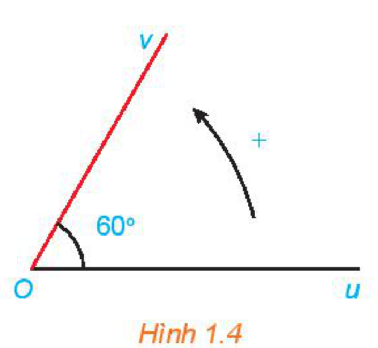
*Hình 1.4*

**Giải:**

Ta có:

- Các góc lượng giác tia đầu $Ou$, tia cuối $Ov$ có số đo là $\text{sđ}(Ou, Ov) = 60^\circ + k360^\circ$ ($k \in \mathbb{Z}$).
- Các góc lượng giác tia đầu $Ov$, tia cuối $Ou$ có số đo là $\text{sđ}(Ov, Ou) = -60^\circ + k360^\circ$ ($k \in \mathbb{Z}$).

**Luyện tập 1:** Cho góc hình học $uOv = 45^\circ$. Xác định số đo của góc lượng giác $(Ou, Ov)$ trong mỗi trường hợp sau:

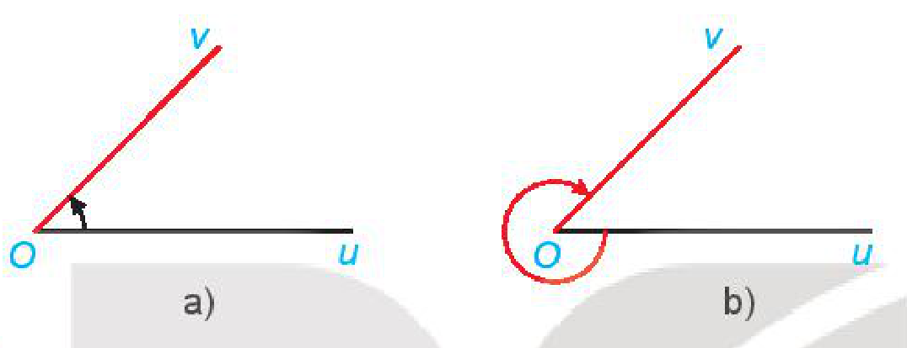

**b) Hệ thức Chasles**

**HĐ2: Nhận biết hệ thức Chasles**

Cho ba tia $Ou, Ov, Ow$ với số đo của các góc hình học $uOv$ và $vOw$ lần lượt là $30^\circ$ và $45^\circ$.

a) Xác định số đo của ba góc lượng giác $(Ou, Ov)$, $(Ov, Ow)$ và $(Ou, Ow)$ được chỉ ra ở Hình 1.5.

b) Với các góc lượng giác ở câu a, chứng tỏ rằng có một số nguyên $k$ để $\text{sđ}(Ou, Ov) + \text{sđ}(Ov, Ow) = \text{sđ}(Ou, Ow) + k360^\circ$.

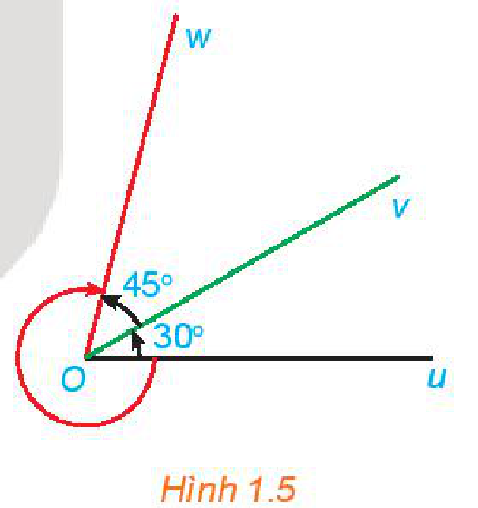
*Hình 1.5*

> **Hệ thức Chasles:** Với ba tia $Ou, Ov, Ow$ bất kì, ta có:
> $\text{sđ}(Ou, Ov) + \text{sđ}(Ov, Ow) = \text{sđ}(Ou, Ow) + k360^\circ \quad (k \in \mathbb{Z}).$

> Hệ thức này tương tự công thức $\overline{AB} = \overline{OB} - \overline{OA}$.

**Nhận xét:** Từ hệ thức Chasles, ta suy ra:

Với ba tia tuỳ ý $Ox, Ou, Ov$ ta có:
<!-- ocr-ok: đã đối chiếu ảnh trang PDF 8, OCR đọc sai chữ tuỳ -->

$\text{sđ}(Ou, Ov) = \text{sđ}(Ox, Ov) - \text{sđ}(Ox, Ou) + k360^\circ \quad (k \in \mathbb{Z}).$

Hệ thức này đóng vai trò quan trọng trong việc tính toán số đo của góc lượng giác.

**Ví dụ 2:** Cho một góc lượng giác $(Ox, Ou)$ có số đo $-270^\circ$ và một góc lượng giác $(Ox, Ov)$ có số đo $135^\circ$. Tính số đo của các góc lượng giác $(Ou, Ov)$.

<!-- pdf:9 -->

**Giải:**

Số đo của các góc lượng giác tia đầu $Ou$, tia cuối $Ov$ là:

$\text{sđ}(Ou, Ov) = \text{sđ}(Ox, Ov) - \text{sđ}(Ox, Ou) + k360^\circ = 135^\circ - (-270^\circ) + k360^\circ = 405^\circ + k360^\circ = 45^\circ + (k + 1)360^\circ = 45^\circ + m360^\circ \quad (m = k + 1, m \in \mathbb{Z}).$

Vậy các góc lượng giác $(Ou, Ov)$ có số đo là $45^\circ + m360^\circ$ ($m \in \mathbb{Z}$).

**Luyện tập 2:** Cho một góc lượng giác $(Ox, Ou)$ có số đo $240^\circ$ và một góc lượng giác $(Ox, Ov)$ có số đo $-270^\circ$. Tính số đo của các góc lượng giác $(Ou, Ov)$.

## 2. ĐƠN VỊ ĐO GÓC VÀ ĐỘ DÀI CUNG TRÒN

**a) Đơn vị đo góc và cung tròn**

**Đơn vị độ:** Để đo góc, ta dùng đơn vị độ. Ta đã biết: Góc $1^\circ$ bằng $\frac{1}{180}$ góc bẹt.

Đơn vị độ được chia thành những đơn vị nhỏ hơn: $1^\circ = 60'$; $1' = 60''$.

Đối với các góc lượng giác, khi mà số vòng quay trong chuyển động tương ứng từ tia đầu đến tia cuối là khá lớn thì số đo của chúng tính bằng độ sẽ trở nên cồng kềnh. Do đó, trong khoa học và kĩ thuật, bên cạnh việc đo bằng độ, người ta còn sử dụng đơn vị đo góc bằng **rađian**.

**Đơn vị rađian:** Cho đường tròn $(O)$ tâm $O$, bán kính $R$ và một cung $AB$ trên $(O)$ (H.1.6).

> Ta nói cung tròn $AB$ có số đo bằng **$1$ rađian** nếu độ dài của nó đúng bằng bán kính $R$.
> Khi đó ta cũng nói rằng góc $AOB$ có số đo bằng $1$ rađian và viết: $\widehat{AOB} = 1\text{ rad}$.

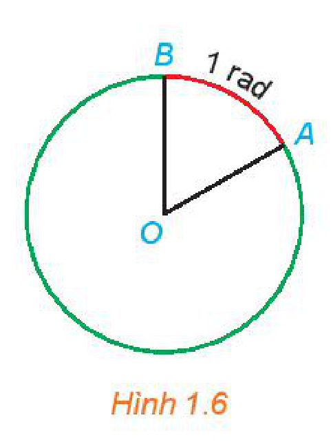
*Hình 1.6*

**Quan hệ giữa độ và rađian:** Do đường tròn có độ dài là $2\pi R$ nên nó có số đo $2\pi\text{ rad}$. Mặt khác, đường tròn có số đo bằng $360^\circ$ nên ta có $360^\circ = 2\pi\text{ rad}$.

Do đó ta viết:

> $1^\circ = \frac{\pi}{180}\text{ rad}$ và $1\text{ rad} = \left(\frac{180}{\pi}\right)^\circ$.

**Chú ý:** Khi viết số đo của một góc theo đơn vị rađian, người ta thường không viết chữ $\text{rad}$ sau số đo. Chẳng hạn góc $\frac{\pi}{2}$ được hiểu là góc $\frac{\pi}{2}\text{ rad}$.

<!-- pdf:10 -->

**Ví dụ 3:**

a) Đổi từ độ sang rađian các số đo sau: $45^\circ$; $150^\circ$.

b) Đổi từ rađian sang độ các số đo sau: $\frac{\pi}{3}$; $\frac{5\pi}{4}$.

**Giải:**

> $\alpha^\circ = \alpha \cdot \frac{\pi}{180}\text{ rad}.$

a) Ta có:

$45^\circ = 45 \cdot \frac{\pi}{180} = \frac{\pi}{4}; \quad 150^\circ = 150 \cdot \frac{\pi}{180} = \frac{5\pi}{6}.$

> $\alpha\text{ rad} = \alpha \cdot \left(\frac{180}{\pi}\right)^\circ.$

b) Ta có:

$\frac{\pi}{3} = \frac{\pi}{3} \cdot \left(\frac{180}{\pi}\right)^\circ = 60^\circ; \quad \frac{5\pi}{4} = \frac{5\pi}{4} \cdot \left(\frac{180}{\pi}\right)^\circ = 225^\circ.$

**Luyện tập 3:**

a) Đổi từ độ sang rađian các số đo sau: $360^\circ$; $-450^\circ$;

b) Đổi từ rađian sang độ các số đo sau: $3\pi$; $-\frac{11\pi}{5}$.

**Chú ý:** Dưới đây là bảng tương ứng giữa số đo bằng độ và số đo bằng rađian của các góc đặc biệt trong phạm vi từ $0^\circ$ đến $180^\circ$.

| Độ | $0^\circ$ | $30^\circ$ | $45^\circ$ | $60^\circ$ | $90^\circ$ | $120^\circ$ | $135^\circ$ | $150^\circ$ | $180^\circ$ |
| :--- | :---: | :---: | :---: | :---: | :---: | :---: | :---: | :---: | :---: |
| Rađian | $0$ | $\frac{\pi}{6}$ | $\frac{\pi}{4}$ | $\frac{\pi}{3}$ | $\frac{\pi}{2}$ | $\frac{2\pi}{3}$ | $\frac{3\pi}{4}$ | $\frac{5\pi}{6}$ | $\pi$ |

**b) Độ dài cung tròn**

**HĐ3: Xây dựng công thức tính độ dài của cung tròn**

Cho đường tròn bán kính $R$.

a) Độ dài của cung tròn có số đo bằng $1\text{ rad}$ là bao nhiêu?

b) Tính độ dài $l$ của cung tròn có số đo $\alpha\text{ rad}$.

<!-- term: Độ dài của cung tròn -->
> Một cung của đường tròn bán kính $R$ và có số đo $\alpha\text{ rad}$ thì có độ dài $l = R\alpha$.

**Ví dụ 4:** Giải bài toán ở *tình huống mở đầu*.

**Giải:**

Bán kính quỹ đạo của trạm vũ trụ quốc tế là $R = 6\,400 + 400 = 6\,800\text{ (km)}$.

Đổi $45^\circ = 45 \cdot \frac{\pi}{180} = \frac{\pi}{4}\text{ rad}$.

<!-- pdf:11 -->

Vậy trong khi được trạm mặt đất theo dõi, trạm ISS đã di chuyển một quãng đường có độ dài là:

$l = R\alpha = 6\,800 \cdot \frac{\pi}{4} \approx 5\,340,708 \approx 5\,341\text{ (km)}.$

**Vận dụng 1:** Một máy kéo nông nghiệp với bánh xe sau có đường kính là $184\text{ cm}$, bánh xe trước có đường kính là $92\text{ cm}$, xe chuyển động với vận tốc không đổi trên một đoạn đường thẳng. Biết rằng vận tốc của bánh xe sau trong chuyển động này là $80\text{ vòng/phút}$.

a) Tính quãng đường đi được của máy kéo trong $10$ phút.

b) Tính vận tốc của máy kéo (theo đơn vị $\text{km/giờ}$).

c) Tính vận tốc của bánh xe trước (theo đơn vị $\text{vòng/phút}$).

## 3. GIÁ TRỊ LƯỢNG GIÁC CỦA GÓC LƯỢNG GIÁC

**a) Đường tròn lượng giác**

**HĐ4: Nhận biết khái niệm đường tròn lượng giác**

Trong mặt phẳng toạ độ $Oxy$, vẽ đường tròn tâm $O$ bán kính $R = 1$. Chọn điểm gốc của đường tròn là giao điểm $A(1; 0)$ của đường tròn với trục $Ox$. Ta quy ước chiều dương của đường tròn là chiều ngược chiều quay của kim đồng hồ và chiều âm là chiều quay của kim đồng hồ.

a) Xác định điểm $M$ trên đường tròn sao cho $\text{sđ}(OA, OM) = \frac{5\pi}{4}$.

b) Xác định điểm $N$ trên đường tròn sao cho $\text{sđ}(OA, ON) = -\frac{7\pi}{4}$.

> - **Đường tròn lượng giác** là đường tròn có tâm tại gốc toạ độ, bán kính bằng $1$, được định hướng và lấy điểm $A(1; 0)$ làm **điểm gốc** của đường tròn.
> - **Điểm trên đường tròn lượng giác biểu diễn góc lượng giác có số đo $\alpha$** (độ hoặc rađian) là điểm $M$ trên đường tròn lượng giác sao cho $\text{sđ}(OA, OM) = \alpha$.

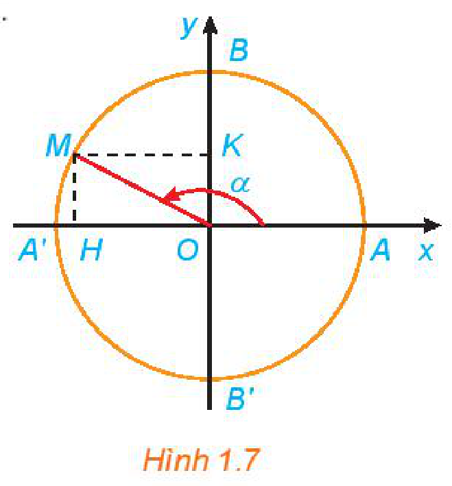
*Hình 1.7*

**Ví dụ 5:** Xác định các điểm $M$ và $N$ trên đường tròn lượng giác lần lượt biểu diễn các góc lượng giác có số đo bằng $\frac{13\pi}{4}$ và $-150^\circ$.

**Giải:**

Điểm $M$ trên đường tròn lượng giác biểu diễn góc lượng giác có số đo bằng $\frac{13\pi}{4}$ được xác định trong Hình 1.8.

Điểm $N$ trên đường tròn lượng giác biểu diễn góc lượng giác có số đo bằng $-150^\circ$ được xác định trong Hình 1.8.

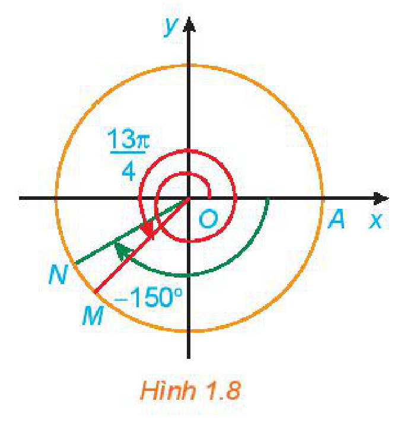
*Hình 1.8*

<!-- pdf:12 -->

**Luyện tập 4:** Xác định các điểm $M$ và $N$ trên đường tròn lượng giác lần lượt biểu diễn các góc lượng giác có số đo bằng $-\frac{15\pi}{4}$ và $420^\circ$.

**b) Các giá trị lượng giác của góc lượng giác**

**HĐ4:** Nhắc lại khái niệm các giá trị lượng giác $\sin\alpha, \cos\alpha, \tan\alpha, \cot\alpha$ của góc $\alpha$ ($0^\circ \le \alpha \le 180^\circ$) đã học ở lớp 10 (H.1.9a).

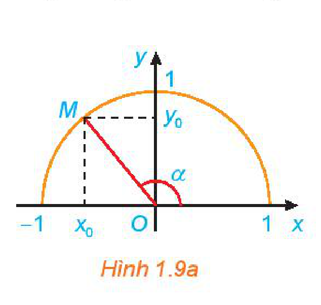
*Hình 1.9a*

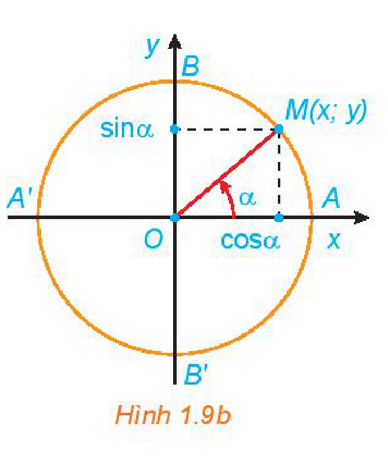
*Hình 1.9b*

Ta có thể mở rộng khái niệm giá trị lượng giác cho các góc lượng giác có số đo tuỳ ý như sau:

Giả sử $M(x; y)$ là điểm trên đường tròn lượng giác, biểu diễn góc lượng giác có số đo $\alpha$ (H.1.9b).

> - Hoành độ $x$ của điểm $M$ được gọi là **côsin** của $\alpha$, kí hiệu là $\cos\alpha$.
>   $\cos\alpha = x.$
> - Tung độ $y$ của điểm $M$ được gọi là **sin** của $\alpha$, kí hiệu là $\sin\alpha$.
>   $\sin\alpha = y.$
> - Nếu $\cos\alpha \ne 0$, tỉ số $\frac{\sin\alpha}{\cos\alpha}$ được gọi là **tang** của $\alpha$, kí hiệu là $\tan\alpha$.
>   $\tan\alpha = \frac{\sin\alpha}{\cos\alpha} = \frac{y}{x} \quad (x \ne 0).$
> - Nếu $\sin\alpha \ne 0$, tỉ số $\frac{\cos\alpha}{\sin\alpha}$ được gọi là **côtang** của $\alpha$, kí hiệu là $\cot\alpha$.
>   $\cot\alpha = \frac{\cos\alpha}{\sin\alpha} = \frac{x}{y} \quad (y \ne 0).$
> - Các giá trị $\cos\alpha, \sin\alpha, \tan\alpha, \cot\alpha$ được gọi là các **giá trị lượng giác** của $\alpha$.

**Chú ý:**

a) Ta còn gọi trục tung là **trục sin**, trục hoành là **trục côsin**.

b) Từ định nghĩa ta suy ra:

- $\sin\alpha, \cos\alpha$ xác định với mọi giá trị của $\alpha$ và ta có:
  $-1 \le \sin\alpha \le 1; \quad -1 \le \cos\alpha \le 1; \quad \sin(\alpha + k2\pi) = \sin\alpha; \quad \cos(\alpha + k2\pi) = \cos\alpha \quad (k \in \mathbb{Z}).$
- $\tan\alpha$ xác định khi $\alpha \ne \frac{\pi}{2} + k\pi$ ($k \in \mathbb{Z}$).
- $\cot\alpha$ xác định khi $\alpha \ne k\pi$ ($k \in \mathbb{Z}$).

<!-- pdf:13 -->

<!-- term: Dấu của các giá trị lượng giác -->
- Dấu của các giá trị lượng giác của một góc lượng giác phụ thuộc vào vị trí điểm biểu diễn $M$ trên đường tròn lượng giác (H.1.10).

| Giá trị lượng giác \ Góc phần tư | I | II | III | IV |
| :--- | :---: | :---: | :---: | :---: |
| $\cos\alpha$ | $+$ | $-$ | $-$ | $+$ |
| $\sin\alpha$ | $+$ | $+$ | $-$ | $-$ |
| $\tan\alpha$ | $+$ | $-$ | $+$ | $-$ |
| $\cot\alpha$ | $+$ | $-$ | $+$ | $-$ |
<!-- ocr-ok: đã đối chiếu ảnh trang PDF 13, OCR đọc lệch chữ trong bảng 2 chiều -->

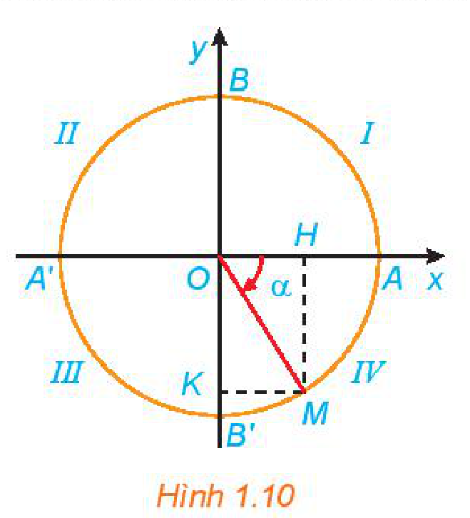
*Hình 1.10*

**Ví dụ 5:** Cho góc lượng giác có số đo bằng $-\frac{\pi}{3}$.

a) Xác định điểm $M$ trên đường tròn lượng giác biểu diễn góc lượng giác đã cho.

b) Tính các giá trị lượng giác của góc lượng giác đã cho.

**Giải:**

a) Điểm $M$ trên đường tròn lượng giác biểu diễn góc lượng giác có số đo là $-\frac{\pi}{3}$ được xác định trong Hình 1.11.

b) Ta có:

$\cos\left(-\frac{\pi}{3}\right) = \frac{1}{2}; \quad \sin\left(-\frac{\pi}{3}\right) = -\frac{\sqrt{3}}{2};$

$\tan\left(-\frac{\pi}{3}\right) = \frac{\sin\left(-\frac{\pi}{3}\right)}{\cos\left(-\frac{\pi}{3}\right)} = -\sqrt{3}; \quad \cot\left(-\frac{\pi}{3}\right) = \frac{\cos\left(-\frac{\pi}{3}\right)}{\sin\left(-\frac{\pi}{3}\right)} = -\frac{1}{\sqrt{3}}.$

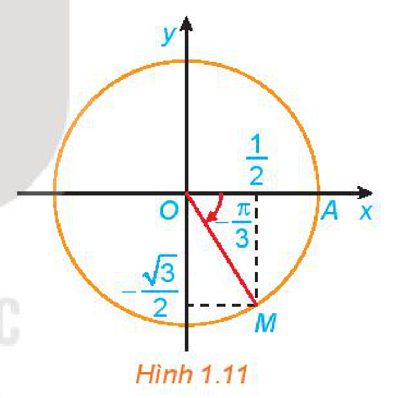
*Hình 1.11*

**Luyện tập 4:** Cho góc lượng giác có số đo bằng $\frac{5\pi}{6}$.

a) Xác định điểm $M$ trên đường tròn lượng giác biểu diễn góc lượng giác đã cho.

b) Tính các giá trị lượng giác của góc lượng giác đã cho.

**c) Giá trị lượng giác của các góc đặc biệt**

<!-- term: Giá trị lượng giác của các góc đặc biệt -->
| Góc $\alpha$ | $0$ | $\frac{\pi}{6}$ | $\frac{\pi}{4}$ | $\frac{\pi}{3}$ | $\frac{\pi}{2}$ |
| :--- | :---: | :---: | :---: | :---: | :---: |
| **Góc $\alpha$ (độ)** | $0^\circ$ | $30^\circ$ | $45^\circ$ | $60^\circ$ | $90^\circ$ |
| $\sin\alpha$ | $0$ | $\frac{1}{2}$ | $\frac{\sqrt{2}}{2}$ | $\frac{\sqrt{3}}{2}$ | $1$ |
| $\cos\alpha$ | $1$ | $\frac{\sqrt{3}}{2}$ | $\frac{\sqrt{2}}{2}$ | $\frac{1}{2}$ | $0$ |
| $\tan\alpha$ | $0$ | $\frac{1}{\sqrt{3}}$ | $1$ | $\sqrt{3}$ | Không xác định |
| $\cot\alpha$ | Không xác định | $\sqrt{3}$ | $1$ | $\frac{1}{\sqrt{3}}$ | $0$ |
<!-- ocr-ok: đã đối chiếu ảnh trang PDF 13, bảng giá trị lượng giác của các góc đặc biệt -->

<!-- pdf:14 -->

**d) Sử dụng máy tính cầm tay để đổi số đo góc và tìm giá trị lượng giác của góc**

Có thể dùng máy tính cầm tay để tính giá trị lượng giác của góc lượng giác và đổi số đo độ của cung tròn ra rađian và ngược lại.

**Ví dụ 6:** Sử dụng máy tính cầm tay để tính: $\sin\left(-\frac{9\pi}{4}\right)$; $\tan 63^\circ 52' 41''$ (làm tròn kết quả đến chữ số thập phân thứ tư).

**Giải:**

| Tính | Bấm phím | Màn hình hiện | Kết quả |
| :---: | :--- | :---: | :---: |
| $\sin\left(-\frac{9\pi}{4}\right)$ | `[MODE]` `[MODE]` `[MODE]` `[2]` `[sin]` `[(]` `[(-)]` `[9]` `[SHIFT]` `[(\pi)]` `[\div]` `[4]` `[)]` `[=]` | `-0.707106781` | $-0,7071$ |
| $\tan 63^\circ 52' 41''$ | `[MODE]` `[MODE]` `[MODE]` `[1]` `[tan]` `[6]` `[3]` `[° ' '']` `[5]` `[2]` `[° ' '']` `[4]` `[1]` `[° ' '']` `[=]` | `2.039276645` | $2,0393$ |
<!-- ocr-ok: đã đối chiếu ảnh trang PDF 14, OCR không đọc được biểu tượng phím bấm máy tính -->

**Ví dụ 7:**

a) Đổi $33^\circ 45'$ sang rađian;

b) Đổi $\frac{3}{4}\text{ (rad)}$ sang độ.

**Giải:**

| Đổi số đo | Bấm phím | Màn hình hiện | Kết quả |
| :---: | :--- | :---: | :---: |
| $33^\circ 45'$ | `[MODE]` `[MODE]` `[MODE]` `[2]` `[3]` `[3]` `[° ' '']` `[4]` `[5]` `[° ' '']` `[SHIFT]` `[(DRG▸)]` `[1]` `[=]` | `0.589048622` | $0,5890\text{ (rad)}$ |
| $\frac{3}{4}\text{ (rad)}$ | `[MODE]` `[MODE]` `[MODE]` `[1]` `[(]` `[3]` `[\div]` `[4]` `[)]` `[SHIFT]` `[(DRG▸)]` `[2]` `[=]` `[° ' '']` | `42°58'19''` | $42^\circ 58' 19''$ |
<!-- ocr-ok: đã đối chiếu ảnh trang PDF 14, OCR không đọc được biểu tượng phím bấm máy tính -->

**Luyện tập 5:** Sử dụng máy tính cầm tay để:

a) Tính: $\cos\frac{3\pi}{7}$; $\tan(-37^\circ 25')$;

b) Đổi $179^\circ 23' 30''$ sang rađian;

c) Đổi $\frac{7}{9}\text{ (rad)}$ sang độ.

## 4. QUAN HỆ GIỮA CÁC GIÁ TRỊ LƯỢNG GIÁC

**a) Các công thức lượng giác cơ bản**

**HĐ5: Nhận biết các công thức lượng giác cơ bản**

a) Dựa vào định nghĩa của $\sin\alpha$ và $\cos\alpha$, hãy tính $\sin^2\alpha + \cos^2\alpha$.

b) Sử dụng kết quả của HĐ5a và định nghĩa của $\tan\alpha$, hãy tính $1 + \tan^2\alpha$.

<!-- pdf:15 -->

Đối với các giá trị lượng giác, ta có các **hệ thức cơ bản** sau:

> $\sin^2\alpha + \cos^2\alpha = 1$
> $1 + \tan^2\alpha = \frac{1}{\cos^2\alpha} \quad \left(\alpha \ne \frac{\pi}{2} + k\pi, k \in \mathbb{Z}\right)$
> $1 + \cot^2\alpha = \frac{1}{\sin^2\alpha} \quad (\alpha \ne k\pi, k \in \mathbb{Z})$
> $\tan\alpha \cdot \cot\alpha = 1 \quad \left(\alpha \ne \frac{k\pi}{2}, k \in \mathbb{Z}\right).$

**Ví dụ 8:** Tính các giá trị lượng giác của góc $\alpha$, biết: $\sin\alpha = \frac{3}{5}$ và $90^\circ < \alpha < 180^\circ$.

**Giải:**

Vì $90^\circ < \alpha < 180^\circ$ nên $\cos\alpha < 0$. Mặt khác, từ $\sin^2\alpha + \cos^2\alpha = 1$ suy ra:
<!-- ocr-ok: đã đối chiếu ảnh trang PDF 15, OCR đọc chữ nên thành nền -->

$\cos\alpha = -\sqrt{1 - \sin^2\alpha} = -\sqrt{1 - \frac{9}{25}} = -\frac{4}{5}.$

Do đó, $\tan\alpha = \frac{\sin\alpha}{\cos\alpha} = \frac{\frac{3}{5}}{-\frac{4}{5}} = -\frac{3}{4}$ và $\cot\alpha = \frac{1}{\tan\alpha} = \frac{1}{-\frac{3}{4}} = -\frac{4}{3}$.

**Luyện tập 6:** Tính các giá trị lượng giác của góc $\alpha$, biết: $\cos\alpha = -\frac{2}{3}$ và $\pi < \alpha < \frac{3\pi}{2}$.

**b) Giá trị lượng giác của các góc có liên quan đặc biệt**

**HĐ6: Nhận biết liên hệ giữa giá trị lượng giác của các góc đối nhau**

Xét hai điểm $M, N$ trên đường tròn lượng giác xác định bởi hai góc đối nhau (H.1.12a).

a) Có nhận xét gì về vị trí của hai điểm $M, N$ đối với hệ trục $Oxy$. Từ đó rút ra liên hệ giữa: $\cos(-\alpha)$ và $\cos\alpha$; $\sin(-\alpha)$ và $\sin\alpha$.

b) Từ kết quả HĐ6a, rút ra liên hệ giữa: $\tan(-\alpha)$ và $\tan\alpha$; $\cot(-\alpha)$ và $\cot\alpha$.

Với kết quả HĐ6, ta có liên hệ giữa các giá trị lượng giác:

- **Góc đối nhau** ($\alpha$ và $-\alpha$)

<!-- term: Giá trị lượng giác của hai góc đối nhau -->
> $\cos(-\alpha) = \cos\alpha$
> $\sin(-\alpha) = -\sin\alpha$
> $\tan(-\alpha) = -\tan\alpha$
> $\cot(-\alpha) = -\cot\alpha.$

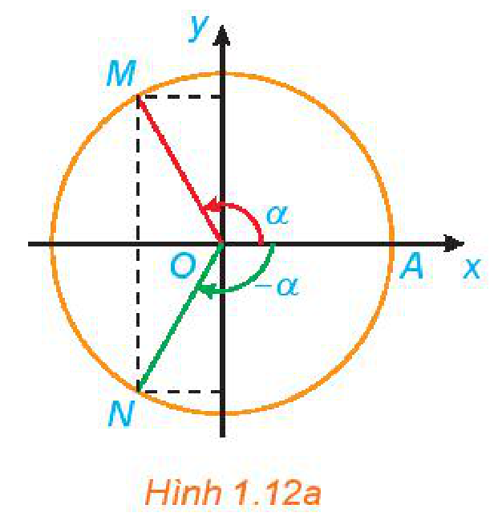
*Hình 1.12a*

<!-- pdf:16 -->

Tương tự HĐ6, ta cũng có liên hệ giữa giá trị lượng giác của các góc bù nhau, phụ nhau và hơn kém $\pi$, như sau:

- **Góc bù nhau** ($\alpha$ và $\pi - \alpha$)

<!-- term: Giá trị lượng giác của hai góc bù nhau -->
> $\sin(\pi - \alpha) = \sin\alpha$
> $\cos(\pi - \alpha) = -\cos\alpha$
> $\tan(\pi - \alpha) = -\tan\alpha$
> $\cot(\pi - \alpha) = -\cot\alpha.$

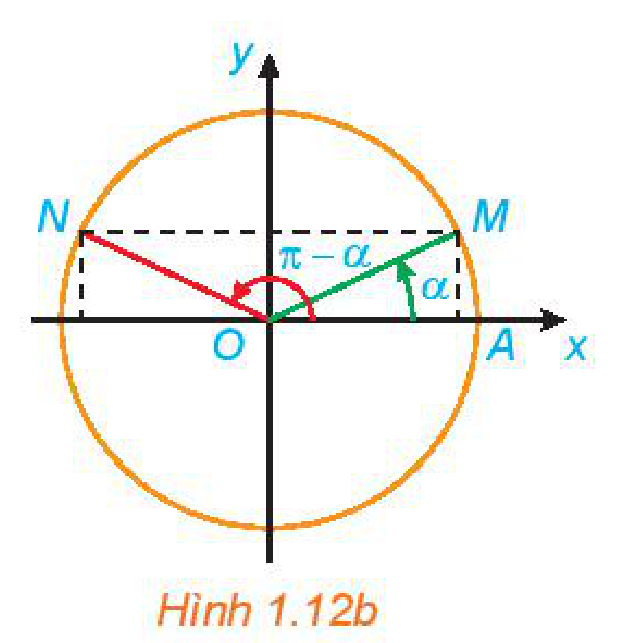
*Hình 1.12b*

- **Góc phụ nhau** ($\alpha$ và $\frac{\pi}{2} - \alpha$)

<!-- term: Giá trị lượng giác của hai góc phụ nhau -->
> $\sin\left(\frac{\pi}{2} - \alpha\right) = \cos\alpha$
> $\cos\left(\frac{\pi}{2} - \alpha\right) = \sin\alpha$
> $\tan\left(\frac{\pi}{2} - \alpha\right) = \cot\alpha$
> $\cot\left(\frac{\pi}{2} - \alpha\right) = \tan\alpha.$

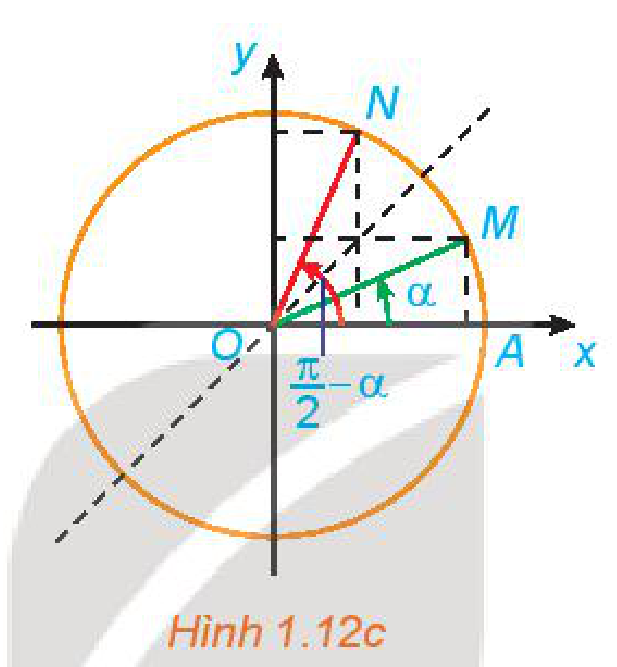
*Hình 1.12c*

- **Góc hơn kém $\pi$** ($\alpha$ và $\pi + \alpha$)

<!-- term: Giá trị lượng giác của hai góc hơn kém pi -->
> $\sin(\pi + \alpha) = -\sin\alpha$
> $\cos(\pi + \alpha) = -\cos\alpha$
> $\tan(\pi + \alpha) = \tan\alpha$
> $\cot(\pi + \alpha) = \cot\alpha.$

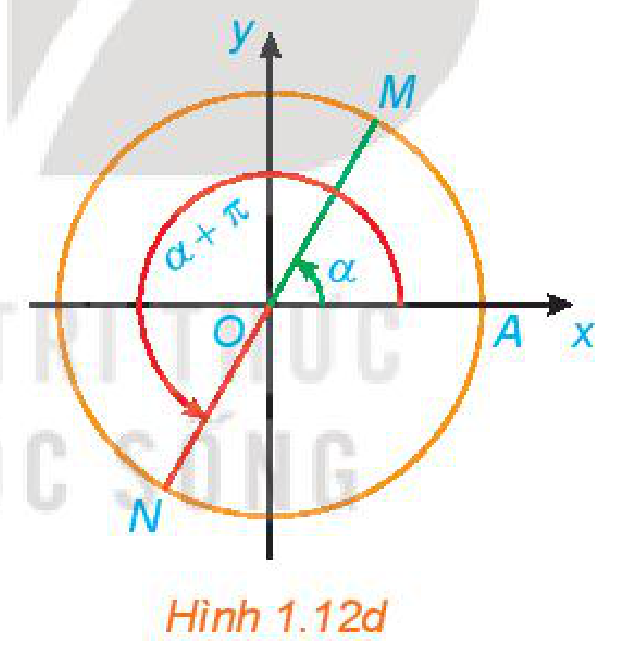
*Hình 1.12d*

**Chú ý:** Nhờ các công thức trên, ta có thể đưa việc tính giá trị lượng giác của một góc lượng giác bất kì về việc tính giá trị lượng giác của góc $\alpha$ với $0 \le \alpha \le \frac{\pi}{2}$.

**Ví dụ 9:** Tính:

a) $\cos\left(-\frac{11\pi}{4}\right)$;

b) $\cot(-675^\circ)$.

**Giải:**

Ta có:

a) $\cos\left(-\frac{11\pi}{4}\right) = \cos\frac{11\pi}{4} = \cos\left(\frac{3\pi}{4} + 2\pi\right) = \cos\frac{3\pi}{4} = -\cos\left(\pi - \frac{3\pi}{4}\right) = -\cos\frac{\pi}{4} = -\frac{\sqrt{2}}{2}$.

b) $\cot(-675^\circ) = \cot(45^\circ - 2 \cdot 360^\circ) = \cot 45^\circ = 1$.

**Luyện tập 7:** Tính:

a) $\sin(-675^\circ)$;

b) $\tan\frac{15\pi}{4}$.

<!-- pdf:17 -->

**Vận dụng 2:** Huyết áp của mỗi người thay đổi trong ngày. Giả sử huyết áp tâm trương (tức là áp lực máu lên thành động mạch khi tim giãn ra) của một người nào đó ở trạng thái nghỉ ngơi tại thời điểm $t$ được cho bởi công thức:

$B(t) = 80 + 7\sin\frac{\pi t}{12},$

trong đó $t$ là số giờ tính từ lúc nửa đêm và $B(t)$ tính bằng $\text{mmHg}$ (milimét thuỷ ngân). Tìm huyết áp tâm trương của người này vào các thời điểm sau:

a) $6$ giờ sáng;

b) $10$ giờ $30$ phút sáng;

c) $12$ giờ trưa;

d) $8$ giờ tối.

## ✏️ BÀI TẬP

**1.1.** Hoàn thành bảng sau:

| Số đo độ | $15^\circ$ | $?$ | $0^\circ$ | $900^\circ$ | $?$ | $?$ |
| :--- | :---: | :---: | :---: | :---: | :---: | :---: |
| **Số đo rađian** | $?$ | $\frac{3\pi}{8}$ | $?$ | $?$ | $-\frac{7\pi}{12}$ | $-\frac{11\pi}{8}$ |

**1.2.** Một đường tròn có bán kính $20\text{ cm}$. Tìm độ dài của các cung trên đường tròn đó có số đo sau:

a) $\frac{\pi}{12}$;

b) $1,5$;

c) $35^\circ$;

d) $315^\circ$.

**1.3.** Trên đường tròn lượng giác, xác định điểm $M$ biểu diễn các góc lượng giác có số đo sau:

a) $\frac{2\pi}{3}$;

b) $-\frac{11\pi}{4}$;

c) $150^\circ$;

d) $-225^\circ$.

**1.4.** Tính các giá trị lượng giác của góc $\alpha$, biết:

a) $\cos\alpha = \frac{1}{5}$ và $0 < \alpha < \frac{\pi}{2}$;

b) $\sin\alpha = \frac{2}{3}$ và $\frac{\pi}{2} < \alpha < \pi$;

c) $\tan\alpha = \sqrt{5}$ và $\pi < \alpha < \frac{3\pi}{2}$;

d) $\cot\alpha = -\frac{1}{\sqrt{2}}$ và $\frac{3\pi}{2} < \alpha < 2\pi$.

**1.5.** Chứng minh các đẳng thức:

a) $\cos^4\alpha - \sin^4\alpha = 2\cos^2\alpha - 1$;

b) $\frac{\cos^2\alpha + \tan^2\alpha - 1}{\sin^2\alpha} = \tan^2\alpha$.

**1.6.** Bánh xe của người đi xe đạp quay được $11$ vòng trong $5$ giây.

a) Tính góc (theo độ và rađian) mà bánh xe quay được trong $1$ giây.

b) Tính độ dài quãng đường mà người đi xe đã đi được trong $1$ phút, biết rằng đường kính của bánh xe đạp là $680\text{ mm}$.

## 📷 Danh sách hình trong bài

| Mã hình | Trang PDF | Vị trí trong bài | Chú thích gốc |
| --- | :---: | --- | --- |
| H11-toan-b01-01 | 6 | Mở đầu chương I | (sách không đánh số, sơ đồ minh hoạ chuyển động tròn và đồ thị hình sin) |
| H11-toan-b01-02 | 6 | Mở đầu | Hình 1.1 |
| H11-toan-b01-03 | 7 | Mục 1.a, HĐ1 | Hình 1.2 |
| H11-toan-b01-04 | 7 | Mục 1.a | Hình 1.3 |
| H11-toan-b01-05 | 7 | Mục 1.a | (sách không đánh số, minh hoạ các góc lượng giác $360^\circ, 720^\circ, -180^\circ, -540^\circ$) |
| H11-toan-b01-06 | 8 | Mục 1.a, Ví dụ 1 | Hình 1.4 |
| H11-toan-b01-07 | 8 | Mục 1.a, Luyện tập 1 | (sách không đánh số, hai trường hợp góc lượng giác $(Ou, Ov)$ a và b) |
| H11-toan-b01-08 | 8 | Mục 1.b, HĐ2 | Hình 1.5 |
| H11-toan-b01-09 | 9 | Mục 2.a | Hình 1.6 |
| H11-toan-b01-10 | 11 | Mục 2.b, Vận dụng 1 | (sách không đánh số, hình máy kéo nông nghiệp) |
| H11-toan-b01-11 | 11 | Mục 3.a | Hình 1.7 |
| H11-toan-b01-12 | 11 | Mục 3.a, Ví dụ 5 | Hình 1.8 |
| H11-toan-b01-13 | 12 | Mục 3.b, HĐ4 | Hình 1.9a |
| H11-toan-b01-14 | 12 | Mục 3.b | Hình 1.9b |
| H11-toan-b01-15 | 13 | Mục 3.b | Hình 1.10 |
| H11-toan-b01-16 | 13 | Mục 3.b, Ví dụ 5 | Hình 1.11 |
| H11-toan-b01-17 | 15 | Mục 4.b, HĐ6 | Hình 1.12a |
| H11-toan-b01-18 | 16 | Mục 4.b | Hình 1.12b |
| H11-toan-b01-19 | 16 | Mục 4.b | Hình 1.12c |
| H11-toan-b01-20 | 16 | Mục 4.b | Hình 1.12d |
