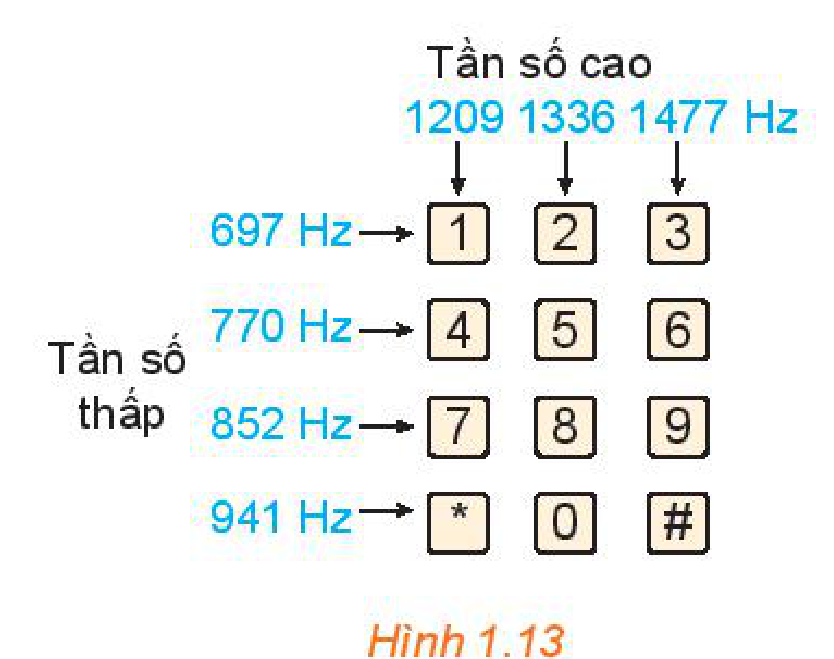

<!-- pdf:18 -->

# BÀI 2: CÔNG THỨC LƯỢNG GIÁC

## 🔤 Thuật ngữ

- Công thức cộng
- Công thức nhân đôi
- Công thức biến đổi tích thành tổng
- Công thức biến đổi tổng thành tích

## 🎯 Mục tiêu

- Mô tả các phép biến đổi lượng giác cơ bản: công thức cộng; công thức góc nhân đôi; công thức biến đổi tích thành tổng và công thức biến đổi tổng thành tích.
- Giải quyết một số vấn đề thực tiễn gắn với giá trị lượng giác của góc lượng giác và các phép biến đổi lượng giác.

## 🔴 Mở đầu

Một thiết bị trễ kĩ thuật số lặp lại tín hiệu đầu vào bằng cách lặp lại tín hiệu đó trong một khoảng thời gian cố định sau khi nhận được tín hiệu. Nếu một thiết bị như vậy nhận được nốt thuần $f_1(t) = 5\sin t$ và phát lại được nốt thuần $f_2(t) = 5\cos t$ thì âm kết hợp là $f(t) = f_1(t) + f_2(t)$, trong đó $t$ là biến thời gian. Chứng tỏ rằng âm kết hợp viết được dưới dạng $f(t) = k\sin(t + \varphi)$, tức là âm kết hợp là một sóng âm hình sin. Hãy xác định biên độ âm $k$ và pha ban đầu $\varphi$ ($-\pi \le \varphi \le \pi$) của sóng âm.

## 1. CÔNG THỨC CỘNG

**HĐ1: Nhận biết công thức cộng**

a) Cho $a = \frac{\pi}{4}$ và $b = \frac{\pi}{6}$, hãy chứng tỏ $\cos(a - b) = \cos a \cos b + \sin a \sin b$.
<!-- ocr-ok: đã đối chiếu ảnh trang PDF 18, phần lời dẫn ngắn có nhiều công thức -->

b) Bằng cách viết $a + b = a - (-b)$ và từ công thức ở HĐ1a, hãy tính $\cos(a + b)$.

c) Bằng cách viết $\sin(a - b) = \cos\left[\frac{\pi}{2} - (a - b)\right] = \cos\left[\left(\frac{\pi}{2} - a\right) + b\right]$ và sử dụng công thức vừa thiết lập ở HĐ1b, hãy tính $\sin(a - b)$.

<!-- term: Công thức cộng -->
> $\cos(a - b) = \cos a \cos b + \sin a \sin b$
> $\cos(a + b) = \cos a \cos b - \sin a \sin b$
> $\sin(a - b) = \sin a \cos b - \cos a \sin b$
> $\sin(a + b) = \sin a \cos b + \cos a \sin b$
> $\tan(a - b) = \frac{\tan a - \tan b}{1 + \tan a \tan b}$
> $\tan(a + b) = \frac{\tan a + \tan b}{1 - \tan a \tan b}$
> *(giả thiết các biểu thức đều có nghĩa).*

**Ví dụ 1:** Không dùng máy tính, hãy tính:

a) $\cos 75^\circ$;

b) $\tan\frac{\pi}{12}$.

<!-- pdf:19 -->

**Giải:**

a) $\cos 75^\circ = \cos(45^\circ + 30^\circ) = \cos 45^\circ \cos 30^\circ - \sin 45^\circ \sin 30^\circ = \frac{\sqrt{2}}{2} \cdot \frac{\sqrt{3}}{2} - \frac{\sqrt{2}}{2} \cdot \frac{1}{2} = \frac{\sqrt{6} - \sqrt{2}}{4}$.

b) $\tan\frac{\pi}{12} = \tan\left(\frac{\pi}{3} - \frac{\pi}{4}\right) = \frac{\tan\frac{\pi}{3} - \tan\frac{\pi}{4}}{1 + \tan\frac{\pi}{3} \cdot \tan\frac{\pi}{4}} = \frac{\sqrt{3} - 1}{1 + \sqrt{3}} = \frac{(\sqrt{3} - 1)^2}{3 - 1} = 2 - \sqrt{3}$.

**Ví dụ 2:** Chứng minh rằng $\sin x + \cos x = \sqrt{2}\sin\left(x + \frac{\pi}{4}\right)$.

**Giải:**

Ta có:

$\sqrt{2}\sin\left(x + \frac{\pi}{4}\right) = \sqrt{2}\left(\sin x \cos\frac{\pi}{4} + \cos x \sin\frac{\pi}{4}\right) = \sqrt{2}\left(\sin x \cdot \frac{\sqrt{2}}{2} + \cos x \cdot \frac{\sqrt{2}}{2}\right) = \sin x + \cos x.$

Đẳng thức được chứng minh.

**Luyện tập 1:** Chứng minh rằng:

a) $\sin x - \cos x = \sqrt{2}\sin\left(x - \frac{\pi}{4}\right)$;

b) $\tan\left(\frac{\pi}{4} - x\right) = \frac{1 - \tan x}{1 + \tan x} \quad \left(x \ne \frac{\pi}{2} + k\pi, x \ne \frac{3\pi}{4} + k\pi, k \in \mathbb{Z}\right)$.

**Vận dụng 1:** Giải bài toán trong *tình huống mở đầu*.

## 2. CÔNG THỨC NHÂN ĐÔI

**HĐ2: Xây dựng công thức nhân đôi**

<!-- term: Công thức nhân đôi -->
Lấy $b = a$ trong các công thức cộng, hãy tìm công thức tính: $\sin 2a$; $\cos 2a$; $\tan 2a$.

<!-- term: Công thức nhân đôi -->
> $\sin 2a = 2\sin a \cos a$
> $\cos 2a = \cos^2 a - \sin^2 a = 2\cos^2 a - 1 = 1 - 2\sin^2 a$
> $\tan 2a = \frac{2\tan a}{1 - \tan^2 a}.$

**Ví dụ 3:** Cho $\cos a = -\frac{1}{3}$ $\left(\frac{\pi}{2} < a < \pi\right)$. Tính $\sin 2a$.

**Giải:**

Vì $\frac{\pi}{2} < a < \pi$ nên $\sin a > 0$. Do đó $\sin a = \sqrt{1 - \cos^2 a} = \sqrt{1 - \left(-\frac{1}{3}\right)^2} = \sqrt{1 - \frac{1}{9}} = \sqrt{\frac{8}{9}} = \frac{2\sqrt{2}}{3}$.

Vậy $\sin 2a = 2\sin a \cos a = 2 \cdot \frac{2\sqrt{2}}{3} \cdot \left(-\frac{1}{3}\right) = -\frac{4\sqrt{2}}{9}$.

<!-- pdf:20 -->

**Luyện tập 2:** Không dùng máy tính, tính $\cos\frac{\pi}{8}$.

> **Công thức hạ bậc:**
> $\cos^2 a = \frac{1 + \cos 2a}{2}$
> $\sin^2 a = \frac{1 - \cos 2a}{2}.$

## 3. CÔNG THỨC BIẾN ĐỔI TÍCH THÀNH TỔNG

**HĐ3: Xây dựng công thức biến đổi tích thành tổng**

<!-- term: Công thức biến đổi tích thành tổng -->
a) Từ các công thức cộng $\cos(a + b)$ và $\cos(a - b)$, hãy tìm: $\cos a \cos b$; $\sin a \sin b$.

b) Từ các công thức cộng $\sin(a + b)$ và $\sin(a - b)$, hãy tìm: $\sin a \cos b$.

<!-- term: Công thức biến đổi tích thành tổng -->
> $\cos a \cos b = \frac{1}{2}[\cos(a - b) + \cos(a + b)]$
> $\sin a \sin b = \frac{1}{2}[\cos(a - b) - \cos(a + b)]$
> $\sin a \cos b = \frac{1}{2}[\sin(a - b) + \sin(a + b)].$

**Ví dụ 4:** Tính giá trị của các biểu thức:

$A = \cos\frac{5\pi}{12}\cos\frac{7\pi}{12}; \quad B = \cos 75^\circ \sin 15^\circ.$

**Giải:**

Ta có:

$A = \cos\frac{5\pi}{12}\cos\frac{7\pi}{12} = \frac{1}{2}\left[\cos\left(\frac{5\pi}{12} - \frac{7\pi}{12}\right) + \cos\left(\frac{5\pi}{12} + \frac{7\pi}{12}\right)\right] = \frac{1}{2}\left[\cos\left(-\frac{\pi}{6}\right) + \cos\pi\right] = \frac{1}{2}\left(\frac{\sqrt{3}}{2} - 1\right) = \frac{\sqrt{3} - 2}{4}.$

$B = \frac{1}{2}[\sin(15^\circ - 75^\circ) + \sin(15^\circ + 75^\circ)] = \frac{1}{2}[\sin(-60^\circ) + \sin 90^\circ] = \frac{1}{2}\left(-\frac{\sqrt{3}}{2} + 1\right) = \frac{2 - \sqrt{3}}{4}.$

**Luyện tập 3:** Không dùng máy tính, tính giá trị của các biểu thức:

$A = \cos 75^\circ \cos 15^\circ; \quad B = \sin\frac{5\pi}{12}\cos\frac{7\pi}{12}.$

<!-- pdf:21 -->

## 4. CÔNG THỨC BIẾN ĐỔI TỔNG THÀNH TÍCH

**HĐ4: Xây dựng công thức biến đổi tổng thành tích**

<!-- term: Công thức biến đổi tổng thành tích -->
Trong các công thức biến đổi tích thành tổng ở Mục 3, đặt $u = a - b$, $v = a + b$ và viết các công thức nhận được.

<!-- term: Công thức biến đổi tổng thành tích -->
> $\cos u + \cos v = 2\cos\frac{u + v}{2}\cos\frac{u - v}{2}$
> $\cos u - \cos v = -2\sin\frac{u + v}{2}\sin\frac{u - v}{2}$
> $\sin u + \sin v = 2\sin\frac{u + v}{2}\cos\frac{u - v}{2}$
> $\sin u - \sin v = 2\cos\frac{u + v}{2}\sin\frac{u - v}{2}.$

**Ví dụ 5:** Không dùng máy tính, tính giá trị của biểu thức $A = \sin\frac{\pi}{9} - \sin\frac{5\pi}{9} + \sin\frac{7\pi}{9}$.

**Giải:**

$A = \left(\sin\frac{\pi}{9} + \sin\frac{7\pi}{9}\right) - \sin\frac{5\pi}{9} = 2\sin\frac{4\pi}{9}\cos\frac{\pi}{3} - \sin\frac{5\pi}{9} = \sin\frac{4\pi}{9} - \sin\frac{5\pi}{9} = 0.$

**Luyện tập 4:** Không dùng máy tính, tính giá trị của biểu thức:

$B = \cos\frac{\pi}{9} + \cos\frac{5\pi}{9} + \cos\frac{11\pi}{9}.$

**Vận dụng 2:** Khi nhấn một phím trên điện thoại cảm ứng, bàn phím sẽ tạo ra hai âm thuần, kết hợp với nhau để tạo ra âm thanh nhận dạng duy nhất phím. Hình 1.13 cho thấy tần số thấp $f_1$ và tần số cao $f_2$ liên quan đến mỗi phím. Nhấn một phím sẽ tạo ra sóng âm $y = \sin(2\pi f_1 t) + \sin(2\pi f_2 t)$, ở đó $t$ là biến thời gian (tính bằng giây).

a) Tìm hàm số mô hình hoá âm thanh được tạo ra khi nhấn phím $4$.

b) Biến đổi công thức vừa tìm được ở câu a về dạng tích của một hàm số sin và một hàm số côsin.

*Hình 1.13*

<!-- pdf:22 -->

## ✏️ BÀI TẬP

**1.7.** Sử dụng $15^\circ = 45^\circ - 30^\circ$, hãy tính các giá trị lượng giác của góc $15^\circ$.

**1.8.** Tính:

a) $\cos\left(a + \frac{\pi}{6}\right)$, biết $\sin a = \frac{1}{\sqrt{3}}$ và $\frac{\pi}{2} < a < \pi$;

b) $\tan\left(a - \frac{\pi}{4}\right)$, biết $\cos a = -\frac{1}{3}$ và $\pi < a < \frac{3\pi}{2}$.

**1.9.** Tính $\sin 2a, \cos 2a, \tan 2a$, biết:

a) $\sin a = \frac{1}{3}$ và $\frac{\pi}{2} < a < \pi$;

b) $\sin a + \cos a = \frac{1}{2}$ và $\frac{\pi}{2} < a < \frac{3\pi}{4}$.

**1.10.** Tính giá trị của các biểu thức sau:

a) $A = \frac{\sin\frac{\pi}{15}\cos\frac{\pi}{10} + \sin\frac{\pi}{10}\cos\frac{\pi}{15}}{\cos\frac{2\pi}{15}\cos\frac{\pi}{5} - \sin\frac{2\pi}{15} \cdot \sin\frac{\pi}{5}}$;

b) $B = \sin\frac{\pi}{32}\cos\frac{\pi}{32}\cos\frac{\pi}{16}\cos\frac{\pi}{8}$.

**1.11.** Chứng minh đẳng thức sau:

$\sin(a + b)\sin(a - b) = \sin^2 a - \sin^2 b = \cos^2 b - \cos^2 a.$

**1.12.** Cho tam giác $ABC$ có $\widehat{B} = 75^\circ$; $\widehat{C} = 45^\circ$ và $a = BC = 12\text{ cm}$.

a) Sử dụng công thức $S = \frac{1}{2}ab\sin C$ và định lí sin, hãy chứng minh diện tích của tam giác $ABC$ cho bởi công thức:

$S = \frac{a^2\sin B \sin C}{2\sin A}.$

b) Sử dụng kết quả ở câu a và công thức biến đổi tích thành tổng, hãy tính diện tích $S$ của tam giác $ABC$.

**1.13.** Trong Vật lí, phương trình tổng quát của một vật dao động điều hoà cho bởi công thức $x(t) = A\cos(\omega t + \varphi)$, trong đó $t$ là thời điểm (tính bằng giây), $x(t)$ là li độ của vật tại thời điểm $t$, $A$ là biên độ dao động ($A > 0$) và $\varphi \in [-\pi; \pi]$ là pha ban đầu của dao động.

Xét hai dao động điều hoà có phương trình:

$x_1(t) = 2\cos\left(\frac{\pi}{3}t + \frac{\pi}{6}\right)\text{ (cm)},$

$x_2(t) = 2\cos\left(\frac{\pi}{3}t - \frac{\pi}{3}\right)\text{ (cm)}.$

Tìm dao động tổng hợp $x(t) = x_1(t) + x_2(t)$ và sử dụng công thức biến đổi tổng thành tích để tìm biên độ và pha ban đầu của dao động tổng hợp này.

## 📷 Danh sách hình trong bài

| Mã hình | Trang PDF | Vị trí trong bài | Chú thích gốc |
| --- | :---: | --- | --- |
| H11-toan-b02-01 | 21 | Mục 4, Vận dụng 2 | Hình 1.13 |
