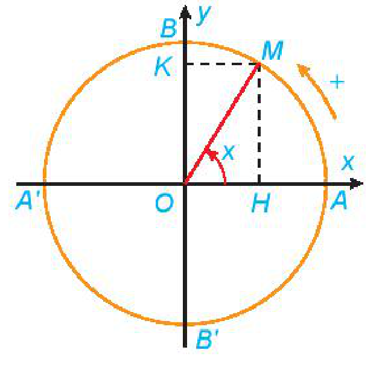
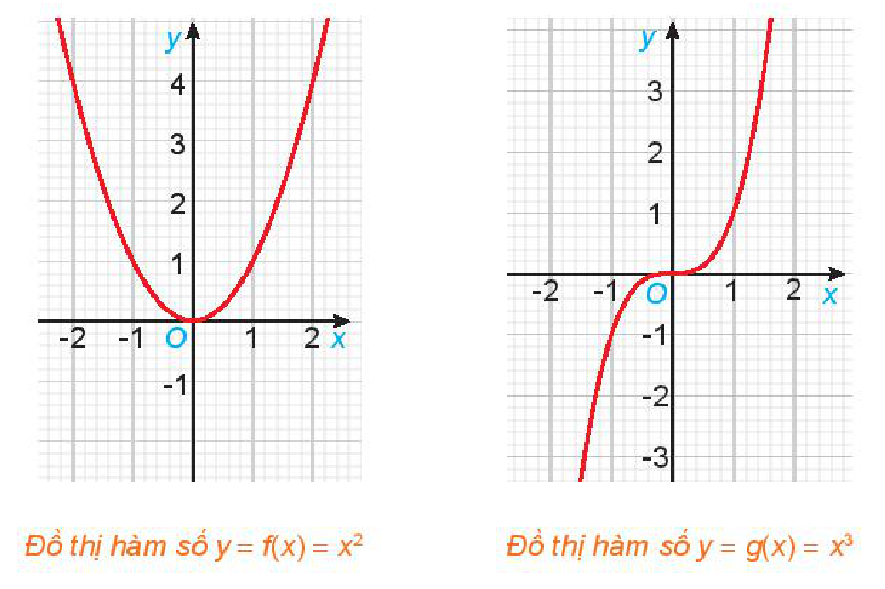
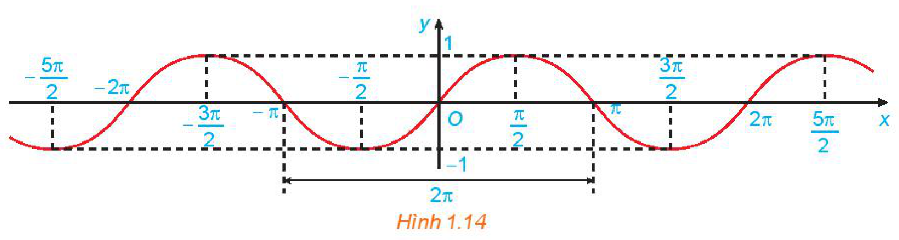
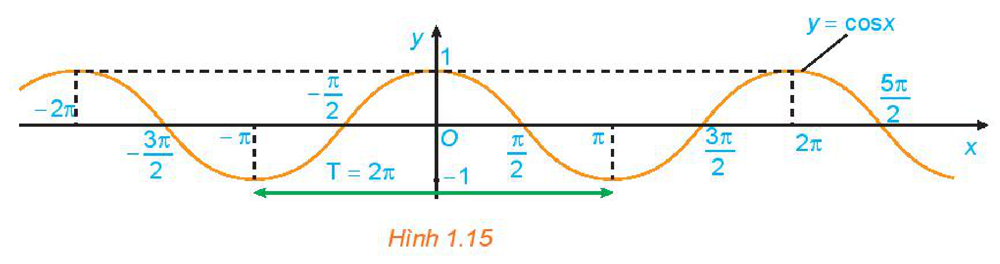
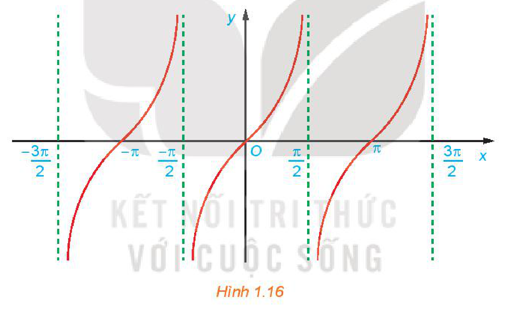
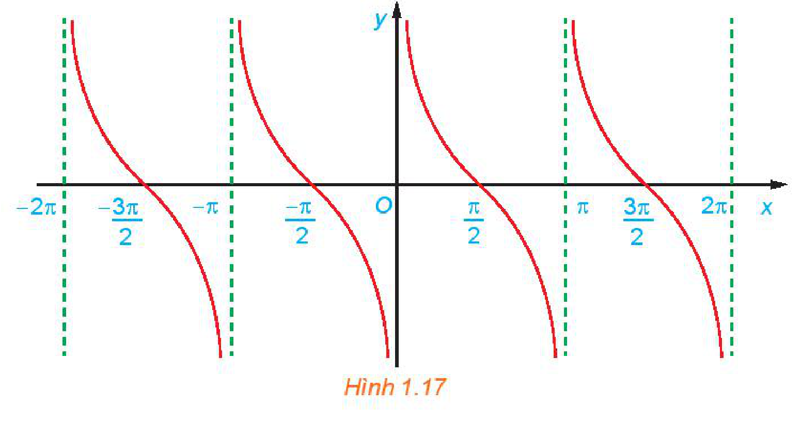

<!-- pdf:23 -->

# BÀI 3: HÀM SỐ LƯỢNG GIÁC

## 🔤 Thuật ngữ

- Hàm số lượng giác
- Hàm số chẵn
- Hàm số lẻ
- Hàm số tuần hoàn
- Đồ thị của hàm số lượng giác

## 🎯 Mục tiêu

- Nhận biết các khái niệm về hàm số chẵn, hàm số lẻ, hàm số tuần hoàn.
- Nhận biết các đặc trưng hình học của đồ thị hàm số chẵn, hàm số lẻ, hàm số tuần hoàn.
- Nhận biết các hàm số lượng giác $y = \sin x$, $y = \cos x$, $y = \tan x$, $y = \cot x$ thông qua đường tròn lượng giác. Mô tả bảng giá trị của bốn hàm số lượng giác đó trên một chu kì.
- Vẽ đồ thị của các hàm số $y = \sin x$, $y = \cos x$, $y = \tan x$, $y = \cot x$.
- Giải thích tập xác định, tập giá trị, tính chất chẵn, lẻ; tính tuần hoàn; chu kì; khoảng đồng biến, nghịch biến của các hàm số $y = \sin x$, $y = \cos x$, $y = \tan x$, $y = \cot x$ dựa vào đồ thị.
- Giải quyết một số vấn đề thực tiễn gắn với hàm số lượng giác.

## 🔴 Mở đầu

Giả sử vận tốc $v$ (tính bằng lít/giây) của luồng khí trong một chu kì hô hấp (tức là thời gian từ lúc bắt đầu của một nhịp thở đến khi bắt đầu của nhịp thở tiếp theo) của một người nào đó ở trạng thái nghỉ ngơi được cho bởi công thức

$v = 0,85\sin\frac{\pi t}{3},$

trong đó $t$ là thời gian (tính bằng giây). Hãy tìm thời gian của một chu kì hô hấp đầy đủ và số chu kì hô hấp trong một phút của người đó.

## 1. ĐỊNH NGHĨA HÀM SỐ LƯỢNG GIÁC

**HĐ1:** Hoàn thành bảng sau:

| $x$ | $\sin x$ | $\cos x$ | $\tan x$ | $\cot x$ |
| :---: | :---: | :---: | :---: | :---: |
| $\frac{\pi}{6}$ | $?$ | $?$ | $?$ | $?$ |
| $0$ | $?$ | $?$ | $?$ | $?$ |
| $-\frac{\pi}{2}$ | $?$ | $?$ | $?$ | $?$ |

Với mỗi số thực $x$, ta xác định được duy nhất một điểm $M$ trên đường tròn lượng giác sao cho số đo của góc lượng giác $(OA, OM)$ bằng $x$. Do đó, ta luôn xác định được các giá trị lượng giác $\sin x$ và $\cos x$ của $x$ lần lượt là tung độ và hoành độ của điểm $M$. Nếu $\cos x \ne 0$, ta định nghĩa $\tan x = \frac{\sin x}{\cos x}$ và nếu $\sin x \ne 0$, ta định nghĩa $\cot x = \frac{\cos x}{\sin x}$.

<!-- pdf:24 -->

Từ đây, ta có định nghĩa sau về các hàm số lượng giác.

<!-- term: Định nghĩa các hàm số lượng giác sin, côsin, tang, côtang -->
> - Quy tắc đặt tương ứng mỗi số thực $x$ với số thực $\sin x$ được gọi là **hàm số sin**, kí hiệu là $y = \sin x$.
>   Tập xác định của hàm số sin là $\mathbb{R}$.
> - Quy tắc đặt tương ứng mỗi số thực $x$ với số thực $\cos x$ được gọi là **hàm số côsin**, kí hiệu là $y = \cos x$.
>   Tập xác định của hàm số côsin là $\mathbb{R}$.
> - Hàm số cho bằng công thức $y = \frac{\sin x}{\cos x}$ được gọi là **hàm số tang**, kí hiệu là $y = \tan x$.
>   Tập xác định của hàm số tang là $\mathbb{R} \setminus \left\{\frac{\pi}{2} + k\pi \mid k \in \mathbb{Z}\right\}$.
> - Hàm số cho bằng công thức $y = \frac{\cos x}{\sin x}$ được gọi là **hàm số côtang**, kí hiệu là $y = \cot x$.
>   Tập xác định của hàm số côtang là $\mathbb{R} \setminus \{k\pi \mid k \in \mathbb{Z}\}$.

**Ví dụ 1:** Tìm tập xác định của hàm số $y = \frac{1}{\cos x}$.

**Giải:**

Biểu thức $\frac{1}{\cos x}$ có nghĩa khi $\cos x \ne 0$, tức là $x \ne \frac{\pi}{2} + k\pi$ ($k \in \mathbb{Z}$).

Vậy tập xác định của hàm số đã cho là $\mathbb{R} \setminus \left\{\frac{\pi}{2} + k\pi \mid k \in \mathbb{Z}\right\}$.

**Luyện tập 1:** Tìm tập xác định của hàm số $y = \frac{1}{\sin x}$.

## 2. HÀM SỐ CHẴN, HÀM SỐ LẺ, HÀM SỐ TUẦN HOÀN

**a) Hàm số chẵn, hàm số lẻ**

**HĐ2:** Cho hai hàm số $f(x) = x^2$ và $g(x) = x^3$, với các đồ thị như hình dưới đây.

*Đồ thị hàm số $y = f(x) = x^2$ — Đồ thị hàm số $y = g(x) = x^3$*

<!-- pdf:25 -->

a) Tìm các tập xác định $D_f, D_g$ của các hàm số $f(x)$ và $g(x)$.

b) Chứng tỏ rằng $f(-x) = f(x), \forall x \in D_f$. Có nhận xét gì về tính đối xứng của đồ thị hàm số $y = f(x)$ đối với hệ trục toạ độ $Oxy$?

c) Chứng tỏ rằng $g(-x) = -g(x), \forall x \in D_g$. Có nhận xét gì về tính đối xứng của đồ thị hàm số $y = g(x)$ đối với hệ trục toạ độ $Oxy$?

<!-- term: Hàm số chẵn và hàm số lẻ -->
> Cho hàm số $y = f(x)$ có tập xác định là $D$.
> - Hàm số $f(x)$ được gọi là **hàm số chẵn** nếu $\forall x \in D$ thì $-x \in D$ và $f(-x) = f(x)$.
>   Đồ thị của một hàm số chẵn nhận trục tung là trục đối xứng.
> - Hàm số $f(x)$ được gọi là **hàm số lẻ** nếu $\forall x \in D$ thì $-x \in D$ và $f(-x) = -f(x)$.
>   Đồ thị của một hàm số lẻ nhận gốc toạ độ là tâm đối xứng.

**Nhận xét:** Để vẽ đồ thị của một hàm số chẵn (tương ứng, lẻ), ta chỉ cần vẽ phần đồ thị của hàm số với những $x$ dương, sau đó lấy đối xứng phần đồ thị đã vẽ qua trục tung (tương ứng, qua gốc toạ độ), ta sẽ được đồ thị của hàm số đã cho.

**Ví dụ 2:** Xét tính chẵn, lẻ của hàm số $f(x) = x\sin x$.

**Giải:**

Tập xác định của hàm số là $D = \mathbb{R}$.

Do đó, nếu $x$ thuộc tập xác định $D$ thì $-x$ cũng thuộc tập xác định $D$.

Ta có: $f(-x) = (-x)\sin(-x) = x\sin x = f(x), \forall x \in D$.

Vậy $f(x) = x\sin x$ là hàm số chẵn.

**Luyện tập 2:** Xét tính chẵn, lẻ của hàm số $g(x) = \frac{1}{x}$.

**b) Hàm số tuần hoàn**

**HĐ3:** So sánh:

a) $\sin(x + 2\pi)$ và $\sin x$;

b) $\cos(x + 2\pi)$ và $\cos x$;

c) $\tan(x + \pi)$ và $\tan x$;

d) $\cot(x + \pi)$ và $\cot x$.

<!-- term: Hàm số tuần hoàn và chu kì -->
> Hàm số $y = f(x)$ có tập xác định $D$ được gọi là **hàm số tuần hoàn** nếu tồn tại số $T \ne 0$ sao cho với mọi $x \in D$ ta có:
> i) $x + T \in D$ và $x - T \in D$;
> ii) $f(x + T) = f(x)$.
> Số $T$ dương nhỏ nhất thoả mãn các điều kiện trên (nếu có) được gọi là **chu kì** của hàm số tuần hoàn đó.

> ❓ Hàm số hằng $f(x) = c$ ($c$ là hằng số) có phải là hàm số tuần hoàn không? Nếu hàm số tuần hoàn thì nó có chu kì không?

<!-- pdf:26 -->

**Nhận xét:**

a) Các hàm số $y = \sin x$ và $y = \cos x$ tuần hoàn với chu kì $2\pi$. Các hàm số $y = \tan x$ và $y = \cot x$ tuần hoàn với chu kì $\pi$.

b) Để vẽ đồ thị của một hàm số tuần hoàn với chu kì $T$, ta chỉ cần vẽ đồ thị của hàm số này trên đoạn $[a; a + T]$, sau đó dịch chuyển song song với trục hoành phần đồ thị đã vẽ sang phải và sang trái các đoạn có độ dài lần lượt là $T, 2T, 3T, \dots$ ta được toàn bộ đồ thị của hàm số.

**Ví dụ 3:** Xét tính tuần hoàn của hàm số $y = \sin 2x$.

**Giải:**

Hàm số có tập xác định là $\mathbb{R}$ và với mọi số thực $x$, ta có:

$x - \pi \in \mathbb{R}, x + \pi \in \mathbb{R},$

$\sin 2(x + \pi) = \sin(2x + 2\pi) = \sin 2x.$

Vậy $y = \sin 2x$ là hàm số tuần hoàn.

<!-- term: Chu kì của hàm số y = A sin(omega x) và y = A cos(omega x) -->
**Chú ý:** Tổng quát, người ta chứng minh được các hàm số $y = A\sin\omega x$ và $y = A\cos\omega x$ ($\omega > 0$) là những hàm số tuần hoàn với chu kì $T = \frac{2\pi}{\omega}$.

**Luyện tập 3:** Xét tính tuần hoàn của hàm số $y = \tan 2x$.

## 3. ĐỒ THỊ VÀ TÍNH CHẤT CỦA HÀM SỐ $y = \sin x$

**HĐ4:** Cho hàm số $y = \sin x$.

a) Xét tính chẵn, lẻ của hàm số.

b) Hoàn thành bảng giá trị sau của hàm số $y = \sin x$ trên đoạn $[-\pi; \pi]$ bằng cách tính giá trị của $\sin x$ với những $x$ không âm, sau đó sử dụng kết quả câu a để suy ra giá trị tương ứng của $\sin x$ với những $x$ âm.

| $x$ | $-\pi$ | $-\frac{3\pi}{4}$ | $-\frac{\pi}{2}$ | $-\frac{\pi}{4}$ | $0$ | $\frac{\pi}{4}$ | $\frac{\pi}{2}$ | $\frac{3\pi}{4}$ | $\pi$ |
| :---: | :---: | :---: | :---: | :---: | :---: | :---: | :---: | :---: | :---: |
| $\sin x$ | $?$ | $?$ | $?$ | $?$ | $?$ | $?$ | $?$ | $?$ | $?$ |

Bằng cách lấy nhiều điểm $M(x; \sin x)$ với $x \in [-\pi; \pi]$ và nối lại ta được đồ thị hàm số $y = \sin x$ trên đoạn $[-\pi; \pi]$.

c) Bằng cách làm tương tự câu b cho các đoạn khác có độ dài bằng chu kì $T = 2\pi$, ta được đồ thị của hàm số $y = \sin x$ như hình dưới đây.

*Hình 1.14*

<!-- pdf:27 -->

Từ đồ thị ở Hình 1.14, hãy cho biết tập giá trị, các khoảng đồng biến, các khoảng nghịch biến của hàm số $y = \sin x$.

<!-- term: Đồ thị và tính chất của hàm số y = sin x -->
> Hàm số $y = \sin x$:
> - Có tập xác định là $\mathbb{R}$ và tập giá trị là $[-1; 1]$;
> - Là hàm số lẻ và tuần hoàn với chu kì $2\pi$;
> - Đồng biến trên mỗi khoảng $\left(-\frac{\pi}{2} + k2\pi; \frac{\pi}{2} + k2\pi\right)$ và nghịch biến trên mỗi khoảng $\left(\frac{\pi}{2} + k2\pi; \frac{3\pi}{2} + k2\pi\right)$, $k \in \mathbb{Z}$;
> - Có đồ thị đối xứng qua gốc toạ độ và gọi là một **đường hình sin**.

**Ví dụ 4:** Sử dụng đồ thị ở Hình 1.14, hãy xác định các giá trị của $x$ trên đoạn $\left[-\frac{\pi}{2}; \frac{3\pi}{2}\right]$ để hàm số $y = \sin x$:

a) Nhận giá trị bằng $0$;

b) Nhận giá trị dương.

**Giải:**

a) Từ đồ thị ta suy ra trên đoạn $\left[-\frac{\pi}{2}; \frac{3\pi}{2}\right]$, $y = 0$ khi $x = 0$; $x = \pi$.

b) Hàm số nhận giá trị dương ứng với phần đồ thị nằm trên trục hoành. Từ đồ thị ta suy ra trên đoạn $\left[-\frac{\pi}{2}; \frac{3\pi}{2}\right]$ thì $y > 0$ khi $x \in (0; \pi)$.

**Luyện tập 4:** Tìm tập giá trị của hàm số $y = 2\sin x$.

**Vận dụng 1:** Xét *tình huống mở đầu*.

a) Giải bài toán ở *tình huống mở đầu*.

b) Biết rằng quá trình hít vào xảy ra khi $v > 0$ và quá trình thở ra xảy ra khi $v < 0$. Trong khoảng thời gian từ $0$ đến $5$ giây, khoảng thời điểm nào thì người đó hít vào? người đó thở ra?

## 4. ĐỒ THỊ VÀ TÍNH CHẤT CỦA HÀM SỐ $y = \cos x$

**HĐ5:** Cho hàm số $y = \cos x$.

a) Xét tính chẵn, lẻ của hàm số.

b) Hoàn thành bảng giá trị sau của hàm số $y = \cos x$ trên đoạn $[-\pi; \pi]$ bằng cách tính giá trị của $\cos x$ với những $x$ không âm, sau đó sử dụng kết quả câu a để suy ra giá trị tương ứng của $\cos x$ với những $x$ âm.

| $x$ | $-\pi$ | $-\frac{3\pi}{4}$ | $-\frac{\pi}{2}$ | $-\frac{\pi}{4}$ | $0$ | $\frac{\pi}{4}$ | $\frac{\pi}{2}$ | $\frac{3\pi}{4}$ | $\pi$ |
| :---: | :---: | :---: | :---: | :---: | :---: | :---: | :---: | :---: | :---: |
| $\cos x$ | $?$ | $?$ | $?$ | $?$ | $?$ | $?$ | $?$ | $?$ | $?$ |

Bằng cách lấy nhiều điểm $M(x; \cos x)$ với $x \in [-\pi; \pi]$ và nối lại ta được đồ thị hàm số $y = \cos x$ trên đoạn $[-\pi; \pi]$.

<!-- pdf:28 -->

c) Bằng cách làm tương tự câu b cho các đoạn khác có độ dài bằng chu kì $T = 2\pi$, ta được đồ thị của hàm số $y = \cos x$ như hình dưới đây.

*Hình 1.15*

d) Từ đồ thị ở Hình 1.15, hãy cho biết tập giá trị, các khoảng đồng biến, các khoảng nghịch biến của hàm số $y = \cos x$.

<!-- term: Đồ thị và tính chất của hàm số y = cos x -->
> Hàm số $y = \cos x$:
> - Có tập xác định là $\mathbb{R}$ và tập giá trị là $[-1; 1]$;
> - Là hàm số chẵn và tuần hoàn với chu kì $2\pi$;
> - Đồng biến trên mỗi khoảng $(-\pi + k2\pi; k2\pi)$ và nghịch biến trên mỗi khoảng $(k2\pi; \pi + k2\pi)$, $k \in \mathbb{Z}$;
> - Có đồ thị là một đường hình sin đối xứng qua trục tung.

**Ví dụ 5:** Sử dụng đồ thị ở Hình 1.15, hãy xác định các giá trị của $x$ trên đoạn $\left[-\frac{3\pi}{2}; \frac{\pi}{2}\right]$ để hàm số $y = \cos x$:

a) Nhận giá trị bằng $0$;

b) Nhận giá trị âm.

**Giải:**

a) Từ đồ thị ta suy ra trên đoạn $\left[-\frac{3\pi}{2}; \frac{\pi}{2}\right]$, $y = 0$ khi $x = -\frac{3\pi}{2}$, $x = -\frac{\pi}{2}$, $x = \frac{\pi}{2}$.

b) Hàm số nhận giá trị âm ứng với phần đồ thị nằm dưới trục hoành. Từ đồ thị ta suy ra trên đoạn $\left[-\frac{3\pi}{2}; \frac{\pi}{2}\right]$, thì $y < 0$ khi $x \in \left(-\frac{3\pi}{2}; -\frac{\pi}{2}\right)$.

**Luyện tập 5:** Tìm tập giá trị của hàm số $y = -3\cos x$.

**Vận dụng 2:** Trong Vật lí, ta biết rằng phương trình tổng quát của một vật dao động điều hoà cho bởi công thức $x(t) = A\cos(\omega t + \varphi)$, trong đó $t$ là thời điểm (tính bằng giây), $x(t)$ là li độ của vật tại thời điểm $t$, $A$ là biên độ dao động ($A > 0$), $\omega t + \varphi$ là pha của dao động tại thời điểm $t$ và $\varphi \in [-\pi; \pi]$ là pha ban đầu của dao động. Dao động điều hoà này có chu kì $T = \frac{2\pi}{\omega}$ (tức là khoảng thời gian để vật thực hiện một dao động toàn phần).

Giả sử một vật dao động điều hoà theo phương trình $x(t) = -5\cos 4\pi t\text{ (cm)}$.

a) Hãy xác định biên độ và pha ban đầu của dao động.

b) Tính pha của dao động tại thời điểm $t = 2$ (giây). Hỏi trong khoảng thời gian $2$ giây, vật thực hiện được bao nhiêu dao động toàn phần?

<!-- pdf:29 -->

## 5. ĐỒ THỊ VÀ TÍNH CHẤT CỦA HÀM SỐ $y = \tan x$

**HĐ6:** Cho hàm số $y = \tan x$.

a) Xét tính chẵn, lẻ của hàm số.

b) Hoàn thành bảng giá trị sau của hàm số $y = \tan x$ trên khoảng $\left(-\frac{\pi}{2}; \frac{\pi}{2}\right)$.

| $x$ | $-\frac{\pi}{3}$ | $-\frac{\pi}{4}$ | $-\frac{\pi}{6}$ | $0$ | $\frac{\pi}{6}$ | $\frac{\pi}{4}$ | $\frac{\pi}{3}$ |
| :---: | :---: | :---: | :---: | :---: | :---: | :---: | :---: |
| $y = \tan x$ | $?$ | $?$ | $?$ | $?$ | $?$ | $?$ | $?$ |

Bằng cách lấy nhiều điểm $M(x; \tan x)$ với $x \in \left(-\frac{\pi}{2}; \frac{\pi}{2}\right)$ và nối lại, ta được đồ thị của hàm số $y = \tan x$ trên khoảng $\left(-\frac{\pi}{2}; \frac{\pi}{2}\right)$.

c) Bằng cách làm tương tự câu b cho các khoảng khác có độ dài bằng chu kì $T = \pi$, ta được đồ thị của hàm số $y = \tan x$ như hình dưới đây.

*Hình 1.16*

Từ đồ thị ở Hình 1.16, hãy tìm tập giá trị và các khoảng đồng biến của hàm số $y = \tan x$.

<!-- term: Đồ thị và tính chất của hàm số y = tan x -->
> Hàm số $y = \tan x$:
> - Có tập xác định là $\mathbb{R} \setminus \left\{\frac{\pi}{2} + k\pi \mid k \in \mathbb{Z}\right\}$ và tập giá trị là $\mathbb{R}$;
> - Là hàm số lẻ và tuần hoàn với chu kì $\pi$;
> - Đồng biến trên mỗi khoảng $\left(-\frac{\pi}{2} + k\pi; \frac{\pi}{2} + k\pi\right)$, $k \in \mathbb{Z}$;
> - Có đồ thị đối xứng qua gốc toạ độ.

<!-- pdf:30 -->

**Ví dụ 6:** Sử dụng đồ thị đã vẽ ở Hình 1.16, hãy xác định các giá trị của $x$ trên đoạn $\left[-\pi; \frac{3\pi}{2}\right]$ để hàm số $y = \tan x$:

a) Nhận giá trị bằng $0$;

b) Nhận giá trị dương.

**Giải:**

a) Từ đồ thị ta suy ra trên đoạn $\left[-\pi; \frac{3\pi}{2}\right]$, $y = 0$ khi $x = -\pi$; $x = 0$; $x = \pi$.

b) Hàm số nhận giá trị dương ứng với phần đồ thị nằm trên trục hoành. Từ đồ thị ta suy ra trên đoạn $\left[-\pi; \frac{3\pi}{2}\right]$ thì $y > 0$ khi $x \in \left(-\pi; -\frac{\pi}{2}\right) \cup \left(0; \frac{\pi}{2}\right) \cup \left(\pi; \frac{3\pi}{2}\right)$.

**Luyện tập 6:** Sử dụng đồ thị đã vẽ ở Hình 1.16, hãy xác định các giá trị của $x$ trên đoạn $\left[-\pi; \frac{3\pi}{2}\right]$ để hàm số $y = \tan x$ nhận giá trị âm.

## 6. ĐỒ THỊ VÀ TÍNH CHẤT CỦA HÀM SỐ $y = \cot x$

**HĐ7:** Cho hàm số $y = \cot x$.

a) Xét tính chẵn, lẻ của hàm số.

b) Hoàn thành bảng giá trị sau của hàm số $y = \cot x$ trên khoảng $(0; \pi)$.

| $x$ | $\frac{\pi}{6}$ | $\frac{\pi}{4}$ | $\frac{\pi}{3}$ | $\frac{\pi}{2}$ | $\frac{2\pi}{3}$ | $\frac{3\pi}{4}$ | $\frac{5\pi}{6}$ |
| :---: | :---: | :---: | :---: | :---: | :---: | :---: | :---: |
| $\cot x$ | $?$ | $?$ | $?$ | $?$ | $?$ | $?$ | $?$ |

Bằng cách lấy nhiều điểm $M(x; \cot x)$ với $x \in (0; \pi)$ và nối lại, ta được đồ thị của hàm số $y = \cot x$ trên khoảng $(0; \pi)$.

c) Bằng cách làm tương tự câu b cho các khoảng khác có độ dài bằng chu kì $T = \pi$, ta được đồ thị của hàm số $y = \cot x$ như hình dưới đây.

*Hình 1.17*

<!-- pdf:31 -->

Từ đồ thị ở Hình 1.17, hãy tìm tập giá trị và các khoảng nghịch biến của hàm số $y = \cot x$.

<!-- term: Đồ thị và tính chất của hàm số y = cot x -->
> Hàm số $y = \cot x$:
> - Có tập xác định là $\mathbb{R} \setminus \{k\pi \mid k \in \mathbb{Z}\}$ và tập giá trị là $\mathbb{R}$;
> - Là hàm số lẻ và tuần hoàn với chu kì $\pi$;
> - Nghịch biến trên mỗi khoảng $(k\pi; \pi + k\pi)$, $k \in \mathbb{Z}$;
> - Có đồ thị đối xứng qua gốc toạ độ.

**Ví dụ 7:** Sử dụng đồ thị đã vẽ ở Hình 1.17, hãy xác định các giá trị của $x$ trên đoạn $\left[-\frac{\pi}{2}; 2\pi\right]$ để hàm số $y = \cot x$:

a) Nhận giá trị bằng $0$;

b) Nhận giá trị âm.

**Giải:**

a) Từ đồ thị ta suy ra trên đoạn $\left[-\frac{\pi}{2}; 2\pi\right]$ $y = 0$ khi $x = -\frac{\pi}{2}$; $x = \frac{\pi}{2}$; $x = \frac{3\pi}{2}$.

b) Hàm số nhận giá trị âm ứng với phần đồ thị nằm dưới trục hoành. Từ đồ thị ta suy ra trên đoạn $\left[-\frac{\pi}{2}; 2\pi\right]$ thì $y < 0$ khi $x \in \left(-\frac{\pi}{2}; 0\right) \cup \left(\frac{\pi}{2}; \pi\right) \cup \left(\frac{3\pi}{2}; 2\pi\right)$.

**Luyện tập 7:** Sử dụng đồ thị đã vẽ ở Hình 1.17, hãy xác định các giá trị của $x$ trên đoạn $\left[-\frac{\pi}{2}; 2\pi\right]$ để hàm số $y = \cot x$ nhận giá trị dương.

## ✏️ BÀI TẬP

**1.15.** Tìm tập xác định của các hàm số sau:

a) $y = \frac{1 - \cos x}{\sin x}$;

b) $y = \sqrt{\frac{1 + \cos x}{2 - \cos x}}$.

**1.16.** Xét tính chẵn lẻ của các hàm số sau:

a) $y = \sin 2x + \tan 2x$;

b) $y = \cos x + \sin^2 x$;

c) $y = \sin x \cos 2x$;

d) $y = \sin x + \cos x$.

**1.17.** Tìm tập giá trị của các hàm số sau:

a) $y = 2\sin\left(x - \frac{\pi}{4}\right) - 1$;

b) $y = \sqrt{1 + \cos x} - 2$.

**1.18.** Từ đồ thị của hàm số $y = \tan x$, hãy tìm các giá trị $x$ sao cho $\tan x = 0$.

**1.19.** Giả sử khi một cơn sóng biển đi qua một cái cọc ở ngoài khơi, chiều cao của nước được mô hình hoá bởi hàm số $h(t) = 90\cos\left(\frac{\pi}{10}t\right)$, trong đó $h(t)$ là độ cao tính bằng centimét trên mực nước biển trung bình tại thời điểm $t$ giây.

a) Tìm chu kì của sóng.

b) Tìm chiều cao của sóng, tức là khoảng cách theo phương thẳng đứng giữa đáy và đỉnh của sóng.

## 📷 Danh sách hình trong bài

| Mã hình | Trang PDF | Vị trí trong bài | Chú thích gốc |
| --- | :---: | --- | --- |
| H11-toan-b03-01 | 23 | Mục 1 | (sách không đánh số, đường tròn lượng giác minh hoạ điểm $M$ ứng với góc lượng giác $x$) |
| H11-toan-b03-02 | 24 | Mục 2.a, HĐ2 | Đồ thị hàm số $y = f(x) = x^2$ — Đồ thị hàm số $y = g(x) = x^3$ |
| H11-toan-b03-03 | 26 | Mục 3, HĐ4c | Hình 1.14 |
| H11-toan-b03-04 | 28 | Mục 4, HĐ5c | Hình 1.15 |
| H11-toan-b03-05 | 29 | Mục 5, HĐ6c | Hình 1.16 |
| H11-toan-b03-06 | 30 | Mục 6, HĐ7c | Hình 1.17 |
