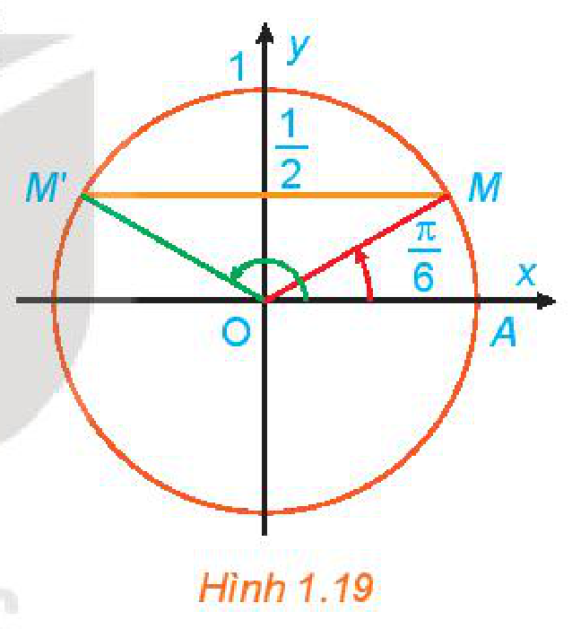
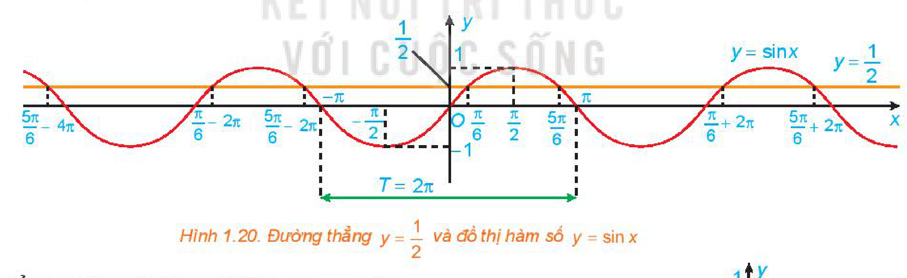
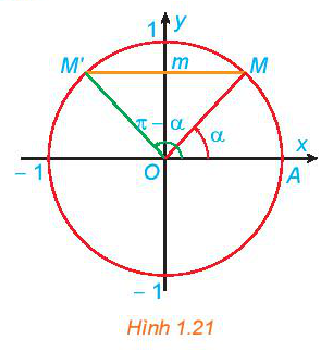
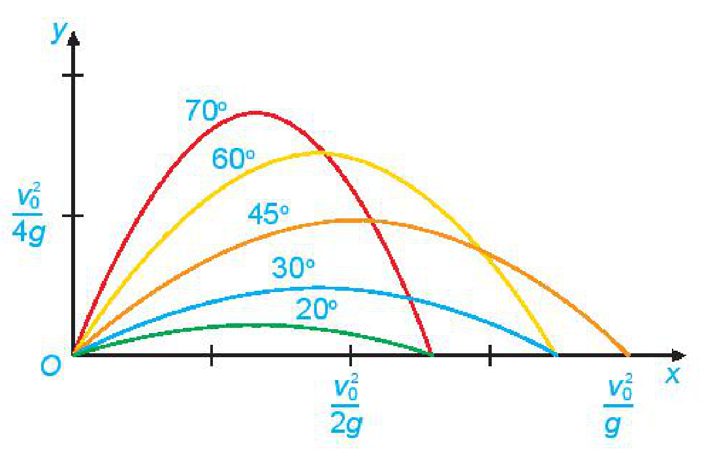
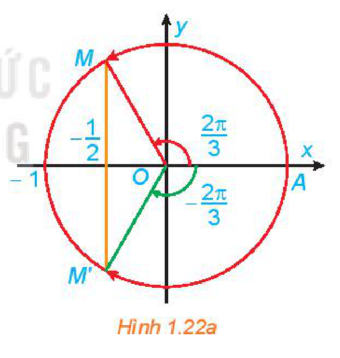
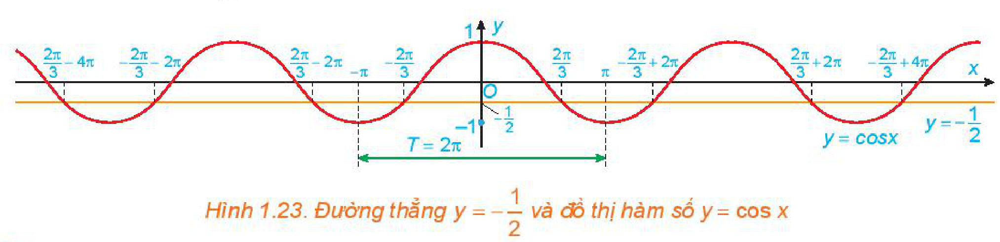
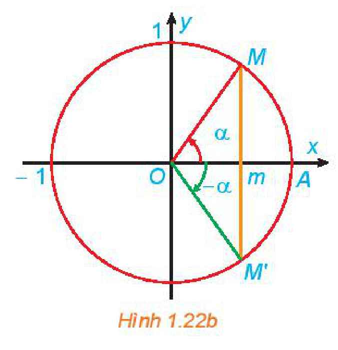
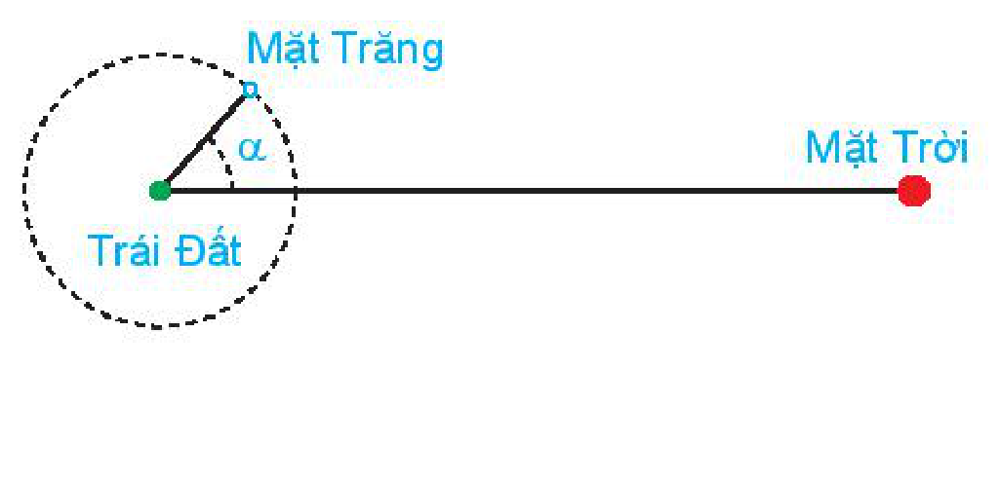
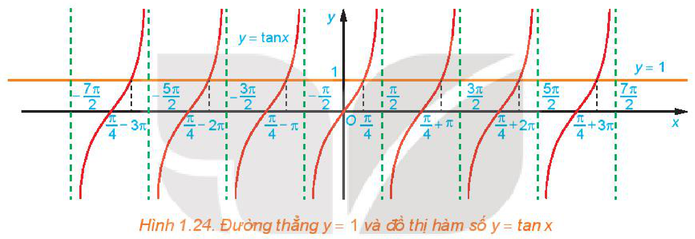
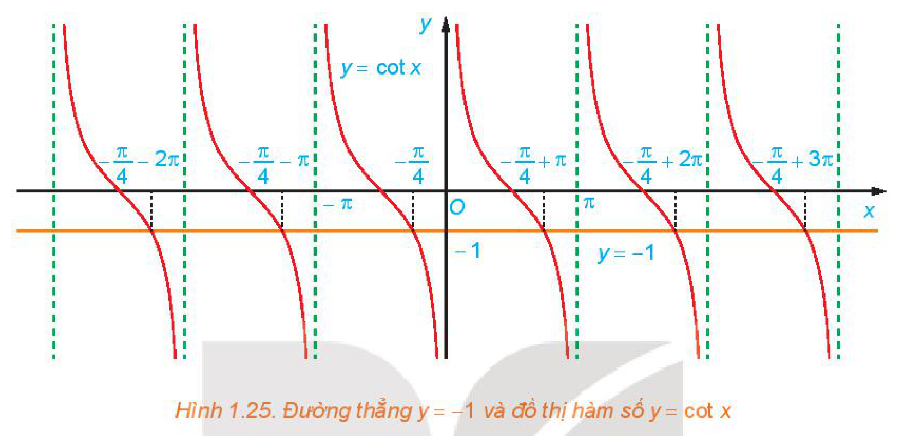

<!-- pdf:32 -->

# BÀI 4: PHƯƠNG TRÌNH LƯỢNG GIÁC CƠ BẢN

## 🔤 Thuật ngữ

- Phương trình lượng giác
- Phương trình lượng giác cơ bản
- Công thức nghiệm

## 🎯 Mục tiêu

- Nhận biết công thức nghiệm của phương trình lượng giác cơ bản bằng cách vận dụng đồ thị hàm số lượng giác tương ứng.
- Tính nghiệm gần đúng của phương trình lượng giác cơ bản bằng máy tính cầm tay.
- Giải phương trình lượng giác ở dạng vận dụng trực tiếp phương trình lượng giác cơ bản.
- Giải quyết một số vấn đề thực tiễn gắn với phương trình lượng giác.

## 🔴 Mở đầu

Một quả đạn pháo được bắn ra khỏi nòng pháo với vận tốc ban đầu có độ lớn $v_0$ không đổi. Tìm góc bắn $\alpha$ để quả đạn pháo bay xa nhất, bỏ qua sức cản của không khí và coi quả đạn pháo được bắn ra từ mặt đất.

*Hình 1.18. Dàn pháo*

## 1. KHÁI NIỆM PHƯƠNG TRÌNH TƯƠNG ĐƯƠNG

**HĐ1: Nhận biết khái niệm hai phương trình tương đương**

Cho hai phương trình $2x - 4 = 0$ và $(x - 2)(x^2 + 1) = 0$.

Tìm và so sánh tập nghiệm của hai phương trình trên.

<!-- term: Phương trình tương đương -->
> - Hai phương trình được gọi là **tương đương** khi chúng có cùng tập nghiệm.
> - Nếu phương trình $f(x) = 0$ tương đương với phương trình $g(x) = 0$ thì ta viết
>   $f(x) = 0 \Leftrightarrow g(x) = 0.$

**Chú ý:** Hai phương trình vô nghiệm là tương đương.

**Ví dụ 1:** Hai phương trình sau có tương đương không?

$2x + 6 = 0 \text{ và } x^2 + 6x + 9 = 0.$

**Giải:**

Tập nghiệm của phương trình $2x + 6 = 0$ là $S_1 = \{-3\}$.

Phương trình $x^2 + 6x + 9 = 0$ được viết lại thành $(x + 3)^2 = 0$, do đó tập nghiệm của nó là $S_2 = \{-3\}$.

Vậy hai phương trình trên là tương đương.

<!-- pdf:33 -->

**Luyện tập 1:** Xét sự tương đương của hai phương trình sau:

$\frac{x - 1}{x + 1} = 0 \text{ và } x^2 - 1 = 0.$

<!-- term: Phép biến đổi tương đương -->
**Chú ý:** Để giải phương trình, thông thường ta biến đổi phương trình đó thành một phương trình tương đương đơn giản hơn. Các phép biến đổi như vậy gọi là các **phép biến đổi tương đương**.

Nếu thực hiện các phép biến đổi sau đây trên một phương trình mà không làm thay đổi điều kiện của nó thì ta được một phương trình mới tương đương với phương trình đã cho:

a) Cộng hay trừ hai vế với cùng một số hoặc một biểu thức:

$f(x) = g(x) \Leftrightarrow f(x) + h(x) = g(x) + h(x).$

b) Nhân hoặc chia hai vế với cùng một số khác $0$ hoặc với cùng một biểu thức luôn có giá trị khác $0$:

$f(x) = g(x) \Leftrightarrow f(x)h(x) = g(x)h(x), \quad (h(x) \ne 0).$

## 2. PHƯƠNG TRÌNH $\sin x = m$

**HĐ2: Nhận biết công thức nghiệm của phương trình $\sin x = \frac{1}{2}$**

a) Quan sát Hình 1.19, tìm các nghiệm của phương trình đã cho trong nửa khoảng $[0; 2\pi)$.

b) Dựa vào tính tuần hoàn của hàm số sin, hãy viết công thức nghiệm của phương trình đã cho.

*Minh hoạ bằng đồ thị:* Nghiệm của phương trình $\sin x = \frac{1}{2}$ là hoành độ các giao điểm của đường thẳng $y = \frac{1}{2}$ và đồ thị hàm số $y = \sin x$.

*Hình 1.19*

*Hình 1.20. Đường thẳng $y = \frac{1}{2}$ và đồ thị hàm số $y = \sin x$*

Tổng quát, xét phương trình $\sin x = m$ (*).

- Nếu $|m| > 1$ thì phương trình (*) vô nghiệm vì $|\sin x| \le 1$ với mọi $x \in \mathbb{R}$.
- Nếu $|m| \le 1$ thì tồn tại duy nhất $\alpha \in \left[-\frac{\pi}{2}; \frac{\pi}{2}\right]$ thoả mãn $\sin\alpha = m$. Khi đó, trên đoạn có độ dài $2\pi$ là $\left[-\frac{\pi}{2}; \frac{3\pi}{2}\right]$, phương trình (*) có các nghiệm $\alpha$ và $\pi - \alpha$ (H.1.21).

*Hình 1.21*

<!-- pdf:34 -->

Do tính tuần hoàn với chu kì $2\pi$ của hàm sin, ta chỉ việc cộng vào các nghiệm này các bội nguyên của $2\pi$ thì sẽ được tất cả các nghiệm của phương trình (*).

<!-- term: Công thức nghiệm của phương trình sin x = m -->
> - Phương trình $\sin x = m$ có nghiệm khi và chỉ khi $|m| \le 1$.
> - Khi $|m| \le 1$, sẽ tồn tại duy nhất $\alpha \in \left[-\frac{\pi}{2}; \frac{\pi}{2}\right]$ thoả mãn $\sin\alpha = m$. Khi đó
>   $\sin x = m \Leftrightarrow \sin x = \sin\alpha \Leftrightarrow \left[\begin{matrix} x = \alpha + k2\pi \\ x = \pi - \alpha + k2\pi \end{matrix}\right. \quad (k \in \mathbb{Z}).$

**Chú ý:**

a) Nếu số đo của góc $\alpha$ được cho bằng đơn vị độ thì

$\sin x = \sin\alpha^\circ \Leftrightarrow \left[\begin{matrix} x = \alpha^\circ + k360^\circ \\ x = 180^\circ - \alpha^\circ + k360^\circ \end{matrix}\right. \quad (k \in \mathbb{Z}).$

b) Một số trường hợp đặc biệt:

- $\sin x = 0 \Leftrightarrow x = k\pi, k \in \mathbb{Z}$.
- $\sin x = 1 \Leftrightarrow x = \frac{\pi}{2} + k2\pi, k \in \mathbb{Z}$.
- $\sin x = -1 \Leftrightarrow x = -\frac{\pi}{2} + k2\pi, k \in \mathbb{Z}$.

**Ví dụ 2:** Giải các phương trình sau:

a) $\sin x = -\frac{\sqrt{3}}{2}$;

b) $\sin x = \frac{1}{3}$.

**Giải:**

a) $\sin x = -\frac{\sqrt{3}}{2} \Leftrightarrow \sin x = \sin\left(-\frac{\pi}{3}\right) \Leftrightarrow \left[\begin{matrix} x = -\frac{\pi}{3} + k2\pi \\ x = \frac{4\pi}{3} + k2\pi \end{matrix}\right. \quad (k \in \mathbb{Z}).$

> $\sin u = \sin v \Leftrightarrow \left[\begin{matrix} u = v + k2\pi \\ u = \pi - v + k2\pi \end{matrix}\right. \quad (k \in \mathbb{Z}).$

b) Gọi $\alpha \in \left[-\frac{\pi}{2}; \frac{\pi}{2}\right]$ là góc thoả mãn $\sin\alpha = \frac{1}{3}$. Khi đó ta có:

$\sin x = \frac{1}{3} \Leftrightarrow \sin x = \sin\alpha \Leftrightarrow \left[\begin{matrix} x = \alpha + k2\pi \\ x = \pi - \alpha + k2\pi \end{matrix}\right. \quad (k \in \mathbb{Z}).$

**Ví dụ 3:** Giải phương trình $\sin 2x = \sin(60^\circ - 3x)$.

**Giải:**

$\sin 2x = \sin(60^\circ - 3x) \Leftrightarrow \left[\begin{matrix} 2x = 60^\circ - 3x + k360^\circ \\ 2x = 180^\circ - (60^\circ - 3x) + k360^\circ \end{matrix}\right.$

$\Leftrightarrow \left[\begin{matrix} 5x = 60^\circ + k360^\circ \\ -x = 120^\circ + k360^\circ \end{matrix}\right. \Leftrightarrow \left[\begin{matrix} x = 12^\circ + k72^\circ \\ x = -120^\circ - k360^\circ \end{matrix}\right. \quad (k \in \mathbb{Z}).$

<!-- pdf:35 -->

**Ví dụ 4:** Giải bài toán ở *tình huống mở đầu*.

**Giải:**

Chọn hệ trục toạ độ có gốc toạ độ đặt tại vị trí khẩu pháo, trục $Ox$ theo hướng khẩu pháo như hình bên. Khi đó, theo Vật lí, ta biết rằng quỹ đạo của quả đạn pháo có dạng đường parabol có phương trình (với $g$ là gia tốc trọng trường) $y = \frac{-g}{2v_0^2\cos^2\alpha}x^2 + x\tan\alpha$.

Cho $y = 0$ ta được $\frac{-g}{2v_0^2\cos^2\alpha}x^2 + x\tan\alpha = 0$, suy ra $x = 0$ hoặc $x = \frac{v_0^2\sin 2\alpha}{g}$.
<!-- ocr-ok: đã đối chiếu ảnh trang PDF 35, OCR dính chữ 0ta -->

Quả đạn tiếp đất khi $x = \frac{v_0^2\sin 2\alpha}{g}$. Ta có $x = \frac{v_0^2\sin 2\alpha}{g} \le \frac{v_0^2}{g}$, dấu bằng xảy ra khi $\sin 2\alpha = 1$.
<!-- ocr-ok: đã đối chiếu ảnh trang PDF 35, OCR đọc sai chữ đất -->

Giải phương trình $\sin 2\alpha = 1$, ta được $\alpha = \frac{\pi}{4} + k\pi, k \in \mathbb{Z}$. Do $0 \le \alpha \le \frac{\pi}{2}$ nên $\alpha = \frac{\pi}{4}$ hay $\alpha = 45^\circ$.
<!-- ocr-ok: đã đối chiếu ảnh trang PDF 35, OCR đọc sai chữ Do -->

Vậy quả đạn pháo sẽ bay xa nhất khi góc bắn bằng $45^\circ$.

**Luyện tập 2:** Giải các phương trình sau:

a) $\sin x = \frac{\sqrt{2}}{2}$;

b) $\sin 3x = -\sin 5x$.

## 3. PHƯƠNG TRÌNH $\cos x = m$

**HĐ3: Nhận biết công thức nghiệm của phương trình $\cos x = -\frac{1}{2}$**

a) Quan sát Hình 1.22a, tìm các nghiệm của phương trình đã cho trong nửa khoảng $[-\pi; \pi)$.

b) Dựa vào tính tuần hoàn của hàm số côsin, hãy viết công thức nghiệm của phương trình đã cho.

*Hình 1.22a*

*Minh hoạ bằng đồ thị:* Nghiệm của phương trình $\cos x = -\frac{1}{2}$ là hoành độ các giao điểm của đường thẳng $y = -\frac{1}{2}$ và đồ thị hàm số $y = \cos x$.

*Hình 1.23. Đường thẳng $y = -\frac{1}{2}$ và đồ thị hàm số $y = \cos x$*

<!-- pdf:36 -->

<!-- term: Công thức nghiệm của phương trình cos x = m -->
> - Phương trình $\cos x = m$ có nghiệm khi và chỉ khi $|m| \le 1$.
> - Khi $|m| \le 1$, sẽ tồn tại duy nhất $\alpha \in [0; \pi]$ thoả mãn $\cos\alpha = m$. Khi đó
>   $\cos x = m \Leftrightarrow \cos x = \cos\alpha \Leftrightarrow \left[\begin{matrix} x = \alpha + k2\pi \\ x = -\alpha + k2\pi \end{matrix}\right. \quad (k \in \mathbb{Z}).$

*Hình 1.22b*

**Chú ý:**

a) Nếu số đo của góc $\alpha$ được cho bằng đơn vị độ thì

$\cos x = \cos\alpha^\circ \Leftrightarrow \left[\begin{matrix} x = \alpha^\circ + k360^\circ \\ x = -\alpha^\circ + k360^\circ \end{matrix}\right. \quad (k \in \mathbb{Z}).$

b) Một số trường hợp đặc biệt:

- $\cos x = 0 \Leftrightarrow x = \frac{\pi}{2} + k\pi, k \in \mathbb{Z}$.
- $\cos x = 1 \Leftrightarrow x = k2\pi, k \in \mathbb{Z}$.
- $\cos x = -1 \Leftrightarrow x = \pi + k2\pi, k \in \mathbb{Z}$.

**Ví dụ 5:** Giải các phương trình sau:

a) $\cos x = -\frac{\sqrt{3}}{2}$;

b) $\cos x = 0,1$.

> $\cos u = \cos v \Leftrightarrow u = \pm v + k2\pi \quad (k \in \mathbb{Z}).$

**Giải:**

a) $\cos x = -\frac{\sqrt{3}}{2} \Leftrightarrow \cos x = \cos\frac{5\pi}{6} \Leftrightarrow x = \pm\frac{5\pi}{6} + k2\pi, k \in \mathbb{Z}$.

b) Gọi $\alpha \in [0; \pi]$ là góc thoả mãn $\cos\alpha = 0,1$. Khi đó ta có:

$\cos x = 0,1 \Leftrightarrow \cos x = \cos\alpha \Leftrightarrow x = \pm\alpha + k2\pi, k \in \mathbb{Z}.$

**Ví dụ 6:** Giải phương trình $\cos 2x = \cos(45^\circ - x)$.

**Giải:**

$\cos 2x = \cos(45^\circ - x) \Leftrightarrow \left[\begin{matrix} 2x = 45^\circ - x + k360^\circ \\ 2x = -(45^\circ - x) + k360^\circ \end{matrix}\right.$

$\Leftrightarrow \left[\begin{matrix} 3x = 45^\circ + k360^\circ \\ x = -45^\circ + k360^\circ \end{matrix}\right. \Leftrightarrow \left[\begin{matrix} x = 15^\circ + k120^\circ \\ x = -45^\circ + k360^\circ \end{matrix}\right. \quad (k \in \mathbb{Z}).$

**Luyện tập 3:** Giải các phương trình sau:

a) $2\cos x = -\sqrt{2}$;

b) $\cos 3x - \sin 5x = 0$.

**Vận dụng:** Khi Mặt Trăng quay quanh Trái Đất, mặt đối diện với Trái Đất thường chỉ được Mặt Trời chiếu sáng một phần. Các pha của Mặt Trăng mô tả mức độ phần bề mặt của nó được Mặt Trời chiếu sáng. Khi góc giữa Mặt Trời, Trái Đất và Mặt Trăng là $\alpha$ ($0^\circ \le \alpha \le 360^\circ$) thì tỉ lệ $F$ của phần Mặt Trăng được chiếu sáng cho bởi công thức

$F = \frac{1}{2}(1 - \cos\alpha).$

*(Theo trang usno.navy.mil).*

<!-- pdf:37 -->

Xác định góc $\alpha$ tương ứng với các pha sau của Mặt Trăng:

a) $F = 0$ (trăng mới);

b) $F = 0,25$ (trăng lưỡi liềm);

c) $F = 0,5$ (trăng bán nguyệt đầu tháng hoặc trăng bán nguyệt cuối tháng);

d) $F = 1$ (trăng tròn).

## 4. PHƯƠNG TRÌNH $\tan x = m$

**HĐ4: Nhận biết công thức nghiệm của phương trình $\tan x = 1$**

a) Quan sát Hình 1.24, hãy cho biết đường thẳng $y = 1$ cắt đồ thị hàm số $y = \tan x$ tại mấy điểm trên khoảng $\left(-\frac{\pi}{2}; \frac{\pi}{2}\right)$?

*Hình 1.24. Đường thẳng $y = 1$ và đồ thị hàm số $y = \tan x$*

b) Dựa vào tính tuần hoàn của hàm tang, hãy viết công thức nghiệm của phương trình đã cho.

<!-- term: Công thức nghiệm của phương trình tan x = m -->
> - Phương trình $\tan x = m$ có nghiệm với mọi $m$.
> - Với mọi $m \in \mathbb{R}$, tồn tại duy nhất $\alpha \in \left(-\frac{\pi}{2}; \frac{\pi}{2}\right)$ thoả mãn $\tan\alpha = m$. Khi đó
>   $\tan x = m \Leftrightarrow \tan x = \tan\alpha \Leftrightarrow x = \alpha + k\pi \quad (k \in \mathbb{Z}).$

**Chú ý:** Nếu số đo của góc $\alpha$ được cho bằng đơn vị độ thì

$\tan x = \tan\alpha^\circ \Leftrightarrow x = \alpha^\circ + k180^\circ \quad (k \in \mathbb{Z}).$

**Ví dụ 7:** Giải các phương trình sau:

a) $\tan x = -\sqrt{3}$;

b) $\tan x = 2$.

**Giải:**

a) $\tan x = -\sqrt{3} \Leftrightarrow \tan x = \tan\left(-\frac{\pi}{3}\right) \Leftrightarrow x = -\frac{\pi}{3} + k\pi, k \in \mathbb{Z}$.

b) Gọi $\alpha \in \left(-\frac{\pi}{2}; \frac{\pi}{2}\right)$ là góc thoả mãn $\tan\alpha = 2$. Khi đó ta có:

$\tan x = 2 \Leftrightarrow \tan x = \tan\alpha \Leftrightarrow x = \alpha + k\pi, k \in \mathbb{Z}.$

**Luyện tập 4:** Giải các phương trình sau:

a) $\sqrt{3}\tan 2x = -1$;

b) $\tan 3x + \tan 5x = 0$.

<!-- pdf:38 -->

## 5. PHƯƠNG TRÌNH $\cot x = m$

**HĐ5: Nhận biết công thức nghiệm của phương trình $\cot x = -1$**

a) Quan sát Hình 1.25, hãy cho biết đường thẳng $y = -1$ cắt đồ thị hàm số $y = \cot x$ tại mấy điểm trên khoảng $(0; \pi)$?

*Hình 1.25. Đường thẳng $y = -1$ và đồ thị hàm số $y = \cot x$*

b) Dựa vào tính tuần hoàn của hàm côtang, hãy viết công thức nghiệm của phương trình đã cho.

<!-- term: Công thức nghiệm của phương trình cot x = m -->
> - Phương trình $\cot x = m$ có nghiệm với mọi $m$.
> - Với mọi $m \in \mathbb{R}$, tồn tại duy nhất $\alpha \in (0; \pi)$ thoả mãn $\cot\alpha = m$. Khi đó
>   $\cot x = m \Leftrightarrow \cot x = \cot\alpha \Leftrightarrow x = \alpha + k\pi \quad (k \in \mathbb{Z}).$

**Chú ý:** Nếu số đo góc $\alpha$ được cho bằng đơn vị độ thì

$\cot x = \cot\alpha^\circ \Leftrightarrow x = \alpha^\circ + k180^\circ \quad (k \in \mathbb{Z}).$

**Ví dụ 8:** Giải các phương trình sau:

a) $\cot x = -\sqrt{3}$;

b) $\cot x = 5$.

> $\cot u = \cot v \Leftrightarrow u = v + k\pi \quad (k \in \mathbb{Z}).$

**Giải:**

a) $\cot x = -\sqrt{3} \Leftrightarrow \cot x = \cot\left(-\frac{\pi}{6}\right) \Leftrightarrow x = -\frac{\pi}{6} + k\pi, k \in \mathbb{Z}$.

b) Gọi $\alpha \in (0; \pi)$ là góc thoả mãn $\cot\alpha = 5$. Khi đó ta có:

$\cot x = 5 \Leftrightarrow \cot x = \cot\alpha \Leftrightarrow x = \alpha + k\pi, k \in \mathbb{Z}.$

**Luyện tập 5:** Giải các phương trình sau:

a) $\cot x = 1$;

b) $\sqrt{3}\cot x + 1 = 0$.

<!-- pdf:39 -->

## 6. SỬ DỤNG MÁY TÍNH CẦM TAY TÌM MỘT GÓC KHI BIẾT GIÁ TRỊ LƯỢNG GIÁC CỦA NÓ

Các phím $(\sin^{-1})$, $(\cos^{-1})$ và $(\tan^{-1})$ của máy tính cầm tay được dùng để tìm số đo (độ hoặc rađian) của một góc khi biết một trong các giá trị lượng giác của nó.

<!-- term: Sử dụng máy tính cầm tay tìm góc khi biết giá trị lượng giác -->
> Để tìm số đo ta thực hiện các bước sau:
> *Bước 1.* Chọn đơn vị đo góc (độ hoặc rađian).
> Muốn tìm số đo độ (dòng trên cùng của màn hình xuất hiện chữ nhỏ D), ta ấn
> `[SHIFT]` `[MODE]` `[3]`
> Muốn tìm số đo rađian (dòng trên cùng của màn hình xuất hiện chữ nhỏ R), ta ấn
> `[SHIFT]` `[MODE]` `[4]`
> *Bước 2.* Tìm số đo góc.
> Khi biết sin, côsin hay tang của góc $\alpha$ cần tìm bằng $m$, ta lần lượt ấn các phím `[SHIFT]` và một trong các phím `[sin]`, `[cos]` và `[tan]`, rồi nhập giá trị lượng giác $m$ và cuối cùng ấn phím `[=]`. Lúc này trên màn hình cho kết quả là số đo của góc $\alpha$ (độ hoặc rađian).

**Chú ý:**

- Khi ở chế độ rađian, các phím $(\sin^{-1})$, $(\tan^{-1})$, cho kết quả là một số thuộc khoảng $\left(-\frac{\pi}{2}; \frac{\pi}{2}\right)$, phím $(\cos^{-1})$ cho kết quả là một số thuộc khoảng $(0; \pi)$, tất nhiên với $(\sin^{-1})$ và $(\cos^{-1})$ thì $|m| \le 1$.
- Khi ở chế độ số đo độ, các phím $(\sin^{-1})$ và $(\tan^{-1})$ cho kết quả là số đo góc $\alpha$ từ $-90^\circ$ đến $90^\circ$, phím $(\cos^{-1})$ cho kết quả là số đo góc $\alpha$ từ $0^\circ$ đến $180^\circ$, với $(\sin^{-1})$ và $(\cos^{-1})$ thì $|m| \le 1$.
- Khi có kết quả (trường hợp chọn đơn vị đo độ), ấn phím `[° ' '']` thì đưa kết quả về dạng độ - phút - giây.

**Ví dụ 9:** Sử dụng máy tính cầm tay, tìm số đo độ và rađian của góc $\alpha$, biết $\sin\alpha = 0,58$.

**Giải:**

Số đo độ:

| $\sin\alpha$ | Bấm phím | Màn hình hiện | Kết quả của $\alpha$ (gần đúng) |
| :---: | :--- | :---: | :---: |
| $0,58$ | `[SHIFT]` `[MODE]` `[3]` `[SHIFT]` `[sin]` `[0]` `[.]` `[5]` `[8]` `[=]` `[° ' '']` | `35.45054264` | $35^\circ 27' 2''$ |
<!-- ocr-ok: đã đối chiếu ảnh trang PDF 39, bảng bấm phím máy tính cầm tay -->

Số đo rađian:

| $\sin\alpha$ | Bấm phím | Màn hình hiện | Kết quả của $\alpha$ (gần đúng) |
| :---: | :--- | :---: | :---: |
| $0,58$ | `[SHIFT]` `[MODE]` `[4]` `[SHIFT]` `[sin]` `[0]` `[.]` `[5]` `[8]` `[=]` | `0.6187286907` | $0,61873$ |
<!-- ocr-ok: đã đối chiếu ảnh trang PDF 39, bảng bấm phím máy tính cầm tay -->

**Luyện tập 6:** Sử dụng máy tính cầm tay, tìm số đo độ và rađian của góc $\alpha$, biết:

a) $\cos\alpha = -0,75$;

b) $\tan\alpha = 2,46$;

c) $\cot\alpha = -6,18$.

<!-- pdf:40 -->

## ✏️ BÀI TẬP

**1.20.** Giải các phương trình sau:

a) $\sin x = \frac{\sqrt{3}}{2}$;

b) $2\cos x = -\sqrt{2}$;

c) $\sqrt{3}\tan\left(\frac{x}{2} + 15^\circ\right) = 1$;

d) $\cot(2x - 1) = \cot\frac{\pi}{5}$.

**1.21.** Giải các phương trình sau:

a) $\sin 2x + \cos 4x = 0$;

b) $\cos 3x = -\cos 7x$.

**1.22.** Một quả đạn pháo được bắn ra khỏi nòng pháo với vận tốc ban đầu $v_0 = 500\text{ m/s}$ hợp với phương ngang một góc $\alpha$. Trong Vật lí, ta biết rằng, nếu bỏ qua sức cản của không khí và coi quả đạn pháo được bắn ra từ mặt đất thì quỹ đạo của quả đạn tuân theo phương trình $y = \frac{-g}{2v_0^2\cos^2\alpha}x^2 + x\tan\alpha$, ở đó $g = 9,8\text{ m/s}^2$ là gia tốc trọng trường.

a) Tính theo góc bắn $\alpha$ tầm xa mà quả đạn đạt tới (tức là khoảng cách từ vị trí bắn đến điểm quả đạn chạm đất).

b) Tìm góc bắn $\alpha$ để quả đạn trúng mục tiêu cách vị trí đặt khẩu pháo $22\,000\text{ m}$.

c) Tìm góc bắn $\alpha$ để quả đạn đạt độ cao lớn nhất.

**1.23.** Giả sử một vật dao động điều hoà xung quanh vị trí cân bằng theo phương trình

$x = 2\cos\left(5t - \frac{\pi}{6}\right).$

Ở đây, thời gian $t$ tính bằng giây và quãng đường $x$ tính bằng centimét. Hãy cho biết trong khoảng thời gian từ $0$ đến $6$ giây, vật đi qua vị trí cân bằng bao nhiêu lần?

## 💡 Em có biết?

*Lượng giác* được phát triển bởi các nhà thiên văn học người Hy Lạp cổ đại, những người coi bầu trời là nằm bên trong của một mặt cầu, do đó lẽ tự nhiên là các hình tam giác trên mặt cầu được nghiên cứu khá sớm bởi Menelaus ở Alexandria vào khoảng năm $100$ sau Công nguyên và các hình tam giác trên mặt phẳng được nghiên cứu muộn hơn nhiều. Cuốn sách đầu tiên chứa đựng các phương pháp xử lí có hệ thống về lượng giác phẳng và lượng giác cầu được viết bởi nhà thiên văn học người Ba Tư Nasir Eddin, khoảng năm $1250$ sau Công nguyên.

Regiomontanus ($1436$ – $1476$) là người có công lớn trong việc chuyển Lượng giác từ Thiên văn học sang Toán học. Công trình của ông đã được cải tiến bởi Copernicus ($1473$ – $1543$) và một học trò của Copernicus là Rhaeticus ($1514$ – $1576$). Cuốn sách của Rhaeticus là cuốn sách đầu tiên định nghĩa các hàm lượng giác là tỉ số các cạnh của tam giác, mặc dù ông chưa đưa ra tên gọi như hiện nay của chúng. Các tên gọi và kí hiệu như ngày nay chúng ta dùng được đưa ra bởi Leonhard Euler ($1707$ – $1783$), người đã xây dựng lí thuyết hiện đại về các hàm số lượng giác trong cuốn “Mở đầu về giải tích các đại lượng vô cùng bé” xuất bản năm $1748$.

Lượng giác là ngành khoa học có nhiều ứng dụng. Có thể kể đến việc sử dụng Lượng giác trong các vấn đề đo đạc của Thiên văn và Địa lí, cũng như những ứng dụng phong phú của Lượng giác trong Lí thuyết số, Cơ học, Điện học, Hoá học, Sinh học, Hải dương học, Đồ hoạ máy tính, Lí thuyết âm nhạc và nhiều lĩnh vực khác.

*(Theo C.B. Boyer, U.C. Merzbach, A History of Mathematics, Third Edition, Wiley, 2011).*

## 📷 Danh sách hình trong bài

| Mã hình | Trang PDF | Vị trí trong bài | Chú thích gốc |
| --- | :---: | --- | --- |
| H11-toan-b04-01 | 32 | Mở đầu | Hình 1.18. Dàn pháo |
| H11-toan-b04-02 | 33 | Mục 2, HĐ2 | Hình 1.19 |
| H11-toan-b04-03 | 33 | Mục 2, HĐ2 | Hình 1.20. Đường thẳng $y = \frac{1}{2}$ và đồ thị hàm số $y = \sin x$ |
| H11-toan-b04-04 | 33 | Mục 2 | Hình 1.21 |
| H11-toan-b04-05 | 35 | Mục 2, Ví dụ 4 | (sách không đánh số, đồ thị quỹ đạo của quả đạn pháo ứng với các góc bắn) |
| H11-toan-b04-06 | 35 | Mục 3, HĐ3 | Hình 1.22a |
| H11-toan-b04-07 | 35 | Mục 3, HĐ3 | Hình 1.23. Đường thẳng $y = -\frac{1}{2}$ và đồ thị hàm số $y = \cos x$ |
| H11-toan-b04-08 | 36 | Mục 3 | Hình 1.22b |
| H11-toan-b04-09 | 37 | Mục 3, Vận dụng | (sách không đánh số, sơ đồ vị trí Mặt Trời, Trái Đất và Mặt Trăng) |
| H11-toan-b04-10 | 37 | Mục 4, HĐ4 | Hình 1.24. Đường thẳng $y = 1$ và đồ thị hàm số $y = \tan x$ |
| H11-toan-b04-11 | 38 | Mục 5, HĐ5 | Hình 1.25. Đường thẳng $y = -1$ và đồ thị hàm số $y = \cot x$ |
