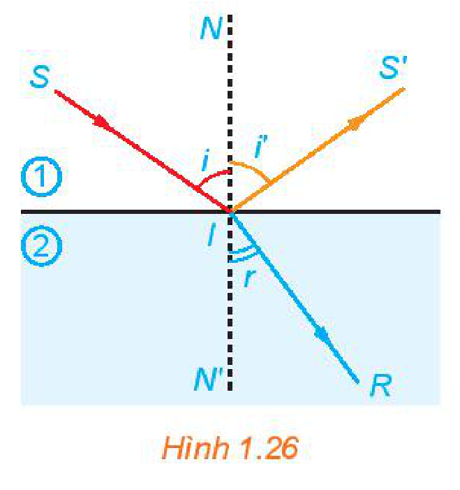

<!-- pdf:41 -->

# BÀI TẬP CUỐI CHƯƠNG I

## ✏️ A – TRẮC NGHIỆM

**1.24.** Biểu diễn các góc lượng giác $\alpha = -\frac{5\pi}{6}$, $\beta = \frac{\pi}{3}$, $\gamma = \frac{25\pi}{3}$, $\delta = \frac{17\pi}{6}$ trên đường tròn lượng giác. Các góc nào có điểm biểu diễn trùng nhau?

A. $\beta$ và $\gamma$.

B. $\alpha, \beta, \gamma$.

C. $\beta, \gamma, \delta$.

D. $\alpha$ và $\beta$.

**1.25.** Trong các khẳng định sau, khẳng định nào là **sai**?

A. $\sin(\pi - \alpha) = \sin\alpha$.

B. $\cos(\pi - \alpha) = \cos\alpha$.

C. $\sin(\pi + \alpha) = -\sin\alpha$.

D. $\cos(\pi + \alpha) = -\cos\alpha$.

**1.26.** Trong các khẳng định sau, khẳng định nào là **sai**?

A. $\cos(a - b) = \cos a\cos b - \sin a\sin b$.

B. $\sin(a - b) = \sin a\cos b - \cos a\sin b$.

C. $\cos(a + b) = \cos a\cos b - \sin a\sin b$.

D. $\sin(a + b) = \sin a\cos b + \cos a\sin b$.

**1.27.** Rút gọn biểu thức $M = \cos(a + b)\cos(a - b) - \sin(a + b)\sin(a - b)$, ta được

A. $M = \sin 4a$.

B. $M = 1 - 2\cos^2 a$.

C. $M = 1 - 2\sin^2 a$.

D. $M = \cos 4a$.

**1.28.** Khẳng định nào sau đây là **sai**?

A. Hàm số $y = \cos x$ có tập xác định là $\mathbb{R}$.

B. Hàm số $y = \cos x$ có tập giá trị là $[-1; 1]$.

C. Hàm số $y = \cos x$ là hàm số lẻ.

D. Hàm số $y = \cos x$ tuần hoàn với chu kì $2\pi$.

**1.29.** Trong các hàm số sau đây, hàm số nào là hàm tuần hoàn?

A. $y = \tan x + x$.

B. $y = x^2 + 1$.

C. $y = \cot x$.

D. $y = \frac{\sin x}{x}$.

**1.30.** Đồ thị của các hàm số $y = \sin x$ và $y = \cos x$ cắt nhau tại bao nhiêu điểm có hoành độ thuộc đoạn $\left[-2\pi; \frac{5\pi}{2}\right]$?

A. $5$.

B. $6$.

C. $4$.

D. $7$.

**1.31.** Tập xác định của hàm số $y = \frac{\cos x}{\sin x - 1}$ là

A. $\mathbb{R} \setminus \{k2\pi \mid k \in \mathbb{Z}\}$.

B. $\mathbb{R} \setminus \left\{\frac{\pi}{2} + k2\pi \mid k \in \mathbb{Z}\right\}$.

C. $\mathbb{R} \setminus \left\{\frac{\pi}{2} + k\pi \mid k \in \mathbb{Z}\right\}$.

D. $\mathbb{R} \setminus \{k\pi \mid k \in \mathbb{Z}\}$.

<!-- pdf:42 -->

## ✏️ B – TỰ LUẬN

**1.32.** Cho góc $\alpha$ thoả mãn $\frac{\pi}{2} < \alpha < \pi$, $\cos\alpha = -\frac{1}{\sqrt{3}}$. Tính giá trị của các biểu thức sau:

a) $\sin\left(\alpha + \frac{\pi}{6}\right)$;

b) $\cos\left(\alpha + \frac{\pi}{6}\right)$;

c) $\sin\left(\alpha - \frac{\pi}{3}\right)$;

d) $\cos\left(\alpha - \frac{\pi}{6}\right)$.

**1.33.** Cho góc bất kì $\alpha$. Chứng minh các đẳng thức sau:

a) $(\sin\alpha + \cos\alpha)^2 = 1 + \sin 2\alpha$;

b) $\cos^4\alpha - \sin^4\alpha = \cos 2\alpha$.

**1.34.** Tìm tập giá trị của các hàm số sau:

a) $y = 2\cos\left(2x - \frac{\pi}{3}\right) - 1$;

b) $y = \sin x + \cos x$.

**1.35.** Giải các phương trình sau:

a) $\cos\left(3x - \frac{\pi}{4}\right) = -\frac{\sqrt{2}}{2}$;

b) $2\sin^2 x - 1 + \cos 3x = 0$;

c) $\tan\left(2x + \frac{\pi}{5}\right) = \tan\left(x - \frac{\pi}{6}\right)$.

**1.36.** Huyết áp là áp lực cần thiết tác động lên thành của động mạch để đưa máu từ tim đến nuôi dưỡng các mô trong cơ thể. Huyết áp được tạo ra do lực co bóp của cơ tim và sức cản của thành động mạch. Mỗi lần tim đập, huyết áp của chúng ta tăng rồi giảm giữa các nhịp. Huyết áp tối đa và huyết áp tối thiểu được gọi tương ứng là huyết áp tâm thu và tâm trương. Chỉ số huyết áp của chúng ta được viết là huyết áp tâm thu/huyết áp tâm trương. Chỉ số huyết áp $120/80$ là bình thường. Giả sử huyết áp của một người nào đó được mô hình hoá bởi hàm số

$p(t) = 115 + 25\sin(160\pi t),$

trong đó $p(t)$ là huyết áp tính theo đơn vị $\text{mmHg}$ (milimét thuỷ ngân) và thời gian $t$ tính theo phút.

a) Tìm chu kì của hàm số $p(t)$.

b) Tìm số nhịp tim mỗi phút.

c) Tìm chỉ số huyết áp. So sánh huyết áp của người này với huyết áp bình thường.

**1.37.** Khi một tia sáng truyền từ không khí vào mặt nước thì một phần tia sáng bị phản xạ trên bề mặt, phần còn lại bị khúc xạ như trong Hình 1.26. Góc tới $i$ liên hệ với góc khúc xạ $r$ bởi Định luật khúc xạ ánh sáng

$\frac{\sin i}{\sin r} = \frac{n_2}{n_1}.$

Ở đây, $n_1$ và $n_2$ tương ứng là chiết suất của môi trường $1$ (không khí) và môi trường $2$ (nước). Cho biết góc tới $i = 50^\circ$, hãy tính góc khúc xạ, biết rằng chiết suất của không khí bằng $1$ còn chiết suất của nước là $1,33$.

*Hình 1.26*

## 📷 Danh sách hình trong bài

| Mã hình | Trang PDF | Vị trí trong bài | Chú thích gốc |
| --- | :---: | --- | --- |
| H11-toan-bt-c01-01 | 42 | Bài 1.37 | Hình 1.26 |
