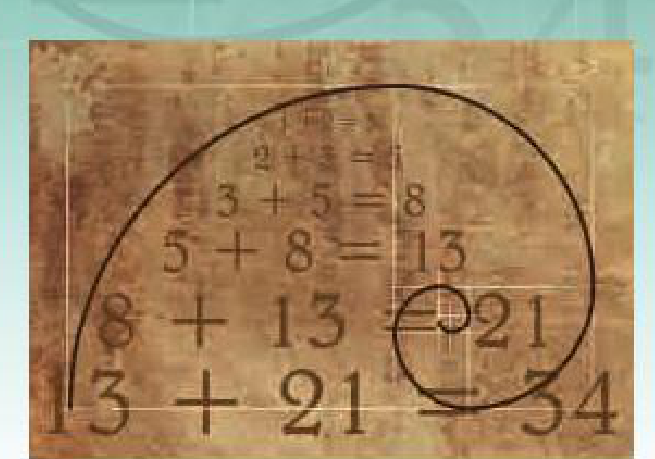
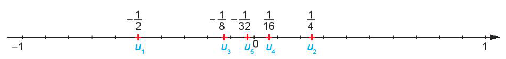

<!-- pdf:43 -->

<!-- Phần giới thiệu Chương II (in chung đầu trang PDF 43): CHƯƠNG II. DÃY SỐ. CẤP SỐ CỘNG VÀ CẤP SỐ NHÂN -->

Chương này giới thiệu những khái niệm cơ bản về dãy số (hữu hạn và vô hạn), một loại hàm số mà biến số là những số nguyên dương, và trình bày một cách hệ thống hai dãy số đặc biệt, có nhiều ứng dụng trong thực tiễn là cấp số cộng và cấp số nhân.

# BÀI 5: DÃY SỐ

## 🔤 Thuật ngữ

- Dãy số
- Dãy số tăng
- Dãy số giảm
- Dãy số bị chặn

## 🎯 Kiến thức, kĩ năng

- Nhận biết dãy số hữu hạn, dãy số vô hạn.
- Thể hiện cách cho dãy số bằng liệt kê các số hạng; bằng công thức tổng quát; bằng hệ thức truy hồi; bằng cách mô tả.
- Nhận biết tính chất tăng, giảm, bị chặn của dãy số trong những trường hợp đơn giản.

## 🔴 Mở đầu

Năm 2020, số dân của một thành phố trực thuộc tỉnh là khoảng $500$ nghìn người. Người ta ước tính rằng số dân của thành phố đó sẽ tăng trưởng với tốc độ khoảng $2\%$ mỗi năm. Khi đó số dân $P_n$ (nghìn người) của thành phố đó sau $n$ năm, kể từ năm 2020, được tính bằng công thức $P_n = 500(1 + 0,02)^n$. Hỏi nếu tăng trưởng theo quy luật như vậy thì vào năm 2030, số dân của thành phố đó là khoảng bao nhiêu nghìn người?

## 1. ĐỊNH NGHĨA DÃY SỐ
<!-- ocr-ok: đã đối chiếu ảnh trang PDF 43, OCR dính chữ ĐỊNHNGHĨA -->

**HĐ1:** Nhận biết dãy số vô hạn

Viết năm số chính phương đầu theo thứ tự tăng dần. Từ đó, dự đoán công thức tính số chính phương thứ $n$.

> **Số chính phương** là số bằng bình phương của một số tự nhiên.

Từ công thức nhận được, ta có quy tắc để viết được dãy gồm tất cả các số chính phương.

> - Mỗi hàm số $u$ xác định trên tập các số nguyên dương $\mathbb{N}^*$ được gọi là một **dãy số vô hạn** (gọi tắt là **dãy số**), kí hiệu là $u = u(n)$.
> - Ta thường viết $u_n$ thay cho $u(n)$ và kí hiệu dãy số $u = u(n)$ bởi $(u_n)$, do đó dãy số $(u_n)$ được viết dưới dạng khai triển $u_1, u_2, u_3, \dots, u_n, \dots$
>   Số $u_1$ gọi là **số hạng đầu**, $u_n$ là số hạng thứ $n$ và gọi là **số hạng tổng quát** của dãy số.

**Chú ý:** Nếu $\forall n \in \mathbb{N}^*, u_n = c$ thì $(u_n)$ được gọi là **dãy số không đổi**.

<!-- pdf:44 -->

**Ví dụ 1:** Xác định số hạng đầu và số hạng tổng quát của mỗi dãy số sau:

a) Dãy số $(u_n)$ các số tự nhiên lẻ: $1, 3, 5, 7, \dots$

b) Dãy số $(v_n)$ các số nguyên dương chia hết cho $5$: $5, 10, 15, 20, \dots$

**Giải:**

a) Dãy $(u_n)$ có số hạng đầu $u_1 = 1$ và số hạng tổng quát $u_n = 2n - 1$.

b) Dãy $(v_n)$ có số hạng đầu $v_1 = 5$ và số hạng tổng quát $v_n = 5n$.

**HĐ2:** Nhận biết dãy số hữu hạn

a) Liệt kê tất cả các số chính phương nhỏ hơn $50$ và sắp xếp chúng theo thứ tự từ bé đến lớn.

b) Viết công thức số hạng $u_n$ của các số tìm được ở câu a) và nêu rõ điều kiện của $n$.

> - Mỗi hàm số $u$ xác định trên tập $M = \{1; 2; 3; \dots; m\}$ với $m \in \mathbb{N}^*$ được gọi là một **dãy số hữu hạn**.
> - Dạng khai triển của dãy số hữu hạn là $u_1, u_2, \dots, u_m$.
>   Số $u_1$ gọi là **số hạng đầu**, số $u_m$ gọi là **số hạng cuối**.

**Ví dụ 2:** Xét dãy số hữu hạn gồm các số tự nhiên lẻ nhỏ hơn $20$, sắp xếp theo thứ tự từ bé đến lớn.

a) Liệt kê tất cả các số hạng của dãy số hữu hạn này.

b) Tìm số hạng đầu và số hạng cuối của dãy số đó.

**Giải:**

a) Các số hạng của dãy số là: $1, 3, 5, 7, 9, 11, 13, 15, 17, 19$.

b) Số hạng đầu của dãy số này là $1$ và số hạng cuối của dãy số là $19$.

**Luyện tập 1:**

a) Xét dãy số gồm tất cả các số tự nhiên chia cho $5$ dư $1$ theo thứ tự tăng dần. Xác định số hạng tổng quát của dãy số.

b) Viết dãy số hữu hạn gồm năm số hạng đầu của dãy số trong câu a. Xác định số hạng đầu và số hạng cuối của dãy số hữu hạn này.

## 2. CÁC CÁCH CHO MỘT DÃY SỐ

**HĐ3:** Nhận biết các cách cho một dãy số

Xét dãy số $(u_n)$ gồm tất cả các số nguyên dương chia hết cho $5$:

$5, 10, 15, 20, 25, 30, \dots$

a) Viết công thức số hạng tổng quát $u_n$ của dãy số.

b) Xác định số hạng đầu và viết công thức tính số hạng thứ $n$ theo số hạng thứ $n - 1$ của dãy số. Công thức thu được gọi là **hệ thức truy hồi**.

> Hãy để ý đến hiệu hai số hạng liên tiếp của dãy số.

<!-- pdf:45 -->

<!-- term: Các cách cho một dãy số -->
> Một dãy số có thể cho bằng:
> - Liệt kê các số hạng (chỉ dùng cho các dãy hữu hạn và có ít số hạng);
> - Công thức của số hạng tổng quát;
> - Phương pháp mô tả;
> - Phương pháp truy hồi.

**Ví dụ 3:** Tìm năm số hạng đầu và số hạng thứ $100$ của dãy số cho bởi công thức sau:

a) $u_n = 2n$;

b) $u_n = \frac{(-1)^n}{n}$.

**Giải:**

a) Năm số hạng đầu của dãy số là: $2, 4, 6, 8, 10$.

Số hạng thứ $100$ của dãy số là $u_{100} = 2 \cdot 100 = 200$.

b) Năm số hạng đầu của dãy số là: $-1, \frac{1}{2}, -\frac{1}{3}, \frac{1}{4}, -\frac{1}{5}$.

Số hạng thứ $100$ của dãy số là $u_{100} = \frac{(-1)^{100}}{100} = \frac{1}{100}$.

**Ví dụ 4:** Xét dãy số gồm tất cả các số nguyên tố theo thứ tự tăng dần. Viết năm số hạng đầu của dãy số đó.

> **Số nguyên tố** là số tự nhiên lớn hơn $1$ mà chỉ có hai ước số là $1$ và chính nó.

**Giải:** Năm số hạng đầu của dãy số là: $2, 3, 5, 7, 11$.

**Chú ý:** Dãy số gồm tất cả các số nguyên tố ở Ví dụ 4 được cho bởi **phương pháp mô tả** (số hạng thứ $n$ là số nguyên tố thứ $n$). Cho đến nay người ta vẫn chưa biết có hay không một công thức tính số nguyên tố thứ $n$ theo $n$ (với $n$ bất kì), hoặc là một hệ thức tính số nguyên tố thứ $n$ theo một vài số nguyên tố đứng trước nó.

**Ví dụ 5:** Cho dãy số xác định bằng hệ thức truy hồi:

$u_1 = 1, u_n = 3u_{n-1} + 2$ với $n \ge 2$.

Viết ba số hạng đầu của dãy số này.

> **Hệ thức truy hồi** là hệ thức biểu thị số hạng thứ $n$ của dãy số qua số hạng (hay vài số hạng) đứng trước nó.

**Giải:**

Ta có: $u_1 = 1, u_2 = 3u_1 + 2 = 3 \cdot 1 + 2 = 5, u_3 = 3u_2 + 2 = 3 \cdot 5 + 2 = 17$.

**Ví dụ 6:** Giải bài toán ở *tình huống mở đầu*.

**Giải:**

Ở đây ta có $n = 2030 - 2020 = 10$. Vậy số dân của thành phố đó vào năm 2030 sẽ là

$P_{10} = 500 \cdot (1,02)^{10} \approx 609$ (nghìn người).

**Luyện tập 2:**

a) Viết năm số hạng đầu của dãy số $(u_n)$ với số hạng tổng quát $u_n = n!$.

b) Viết năm số hạng đầu của dãy số Fibonacci $(F_n)$ cho bởi hệ thức truy hồi

$\begin{cases} F_1 = 1, F_2 = 1 \\ F_n = F_{n-1} + F_{n-2} \ (n \ge 3). \end{cases}$

<!-- pdf:46 -->

<!-- term: Biểu diễn dãy số trên trục số -->
**Chú ý:** Để có hình ảnh trực quan về dãy số, ta thường biểu diễn các số hạng của nó trên trục số. Chẳng hạn, xét dãy số $(u_n)$ với $u_n = \frac{(-1)^n}{2^n}$. Năm số hạng đầu của dãy số này là

$u_1 = -\frac{1}{2}, u_2 = \frac{1}{4}, u_3 = -\frac{1}{8}, u_4 = \frac{1}{16}, u_5 = -\frac{1}{32}$ và được biểu diễn trên trục số như sau:
<!-- ocr-ok: đã đối chiếu ảnh trang PDF 46, OCR đọc sai chữ biểu diễn trên trục số -->

## 3. DÃY SỐ TĂNG, DÃY SỐ GIẢM VÀ DÃY SỐ BỊ CHẶN

**HĐ4:** Nhận biết dãy số tăng, dãy số giảm

a) Xét dãy số $(u_n)$ với $u_n = 3n - 1$. Tính $u_{n+1}$ và so sánh với $u_n$.

b) Xét dãy số $(v_n)$ với $v_n = \frac{1}{n^2}$. Tính $v_{n+1}$ và so sánh với $v_n$.

> - Dãy số $(u_n)$ được gọi là **dãy số tăng** nếu ta có $u_{n+1} > u_n$ với mọi $n \in \mathbb{N}^*$.
> - Dãy số $(u_n)$ được gọi là **dãy số giảm** nếu ta có $u_{n+1} < u_n$ với mọi $n \in \mathbb{N}^*$.

**Ví dụ 7:** Xét tính tăng, giảm của dãy số $(u_n)$, với $u_n = -2n + 5$.

**Giải:**

Ta có

$u_{n+1} - u_n = [-2(n + 1) + 5] - (-2n + 5) = (-2n + 3) + 2n - 5 = -2 < 0$, tức là $u_{n+1} < u_n, \forall n \in \mathbb{N}^*$.

Vậy $(u_n)$ là dãy số giảm.

**Luyện tập 3:** Xét tính tăng, giảm của dãy số $(u_n)$, với $u_n = \frac{1}{n + 1}$.

**HĐ5:** Nhận biết dãy số bị chặn

Cho dãy số $(u_n)$ với $u_n = \frac{n + 1}{n}, \forall n \in \mathbb{N}^*$.

a) So sánh $u_n$ và $1$.

b) So sánh $u_n$ và $2$.

> - Dãy số $(u_n)$ được gọi là **bị chặn trên** nếu tồn tại một số $M$ sao cho $u_n \le M$ với mọi $n \in \mathbb{N}^*$.
> - Dãy số $(u_n)$ được gọi là **bị chặn dưới** nếu tồn tại một số $m$ sao cho $u_n \ge m$ với mọi $n \in \mathbb{N}^*$.
> - Dãy số $(u_n)$ được gọi là **bị chặn** nếu nó vừa bị chặn trên vừa bị chặn dưới, tức là tồn tại các số $m, M$ sao cho $m \le u_n \le M$ với mọi $n \in \mathbb{N}^*$.

**Ví dụ 8:** Xét tính bị chặn của dãy số $(u_n)$, với $u_n = \frac{n - 1}{n}$.

<!-- pdf:47 -->

**Giải:**

Dãy số $(u_n)$ bị chặn trên, vì $u_n = \frac{n - 1}{n} = 1 - \frac{1}{n} < 1, \forall n \in \mathbb{N}^*$.

Dãy số $(u_n)$ cũng bị chặn dưới, vì $u_n = \frac{n - 1}{n} \ge 0, \forall n \in \mathbb{N}^*$.

Vậy dãy số $(u_n)$ bị chặn.

**Luyện tập 4:** Xét tính bị chặn của dãy số $(u_n)$, với $u_n = 2n - 1$.

**Vận dụng:** Anh Thanh vừa được tuyển dụng vào một công ty công nghệ, được cam kết lương năm đầu sẽ là $200$ triệu đồng và lương mỗi năm tiếp theo sẽ được tăng thêm $25$ triệu đồng.

Gọi $s_n$ (triệu đồng) là lương vào năm thứ $n$ mà anh Thanh làm việc cho công ty đó. Khi đó ta có:

$s_1 = 200, s_n = s_{n-1} + 25$ với $n \ge 2$.

a) Tính lương của anh Thanh vào năm thứ $5$ làm việc cho công ty.

b) Chứng minh $(s_n)$ là dãy số tăng. Giải thích ý nghĩa thực tế của kết quả này.

## ✏️ BÀI TẬP

**2.1.** Viết năm số hạng đầu và số hạng thứ $100$ của các dãy số $(u_n)$ có số hạng tổng quát cho bởi:

a) $u_n = 3n - 2$;

b) $u_n = 3 \cdot 2^n$;

c) $u_n = \left(1 + \frac{1}{n}\right)^n$.

**2.2.** Dãy số $(u_n)$ cho bởi hệ thức truy hồi: $u_1 = 1, u_n = n \cdot u_{n-1}$ với $n \ge 2$.

a) Viết năm số hạng đầu của dãy số.

b) Dự đoán công thức số hạng tổng quát $u_n$.

**2.3.** Xét tính tăng, giảm của dãy số $(u_n)$, biết:

a) $u_n = 2n - 1$;

b) $u_n = -3n + 2$;

c) $u_n = \frac{(-1)^{n-1}}{2^n}$.

**2.4.** Trong các dãy số $(u_n)$ sau, dãy số nào bị chặn dưới, bị chặn trên, bị chặn?

a) $u_n = n - 1$;

b) $u_n = \frac{n + 1}{n + 2}$;

c) $u_n = \sin n$;

d) $u_n = (-1)^{n-1} n^2$.

**2.5.** Viết số hạng tổng quát của dãy số tăng gồm tất cả các số nguyên dương mà mỗi số hạng của nó:

a) Đều chia hết cho $3$;

b) Khi chia cho $4$ dư $1$.

**2.6.** Ông An gửi tiết kiệm $100$ triệu đồng kì hạn $1$ tháng với lãi suất $6\%$ một năm theo hình thức tính lãi kép. Số tiền (triệu đồng) của ông An thu được sau $n$ tháng được cho bởi công thức

$A_n = 100\left(1 + \frac{0,06}{12}\right)^n.$

a) Tìm số tiền ông An nhận được sau tháng thứ nhất, sau tháng thứ hai.

b) Tìm số tiền ông An nhận được sau $1$ năm.

<!-- pdf:48 -->

**2.7.** Chị Hương vay trả góp một khoản tiền $100$ triệu đồng và đồng ý trả dần $2$ triệu đồng mỗi tháng với lãi suất $0,8\%$ số tiền còn lại của mỗi tháng.

Gọi $A_n$ ($n \in \mathbb{N}$) là số tiền còn nợ (triệu đồng) của chị Hương sau $n$ tháng.

a) Tìm lần lượt $A_0, A_1, A_2, A_3, A_4, A_5, A_6$ để tính số tiền còn nợ của chị Hương sau $6$ tháng.

b) Dự đoán hệ thức truy hồi đối với dãy số $(A_n)$.

## 💡 Em có biết?

**Dãy số Fibonacci**

Fibonacci là nhà toán học nổi tiếng người Italia. Trong cuốn sách Liber Abaci (Sách tính) của ông, được viết năm 1202, có bài toán sau:

*“Một đôi thỏ (gồm một thỏ đực và một thỏ cái) cứ mỗi tháng đẻ được một đôi thỏ con (cũng gồm một thỏ đực và thỏ cái); một đôi thỏ con, khi tròn $2$ tháng tuổi, sau mỗi tháng đẻ ra một đôi thỏ con, và quá trình sinh nở cứ thế tiếp diễn. Hỏi sau $n$ tháng có bao nhiêu đôi thỏ, nếu đầu năm (tháng Giêng) có một đôi thỏ sơ sinh?”.*

*Fibonacci (1170 – 1250)*

Việc giải quyết bài toán nói trên dẫn đến việc nghiên cứu dãy số $(F_n)$ cho bởi hệ thức truy hồi

$\begin{cases} F_1 = 1, F_2 = 1 \\ F_n = F_{n-1} + F_{n-2} \ (n \ge 3). \end{cases}$

Dãy số này được gọi là **dãy số Fibonacci** và các số hạng của nó được gọi là các **số Fibonacci**.

Người ta chứng minh được rằng số hạng tổng quát của dãy Fibonacci cho bởi

$F_n = \frac{1}{\sqrt{5}} \left[ \left(\frac{1 + \sqrt{5}}{2}\right)^n - \left(\frac{1 - \sqrt{5}}{2}\right)^n \right].$

Dãy số Fibonacci có rất nhiều tính chất đẹp, chẳng hạn:

1) $F_n^2 = F_{n-1}F_{n+1} + (-1)^{n-1}$ với mọi $n \ge 2$;

2) $F_1 + F_3 + F_5 + \dots + F_{2n-1} = F_{2n}$ với mọi $n \ge 1$;

3) $F_n^2 + F_{n+1}^2 = F_{2n+1}$ với mọi $n \ge 1$.

Dãy số Fibonacci liên quan mật thiết với nhiều vấn đề của Toán học, Vật lí, Hội hoạ, Âm nhạc.

Các số Fibonacci xuất hiện ở khắp nơi trong thiên nhiên.

Hầu hết các bông hoa có số cánh hoa là một trong các số: $F_4, F_5, F_6, F_7, F_8, F_9, F_{10}, F_{11}$. Chẳng hạn, hoa loa kèn có $3$ cánh, hoa mao lương vàng có $5$ cánh, hoa cải ô rô thường có $8$ cánh, hoa cúc vạn thọ có $13$ cánh, hoa cúc tây có $21$ cánh, hoa cúc thường có $34$, hoặc $55$ hoặc $89$ cánh.

## 📷 Danh sách hình trong bài

| Mã hình | Trang PDF | Vị trí trong bài | Chú thích gốc |
| --- | :---: | --- | --- |
| H11-toan-b05-01 | 43 | Mở đầu chương II | (sách không đánh số, hình xoắn ốc Fibonacci minh hoạ đầu chương II) |
| H11-toan-b05-02 | 46 | Mục 2, Chú ý | (sách không đánh số, biểu diễn năm số hạng đầu của dãy số $u_n = \frac{(-1)^n}{2^n}$ trên trục số) |
| H11-toan-b05-03 | 48 | Em có biết? | Fibonacci (1170 – 1250) |
