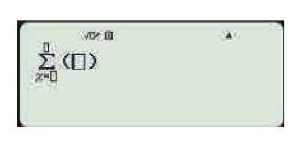
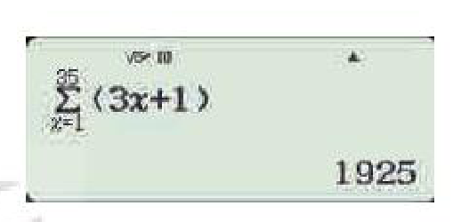

<!-- pdf:49 -->

# BÀI 6: CẤP SỐ CỘNG

## 🔤 Thuật ngữ

- Cấp số cộng
- Công sai
- Số hạng tổng quát
- Tổng của $n$ số hạng đầu

## 🎯 Kiến thức, kĩ năng

- Nhận biết một dãy số là cấp số cộng.
- Giải thích công thức xác định số hạng tổng quát của cấp số cộng.
- Tính tổng của $n$ số hạng đầu của cấp số cộng.
- Giải quyết một số vấn đề thực tiễn gắn với cấp số cộng.

## 🔴 Mở đầu

Một nhà hát có $25$ hàng ghế với $16$ ghế ở hàng thứ nhất, $18$ ghế ở hàng thứ hai, $20$ ghế ở hàng thứ ba và cứ tiếp tục theo quy luật đó, tức là hàng sau nhiều hơn hàng liền trước nó $2$ ghế. Tính tổng số ghế của nhà hát đó.

## 1. ĐỊNH NGHĨA

**HĐ1:** Nhận biết cấp số cộng

Cho dãy số $(u_n)$ gồm tất cả các số tự nhiên lẻ, xếp theo thứ tự tăng dần.

a) Viết năm số hạng đầu của dãy số.

b) Dự đoán công thức biểu diễn số hạng $u_n$ theo số hạng $u_{n-1}$.

> - **Cấp số cộng** là một dãy số (hữu hạn hay vô hạn), trong đó kể từ số hạng thứ hai, mỗi số hạng đều bằng số hạng đứng ngay trước nó cộng với một số không đổi $d$.
>   Số $d$ được gọi là **công sai** của cấp số cộng.
> - Cấp số cộng $(u_n)$ với công sai $d$ được cho bởi hệ thức truy hồi
>   $u_n = u_{n-1} + d$ với $n \ge 2$.

> ❓ Dãy số không đổi $a, a, a, \dots$ có phải là một cấp số cộng không?

**Ví dụ 1:** Cho cấp số cộng $(u_n)$ có số hạng đầu $u_1 = 2$ và công sai $d = 3$. Hãy viết năm số hạng đầu của cấp số cộng này.

**Giải:**

Năm số hạng đầu của cấp số cộng này là:

$u_1 = 2, u_2 = u_1 + d = 2 + 3 = 5, u_3 = u_2 + d = 5 + 3 = 8,$

$u_4 = u_3 + d = 8 + 3 = 11, u_5 = u_4 + d = 11 + 3 = 14.$

<!-- pdf:50 -->

**Ví dụ 2:** Cho dãy số $(u_n)$ với $u_n = 5n - 1$. Chứng minh rằng $(u_n)$ là một cấp số cộng. Tìm số hạng đầu $u_1$ và công sai $d$ của nó.

> Để chứng minh $(u_n)$ là một cấp số cộng, hãy chứng minh hiệu hai số hạng liên tiếp $u_n - u_{n-1}$ không đổi.

**Giải:**

Ta có $u_n - u_{n-1} = (5n - 1) - [5(n - 1) - 1] = 5$, với mọi $n \ge 2$.

Do đó $(u_n)$ là cấp số cộng có số hạng đầu $u_1 = 5 \cdot 1 - 1 = 4$ và công sai $d = 5$.

**Luyện tập 1:** Cho dãy số $(u_n)$ với $u_n = -2n + 3$. Chứng minh rằng $(u_n)$ là một cấp số cộng. Xác định số hạng đầu và công sai của cấp số cộng này.

## 2. SỐ HẠNG TỔNG QUÁT

**HĐ2:** Công thức số hạng tổng quát của cấp số cộng

Cho cấp số cộng $(u_n)$ với số hạng đầu $u_1$ và công sai $d$.

a) Tính các số hạng $u_2, u_3, u_4, u_5$ theo $u_1$ và $d$.

b) Dự đoán công thức tính số hạng tổng quát $u_n$ theo $u_1$ và $d$.

<!-- term: Số hạng tổng quát của cấp số cộng -->
> Nếu cấp số cộng $(u_n)$ có số hạng đầu $u_1$ và công sai $d$ thì **số hạng tổng quát** $u_n$ của nó được xác định theo công thức
>
> $u_n = u_1 + (n - 1)d.$

**Ví dụ 3:** Tìm năm số hạng đầu và số hạng thứ $100$ của cấp số cộng $(u_n)$: $10, 5, \dots$

**Giải:**

Cấp số cộng này có số hạng đầu $u_1 = 10$ và công sai $d = -5$.

Do đó năm số hạng đầu là: $10, 5, 0, -5, -10$.

Số hạng thứ $100$ là $u_{100} = u_1 + (100 - 1)d = 10 + 99 \cdot (-5) = -485$.

**Ví dụ 4:** Số hạng thứ $10$ của một cấp số cộng $(u_n)$ bằng $48$ và số hạng thứ $18$ bằng $88$. Tìm số hạng thứ $100$ của cấp số cộng đó.

**Giải:**

Giả sử $u_1$ là số hạng đầu và $d$ là công sai của cấp số cộng đó. Ta có:

$u_{10} = u_1 + 9d = 48$

$u_{18} = u_1 + 17d = 88.$

Giải hệ này ta được $u_1 = 3$ và $d = 5$.

Vậy số hạng thứ $100$ của cấp số cộng này là $u_{100} = u_1 + 99d = 3 + 99 \cdot 5 = 498$.

**Luyện tập 2:** Cho dãy số $(u_n)$ với $u_n = 4n - 3$. Chứng minh rằng $(u_n)$ là một cấp số cộng. Xác định số hạng đầu $u_1$ và công sai $d$ của cấp số cộng này. Từ đó viết số hạng tổng quát $u_n$ dưới dạng $u_n = u_1 + (n - 1)d$.

<!-- pdf:51 -->

## 3. TỔNG $n$ SỐ HẠNG ĐẦU CỦA MỘT CẤP SỐ CỘNG

**HĐ3:** Xây dựng công thức tính tổng $n$ số hạng đầu của cấp số cộng

Cho cấp số cộng $(u_n)$ với số hạng đầu $u_1$ và công sai $d$.

Để tính tổng của $n$ số hạng đầu

$S_n = u_1 + u_2 + \dots + u_{n-1} + u_n,$

hãy lần lượt thực hiện các yêu cầu sau:

a) Biểu diễn mỗi số hạng trong tổng $S_n$ theo số hạng đầu $u_1$ và công sai $d$.

b) Viết $S_n$ theo thứ tự ngược lại: $S_n = u_n + u_{n-1} + \dots + u_2 + u_1$ và sử dụng kết quả ở phần a) để biểu diễn mỗi số hạng trong tổng này theo $u_1$ và $d$.

c) Cộng từng vế hai đẳng thức nhận được ở a), b), để tính $S_n$ theo $u_1$ và $d$.
<!-- ocr-ok: đã đối chiếu ảnh trang PDF 51, OCR đọc sai dấu vế và để -->

<!-- term: Tổng của n số hạng đầu của cấp số cộng -->
> Cho cấp số cộng $(u_n)$ với công sai $d$. Đặt $S_n = u_1 + u_2 + \dots + u_n$. Khi đó
>
> $S_n = \frac{n}{2}\left[2u_1 + (n - 1)d\right].$

<!-- term: Tổng của n số hạng đầu của cấp số cộng -->
**Chú ý:** Sử dụng công thức $u_n = u_1 + (n - 1)d$, ta có thể viết tổng $S_n$ dưới dạng

> $S_n = \frac{n(u_1 + u_n)}{2}.$

**Ví dụ 5:** Giải bài toán ở *tình huống mở đầu*.

**Giải:** Số ghế ở mỗi hàng của nhà hát lập thành một cấp số cộng, gồm $25$ số hạng, với số hạng đầu $u_1 = 16$ và công sai $d = 2$. Tổng các số hạng này là

$S_{25} = u_1 + u_2 + \dots + u_{25} = \frac{25}{2}\left[2u_1 + (25 - 1)d\right] = \frac{25}{2}\left[2 \cdot 16 + 24 \cdot 2\right] = 1\,000.$

Vậy nhà hát đó có tổng cộng $1\,000$ ghế.

**Ví dụ 6:** Cần lấy tổng của bao nhiêu số hạng đầu của cấp số cộng $2, 5, 8, \dots$ để được kết quả bằng $345$?

**Giải:**

Cấp số cộng này có số hạng đầu $u_1 = 2$ và công sai $d = 3$. Gọi $n$ là số các số hạng đầu của cấp số cộng cần lấy tổng, ta có

$345 = S_n = \frac{n}{2}\left[2u_1 + (n - 1)d\right] = \frac{n}{2}\left[2 \cdot 2 + (n - 1) \cdot 3\right] = \frac{n}{2}(3n + 1).$

Do đó $3n^2 + n - 690 = 0$. Giải phương trình bậc hai này ta được $n = -\frac{230}{15}$ (loại) và $n = 15$.

Vậy phải lấy tổng của $15$ số hạng đầu của cấp số cộng đã cho để được tổng bằng $345$.

**Vận dụng:** Anh Nam được nhận vào làm việc ở một công ty về công nghệ với mức lương khởi điểm là $100$ triệu đồng một năm. Công ty sẽ tăng thêm lương cho anh Nam mỗi năm là $20$ triệu đồng. Tính tổng số tiền lương mà anh Nam nhận được sau $10$ năm làm việc cho công ty đó.

<!-- pdf:52 -->

## 💡 Góc công nghệ

**Kí hiệu tổng $\sum$ và cách tính tổng bằng máy tính cầm tay**

<!-- term: Kí hiệu tổng xích ma -->
Cho dãy số $(u_n)$. Tổng $n$ số hạng đầu của dãy số này: $S_n = u_1 + u_2 + \dots + u_n$ được kí hiệu ngắn gọn như sau: $S_n = \sum_{k=1}^n u_k$ (kí hiệu $\sum$ đọc là xích ma).

Ta có thể sử dụng máy tính cầm tay để tính tổng $n$ số hạng liên tiếp của một dãy số khi biết công thức của số hạng tổng quát.

Chẳng hạn, cho dãy số $(u_n)$ có số hạng tổng quát là $u_n = 3n + 1$. Để tính tổng $35$ số hạng đầu của dãy số đó, ta có thể dùng máy tính cầm tay, nhấn lần lượt các phím: $\text{SHIFT} \to \text{x}, \fbox{SHIFT} \ \fbox{$\sum_{\square}^{\square}(\square)$}$. Khi đó màn hình hiện ra như hình bên, lưu ý rằng giao diện máy tính mặc định là $x$, ở đây được hiểu là $n$ trong công thức số hạng tổng quát.

Tiếp theo ta nhập công thức số hạng tổng quát vào trong ngoặc $()$, rồi nhấn $\downarrow$ để nhập giá trị đầu tiên của $x$ (ở đây là $1$), sau đó nhấn $\uparrow$ để nhập giá trị cuối cùng của $x$ (trường hợp này là $35$), cuối cùng nhấn phím $\fbox{$=$}$. Khi đó, màn hình sẽ hiển thị kết quả cần tính như hình bên.

## ✏️ BÀI TẬP

**2.8.** Xác định công sai, số hạng thứ $5$, số hạng tổng quát và số hạng thứ $100$ của mỗi cấp số cộng sau:

a) $4, 9, 14, 19, \dots$;

b) $1, -1, -3, -5, \dots$

**2.9.** Viết năm số hạng đầu của mỗi dãy số $(u_n)$ sau và xét xem nó có phải là cấp số cộng không. Nếu dãy số đó là cấp số cộng, hãy tìm công sai $d$ và viết số hạng tổng quát của nó dưới dạng $u_n = u_1 + (n - 1)d$.

a) $u_n = 3 + 5n$;

b) $u_n = 6n - 4$;

c) $u_1 = 2, u_n = u_{n-1} + n$;

d) $u_1 = 2, u_n = u_{n-1} + 3$.

**2.10.** Một cấp số cộng có số hạng thứ $5$ bằng $18$ và số hạng thứ $12$ bằng $32$. Tìm số hạng thứ $50$ của cấp số cộng này.

**2.11.** Một cấp số cộng có số hạng đầu bằng $5$ và công sai bằng $2$. Hỏi phải lấy tổng của bao nhiêu số hạng đầu của cấp số cộng này để có tổng bằng $2\,700$?

**2.12.** Giá của một chiếc xe ô tô lúc mới mua là $680$ triệu đồng. Cứ sau mỗi năm sử dụng, giá của chiếc xe ô tô giảm $55$ triệu đồng. Tính giá còn lại của chiếc xe sau $5$ năm sử dụng.

**2.13.** Một kiến trúc sư thiết kế một hội trường với $15$ ghế ngồi ở hàng thứ nhất, $18$ ghế ngồi ở hàng thứ hai, $21$ ghế ngồi ở hàng thứ ba, và cứ như vậy (số ghế ở hàng sau nhiều hơn $3$ ghế so với số ghế ở hàng liền trước nó). Nếu muốn hội trường đó có sức chứa ít nhất $870$ ghế ngồi thì kiến trúc sư đó phải thiết kế tối thiểu bao nhiêu hàng ghế?

**2.14.** Vào năm 2020, dân số của một thành phố là khoảng $1,2$ triệu người. Giả sử mỗi năm, dân số của thành phố này tăng thêm khoảng $30$ nghìn người. Hãy ước tính dân số của thành phố này vào năm 2030.

## 📷 Danh sách hình trong bài

| Mã hình | Trang PDF | Vị trí trong bài | Chú thích gốc |
| --- | :---: | --- | --- |
| H11-toan-b06-01 | 49 | Mở đầu | (sách không đánh số, hình các hàng ghế trong nhà hát) |
| H11-toan-b06-02 | 52 | Góc công nghệ | (sách không đánh số, màn hình máy tính cầm tay khi nhấn phím tính tổng $\sum$) |
| H11-toan-b06-03 | 52 | Góc công nghệ | (sách không đánh số, màn hình máy tính cầm tay hiển thị kết quả $\sum_{x=1}^{35}(3x+1) = 1925$) |
