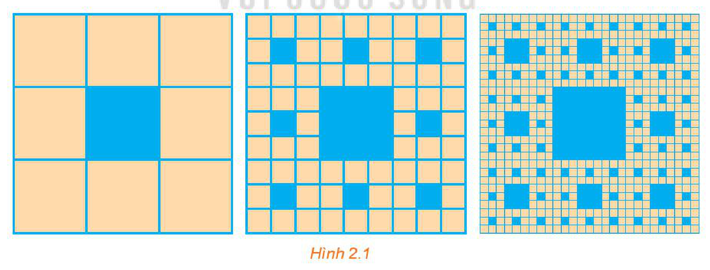

<!-- pdf:57 -->

# BÀI TẬP CUỐI CHƯƠNG II

## ✏️ A – TRẮC NGHIỆM

**2.22.** Khẳng định nào sau đây là **sai**?

A. Một dãy số tăng thì bị chặn dưới.

B. Một dãy số giảm thì bị chặn trên.

C. Một dãy số bị chặn thì phải tăng hoặc giảm.

D. Một dãy số không đổi thì bị chặn.

**2.23.** Cho dãy số

$1, \frac{1}{2}, \frac{1}{4}, \frac{1}{8}, \dots$ (số hạng sau bằng một nửa số hạng liền trước nó).

Công thức tổng quát của dãy số đã cho là

A. $u_n = \left(\frac{1}{2}\right)^n$.

B. $u_n = \frac{(-1)^n}{2^{n-1}}$.

C. $u_n = \frac{1}{2n}$.

D. $u_n = \left(\frac{1}{2}\right)^{n-1}$.

**2.24.** Cho dãy số $(u_n)$ với $u_n = 3n + 6$. Khẳng định nào sau đây là đúng?

A. Dãy số $(u_n)$ là cấp số cộng với công sai $d = 3$.

B. Dãy số $(u_n)$ là cấp số cộng với công sai $d = 6$.

C. Dãy số $(u_n)$ là cấp số nhân với công bội $q = 3$.

D. Dãy số $(u_n)$ là cấp số nhân với công bội $q = 6$.

**2.25.** Trong các dãy số cho bởi công thức truy hồi sau, dãy số nào là cấp số nhân?

A. $u_1 = -1, u_{n+1} = u_n^2$.

B. $u_1 = -1, u_{n+1} = 2u_n$.

C. $u_1 = -1, u_{n+1} = u_n + 2$.

D. $u_1 = -1, u_{n+1} = u_n - 2$.

**2.26.** Tổng $100$ số hạng đầu của dãy số $(u_n)$ với $u_n = 2n - 1$ là

A. $199$.

B. $2^{100} - 1$.

C. $10\,000$.

D. $9\,999$.

<!-- pdf:58 -->

## ✏️ B – TỰ LUẬN

**2.27.** Từ $0$ giờ đến $12$ giờ trưa, chuông của một chiếc đồng hồ quả lắc sẽ đánh bao nhiêu tiếng, biết rằng nó chỉ đánh chuông báo giờ và số tiếng chuông bằng số giờ?

**2.28.** Tế bào E. Coli trong điều kiện nuôi cấy thích hợp cứ $20$ phút lại phân đôi một lần. Hỏi sau $24$ giờ, tế bào ban đầu sẽ phân chia thành bao nhiêu tế bào?

**2.29.** Chứng minh rằng:

<!-- term: Tính chất các số hạng của cấp số cộng -->
a) Trong một cấp số cộng $(u_n)$, mỗi số hạng (trừ số hạng đầu và số hạng cuối, nếu có) đều là trung bình cộng của hai số hạng đứng kề với nó, nghĩa là

$u_k = \frac{u_{k-1} + u_{k+1}}{2}$ với $k \ge 2$.

<!-- term: Tính chất các số hạng của cấp số nhân -->
b) Trong một cấp số nhân, bình phương của mỗi số hạng (trừ số hạng đầu và số hạng cuối, nếu có) đều là tích của hai số hạng đứng kề với nó, nghĩa là

$u_k^2 = u_{k-1} \cdot u_{k+1}$ với $k \ge 2$.

**2.30.** Tìm ba số, biết theo thứ tự đó chúng lập thành cấp số cộng và có tổng bằng $21$, và nếu lần lượt cộng thêm các số $2; 3; 9$ vào ba số đó thì được ba số lập thành một cấp số nhân.

**2.31.** Mặt sàn tầng một (tầng trệt) của một ngôi nhà cao hơn mặt sân $0,5\text{ m}$. Cầu thang đi từ tầng một lên tầng hai gồm $25$ bậc, mỗi bậc cao $16\text{ cm}$.
<!-- ocr-ok: đã đối chiếu ảnh trang PDF 58, OCR đọc sai chữ tầng và mỗi -->

a) Viết công thức để tìm độ cao của bậc cầu thang thứ $n$ so với mặt sân.

b) Tính độ cao của sàn tầng hai so với mặt sân.
<!-- ocr-ok: đã đối chiếu ảnh trang PDF 58, OCR đọc sai chữ Tính, sàn, tầng -->

**2.32.** Một hình vuông màu vàng có cạnh $1$ đơn vị dài được chia thành chín hình vuông nhỏ hơn và hình vuông ở chính giữa được tô màu xanh như Hình 2.1. Mỗi hình vuông màu vàng nhỏ hơn lại được chia thành chín hình vuông con, và mỗi hình vuông con ở chính giữa lại được tô màu xanh. Nếu quá trình này được tiếp tục lặp lại năm lần, thì tổng diện tích các hình vuông được tô màu xanh bao nhiêu?

*Hình 2.1*

## 📷 Danh sách hình trong bài

| Mã hình | Trang PDF | Vị trí trong bài | Chú thích gốc |
| --- | :---: | --- | --- |
| H11-toan-bt-c02-01 | 58 | Bài tập 2.32 | Hình 2.1 |
