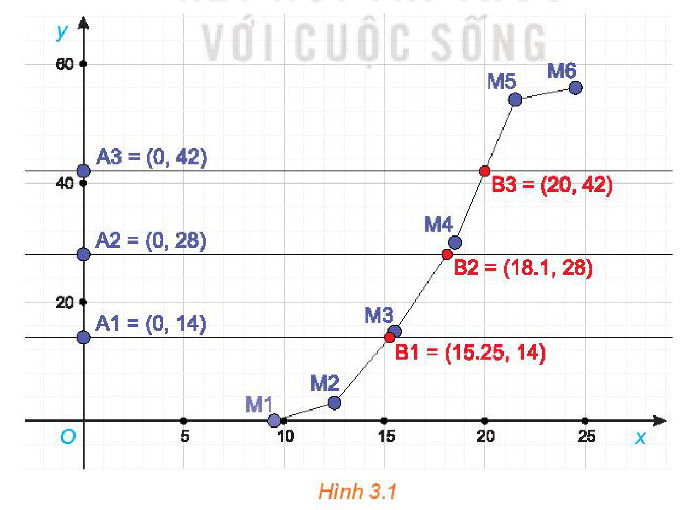

<!-- pdf:63 -->

# BÀI 9: CÁC SỐ ĐẶC TRƯNG ĐO XU THẾ TRUNG TÂM

## 🔤 Thuật ngữ

- Số trung bình
- Trung vị
- Tứ phân vị
- Mốt

## 🎯 Kiến thức, kĩ năng

- Tính các số đặc trưng đo xu thế trung tâm của mẫu số liệu ghép nhóm.
- Hiểu ý nghĩa, vai trò của các số đặc trưng của mẫu số liệu thực tế.

## 🔴 Mở đầu

Một cửa hàng đã ghi lại số tiền bán xăng cho $35$ khách hàng đi xe máy. Mẫu số liệu gốc có dạng: $x_1, x_2, \dots, x_{35}$ trong đó $x_i$ là số tiền bán xăng cho khách hàng thứ $i$. Vì một lí do nào đó, cửa hàng chỉ có mẫu số liệu ghép nhóm dạng sau:

| Số tiền (nghìn đồng) | $[0; 30)$ | $[30; 60)$ | $[60; 90)$ | $[90; 120)$ |
| --- | :---: | :---: | :---: | :---: |
| Số khách hàng | $3$ | $15$ | $10$ | $7$ |

*Bảng 3.1. Số tiền khách hàng mua xăng*

Dựa trên mẫu số liệu ghép nhóm này, làm thế nào để ước lượng các số đặc trưng đo xu thế trung tâm (số trung bình, trung vị, tứ phân vị, mốt) cho mẫu số liệu gốc?

Chúng ta cùng tìm hiểu vấn đề này!

## 1. SỐ TRUNG BÌNH CỦA MẪU SỐ LIỆU GHÉP NHÓM

**HĐ1:** Khảo sát thời gian tự học của các học sinh trong lớp theo mẫu bên.

a) Hãy lập bảng thống kê cho mẫu số liệu ghép nhóm thu được.

b) Có thể tính chính xác thời gian tự học trung bình của các học sinh trong lớp không?

c) Có cách nào tính gần đúng thời gian tự học trung bình của các học sinh trong lớp dựa trên mẫu số liệu ghép nhóm này không?

Mỗi ngày em tự học trong bao nhiêu giờ?

A. Dưới $1,5$ giờ.

B. Từ $1,5$ giờ đến dưới $3$ giờ.
<!-- ocr-ok: đã đối chiếu ảnh trang PDF 63, OCR đọc dính chữ B.Từ -->

C. Từ $3$ giờ đến dưới $4,5$ giờ.
<!-- ocr-ok: đã đối chiếu ảnh trang PDF 63, OCR đọc dính chữ C.Từ -->

D. Từ $4,5$ giờ trở lên.
<!-- ocr-ok: đã đối chiếu ảnh trang PDF 63, OCR đọc sai chữ Từ thành Tử -->

Cho mẫu số liệu ghép nhóm

| Nhóm | $[a_1; a_2)$ | $\dots$ | $[a_i; a_{i+1})$ | $\dots$ | $[a_k; a_{k+1})$ |
| --- | :---: | :---: | :---: | :---: | :---: |
| Tần số | $m_1$ | $\dots$ | $m_i$ | $\dots$ | $m_k$ |
<!-- ocr-ok: đã đối chiếu ảnh trang PDF 63, OCR đọc sai kí hiệu nhóm và tần số trong Bảng 3.2 -->

*Bảng 3.2*

> **Số trung bình** của mẫu số liệu ghép nhóm kí hiệu là $\bar{x}$.
>
> $\bar{x} = \frac{m_1 x_1 + \dots + m_k x_k}{n}$
>
> trong đó, $n = m_1 + \dots + m_k$ là **cỡ mẫu** và $x_i = \frac{a_i + a_{i+1}}{2}$ (với $i = 1, \dots, k$) là **giá trị đại diện** của nhóm $[a_i; a_{i+1})$.

<!-- pdf:64 -->

<!-- term: Hiệu chỉnh nhóm đối với số liệu rời rạc -->
**Chú ý:** Đối với **số liệu rời rạc**, người ta thường cho các nhóm dưới dạng $k_1 \text{ - } k_2$, trong đó $k_1, k_2 \in \mathbb{N}$. Nhóm $k_1 \text{ - } k_2$ được hiểu là nhóm gồm các giá trị $k_1, k_1 + 1, \dots, k_2$. Khi đó, ta cần hiệu chỉnh mẫu dữ liệu ghép nhóm để đưa về dạng Bảng 3.2 trước khi thực hiện tính toán các số đặc trưng bằng cách hiệu chỉnh nhóm $k_1 \text{ - } k_2$ với $k_1, k_2 \in \mathbb{N}$ thành nhóm $[k_1 - 0,5; k_2 + 0,5)$. Chẳng hạn, với dữ liệu ghép nhóm điểm thi môn Toán trong Bảng 3.3 sau khi hiệu chỉnh ta được Bảng 3.4.

| Điểm thi | $1\text{-}4$ | $5\text{-}7$ | $8\text{-}10$ |
| --- | :---: | :---: | :---: |
| Số học sinh | $5$ | $20$ | $10$ |
<!-- ocr-ok: đã đối chiếu ảnh trang PDF 64, OCR đọc gộp hai bảng 3.3 và 3.4 trên cùng dòng -->

*Bảng 3.3*

| Điểm thi | $[0,5; 4,5)$ | $[4,5; 7,5)$ | $[7,5; 10]$ |
| --- | :---: | :---: | :---: |
| Số học sinh | $5$ | $20$ | $10$ |
<!-- ocr-ok: đã đối chiếu ảnh trang PDF 64, OCR đọc gộp hai bảng 3.3 và 3.4 trên cùng dòng -->

*Bảng 3.4*

**Ví dụ 1:** Tìm cân nặng trung bình của học sinh lớp 11D cho trong *Bảng 3.5*.

| Cân nặng | $[40,5; 45,5)$ | $[45,5; 50,5)$ | $[50,5; 55,5)$ | $[55,5; 60,5)$ | $[60,5; 65,5)$ | $[65,5; 70,5)$ |
| --- | :---: | :---: | :---: | :---: | :---: | :---: |
| Số học sinh | $10$ | $7$ | $16$ | $4$ | $2$ | $3$ |

*Bảng 3.5. Cân nặng của học sinh lớp 11D*

**Giải:**

Trong mỗi khoảng cân nặng, giá trị đại diện là trung bình cộng của giá trị hai đầu mút nên ta có bảng sau:

| Cân nặng ($\text{kg}$) | $43$ | $48$ | $53$ | $58$ | $63$ | $68$ |
| --- | :---: | :---: | :---: | :---: | :---: | :---: |
| Số học sinh | $10$ | $7$ | $16$ | $4$ | $2$ | $3$ |

Tổng số học sinh là $n = 42$. Cân nặng trung bình của học sinh lớp 11D là

$\bar{x} = \frac{10 \cdot 43 + 7 \cdot 48 + 16 \cdot 53 + 4 \cdot 58 + 2 \cdot 63 + 3 \cdot 68}{42} \approx 51,81\text{ (kg)}$.

**Luyện tập 1:** Tìm hiểu thời gian xem ti vi trong tuần trước (đơn vị: giờ) của một số học sinh thu được kết quả sau:

| Thời gian (giờ) | $[0; 5)$ | $[5; 10)$ | $[10; 15)$ | $[15; 20)$ | $[20; 25)$ |
| --- | :---: | :---: | :---: | :---: | :---: |
| Số học sinh | $8$ | $16$ | $4$ | $2$ | $2$ |

Tính thời gian xem ti vi trung bình trong tuần trước của các bạn học sinh này.

**Ý nghĩa:** Số trung bình của mẫu số liệu ghép nhóm xấp xỉ cho số trung bình của mẫu số liệu gốc, nó cho biết vị trí trung tâm của mẫu số liệu và có thể dùng để đại diện cho mẫu số liệu.

## 2. TRUNG VỊ CỦA MẪU SỐ LIỆU GHÉP NHÓM

**HĐ2:** Cho mẫu số liệu ghép nhóm về chiều cao của $21$ cây na giống.

| Chiều cao ($\text{cm}$) | $[0; 5)$ | $[5; 10)$ | $[10; 15)$ | $[15; 20)$ |
| --- | :---: | :---: | :---: | :---: |
| Số cây | $3$ | $8$ | $7$ | $3$ |

Gọi $x_1, x_2, \dots, x_{21}$ là chiều cao của các cây giống, đã được sắp xếp theo thứ tự tăng dần. Khi đó, $x_1, \dots, x_3$ thuộc $[0; 5)$, $x_4, \dots, x_{11}$ thuộc $[5; 10), \dots$ Hỏi trung vị thuộc nhóm nào?

<!-- pdf:65 -->

Cho mẫu số liệu ghép nhóm như trong Bảng 3.2.

> Để tính **trung vị** của mẫu số liệu ghép nhóm, ta làm như sau:
>
> *Bước 1.* Xác định **nhóm chứa trung vị**. Giả sử đó là nhóm thứ $p$: $[a_p; a_{p+1})$.
>
> *Bước 2.* Trung vị là $M_e = a_p + \frac{\frac{n}{2} - (m_1 + \dots + m_{p-1})}{m_p} \cdot (a_{p+1} - a_p)$,
>
> trong đó $n$ là cỡ mẫu, $m_p$ là tần số nhóm $p$. Với $p = 1$, ta quy ước $m_1 + \dots + m_{p-1} = 0$.

**Ví dụ 2:** Thời gian (phút) truy cập Internet mỗi buổi tối của một số học sinh được cho trong bảng sau:

| Thời gian (phút) | $[9,5; 12,5)$ | $[12,5; 15,5)$ | $[15,5; 18,5)$ | $[18,5; 21,5)$ | $[21,5; 24,5)$ |
| --- | :---: | :---: | :---: | :---: | :---: |
| Số học sinh | $3$ | $12$ | $15$ | $24$ | $2$ |

Tính trung vị của mẫu số liệu ghép nhóm này.

**Giải:**

Cỡ mẫu là $n = 3 + 12 + 15 + 24 + 2 = 56$.

Gọi $x_1, \dots, x_{56}$ là thời gian vào Internet của $56$ học sinh và giả sử dãy này đã được sắp xếp theo thứ tự tăng dần. Khi đó, trung vị là $\frac{x_{28} + x_{29}}{2}$. Do $2$ giá trị $x_{28}, x_{29}$ thuộc nhóm $[15,5; 18,5)$ nên nhóm này chứa trung vị. Do đó, $p = 3$; $a_3 = 15,5$; $m_3 = 15$; $m_1 + m_2 = 3 + 12 = 15$; $a_4 - a_3 = 3$ và ta có

$M_e = 15,5 + \frac{\frac{56}{2} - 15}{15} \cdot 3 = 18,1.$

**Luyện tập 2:** Ghi lại tốc độ bóng trong $200$ lần giao bóng của một vận động viên môn quần vợt cho kết quả như bảng bên.

Tính trung vị của mẫu số liệu ghép nhóm này.

| Tốc độ $v$ ($\text{km/h}$) | Số lần |
| :---: | :---: |
| $150 \le v < 155$ | $18$ |
| $155 \le v < 160$ | $28$ |
| $160 \le v < 165$ | $35$ |
| $165 \le v < 170$ | $43$ |
| $170 \le v < 175$ | $41$ |
| $175 \le v < 180$ | $35$ |
<!-- ocr-ok: đã đối chiếu ảnh trang PDF 65, bảng đặt ở cột phải nên OCR đọc lẫn với chữ bên trái -->

**Ý nghĩa:** Trung vị của mẫu số liệu ghép nhóm xấp xỉ cho trung vị của mẫu số liệu gốc, nó chia mẫu số liệu thành hai phần, mỗi phần chứa $50\%$ giá trị.

## 3. TỨ PHÂN VỊ CỦA MẪU SỐ LIỆU GHÉP NHÓM

**HĐ3:** Với mẫu số liệu ghép nhóm cho trong HĐ2, hãy cho biết tứ phân vị thứ nhất $Q_1$ và tứ phân vị thứ ba $Q_3$ thuộc nhóm nào.

Với tứ phân vị $Q_1, Q_2, Q_3$ lần lượt có $25\%, 50\%, 75\%$ số giá trị nhỏ hơn $Q_1, Q_2, Q_3$.

Cho mẫu số liệu ghép nhóm như Bảng 3.2.

<!-- pdf:66 -->

> Để tính **tứ phân vị thứ nhất** $Q_1$ của mẫu số liệu ghép nhóm, trước hết ta xác định nhóm chứa $Q_1$, giả sử đó là nhóm thứ $p$: $[a_p; a_{p+1})$. Khi đó,
>
> $Q_1 = a_p + \frac{\frac{n}{4} - (m_1 + \dots + m_{p-1})}{m_p} \cdot (a_{p+1} - a_p),$
>
> trong đó, $n$ là cỡ mẫu, $m_p$ là tần số nhóm $p$, với $p = 1$ ta quy ước $m_1 + \dots + m_{p-1} = 0$.
>
> Để tính **tứ phân vị thứ ba** $Q_3$ của mẫu số liệu ghép nhóm, trước hết ta xác định nhóm chứa $Q_3$. Giả sử đó là nhóm thứ $p$: $[a_p; a_{p+1})$. Khi đó,
>
> $Q_3 = a_p + \frac{\frac{3n}{4} - (m_1 + \dots + m_{p-1})}{m_p} \cdot (a_{p+1} - a_p),$
>
> trong đó, $n$ là cỡ mẫu, $m_p$ là tần số nhóm $p$, với $p = 1$ ta quy ước $m_1 + \dots + m_{p-1} = 0$.
>
> **Tứ phân vị thứ hai** $Q_2$ chính là trung vị $M_e$.

**Ví dụ 3:** Tìm tứ phân vị thứ nhất $Q_1$ và tứ phân vị thứ ba $Q_3$ của mẫu số liệu ghép nhóm cho trong Ví dụ 2.

**Giải:**

Cỡ mẫu là $n = 56$.

Tứ phân vị thứ nhất $Q_1$ là $\frac{x_{14} + x_{15}}{2}$. Do $x_{14}, x_{15}$ đều thuộc nhóm $[12,5; 15,5)$ nên nhóm này chứa $Q_1$. Do đó, $p = 2$; $a_2 = 12,5$; $m_2 = 12$; $m_1 = 3$, $a_3 - a_2 = 3$ và ta có

$Q_1 = 12,5 + \frac{\frac{56}{4} - 3}{12} \cdot 3 = 15,25.$

Với tứ phân vị thứ ba $Q_3$ là $\frac{x_{42} + x_{43}}{2}$. Do $x_{42}, x_{43}$ đều thuộc nhóm $[18,5; 21,5)$ nên nhóm này chứa $Q_3$. Do đó, $p = 4$; $a_4 = 18,5$; $m_4 = 24$; $m_1 + m_2 + m_3 = 3 + 12 + 15 = 30$; $a_5 - a_4 = 3$ và ta có

$Q_3 = 18,5 + \frac{\frac{3 \cdot 56}{4} - 30}{24} \cdot 3 = 20.$

**Nhận xét:** Ta cũng có thể xác định nhóm chứa tứ phân vị thứ $r$ nhờ tính chất: có khoảng $\left(\frac{r \cdot n}{4}\right)$ giá trị nhỏ hơn tứ phân vị này.

**Luyện tập 3:** Tìm tứ phân vị thứ nhất và tứ phân vị thứ ba cho mẫu số liệu ghép nhóm ở Luyện tập 2.

**Ý nghĩa:** Các **tứ phân vị** của mẫu số liệu ghép nhóm xấp xỉ cho các tứ phân vị của mẫu số liệu gốc, chúng chia mẫu số liệu thành $4$ phần, mỗi phần chứa $25\%$ giá trị.

<!-- pdf:67 -->

## 4. MỐT CỦA MẪU SỐ LIỆU GHÉP NHÓM

**HĐ4:** Với số liệu cho trong Luyện tập 1:

a) Có thể tìm được giá trị chính xác cho mốt của mẫu số liệu gốc về thời gian xem ti vi của học sinh không?

b) Mốt thuộc nhóm nào là hợp lí nhất? Nên lấy số nào trong nhóm để ước lượng cho mốt?

Cho mẫu số liệu ghép nhóm như trong Bảng 3.2.

> Để tìm **mốt** của mẫu số liệu ghép nhóm, ta thực hiện theo các bước sau:
>
> *Bước 1.* Xác định nhóm có tần số lớn nhất (gọi là **nhóm chứa mốt**), giả sử là nhóm $j$: $[a_j; a_{j+1})$.
>
> *Bước 2.* Mốt được xác định là: $M_o = a_j + \frac{m_j - m_{j-1}}{(m_j - m_{j-1}) + (m_j - m_{j+1})} \cdot h$
>
> trong đó $m_j$ là tần số của nhóm $j$ (quy ước $m_0 = m_{k+1} = 0$) và $h$ là độ dài của nhóm.

**Lưu ý:** Người ta chỉ định nghĩa mốt cho mẫu ghép nhóm có độ dài các nhóm bằng nhau. Một mẫu có thể không có mốt hoặc có nhiều hơn một mốt.

Khi tần số của các nhóm số liệu bằng nhau thì mẫu số liệu ghép nhóm không có mốt.

**Ví dụ 4:** Bảng số liệu ghép nhóm sau cho biết chiều cao ($\text{cm}$) của $50$ học sinh lớp 11A.

| Khoảng chiều cao ($\text{cm}$) | $[145; 150)$ | $[150; 155)$ | $[155; 160)$ | $[160; 165)$ | $[165; 170)$ |
| --- | :---: | :---: | :---: | :---: | :---: |
| Số học sinh | $7$ | $14$ | $10$ | $10$ | $9$ |

Tính mốt của mẫu số liệu ghép nhóm này. Có thể kết luận gì từ giá trị tính được?

**Giải:**

Tần số lớn nhất là $14$ nên nhóm chứa mốt là nhóm $[150; 155)$. Ta có, $j = 2, a_2 = 150, m_2 = 14$, $m_1 = 7, m_3 = 10, h = 5$. Do đó

$M_o = 150 + \frac{14 - 7}{(14 - 7) + (14 - 10)} \cdot 5 \approx 153,18.$

Số học sinh có chiều cao khoảng $153,18\text{ cm}$ là nhiều nhất.

**Luyện tập 3:** Thời gian (phút) để học sinh hoàn thành một câu hỏi thi được cho như sau:

| Thời gian (phút) | $[0,5; 10,5)$ | $[10,5; 20,5)$ | $[20,5; 30,5)$ | $[30,5; 40,5)$ | $[40,5; 50,5)$ |
| --- | :---: | :---: | :---: | :---: | :---: |
| Số học sinh | $2$ | $10$ | $6$ | $4$ | $3$ |

Tìm mốt của mẫu số liệu ghép nhóm này.

**Ý nghĩa:** Mốt của mẫu số liệu ghép nhóm xấp xỉ cho mốt của mẫu số liệu gốc, nó được dùng để đo xu thế trung tâm của mẫu số liệu.

**Vận dụng:** Hãy tính các số đặc trưng cho mẫu số liệu trong Bảng 3.1 và giải thích ý nghĩa của các giá trị thu được.

<!-- pdf:68 -->

## ✏️ BÀI TẬP

**3.4.** Quãng đường ($\text{km}$) từ nhà đến nơi làm việc của $40$ công nhân một nhà máy được ghi lại như sau:

$5 \quad 3 \quad 10 \quad 20 \quad 25 \quad 11 \quad 13 \quad 7 \quad 12 \quad 31 \quad 19 \quad 10 \quad 12 \quad 17 \quad 18 \quad 11 \quad 32 \quad 17 \quad 16 \quad 2$

$7 \quad 9 \quad 7 \quad 8 \quad 3 \quad 5 \quad 12 \quad 15 \quad 18 \quad 3 \quad 12 \quad 14 \quad 2 \quad 9 \quad 6 \quad 15 \quad 15 \quad 7 \quad 6 \quad 12.$

a) Ghép nhóm dãy số liệu trên thành các khoảng có độ rộng bằng nhau, khoảng đầu tiên là $[0; 5)$. Tìm giá trị đại diện cho mỗi nhóm.

b) Tính số trung bình của mẫu số liệu không ghép nhóm và mẫu số liệu ghép nhóm. Giá trị nào chính xác hơn?

c) Xác định nhóm chứa mốt của mẫu số liệu ghép nhóm thu được.

**3.5.** Tuổi thọ (năm) của $50$ bình ắc quy ô tô được cho như sau:

| Tuổi thọ (năm) | $[2; 2,5)$ | $[2,5; 3)$ | $[3; 3,5)$ | $[3,5; 4)$ | $[4; 4,5)$ | $[4,5; 5)$ |
| --- | :---: | :---: | :---: | :---: | :---: | :---: |
| Tần số | $4$ | $9$ | $14$ | $11$ | $7$ | $5$ |

a) Xác định mốt và giải thích ý nghĩa.

b) Tính tuổi thọ trung bình của $50$ bình ắc quy ô tô này.

**3.6.** Điểm thi môn Toán (thang điểm $100$, điểm được làm tròn đến $1$) của $60$ thí sinh được cho trong bảng sau:

| Điểm | $0 \text{ - } 9$ | $10 \text{ - } 19$ | $20 \text{ - } 29$ | $30 \text{ - } 39$ | $40 \text{ - } 49$ |
| --- | :---: | :---: | :---: | :---: | :---: |
| Số thí sinh | $1$ | $2$ | $4$ | $6$ | $15$ |
| Điểm | $50 \text{ - } 59$ | $60 \text{ - } 69$ | $70 \text{ - } 79$ | $80 \text{ - } 89$ | $90 \text{ - } 99$ |
| Số thí sinh | $12$ | $10$ | $6$ | $3$ | $1$ |
<!-- ocr-ok: đã đối chiếu ảnh trang PDF 68, các khoảng điểm được bọc trong LaTeX -->

a) Hiệu chỉnh để thu được mẫu số liệu ghép nhóm dạng Bảng 3.2.

b) Tìm các tứ phân vị và giải thích ý nghĩa của chúng.

**3.7.** Phỏng vấn một số học sinh khối 11 về thời gian (giờ) ngủ của một buổi tối, thu được bảng số liệu ở bên.
<!-- ocr-ok: đã đối chiếu ảnh trang PDF 68, OCR đọc lẫn dòng chữ bên trái với tiêu đề bảng bên phải -->

a) So sánh thời gian ngủ trung bình của các bạn học sinh nam và nữ.

b) Hãy cho biết $75\%$ học sinh khối 11 ngủ ít nhất bao nhiêu giờ?

| Thời gian | Số học sinh nam | Số học sinh nữ |
| :---: | :---: | :---: |
| $[4; 5)$ | $6$ | $4$ |
| $[5; 6)$ | $10$ | $8$ |
| $[6; 7)$ | $13$ | $10$ |
| $[7; 8)$ | $9$ | $11$ |
| $[8; 9)$ | $7$ | $8$ |
<!-- ocr-ok: đã đối chiếu ảnh trang PDF 68, bảng đặt ở cột phải nên OCR đọc lẫn với chữ bên trái -->

<!-- pdf:69 -->

## 💡 Em có biết?

Ta có thể sử dụng phần mềm Geogebra để tính các tứ phân vị của mẫu số liệu ghép nhóm dạng Bảng 3.2 theo các bước sau đây:

*Bước 1.* Lập **bảng tần số tích luỹ** dạng sau:

| Nhóm | $< a_1$ | $[a_1; a_2)$ | $\dots$ | $[a_i; a_{i+1})$ | $\dots$ | $[a_k; a_{k+1})$ |
| --- | :---: | :---: | :---: | :---: | :---: | :---: |
| Tần số tích luỹ | $0$ | $c_1$ | $\dots$ | $c_i$ | $\dots$ | $c_k$ |
<!-- ocr-ok: đã đối chiếu ảnh trang PDF 69, OCR đọc sai kí hiệu nhóm và tần số tích luỹ trong bảng -->

trong đó $c_i = m_1 + \dots + m_{i-1}$ là **tần số tích luỹ**.

*Bước 2.* Vẽ **đồ thị tần số tích luỹ** bằng cách nối các điểm liên tiếp $M_1(a_1; 0), M_2(a_2; c_1), \dots, M_{k+1}(a_{k+1}; c_k)$.

*Bước 3.* Qua điểm $A_1\left(0; \frac{n}{4}\right)$ vẽ tia song song với $Ox$, cắt đồ thị tần số tích luỹ tại $B_1\left(Q_1; \frac{n}{4}\right)$, với $n$ là cỡ mẫu, $Q_1$ chính là tứ phân vị thứ nhất.

Qua điểm $A_2\left(0; \frac{n}{2}\right)$ vẽ tia song song với $Ox$, cắt đồ thị tần số tích luỹ tại $B_2\left(Q_2; \frac{n}{2}\right)$. $Q_2$ chính là tứ phân vị thứ hai.

Qua điểm $A_3\left(0; \frac{3n}{4}\right)$ vẽ tia song song với $Ox$, cắt đồ thị tần số tích luỹ tại $B_3\left(Q_3; \frac{3n}{4}\right)$. $Q_3$ chính là tứ phân vị thứ ba.

Chẳng hạn, với mẫu số liệu ghép nhóm cho trong Ví dụ 2 ta có bảng tần số tích luỹ:

| Nhóm | $< 9,5$ | $[9,5; 12,5)$ | $[12,5; 15,5)$ | $[15,5; 18,5)$ | $[18,5; 21,5)$ | $[21,5; 24,5)$ |
| --- | :---: | :---: | :---: | :---: | :---: | :---: |
| Tần số tích luỹ | $0$ | $3$ | $15$ | $30$ | $54$ | $56$ |

Sử dụng phần mềm Geogebra ta có Hình 3.1.

*Hình 3.1*

Từ hình vẽ ta có $Q_1 = 15,25; Q_2 = 18,1; Q_3 = 20$.

## 📷 Danh sách hình trong bài

| Mã hình | Trang PDF | Vị trí trong bài | Chú thích gốc |
| --- | --- | --- | --- |
| H11-toan-b09-01 | 69 | Em có biết? | Hình 3.1 |
