<!-- pdf:71 -->

<!-- Phần giới thiệu Chương IV (in chung đầu trang PDF 71): CHƯƠNG IV. QUAN HỆ SONG SONG TRONG KHÔNG GIAN -->

Ở các lớp dưới, ta đã học về Hình học phẳng, môn học nghiên cứu tính chất của các hình trong mặt phẳng như hình tam giác, hình tứ giác, hình tròn,... Tuy nhiên, các vật thể thường gặp trong thực tế đời sống như hộp phấn, cục tẩy, chặn giấy là các hình trong không gian. Một số tính chất của những hình này đã được giới thiệu và thừa nhận trong phần Hình học trực quan. Trong chương này, ta sẽ tiếp tục học về **Hình học không gian**, môn học nghiên cứu tính chất của các hình trong không gian dựa trên các lập luận toán học logic và chặt chẽ. Nội dung chính của chương liên quan đến đường thẳng, mặt phẳng trong không gian và vị trí tương đối giữa chúng.

*Hình học không gian đóng vai trò quan trọng trong xây dựng và đồ hoạ như vẽ kĩ thuật, in 3D, thiết kế với sự hỗ trợ của máy tính CAD (Computer Aided Design).*

# BÀI 10: ĐƯỜNG THẲNG VÀ MẶT PHẲNG TRONG KHÔNG GIAN

## 🔤 Thuật ngữ

- Mặt phẳng
- Điểm thuộc mặt phẳng
- Các điểm đồng phẳng
- Giao tuyến của hai mặt phẳng
- Hình chóp và hình tứ diện

## 🎯 Kiến thức, kĩ năng

- Nhận biết các quan hệ liên thuộc cơ bản giữa điểm, đường thẳng, mặt phẳng trong không gian.
- Mô tả ba cách xác định mặt phẳng.
- Xác định giao tuyến của hai mặt phẳng, giao điểm của đường thẳng và mặt phẳng.
- Nhận biết hình chóp và hình tứ diện.
- Mô tả một số hình ảnh trong thực tiễn có liên quan đến đường thẳng, mặt phẳng trong không gian.

## 🔴 Mở đầu

Điểm, đường thẳng và mối quan hệ liên thuộc giữa hai đối tượng hình học này đã được giới thiệu trong Hình học phẳng. Bài này tiếp tục trình bày một đối tượng hình học khác là mặt phẳng, đồng thời nghiên cứu mối quan hệ liên thuộc giữa điểm, đường thẳng với mặt phẳng.

<!-- pdf:72 -->

## 1. KHÁI NIỆM MỞ ĐẦU

Mặt bảng, màn hình máy tính hay mặt nước lúc tĩnh lặng là một số hình ảnh về một phần của **mặt phẳng**. Mặt phẳng không có bề dày và không có giới hạn.

**Chú ý:**

<!-- term: Cách biểu diễn và kí hiệu mặt phẳng -->
- Để biểu diễn mặt phẳng ta thường dùng một hình bình hành và viết tên của mặt phẳng vào một góc của hình. Ta cũng có thể sử dụng một góc và viết tên của mặt phẳng ở bên trong góc đó.

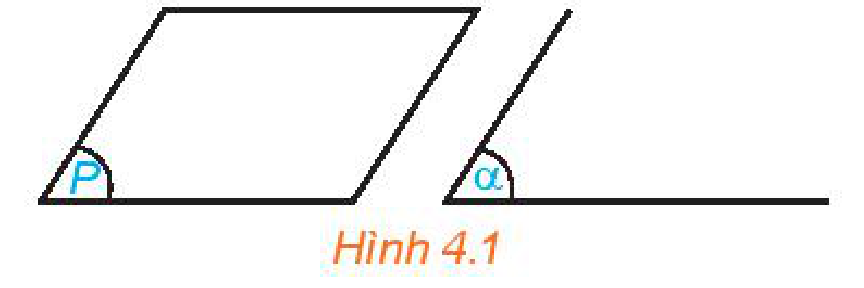
*Hình 4.1*

<!-- term: Cách biểu diễn và kí hiệu mặt phẳng -->
- Để kí hiệu mặt phẳng ta dùng chữ cái in hoa hoặc chữ cái Hy Lạp đặt trong dấu ngoặc $( \ )$. Trong Hình 4.1, ta có mặt phẳng $(P)$ và mặt phẳng $(\alpha)$.

> ❓ Hãy tìm một số hình ảnh của mặt phẳng trong thực tế.

**HĐ1:** Chấm phạt đền trên sân bóng đá cho ta hình ảnh về một điểm thuộc một mặt phẳng. Hãy tìm thêm các ví dụ khác cũng gợi cho ta hình ảnh đó.

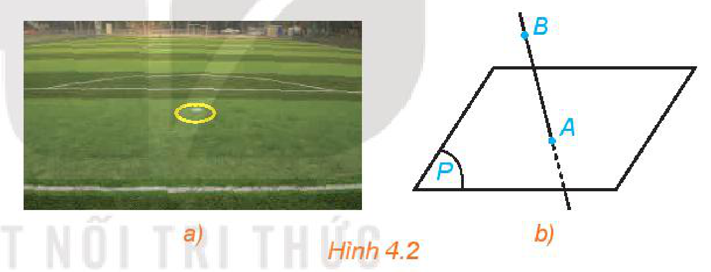
*Hình 4.2*

<!-- term: Điểm thuộc mặt phẳng -->
> - Điểm $A$ **thuộc mặt phẳng** $(P)$, kí hiệu $A \in (P)$.
> - Điểm $B$ **không thuộc mặt phẳng** $(P)$, kí hiệu $B \notin (P)$.
>
> Nếu $A \in (P)$ ta còn nói $A$ nằm trên $(P)$, hoặc $(P)$ chứa $A$, hoặc $(P)$ đi qua $A$.
<!-- ocr-ok: OCR đọc lệch kí hiệu thuộc và không thuộc -->

**Chú ý:** Để nghiên cứu hình học không gian, ta thường vẽ các hình đó lên bảng hoặc lên giấy. Hình vẽ đó được gọi là **hình biểu diễn của một hình không gian**. Hình biểu diễn của một hình không gian cần tuân thủ những quy tắc sau:

- Hình biểu diễn của đường thẳng là đường thẳng, của đoạn thẳng là đoạn thẳng.
- Hình biểu diễn của hai đường thẳng song song là hai đường thẳng song song, của hai đường thẳng cắt nhau là hai đường thẳng cắt nhau.
- Hình biểu diễn giữ nguyên quan hệ liên thuộc giữa điểm và đường thẳng.
- Dùng nét vẽ liền để biểu diễn cho đường nhìn thấy và nét đứt đoạn để biểu diễn cho đường bị che khuất.

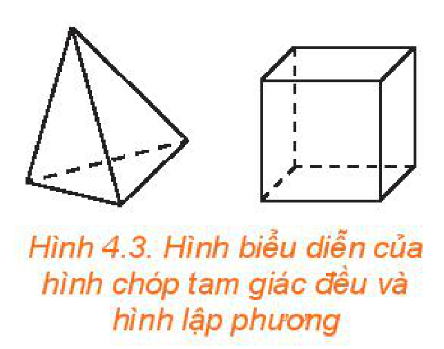
*Hình 4.3. Hình biểu diễn của hình chóp tam giác đều và hình lập phương*

Các quy tắc khác sẽ được học ở phần sau.

<!-- pdf:73 -->

## 2. CÁC TÍNH CHẤT THỪA NHẬN

**HĐ2:** Chiếc xà ngang đặt tựa lên hai điểm $A, B$ của trụ nhảy thể hiện hình ảnh của một đường thẳng đi qua hai điểm đó. Có thể tìm được một đường thẳng khác cũng đi qua hai điểm $A, B$ hay không?

> Có một và chỉ một đường thẳng đi qua hai điểm phân biệt.

> ❓ Có bao nhiêu đường thẳng đi qua hai điểm trong số ba điểm không thẳng hàng?

**HĐ3:** Trong Hình 4.4 là một khối rubik có bốn đỉnh và bốn mặt, mỗi mặt là một tam giác.

a) Đặt khối rubik sao cho ba đỉnh của mặt màu đỏ đều nằm trên mặt bàn. Khi đó, mặt màu đỏ của khối rubik có nằm trên mặt bàn hay không?

b) Có thể đặt khối rubik sao cho bốn đỉnh của nó đều nằm trên mặt bàn hay không?

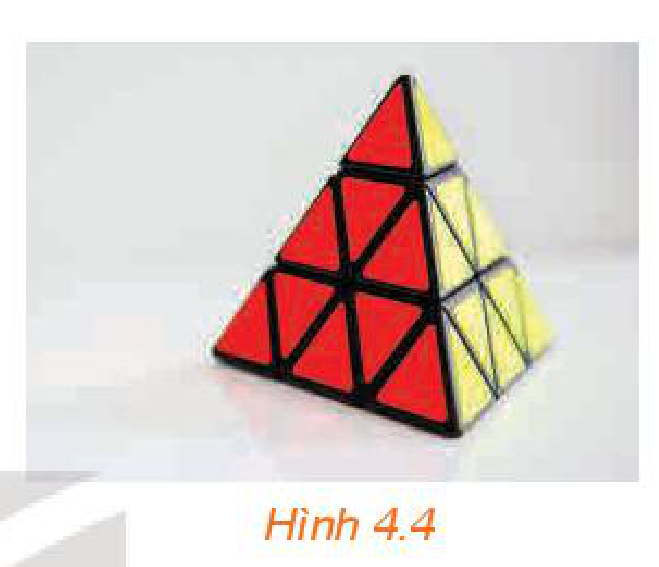
*Hình 4.4*

> Có một và chỉ một mặt phẳng đi qua ba điểm không thẳng hàng.

> Tồn tại bốn điểm không cùng thuộc một mặt phẳng.

**Nhận xét:** Một mặt phẳng hoàn toàn xác định nếu biết ba điểm không thẳng hàng thuộc mặt phẳng đó. Ta kí hiệu mặt phẳng đi qua ba điểm không thẳng hàng $A, B, C$ là $(ABC)$. Nếu có nhiều điểm cùng thuộc một mặt phẳng thì ta nói những điểm đó **đồng phẳng**. Nếu không có mặt phẳng nào chứa các điểm đó thì ta nói những điểm đó **không đồng phẳng**.

*Cửu đỉnh bằng đồng ở cố đô Huế là một di sản văn hoá có giá trị to lớn của Việt Nam.*

> ❓ Có bao nhiêu mặt phẳng đi qua ba điểm thẳng hàng?

**Ví dụ 1:** Cho bốn điểm $A, B, C, D$ không đồng phẳng (H.4.5). Có bao nhiêu mặt phẳng đi qua ba trong số bốn điểm đã cho?

**Giải:**

Có $4$ mặt phẳng đi qua ba trong số bốn điểm đã cho, đó là các mặt phẳng $(DAB), (DAC), (DBC)$ và $(ABC)$.

**Luyện tập 1:** Cho tứ giác $ABCD$. Có bao nhiêu mặt phẳng đi qua ba trong số bốn đỉnh của tứ giác đó?

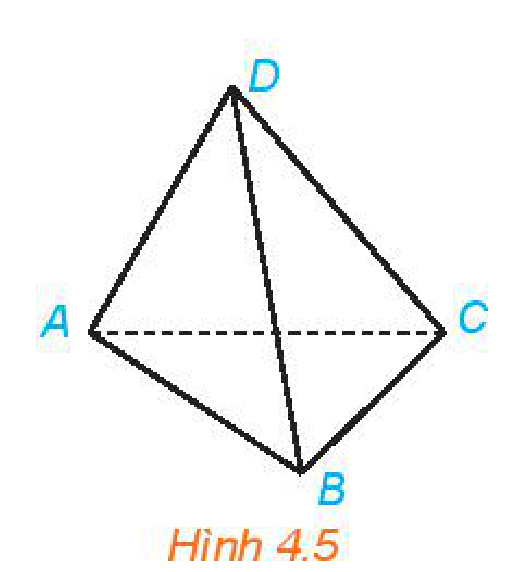
*Hình 4.5*

**Vận dụng 1:** Hãy giải thích tại sao trong thực tiễn có nhiều đồ vật được thiết kế gồm ba chân như chân đỡ máy ảnh, giá treo tranh, kiềng ba chân treo nồi,...

<!-- pdf:74 -->

**HĐ4:** Căng một sợi dây sao cho hai đầu của sợi dây nằm trên mặt bàn. Khi đó, sợi dây có nằm trên mặt bàn hay không?

> Nếu một đường thẳng có hai điểm phân biệt thuộc một mặt phẳng thì tất cả các điểm của đường thẳng đều thuộc mặt phẳng đó.

<!-- term: Đường thẳng nằm trong mặt phẳng -->
**Chú ý:** Nếu mọi điểm của đường thẳng $d$ đều thuộc mặt phẳng $(P)$ thì ta nói đường thẳng $d$ nằm trong $(P)$ hoặc $(P)$ chứa $d$. Khi đó ta kí hiệu là $d \subset (P)$ hoặc $(P) \supset d$.

**Ví dụ 2:** Cho tam giác $ABC$ và một điểm $M$ thuộc đường thẳng $BC$ (H.4.6).

a) Điểm $M$ có thuộc mặt phẳng $(ABC)$ hay không?

b) Đường thẳng $AM$ có nằm trong mặt phẳng $(ABC)$ hay không?

**Giải:**

a) Đường thẳng $BC$ có hai điểm phân biệt $B, C$ thuộc mặt phẳng $(ABC)$ nên đường thẳng $BC$ nằm trong mặt phẳng $(ABC)$. Vì $M$ thuộc đường thẳng $BC$ nên $M$ thuộc mặt phẳng $(ABC)$.

b) Đường thẳng $AM$ có hai điểm phân biệt $A, M$ thuộc mặt phẳng $(ABC)$ nên đường thẳng $AM$ nằm trong mặt phẳng $(ABC)$.

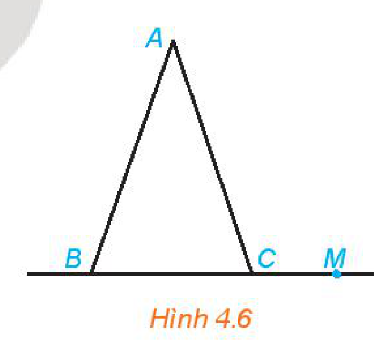
*Hình 4.6*

**Luyện tập 2:** Trong Ví dụ 2, lấy điểm $N$ thuộc đường thẳng $AB$ sao cho $N$ khác $M$. Đường thẳng $MN$ có thuộc mặt phẳng $(ABC)$ hay không?

**HĐ5:** Trong Hình 4.7, mặt nước và thành bể có giao nhau theo đường thẳng hay không?

> Nếu hai mặt phẳng phân biệt có điểm chung thì các điểm chung của hai mặt phẳng là một đường thẳng đi qua điểm chung đó.

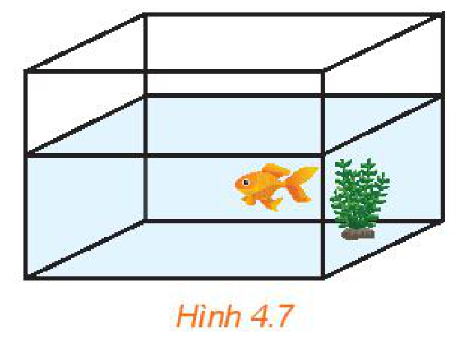
*Hình 4.7*

**Chú ý:** Đường thẳng chung $d$ (nếu có) của hai mặt phẳng phân biệt $(P)$ và $(Q)$ được gọi là **giao tuyến** của hai mặt phẳng đó và kí hiệu là $d = (P) \cap (Q)$.

<!-- pdf:75 -->

**Ví dụ 3:** Cho tam giác $ABC$ và một điểm $S$ không thuộc mặt phẳng $(ABC)$. Gọi $M, N$ lần lượt là trung điểm của các đoạn thẳng $AB, AC$ (H.4.8).

a) Chỉ ra một điểm chung của hai mặt phẳng $(SBN), (SCM)$ và khác điểm $S$.

b) Giao tuyến của hai mặt phẳng $(SBN)$ và $(SCM)$ có đi qua trọng tâm của tam giác $ABC$ hay không?

**Giải:**

a) Trong tam giác $ABC$, hai đường trung tuyến $BN$ và $CM$ cắt nhau tại trọng tâm $G$ của tam giác. Điểm $G$ thuộc $BN$ nên cũng thuộc mặt phẳng $(SBN)$. Điểm $G$ thuộc $CM$ nên cũng thuộc mặt phẳng $(SCM)$. Vậy $G$ là một điểm chung của hai mặt phẳng $(SBN)$ và $(SCM)$.

b) Vì $S, G$ là hai điểm chung của hai mặt phẳng $(SBN)$ và $(SCM)$ nên giao tuyến của hai mặt phẳng này là đường thẳng $SG$. Đường thẳng này đi qua trọng tâm $G$ của tam giác $ABC$.

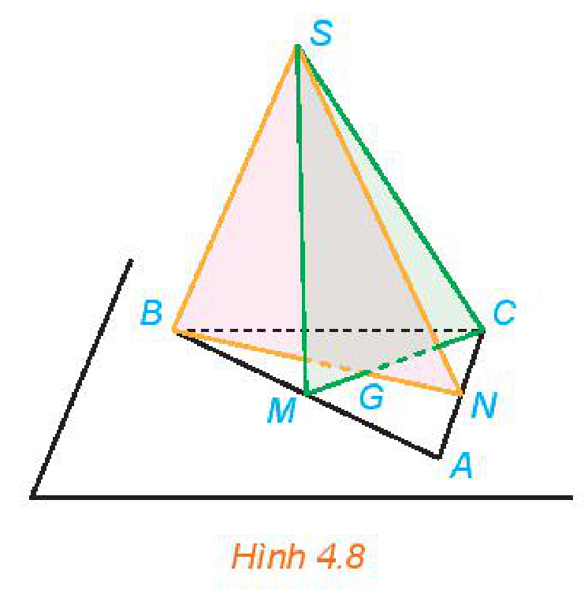
*Hình 4.8*

Để xác định giao tuyến của hai mặt phẳng, ta tìm hai điểm cùng thuộc cả hai mặt phẳng đó.

**Nhận xét:** Hai đường trung tuyến trong một tam giác cắt nhau tại trọng tâm của tam giác là một tính chất đã được học trong hình học phẳng. Trong ví dụ trên, tính chất này đã được áp dụng cho tam giác $ABC$ trong mặt phẳng $(ABC)$.

Trong trường hợp tổng quát, ta có tính chất sau:

> Trên mỗi mặt phẳng, tất cả các kết quả đã biết trong hình học phẳng đều đúng.

**Luyện tập 3:** Trong Ví dụ 3, hãy xác định giao tuyến của hai mặt phẳng $(SBM)$ và $(SCN)$.

## 3. CÁCH XÁC ĐỊNH MỘT MẶT PHẲNG

Ở mục 2, ta đã thừa nhận kết quả sau:

> Một mặt phẳng được hoàn toàn xác định khi biết nó đi qua ba điểm không thẳng hàng.

Mục này sẽ tiếp tục giới thiệu thêm hai cách xác định một mặt phẳng.

**HĐ6:** Cho đường thẳng $d$ và điểm $A$ không thuộc $d$. Trên đường thẳng $d$ lấy hai điểm phân biệt $B, C$ (H.4.9). Mặt phẳng $(ABC)$ có chứa điểm $A$ và đường thẳng $d$ hay không? Mặt phẳng $(ABC)$ có chứa hai đường thẳng $AB$ và $BC$ hay không?

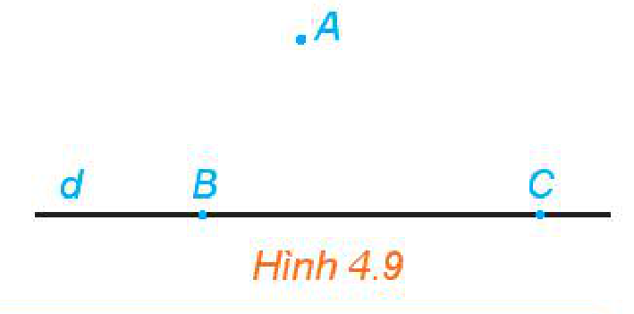
*Hình 4.9*

<!-- term: Ba cách xác định một mặt phẳng -->
> - Một mặt phẳng được hoàn toàn xác định khi biết nó đi qua một điểm và chứa một đường thẳng không đi qua điểm đó.
> - Một mặt phẳng được hoàn toàn xác định khi biết nó chứa hai đường thẳng cắt nhau.

<!-- pdf:76 -->

<!-- term: Kí hiệu mặt phẳng xác định bởi điểm và đường thẳng hoặc hai đường thẳng cắt nhau -->
**Chú ý:** Mặt phẳng được xác định bởi điểm $A$ và đường thẳng $d$ không chứa $A$ được kí hiệu là $\text{mp}(A, d)$. Mặt phẳng được xác định bởi hai đường thẳng cắt nhau $a$ và $b$ được kí hiệu là $\text{mp}(a, b)$.

**Ví dụ 4:** Cho hai đường thẳng cắt nhau $a, b$ và gọi $S$ là một điểm không thuộc $\text{mp}(a, b)$ (H.4.10). Xác định giao tuyến của $\text{mp}(S, a)$ và $\text{mp}(S, b)$.

**Giải:**

Gọi $M$ là giao điểm của $a$ và $b$. Vì $M$ thuộc $a$ nên $M$ thuộc $\text{mp}(S, a)$. Vì $M$ thuộc $b$ nên $M$ thuộc $\text{mp}(S, b)$. Hai điểm $S, M$ cùng thuộc $\text{mp}(S, a)$ và $\text{mp}(S, b)$ nên giao tuyến của hai mặt phẳng đó là đường thẳng $SM$.
<!-- ocr-ok: OCR đọc lệch kí hiệu mp(S, a) và mp(S, b) -->

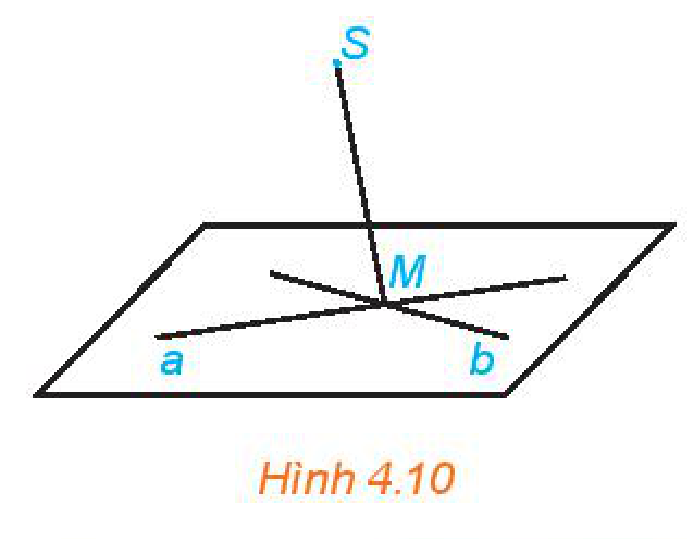
*Hình 4.10*

**Luyện tập 4:** Trong Ví dụ 4, vẽ một đường thẳng $c$ cắt cả hai đường thẳng $a$ và $b$. Xác định giao tuyến của hai mặt phẳng: $\text{mp}(S, a)$ và $\text{mp}(S, c)$; $\text{mp}(S, b)$ và $\text{mp}(S, c)$.

**Vận dụng 2:** Để tránh cho cửa ra vào không bị va đập vào các đồ dùng xung quanh (do mở cửa quá mạnh hoặc do gió to dập cửa), người ta thường sử dụng một phụ kiện là hít cửa nam châm. Hãy giải thích tại sao khi cửa được hút tới vị trí của nam châm thì cánh cửa được giữ cố định.

## 4. HÌNH CHÓP VÀ HÌNH TỨ DIỆN

**HĐ7:** Các hình ảnh dưới đây có đặc điểm chung nào với hình chóp tam giác đều mà em đã học ở lớp 8?

> - Cho đa giác lồi $A_1 A_2 \dots A_n$ và một điểm $S$ nằm ngoài mặt phẳng chứa đa giác đó. Nối $S$ với các đỉnh $A_1, A_2, \dots, A_n$ để được $n$ tam giác $SA_1 A_2, SA_2 A_3, \dots, SA_n A_1$. Hình gồm $n$ tam giác $SA_1 A_2, SA_2 A_3, \dots, SA_n A_1$ và đa giác $A_1 A_2 \dots A_n$ được gọi là **hình chóp** và kí hiệu là $S.A_1 A_2 \dots A_n$.
> - Trong hình chóp $S.A_1 A_2 \dots A_n$, điểm $S$ được gọi là **đỉnh** và đa giác $A_1 A_2 \dots A_n$ được gọi là **mặt đáy**; các tam giác $SA_1 A_2, SA_2 A_3, \dots, SA_n A_1$ được gọi là các **mặt bên**; các cạnh $SA_1, SA_2, \dots, SA_n$ được gọi là các **cạnh bên**; các cạnh $A_1 A_2, A_2 A_3, \dots, A_n A_1$ được gọi là các **cạnh đáy**.

**Chú ý:**

Tên của hình chóp được gọi dựa theo tên của đa giác đáy, ví dụ hình chóp có đáy là tứ giác được gọi là **hình chóp tứ giác**.

<!-- pdf:77 -->

**Ví dụ 5:** Cho hình chóp $S.ABCD$ (H.4.11). Hình chóp đó có bao nhiêu đỉnh, bao nhiêu cạnh?

**Giải:**

Hình chóp $S.ABCD$ có $5$ đỉnh là $S, A, B, C, D$ và có $8$ cạnh là $SA, SB, SC, SD, AB, BC, CD, DA$.
<!-- ocr-ok: OCR đọc lệch kí hiệu S.ABCD và các cạnh -->

**Luyện tập 5:** Cho hình chóp $S.ABCD$. Gọi tên các mặt bên và mặt đáy của hình chóp đó.

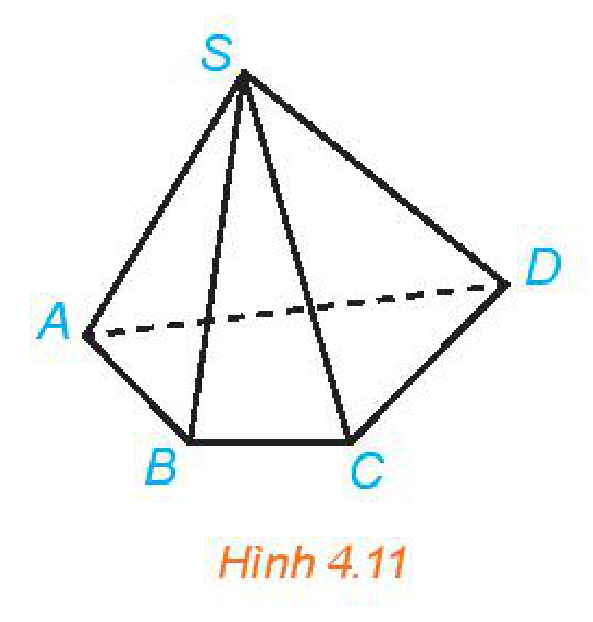
*Hình 4.11*

**HĐ8:** Trong các hình chóp ở HĐ7, hình chóp nào có ít đỉnh nhất? Xác định số đỉnh, số cạnh và số mặt của hình chóp đó.

> - Cho bốn điểm $A, B, C, D$ không đồng phẳng. Hình gồm bốn tam giác $ABC, ACD, ABD$ và $BCD$ được gọi là **hình tứ diện** và được kí hiệu là $ABCD$.
> - Trong hình tứ diện $ABCD$, các điểm $A, B, C, D$ được gọi là các **đỉnh** của tứ diện, các đoạn thẳng $AB, BC, CD, DA, AC, BD$ được gọi là các **cạnh** của tứ diện, các tam giác $ABC, ACD, ABD, BCD$ được gọi là các **mặt** của tứ diện.
> - Trong hình tứ diện, hai cạnh không có đỉnh chung được gọi là **hai cạnh đối diện**, đỉnh không nằm trên một mặt được gọi là **đỉnh đối diện** với mặt đó.

Hình tứ diện có bốn mặt là các tam giác đều gọi là **hình tứ diện đều**.
<!-- ocr-ok: OCR đọc thiếu bóng thoại hình tứ diện đều -->

**Nhận xét:** Hình tứ diện là một hình chóp tam giác mà mặt nào của hình tứ diện cũng có thể được coi là mặt đáy.

**Ví dụ 6:** Cho hình tứ diện $ABCD$ và $E$ là một điểm nằm trong tam giác $BCD$. Gọi $F$ là một điểm nằm giữa $A$ và $E$ (H.4.12). Xác định giao điểm của đường thẳng $BF$ và mặt phẳng $(ACD)$.

**Giải:**

Vì điểm $E$ nằm trong tam giác $BCD$ nên đường thẳng $BE$ cắt cạnh $CD$ tại một điểm $M$. Các điểm $A, E$ thuộc mặt phẳng $(ABM)$ nên đường thẳng $AE$ thuộc mặt phẳng $(ABM)$, do đó điểm $F$ thuộc mặt phẳng $(ABM)$. Như vậy các điểm $A, B, E, F, M$ cùng thuộc mặt phẳng $(ABM)$.

Trong tam giác $ABM$, đường thẳng $BF$ cắt $AM$ tại $N$. Vì $N$ thuộc $AM$ và $A, M$ cùng thuộc mặt phẳng $(ACD)$ nên $N$ thuộc mặt phẳng $(ACD)$. Vậy $N$ là giao điểm của đường thẳng $BF$ và mặt phẳng $(ACD)$.
<!-- ocr-ok: OCR đọc lệch kí hiệu ABM, BF, AM, N, (ACD) -->

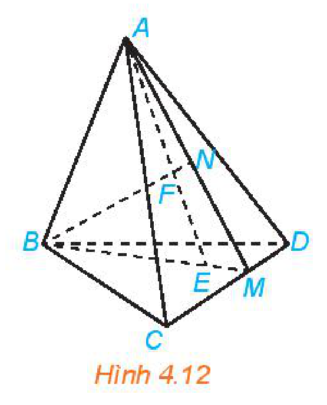
*Hình 4.12*

<!-- term: Giao điểm của đường thẳng và mặt phẳng -->
Để xác định giao điểm của một đường thẳng và một mặt phẳng, ta có thể tìm giao điểm của đường thẳng đó với một đường thẳng nằm trong mặt phẳng đã cho.

**Luyện tập 6:** Trong Ví dụ 6, xác định giao điểm của đường thẳng $DF$ và mặt phẳng $(ABC)$.

<!-- pdf:78 -->

## ✏️ BÀI TẬP

**4.1.** Trong không gian, cho hai đường thẳng $a, b$ và mặt phẳng $(P)$. Những mệnh đề nào sau đây là đúng?

a) Nếu $a$ chứa một điểm nằm trong $(P)$ thì $a$ nằm trong $(P)$.

b) Nếu $a$ chứa hai điểm phân biệt thuộc $(P)$ thì $a$ nằm trong $(P)$.

c) Nếu $a$ và $b$ cùng nằm trong $(P)$ thì giao điểm (nếu có) của $a$ và $b$ cũng nằm trong $(P)$.

d) Nếu $a$ nằm trong $(P)$ và $a$ cắt $b$ thì $b$ nằm trong $(P)$.
<!-- ocr-ok: OCR đọc lệch kí hiệu d), a, b, (P) -->

**4.2.** Cho tam giác $ABC$ và điểm $S$ không thuộc mặt phẳng $(ABC)$. Lấy $D, E$ là các điểm lần lượt thuộc các cạnh $SA, SB$ và $D, E$ khác $S$.

a) Đường thẳng $DE$ có nằm trong mặt phẳng $(SAB)$ không?

b) Giả sử $DE$ cắt $AB$ tại $F$. Chứng minh rằng $F$ là điểm chung của hai mặt phẳng $(SAB)$ và $(CDE)$.

**4.3.** Cho mặt phẳng $(P)$ và hai đường thẳng $a, b$ nằm trong $(P)$. Một đường thẳng $c$ cắt hai đường thẳng $a$ và $b$ tại hai điểm phân biệt. Chứng minh rằng đường thẳng $c$ nằm trong mặt phẳng $(P)$.

**4.4.** Cho hình chóp tứ giác $S.ABCD$ và $M$ là một điểm thuộc cạnh $SC$ ($M$ khác $S, C$). Giả sử hai đường thẳng $AB$ và $CD$ cắt nhau tại $N$. Chứng minh rằng đường thẳng $MN$ là giao tuyến của hai mặt phẳng $(ABM)$ và $(SCD)$.

**4.5.** Cho hình chóp tứ giác $S.ABCD$ và lấy một điểm $E$ thuộc cạnh $SA$ của hình chóp ($E$ khác $S, A$). Trong mặt phẳng $(ABCD)$ vẽ một đường thẳng $d$ cắt các cạnh $CB, CD$ lần lượt tại $M, N$ và cắt các tia $AB, AD$ lần lượt tại $P, Q$.

a) Xác định giao điểm của $\text{mp}(E, d)$ với các cạnh $SB, SD$ của hình chóp.

b) Xác định giao tuyến của $\text{mp}(E, d)$ với các mặt của hình chóp.

**4.6.** Cho hình tứ diện $ABCD$. Trên các cạnh $AC, BC, BD$ lần lượt lấy các điểm $M, N, P$ sao cho $AM = CM, BN = CN, BP = 2DP$.

a) Xác định giao điểm của đường thẳng $CD$ và mặt phẳng $(MNP)$.

b) Xác định giao tuyến của hai mặt phẳng $(ACD)$ và $(MNP)$.

**4.7.** Tại các nhà hàng, khách sạn, nhân viên phục vụ bàn thường xuyên phải bưng bê nhiều khay, đĩa đồ ăn khác nhau. Một trong những nguyên tắc nhân viên cần nhớ là khay phải được bưng bằng ít nhất $3$ ngón tay. Hãy giải thích tại sao.

**4.8.** Bàn cắt giấy là một dụng cụ được sử dụng thường xuyên ở các cửa hàng photo-copy. Bàn cắt giấy gồm hai phần chính: phần bàn hình chữ nhật có chia kích thước giấy và phần dao cắt có một đầu được cố định vào bàn. Hãy giải thích tại sao khi sử dụng bàn cắt giấy thì các đường cắt luôn là đường thẳng.

## 📷 Danh sách hình trong bài

| Mã hình | Trang PDF | Vị trí trong bài | Chú thích gốc |
| --- | --- | --- | --- |
| H11-toan-b10-01 | 72 | Mục 1, Chú ý | Hình 4.1 |
| H11-toan-b10-02 | 72 | Mục 1, HĐ1 | Hình 4.2 |
| H11-toan-b10-03 | 72 | Mục 1, Chú ý | Hình 4.3. Hình biểu diễn của hình chóp tam giác đều và hình lập phương |
| H11-toan-b10-04 | 73 | Mục 2, HĐ3 | Hình 4.4 |
| H11-toan-b10-05 | 73 | Mục 2, Ví dụ 1 | Hình 4.5 |
| H11-toan-b10-06 | 74 | Mục 2, Ví dụ 2 | Hình 4.6 |
| H11-toan-b10-07 | 74 | Mục 2, HĐ5 | Hình 4.7 |
| H11-toan-b10-08 | 75 | Mục 2, Ví dụ 3 | Hình 4.8 |
| H11-toan-b10-09 | 75 | Mục 3, HĐ6 | Hình 4.9 |
| H11-toan-b10-10 | 76 | Mục 3, Ví dụ 4 | Hình 4.10 |
| H11-toan-b10-11 | 77 | Mục 4, Ví dụ 5 | Hình 4.11 |
| H11-toan-b10-12 | 77 | Mục 4, Ví dụ 6 | Hình 4.12 |
