<!-- pdf:79 -->

# BÀI 11: HAI ĐƯỜNG THẲNG SONG SONG

## 🔤 Thuật ngữ

- Hai đường thẳng đồng phẳng
- Hai đường thẳng chéo nhau

## 🎯 Kiến thức, kĩ năng

- Nhận biết vị trí tương đối của hai đường thẳng trong không gian: hai đường thẳng trùng nhau, song song, cắt nhau, chéo nhau.
- Giải thích tính chất cơ bản của hai đường thẳng song song trong không gian.
- Vận dụng kiến thức về hai đường thẳng song song để mô tả một số hình ảnh trong thực tiễn.

## 🔴 Mở đầu

Để giải quyết vấn đề tắc đường ở các thành phố lớn, có rất nhiều giải pháp được đưa ra. Trong đó giải pháp xây dựng các hệ thống cầu vượt, đường hoặc đường sắt trên cao đã và đang được đưa vào thực tế ở Việt Nam. Toán học mô tả vị trí tương quan giữa các tuyến đường trên như thế nào?

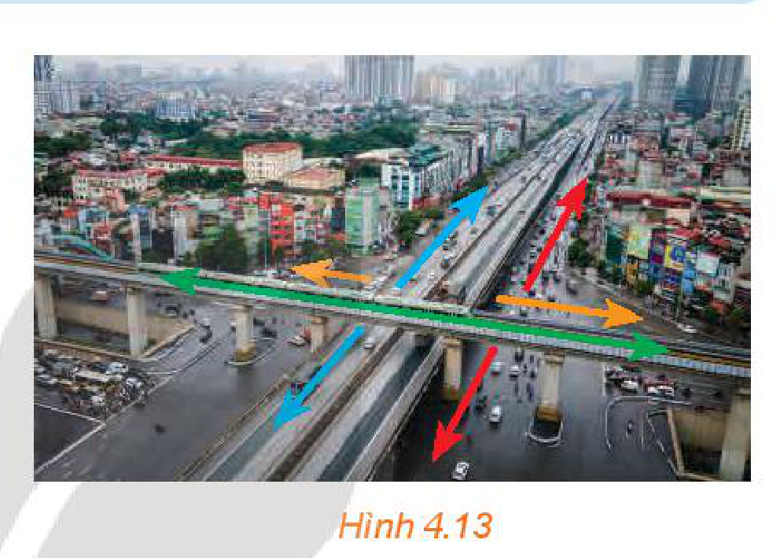
*Hình 4.13*

## 1. VỊ TRÍ TƯƠNG ĐỐI CỦA HAI ĐƯỜNG THẲNG

**HĐ1:** Quan sát bốn tuyến đường trong Hình 4.13 và trả lời các câu hỏi sau:

a) Hai tuyến đường nào giao nhau?

b) Hai tuyến đường nào không giao nhau?

c) Hai tuyến đường nào song song?

<!-- term: Hai đường thẳng đồng phẳng -->
<!-- term: Hai đường thẳng chéo nhau -->
> Cho hai đường thẳng $a$ và $b$ trong không gian.
> - Nếu $a$ và $b$ cùng nằm trong một mặt phẳng thì ta nói $a$ và $b$ **đồng phẳng**. Khi đó, $a$ và $b$ có thể cắt nhau, song song với nhau hoặc trùng nhau.
> - Nếu $a$ và $b$ không cùng nằm trong bất kì mặt phẳng nào thì ta nói $a$ và $b$ **chéo nhau**. Khi đó, ta cũng nói $a$ chéo với $b$, hoặc $b$ chéo với $a$.

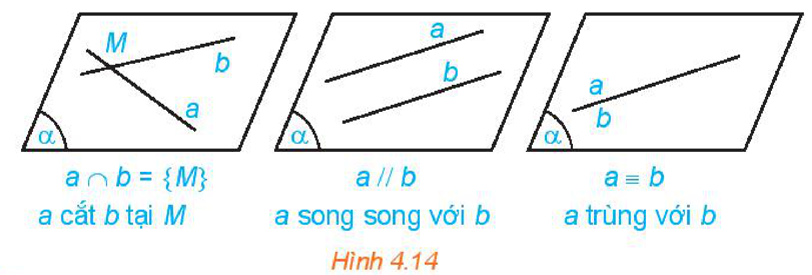
*Hình 4.14*

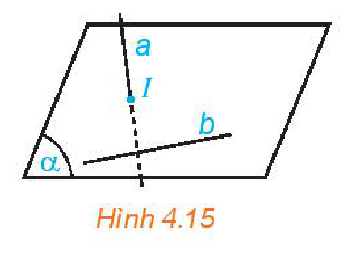
*Hình 4.15*

<!-- pdf:80 -->

> ❓ Hãy tìm một số hình ảnh về hai đường thẳng song song, hai đường thẳng chéo nhau trong thực tiễn.

*Dệt vải bằng khung cửi, một trong những nét đẹp văn hoá của một số dân tộc.*

*Hành lang với bộ cảm biến an ninh gồm các tia laze đôi một không cắt nhau.*

**Nhận xét:**

- **Hai đường thẳng song song** là hai đường thẳng đồng phẳng và không có điểm chung.
- Có đúng một mặt phẳng chứa hai đường thẳng song song.

Hai đường thẳng không có điểm chung thì có thể song song hoặc chéo nhau.

**Ví dụ 1:** Cho hai hình bình hành $ABCD$ và $ABEF$ không cùng nằm trong một mặt phẳng (H.4.16).

a) Quan sát bốn đường thẳng $AB, BC, CD, DA$. Chỉ ra các cặp đường thẳng cắt nhau, các cặp đường thẳng song song.

b) Trong ba đường thẳng $AB, AF, BE$ có hai đường thẳng nào chéo nhau hay không?

**Giải:**

a) Các cặp đường thẳng cắt nhau là $AB$ và $BC$, $AB$ và $DA$, $BC$ và $CD$, $CD$ và $DA$.
<!-- ocr-ok: OCR đọc lệch kí hiệu AB, BC, CD, DA -->

Các cặp đường thẳng song song là $AB$ và $CD$, $DA$ và $BC$.

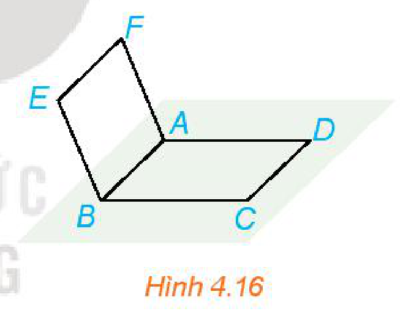
*Hình 4.16*

b) Các đường thẳng $AB, AF, BE$ cùng nằm trong mặt phẳng $(ABEF)$ nên trong ba đường thẳng đó không có hai đường thẳng nào chéo nhau.

**Luyện tập 1:** Cho hình chóp $S.ABCD$ có đáy $ABCD$ là hình bình hành (H.4.17).

a) Trong các đường thẳng $AB, AC, CD$, hai đường thẳng nào song song, hai đường thẳng nào cắt nhau?

b) Gọi $M, N$ lần lượt là hai điểm thuộc hai cạnh $SA, SB$. Trong các đường thẳng $SA, MN, AB$ có hai đường thẳng nào chéo nhau hay không?

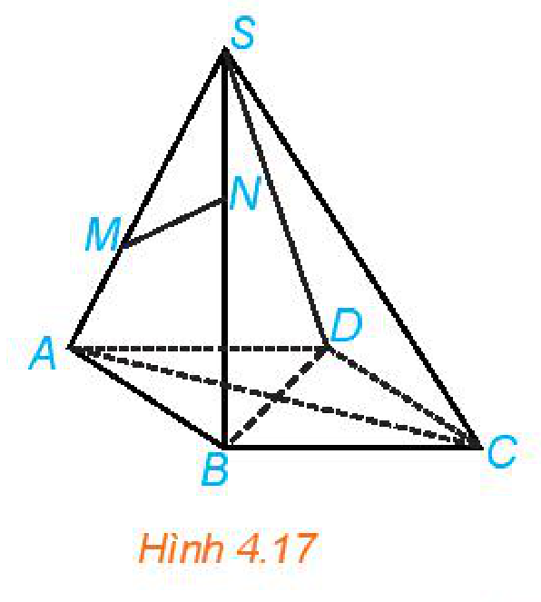
*Hình 4.17*

<!-- pdf:81 -->

**Ví dụ 2:** Cho hình tứ diện $ABCD$ (H.4.18). Hai đường thẳng $AB$ và $CD$ có chéo nhau hay không? Chỉ ra các cặp đường thẳng chéo nhau có trong hình tứ diện đó.

**Giải:**

Nếu hai đường thẳng $AB$ và $CD$ không chéo nhau thì chúng cùng thuộc một mặt phẳng. Khi đó bốn điểm $A, B, C, D$ đồng phẳng, trái với giả thiết $ABCD$ là hình tứ diện. Do đó, hai đường thẳng $AB$ và $CD$ chéo nhau.
<!-- ocr-ok: OCR đọc lệch kí hiệu AB, CD, A, B, C, D -->

Lập luận tương tự, ta thấy trong tứ diện $ABCD$ còn có các cặp đường thẳng chéo nhau là $AC$ và $BD$, $AD$ và $BC$.

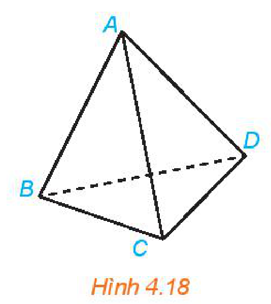
*Hình 4.18*

**Luyện tập 2:** Trong hình chóp tứ giác $S.ABCD$ (H.4.19), chỉ ra những đường thẳng:

a) Chéo với đường thẳng $SA$;

b) Chéo với đường thẳng $BC$.

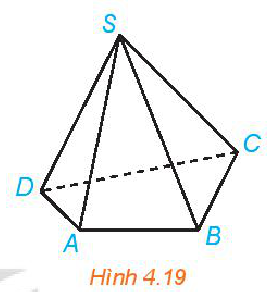
*Hình 4.19*

**Vận dụng 1:** Một chiếc gậy được đặt một đầu dựa vào tường và đầu kia trên mặt sàn (H.4.20). Hỏi có thể đặt chiếc gậy đó song song với một trong các mép tường hay không?

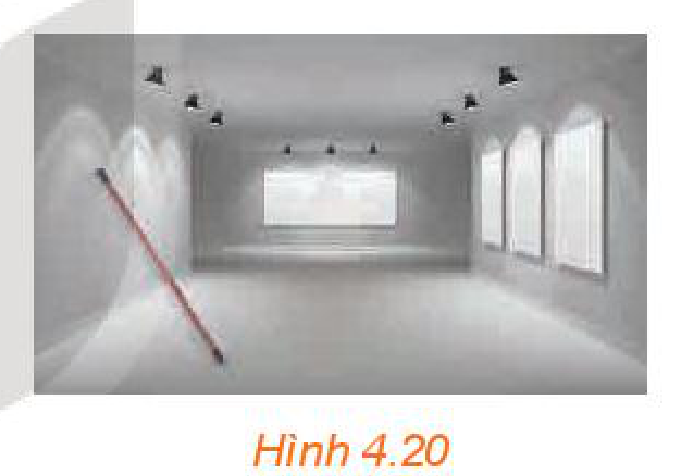
*Hình 4.20*

## 2. TÍNH CHẤT CỦA HAI ĐƯỜNG THẲNG SONG SONG
<!-- ocr-ok: OCR đọc thiếu chữ trong tiêu đề mục 2 -->

**HĐ2:** Trong không gian, cho một đường thẳng $d$ và một điểm $M$ không nằm trên $d$ (H.4.21). Gọi $(P)$ là mặt phẳng chứa $M$ và $d$.

a) Trên mặt phẳng $(P)$ có bao nhiêu đường thẳng đi qua $M$ và song song với $d$?

b) Nếu một đường thẳng đi qua $M$ và song song với $d$ thì đường thẳng đó có thuộc mặt phẳng $(P)$ hay không?

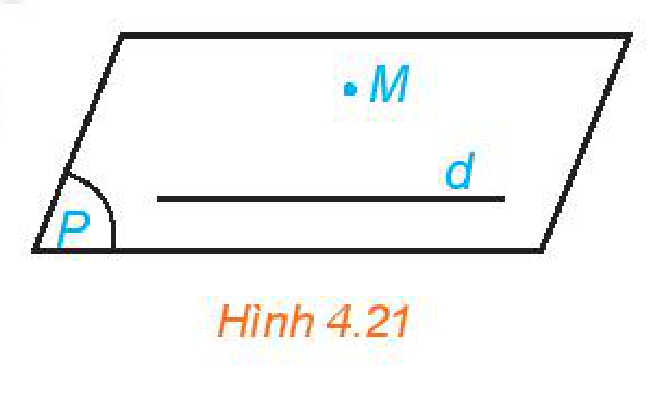
*Hình 4.21*

> Trong không gian, qua một điểm không nằm trên đường thẳng cho trước, có đúng một đường thẳng song song với đường thẳng đã cho.

**HĐ3:** Quan sát lớp học và tìm hai đường thẳng song song với mép trên của bảng. Hai đường thẳng đó có song song với nhau hay không?

<!-- term: Tính chất bắc cầu của hai đường thẳng song song -->
> Trong không gian, hai đường thẳng phân biệt cùng song song với đường thẳng thứ ba thì song song với nhau.

Các tia sáng Mặt Trời ở gần Trái Đất được coi như các đường thẳng đôi một song song với nhau.
<!-- ocr-ok: OCR đọc thiếu bóng thoại tia sáng Mặt Trời -->

<!-- pdf:82 -->

**Ví dụ 3:** Cho tứ diện $ABCD$. Gọi $M, N, P, Q, R, S$ lần lượt là trung điểm của các đoạn thẳng $AB, CD, AD, BC, AC, BD$ (H.4.22).

a) Chứng minh rằng tứ giác $MPNQ$ là hình bình hành.

b) Chứng minh rằng các đoạn thẳng $MN, PQ, RS$ cùng đi qua trung điểm của mỗi đoạn.

**Giải:**

a) Trong tam giác $ABC$, ta có $MQ$ là đường trung bình nên $MQ \parallel AC$ và $MQ = \frac{1}{2} AC$. Tương tự với tam giác $ACD$, ta có $PN \parallel AC$ và $PN = \frac{1}{2} AC$. Do đó $MQ \parallel PN$ và $MQ = PN$, suy ra tứ giác $MPNQ$ là hình bình hành.

b) Từ câu a suy ra hai đoạn thẳng $MN$ và $PQ$ cắt nhau tại trung điểm của mỗi đoạn. Tương tự, hai đoạn thẳng $MN$ và $RS$ cắt nhau tại trung điểm của mỗi đoạn. Do đó, các đoạn thẳng $MN, PQ, RS$ cùng đi qua trung điểm của mỗi đoạn.

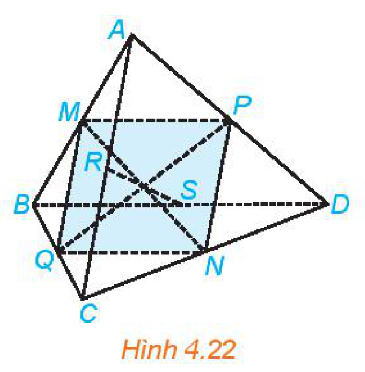
*Hình 4.22*

Nêu các dấu hiệu nhận biết tứ giác là hình bình hành.
<!-- ocr-ok: OCR đọc thiếu bóng thoại dấu hiệu hình bình hành -->

**Luyện tập 3:** Trong Ví dụ 1, chứng minh rằng bốn điểm $C, D, E, F$ đồng phẳng và tứ giác $CDFE$ là hình bình hành.

**HĐ4:** Cho hai mặt phẳng $(P)$ và $(Q)$ cắt nhau theo giao tuyến $c$. Một mặt phẳng $(R)$ cắt $(P)$ và $(Q)$ lần lượt theo các giao tuyến $a$ và $b$ khác $c$.
<!-- ocr-ok: OCR đọc lệch kí hiệu (P), (Q), (R), a, b, c -->

a) Nếu hai đường thẳng $a$ và $c$ cắt nhau tại $M$ thì đường thẳng $b$ có đi qua $M$ hay không (H.4.23)? Giải thích vì sao.

b) Nếu hai đường thẳng $a$ và $c$ song song với nhau thì hai đường thẳng $b$ và $c$ có song song với nhau hay không (H.4.24)? Giải thích vì sao.

Nếu hai đường thẳng $b$ và $c$ cắt nhau tại $N$ thì ta có thể sử dụng lại kết quả ở câu a.

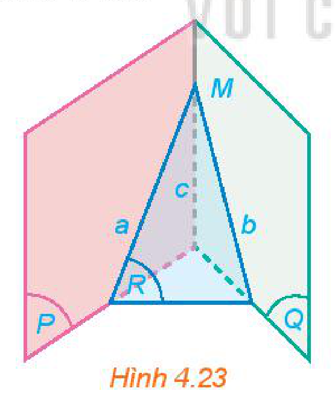
*Hình 4.23*

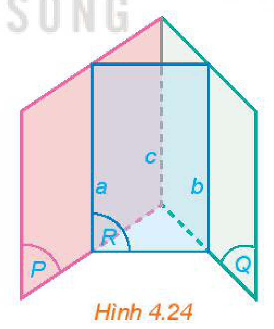
*Hình 4.24*

Kết quả sau đây còn được biết đến với tên gọi "Định lí về ba đường giao tuyến".

<!-- term: Định lí về ba đường giao tuyến -->
> Nếu ba mặt phẳng đôi một cắt nhau theo ba giao tuyến phân biệt thì ba giao tuyến đó đồng quy hoặc đôi một song song với nhau.

<!-- term: Giao tuyến của hai mặt phẳng chứa hai đường thẳng song song -->
**Chú ý:** Từ kết quả trên có thể suy ra rằng: Nếu hai mặt phẳng chứa hai đường thẳng song song với nhau thì giao tuyến của chúng (nếu có) song song với hai đường thẳng đó hoặc trùng với một trong hai đường thẳng đó.

<!-- pdf:83 -->

**Ví dụ 4:** Cho hình chóp $S.ABCD$ có đáy $ABCD$ là hình bình hành (H.4.25). Xác định giao tuyến của hai mặt phẳng $(SAB)$ và $(SCD)$.

**Giải:**

Hai mặt phẳng $(SAB)$ và $(SCD)$ có điểm chung $S$ và chứa hai đường thẳng song song là $AB$ và $CD$. Do đó, giao tuyến của hai mặt phẳng $(SAB)$ và $(SCD)$ là đường thẳng $m$ đi qua $S$ và song song với $AB, CD$.

**Luyện tập 4:** Trong Ví dụ 4, hãy xác định giao tuyến của hai mặt phẳng $(SAD)$ và $(SBC)$.

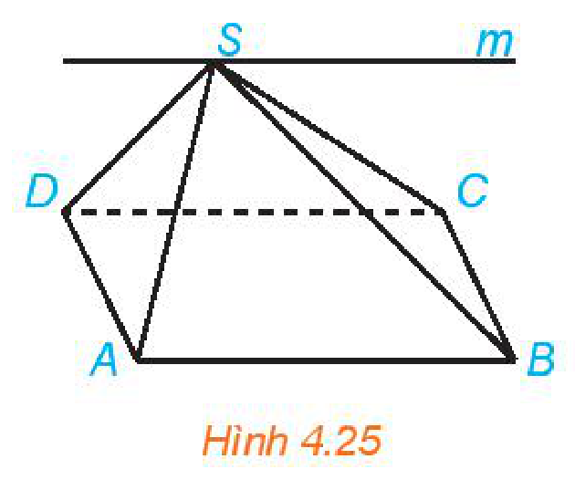
*Hình 4.25*

**Vận dụng 2:** Một bể kính chứa nước có đáy là hình chữ nhật được đặt nghiêng như Hình 4.26. Giải thích tại sao đường mép nước $AB$ song song với cạnh $CD$ của bể nước.

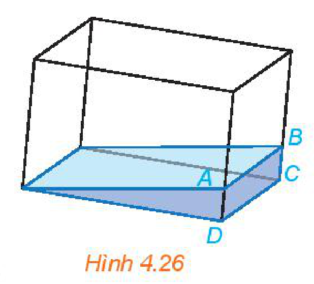
*Hình 4.26*

## ✏️ BÀI TẬP

**4.9.** Trong không gian, cho ba đường thẳng $a, b, c$. Những mệnh đề nào sau đây là đúng?

a) Nếu $a$ và $b$ không cắt nhau thì $a$ và $b$ song song.

b) Nếu $b$ và $c$ chéo nhau thì $b$ và $c$ không cùng thuộc một mặt phẳng.

c) Nếu $a$ và $b$ cùng song song với $c$ thì $a$ song song với $b$.
<!-- ocr-ok: OCR đọc lệch kí hiệu a, b, c -->

d) Nếu $a$ và $b$ cắt nhau, $b$ và $c$ cắt nhau thì $a$ và $c$ cắt nhau.
<!-- ocr-ok: OCR đọc lệch kí hiệu a, b, c -->

**4.10.** Cho hình chóp $S.ABCD$ có đáy là hình bình hành. Trong các cặp đường thẳng sau, cặp đường thẳng nào cắt nhau, cặp đường thẳng nào song song, cặp đường thẳng nào chéo nhau?

a) $AB$ và $CD$;

b) $AC$ và $BD$;

c) $SB$ và $CD$.

**4.11.** Cho hình chóp $S.ABCD$ có đáy $ABCD$ là hình bình hành. Gọi $M, N, P, Q$ lần lượt là trung điểm của các cạnh bên $SA, SB, SC, SD$ (H.4.27). Chứng minh rằng tứ giác $MNPQ$ là hình bình hành.

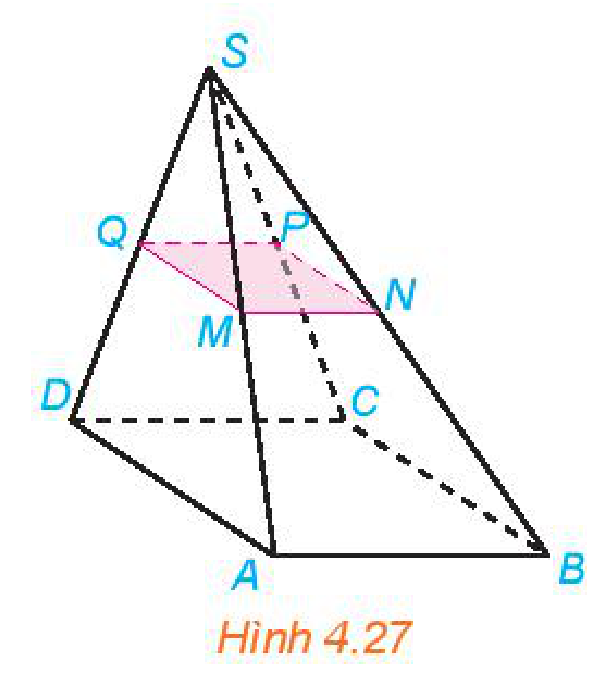
*Hình 4.27*

**4.12.** Cho hình chóp $S.ABCD$ có đáy $ABCD$ là hình thang ($AB \parallel CD$). Gọi $M, N$ lần lượt là trung điểm của các cạnh $SA, SB$. Chứng minh rằng tứ giác $MNCD$ là hình thang.

**4.13.** Cho hình chóp $S.ABCD$ có đáy $ABCD$ là hình thang ($AB \parallel CD$). Gọi $M$ là trung điểm của đoạn thẳng $SD$ (H.4.28).

a) Xác định giao tuyến của mặt phẳng $(MAB)$ và $(SCD)$.

b) Gọi $N$ là giao điểm của đường thẳng $SC$ và mặt phẳng $(MAB)$. Chứng minh rằng $MN$ là đường trung bình của tam giác $SCD$.

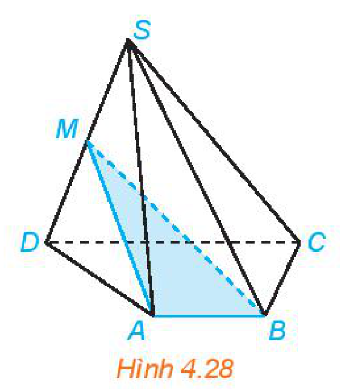
*Hình 4.28*

<!-- pdf:84 -->

**4.14.** Cho tứ diện $ABCD$. Gọi $M, N$ lần lượt là trung điểm của các cạnh $BC, CD$ và $P$ là một điểm thuộc cạnh $AC$. Xác định giao tuyến của hai mặt phẳng $(AMN)$ và $(BPD)$ và chứng minh giao tuyến đó song song với $BD$.

**4.15.** (Đố vui) Khi hai cánh cửa sổ hình chữ nhật được mở, dù ở vị trí nào, thì hai mép ngoài của chúng luôn song song với nhau (H.4.29). Hãy giải thích tại sao.

Nếu hai cánh cửa sổ có dạng hình thang như Hình 4.30 thì có vị trí nào của hai cánh cửa để hai mép ngoài của chúng song song với nhau hay không?

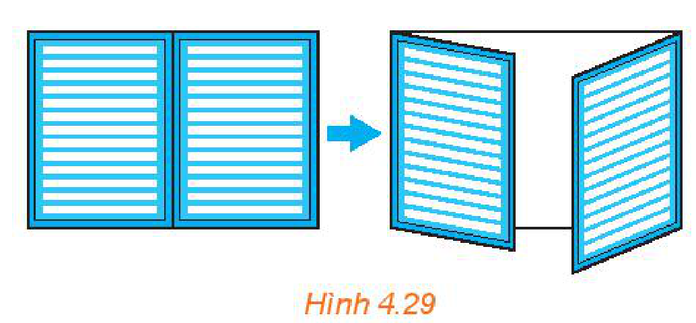
*Hình 4.29*

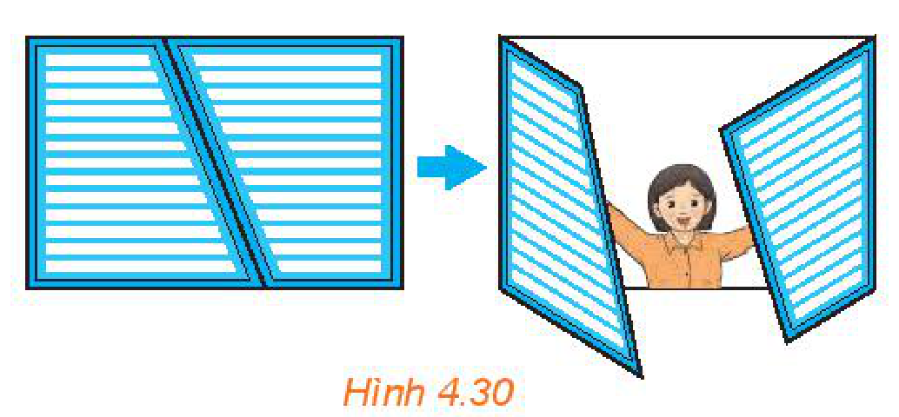
*Hình 4.30*

## 💡 Em có biết?

Trong không gian, cố định một đường thẳng $\Delta$ thẳng đứng và gọi $d$ là một đường thẳng tuỳ ý. Ta hãy cùng tìm hiểu hình được tạo bởi đường thẳng $d$ khi quay đường thẳng này quanh đường thẳng $\Delta$ trong không gian. Nếu $d$ song song với $\Delta$ hoặc $d$ cắt $\Delta$ thì có thể dễ dàng hình dung được hình tạo ra là mặt trụ hoặc mặt nón (H.4.31).

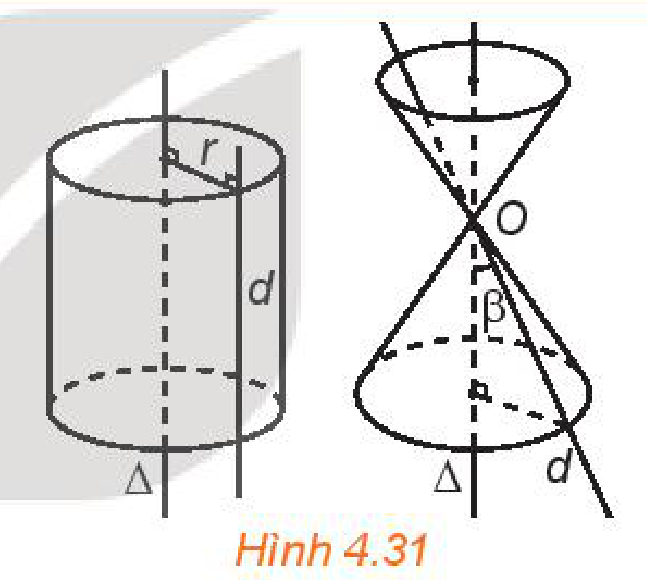
*Hình 4.31*

Còn nếu $d$ và $\Delta$ chéo nhau thì sao? Trong hầu hết các trường hợp, hình tạo ra được gọi là **mặt hypebol** (hyperboloid) như trong Hình 4.32. Mặt hypebol có thể được coi như một “dạng 3D” của đường hypebol đã được dạy ở lớp 10. Một điều thú vị là nếu mặt hypebol được cắt bởi một mặt phẳng đi qua đường thẳng $\Delta$ (**trục hypebol**) thì vết cắt nhận được chính là một đường hypebol (H.4.33).

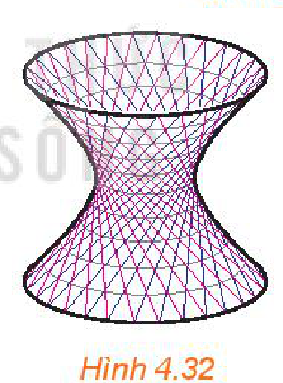
*Hình 4.32*

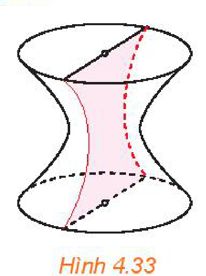
*Hình 4.33*

Hình ảnh của mặt hypebol xuất hiện rất nhiều trong xây dựng, kiến trúc, nghệ thuật,... và trong thực tiễn, chúng ta hoàn toàn có thể “dựng được” mặt hypebol bằng cách sử dụng các vật dụng đơn giản như nan tre thẳng, que tính hay những chiếc đũa... Em có thể tìm thấy một cách dựng như vậy trên các trang web tìm kiếm với từ khoá “hyperboloid”.

## 📷 Danh sách hình trong bài

| Mã hình | Trang PDF | Vị trí trong bài | Chú thích gốc |
| --- | --- | --- | --- |
| H11-toan-b11-01 | 79 | Mở đầu | Hình 4.13 |
| H11-toan-b11-02 | 79 | Mục 1 | Hình 4.14 |
| H11-toan-b11-03 | 79 | Mục 1 | Hình 4.15 |
| H11-toan-b11-04 | 80 | Mục 1, Ví dụ 1 | Hình 4.16 |
| H11-toan-b11-05 | 80 | Mục 1, Luyện tập 1 | Hình 4.17 |
| H11-toan-b11-06 | 81 | Mục 1, Ví dụ 2 | Hình 4.18 |
| H11-toan-b11-07 | 81 | Mục 1, Luyện tập 2 | Hình 4.19 |
| H11-toan-b11-08 | 81 | Mục 1, Vận dụng 1 | Hình 4.20 |
| H11-toan-b11-09 | 81 | Mục 2, HĐ2 | Hình 4.21 |
| H11-toan-b11-10 | 82 | Mục 2, Ví dụ 3 | Hình 4.22 |
| H11-toan-b11-11 | 82 | Mục 2, HĐ4 | Hình 4.23 |
| H11-toan-b11-12 | 82 | Mục 2, HĐ4 | Hình 4.24 |
| H11-toan-b11-13 | 83 | Mục 2, Ví dụ 4 | Hình 4.25 |
| H11-toan-b11-14 | 83 | Mục 2, Vận dụng 2 | Hình 4.26 |
| H11-toan-b11-15 | 83 | Bài tập 4.11 | Hình 4.27 |
| H11-toan-b11-16 | 83 | Bài tập 4.13 | Hình 4.28 |
| H11-toan-b11-17 | 84 | Bài tập 4.15 | Hình 4.29 |
| H11-toan-b11-18 | 84 | Bài tập 4.15 | Hình 4.30 |
| H11-toan-b11-19 | 84 | Em có biết? | Hình 4.31 |
| H11-toan-b11-20 | 84 | Em có biết? | Hình 4.32 |
| H11-toan-b11-21 | 84 | Em có biết? | Hình 4.33 |
