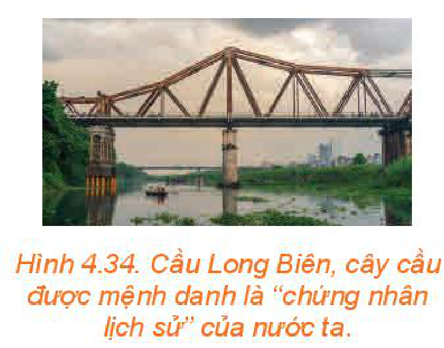
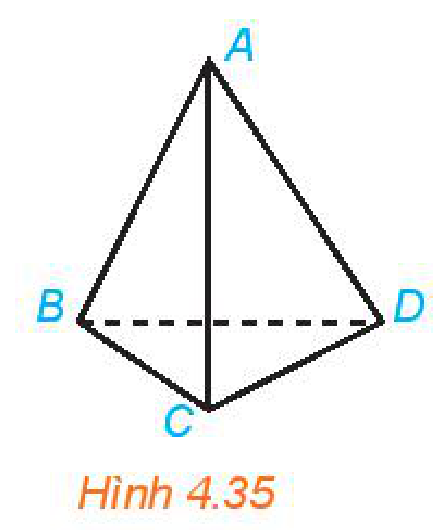
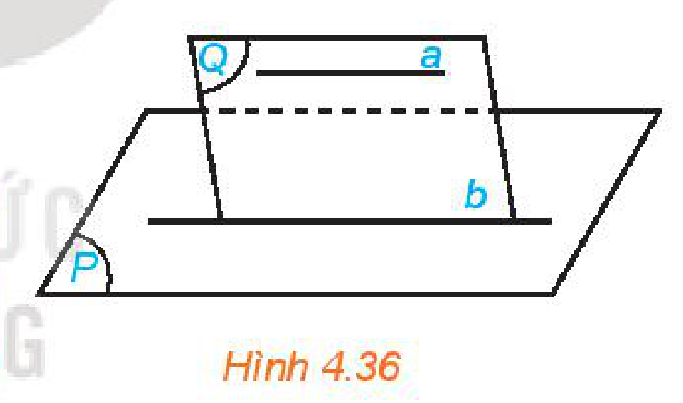
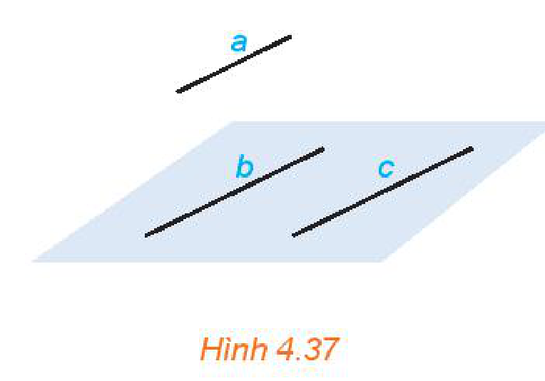
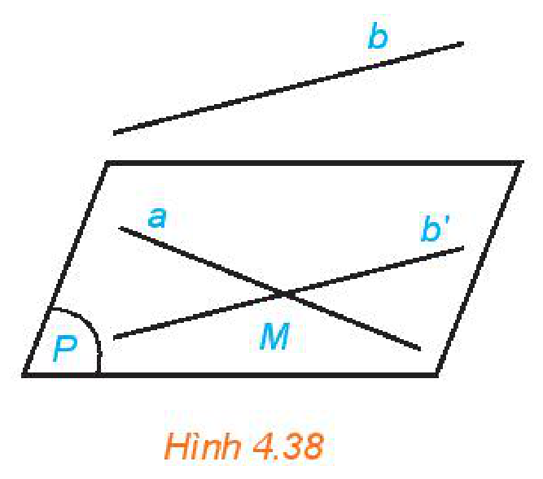
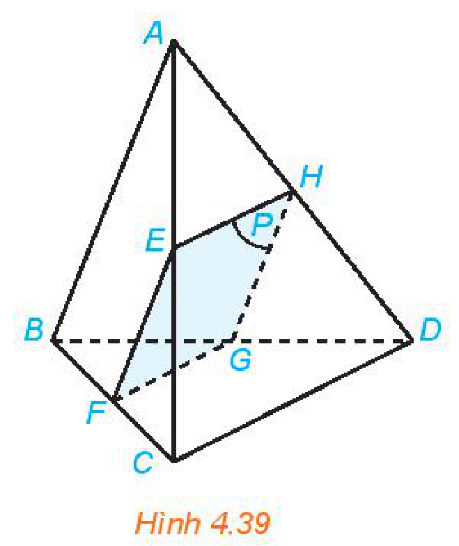

<!-- pdf:85 -->

# BÀI 12: ĐƯỜNG THẲNG VÀ MẶT PHẲNG SONG SONG

## 🔤 Thuật ngữ

- Đường thẳng song song với mặt phẳng
- Đường thẳng cắt mặt phẳng

## 🎯 Kiến thức, kĩ năng

- Nhận biết đường thẳng song song với mặt phẳng.
- Giải thích điều kiện để đường thẳng song song với mặt phẳng.
- Giải thích tính chất cơ bản về đường thẳng song song với mặt phẳng.
- Mô tả một số hình ảnh trong thực tiễn có liên quan đến đường thẳng song song với mặt phẳng.

## 🔴 Mở đầu

Khi xây tường gạch, người thợ thường bắt đầu với việc xây các viên gạch dẫn, sau đó căng dây nhợ dọc theo cạnh của các viên gạch dẫn đó để làm chuẩn rồi mới xây các viên gạch tiếp theo. Việc sử dụng dây căng như vậy có tác dụng gì? Toán học mô tả vị trí giữa dây căng, các mép gạch với mặt đất như thế nào?

## 1. ĐƯỜNG THẲNG SONG SONG VỚI MẶT PHẲNG

**HĐ1:** Quan sát hình ảnh khung thành bóng đá và nhận xét vị trí của xà ngang, cột dọc, thanh chống và thanh bên của khung thành với mặt đất.

Kích thước của khung thành được quy định khác nhau tuỳ theo sân bóng. Trong sân bóng đá mini $5$ người, xà ngang của khung thành dài $3$ mét, cột dọc dài $2$ mét.

<!-- term: Đường thẳng song song với mặt phẳng -->
> Cho đường thẳng $d$ và mặt phẳng $(\alpha)$. Nếu $d$ và $(\alpha)$ không có điểm chung thì ta nói $d$ **song song** với $(\alpha)$ hay $(\alpha)$ song song với $d$ và kí hiệu là $d \parallel (\alpha)$ hay $(\alpha) \parallel d$.

Ngoài ra:

<!-- term: Đường thẳng cắt mặt phẳng -->
- Nếu $d$ và $(\alpha)$ có một điểm chung duy nhất $M$ thì ta nói $d$ và $(\alpha)$ **cắt nhau** tại điểm $M$ và kí hiệu $d \cap (\alpha) = \{M\}$ hay $d \cap (\alpha) = M$.
- Nếu $d$ và $(\alpha)$ có nhiều hơn một điểm chung thì ta nói $d$ **nằm trong** $(\alpha)$ hay $(\alpha)$ chứa $d$ và kí hiệu $d \subset (\alpha)$ hay $(\alpha) \supset d$.
<!-- ocr-ok: OCR đọc lệch kí hiệu giao của đường thẳng và mặt phẳng -->

<!-- pdf:86 -->

> ❓ Hãy chỉ ra một hình ảnh đường thẳng song song với mặt phẳng trong bức ảnh bên (H.4.34).

*Hình 4.34. Cầu Long Biên, cây cầu được mệnh danh là “chứng nhân lịch sử” của nước ta.*
<!-- ocr-ok: OCR đọc thiếu chữ trong chú thích Hình 4.34 -->

**Ví dụ 1:** Cho hình tứ diện $ABCD$ (H.4.35). Trong các mặt phẳng chứa các mặt của hình tứ diện, hãy cho biết:

a) Đường thẳng $AB$ cắt các mặt phẳng nào;

b) Đường thẳng $AB$ nằm trong các mặt phẳng nào.

**Giải:**

a) Đường thẳng $AB$ cắt các mặt phẳng $(ACD)$ và $(BCD)$.

b) Đường thẳng $AB$ nằm trong các mặt phẳng $(ABC)$ và $(ABD)$.

**Luyện tập 1:** Trong Ví dụ 1, đường thẳng $AC$ cắt các mặt phẳng nào, nằm trong các mặt phẳng nào?

*Hình 4.35*

## 2. ĐIỀU KIỆN VÀ TÍNH CHẤT CỦA ĐƯỜNG THẲNG SONG SONG VỚI MẶT PHẲNG
<!-- ocr-ok: OCR đọc thiếu chữ trong tiêu đề mục 2 -->

**HĐ2:** Cho đường thẳng $a$ không nằm trong mặt phẳng $(P)$ và $a$ song song với đường thẳng $b$ nằm trong $(P)$. Gọi $(Q)$ là mặt phẳng chứa $a$ và $b$ (H.4.36).

Nếu $a$ và $(P)$ cắt nhau tại điểm $M$ thì $M$ có thuộc $(Q)$ và $M$ có thuộc $b$ hay không? Hãy rút ra kết luận sau khi trả lời các câu hỏi trên.

Ở Bài 11, ta đã biết có đúng một mặt phẳng chứa hai đường thẳng song song.

<!-- term: Điều kiện để đường thẳng song song với mặt phẳng -->
> Nếu đường thẳng $a$ không nằm trong mặt phẳng $(P)$ và song song với một đường thẳng nằm trong $(P)$ thì $a$ song song với $(P)$.

*Hình 4.36*

> ❓ Phát biểu trên còn đúng không nếu bỏ điều kiện “$a$ không nằm trong mặt phẳng $(P)$”?

**Ví dụ 2:** Cho ba đường thẳng $a, b, c$ đôi một song song với nhau và không cùng nằm trong một mặt phẳng (H.4.37). Chứng minh rằng đường thẳng $a$ song song với $\text{mp}(b, c)$.

**Giải:**

Ba đường thẳng $a, b, c$ không cùng nằm trong một mặt phẳng nên đường thẳng $a$ không nằm trong $\text{mp}(b, c)$. Vì đường thẳng $a$ song song với đường thẳng $b$ và đường thẳng $b$ nằm trong $\text{mp}(b, c)$ nên đường thẳng $a$ song song với mặt phẳng $\text{mp}(b, c)$.

*Hình 4.37*

**Luyện tập 2:** Trong Ví dụ 2, chứng minh rằng đường thẳng $c$ song song với $\text{mp}(a, b)$, đường thẳng $b$ song song với $\text{mp}(a, c)$.

<!-- pdf:87 -->

**Ví dụ 3:** Trong không gian cho hai đường thẳng chéo nhau $a$ và $b$. Chứng minh rằng có một mặt phẳng chứa $a$ và song song với $b$.

**Giải:** (H.4.38)

Lấy điểm $M$ bất kì thuộc $a$. Qua $M$ kẻ đường thẳng $b'$ song song với $b$ và đặt $(P) = \text{mp}(a, b')$.

Vì $a$ và $b$ chéo nhau nên đường thẳng $b$ không nằm trong mặt phẳng $(P)$. Vì $b$ song song với $b'$ nằm trong mặt phẳng $(P)$ nên $b$ song song với $(P)$. Vậy $(P)$ là mặt phẳng chứa $a$ và song song với $b$.

*Hình 4.38*

**Chú ý:** Ta có thể chứng minh rằng mặt phẳng $(P)$ trong Ví dụ 3 là mặt phẳng duy nhất chứa đường thẳng $a$ và song song với đường thẳng $b$. Như vậy, cho trước hai đường thẳng chéo nhau, có duy nhất một mặt phẳng chứa đường thẳng này và song song với đường thẳng kia.

**Luyện tập 3:** Cho hình chóp $S.ABCD$ có đáy là hình thang ($AB \parallel CD$). Hai đường thẳng $SD$ và $AB$ có chéo nhau hay không? Chỉ ra mặt phẳng chứa đường thẳng $SD$ và song song với $AB$.

**Vận dụng:** Trong *tình huống mở đầu*, hãy giải thích tại sao dây nhợ khi căng thì song song với mặt đất. Tác dụng của việc đó là gì?

**HĐ3:** Cho đường thẳng $a$ song song với mặt phẳng $(P)$ và $(Q)$ là một mặt phẳng chứa $a$. Giả sử $(Q)$ cắt $(P)$ theo giao tuyến $b$ (H.4.36).

a) Hai đường thẳng $a$ và $b$ có thể chéo nhau không?

b) Hai đường thẳng $a$ và $b$ có thể cắt nhau không?

Nhắc lại các vị trí tương đối của hai đường thẳng trong không gian.

<!-- term: Tính chất của đường thẳng song song với mặt phẳng -->
> Cho đường thẳng $a$ song song với mặt phẳng $(P)$. Nếu mặt phẳng $(Q)$ chứa $a$ và cắt $(P)$ theo giao tuyến $b$ thì $b$ song song với $a$.

**Ví dụ 4:** Cho tứ diện $ABCD$, điểm $E$ nằm giữa hai điểm $A$ và $C$. Gọi $(P)$ là mặt phẳng qua $E$ và song song với hai đường thẳng $AB, CD$ (H.4.39). Xác định các giao tuyến của $(P)$ và các mặt của tứ diện. Hình tạo bởi các giao tuyến là hình gì?

**Giải:**

Mặt phẳng $(ABC)$ chứa đường thẳng $AB$ song song với mặt phẳng $(P)$ nên mặt phẳng $(ABC)$ cắt mặt phẳng $(P)$ theo giao tuyến song song với $AB$. Vẽ $EF \parallel AB$ ($F$ thuộc $BC$) thì $EF$ là giao tuyến của $(P)$ và $(ABC)$.

Hai mặt phẳng $(ACD)$ và $(BCD)$ cùng chứa đường thẳng $CD$ song song với mặt phẳng $(P)$ nên chúng cắt mặt phẳng $(P)$ theo giao tuyến song song với $CD$. Vẽ $EH, FG$ song song với $CD$ ($H$ thuộc $AD$, $G$ thuộc $BD$) thì $EH, FG$ lần lượt là giao tuyến của mặt phẳng $(P)$ với hai mặt phẳng $(ACD), (BCD)$. Khi đó $GH$ là giao tuyến của $(P)$ và $(ABD)$.

*Hình 4.39*

<!-- pdf:88 -->

Mặt phẳng $(ABD)$ chứa đường thẳng $AB$ song song với mặt phẳng $(P)$ nên giao tuyến $GH$ của $(ABD)$ và $(P)$ song song với $AB$. Tứ giác $EFGH$ có $EF \parallel GH$ (vì cùng song song với $AB$) và $EH \parallel FG$ (vì cùng song song với $CD$) nên nó là hình bình hành.

**Luyện tập 4:** Trong Ví dụ 4, gọi $(Q)$ là mặt phẳng qua $E$ và song song với hai đường thẳng $AB, AD$. Xác định giao tuyến của $(Q)$ với các mặt của tứ diện.

## ✏️ BÀI TẬP

**4.16.** Trong không gian, cho hai đường thẳng phân biệt $a, b$ và mặt phẳng $(P)$. Những mệnh đề nào sau đây là đúng?

a) Nếu $a$ và $(P)$ có điểm chung thì $a$ không song song với $(P)$.

b) Nếu $a$ và $(P)$ có điểm chung thì $a$ và $(P)$ cắt nhau.
<!-- ocr-ok: OCR đọc lệch kí hiệu a, b, (P) -->

c) Nếu $a$ song song với $b$ và $b$ nằm trong $(P)$ thì $a$ song song với $(P)$.
<!-- ocr-ok: OCR đọc lệch kí hiệu a, b, (P) -->

d) Nếu $a$ và $b$ song song với $(P)$ thì $a$ song song với $b$.

**4.17.** Cho hai tam giác $ABC$ và $ABD$ không cùng nằm trong một mặt phẳng. Gọi $M, N$ lần lượt là trung điểm của các cạnh $AC, AD$.

a) Đường thẳng $AM$ có song song với mặt phẳng $(BCD)$ hay không? Hãy giải thích tại sao.

b) Đường thẳng $MN$ có song song với mặt phẳng $(BCD)$ hay không? Hãy giải thích tại sao.

**4.18.** Cho tứ diện $ABCD$. Gọi $M, N$ lần lượt là trung điểm của hai cạnh $BC, CD$. Chứng minh rằng đường thẳng $BD$ song song với mặt phẳng $(AMN)$.

**4.19.** Cho hình chóp $S.ABCD$ có đáy là hình thang ($AB \parallel CD$). Gọi $E$ là một điểm nằm giữa $S$ và $A$. Gọi $(P)$ là mặt phẳng qua $E$ và song song với hai đường thẳng $AB, AD$. Xác định giao tuyến của $(P)$ và các mặt bên của hình chóp. Hình tạo bởi các giao tuyến là hình gì?

**4.20.** Bạn Nam quan sát thấy dù cửa ra vào được mở ở vị trí nào thì mép trên của cửa luôn song song với một mặt phẳng cố định. Hãy cho biết đó là mặt phẳng nào và giải thích tại sao.

## 📷 Danh sách hình trong bài

| Mã hình | Trang PDF | Vị trí trong bài | Chú thích gốc |
| --- | --- | --- | --- |
| H11-toan-b12-01 | 86 | Mục 1 | Hình 4.34. Cầu Long Biên, cây cầu được mệnh danh là “chứng nhân lịch sử” của nước ta. |
| H11-toan-b12-02 | 86 | Mục 1, Ví dụ 1 | Hình 4.35 |
| H11-toan-b12-03 | 86 | Mục 2, HĐ2 | Hình 4.36 |
| H11-toan-b12-04 | 86 | Mục 2, Ví dụ 2 | Hình 4.37 |
| H11-toan-b12-05 | 87 | Mục 2, Ví dụ 3 | Hình 4.38 |
| H11-toan-b12-06 | 87 | Mục 2, Ví dụ 4 | Hình 4.39 |
