<!-- pdf:89 -->

# BÀI 13: HAI MẶT PHẲNG SONG SONG

## 🔤 Thuật ngữ

- Hai mặt phẳng song song
- Định lí Thalès trong không gian
- Hình lăng trụ
- Hình hộp

## 🎯 Kiến thức, kĩ năng

- Nhận biết hai mặt phẳng song song trong không gian.
- Giải thích điều kiện để hai mặt phẳng song song.
- Giải thích tính chất cơ bản về hai mặt phẳng song song.
- Giải thích định lí Thalès trong không gian.
- Giải thích tính chất cơ bản của hình lăng trụ và hình hộp.
- Mô tả một số hình ảnh trong thực tiễn có liên quan đến hai mặt phẳng song song trong không gian.

## 🔴 Mở đầu

Các đầu bếp chuyên nghiệp luôn có kĩ năng dùng dao điêu luyện để thái thức ăn như rau, củ, thịt, cá,... thành các miếng đều nhau và đẹp mắt. Các nhát cắt cần tuân thủ nguyên tắc gì để đạt được điều đó?

## 1. HAI MẶT PHẲNG SONG SONG

**HĐ1:** Các mặt bậc thang trong Hình 4.40 gợi nên hình ảnh về các mặt phẳng không có điểm chung. Hãy tìm thêm một số ví dụ khác cũng gợi nên hình ảnh đó.

<!-- term: Hai mặt phẳng song song -->
> Hai mặt phẳng $(\alpha)$ và $(\beta)$ được gọi là **song song** với nhau nếu chúng không có điểm chung, kí hiệu $(\alpha) \parallel (\beta)$ hay $(\beta) \parallel (\alpha)$.

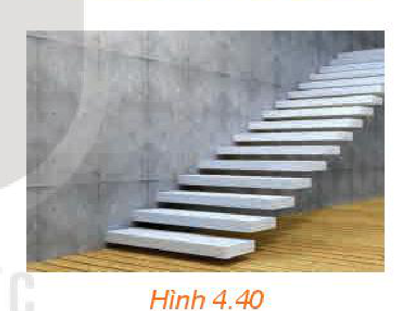
*Hình 4.40*

*Ruộng bậc thang có các mặt bậc thang gợi nên hình ảnh về các mặt phẳng song song.*

**Nhận xét:** Nếu hai mặt phẳng $(\alpha)$ và $(\beta)$ song song với nhau và đường thẳng $d$ nằm trong $(\alpha)$ thì $d$ và $(\beta)$ không có điểm chung, tức là $d$ song song với $(\beta)$. Như vậy, nếu một đường thẳng nằm trong một trong hai mặt phẳng song song thì đường thẳng đó song song với mặt phẳng còn lại.

> ❓ Trong hình ảnh mở đầu, các nhát cắt có tạo thành các mặt phẳng song song hay không?

*Tháp nghiêng Pisa ở Ý có các mặt sàn ở mỗi tầng không song song với mặt đất.*

<!-- pdf:90 -->

## 2. ĐIỀU KIỆN VÀ TÍNH CHẤT CỦA HAI MẶT PHẲNG SONG SONG

**HĐ2:** Cho mặt phẳng $(\alpha)$ chứa hai đường thẳng cắt nhau $a, b$ và $a, b$ cùng song song với mặt phẳng $(\beta)$ (H.4.41).

Nếu $(\alpha)$ và $(\beta)$ cắt nhau theo giao tuyến $c$ thì hai đường thẳng $a$ và $c$ có song song với nhau hay không, hai đường thẳng $b$ và $c$ có song song với nhau hay không?

Hãy rút ra kết luận sau khi trả lời các câu hỏi trên.

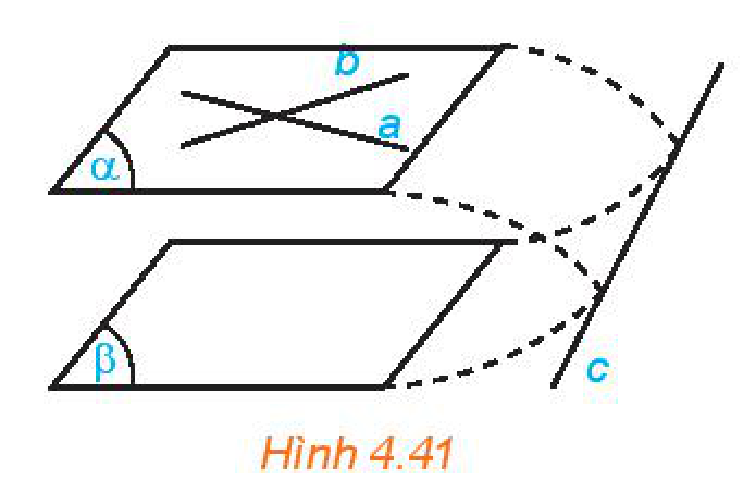
*Hình 4.41*

<!-- term: Điều kiện để hai mặt phẳng song song -->
> Nếu mặt phẳng $(\alpha)$ chứa hai đường thẳng cắt nhau và hai đường thẳng này song song với mặt phẳng $(\beta)$ thì $(\alpha)$ và $(\beta)$ song song với nhau.

Hãy nhắc lại các tính chất của đường thẳng song song với mặt phẳng đã được học ở Bài 12.

> ❓ Nếu không có điều kiện “hai đường thẳng cắt nhau” thì khẳng định trên còn đúng không?

**Ví dụ 1:** Cho hai hình bình hành $ABCD$ và $ABEF$ không cùng nằm trong một mặt phẳng. Chứng minh rằng mặt phẳng $(BCE)$ song song với mặt phẳng $(ADF)$ (H.4.42).

**Giải:**

Vì tứ giác $ABCD$ là hình bình hành nên $BC \parallel AD$, suy ra $BC \parallel (ADF)$.

Vì tứ giác $ABEF$ là hình bình hành nên $BE \parallel AF$, suy ra $BE \parallel (ADF)$.

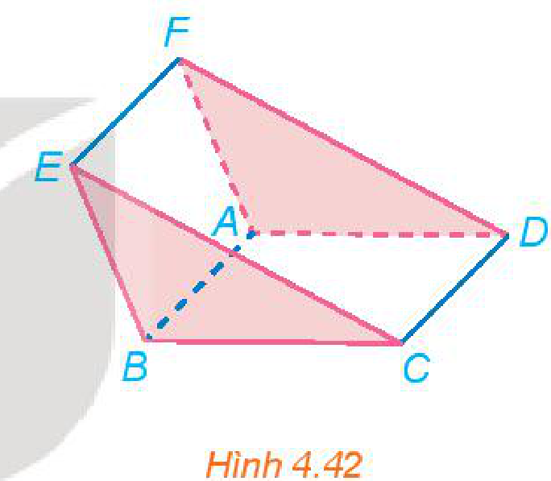
*Hình 4.42*

Mặt phẳng $(BCE)$ chứa hai đường thẳng cắt nhau $BC$ và $BE$ cùng song song với mặt phẳng $(ADF)$ nên mặt phẳng $(BCE)$ song song với mặt phẳng $(ADF)$.

**Luyện tập 1:** Trong không gian, cho bốn điểm $A, B, C, D$ không đồng phẳng. Qua điểm $A$ vẽ hai đường thẳng $m, n$ lần lượt song song với hai đường thẳng $BC, BD$. Chứng minh rằng $\text{mp}(m, n)$ song song với mặt phẳng $(BCD)$.

**Vận dụng 1:** Một chiếc bàn có phần chân là hai khung sắt hình chữ nhật có thể xoay quanh một trục như trong Hình 4.43. Khi mặt bàn được đặt lên phần chân bàn thì mặt bàn luôn song song với mặt đất. Hãy giải thích tại sao.

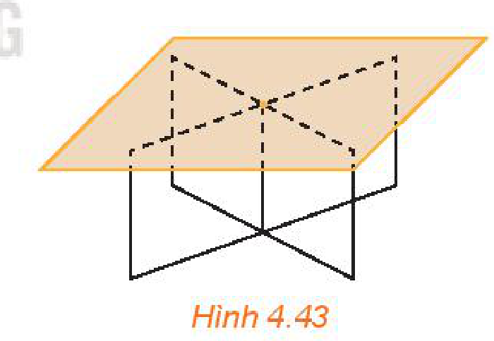
*Hình 4.43*

**HĐ3:** Đặt một tấm bìa cứng lên một góc của mặt bàn nằm ngang (H.4.44) sao cho mặt bìa song song với mặt đất. Khi đó mặt bìa có trùng với mặt bàn hay không?

<!-- term: Tính chất của hai mặt phẳng song song -->
> Qua một điểm nằm ngoài một mặt phẳng cho trước có một và chỉ một mặt phẳng song song với mặt phẳng đã cho.

> ❓ Nếu hai mặt phẳng phân biệt cùng song song với mặt phẳng thứ ba thì hai mặt phẳng đó có song song với nhau hay không? Vì sao?

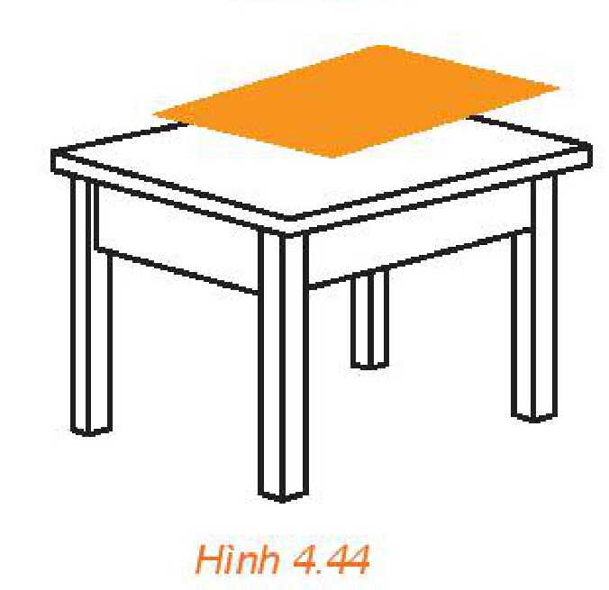
*Hình 4.44*

<!-- pdf:91 -->

**Ví dụ 2:** Cho hình chóp $S.ABCD$. Gọi $M, N, P, Q$ lần lượt là trung điểm của các cạnh $SA, SB, SC, SD$ (H.4.45). Chứng minh rằng hai mặt phẳng $(MNP)$ và $(NPQ)$ cùng song song với mặt phẳng $(ABCD)$, từ đó suy ra bốn điểm $M, N, P, Q$ đồng phẳng.

**Giải:**

Vì $M, N$ là trung điểm của $SA, SB$ nên $MN$ là đường trung bình của tam giác $SAB$. Do đó, $MN \parallel AB$ và suy ra $MN$ song song với mặt phẳng $(ABCD)$. Tương tự, $NP$ cũng song song với mặt phẳng $(ABCD)$. Vậy mặt phẳng $(MNP)$ song song với mặt phẳng $(ABCD)$. Lập luận tương tự ta có mặt phẳng $(NPQ)$ cũng song song với mặt phẳng $(ABCD)$.

Hai mặt phẳng $(MNP)$ và $(NPQ)$ cùng đi qua điểm $N$ và cùng song song với mặt phẳng $(ABCD)$ nên hai mặt phẳng đó trùng nhau, tức là bốn điểm $M, N, P, Q$ đồng phẳng.

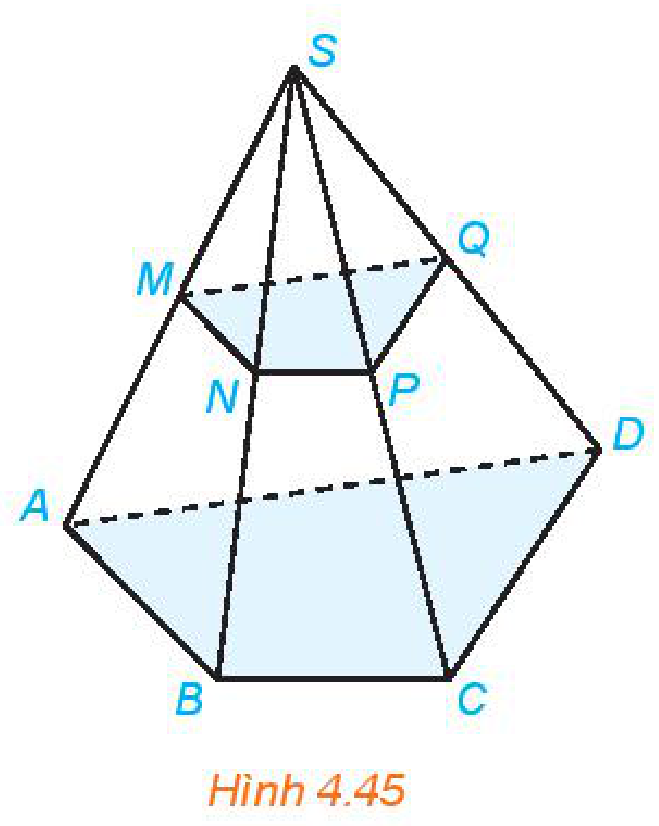
*Hình 4.45*

**Luyện tập 2:** Cho hình chóp $S.ABCD$. Gọi $M, N, P, Q$ lần lượt là các điểm thuộc các cạnh $SA, SB, SC, SD$ sao cho $\frac{MA}{MS} = \frac{NB}{NS} = \frac{PC}{PS} = \frac{QD}{QS} = \frac{1}{2}$. Chứng minh rằng bốn điểm $M, N, P, Q$ đồng phẳng.

**HĐ4:** Cho hai mặt phẳng song song $(P)$ và $(Q)$. Giả sử mặt phẳng $(R)$ cắt mặt phẳng $(P)$ theo giao tuyến $a$ (H.4.46).

a) Chứng minh rằng mặt phẳng $(R)$ cắt mặt phẳng $(Q)$.

b) Gọi $b$ là giao tuyến của hai mặt phẳng $(R)$ và $(Q)$. Hai đường thẳng $a$ và $b$ có thể chéo nhau hay không, có thể cắt nhau hay không?

<!-- term: Tính chất của hai mặt phẳng song song -->
> Cho hai mặt phẳng song song. Nếu một mặt phẳng cắt mặt phẳng này thì cũng cắt mặt phẳng kia và hai giao tuyến song song với nhau.

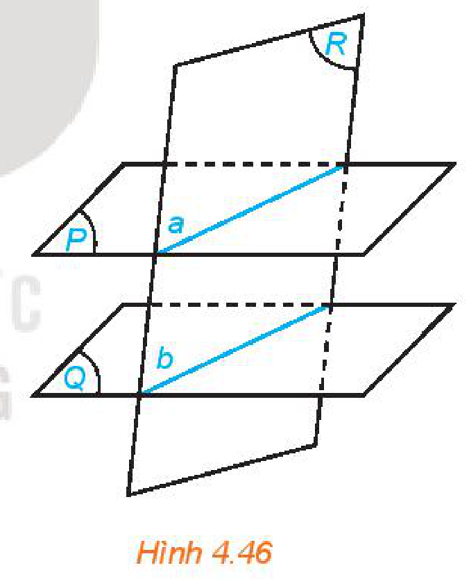
*Hình 4.46*

**Ví dụ 3:** Trong Ví dụ 2, gọi $E, F$ lần lượt là các điểm thuộc các cạnh $AB, CD$ (H.4.47). Xác định giao tuyến của mặt phẳng $(MEF)$ và mặt phẳng $(MNPQ)$.

**Giải:**

Trong Ví dụ 2, ta đã chứng minh được hai mặt phẳng $(MNPQ)$ và $(ABCD)$ song song với nhau. Vì vậy hai giao tuyến của mặt phẳng $(MEF)$ với hai mặt phẳng $(MNPQ)$ và $(ABCD)$ song song với nhau. Trong mặt phẳng $(MEF)$, qua $M$ vẽ đường thẳng song song với $EF$ cắt $PQ$ tại $G$ thì đường thẳng $MG$ là giao tuyến của hai mặt phẳng $(MEF)$ và $(MNPQ)$.

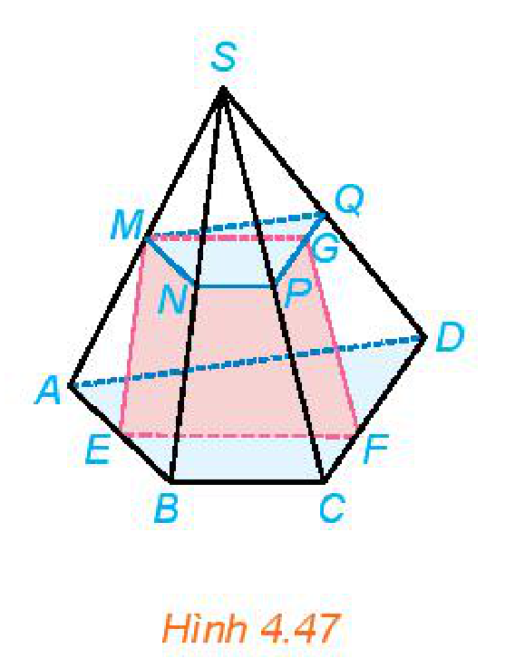
*Hình 4.47*

<!-- pdf:92 -->

**Luyện tập 3:** Trong Ví dụ 3, hãy xác định giao tuyến của mặt phẳng $(EMQ)$ và mặt phẳng $(ABCD)$.

## 3. ĐỊNH LÍ THALÈS TRONG KHÔNG GIAN

**HĐ5:** Cho ba mặt phẳng $(P), (Q)$ và $(R)$ đôi một song song. Hai đường thẳng phân biệt $d$ và $d'$ cắt ba mặt phẳng lần lượt tại $A, B, C$ và $A', B', C'$ ($C$ khác $C'$). Gọi $D$ là giao điểm của $AC'$ và $(Q)$ (H.4.48).

a) Các cặp đường thẳng $BD$ và $CC'$, $B'D$ và $AA'$ có song song với nhau không?

b) Các tỉ số $\frac{AB}{BC}, \frac{AD}{DC'}$ và $\frac{A'B'}{B'C'}$ có bằng nhau không?
<!-- ocr-ok: OCR đọc lệch công thức phân số tỉ số -->

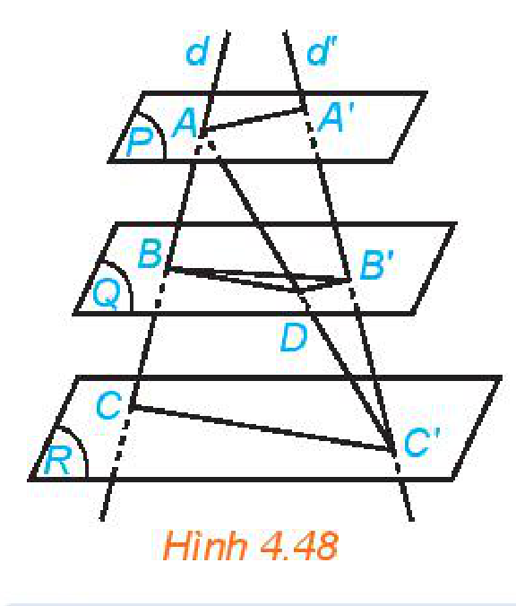
*Hình 4.48*

Kết quả sau còn được biết đến như **định lí Thalès trong không gian**.

Nhắc lại định lí Thalès trong hình học phẳng.

<!-- term: Định lí Thalès trong không gian -->
> Ba mặt phẳng đôi một song song chắn trên hai **cát tuyến** phân biệt bất kì những đoạn thẳng tương ứng tỉ lệ.

Trong Hình 4.48 ta có $\frac{AB}{A'B'} = \frac{BC}{B'C'} = \frac{AC}{A'C'}$.

**Ví dụ 4:** Cho hình tứ diện $SABC$. Trên cạnh $SA$ lấy các điểm $A_1, A_2$ sao cho $A_2 A_1 = 2 A_1 A$. Gọi $(P)$ và $(Q)$ là hai mặt phẳng song song với mặt phẳng $(ABC)$ và lần lượt đi qua $A_1, A_2$. Mặt phẳng $(P)$ cắt các cạnh $SB, SC$ lần lượt tại $B_1, C_1$. Mặt phẳng $(Q)$ cắt các cạnh $SB, SC$ lần lượt tại $B_2, C_2$ (H.4.49). Chứng minh $B_2 B_1 = 2 B_1 B$ và $C_2 C_1 = 2 C_1 C$.

**Giải:**

Áp dụng định lí Thalès cho ba mặt phẳng đôi một song song $(P), (Q), (ABC)$ và hai cát tuyến $SA, SB$, ta có $\frac{A_2 A_1}{A_1 A} = \frac{B_2 B_1}{B_1 B}$. Vì $A_2 A_1 = 2 A_1 A$ nên $B_2 B_1 = 2 B_1 B$.

Tương tự với hai cát tuyến $SA, SC$ suy ra $C_2 C_1 = 2 C_1 C$.

**Luyện tập 4:** Trong HĐ5, cho $AB = 2\text{ cm}, BC = 4\text{ cm}$ và $A'B' = 3\text{ cm}$. Tính độ dài của đoạn thẳng $B'C'$.

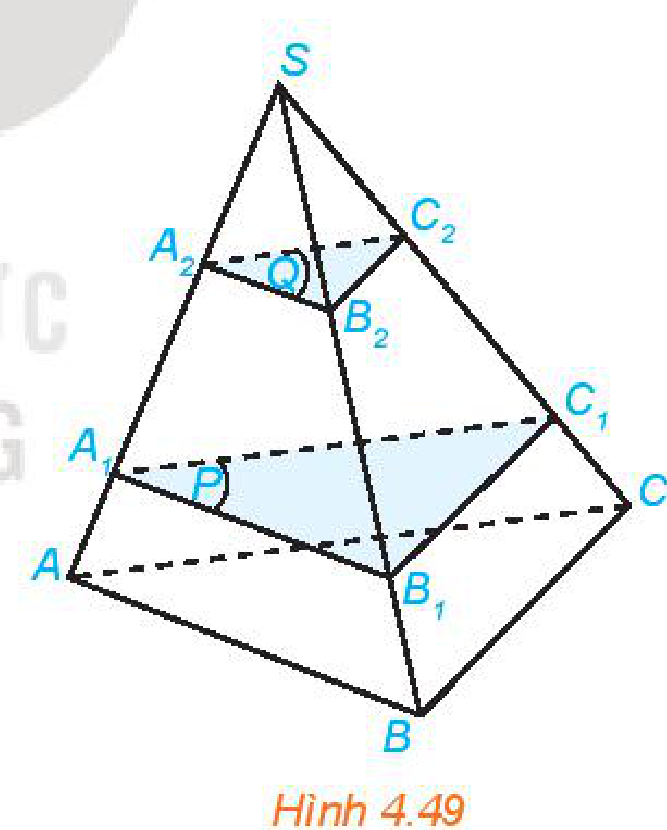
*Hình 4.49*

## 4. HÌNH LĂNG TRỤ VÀ HÌNH HỘP

**HĐ6:** Các hình ảnh dưới đây có đặc điểm chung nào với hình lăng trụ đứng tam giác mà em đã học ở lớp 7?

<!-- pdf:93 -->

> Cho hai mặt phẳng song song $(\alpha)$ và $(\alpha')$. Trên $(\alpha)$ cho đa giác lồi $A_1 A_2 \dots A_n$. Qua các đỉnh $A_1, A_2, \dots, A_n$ vẽ các đường thẳng đôi một song song và cắt mặt phẳng $(\alpha')$ tại $A'_1, A'_2, \dots, A'_n$. Hình gồm hai đa giác $A_1 A_2 \dots A_n, A'_1 A'_2 \dots A'_n$ và các tứ giác $A_1 A'_1 A'_2 A_2, A_2 A'_2 A'_3 A_3, \dots, A_n A'_n A'_1 A_1$ được gọi là **hình lăng trụ** và kí hiệu là $A_1 A_2 \dots A_n . A'_1 A'_2 \dots A'_n$ (H.4.50).
> - Các điểm $A_1, A_2, \dots, A_n$ và $A'_1, A'_2, \dots, A'_n$ được gọi là các **đỉnh**, các đoạn thẳng $A_1 A'_1, A_2 A'_2, \dots, A_n A'_n$ được gọi là các **cạnh bên**, các đoạn thẳng $A_1 A_2, A_2 A_3, \dots, A_n A_1$ và $A'_1 A'_2, A'_2 A'_3, \dots, A'_n A'_1$ được gọi là các **cạnh đáy** của hình lăng trụ.
> - Hai đa giác $A_1 A_2 \dots A_n$ và $A'_1 A'_2 \dots A'_n$ được gọi là hai **mặt đáy** của hình lăng trụ.
> - Các tứ giác $A_1 A'_1 A'_2 A_2, A_2 A'_2 A'_3 A_3, \dots, A_n A'_n A'_1 A_1$ được gọi là các **mặt bên** của hình lăng trụ.

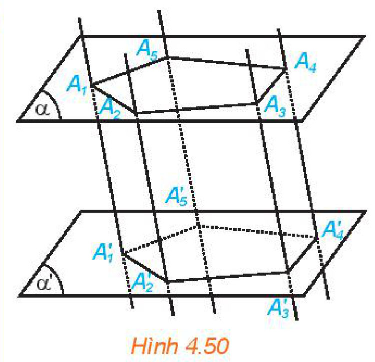
*Hình 4.50*

Hình lăng trụ có đáy là tam giác được gọi là **hình lăng trụ tam giác**, hình lăng trụ có đáy là tứ giác được gọi là **hình lăng trụ tứ giác**.

> ❓ Hãy giải thích tại sao các mặt bên của hình lăng trụ là hình bình hành, từ đó suy ra các cạnh bên đôi một song song và có độ dài bằng nhau.

**Chú ý:** Tên của hình lăng trụ được gọi dựa theo tên của đa giác đáy.

**Ví dụ 5:** Cho hình lăng trụ tam giác $ABC.A'B'C'$. Một mặt phẳng song song với mặt đáy của hình lăng trụ cắt các cạnh bên của hình lăng trụ lần lượt tại $A'', B'', C''$ (H.4.51). Chứng minh rằng $ABC.A''B''C''$ là hình lăng trụ.

**Giải:**

Vì các cạnh bên của hình lăng trụ $ABC.A'B'C'$ đôi một song song nên $AA'', BB'', CC''$ đôi một song song. Mặt phẳng $(ABC)$ song song với mặt phẳng $(A''B''C'')$ nên $ABC.A''B''C''$ là hình lăng trụ.

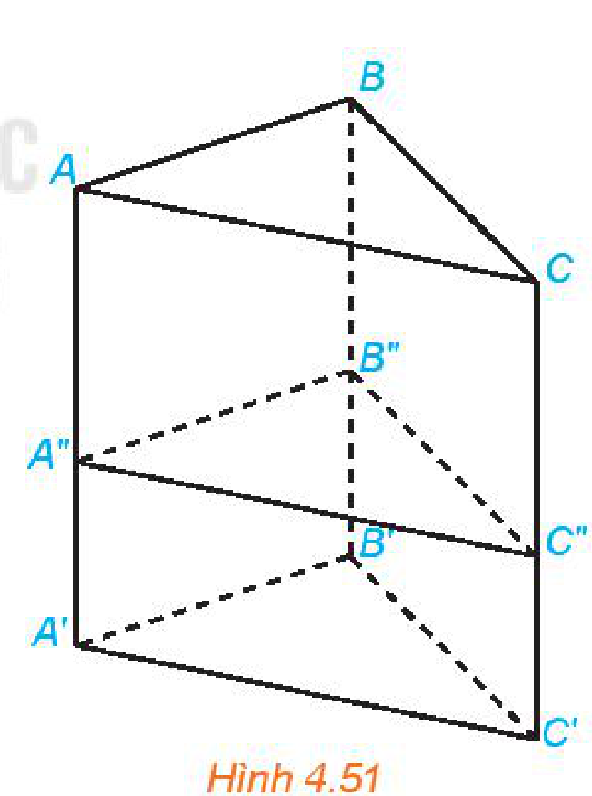
*Hình 4.51*

**Luyện tập 5:** Cho hình lăng trụ tam giác $ABC.A'B'C'$. Gọi $M$ và $M'$ lần lượt là trung điểm của $BC$ và $B'C'$. Chứng minh rằng $AMC.A'M'C'$ là hình lăng trụ.

**HĐ7:** Hình ảnh nào trong HĐ6 gợi nên hình ảnh về hình lăng trụ có đáy là hình bình hành?

<!-- pdf:94 -->

> Hình lăng trụ tứ giác $ABCD.A'B'C'D'$ có hai đáy là hình bình hành được gọi là **hình hộp**.
> - Các cặp điểm $A$ và $C'$, $B$ và $D'$, $C$ và $A'$, $D$ và $B'$ được gọi là các **đỉnh đối diện** của hình hộp.
> - Các đoạn thẳng $AC', BD', CA'$ và $DB'$ được gọi là các **đường chéo** của hình hộp.
> - Các cặp tứ giác $ABCD$ và $A'B'C'D'$, $ADD'A'$ và $BCC'B'$, $ABB'A'$ và $CDD'C'$ được gọi là hai **mặt đối diện** của hình hộp.

Hai đỉnh đối diện của hình hộp là hai đỉnh không cùng thuộc bất kì mặt nào của hình hộp. Hai mặt đối diện của hình hộp là hai mặt không có điểm chung.

**Ví dụ 6:** Cho hình hộp $ABCD.A'B'C'D'$ (H.4.52). Chứng minh rằng các đường chéo $AC', BD', CA'$ và $DB'$ của hình hộp cùng đi qua trung điểm của mỗi đường.

**Giải:**

Đáy $ABCD$ của hình hộp là hình bình hành nên $AD \parallel BC$ và $AD = BC$. Mặt bên $BCC'B'$ của hình hộp là hình bình hành nên $BC \parallel B'C'$ và $BC = B'C'$. Vậy $AD \parallel B'C'$ và $AD = B'C'$, suy ra $ADC'B'$ là hình bình hành. Từ đó $AC'$ và $DB'$ cắt nhau tại trung điểm của mỗi đường. Tương tự $AC'$ và $BD'$, $AC'$ và $CA'$ cũng cắt nhau tại trung điểm của mỗi đường. Vậy bốn đường chéo của hình hộp cùng đi qua trung điểm của mỗi đường.

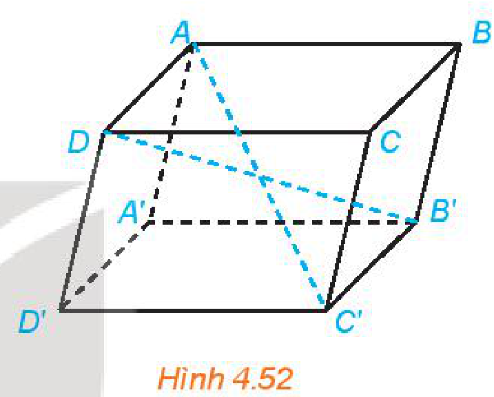
*Hình 4.52*

**Luyện tập 6:** Cho hình hộp $ABCD.A'B'C'D'$. Chứng minh rằng hai mặt phẳng $(ADD'A')$ và $(BCC'B')$ song song với nhau.

**Nhận xét:** Từ Ví dụ 6 và Luyện tập 6, ta có:

<!-- term: Tính chất của hình hộp -->
- Các đường chéo của hình hộp cùng đi qua trung điểm của mỗi đường;
- Các mặt đối diện của hình hộp song song với nhau và có thể coi là hai đáy của hình hộp.

**Vận dụng 2:** Để xác định mực nước trong một chiếc bể có dạng hình hộp, bác Hà đặt một thanh gỗ đủ dài vào trong bể sao cho một đầu của thanh gỗ dựa vào mép của nắp bể, đầu còn lại nằm trên đáy bể (H.4.53). Sau đó bác Hà rút thanh gỗ ra ngoài và tính tỉ lệ giữa độ dài của phần thanh gỗ bị ngâm trong nước và độ dài của cả thanh gỗ. Tỉ lệ này chính bằng tỉ lệ giữa mực nước và chiều cao của bể. Hãy giải thích vì sao.

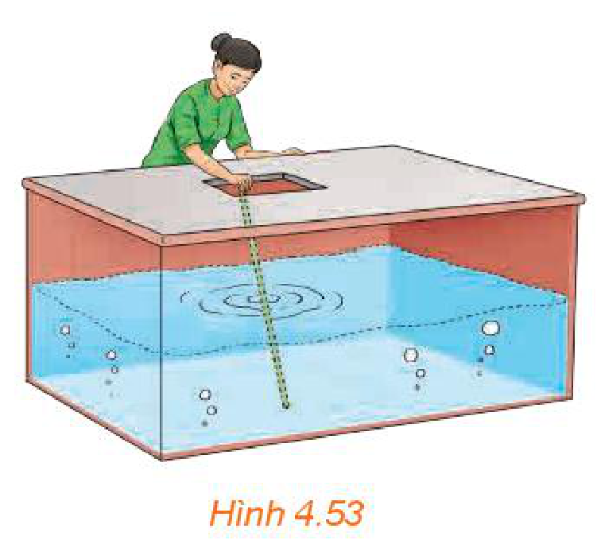
*Hình 4.53*

## ✏️ BÀI TẬP

**4.21.** Trong không gian cho ba mặt phẳng phân biệt $(P), (Q), (R)$. Những mệnh đề nào sau đây là đúng?

a) Nếu $(P)$ chứa một đường thẳng song song với $(Q)$ thì $(P)$ song song với $(Q)$.

<!-- pdf:95 -->

b) Nếu $(P)$ chứa hai đường thẳng song song với $(Q)$ thì $(P)$ song song với $(Q)$.

c) Nếu $(P)$ và $(Q)$ song song với $(R)$ thì $(P)$ song song với $(Q)$.
<!-- ocr-ok: OCR đọc lệch kí hiệu (P), (Q), (R) -->

d) Nếu $(P)$ và $(Q)$ cắt $(R)$ thì $(P)$ và $(Q)$ song song với nhau.
<!-- ocr-ok: OCR đọc lệch kí hiệu (P), (Q), (R) -->

**4.22.** Cho hình lăng trụ tam giác $ABC.A'B'C'$. Gọi $M, N, P$ lần lượt là trung điểm của các cạnh $AA', BB', CC'$. Chứng minh rằng mặt phẳng $(MNP)$ song song với mặt phẳng $(ABC)$.

**4.23.** Cho hình thang $ABCD$ có hai đáy $AB$ và $CD$. Qua các điểm $A, D$ lần lượt vẽ các đường thẳng $m, n$ song song với nhau và không nằm trong mặt phẳng $(ABCD)$. Chứng minh rằng $\text{mp}(B, m)$ và $\text{mp}(C, n)$ song song với nhau.

**4.24.** Cho hình tứ diện $SABC$. Trên cạnh $SA$ lấy các điểm $A_1, A_2$ sao cho $AA_1 = A_1 A_2 = A_2 S$. Gọi $(P)$ và $(Q)$ là hai mặt phẳng song song với mặt phẳng $(ABC)$ và lần lượt đi qua $A_1, A_2$. Mặt phẳng $(P)$ cắt các cạnh $SB, SC$ lần lượt tại $B_1, C_1$. Mặt phẳng $(Q)$ cắt các cạnh $SB, SC$ lần lượt tại $B_2, C_2$. Chứng minh $BB_1 = B_1 B_2 = B_2 S$ và $CC_1 = C_1 C_2 = C_2 S$.

**4.25.** Cho hình lăng trụ tứ giác $ABCD.A'B'C'D'$. Một mặt phẳng song song với mặt phẳng $(A'B'C'D')$ cắt các cạnh bên của hình lăng trụ lần lượt tại $A'', B'', C'', D''$. Hỏi hình tạo bởi các điểm $A, B, C, D, A'', B'', C'', D''$ là hình gì?

**4.26.** Cho hình lăng trụ tam giác $ABC.A'B'C'$. Gọi $G$ và $G'$ lần lượt là trọng tâm của hai tam giác $ABC$ và $A'B'C'$.

a) Chứng minh rằng tứ giác $AGG'A'$ là hình bình hành.

b) Chứng minh rằng $AGC.A'G'C'$ là hình lăng trụ.

**4.27.** Cho hình hộp $ABCD.A'B'C'D'$. Một mặt phẳng song song với mặt bên $(ABB'A')$ của hình hộp và cắt các cạnh $AD, BC, A'D', B'C'$ lần lượt tại $M, N, M', N'$ (H.4.54).

Chứng minh rằng $ABNM.A'B'N'M'$ là hình hộp.

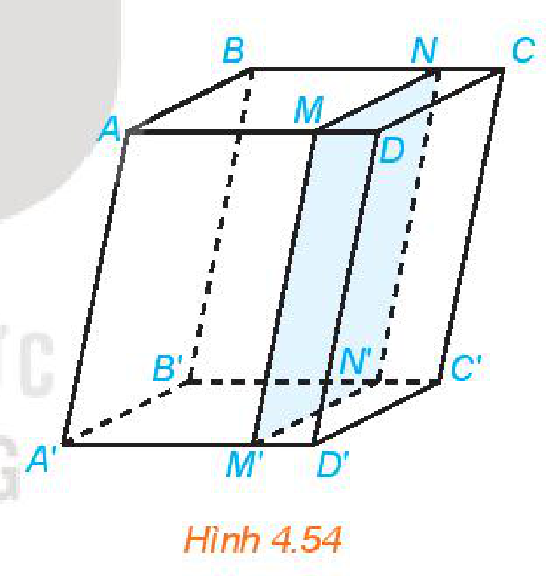
*Hình 4.54*

**4.28.** Cầu thang xương cá là dạng cầu thang có hình dáng tương tự như những đốt xương cá, thường có những bậc cầu thang với khoảng mở lớn, tạo được sự nhẹ nhàng và thoáng đãng cho không gian sống. Trong Hình 4.55, phần mép của mỗi bậc thang nằm trên tường song song với nhau. Hãy giải thích tại sao.

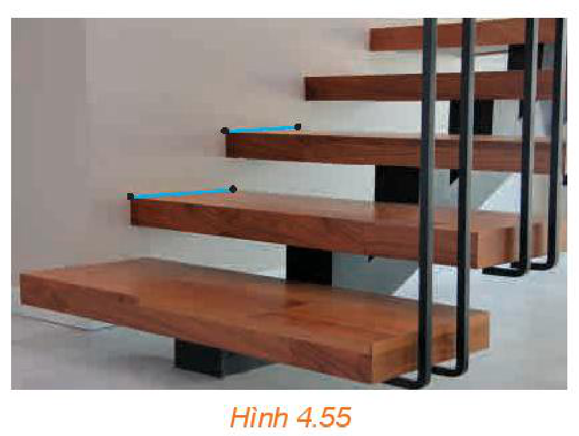
*Hình 4.55*

## 📷 Danh sách hình trong bài

| Mã hình | Trang PDF | Vị trí trong bài | Chú thích gốc |
| --- | --- | --- | --- |
| H11-toan-b13-01 | 89 | Mục 1, HĐ1 | Hình 4.40 |
| H11-toan-b13-02 | 90 | Mục 2, HĐ2 | Hình 4.41 |
| H11-toan-b13-03 | 90 | Mục 2, Ví dụ 1 | Hình 4.42 |
| H11-toan-b13-04 | 90 | Mục 2, Vận dụng 1 | Hình 4.43 |
| H11-toan-b13-05 | 90 | Mục 2, HĐ3 | Hình 4.44 |
| H11-toan-b13-06 | 91 | Mục 2, Ví dụ 2 | Hình 4.45 |
| H11-toan-b13-07 | 91 | Mục 2, HĐ4 | Hình 4.46 |
| H11-toan-b13-08 | 91 | Mục 2, Ví dụ 3 | Hình 4.47 |
| H11-toan-b13-09 | 92 | Mục 3, HĐ5 | Hình 4.48 |
| H11-toan-b13-10 | 92 | Mục 3, Ví dụ 4 | Hình 4.49 |
| H11-toan-b13-11 | 93 | Mục 4 | Hình 4.50 |
| H11-toan-b13-12 | 93 | Mục 4, Ví dụ 5 | Hình 4.51 |
| H11-toan-b13-13 | 94 | Mục 4, Ví dụ 6 | Hình 4.52 |
| H11-toan-b13-14 | 94 | Mục 4, Vận dụng 2 | Hình 4.53 |
| H11-toan-b13-15 | 95 | Bài tập 4.27 | Hình 4.54 |
| H11-toan-b13-16 | 95 | Bài tập 4.28 | Hình 4.55 |
